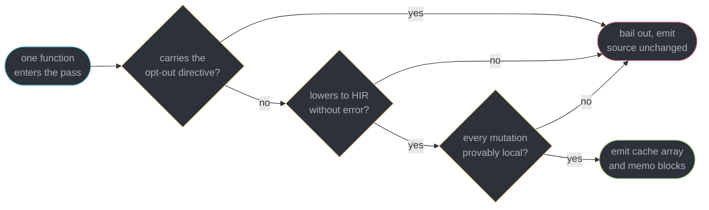
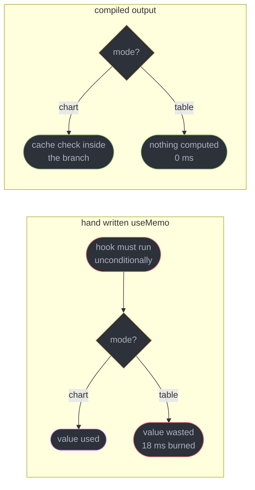
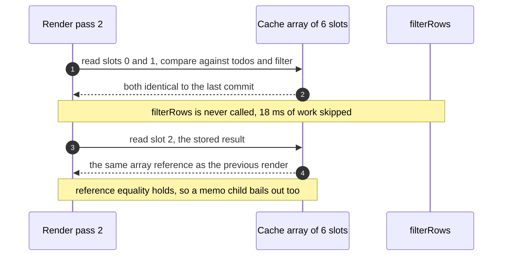
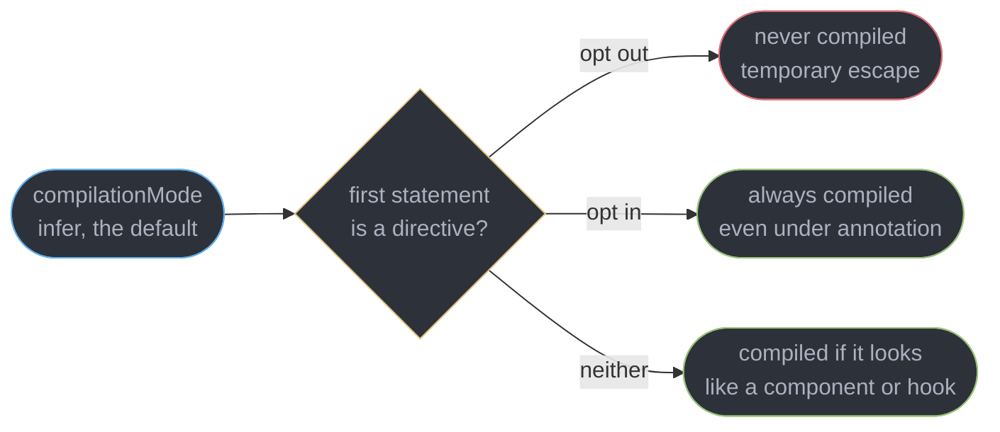
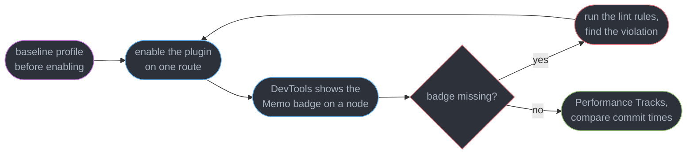

# The React Compiler

---

## 1. Concept Overview

React's render model has always had one unpriced cost: a component body re-runs on every render of its parent, and everything it allocates — an object literal, an arrow function, a filtered array, a JSX element — is a new reference. Downstream, `memo` compares by reference and finds a mismatch, an effect's dependency array finds a mismatch, and the work spreads. The fix was manual: wrap the value in `useMemo`, wrap the handler in `useCallback`, wrap the child in `React.memo`. Three APIs, hand-applied, at hundreds of sites per application, each one an unverified guess.

**The React Compiler is a build-time transform that applies that memoization for you.** It reached 1.0 on **2025-10-07** as the Babel plugin `babel-plugin-react-compiler`, and experimental Rust versions run it inside Turbopack (Next.js 16.3) and Vite (`@vitejs/plugin-react` 6.1 with `oxc-transform-react`) with no Babel pass. It targets React 17, 18 and 19, and it works for React Native. It reads your components, proves which values can be reused because nothing mutated them, and emits a version of the same function that caches those values in a per-instance array. Meta reports up to **12% faster loads** and roughly **2.5x** on some interactions across its own surfaces after enabling it.

The consequence for how you write React is larger than the speedup. `useMemo`, `useCallback` and `React.memo` stop being the primary optimization technique and become **escape hatches** — for a referential identity a third-party library depends on, for a value whose cost the compiler cannot see, for the rare shape the compiler declines. New code written against a compiled build reaches for none of them. A curriculum that still teaches manual memoization as the default is teaching 2023.

What makes this possible is not cleverness about your code but a set of rules your code has already agreed to. **The Rules of React** — purity during render, no mutation of props or state, no `setState` during render, no ref reads during render — are exactly the invariants that let a compiler prove a value is safe to cache. Where it cannot prove them it **bails out**, leaving your function untouched rather than miscompiling it. Profiling and the DevTools workflow you use to confirm any of this worked belong to [React Performance and Profiling](../react_performance_and_profiling/react_performance_and_profiling.md), which deliberately precedes this module.

---

## 2. Intuition

> **One-line analogy**: it is a spreadsheet recalculation engine dropped into your component. Every value gets a formula and a list of the cells it reads, and a cell only recomputes when one of those cells changed.

**Mental model**: the compiler rewrites each component into "read the cache, compare the inputs, recompute only the mismatches". Where you would have written one `useMemo` around the one expensive thing you noticed, it writes a cache slot for **every** value whose inputs it can name — the filtered array, the callback, the style object, and the JSX elements themselves.

**Why it matters**: manual memoization fails in two directions at once and neither is visible. Under-memoize and a 40 ms child re-renders on every keystroke. Over-memoize and you pay a dependency-array comparison plus a closure allocation to protect a 0.2 ms computation, at 300 sites. Nobody profiles 300 sites, so both errors are permanent.

**Key insight**: the compiler's real advantage is not that it is tireless. It is that **it can memoize a value on only the branch where that value is live**, and the Rules of Hooks forbid you from ever writing that by hand. A `useMemo` must run unconditionally at the top of the function; a compiled cache check sits inside the `if`. That is a category of optimization that was not available to a human at any level of diligence.

---

## 3. Core Principles

- **Compilation is per function, not per file.** One component that violates a rule bails out alone; its siblings in the same file are still compiled.
- **A bail-out is a success, not a failure.** Declining to compile leaves the original function intact and correct. Silent miscompilation is the outcome the design refuses.
- **The Rules of React are the proof obligations.** Purity, no prop or state mutation, no `setState` in render, no ref reads in render — each one is an assumption the analysis depends on.
- **Memoization is per value, not per component.** A single component can emit 11 cache slots covering 4 independent values, each invalidating on its own inputs.
- **Cached means reference-stable.** The win is not just skipped work — it is that downstream `memo` boundaries, effect dependency arrays and context consumers now see unchanged references.
- **The compiler cannot see cost.** It memoizes a 0.1 ms string concat with the same machinery as an 80 ms filter, because static analysis knows dependencies, not milliseconds.
- **It never changes behaviour on correct code.** Output is semantically identical for a component that follows the rules — which is precisely why breakage means a rule was already broken.
- **Existing manual memoization stays.** The compiler composes with `useMemo` rather than removing it; deleting one is a behavioural change you must test.

---

## 4. Types / Architectures / Strategies

### 4.1 Compilation modes

| `compilationMode` | What it compiles | Use when |
|-------------------|------------------|----------|
| `infer` (default) | anything that looks like a component or hook — capitalized function returning JSX, or a `use`-prefixed function calling hooks | the normal setting for an application |
| `annotation` | only functions carrying the `"use memo"` directive | incremental adoption on a codebase with known rule violations |
| `all` | every function in the file | never in application code; it compiles plain helpers for no benefit |
| `syntax` | nothing — parse and validate only | CI gate that fails on a rule violation without shipping compiled output |

`infer` is the mode virtually everyone runs. `annotation` exists so a 4,000-component codebase can migrate a directory at a time instead of turning on 4,000 unreviewed rewrites at once.

### 4.2 The three ways a function ends up uncompiled

| Path | Trigger | Recoverable |
|------|---------|-------------|
| Explicit opt-out | `"use no memo"` as the first statement | yes — delete the directive once the bug is understood |
| Static rule violation | mutation of a prop, `setState` in render, a `ref.current` read in render | yes — fix the violation, the lint rules name the line |
| Unsupported shape | syntax the HIR lowering has no representation for | rarely — usually rewrite the function |

All three produce the same artifact: the original source, untransformed. There is no partial compilation of a single function.

### 4.3 What still needs a hand-written escape hatch

| Situation | Why the compiler cannot cover it |
|-----------|----------------------------------|
| A ref or instance a third-party library keys a cache on | the compiler guarantees semantic equivalence, not any specific identity across renders |
| A value whose cost is in a dependency you call | `useMemo` around a 300 ms WASM call is a decision about cost, and cost is invisible to static analysis |
| A component that legitimately must not compile | interop with a library that mutates the props it is handed |
| `React.memo` on a props boundary | the compiler memoizes *inside* a component; the props comparison at its edge is still a separate decision |

### 4.4 What actually gets a cache slot

| Kind of value | Manual equivalent | What the compiler adds |
|---------------|-------------------|------------------------|
| A derived computation — a filter, a sort, an aggregation | `useMemo` | it finds every one of them, not the three you noticed |
| A callback passed as a prop | `useCallback` | a callback capturing nothing render-dependent is hoisted out of the component entirely, so it costs zero slots |
| A JSX element | nothing you would write | the element object itself is cached, so an unchanged child subtree is reused rather than re-created |
| An object or array literal in a prop | `useMemo` around a literal | the same, without the two-line ceremony that made people skip it |
| A value with no reactive inputs | a module constant, by hand | the sentinel form — computed once for the lifetime of the instance, compared never |

The third row is the quiet one. Caching the JSX element is what makes a `memo` child's shallow prop comparison succeed, and it is why enabling the compiler often improves components that contain no expensive computation at all.

---

## 5. Architecture Diagrams

### The pipeline from source to cache array


Every stage after the HIR exists to answer one question: for each value, which other values can change it. Only once that is known can a cache slot be emitted safely.

### Why a function does or does not get compiled



Three gates, one exit. Nothing here produces a half-compiled function, which is why a bail-out is never a correctness risk — only a lost optimization.

### The optimization you cannot hand-write



The Rules of Hooks force the left shape on you. The compiler is not bound by them because it emits a plain `if`, not a hook call.

### What a cache hit looks like at runtime



The comparison is `!==` on each dependency slot, the same check `useMemo` performs — the difference is only that nobody had to write it or keep its dependency list honest.

### How the directives interact with the mode



`use memo` and `use no memo` are string literal directives, and both must be the **first statement in the function body** — a line above the function or after a `const` is inert and silently ignored.

### The verification loop



The loop closes on a measurement, not on the plugin being installed. A component silently bailing out looks exactly like a component the compiler had nothing to do for.

---

## 6. How It Works — Detailed Mechanics

### 6.1 Installing it

The stable 1.0 compiler is a Babel plugin, and Babel is where it runs even in a project whose bundler is otherwise Babel-free, unless you opt into the experimental Rust port covered in §6.8.

```js
// babel.config.js -- the plugin must be FIRST so it sees the original source,
// before any other transform has rewritten JSX or downleveled the syntax.
module.exports = {
  plugins: [
    ["babel-plugin-react-compiler", { target: "19" }],  // "17" | "18" | "19"
  ],
};
```

`target` selects the runtime contract. On React 19 the cache hook is built in. On 17 and 18 the emitted code imports it from the `react-compiler-runtime` polyfill package, which you install alongside — this is the whole mechanism by which a five-year-old React 17 application gets auto-memoization without a React upgrade.

### 6.2 What the output actually looks like

Given an ordinary component:

```tsx
function TodoList({ todos, filter }: { todos: Todo[]; filter: Status }) {
  const visible = todos.filter((t) => t.status === filter);   // 18 ms over 4,000 todos
  return <List rows={visible} onPick={(id) => select(id)} />;
}
```

the compiler emits, in readable form:

```js
import { c as _c } from "react/compiler-runtime";

function TodoList(t0) {
  const $ = _c(6);                       // 6 cache slots on this fiber, one array
  const { todos, filter } = t0;

  let t1;
  if ($[0] !== todos || $[1] !== filter) {
    t1 = todos.filter((t) => t.status === filter);
    $[0] = todos;
    $[1] = filter;
    $[2] = t1;                           // the memoized value
  } else {
    t1 = $[2];                           // cache hit: 18 ms skipped
  }
  const visible = t1;

  let t2;
  if ($[3] !== visible) {                // the JSX element itself is memoized
    t2 = <List rows={visible} onPick={_temp} />;
    $[3] = visible;
    $[4] = t2;
  } else {
    t2 = $[4];
  }
  return t2;
}
function _temp(id) { return select(id); }   // hoisted: it closes over nothing
```

Three things are worth recognising in a bundle. `_c(n)` is the imported alias of **`useMemoCache`**, a real hook that allocates an `n`-length array on the [fiber](../fiber_and_reconciliation/fiber_and_reconciliation.md) and returns the same array on every render — so cache lifetime is exactly component-instance lifetime, and unmounting frees it. Dependencies and results share one flat array, which is why 4 memoized values cost 6 slots rather than 4 closures. And the callback was **hoisted out of the component entirely**, because it captured nothing render-dependent, which is strictly better than the `useCallback` you would have written.

### 6.3 The sentinel

A value with no reactive inputs needs no comparison, only a "have I computed this yet" test. That is what the sentinel is for.

```js
const $ = _c(2);
let config;
if ($[0] === Symbol.for("react.memo_cache_sentinel")) {
  config = { locale: "en-GB", currency: "GBP" };   // constant, computed once ever
  $[0] = config;
} else {
  config = $[0];
}
```

Every slot in a fresh array is initialised to that symbol, so the first render always misses and every subsequent one hits. Seeing `react.memo_cache_sentinel` in a production stack trace or a bundle is how you confirm the compiler ran at all.

### 6.4 Mutability and aliasing analysis — the part that does the work

The analysis in the middle of the pipeline is deciding one thing: **for each value, over what range of instructions can it still be mutated, and which other names alias it.** A value can be cached only from the point its mutation range closes.

```tsx
function Report({ rows, sort }: Props) {
  const summary = { total: 0, byOwner: new Map<string, number>() };
  for (const r of rows) {                 // summary is MUTATED here
    summary.total += r.amount;
    summary.byOwner.set(r.owner, (summary.byOwner.get(r.owner) ?? 0) + r.amount);
  }
  const label = format(summary.total);    // mutation range of summary has closed
  return <Panel summary={summary} label={label} sort={sort} />;
}
```

A naive compiler would refuse to cache `summary` because a local object is written to. The mutability pass instead computes that every write happens inside the loop, that the loop reads only `rows`, and that no reference to `summary` escapes before the loop ends. So the whole construct-and-fill block becomes one reactive scope keyed on `rows` — mutation during construction is fine, because it is unobservable from outside.

Aliasing is why the pass has to be interprocedural in spirit. If `summary.byOwner` were handed to a helper that stored it somewhere, the compiler would have to assume it may be mutated later and give up on the scope. React Compiler 1.0 ships a rewritten aliasing model precisely to make more of these cases provable instead of conservatively bailing. This is also why **mutating a prop is the highest-value violation the lint rules catch**: it makes the mutation range of a value the compiler does not own extend forever.

Reactive scopes are then aligned to block scopes, merged where two values share dependencies, and pruned where a dependency turns out not to be reactive at all — a value derived only from a module constant needs the sentinel form, not a comparison.

### 6.5 Conditional memoization

This is the capability that has no manual equivalent.

```tsx
// You cannot write this by hand. The Rules of Hooks require useMemo to be called
// unconditionally, so the 18 ms projection runs even when the table is on screen.
function Chart({ points, mode }: { points: Point[]; mode: "chart" | "table" }) {
  const projected = useMemo(() => project(points), [points]);   // 18 ms, always
  return mode === "chart" ? <Canvas data={projected} /> : <Table rows={points} />;
}
```

Delete the `useMemo` and let the compiler have it, and the cache check lands inside the branch:

```js
function Chart(t0) {
  const $ = _c(5);
  const { points, mode } = t0;
  let t1;
  if (mode === "chart") {
    let t2;
    if ($[0] !== points) {          // the check only exists on this path
      t2 = project(points);         // and only this path can pay the 18 ms
      $[0] = points;
      $[1] = t2;
    } else {
      t2 = $[1];
    }
    t1 = <Canvas data={t2} />;
  } else {
    t1 = <Table rows={points} />;   // 0 ms: nothing projected, nothing compared
  }
  return t1;
}
```

The same property covers early returns, values used only inside a `try`, and values whose dependency set differs per branch. In a dashboard with 7 conditionally rendered widgets this is usually the largest single win, larger than the reference stability, because the work is not deferred — it is not performed.

### 6.6 The Rules of React it depends on, and the lint rules that find violations

Four invariants carry almost all of the weight:

1. **Render is pure.** Same props, state and context in, same JSX out, no observable side effect.
2. **Props and state are not mutated.** They belong to React, and their mutation ranges are not yours to extend.
3. **No `setState` during render.** A render that schedules another render has no fixed point to cache against.
4. **`ref.current` is not read or written during render.** A ref is deliberately outside the reactive graph, so a cached value derived from one is stale by construction.

`eslint-plugin-react-hooks` now ships the Rules of React rules alongside the classic two, including `react-hooks/set-state-in-render`, `react-hooks/set-state-in-effect`, `react-hooks/refs`, `react-hooks/purity` and `react-hooks/immutability`. Enable its recommended config and the violations surface in the editor rather than as a silent bail-out weeks later.

```tsx
// BROKEN: reads ref.current during render. The compiler bails out of this whole
// component, and the lint rule reports:
//   error  Ref values (the current property) may not be read during render
//          react-hooks/refs
function Ticker({ label }: { label: string }) {
  const seen = useRef(0);
  seen.current += 1;                                // write during render, too
  return <span>{label} seen {seen.current} times</span>;
}

// FIX: renderable state belongs in state. The ref keeps only what render never reads.
function Ticker({ label }: { label: string }) {
  const [seen, setSeen] = useState(0);
  useEffect(() => setSeen((n) => n + 1), [label]);
  return <span>{label} seen {seen} times</span>;
}
```

The point to internalise: the compiler did not break this component. The component was already relying on a render-phase mutation, and the compiler is the first tool that noticed. The hook model behind refs and state belongs to [Hooks, Rules and the Hook Model](../hooks_rules_and_the_hook_model/hooks_rules_and_the_hook_model.md), and effect timing to [Effects and Synchronization](../effects_and_synchronization/effects_and_synchronization.md).

### 6.7 The two directives

```tsx
// Opts a function IN. Under compilationMode: "annotation" this is the only way
// anything gets compiled. Must be the FIRST statement in the body.
function PriceGrid({ rows }: { rows: Row[] }) {
  "use memo";
  return <Grid rows={rows} />;
}

// Opts a function OUT. This is a debugging tool with a ticket number attached,
// not a permanent configuration setting.
function LegacyCanvas({ scene }: { scene: Scene }) {
  "use no memo";                       // TODO(PERF-4417): mutates scene.nodes in render
  return <canvas ref={draw(scene)} />;
}
```

Both are ordinary string-literal directives, in the same position `"use strict"` occupies. Put either one after a declaration, or above the function instead of inside it, and it is a no-op expression statement that nothing warns you about. `"use no memo"` is deliberately the ugliest name available, because a codebase accumulating them is a codebase with un-triaged rule violations, and the directive should read like a bandage.

### 6.8 Enabling it in a real toolchain

```ts
// next.config.ts -- Next.js 16 promoted reactCompiler out of experimental.
import type { NextConfig } from "next";
const config: NextConfig = { reactCompiler: true };
export default config;
```

```js
// vite.config.js -- @vitejs/plugin-react 6 has no babel option; the compiler
// runs through @rolldown/plugin-babel with the preset plugin-react exports.
import react, { reactCompilerPreset } from "@vitejs/plugin-react";
import babel from "@rolldown/plugin-babel";
export default {
  plugins: [react(), babel({ presets: [reactCompilerPreset()] })],
};
```

`@vitejs/plugin-react` 6.0 (2026-03-12) dropped its Babel dependency and the `babel` option. Since 6.1.0 (2026-08-20) `react({ compiler: true })` runs an experimental Rust port of the compiler, `oxc-transform-react`, with no Babel pass at all.

New Expo SDK 54 and later projects and the current Vite React templates ship with it enabled, so on a greenfield app the decision is usually already made for you.

**The cost is build time.** The stable plugin is Babel, and a project on SWC or Turbopack is otherwise paying no Babel cost at all. Next.js 16 limits the pass to files that actually contain components or hooks, which keeps the penalty bounded; a 1,900-component application measured a cold production build going from 94 s to 128 s, a 36% increase, and an incremental dev rebuild of a single file from 210 ms to 340 ms. That is a real number to put in front of a team, and it is paid by every engineer on every build in exchange for a runtime win paid to every user.

**The Rust port removes the Babel pass.** Next.js 16.3 (2026-08-03) runs an experimental Rust port of the compiler directly inside Turbopack, which skips generating and reparsing code for Babel:

```ts
// next.config.ts
import type { NextConfig } from "next";

const config: NextConfig = {
  reactCompiler: true,
  experimental: { turbopackRustReactCompiler: true },
};

export default config;
```

On v0, the Rust path cut the time from `next dev` to a ready page by 34% on a cold build and 46% on a warm one. Those figures assume no Babel at all; a project that still runs Babel for another transform sees a smaller gain. Next.js 16.4 (2026-10-06) added a fast check that skips files with nothing to optimize and stopped re-optimizing Client Components for the server build, and Turbopack allocation changes cut the compiler's memory use by 30% and compile time by 15%. The Vite equivalent is `react({ compiler: true })` with `oxc-transform-react` installed. Both are experimental flags; the Babel plugin is still the stable path.

### 6.9 Adoption: what to do with the memoization you already have

Leave it. A `useMemo` in an existing codebase composes with the compiler — the compiled output keeps the hook call and caches around it — so nothing is broken by inaction.

```tsx
// KEEP THIS. The compiler guarantees the same rendered output, not any particular
// object identity, and this map instance is the key of a WeakMap cache inside
// the charting library. Deleting the useMemo is a behavioural change, not cleanup.
const series = useMemo(() => buildSeries(rows), [rows]);
useChartLibrary(series);   // library caches on the identity of `series`
```

The rule of thumb that holds up: **new code relies on the compiler and adds no memoization; existing memoization is removed only when someone measures before and after.** A hand-written `useMemo` may be load-bearing for a reason no analysis can see — a referential identity a library keys on, a dependency array deliberately narrower than the true one, a value that must survive a `memo` boundary in a specific way. Bulk-deleting them across 300 sites as "cleanup" is the single most common way a compiler migration produces a regression.

---

## 7. Real-World Examples

**Meta's own rollout.** The compiler shipped on Instagram web and the Quest Store before 1.0, and the published figures — up to 12% faster loads and about 2.5x on some interactions — come from surfaces with hundreds of engineers who had already hand-optimized the hot paths. The interesting part is that the wins were largest where nobody had bothered to memoize, not where they had.

**The dashboard where the win was conditional, not incremental.** A financial console rendered 9 widgets, 6 of them behind tabs. Every render projected all 9 datasets because the projections sat in unconditional `useMemo` calls. After compiling, the 6 hidden projections moved inside their branches and stopped running: a tab switch went from 240 ms to 61 ms, and the removed work was 100% of the difference — reference stability contributed nothing measurable.

**The component that was already broken.** A media library bailed out on exactly one component after enabling the plugin. The lint rule pointed at a `props.items.sort()` call — an in-place sort of a prop array. The team had a two-year-old intermittent bug where the parent's list order changed for no reason; the compiler found it as a side effect of refusing to compile it.

**The build-time argument.** A 1,900-component Next.js 16 app measured cold builds at 94 s before and 128 s after, and CI minutes rose 31% across the org. It shipped anyway, because keystroke-to-paint on the main table dropped from 88 ms to 24 ms, and the table is used by 400 people for 6 hours a day.

**The library that broke on removal.** A team deleted 217 `useMemo` calls in one pull request as post-compiler cleanup. Sixteen of them fed a virtualization library that caches measurements on object identity. Row heights recomputed on every scroll frame and the list stuttered at 34 fps. The revert kept the compiler and restored the 217 hooks; they were removed one at a time afterwards, and 201 of them were in fact dead weight.

---

## 8. Tradeoffs

| Design choice | Bought | Paid |
|---------------|--------|------|
| Build-time analysis over a runtime memoizer | Zero runtime analysis cost, output is plain JavaScript | A Babel pass in a toolchain that may otherwise have none — 36% on one cold build |
| Experimental Rust port over the Babel plugin | No Babel pass: 34% cold and 46% warm faster `next dev` to a ready page on v0 | An experimental flag, and the gain shrinks if Babel still runs for another transform |
| Bail out rather than compile unsafely | No silent miscompilation, ever | A bailed-out component is invisible unless you check for the badge |
| Memoize every value with a nameable dependency | Nothing is missed through inattention | Cache slots and comparisons for values that cost 0.1 ms |
| Cache array on the fiber | Lifetime is exactly instance lifetime, freed on unmount | Memory grows with component count, not with what is worth caching |
| Depend on the Rules of React | Analysis can be sound and simple | Legacy codebases must fix real violations before they see any benefit |
| Compose with manual memoization instead of stripping it | Adoption needs no code change | The old hooks stay, and nobody knows which are still load-bearing |
| Conditional scopes inside branches | An optimization the Rules of Hooks forbid by hand | Compiled output no longer resembles the source when you debug it |

---

## 9. When to Use / When NOT to Use

**Turn it on when:**

- You are starting a new application. Expo SDK 54 and current Vite templates already do, and Next.js 16 exposes `reactCompiler: true` as a stable flag.
- Your codebase already passes `eslint-plugin-react-hooks` with the Rules of React rules enabled, which means the violations are already zero.
- Re-render cost is a real, profiled problem — a table, a form with 60 fields, a canvas with a live data feed.
- You are on React 17 or 18 and cannot upgrade. The `react-compiler-runtime` polyfill makes this the cheapest performance work available to you.

**Do not turn it on when:**

- The lint rules report dozens of violations and nobody has time to fix them. You will get bail-outs, a slower build, and no speedup — a pure loss.
- Your bottleneck is network or bundle size. The compiler changes neither; it reduces render work only.
- Build time is your acute pain and render time is not. A 36% cold-build increase on a team that already complains about CI is the wrong trade this quarter.
- You are about to combine it with a bulk deletion of existing `useMemo` calls in the same change. Enable first, measure, delete later, separately.

---

## 10. Common Pitfalls

**Deleting manual memoization in the same pull request that enables the compiler.** The highest-cost mistake in this topic, because when something regresses you cannot tell which half did it. Two changes, two deployments, two measurements.

**Assuming a component compiled because the plugin is installed.** A bail-out is silent by design. Open React DevTools and look for the `Memo` badge on the node before claiming anything about it.

**Putting a directive in the wrong place.** It must be the first statement in the function body.

```tsx
// BROKEN: the directive sits above the function, so it is a module-level string
// expression. The component compiles anyway and the bug you were chasing remains.
"use no memo";
function SceneGraph({ scene }: { scene: Scene }) {
  scene.nodes.sort(byDepth);          // mutates a prop, the actual violation
  return <Canvas nodes={scene.nodes} />;
}

// FIX: directive inside the body -- and better, fix the mutation and delete it.
function SceneGraph({ scene }: { scene: Scene }) {
  const nodes = [...scene.nodes].sort(byDepth);   // copy, do not mutate the prop
  return <Canvas nodes={nodes} />;
}
```

**Treating `"use no memo"` as configuration.** It is a debugging escape hatch with a ticket number in the comment beside it. A repository with 40 of them has 40 unfixed rule violations, and each one is a component the compiler cannot help.

**Expecting `React.memo` to become unnecessary.** The compiler memoizes values *inside* a component. The props comparison at a component's edge is still a separate boundary, and a component receiving props from an uncompiled parent still benefits from `memo`.

**Reading `ref.current` in render and blaming the compiler for the breakage.** The rule predates the compiler by years. What is new is a tool that enforces it.

**Believing the compiler fixes dependency arrays.** It infers dependencies for the memoization *it* emits. Your `useEffect` dependency array is still yours, and an effect with a missing dependency is still stale.

**Enabling `compilationMode: "all"` because it sounds thorough.** It compiles plain helper functions that are not components, producing cache machinery for code React never re-runs.

**Ordering the plugin after other Babel transforms.** It must run first, on the original source. A transform that has already downleveled the syntax or rewritten JSX hands it a shape it declines to lower, and the result is a codebase-wide bail-out that looks like the compiler simply doing nothing.

**Forgetting `react-compiler-runtime` on React 17 or 18.** With `target: "18"` set and the polyfill missing, the emitted `import { c as _c }` resolves to nothing and the application fails at module load rather than at render — a confusing first symptom for what is a one-package omission.

**Assuming the compiler knows what is expensive.** It memoizes a 0.1 ms string concatenation with exactly the same machinery it applies to an 80 ms aggregation, because static analysis sees dependency graphs, not milliseconds. A `useMemo` you keep around a 300 ms call is a statement about cost, and it is still yours to make.

**Measuring nothing.** Installing the plugin and shipping it is not a performance improvement, it is a build change. The before-and-after profile is the deliverable.

---

## 11. Technologies & Tools

| Tool | Purpose |
|------|---------|
| babel-plugin-react-compiler | The compiler itself, 1.0 stable since 2025-10-07 |
| react-compiler-runtime | Polyfill supplying the cache hook on React 17 and 18 |
| eslint-plugin-react-hooks | Ships the Rules of React rules that find bail-out causes before the build does |
| React DevTools | The `Memo` badge marking which components were actually compiled |
| React Performance Tracks | 19.2 Chrome performance-panel tracks for comparing commit cost before and after |
| React Compiler Playground | Paste a component, read the emitted cache array and the bail-out diagnostic |
| Next.js | 16 exposes `reactCompiler` as a stable config flag, and 16.3 adds `experimental.turbopackRustReactCompiler` |
| Vite | Runs the plugin through `@rolldown/plugin-babel` with `reactCompilerPreset()` from `@vitejs/plugin-react` 6, or experimentally through `react({ compiler: true })` |
| oxc-transform-react | The experimental Rust port behind `react({ compiler: true })` in `@vitejs/plugin-react` 6.1 |
| Expo | SDK 54 and later enable it by default for React Native projects |
| Babel | The host the stable plugin runs inside, even in an otherwise Babel-free toolchain |
| Turbopack | Default bundler in Next.js 16; shells out to Babel for the stable plugin, or runs the Rust port in-process |
| react-scan | Shows which components still re-render after compilation, live in the page |
| Playwright | Scripted interaction traces that make the before-and-after number reproducible |

---

## 12. Interview Questions with Answers

**Q: Now that the React Compiler is enabled, can I delete all my useMemo and useCallback calls?**
**Short:** Deleting manual memoization is a separate, tested change, because a hand-written hook may hold a referential identity a library keys on that the compiler never promised to preserve.

The compiler composes with existing hooks rather than replacing them, so leaving every one of them in place costs almost nothing and breaks nothing. New code written afterwards should add none.

One team deleted 217 in a single pull request; 16 fed a virtualization library caching row measurements on object identity, and the list dropped to 34 fps. Enable first, measure, then remove hooks individually with a profile on each side.

**Q: Why does the compiler bail out of a component instead of compiling it?**
**Short:** Provable safety gates every rewrite, so when the analysis cannot show that a value is unmutated and unaliased it emits your original source untouched rather than a faster wrong version.

The three triggers are an explicit `"use no memo"` directive, a static Rules of React violation such as mutating a prop or reading `ref.current` in render, and syntax the HIR lowering cannot represent.

Bail-out is per function, not per file, so siblings still compile. The danger is not incorrectness but silence: nothing warns you, so a component you assumed was optimized may never have been. Check the DevTools `Memo` badge.

**Q: What can the compiler memoize that a hand-written useMemo cannot?**
**Short:** Conditional memoization on only the live branch is impossible by hand, because the Rules of Hooks force useMemo to run unconditionally while compiled output is a plain if statement.

A component that projects a dataset for chart mode and ignores it for table mode pays the 18 ms projection on both paths with a hook. Compiled, the cache check sits inside the `if`, so the table path computes nothing at all.

The same applies to early returns and to values whose dependency sets differ per branch. In a dashboard with 6 tab-hidden widgets this removed work, not merely deferred it — a tab switch went from 240 ms to 61 ms.

**Q: What do the use memo and use no memo directives do, and where must they go?**
**Short:** Directives flip compilation for one function: the opt-in form is how annotation mode compiles anything, the opt-out form is a temporary debugging escape, and both must be the first statement in the body.

They are ordinary string-literal directives occupying the position `"use strict"` does. Placed above the function or after a declaration they become inert expression statements with no warning.

The opt-out is deliberately the uglier name. Each occurrence marks an un-triaged rule violation, so it belongs next to a ticket number in a comment, not in a lint config as a permanent setting.

**Q: What does the compiled output look like in a bundle?**
**Short:** A cache array allocated by _c(n) sits at the top of every compiled function, holding both dependency copies and memoized results in one flat list of slots.

`_c` is the imported alias of `useMemoCache`, a genuine hook that allocates the array on the fiber and returns the identical array each render. Four memoized values typically occupy six slots, since dependencies share the array with results.

Around each value the compiler emits `if ($[0] !== dep) { compute; store } else { read }`. Callbacks capturing nothing render-dependent are hoisted out of the component entirely, which beats the `useCallback` you would have written.

**Q: What is mutability analysis actually deciding?**
**Short:** Which values escaped unmutated is the whole question, and the pass computes the instruction range over which each value can still be written plus which other names alias it.

A local object filled in a loop is still cacheable, because every write happens before any reference escapes — mutation during construction is unobservable from outside, so the construct-and-fill block becomes one reactive scope.

If a reference is handed to a helper that might store it, the analysis must assume later mutation and gives up on that scope. This is why mutating a prop is the costliest violation: it extends the mutation range of a value the compiler does not own, indefinitely.

**Q: Why lower to an HIR instead of transforming the Babel AST directly?**
**Short:** Control-flow graphs make dataflow questions answerable, and an AST cannot tell you which of two branches a value is live on or where its last write happens.

The HIR is a control-flow graph of basic blocks in SSA form, so every name has exactly one definition. That is the precondition for tracking a value's mutation range and its aliases without a whole-program analysis.

Reactive scopes are then constructed on that graph, aligned to block scopes and merged where they share dependencies, before codegen turns everything back into JavaScript. Conditional memoization falls out of this representation directly.

**Q: Which Rules of React does the compiler depend on?**
**Short:** Purity during render carries most of the weight, joined by no mutation of props or state, no setState during render, and no reading or writing ref.current during render.

Each is a proof obligation. Purity means the same inputs give the same output, so a cached result is still valid. No prop mutation bounds a value's mutation range. No render-phase `setState` gives the render a fixed point. A ref is deliberately outside the reactive graph, so anything derived from one during render is stale by construction.

Code that already follows all four compiles to semantically identical output. Code that breaks after enabling the compiler was relying on a violation the compiler is the first tool to notice.

**Q: How do you find rule violations before the compiler silently bails out?**
**Short:** Lint rules shipped inside eslint-plugin-react-hooks now cover the Rules of React, so violations surface in the editor rather than as a missing badge weeks later.

The recommended config includes `react-hooks/set-state-in-render`, `react-hooks/set-state-in-effect`, `react-hooks/refs`, `react-hooks/purity` and `react-hooks/immutability` alongside the two classic hook rules.

The messages name the line directly, as in `Ref values (the current property) may not be read during render`. Running this to zero across the codebase is the real prerequisite for adoption, and it is worth doing even on a project that never enables the compiler.

**Q: Does the compiler make React.memo unnecessary?**
**Short:** Props-level bailouts still need an explicit boundary, since the compiler memoizes values inside a component and does not decide whether that component re-renders at all.

What it does contribute is reference stability. A parent that now hands the same array and the same callback across renders makes a `memo` child's shallow comparison succeed where it used to fail, so `memo` gets far more effective.

The case where you still reach for it is a component whose parent is uncompiled — a bailed-out component or a third-party wrapper — because nothing upstream is stabilising the props it receives.

**Q: What is a reactive scope?**
**Short:** Scopes group values that must be recomputed together, each carrying the set of reactive inputs whose change invalidates every value in the group.

Construction happens on the HIR after mutability analysis, then the scopes are aligned to real block scopes so the emitted `if` sits at a legal position, merged where two scopes share the same dependency set, and pruned where a dependency turns out not to be reactive.

A scope with no reactive dependencies compiles to the sentinel form — computed once ever, compared never. A scope inside a conditional block is exactly the conditional memoization a hook cannot express.

**Q: How do you verify the compiler actually helped?**
**Short:** Memo badge in React DevTools proves a component compiled at all, and only a before-and-after profile proves the compilation changed anything a user experiences.

The badge is the first check because a bail-out is silent — an uncompiled component and a component with nothing to memoize look identical from the outside. If it is missing, run the lint rules and find the violation.

Then compare commit counts and commit durations across the same scripted interaction, using React Performance Tracks in the Chrome performance panel. The profiling workflow itself belongs to the performance and profiling module, which precedes this one for that reason.

**Q: What does the compiler cost at build time?**
**Short:** The stable Babel plugin puts a Babel pass back into a Turbopack or SWC build, while experimental Rust versions in Next.js 16.3 and Vite remove that pass.

A 1,900-component Next.js 16 application on the Babel plugin measured a cold production build going from 94 s to 128 s, a 36% increase, and a single-file incremental dev rebuild from 210 ms to 340 ms.

Next.js 16 limits the pass to files that actually contain components or hooks, which bounds it. `experimental.turbopackRustReactCompiler` runs the compiler inside Turbopack instead, and on v0 cut `next dev` to a ready page by 34% cold and 46% warm against the Babel path, a gain that assumes no other Babel transform remains. The trade is explicit: every engineer pays on every build, every user collects on every interaction, and on a table used by 400 people daily that is easy to justify.

**Q: Can I use the compiler on React 17, or in React Native?**
**Short:** Runtime polyfill via react-compiler-runtime supplies the cache hook that React 19 has built in, so the plugin targets 17 and 18 as well, and React Native is supported.

Set `target: "17"` or `"18"` in the plugin options and install the runtime package. The emitted code imports `_c` from the polyfill instead of `react/compiler-runtime`, and everything downstream is identical.

For a large application stuck on React 17 for upgrade reasons, this is usually the cheapest available performance work — no API migration, no behavioural change, one Babel plugin. New Expo SDK 54 projects enable it by default.

**Q: What is the difference between the infer and annotation compilation modes?**
**Short:** Opt-in modes limit blast radius: infer compiles anything shaped like a component or hook, while annotation compiles only functions carrying the explicit opt-in directive.

`infer` is the default and the normal application setting. `annotation` exists so a 4,000-component codebase with known rule violations can migrate one directory at a time instead of turning on thousands of unreviewed rewrites at once.

Two further modes matter less: `all` compiles every function including plain helpers, which is waste, and `syntax` compiles nothing but validates, which makes a useful CI gate that fails on a rule violation without shipping compiled output.

**Q: A component broke after you enabled the compiler. What is the debugging path?**
**Short:** Narrowing with the temporary opt-out directive isolates the guilty function first, and the violation it hides is almost always a real bug the compiler merely exposed.

Add `"use no memo"` as the first statement in the suspected component. If the symptom disappears, that function is the one; if not, keep bisecting. Then run the lint rules over it and read the diagnostic.

The fix is nearly always in the source, not the config — an in-place `sort()` on a prop, a ref read in render, a module variable written during render. One team's two-year-old intermittent list-ordering bug turned out to be exactly this. Remove the directive once the violation is fixed.

**Q: Can the compiler change the referential identity a third-party library depends on?**
**Short:** Stable identities the compiler creates are a byproduct, not a contract, since the guarantee is semantic equivalence of rendered output rather than any particular object surviving a render.

In practice compilation makes identities *more* stable, not less. The hazard runs the other way: deleting a `useMemo` that a library keyed a `WeakMap` cache on, assuming the compiler will produce the same object.

That assumption held in one codebase and failed in sixteen places in another. Where a library documents that it caches on identity, keep the explicit hook and put a comment on it saying why, so the next cleanup pass leaves it alone.

**Q: Does the compiler fix effect dependency arrays too?**
**Short:** Effect dependency arrays remain entirely yours, because the compiler infers dependencies only for the memoization it emits and never rewrites the array you hand to useEffect.

What changes is that the values you list are now more likely to be reference-stable, so an effect that used to re-run on every render because a callback prop was freshly allocated may now settle. That is a side effect of the memoization, not a repair.

An effect with a genuinely missing dependency is still stale after compilation, and the exhaustive-deps lint rule is still the tool for it. The effect model itself belongs to the effects and synchronization module.

---

## 13. Best Practices

- Run `eslint-plugin-react-hooks` with the Rules of React rules to zero violations **before** enabling the plugin, not after.
- Enable the compiler and delete manual memoization in two separate changes, with a profile between them.
- Check the DevTools `Memo` badge on the components you care about; a silent bail-out looks exactly like success.
- Treat `"use no memo"` as a bandage with a ticket number beside it, and review the count of them in the codebase every quarter.
- Keep a `useMemo` whose identity a third-party library caches on, and leave a comment saying which library and why.
- Write new components with no `useMemo`, no `useCallback` and no `React.memo` unless a profile demands one.
- Measure cold and incremental build time before and after, and present that number alongside the runtime win when asking a team to adopt.
- Use `compilationMode: "annotation"` for a staged migration on a large legacy codebase, and `"syntax"` as a CI validation gate.
- Keep `React.memo` at boundaries where the parent is uncompiled, since nothing upstream is stabilising those props.
- Roll out one route at a time and compare commit durations with React Performance Tracks, rather than enabling globally and hoping.

---

## 14. Case Study

**Problem.** An inventory management console rendered a 3,200-row table with 11 columns, a filter bar and a live stock feed over WebSocket. Typing in the filter measured 88 ms keystroke-to-paint. The team had spent a sprint adding memoization: 340 `useMemo` and `useCallback` calls across 190 components, and the number had improved from 104 ms to 88 ms. Enabling the React Compiler was proposed as the next step and produced 4 ms of improvement, which nobody could explain.

**Investigation.** React DevTools showed the `Memo` badge on 176 of 190 components. The 14 without it included `StockTable`, the component doing 71 ms of the 88 ms. The Rules of React lint rules, enabled for the first time, reported 3 errors in that file, one of them `react-hooks/immutability`. The root scope had been rejected because the component sorted its own props array in place.

**Root cause.** One in-place sort extended the mutation range of a value the compiler did not own, so every derived value in the component became uncacheable.

```tsx
// BROKEN
function StockTable({ items, sortKey, filter }: Props) {
  // 1. In-place sort of a PROP. The compiler cannot bound the mutation range of
  //    `items`, so every value derived from it is uncacheable and the whole
  //    component bails out. It is also a real bug: the parent's array is reordered.
  items.sort((a, b) => compare(a[sortKey], b[sortKey]));

  // 2. Written during render, read by an effect elsewhere. Render is not pure.
  lastRenderedCount.current = items.length;

  // 3. The unconditional useMemo the team added. It runs on both branches, so the
  //    26 ms grouping is paid even when the flat view is showing.
  const grouped = useMemo(() => groupByLocation(items), [items]);

  const visible = items.filter((i) => i.sku.includes(filter));   // 45 ms
  return filter.length > 0
    ? <FlatRows rows={visible} />
    : <GroupedRows groups={grouped} />;
}
```

**Fix.** Copy before sorting, move the render-phase write out, and delete the hand-written memo so the compiler can place a conditional one.

```tsx
// FIX
function StockTable({ items, sortKey, filter }: Props) {
  // 1. Copy first. `sorted` is a local the compiler owns, its mutation range
  //    closes at the end of this statement, and it becomes a cacheable scope
  //    keyed on items and sortKey.
  const sorted = [...items].sort((a, b) => compare(a[sortKey], b[sortKey]));

  // 2. The count moves to an effect, so render reads and writes nothing outside itself.
  useEffect(() => { lastRenderedCount.current = sorted.length; }, [sorted.length]);

  // 3. No useMemo. The compiler emits the grouping cache INSIDE the else branch,
  //    so the 26 ms is not paid at all while a filter is active.
  const visible = sorted.filter((i) => i.sku.includes(filter));
  return filter.length > 0
    ? <FlatRows rows={visible} />
    : <GroupedRows groups={groupByLocation(sorted)} />;
}
```

The team then removed manual memoization in a **separate** pull request, one directory per day, with a profile on each side. Of 340 hooks, 309 were removed and 31 kept — 24 because the compiler covered them identically and removal made no measurable difference either way, and 7 because a charting library caches series on object identity and dropping the hook re-rendered every axis on every stock tick.

**Results.**

- Components carrying the `Memo` badge: 176 of 190, to 190 of 190.
- Keystroke-to-paint in the filter bar: 88 ms to 21 ms, measured with Playwright typing at 5 characters per second under 4x CPU throttling.
- Grouping work per keystroke while a filter is active: 26 ms to 0 ms, because the conditional scope removed the work rather than caching it.
- Hand-written memoization hooks: 340 to 31, over 9 separate pull requests.
- Cold production build: 71 s to 96 s, a 35% increase, accepted and communicated to the team up front.
- Parent list reordering bug, open 14 months and marked not-reproducible: closed by the copy-before-sort fix.

**Lesson.** The compiler delivered 4 ms until the one component that mattered stopped bailing out, and then it delivered 67 ms. Two things generalise from that. A bail-out is invisible, so the badge check is not optional diligence but the first step of the workflow. And the violation blocking it was a genuine bug that had survived a sprint of manual optimization, a code review and 14 months of a bug ticket — the compiler did not break the component, it was the first thing in the toolchain that could read the code carefully enough to notice.
