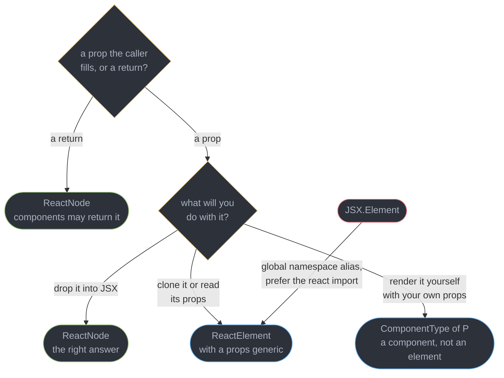
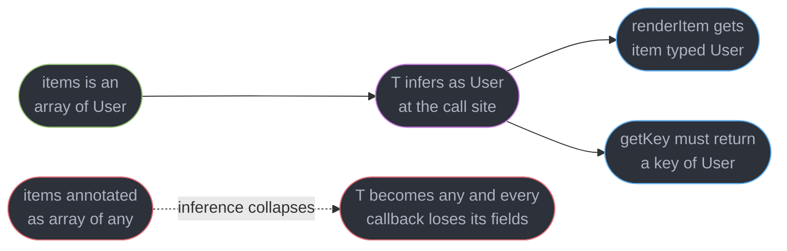
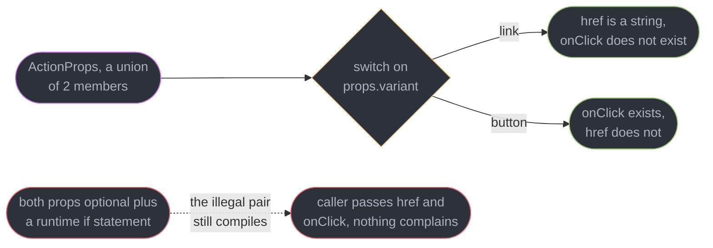
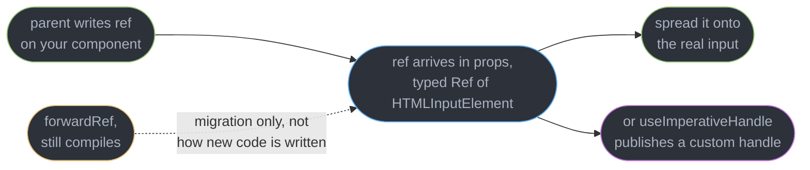
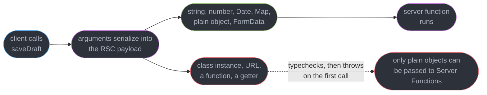

# Typing React Components

---

## 1. Concept Overview

React has no runtime type system. `propTypes` and `defaultProps` were removed from function components in React 19.0, so the only thing standing between a caller and a wrong prop is the compiler. That makes the type layer a load-bearing part of a React codebase rather than a nicety, and it makes a handful of type names — `ReactNode`, `ReactElement`, `ComponentType`, `ComponentPropsWithoutRef`, `Ref` — the vocabulary you use every day.

Almost every mistake in this area comes from one confusion: **the type of a thing React can render is not the type of a thing React rendered, and neither is the type of the function that produces it.** `ReactNode` is the widest of the three and is what a prop should almost always accept. `ReactElement` is one object with `type`, `props` and `key`. `ComponentType` is the function or class itself, unrendered. Reaching for the narrow one in a prop position is the single highest-volume typing bug in React code, and it fails at the call site, several files away from the mistake.

The rest of the module is four patterns that come up in every design system — generic components, discriminated prop unions, polymorphic `as`, and typed context — plus the two places React 19 changed the answers. `ref` is now an ordinary prop, which deleted `forwardRef` from new code and changed how `useRef` is typed. And Server Functions introduced a boundary the type system cannot police at all: arguments must survive serialization, and TypeScript will happily approve an argument that throws the moment it crosses.

This module assumes the language. Generics, constraints, inference and variance belong to [Generics and Type Parameters](../../typescript/generics_and_type_parameters/generics_and_type_parameters.md); assignability, excess-property checking and `satisfies` belong to [Structural Typing and Assignability](../../typescript/structural_typing_and_assignability/structural_typing_and_assignability.md). Hook ordering and the dispatcher belong to [Hooks Rules and the Hook Model](../hooks_rules_and_the_hook_model/hooks_rules_and_the_hook_model.md); fiber internals to [Fiber and Reconciliation](../fiber_and_reconciliation/fiber_and_reconciliation.md). Target is React 19.2 with `@types/react` 19 and TypeScript 7.0, whose native compiler changed build speed and nothing about the type system.

---

## 2. Intuition

> **One-line analogy**: `ReactNode` is a shipping container — anything renderable fits, including nothing. `ReactElement` is one labelled parcel inside it. `ComponentType` is the factory that stamps parcels out. Ask for a container when you only intend to put it on a shelf.

**Mental model**: think of every prop type as a promise about what you will *do* with the value. If you will drop it into JSX and forget it, take `ReactNode` — the widest thing that can be dropped. If you will call `cloneElement` on it or read `props.title` off it, you need `ReactElement<{ title: string }>` and you have just told every caller they may pass exactly one element, never a string, never two. If you will write `<Icon />` yourself, you need `ComponentType<IconProps>` and the caller passes `Icon`, not `<Icon />`.

**Why it matters**: narrowing a prop that did not need narrowing produces errors in files the author never opens. `children: ReactElement` compiles fine in the component and then rejects `<Card>Hello</Card>` at 40 call sites with a message about `string` not being assignable to `ReactElement`. The author sees a green build; the consumers see a wall of red.

**Key insight**: React's type surface is deliberately structural, which means the compiler will approve anything shaped right and knows nothing about what happens after. It cannot tell you that a `Date` survives a Server Function boundary and a `URL` does not, that a polymorphic `as` prop just added 800 ms to your editor's checking time, or that `useRef` returned a ref you can write during render. Those are runtime and tooling facts wearing a type-shaped hole.

---

## 3. Core Principles

- **Widest type in, narrowest type out.** A prop should accept the most permissive thing you can render; a return should be as specific as the caller can use. `ReactNode` is right for both far more often than it looks.
- **`ReactNode` includes `null`, `undefined`, `boolean`, `string`, `number`, `bigint`, arrays and portals.** That is why `{cond && <X />}` typechecks: `false` is a legal node.
- **Extend the native element instead of re-declaring its props.** `ComponentPropsWithoutRef<'button'>` gives you all 260-odd button attributes; hand-listing five of them guarantees the sixth is missing.
- **Make illegal states unrepresentable.** A discriminated union of prop shapes moves an entire class of bug from a runtime `if` to a compile error, at zero runtime cost.
- **Inference flows from values to type parameters, never backwards.** A generic component works because `items: T[]` sees a real array at the call site; annotate the array as `any[]` and every downstream callback silently becomes `any`.
- **`ref` is a prop in React 19.** No `forwardRef` in new code, no `ForwardedRef` in new signatures, and `useRef` now takes a mandatory argument.
- **Context that can be `undefined` taxes every consumer.** One factory with a throwing guard removes `| undefined` from the type at every read site.
- **Every narrowing is a purchase.** A more precise type costs consumers something; ask what it buys before paying, and audit call sites rather than guessing at them.
- **The type system stops at the network.** Server Function arguments are checked structurally and serialized by value; the two rules do not agree, and only one of them runs in production.

---

## 4. Types / Architectures / Strategies

### 4.1 The four renderable-ish types

| Type | What it is | Use as | Accepts a string? |
|------|-----------|--------|-------------------|
| `ReactNode` | Union of everything React can render | **Prop type, and the return type of a component** | Yes |
| `ReactElement<P>` | One element object: `{ type, props, key }` | A prop you will `cloneElement` or inspect | No |
| `JSX.Element` | Global-namespace alias for `ReactElement<any, any>` | Legacy; prefer the `react` import | No |
| `ComponentType<P>` | `FunctionComponent<P> \| ComponentClass<P>` | A prop holding a component you will render yourself | No |

`ReactElement` also refuses `null`, arrays, and fragments-as-arrays, which is what makes it the wrong default.

### 4.2 Props declaration forms

| Form | Best for | Cost |
|------|----------|------|
| `interface Props { ... }` | Public component props others may augment | Declaration merging can surprise you |
| `type Props = { ... }` | Anything computed — unions, mapped, conditional | Cannot be reopened later |
| `PropsWithChildren<P>` | Adding `children?: ReactNode` to an existing shape | Makes `children` optional even when it is required |
| `ComponentPropsWithoutRef<'el'>` | A wrapper that must forward native attributes | Pulls in ~260 props; slower to hover |
| `ComponentProps<typeof Comp>` | Wrapping another component you do not control | Breaks if that component's props are not exported |

### 4.3 Advanced component-typing patterns, ranked by cost

| Pattern | Buys | Type-level cost | Verdict |
|---------|------|-----------------|---------|
| Generic component | Callbacks typed from the data, no `any` | Low — one parameter, inferred | Use freely |
| Discriminated prop union | Illegal prop combinations do not compile | Low — a literal discriminant | Use freely |
| `Omit` to replace a native prop | A wrapper can redefine `color` or `size` | Low | Use freely |
| Generic + discriminated union together | Both at once | Medium — inference across union members degrades | Use with care |
| Polymorphic `as` | One component renders any element | **High** — checker time, opaque errors | Usually not worth it |

### 4.4 Ref types in React 19

| Type | Shape | Where it appears |
|------|-------|------------------|
| `Ref<T>` | `RefCallback<T> \| RefObject<T \| null> \| null` | **The prop type you declare** |
| `RefObject<T>` | `{ current: T }` — writable in `@types/react` 19 | What `useRef` returns |
| `RefCallback<T>` | `(instance: T \| null) => void \| (() => void)` | Inline ref callbacks; may return cleanup in 19 |
| `MutableRefObject<T>` | Legacy alias | Not used in new code — `RefObject` is writable now |

---

## 5. Architecture Diagrams

### Choosing between the renderable types



Only the two green boxes are the common answer. Every red-adjacent path narrows what callers may pass, which is a decision you should be able to justify out loud.

### How a wrapper's props are assembled


The value of the chain is what it does not say. Nobody lists `aria-pressed`, `formNoValidate` or `onPointerCancel`, and all three keep working.

### Where a generic component's type parameter comes from



The type parameter is never written at the call site in practice. It is read out of the `items` prop, which is why annotating that array loosely poisons everything downstream of it.

### A discriminated prop union, narrowed



The dotted pair is the alternative most codebases ship. It has the same runtime behaviour and none of the compile-time guarantee.

### Refs after React 19



The practical consequence is that a component's props type is now complete on its own — there is no second generic parameter carrying the ref type separately.

### What survives the Server Function boundary



Both branches have identical types. The compiler sees an object with the right fields either way, and the split happens at runtime on the first invocation.

---

## 6. How It Works — Detailed Mechanics

### 6.1 The renderable types, precisely

```ts
// @types/react 19, condensed. This is why ReactNode accepts almost anything.
type ReactNode =
  | ReactElement
  | string | number | bigint
  | Iterable<ReactNode>          // arrays, and any iterable
  | ReactPortal
  | boolean | null | undefined;

interface ReactElement<P = any, T = string | JSXElementConstructor<any>> {
  type: T;                        // "div", or the component function itself
  props: P;
  key: string | null;             // note: `ref` is inside props now, not here
}

type ComponentType<P = {}> = ComponentClass<P> | FunctionComponent<P>;
```

`JSX.Element` is `ReactElement<any, any>` reached through the global `JSX` namespace, which React 19 moved under `React.JSX`. It carries no extra information and it is not portable across renderers, so `ReactElement` from the `react` import is the better name for the same idea.

The failure this produces is one-directional. `ReactElement` is assignable to `ReactNode`; the reverse is not. Narrow a prop to `ReactElement` and a caller writing `<Card>Total: 42</Card>` gets:

```
Type 'string' is not assignable to type 'ReactElement<any, string | JSXElementConstructor<any>>'.
```

Take `ReactNode` unless you call `cloneElement`, read `element.props`, or use `Children.only`. Those three are the entire legitimate list, and all three are rare.

The return direction changed in React 19. A component may now return `ReactNode`, so `async` Server Components returning `Promise<ReactNode>` and components returning `undefined` both typecheck — under `@types/react` 18 the latter reported `Its return type 'undefined' is not a valid JSX element.` Annotating a return type at all is optional and usually noise; if you do, write `ReactNode` rather than `JSX.Element`, which would reject `null` from a component whose whole job is conditional rendering.

### 6.2 Props, children, and native attributes

`interface` and `type` are interchangeable for a plain props object; the compiler treats both structurally. The differences that matter: an `interface` can be reopened by a later declaration (useful for a library others augment, surprising for an application), while a `type` alias can be a union, an intersection, or the result of a mapped or conditional type. A component whose props are a discriminated union **must** be a `type`.

```tsx
// Children: declare it explicitly when it is required, use the helper when it is not.
interface CardProps { title: string; children: ReactNode }        // required
type PanelProps = PropsWithChildren<{ title: string }>;            // children?: ReactNode
```

`PropsWithChildren<P>` is exactly `P & { children?: ReactNode | undefined }`. The optionality is the catch: a `Card` that renders nothing useful without children should say `children: ReactNode` itself rather than take the helper's optional version.

For a wrapper around a DOM element, extend the element's props rather than listing them:

```tsx
type ButtonProps = Omit<ComponentPropsWithoutRef<'button'>, 'color'> & {
  variant: 'primary' | 'ghost';
  color?: 'brand' | 'danger';          // our token name, not the HTML attribute
  ref?: Ref<HTMLButtonElement>;        // [19] an ordinary prop
};

function Button({ variant, color = 'brand', className, ...rest }: ButtonProps) {
  return <button className={cx(variant, color, className)} {...rest} />;
}
```

`ComponentPropsWithoutRef<'button'>` resolves to 262 properties on `@types/react` 19 — every ARIA attribute, every DOM event, `formAction`, `popoverTarget`. `Omit` removes the one whose meaning you are changing, so a caller passing `color="danger"` gets your union instead of the HTML `color` attribute's `string`. Use `ComponentProps<typeof OtherComponent>` for the same trick over a component whose props type is not exported.

Two variants exist for a reason. `ComponentPropsWithRef<'button'>` includes `ref`; `ComponentPropsWithoutRef` does not. Under React 19 you take the *without* form and declare `ref` yourself, which keeps the ref type visible in your own props rather than buried in a spread.

### 6.3 Generic components

A generic component is an ordinary generic function that happens to return JSX. The type parameter is inferred from a prop and flows into every callback in the same props object.

```tsx
interface ListProps<T> {
  items: readonly T[];
  getKey: (item: T) => string | number;
  renderItem: (item: T, index: number) => ReactNode;
  empty?: ReactNode;
}

function List<T>({ items, getKey, renderItem, empty = null }: ListProps<T>) {
  if (items.length === 0) return <>{empty}</>;
  return <ul>{items.map((item, i) => <li key={getKey(item)}>{renderItem(item, i)}</li>)}</ul>;
}

// T infers as User from `items`. `u` is a User in both callbacks, with no annotation.
<List items={users} getKey={(u) => u.id} renderItem={(u) => u.email} />;
```

Note `readonly T[]` on the input: it accepts both mutable and readonly arrays, and a plain `T[]` rejects an `as const` array with `The type 'readonly User[]' is 'readonly' and cannot be assigned to the mutable type 'User[]'.`

**The `.tsx` arrow-function trap.** In a `.ts` file `const List = <T>(props: ListProps<T>) => ...` is fine. In a `.tsx` file the parser reads `<T>` as an opening JSX tag:

```
JSX element 'T' has no corresponding closing tag.
```

Three fixes, in order of preference: declare it with the `function` keyword (no ambiguity, and the one to reach for); write a trailing comma, `<T,>`, which forces the type-parameter reading; or add a constraint, `<T extends unknown>`, which does the same thing more verbosely.

Constrain the parameter when the component reads fields off `T`. `function Select<T extends { id: string }>` lets the body use `option.id` and produces a clear error at the call site instead of inside your file. Deeper constraint mechanics — variance, `infer`, distributive conditionals — are in [Generics and Type Parameters](../../typescript/generics_and_type_parameters/generics_and_type_parameters.md).

### 6.4 Discriminated prop unions

Optional props plus a runtime check is the pattern everyone writes first, and it accepts every illegal combination:

```tsx
// BROKEN: nothing stops a caller passing both, or neither.
interface ActionProps { href?: string; onClick?: () => void; children: ReactNode }
```

A union with a literal discriminant makes those states uninhabitable:

```tsx
type ActionProps = { children: ReactNode } & (
  | { variant: 'link'; href: string; onClick?: never }
  | { variant: 'button'; onClick: () => void; href?: never }
);

function Action(props: ActionProps) {
  if (props.variant === 'link') return <a href={props.href}>{props.children}</a>;
  return <button onClick={props.onClick}>{props.children}</button>;
}
```

Passing `variant="link"` with an `onClick` now gives an error at the call site, which is where the mistake is:

```
Type '{ variant: "link"; href: string; onClick: () => void; }' is not assignable to type 'ActionProps'.
  Types of property 'onClick' are incompatible.
    Type '() => void' is not assignable to type 'undefined'.
```

Two mechanics make this work. **Destructuring defeats it** — `function Action({ variant, href, onClick }: ActionProps)` narrows nothing, because narrowing operates on the discriminant *property access*, not on the destructured bindings. Keep `props` whole and narrow with `props.variant`. And the `onClick?: never` entries are what block the excess property; without them the object literal is assignable to the first member with the extra key merely flagged by excess-property checking, which a spread bypasses entirely.

A generic component and a prop union compose badly, and it is worth knowing before you try. Inference resolves the type parameter against one union member at a time and takes the first that fits, so `Select<T>` with a `{ multiple: true; value: T[] } | { multiple?: false; value: T }` union frequently infers `T` from the wrong branch and reports a mismatch pointing at the `value` prop rather than at `multiple`. Two exported components — `Select` and `MultiSelect` — cost 15 lines and produce errors a reader can act on.

The gain over the runtime check is that there is no runtime check. The optional-props version needs `if (href && onClick) throw new Error(...)` to be equally safe, and that error fires in the browser of whoever hit the code path, months later.

### 6.5 Polymorphic components, and why to avoid them

The `as` prop lets one component render any element while typing that element's attributes correctly. The complete pattern:

```tsx
type PolymorphicProps<E extends ElementType> = {
  as?: E;
  children?: ReactNode;
} & Omit<ComponentPropsWithoutRef<E>, 'as' | 'children'>;

function Text<E extends ElementType = 'span'>({ as, ...rest }: PolymorphicProps<E>) {
  const Tag = (as ?? 'span') as ElementType;
  return <Tag {...rest} />;
}

<Text as="a" href="/pricing">Pricing</Text>;   // href allowed
<Text as="p" href="/pricing">Pricing</Text>;   // error: href not on a paragraph
```

It works, and it costs more than it looks. `ComponentPropsWithoutRef<E>` over an unresolved `E` forces the checker to keep a distributive union of every intrinsic element in play — roughly 180 tags on `@types/react` 19 — so every use site instantiates a large conditional type. On a design system with a dozen polymorphic primitives this is measurable: hovering a component in the editor goes from tens of milliseconds to hundreds, and `tsc --extendedDiagnostics` shows the instantiation count climbing into the millions. TypeScript 7.0's native compiler cuts the wall-clock cost by roughly an order of magnitude but does not change the shape of the work.

The second cost is error quality. A wrong prop on a polymorphic component reports against the full union, producing a page of candidate signatures rather than one line. Add a ref and it gets worse: correct ref typing needs `ComponentPropsWithRef<E>` and a cast in the body, because TypeScript cannot prove the spread matches the tag.

**The honest recommendation: do not build one unless a real requirement demands it.** A `Text` that renders `span` and a separate `Heading` that takes `level: 1 | 2 | 3` cover the actual need in most design systems, in 20 lines with no generics. Build the polymorphic version when consumers genuinely need arbitrary tags for semantics or when you are shipping a public primitive library — and even then, cap it with `ElementType<any, 'a' | 'span' | 'p' | 'div'>`-style narrowing where you can.

### 6.6 Refs in React 19

`ref` is an ordinary prop. Declare it, spread it, done:

```tsx
type InputProps = ComponentPropsWithoutRef<'input'> & { ref?: Ref<HTMLInputElement> };

function TextField({ ref, ...rest }: InputProps) {
  return <input ref={ref} {...rest} />;
}
```

`forwardRef` still compiles and still works — a library supporting React 18 has to keep it — but it is not how new code is written. Note that nothing in the type system will tell you: `@types/react` 19.2 carries no `@deprecated` tag on `forwardRef`, only a source comment hoping React removes it first, so the overload documents itself in full and your editor stays silent. A lint rule or review is what catches it.

`useRef` has exactly three overloads in `@types/react` 19, and it now **requires an argument**:

```ts
function useRef<T>(initialValue: T): RefObject<T>;                    // a real value
function useRef<T>(initialValue: T | null): RefObject<T | null>;      // the DOM case
function useRef<T>(initialValue: T | undefined): RefObject<T | undefined>;
```

So `useRef<number>()` no longer compiles:

```
Expected 1 arguments, but got 0.
```

Write `useRef<number | undefined>(undefined)` for a mutable slot with no initial value, and `useRef<HTMLInputElement>(null)` for a DOM ref — that hits the second overload and gives `RefObject<HTMLInputElement | null>`, which is why `inputRef.current?.focus()` needs the optional chain. The other change: `RefObject.current` is now writable, so `MutableRefObject` no longer earns its own name and the old `useRef<T>(null!)` cast to get a writable ref is dead weight.

`useImperativeHandle` publishes a custom handle instead of the DOM node. Type the handle once and use it on both sides:

```tsx
type VideoHandle = { play: () => void; seek: (seconds: number) => void };

function Video({ ref, src }: { ref?: Ref<VideoHandle>; src: string }) {
  const el = useRef<HTMLVideoElement>(null);
  useImperativeHandle(ref, () => ({
    play: () => el.current?.play(),
    seek: (s) => { if (el.current) el.current.currentTime = s; },
  }), []);
  return <video ref={el} src={src} />;
}

const handle = useRef<VideoHandle>(null);   // parent side: same type, no DOM leakage
```

The parent's `handle.current` is `VideoHandle | null` and exposes two methods, not 300 media-element properties.

One more `[19]` change reaches the types. A `RefCallback<T>` may now return a cleanup function, so `ref={(node) => { obs.observe(node); return () => obs.unobserve(node); }}` typechecks and React calls the cleanup on detach. The catch is that returning anything else is now an error — an arrow body such as `(node) => (nodeRef.current = node)` returns the assigned value and reports `Type 'HTMLDivElement' is not assignable to type 'void | (() => void)'.` Wrap the body in braces.

Ref lifecycle, focus management and portals belong to [Refs and Focus Management](../refs_and_focus_management/refs_and_focus_management.md).

### 6.7 Typing hooks and context

`useState` infers from its initial value, which is right most of the time and wrong in two specific shapes:

```tsx
const [user, setUser] = useState<User | null>(null);   // without the param, T is `null`
const [tags, setTags] = useState<string[]>([]);        // without the param, T is `never[]`
const [open, setOpen] = useState(false);               // fine, boolean is inferred
```

Skip the parameter on the first and `setUser(fetched)` reports `Argument of type 'User' is not assignable to parameter of type 'null'.` Skip it on the second and `setTags(['a'])` reports `Type 'string' is not assignable to type 'never'.` The rule: pass an explicit parameter whenever the initial value is narrower than the state's real domain.

A reducer wants its action type as a union with a literal `type` field, which turns the `switch` into an exhaustiveness check:

```ts
type State = { items: Item[]; filter: string };
type Action =
  | { type: 'add'; item: Item }
  | { type: 'remove'; id: string }
  | { type: 'filter'; value: string };

function reducer(state: State, action: Action): State {
  switch (action.type) {
    case 'add':    return { ...state, items: [...state.items, action.item] };
    case 'remove': return { ...state, items: state.items.filter((i) => i.id !== action.id) };
    case 'filter': return { ...state, filter: action.value };
    default: {
      const _exhaustive: never = action;     // adding a 4th action breaks the build here
      return state;
    }
  }
}
```

`action.item` is only reachable inside the `'add'` case; the `never` assignment in `default` is what makes a forgotten case a compile error rather than a silent no-op. `useReducer(reducer, initialState)` then infers `State` and the `dispatch` signature with no annotations.

Context's default problem is that `createContext<Theme>(undefined)` does not compile and `createContext<Theme | undefined>(undefined)` pushes `| undefined` into every consumer. One factory removes it:

```tsx
function createStrictContext<T>(name: string) {
  const Ctx = createContext<T | undefined>(undefined);
  function useCtx(): T {
    const value = useContext(Ctx);
    if (value === undefined) throw new Error(`use${name} must be used inside ${name}Provider`);
    return value;                                  // narrowed: T, never T | undefined
  }
  return [Ctx, useCtx] as const;                   // [19] <Ctx value={...}> is the provider
}

const [ThemeContext, useTheme] = createStrictContext<Theme>('Theme');
```

A custom hook returning a tuple needs `as const` for the same reason a context needs the guard — without it the return type widens to `(boolean | (() => void))[]`, an array of the union, and the caller's destructured `toggle` is not callable. `return [on, toggle] as const` gives a 2-tuple with distinct element types. Objects do not need it.

Consumers write `const theme = useTheme()` and get `Theme`. The runtime guard buys the type narrowing — the `if` is what lets the return type be `T`, and it also converts a missing-provider bug from `Cannot read properties of undefined` in a random child into a named error. React 19 lets you render `<ThemeContext value={theme}>` directly, without `.Provider`. Re-render cost, tearing and `useSyncExternalStore` belong to [Context and Component Communication](../context_and_component_communication/context_and_component_communication.md).

### 6.8 The Server Function boundary

A Server Function's arguments and return value cross a wire. The type system checks them structurally; React serializes them by value; the two rules do not agree, and only the second one runs in production.

```ts
// app/actions.ts
'use server';
export async function saveDraft(draft: { id: string; body: string; savedAt: Date }) {
  await db.drafts.upsert(draft);
  return { ok: true as const };
}
```

React 19 serializes: `string`, `number`, `bigint`, `boolean`, `null`, `undefined`, plain objects and arrays of those, `Date`, `Map`, `Set`, `TypedArray`, `ArrayBuffer`, `FormData`, promises, JSX, and references to other Server Functions. Everything else fails at call time with a message the type system never hinted at:

```
Error: Only plain objects, and a few built-ins, can be passed to Server Functions.
Classes or null prototypes are not supported.
```

The dangerous cases are the ones that look plain. A `URL` is a class instance. A Prisma or Mongoose model object carries a prototype and methods. An object with a getter serializes the getter's *value*, so a computed field silently becomes a stale constant. A callback typed `() => void` in an argument object typechecks and throws. And the reverse direction has its own version — a value returned to a Client Component is subject to the same rules, so returning a class instance fails after the function ran, with the write already committed.

Two defences, both cheap. Type the argument as an explicitly plain shape rather than a domain model — `Pick<Draft, 'id' | 'body'>` instead of `Draft` — so the class never reaches the boundary. And validate at the top of the function with a schema, because the argument is attacker-controlled input regardless of what the client's types say: a Server Function is a public HTTP endpoint, and TypeScript erases at build time. The boundary rules, `"use server"` semantics, `useActionState` and CSRF belong to [Server Components and Server Functions](../server_components_and_server_functions/server_components_and_server_functions.md).

---

## 7. Real-World Examples

**A design system that rejected every string child.** A `Card` component declared `children: ReactElement` because its author had only ever passed `<CardBody />`. The build was green in the package and red in 3 consuming apps, with 47 errors reading `Type 'string' is not assignable to type 'ReactElement'`. The fix was one word — `ReactNode` — and shipped as a patch release the same afternoon.

**The polymorphic primitive that doubled editor latency.** A component library added `as` to `Box`, `Text`, `Stack` and `Flex`. Hover-to-tooltip on a component in VS Code went from 90 ms to 780 ms, and `tsc --extendedDiagnostics` showed instantiations rising from 1.1 M to 6.4 M. Narrowing three of the four to fixed tags and keeping `as` only on `Box` brought it back to 140 ms.

**A Server Function that saved a stale timestamp.** An editor passed its domain object straight to a Server Function. The object had a `get wordCount()` getter and a `updatedAt` field backed by a getter over `Date.now()`. Serialization froze both at their values at call time, so every saved draft recorded the timestamp of the page load. Nothing errored; the bug was found 3 weeks later by a report that showed 400 drafts with identical `updatedAt` values.

**The React 19 upgrade that failed on 118 files.** A migration from `@types/react` 18 to 19 broke the build in one pass on `useRef()` calls with no argument — `Expected 1 arguments, but got 0.` — spread across timers, observers and mutable counters. A codemod rewriting `useRef<T>()` to `useRef<T | undefined>(undefined)` cleared 114 of them; the remaining 4 were DOM refs that should have been `useRef<T>(null)` all along and had been silently typed as always-present.

**Optional props that shipped a broken link.** An `Action` component took `href?` and `onClick?` with a runtime warning. A refactor moved a call site from a link to a button and left the `href` in place, so the component rendered an `<a>` with no navigation handler and swallowed the click. A discriminated union would have failed the build; the runtime warning was `console.warn` and had been filtered out of the production logger 8 months earlier.

---

## 8. Tradeoffs

| Choice | Bought | Paid |
|--------|--------|------|
| `ReactNode` for a children prop | Every caller works: strings, arrays, `null`, conditionals | You cannot inspect or clone what you were given |
| `ReactElement` for a children prop | `cloneElement` and `props` access are safe | Rejects strings, arrays and `null` at every call site |
| `interface` for props | Consumers can augment it via declaration merging | Cannot be a union, and merging can arrive unannounced |
| `type` for props | Unions, mapped and conditional shapes are available | No augmentation path for library consumers |
| Extending `ComponentPropsWithoutRef` | ~260 native props forwarded for free | Slower hovers, and a wide surface you did not review |
| Generic component | Callbacks typed from data with zero annotations | Inference degrades badly if combined with a prop union |
| Discriminated prop union | Illegal combinations do not compile, zero runtime cost | Destructuring in the signature silently disables narrowing |
| Polymorphic `as` | One component covers every element | High checker cost and unreadable errors; rarely worth it |
| Strict context factory | No `\| undefined` at any consumer | A thrown error replaces a default value at runtime |
| Trusting types at the Server Function boundary | Nothing to write | A serialization failure the compiler cannot see |
| `as const` on a custom hook's tuple return | Destructured callbacks stay callable | One more token nobody remembers until it breaks |
| Annotating a component's return type | Explicit contract in a public package | Usually noise, and `JSX.Element` there rejects `null` |

---

## 9. When to Use / When NOT to Use

**Reach for the narrow types when:**

- You call `cloneElement`, `Children.only`, or read `element.props` — that is the whole case for `ReactElement`.
- A public package's props are part of its contract and a narrowing regression would break consumers silently — assert the shape with `tsd`.
- A prop holds a component you will instantiate with props you choose — `ComponentType<P>`, and the caller passes `Icon` rather than `<Icon />`.
- Two prop combinations are genuinely mutually exclusive and both are load-bearing — a discriminated union pays for itself immediately.
- A component's callbacks operate on caller-supplied data — make it generic and let inference do the work.

**Do not reach for them when:**

- You only render what you were handed. `ReactNode` is the answer, and the narrower type is a tax on every consumer.
- The union has one member today and "might have more later". Add the discriminant when the second member exists, not before.
- An `as` prop would be convenient. Two fixed components are cheaper to build, faster to check, and produce readable errors.
- A generic component would also need a prop union. Inference picks one member and reports against the wrong prop; ship two components instead.
- The type would encode something the compiler cannot enforce — serializability at a Server Function boundary, or a runtime invariant about ordering. Validate those instead.

---

## 10. Common Pitfalls

**`ReactElement` in a children prop.** The highest-volume typing bug in React code, and it fails in the consumer's file rather than yours.

```tsx
// BROKEN: compiles here, rejects `<Card>Total: 42</Card>` at every call site with
// Type 'string' is not assignable to type 'ReactElement<any, string | JSXElementConstructor<any>>'.
interface CardProps { children: ReactElement }

// FIX: take the widest renderable type unless you inspect or clone the child.
interface CardProps { children: ReactNode }
```

**Destructuring props kills union narrowing.** `function Action({ variant, href }: ActionProps)` compiles the destructure and then reports `Property 'href' does not exist on type ActionProps` — narrowing needs the discriminant read off the whole object, so keep `props` intact and branch on `props.variant`.

**`useRef()` with no argument.** `@types/react` 19 removed the zero-argument overload, so `useRef<Timer>()` fails with `Expected 1 arguments, but got 0.` Write `useRef<Timer | undefined>(undefined)`. Migrations from React 18 hit this on the first build, usually in dozens of files at once.

**Forgetting `| null` on a DOM ref.** `useRef<HTMLInputElement>(null)` returns `RefObject<HTMLInputElement | null>`, so `ref.current.focus()` reports `'ref.current' is possibly 'null'.` The optional chain is not noise — the ref really is null before commit and after unmount.

**Typing an event handler by hand.** `(e: any)` and `(e: Event)` are both wrong: React events are synthetic. Let the JSX position infer it, or write `React.ChangeEvent<HTMLInputElement>` when you must name it. A hand-written `Event` gives you no `currentTarget` typing at all.

**`ComponentProps<typeof Comp>` on a generic component.** It resolves the type parameter to `unknown`, silently, and every callback in the resulting type degrades. Export the props interface from the generic component instead.

**Passing a domain object to a Server Function.** A Prisma record, a `URL`, a `Mongoose` document and anything with a getter all typecheck and then either throw `Only plain objects, and a few built-ins, can be passed to Server Functions` or, worse, serialize a getter's frozen value. Pass a `Pick<...>` of primitives.

**Assuming `PropsWithChildren` makes children required.** It adds `children?: ReactNode | undefined`. A component that is meaningless without children should declare `children: ReactNode` itself.

**A custom hook returning a tuple without `as const`.** `return [on, toggle]` widens to `(boolean | (() => void))[]`, so the caller's `toggle()` reports `This expression is not callable. Not all constituents of type 'boolean | (() => void)' are callable.` One `as const` fixes it.

**Trusting an unvalidated Server Function argument because it is typed.** Types erase at build time and a Server Function is a public HTTP endpoint, so the argument is attacker-controlled regardless of the signature. Parse it with a schema on the first line of the function body.

**Casting to silence a polymorphic error.** `as any` inside the body of an `as`-prop component is how these end up unsound — the cast usually hides a real mismatch between the spread props and the resolved tag. If the cast is unavoidable, confine it to the single `Tag` binding and nothing else.

---

## 11. Technologies & Tools

| Tool | Purpose |
|------|---------|
| TypeScript | 7.0 — the native compiler port; same type system, roughly 10x faster checks |
| React | 19.2, where `ref` is a prop and `forwardRef` leaves new code |
| @types/react | Owns `ReactNode`, `ComponentPropsWithoutRef`, and the three `useRef` overloads |
| typescript-eslint | Rules for consistent type imports and banning `any` in props |
| Zod | Validates Server Function arguments, which types cannot |
| tsc | `--extendedDiagnostics` reports instantiation counts for a slow polymorphic type |
| Biome | Faster lint and format; type-aware React rules are narrower than typescript-eslint |
| Vitest | Type-level assertions alongside runtime tests via `expectTypeOf` |
| tsd | Asserts a published component's props type across releases |
| Next.js | 16 — generates route and Server Function types into `.next/types` |
| React DevTools | Shows resolved props at runtime when a generic inference looks wrong |
| expect-type | Standalone type assertions for a props contract outside a test runner |

---

## 12. Interview Questions with Answers

**Q: What is the difference between ReactNode, ReactElement, JSX.Element and ComponentType?**
**Short:** Accepting the widest union is ReactNode; ReactElement is one element object, JSX.Element is its global alias, and ComponentType is the unrendered component itself.

`ReactNode` is the union of everything React can render — elements, strings, numbers, bigints, iterables, portals, booleans, `null` and `undefined` — which is why `{cond && <X />}` typechecks. `ReactElement<P>` is a single object with `type`, `props` and `key`, and refuses strings, arrays and `null`. `JSX.Element` is `ReactElement<any, any>` reached through the global namespace, carrying no extra information. `ComponentType<P>` is the function or class, so a caller passes `Icon`, not `<Icon />`.

**Q: Why should a children prop almost always be ReactNode?**
**Short:** Narrowing it to a single element rejects strings, arrays and conditionals at every call site while the component itself still compiles clean.

A component that only renders `{children}` has no reason to constrain what it was given. Declaring `children: ReactElement` produces `Type 'string' is not assignable to type 'ReactElement'` in the consumer's file, not the author's, so the author ships a green build and the consumers get the errors. The only legitimate reasons to narrow are `cloneElement`, `Children.only`, and reading `element.props` — all three are rare, and all three should be a deliberate documented choice.

**Q: How does a generic React component get its type parameter?**
**Short:** Passing a real array at the call site lets inference pick T from the items prop, which then types every callback in the same props object.

`function List<T>({ items, renderItem }: { items: readonly T[]; renderItem: (i: T) => ReactNode })` infers `T` as `User` when handed `User[]`, so `renderItem`'s parameter needs no annotation. The parameter is essentially never written explicitly at a call site. The failure mode is upstream: annotate the array as `any[]` and `T` collapses to `any`, so every callback silently loses its fields with no error anywhere. Use `readonly T[]` so `as const` arrays are accepted too.

**Q: How did ref typing change in React 19?**
**Short:** Ref arrives as an ordinary prop, so a component declares `ref?: Ref<HTMLInputElement>` in its own props type and `forwardRef` leaves new code entirely.

`function TextField({ ref, ...rest }: ComponentPropsWithoutRef<'input'> & { ref?: Ref<HTMLInputElement> })` is the whole pattern — spread `ref` onto the element like any other prop. The props type is now complete on its own, with no second generic parameter carrying the ref. `forwardRef` still compiles, and a library supporting React 18 must keep it, but it is a migration artefact rather than a way to write a component.

**Q: Why does a discriminated prop union beat two optional props with a runtime check?**
**Short:** Union members make the illegal combination uninhabitable, so the mistake is a compile error at the call site instead of a warning nobody reads in production.

`{ variant: 'link'; href: string; onClick?: never } | { variant: 'button'; onClick: () => void; href?: never }` rejects a caller passing both, and rejects a caller passing neither. The optional-props version needs a runtime `if` to be equally safe, and that check fires in a user's browser months after the refactor that broke it. The `?: never` members are load-bearing: without them an object literal is assignable to one branch with the extra key caught only by excess-property checking, which a spread bypasses.

**Q: What does ComponentPropsWithoutRef buy over listing props by hand?**
**Short:** Extending the native element forwards all 262 button attributes, so a wrapper supports ARIA, form and pointer props the author never thought about.

`Omit<ComponentPropsWithoutRef<'button'>, 'color'> & { variant: 'primary' | 'ghost'; color?: 'brand' | 'danger' }` keeps `aria-pressed`, `formNoValidate` and `onPointerCancel` working while replacing the one attribute whose meaning changed. Hand-listing five props guarantees a consumer needs the sixth. Use `ComponentProps<typeof Comp>` when wrapping a component whose props type is not exported, and the `WithRef` variant only when you deliberately want `ref` folded into the spread.

**Q: interface or type for a props declaration?**
**Short:** Declaration merging is the only real difference, and a props type that is a union has to be a type alias because an interface cannot express one.

Structurally the compiler treats them identically for a plain object shape. An `interface` can be reopened by a later declaration, which is useful for a library others augment and surprising inside an application. A `type` alias can be a union, an intersection, or the output of a mapped or conditional type, so anything discriminated must be a `type`. Pick one convention per codebase; the choice matters far less than the consistency.

**Q: What does a polymorphic as prop actually cost?**
**Short:** Constraining E to ElementType forces a distributive union over roughly 180 intrinsic tags at every use site, which is measurable in editor latency and unreadable in errors.

The pattern is `Omit<ComponentPropsWithoutRef<E>, 'as'>` over `E extends ElementType`, and it works. On a library with four polymorphic primitives, hover latency in VS Code went from 90 ms to 780 ms and `tsc --extendedDiagnostics` reported instantiations climbing from 1.1 M to 6.4 M. Errors report against the whole union rather than one line, and adding a ref requires a cast. Two fixed components usually cover the real requirement in a fraction of the code.

**Q: What are the three useRef overloads and when does each fire?**
**Short:** Three overloads exist for a value, a nullable, and an undefined initial state, and the zero-argument form was removed so `useRef()` no longer compiles.

`useRef<T>(v: T)` gives `RefObject<T>`; `useRef<T>(v: T | null)` gives `RefObject<T | null>`, which is the DOM case and why `ref.current?.focus()` needs the optional chain; `useRef<T>(v: T | undefined)` gives the undefined variant. `useRef<number>()` now reports `Expected 1 arguments, but got 0.` — write `useRef<number | undefined>(undefined)`. `RefObject.current` is writable in `@types/react` 19, so `MutableRefObject` and the old `null!` cast are both obsolete.

**Q: How do you type useImperativeHandle so a parent does not see the DOM node?**
**Short:** Handing the parent a named handle type keeps the exposed surface to the methods you publish rather than 300 media-element properties.

Declare `type VideoHandle = { play: () => void; seek: (s: number) => void }`, take `ref?: Ref<VideoHandle>` as a prop, and call `useImperativeHandle(ref, () => ({ play, seek }), [])`. The parent writes `useRef<VideoHandle>(null)` and gets exactly those two methods. Keeping the handle small is the point: exposing the raw element re-couples the parent to your markup, and the type is what makes that coupling visible in review.

**Q: When does useState need an explicit type parameter?**
**Short:** Widening the initial value is required whenever it is narrower than the real state domain, which is exactly the `null` and empty-array cases.

`useState(null)` infers `T` as `null`, so `setUser(fetched)` reports `Argument of type 'User' is not assignable to parameter of type 'null'.` `useState([])` infers `never[]`, so `setTags(['a'])` reports `Type 'string' is not assignable to type 'never'.` Write `useState<User | null>(null)` and `useState<string[]>([])`. When the initial value already covers the domain — `useState(false)`, `useState(0)` — the parameter is noise.

**Q: How do you type a reducer so a forgotten case fails the build?**
**Short:** Discriminating on a literal type field lets a `never` assignment in the default branch turn an unhandled action into a compile error.

Declare the actions as a union with a `type` discriminant, then in the `switch` default write `const _exhaustive: never = action;`. Adding a fourth action without a case makes that assignment fail, naming the missing member. Inside each case the payload is narrowed — `action.item` only exists in the `'add'` branch — so no casts are needed. `useReducer(reducer, initial)` then infers both the state and the `dispatch` signature with no further annotation.

**Q: How do you remove the undefined from a context type at every consumer?**
**Short:** Throwing inside the custom hook narrows the value, so the hook returns T and a missing provider becomes a named error instead of a property access on undefined.

`createContext<T | undefined>(undefined)` is the only honest default, but leaking `| undefined` into every read site is a tax. A factory that returns `[Context, useContext]` where the hook does `if (value === undefined) throw new Error(...)` gives consumers a plain `T`. The runtime guard is what buys the type narrowing, and it converts `Cannot read properties of undefined` in some random child into a message naming the provider. React 19 renders the context object directly as the provider.

**Q: What can and cannot be passed to a Server Function?**
**Short:** Serializable arguments are limited to primitives, plain objects and a named list of built-ins, and the compiler enforces none of that list.

React 19 accepts strings, numbers, bigints, booleans, `null`, `undefined`, plain objects and arrays, `Date`, `Map`, `Set`, typed arrays, `FormData`, promises, JSX and other Server Function references. Anything else throws `Only plain objects, and a few built-ins, can be passed to Server Functions. Classes or null prototypes are not supported.` The dangerous cases look plain: a `URL`, a Prisma record, an object with a getter whose computed value silently freezes. Pass a `Pick<...>` of primitives and validate with a schema, since the argument is public input.

**Q: When is ComponentType the right prop type instead of ReactNode?**
**Short:** Holding a component rather than its output is what you need when you supply the props yourself at render time.

`icon: ComponentType<{ size: number }>` means the caller passes `SearchIcon` and you write `<Icon size={16} />` with props you control. `icon: ReactNode` means the caller passes `<SearchIcon size={16} />` already constructed, and you cannot change it. Choose by who decides the props. The tell that you picked wrong is reaching for `cloneElement` to inject a prop into something you were handed — that is `ComponentType` with extra steps and a runtime cost.

**Q: Why use Omit when extending native element props?**
**Short:** Removing the native attribute first is what lets a wrapper redefine a name like color or size without an intersection conflict.

`ComponentPropsWithoutRef<'button'> & { color?: 'brand' | 'danger' }` intersects your union with the HTML attribute's `string`, and the result is `never` for every value you actually want. `Omit<ComponentPropsWithoutRef<'button'>, 'color'> & { color?: 'brand' | 'danger' }` replaces it cleanly. The same applies to `size` on an input and `type` on almost anything. Omit only what you are redefining — omitting more than that quietly drops native props consumers depend on.

**Q: Why does a generic arrow component fail to parse in a .tsx file?**
**Short:** Adding a trailing comma resolves the ambiguity, because in .tsx the parser reads a bare angle bracket as an opening JSX tag rather than a type parameter list.

`const List = <T>(props: ListProps<T>) => ...` in a `.tsx` file reports `JSX element 'T' has no corresponding closing tag.` Three fixes: declare it with the `function` keyword, which has no ambiguity and is the one to prefer; write `<T,>` so the comma forces the type-parameter reading; or add a constraint such as `<T extends unknown>`, which does the same thing more verbosely. In a `.ts` file none of this applies.

**Q: How does a type parameter flow into a render-prop callback?**
**Short:** Inference flows from the data prop into every function in the same props object, so a render callback's parameter is typed without any annotation.

Because `items: readonly T[]` and `renderItem: (item: T, index: number) => ReactNode` sit in one props type, resolving `T` from `items` resolves `renderItem` too. Writing `renderItem={(u) => u.email}` typechecks `u` as `User` and reports a typo on `u.emial` immediately. Two things break it: annotating the parameter yourself, which turns inference into a check, and combining the generic with a prop union, where inference across union members degrades and often falls back to the first member.

---

## 13. Best Practices

- Default every renderable prop to `ReactNode` and narrow only when you call `cloneElement`, `Children.only`, or read `element.props`.
- Extend `ComponentPropsWithoutRef<'el'>` for any wrapper over a DOM element, and `Omit` exactly the attributes whose meaning you are changing.
- Declare `ref?: Ref<T>` as an ordinary prop. Reach for `forwardRef` only in a package that still supports React 18.
- Pass a `useState` type parameter whenever the initial value is `null` or `[]`, and skip it when the initial value already covers the domain.
- Give every action union a literal `type` discriminant and close the reducer's `switch` with a `never` assignment.
- Keep `props` undestructured in any component whose props are a discriminated union — destructuring in the signature disables narrowing.
- Wrap every context in a factory whose hook throws on `undefined`, so consumers read a plain `T`.
- Declare generic components with the `function` keyword. It sidesteps the `.tsx` angle-bracket ambiguity and reads better than `<T,>`.
- Type Server Function arguments as an explicit `Pick` of primitives, and validate them with a schema at the top of the function.
- Treat a slow editor as a type-level bug. Run `tsc --extendedDiagnostics` before adding another polymorphic primitive.
- Return `as const` from any custom hook whose result is a tuple, and prefer an object once there are more than three values.
- Assert a public component's props with `tsd` or `expectTypeOf` so a narrowing regression fails your build rather than a consumer's.

---

## 14. Case Study

**Problem.** A 40-engineer product team shipped an internal design system as a workspace package. Two complaints arrived in the same sprint. Consuming apps reported that `<Card>` and `<Panel>` refused plain text children — 47 build errors across 3 applications, all reading the same thing. And the platform team reported that `tsc --noEmit` on the largest app had grown from 34 seconds to 81 seconds over 4 months, with VS Code hover latency on any design-system component sitting at roughly 780 ms.

**Investigation.** The 47 errors were one line of source. Both components declared `children: ReactElement`, written by an author who only ever passed sub-components. The compile-time regression was separate: `tsc --extendedDiagnostics` reported 6.4 M type instantiations against 1.1 M in the tagged release from 4 months earlier. The commit that moved the number added an `as` prop to four primitives — `Box`, `Text`, `Stack` and `Flex` — each resolving `ComponentPropsWithoutRef<E>` over an unconstrained `ElementType`.

**Root cause.** Both defects were narrowing decisions taken without a consumer in the room.

```tsx
// BROKEN
interface CardProps { title: string; children: ReactElement }   // rejects <Card>Total: 42</Card>

type PolyProps<E extends ElementType> = { as?: E } & ComponentPropsWithoutRef<E>;
function Stack<E extends ElementType = 'div'>({ as, ...rest }: PolyProps<E>) {
  const Tag = (as ?? 'div') as ElementType;
  return <Tag {...rest} />;                    // Stack is never rendered as anything but div
}
```

The `Card` type produced `Type 'string' is not assignable to type 'ReactElement<any, string | JSXElementConstructor<any>>'` in files the design-system authors never opened. `Stack` and `Flex` were audited across all 3 apps and 214 call sites: **zero** passed an `as` prop. `Text` used it 6 times and `Box` 31 times, both for genuine semantic reasons.

**Fix.** Widen the children props, and keep polymorphism only where it was actually used.

```tsx
// FIX
interface CardProps { title: string; children: ReactNode }      // strings, arrays and null all fine

function Stack({ gap = 8, ...rest }: ComponentPropsWithoutRef<'div'> & { gap?: number }) {
  return <div style={{ display: 'flex', flexDirection: 'column', gap }} {...rest} />;
}
```

`Stack` and `Flex` lost their type parameters entirely and became ordinary `div` wrappers. `Box` and `Text` kept `as`, with the constraint narrowed from all of `ElementType` to a 9-tag union covering everything the 37 real call sites used. The design system added a `tsd` assertion that `<Card>text</Card>` typechecks, so the `ReactElement` regression cannot return silently.

**Results.**

- Consumer build errors: 47 to 0, in a patch release shipped the same day.
- Type instantiations on the largest app: 6.4 M to 1.5 M.
- `tsc --noEmit` wall clock: 81 s to 39 s, and 4.1 s after the team moved to TypeScript 7.0's native compiler in the following sprint.
- VS Code hover latency on a design-system component: 780 ms to 140 ms.
- Polymorphic primitives in the library: 4 to 2, covering 37 of 251 audited call sites.

**Lesson.** Both bugs were the same instinct — reaching for the more precise type when the looser one carried no cost. `ReactElement` was more specific than `ReactNode` and bought nothing, because neither component ever inspected its children. `as` was more general than a fixed tag and bought nothing on two of four primitives, because nobody used it. Precision and generality are both purchases; ask what they buy before paying, and audit the call sites rather than guessing at them.
