# Rust: Senior Engineer and Interview Prep Guide

A reference for **Rust the language and Rust the runtime ecosystem**: ownership and lifetimes, traits and generics, unsafe code and FFI, `Send`/`Sync` and atomics, futures and Tokio, performance and verification with Miri, the axum/tonic/sqlx service stack, `no_std` and WebAssembly, and the cargo supply chain. Many systems the repo already teaches are written in Rust: Pingora, linkerd2-proxy, ztunnel, Qdrant, uv and ruff. Those pages cover how to use them. This section covers how to write one.

> **No runnable application.** All content is Markdown. Code blocks target Rust 1.99.1 on edition 2024, and every std-only `rust` fence is compile-checked against `rustc` 1.99.1.

---

## 1. Section Overview

This section covers:

- **Ownership and the type system:** moves and borrows, lifetimes and the borrow checker's error codes, traits and trait objects, enums and type-driven design, errors and panics, collections and strings, closures and iterators, smart pointers, and cargo.
- **Metaprogramming, unsafe and interop:** declarative and procedural macros, the undefined-behavior catalogue and an unsafe-code policy, and FFI to C, C++, Python, Node and the JVM.
- **Concurrency and async:** `Send` and `Sync`, locks, channels and atomics, poll-based futures and `Pin`, runtimes and Tokio's scheduler, and cancellation safety.
- **Performance and verification:** what zero-cost means and where it stops, profiling and benchmarking a Rust binary, and the testing ladder from unit tests to Miri, loom and Kani.
- **Services and ecosystem:** hyper, tower and axum; serde; sqlx and diesel; tonic; `tracing` and OpenTelemetry.
- **Platforms, judgment and production:** bare-metal and embedded Rust, WebAssembly and WASI, library API design and semver, build and supply chain, and Rust against C++, Go, Java and Python.

**Primary target: Rust 1.99.1** (2026-10-15) on **edition 2024**. Rust ships every six weeks; 1.100.0 is due 2026-11-12. Version tags such as `[1.95]` and `[ed2024]` mark only features that are really gated.

---

## 2. Module Table

| # | Module Directory | Phase | Difficulty | Key Topics |
|---|-----------------|-------|-----------|-----------|
| 1 | [ownership_borrowing_and_raii](ownership_borrowing_and_raii/ownership_borrowing_and_raii.md) | 1. Ownership and the Type System | Intermediate | Move vs `Copy` vs `Clone`, shared-xor-mutable borrows, NLL and two-phase borrows, `Drop` order, `mem::take`/`replace`, edition 2024 temporary scopes, safe leaking |
| 2 | [lifetimes_and_the_borrow_checker](lifetimes_and_the_borrow_checker/lifetimes_and_the_borrow_checker.md) | 1. Ownership and the Type System | Advanced | Lifetimes as regions, the three elision rules, `'static` as a bound vs a reference, variance, HRTBs, E0499/E0502/E0505/E0597/E0716, `use<..>` capturing, self-referential structs |
| 3 | [traits_generics_and_trait_objects](traits_generics_and_trait_objects/traits_generics_and_trait_objects.md) | 1. Ownership and the Type System | Advanced | Associated types vs generic parameters, blanket impls, the orphan rule and newtypes, conversion traits, `async fn` in traits and the `Send` bound, dyn compatibility, trait upcasting |
| 4 | [enums_pattern_matching_and_type_driven_design](enums_pattern_matching_and_type_driven_design/enums_pattern_matching_and_type_driven_design.md) | 1. Ownership and the Type System | Intermediate | ADTs and niche layout, exhaustive `match`, `let else`, let chains, `if let` guards, `assert_matches!`, `#[non_exhaustive]`, the never type, typestate and newtypes |
| 5 | [error_handling_and_panics](error_handling_and_panics/error_handling_and_panics.md) | 1. Ownership and the Type System | Intermediate | `?` and `From`, the `Error` trait and `source()` chains, panic vs `Result`, unwind vs abort, `catch_unwind`, `extern "C-unwind"`, `Mutex` poisoning |
| 6 | [collections_and_strings](collections_and_strings/collections_and_strings.md) | 1. Ownership and the Type System | Intermediate | `Vec` capacity and amortized push, `HashMap` (SwissTable, SipHash-1-3, the entry API), `BTreeMap`, `String` vs `&str` vs `Cow<str>` vs `Arc<str>`, UTF-8 indexing, `OsString`/`PathBuf` |
| 7 | [closures_and_iterators](closures_and_iterators/closures_and_iterators.md) | 1. Ownership and the Type System | Intermediate | `Fn`/`FnMut`/`FnOnce`, capture modes and `move`, async closures, iterator laziness and adapters, collecting into `Result`, `try_fold`, implementing `Iterator` |
| 8 | [smart_pointers_and_interior_mutability](smart_pointers_and_interior_mutability/smart_pointers_and_interior_mutability.md) | 1. Ownership and the Type System | Advanced | `Box`, `Rc`/`Arc` and `Weak`, `Cell`/`RefCell` and borrow panics, `OnceLock`/`LazyLock`, `UnsafeCell`, `Cow`, arenas and `slotmap` in place of `Rc<RefCell<T>>` |
| 9 | [modules_crates_and_cargo](modules_crates_and_cargo/modules_crates_and_cargo.md) | 1. Ownership and the Type System | Intermediate | Visibility, crates vs packages vs workspaces, additive features and feature unification, resolver 3, `[workspace.dependencies]`, `Cargo.lock`, `build.rs`, profiles, compile-time levers |
| 10 | [macros_declarative_and_procedural](macros_declarative_and_procedural/macros_declarative_and_procedural.md) | 2. Metaprogramming, Unsafe and Interop | Advanced | `macro_rules!` fragments and hygiene, `$crate`, `expr_2021`, derive, attribute and function-like proc macros, `syn` and `quote`, `cargo expand`, `trybuild` |
| 11 | [unsafe_rust_and_undefined_behavior](unsafe_rust_and_undefined_behavior/unsafe_rust_and_undefined_behavior.md) | 2. Metaprogramming, Unsafe and Interop | Advanced | The five unsafe powers, soundness, the UB catalogue, `// SAFETY:` comments, `unsafe extern` and unsafe attributes, `&raw`, `MaybeUninit`, strict provenance, Miri's aliasing models |
| 12 | [ffi_and_language_interop](ffi_and_language_interop/ffi_and_language_interop.md) | 2. Metaprogramming, Unsafe and Interop | Advanced | `extern "C"`, `#[repr(C)]`, `CStr`/`CString` and `c"..."`, which side frees memory, `extern "C-unwind"`, C-variadic definitions, bindgen/cbindgen/cxx, the Rust side of PyO3, napi-rs, jni, UniFFI |
| 13 | [threads_send_sync_and_locks](threads_send_sync_and_locks/threads_send_sync_and_locks.md) | 3. Concurrency and Async | Advanced | `thread::spawn` and `'static`, scoped threads, `Send`/`Sync`, data races vs deadlocks, `Mutex`/`RwLock`/`Condvar`, poisoning, `parking_lot`, the 2 MiB default stack, rayon |
| 14 | [channels_atomics_and_shared_state](channels_atomics_and_shared_state/channels_atomics_and_shared_state.md) | 3. Concurrency and Async | Advanced | `std::sync::mpsc`, crossbeam-channel, tokio channels, actors, `Ordering`, `compare_exchange` vs `_weak`, atomic `update`, arc-swap, dashmap, `CachePadded`, loom |
| 15 | [async_futures_and_pinning](async_futures_and_pinning/async_futures_and_pinning.md) | 3. Concurrency and Async | Advanced | `Future::poll` and `Waker`, `async fn` as a state machine, future size, `Pin`/`Unpin`, `pin!`, `Send` futures across `.await`, `Stream`, sync and async bridges |
| 16 | [async_runtimes_and_executors](async_runtimes_and_executors/async_runtimes_and_executors.md) | 3. Concurrency and Async | Advanced | Executor vs reactor, work stealing vs thread-per-core, multi-thread vs `current_thread`, smol, embassy, io_uring owned buffers, runtime-agnostic libraries |
| 17 | [async_cancellation_and_pitfalls](async_cancellation_and_pitfalls/async_cancellation_and_pitfalls.md) | 3. Concurrency and Async | Advanced | Drop as cancellation, cancel safety in `select!`, `CancellationToken`, `JoinSet`/`TaskTracker`, graceful shutdown, blocking in async, a std `Mutex` across `.await`, no async `Drop` |
| 18 | [performance_and_zero_cost_abstractions](performance_and_zero_cost_abstractions/performance_and_zero_cost_abstractions.md) | 4. Performance and Verification | Advanced | What zero-cost means, bounds-check elimination, inlining and LTO, `codegen-units`, PGO, allocation discipline, mimalloc vs jemalloc, layout and `size_of`, SIMD with `std::arch`, `cold_path` |
| 19 | [profiling_and_benchmarking](profiling_and_benchmarking/profiling_and_benchmarking.md) | 4. Performance and Verification | Intermediate | Release builds with debuginfo, frame pointers, perf, cargo-flamegraph and samply, v0 mangling, dhat and heaptrack, tokio-console, criterion, divan, instruction-count benches, `black_box` |
| 20 | [testing_fuzzing_and_miri](testing_fuzzing_and_miri/testing_fuzzing_and_miri.md) | 4. Performance and Verification | Intermediate | Unit, integration and doc tests, cargo-nextest, mockall vs fakes, insta, proptest, cargo-fuzz, Miri, loom, turmoil, Kani, coverage with cargo-llvm-cov |
| 21 | [web_services_axum_tower_and_hyper](web_services_axum_tower_and_hyper/web_services_axum_tower_and_hyper.md) | 5. Services and Ecosystem | Intermediate | hyper 1.x, tower `Service`/`Layer` and `poll_ready`, tower-http, axum extractors and `State`, error responses, graceful shutdown, the 2 MB default body limit, reqwest, rustls |
| 22 | [serde_and_serialization](serde_and_serialization/serde_and_serialization.md) | 5. Services and Ecosystem | Intermediate | The serde data model, derive attributes, `flatten` cost, enum representations, zero-copy `&'de str`, `Value` vs typed vs `RawValue`, format choice, schema evolution |
| 23 | [databases_sqlx_and_diesel](databases_sqlx_and_diesel/databases_sqlx_and_diesel.md) | 5. Services and Ecosystem | Intermediate | `query!` compile-time checks and offline mode, `PgPoolOptions`, transactions, migrations, diesel and diesel-async, sea-orm, tokio-postgres, pgbouncer, N+1 |
| 24 | [grpc_with_tonic](grpc_with_tonic/grpc_with_tonic.md) | 5. Services and Ecosystem | Intermediate | tonic and prost codegen, the four RPC modes, `Status`, metadata, interceptors vs tower layers, deadlines, streaming backpressure, health and reflection |
| 25 | [observability_tracing_and_opentelemetry](observability_tracing_and_opentelemetry/observability_tracing_and_opentelemetry.md) | 5. Services and Ecosystem | Intermediate | Spans and events, `#[instrument]`, `Instrument` for futures, `tracing-subscriber` layers and `EnvFilter`, `tracing-opentelemetry`, OTLP export, metrics and cardinality |
| 26 | [embedded_rust_and_bare_metal](embedded_rust_and_bare_metal/embedded_rust_and_bare_metal.md) | 6. Platforms, Judgment and Production | Advanced | `no_std`/`no_main`, `core` vs `alloc`, `#[panic_handler]`, PAC/HAL/BSP layers, embedded-hal 1.0, `critical-section`, RTIC vs Embassy, `heapless`, probe-rs and defmt |
| 27 | [webassembly_and_wasi](webassembly_and_wasi/webassembly_and_wasi.md) | 6. Platforms, Judgment and Production | Advanced | `wasm32-unknown-unknown`, `wasm32-wasip1`, `wasm32-wasip2`, wasm-bindgen, wasm-pack, size tuning, cargo component and wit-bindgen, embedding wasmtime |
| 28 | [library_api_design_and_semver](library_api_design_and_semver/library_api_design_and_semver.md) | 6. Platforms, Judgment and Production | Advanced | API Guidelines naming, generic inputs vs concrete returns, builders and typestate, sealed traits, `#[non_exhaustive]`, semver hazards, cargo-semver-checks, MSRV bumps |
| 29 | [build_deployment_and_supply_chain](build_deployment_and_supply_chain/build_deployment_and_supply_chain.md) | 6. Platforms, Judgment and Production | Advanced | Shipping profile, static musl builds, cross and cargo-zigbuild, LLD, cargo-chef, distroless images, build-time code execution, cargo-audit, cargo-deny, cargo-vet, trusted publishing |
| 30 | [rust_vs_cpp_go_java_and_python](rust_vs_cpp_go_java_and_python/rust_vs_cpp_go_java_and_python.md) | 6. Platforms, Judgment and Production | Advanced | Ownership vs GC vs refcounting vs manual memory, tail latency without a GC, async vs goroutines vs virtual threads, an adoption scorecard, migration seams, where Rust is the wrong answer |

### Deep-Dive Sub-Files

Each sub-file exists because it needs a different study tier from its parent page.

| File | Parent | Why separate |
|------|--------|--------------|
| [monomorphization_vtables_and_dispatch_cost](traits_generics_and_trait_objects/monomorphization_vtables_and_dispatch_cost.md) | Traits, Generics and Trait Objects | What rustc emits per instantiation, code bloat, vtable layout and the limits of devirtualization. Writing generics is senior craft. What they cost in code size and dispatch is a principal argument |
| [error_design_for_libraries_and_applications](error_handling_and_panics/error_design_for_libraries_and_applications.md) | Error Handling and Panics | thiserror vs anyhow vs snafu vs eyre vs miette vs error-stack, and the error type as a public contract. Holds the error-crate decision model |
| [editions_toolchains_and_msrv](modules_crates_and_cargo/editions_toolchains_and_msrv.md) | Modules, Crates and Cargo | The release train, editions per crate, the edition 2024 change list and the MSRV policy a team commits to. Principal only |
| [tokio_deep_dive](async_runtimes_and_executors/tokio_deep_dive.md) | Async Runtimes and Executors | The work-stealing scheduler, the 128 coop budget, the 512-thread blocking pool, the I/O driver and the timer wheel. The page you read when a service stalls |

---

## 3. 6-Phase Learning Path

```mermaid
flowchart LR
  classDef io      fill:#61afef,stroke:#2e86c1,color:#1a1a1a,font-weight:bold
  classDef frozen  fill:#c678dd,stroke:#9b59b6,color:#fff
  classDef train   fill:#98c379,stroke:#27ae60,color:#1a1a1a
  classDef mathOp  fill:#d19a66,stroke:#e67e22,color:#1a1a1a,font-weight:bold
  classDef lossN   fill:#e06c75,stroke:#c0392b,color:#fff,font-weight:bold
  classDef req     fill:#56b6c2,stroke:#0097a7,color:#1a1a1a
  classDef base    fill:#e5c07b,stroke:#f39c12,color:#1a1a1a
  p1(["Phase 1<br/>Ownership and<br/>Type System<br/>9 modules"]) --> p2(["Phase 2<br/>Macros, Unsafe<br/>and Interop<br/>3 modules"])
  p2 --> p3(["Phase 3<br/>Concurrency<br/>and Async<br/>5 modules"])
  p3 --> p4(["Phase 4<br/>Performance and<br/>Verification<br/>3 modules"])
  p4 --> p5(["Phase 5<br/>Services and<br/>Ecosystem<br/>5 modules"])
  p5 --> p6(["Phase 6<br/>Platforms and<br/>Judgment<br/>5 modules"])
  p6 --> cs(["7 Case Studies<br/>plus 2 cross-cutting"])
  class p1 base
  class p2 lossN
  class p3 frozen
  class p4 mathOp
  class p5 train
  class p6 io
  class cs req
```

The six phases run in study order. Phase 1 is the foundation every later phase assumes; the case studies combine phases 3 to 6.

### Phase 1: Ownership and the Type System

| # | Module | Key Topics |
|---|--------|-----------|
| 1 | [Ownership, Borrowing and RAII](ownership_borrowing_and_raii/ownership_borrowing_and_raii.md) | Move vs `Copy` vs `Clone`, shared-xor-mutable borrows, NLL and two-phase borrows, `Drop` order, `mem::take`/`replace`, edition 2024 temporary scopes, safe leaking |
| 2 | [Lifetimes and the Borrow Checker](lifetimes_and_the_borrow_checker/lifetimes_and_the_borrow_checker.md) | Lifetimes as regions, the three elision rules, `'static` as a bound vs a reference, variance, HRTBs, E0499/E0502/E0505/E0597/E0716, `use<..>` capturing, self-referential structs |
| 3 | [Traits, Generics and Trait Objects](traits_generics_and_trait_objects/traits_generics_and_trait_objects.md) | Associated types vs generic parameters, blanket impls, the orphan rule and newtypes, conversion traits, `async fn` in traits and the `Send` bound, dyn compatibility, trait upcasting |
| 4 | [Enums, Pattern Matching and Type-Driven Design](enums_pattern_matching_and_type_driven_design/enums_pattern_matching_and_type_driven_design.md) | ADTs and niche layout, exhaustive `match`, `let else`, let chains, `if let` guards, `assert_matches!`, `#[non_exhaustive]`, the never type, typestate and newtypes |
| 5 | [Error Handling and Panics](error_handling_and_panics/error_handling_and_panics.md) | `?` and `From`, the `Error` trait and `source()` chains, panic vs `Result`, unwind vs abort, `catch_unwind`, `extern "C-unwind"`, `Mutex` poisoning |
| 6 | [Collections and Strings](collections_and_strings/collections_and_strings.md) | `Vec` capacity and amortized push, `HashMap` (SwissTable, SipHash-1-3, the entry API), `BTreeMap`, `String` vs `&str` vs `Cow<str>` vs `Arc<str>`, UTF-8 indexing, `OsString`/`PathBuf` |
| 7 | [Closures and Iterators](closures_and_iterators/closures_and_iterators.md) | `Fn`/`FnMut`/`FnOnce`, capture modes and `move`, async closures, iterator laziness and adapters, collecting into `Result`, `try_fold`, implementing `Iterator` |
| 8 | [Smart Pointers and Interior Mutability](smart_pointers_and_interior_mutability/smart_pointers_and_interior_mutability.md) | `Box`, `Rc`/`Arc` and `Weak`, `Cell`/`RefCell` and borrow panics, `OnceLock`/`LazyLock`, `UnsafeCell`, `Cow`, arenas and `slotmap` in place of `Rc<RefCell<T>>` |
| 9 | [Modules, Crates and Cargo](modules_crates_and_cargo/modules_crates_and_cargo.md) | Visibility, crates vs packages vs workspaces, additive features and feature unification, resolver 3, `[workspace.dependencies]`, `Cargo.lock`, `build.rs`, profiles, compile-time levers |

### Phase 2: Metaprogramming, Unsafe and Interop

| # | Module | Key Topics |
|---|--------|-----------|
| 10 | [Macros: Declarative and Procedural](macros_declarative_and_procedural/macros_declarative_and_procedural.md) | `macro_rules!` fragments and hygiene, `$crate`, `expr_2021`, derive, attribute and function-like proc macros, `syn` and `quote`, `cargo expand`, `trybuild` |
| 11 | [Unsafe Rust and Undefined Behavior](unsafe_rust_and_undefined_behavior/unsafe_rust_and_undefined_behavior.md) | The five unsafe powers, soundness, the UB catalogue, `// SAFETY:` comments, `unsafe extern` and unsafe attributes, `&raw`, `MaybeUninit`, strict provenance, Miri's aliasing models |
| 12 | [FFI and Language Interop](ffi_and_language_interop/ffi_and_language_interop.md) | `extern "C"`, `#[repr(C)]`, `CStr`/`CString` and `c"..."`, which side frees memory, `extern "C-unwind"`, C-variadic definitions, bindgen/cbindgen/cxx, the Rust side of PyO3, napi-rs, jni, UniFFI |

### Phase 3: Concurrency and Async

| # | Module | Key Topics |
|---|--------|-----------|
| 13 | [Threads, Send/Sync and Locks](threads_send_sync_and_locks/threads_send_sync_and_locks.md) | `thread::spawn` and `'static`, scoped threads, `Send`/`Sync`, data races vs deadlocks, `Mutex`/`RwLock`/`Condvar`, poisoning, `parking_lot`, the 2 MiB default stack, rayon |
| 14 | [Channels, Atomics and Shared State](channels_atomics_and_shared_state/channels_atomics_and_shared_state.md) | `std::sync::mpsc`, crossbeam-channel, tokio channels, actors, `Ordering`, `compare_exchange` vs `_weak`, atomic `update`, arc-swap, dashmap, `CachePadded`, loom |
| 15 | [Async, Futures and Pinning](async_futures_and_pinning/async_futures_and_pinning.md) | `Future::poll` and `Waker`, `async fn` as a state machine, future size, `Pin`/`Unpin`, `pin!`, `Send` futures across `.await`, `Stream`, sync and async bridges |
| 16 | [Async Runtimes and Executors](async_runtimes_and_executors/async_runtimes_and_executors.md) | Executor vs reactor, work stealing vs thread-per-core, multi-thread vs `current_thread`, smol, embassy, io_uring owned buffers, runtime-agnostic libraries |
| 17 | [Async Cancellation and Pitfalls](async_cancellation_and_pitfalls/async_cancellation_and_pitfalls.md) | Drop as cancellation, cancel safety in `select!`, `CancellationToken`, `JoinSet`/`TaskTracker`, graceful shutdown, blocking in async, a std `Mutex` across `.await`, no async `Drop` |

### Phase 4: Performance and Verification

| # | Module | Key Topics |
|---|--------|-----------|
| 18 | [Performance and Zero-Cost Abstractions](performance_and_zero_cost_abstractions/performance_and_zero_cost_abstractions.md) | What zero-cost means, bounds-check elimination, inlining and LTO, `codegen-units`, PGO, allocation discipline, mimalloc vs jemalloc, layout and `size_of`, SIMD with `std::arch`, `cold_path` |
| 19 | [Profiling and Benchmarking](profiling_and_benchmarking/profiling_and_benchmarking.md) | Release builds with debuginfo, frame pointers, perf, cargo-flamegraph and samply, v0 mangling, dhat and heaptrack, tokio-console, criterion, divan, instruction-count benches, `black_box` |
| 20 | [Testing, Fuzzing and Miri](testing_fuzzing_and_miri/testing_fuzzing_and_miri.md) | Unit, integration and doc tests, cargo-nextest, mockall vs fakes, insta, proptest, cargo-fuzz, Miri, loom, turmoil, Kani, coverage with cargo-llvm-cov |

### Phase 5: Services and Ecosystem

| # | Module | Key Topics |
|---|--------|-----------|
| 21 | [Web Services: axum, tower and hyper](web_services_axum_tower_and_hyper/web_services_axum_tower_and_hyper.md) | hyper 1.x, tower `Service`/`Layer` and `poll_ready`, tower-http, axum extractors and `State`, error responses, graceful shutdown, the 2 MB default body limit, reqwest, rustls |
| 22 | [Serde and Serialization](serde_and_serialization/serde_and_serialization.md) | The serde data model, derive attributes, `flatten` cost, enum representations, zero-copy `&'de str`, `Value` vs typed vs `RawValue`, format choice, schema evolution |
| 23 | [Databases: sqlx and diesel](databases_sqlx_and_diesel/databases_sqlx_and_diesel.md) | `query!` compile-time checks and offline mode, `PgPoolOptions`, transactions, migrations, diesel and diesel-async, sea-orm, tokio-postgres, pgbouncer, N+1 |
| 24 | [gRPC with tonic](grpc_with_tonic/grpc_with_tonic.md) | tonic and prost codegen, the four RPC modes, `Status`, metadata, interceptors vs tower layers, deadlines, streaming backpressure, health and reflection |
| 25 | [Observability: tracing and OpenTelemetry](observability_tracing_and_opentelemetry/observability_tracing_and_opentelemetry.md) | Spans and events, `#[instrument]`, `Instrument` for futures, `tracing-subscriber` layers and `EnvFilter`, `tracing-opentelemetry`, OTLP export, metrics and cardinality |

### Phase 6: Platforms, Judgment and Production

| # | Module | Key Topics |
|---|--------|-----------|
| 26 | [Embedded Rust and Bare Metal](embedded_rust_and_bare_metal/embedded_rust_and_bare_metal.md) | `no_std`/`no_main`, `core` vs `alloc`, `#[panic_handler]`, PAC/HAL/BSP layers, embedded-hal 1.0, `critical-section`, RTIC vs Embassy, `heapless`, probe-rs and defmt |
| 27 | [WebAssembly and WASI](webassembly_and_wasi/webassembly_and_wasi.md) | `wasm32-unknown-unknown`, `wasm32-wasip1`, `wasm32-wasip2`, wasm-bindgen, wasm-pack, size tuning, cargo component and wit-bindgen, embedding wasmtime |
| 28 | [Library API Design and Semver](library_api_design_and_semver/library_api_design_and_semver.md) | API Guidelines naming, generic inputs vs concrete returns, builders and typestate, sealed traits, `#[non_exhaustive]`, semver hazards, cargo-semver-checks, MSRV bumps |
| 29 | [Rust Build, Deployment and Supply Chain](build_deployment_and_supply_chain/build_deployment_and_supply_chain.md) | Shipping profile, static musl builds, cross and cargo-zigbuild, LLD, cargo-chef, distroless images, build-time code execution, cargo-audit, cargo-deny, cargo-vet, trusted publishing |
| 30 | [Rust vs C++, Go, Java and Python](rust_vs_cpp_go_java_and_python/rust_vs_cpp_go_java_and_python.md) | Ownership vs GC vs refcounting vs manual memory, tail latency without a GC, async vs goroutines vs virtual threads, an adoption scorecard, migration seams, where Rust is the wrong answer |

---

## Learning Paths

This section has 30 modules in 6 phases, from move semantics to supply-chain policy. That depth suits a reference and does not suit someone two weeks from an interview. So there are three ways through it. The browser learning game's **Study** view shows them as a Full / Senior / Principal toggle (Full is the default).

### Full Path (30 modules)

The complete curriculum in the order above. See [6-Phase Learning Path](#3-6-phase-learning-path). Use it for mastery: every language mechanic, the unsafe and FFI surface, the whole async model, the service crates, and the platform and judgment material.

<!-- study-path-table senior -->
### Senior Path (21 modules)

| # | Module | Files |
|---|--------|-------|
| 1 | [ownership_borrowing_and_raii](ownership_borrowing_and_raii/ownership_borrowing_and_raii.md) | module page only |
| 2 | [lifetimes_and_the_borrow_checker](lifetimes_and_the_borrow_checker/lifetimes_and_the_borrow_checker.md) | module page only |
| 3 | [traits_generics_and_trait_objects](traits_generics_and_trait_objects/traits_generics_and_trait_objects.md) | module page only |
| 4 | [enums_pattern_matching_and_type_driven_design](enums_pattern_matching_and_type_driven_design/enums_pattern_matching_and_type_driven_design.md) | module page only |
| 5 | [error_handling_and_panics](error_handling_and_panics/error_handling_and_panics.md) | 2 files |
| 6 | [collections_and_strings](collections_and_strings/collections_and_strings.md) | module page only |
| 7 | [closures_and_iterators](closures_and_iterators/closures_and_iterators.md) | module page only |
| 8 | [smart_pointers_and_interior_mutability](smart_pointers_and_interior_mutability/smart_pointers_and_interior_mutability.md) | module page only |
| 9 | [modules_crates_and_cargo](modules_crates_and_cargo/modules_crates_and_cargo.md) | module page only |
| 13 | [threads_send_sync_and_locks](threads_send_sync_and_locks/threads_send_sync_and_locks.md) | module page only |
| 14 | [channels_atomics_and_shared_state](channels_atomics_and_shared_state/channels_atomics_and_shared_state.md) | module page only |
| 15 | [async_futures_and_pinning](async_futures_and_pinning/async_futures_and_pinning.md) | module page only |
| 16 | [async_runtimes_and_executors](async_runtimes_and_executors/async_runtimes_and_executors.md) | 2 files |
| 17 | [async_cancellation_and_pitfalls](async_cancellation_and_pitfalls/async_cancellation_and_pitfalls.md) | module page only |
| 18 | [performance_and_zero_cost_abstractions](performance_and_zero_cost_abstractions/performance_and_zero_cost_abstractions.md) | module page only |
| 19 | [profiling_and_benchmarking](profiling_and_benchmarking/profiling_and_benchmarking.md) | module page only |
| 20 | [testing_fuzzing_and_miri](testing_fuzzing_and_miri/testing_fuzzing_and_miri.md) | module page only |
| 21 | [web_services_axum_tower_and_hyper](web_services_axum_tower_and_hyper/web_services_axum_tower_and_hyper.md) | module page only |
| 22 | [serde_and_serialization](serde_and_serialization/serde_and_serialization.md) | module page only |
| 23 | [databases_sqlx_and_diesel](databases_sqlx_and_diesel/databases_sqlx_and_diesel.md) | module page only |
| 25 | [observability_tracing_and_opentelemetry](observability_tracing_and_opentelemetry/observability_tracing_and_opentelemetry.md) | module page only |

**Not in this path** (9 of 30, Full Path only): `macros_declarative_and_procedural`, `unsafe_rust_and_undefined_behavior`, `ffi_and_language_interop`, `grpc_with_tonic`, `embedded_rust_and_bare_metal`, `webassembly_and_wasi`, `library_api_design_and_semver`, `build_deployment_and_supply_chain`, `rust_vs_cpp_go_java_and_python`
<!-- /study-path-table -->

The Senior Path is the craft cut: what a senior Rust interview probes and what breaks in production. Same learning order, a strict subset of the Full Path.

| Group | Why it is tested |
|-------|-----------------|
| Ownership and types | Moves, borrows and lifetime errors are the first wall every Rust engineer hits, and interviewers ask you to read a borrow-checker error and fix it |
| Concurrency and async | `Send` and `Sync` errors, cancel safety in `select!`, and blocking inside async code are the traps a Go, Java or Python background does not prepare you for |
| Services | The axum, sqlx, serde and `tracing` defaults that silently cap a service: the 2 MB body limit, pool sizing, `flatten` cost, a span guard held across `.await` |

<!-- study-path-table principal -->
### Principal Path (13 modules)

| # | Module | Files |
|---|--------|-------|
| 3 | [traits_generics_and_trait_objects](traits_generics_and_trait_objects/traits_generics_and_trait_objects.md) | 2 files |
| 5 | [error_handling_and_panics](error_handling_and_panics/error_handling_and_panics.md) | 2 files |
| 9 | [modules_crates_and_cargo](modules_crates_and_cargo/modules_crates_and_cargo.md) | 2 files |
| 11 | [unsafe_rust_and_undefined_behavior](unsafe_rust_and_undefined_behavior/unsafe_rust_and_undefined_behavior.md) | module page only |
| 12 | [ffi_and_language_interop](ffi_and_language_interop/ffi_and_language_interop.md) | module page only |
| 14 | [channels_atomics_and_shared_state](channels_atomics_and_shared_state/channels_atomics_and_shared_state.md) | module page only |
| 16 | [async_runtimes_and_executors](async_runtimes_and_executors/async_runtimes_and_executors.md) | module page only |
| 17 | [async_cancellation_and_pitfalls](async_cancellation_and_pitfalls/async_cancellation_and_pitfalls.md) | module page only |
| 20 | [testing_fuzzing_and_miri](testing_fuzzing_and_miri/testing_fuzzing_and_miri.md) | module page only |
| 27 | [webassembly_and_wasi](webassembly_and_wasi/webassembly_and_wasi.md) | module page only |
| 28 | [library_api_design_and_semver](library_api_design_and_semver/library_api_design_and_semver.md) | module page only |
| 29 | [build_deployment_and_supply_chain](build_deployment_and_supply_chain/build_deployment_and_supply_chain.md) | module page only |
| 30 | [rust_vs_cpp_go_java_and_python](rust_vs_cpp_go_java_and_python/rust_vs_cpp_go_java_and_python.md) | module page only |

**Not in this path** (17 of 30, Full Path only): `ownership_borrowing_and_raii`, `lifetimes_and_the_borrow_checker`, `enums_pattern_matching_and_type_driven_design`, `collections_and_strings`, `closures_and_iterators`, `smart_pointers_and_interior_mutability`, `macros_declarative_and_procedural`, `threads_send_sync_and_locks`, `async_futures_and_pinning`, `performance_and_zero_cost_abstractions`, `profiling_and_benchmarking`, `web_services_axum_tower_and_hyper`, `serde_and_serialization`, `databases_sqlx_and_diesel`, `grpc_with_tonic`, `observability_tracing_and_opentelemetry`, `embedded_rust_and_bare_metal`
<!-- /study-path-table -->

The Principal Path is a different cut, not senior plus extras. It probes judgment: what monomorphization and `dyn` cost, what an error type promises its callers, which MSRV and edition policy a team commits to, how much unsafe code to allow and who reviews it, which runtime to choose, which dependencies to admit, and when Rust is the wrong answer. Six of its modules are material the Senior Path never covers, and it is the smaller list.

---

## Knowledge-Question Map

| If you can't answer this | Read |
|--------------------------|------|
| "Why does this future not implement `Send`?" | [async_futures_and_pinning](async_futures_and_pinning/async_futures_and_pinning.md) |
| "Why does the borrow checker reject this when the reference looks dead?" | [lifetimes_and_the_borrow_checker](lifetimes_and_the_borrow_checker/lifetimes_and_the_borrow_checker.md) |
| "Why does `Rc` not compile inside `thread::spawn`?" | [threads_send_sync_and_locks](threads_send_sync_and_locks/threads_send_sync_and_locks.md) |
| "Why did my `select!` loop lose messages?" | [async_cancellation_and_pitfalls](async_cancellation_and_pitfalls/async_cancellation_and_pitfalls.md) |
| "Why did a `RefCell` panic at runtime?" | [smart_pointers_and_interior_mutability](smart_pointers_and_interior_mutability/smart_pointers_and_interior_mutability.md) |
| "Why did my Tokio service stall while CPU was low?" | [tokio_deep_dive](async_runtimes_and_executors/tokio_deep_dive.md) |
| "Should this be a generic, a `dyn Trait` or an enum?" | [monomorphization_vtables_and_dispatch_cost](traits_generics_and_trait_objects/monomorphization_vtables_and_dispatch_cost.md) |
| "thiserror or anyhow for this crate?" | [error_design_for_libraries_and_applications](error_handling_and_panics/error_design_for_libraries_and_applications.md) |
| "Is this `unsafe` block sound?" | [unsafe_rust_and_undefined_behavior](unsafe_rust_and_undefined_behavior/unsafe_rust_and_undefined_behavior.md) |
| "Why did adding a public field break a downstream crate?" | [library_api_design_and_semver](library_api_design_and_semver/library_api_design_and_semver.md) |
| "Why did turning on a feature in one crate change another crate's build?" | [modules_crates_and_cargo](modules_crates_and_cargo/modules_crates_and_cargo.md) |
| "Why does RSS keep growing when nothing leaks?" | [memory_budgets_without_a_gc](case_studies/cross_cutting/memory_budgets_without_a_gc.md) |
| "Rust or Go for this service, and why?" | [rust_vs_cpp_go_java_and_python](rust_vs_cpp_go_java_and_python/rust_vs_cpp_go_java_and_python.md) |

---

## Decision Map

Each decision has one owner page. Other pages link to it.

| Decision | Owner page | Form |
|----------|-----------|------|
| `Arc<Mutex<T>>` vs `RwLock` vs sharded locks vs channels vs actor vs atomics or arc-swap | [channels_atomics_and_shared_state](channels_atomics_and_shared_state/channels_atomics_and_shared_state.md) | table by contention and read:write ratio, plus a flowchart |
| Async at all? Tokio multi-thread vs `current_thread` vs thread-per-core vs smol vs embassy | [async_runtimes_and_executors](async_runtimes_and_executors/async_runtimes_and_executors.md) | flowchart plus a numbers table |
| Error crate and error shape, library vs application | [error_design_for_libraries_and_applications](error_handling_and_panics/error_design_for_libraries_and_applications.md) | quadrant plus table |
| When to adopt Rust, and at which seam | [rust_vs_cpp_go_java_and_python](rust_vs_cpp_go_java_and_python/rust_vs_cpp_go_java_and_python.md) | scorecard table plus flowchart |
| Generics vs `dyn` vs enum dispatch | [monomorphization_vtables_and_dispatch_cost](traits_generics_and_trait_objects/monomorphization_vtables_and_dispatch_cost.md) | table with code size and ns per call |
| `Box` vs `Rc` vs `Arc`; `RefCell` vs `Mutex`; indices or arenas instead | [smart_pointers_and_interior_mutability](smart_pointers_and_interior_mutability/smart_pointers_and_interior_mutability.md) | flowchart |
| bindgen vs cxx vs hand-written bindings; in-process FFI vs subprocess vs service | [ffi_and_language_interop](ffi_and_language_interop/ffi_and_language_interop.md) | table |
| Unsafe-code policy and review gates | [unsafe_rust_and_undefined_behavior](unsafe_rust_and_undefined_behavior/unsafe_rust_and_undefined_behavior.md) | checklist plus table |
| Verification ladder: unit, property, fuzz, Miri, loom, Kani or deterministic simulation | [testing_fuzzing_and_miri](testing_fuzzing_and_miri/testing_fuzzing_and_miri.md) | cost vs bug-class table |
| MSRV policy | [editions_toolchains_and_msrv](modules_crates_and_cargo/editions_toolchains_and_msrv.md) | table |
| axum vs actix-web; tower middleware vs handler code | [web_services_axum_tower_and_hyper](web_services_axum_tower_and_hyper/web_services_axum_tower_and_hyper.md) | table |
| sqlx vs diesel vs sea-orm vs tokio-postgres | [databases_sqlx_and_diesel](databases_sqlx_and_diesel/databases_sqlx_and_diesel.md) | table |
| Serialization format | [serde_and_serialization](serde_and_serialization/serde_and_serialization.md) | table |
| RTIC vs Embassy vs a bare HAL vs an RTOS | [embedded_rust_and_bare_metal](embedded_rust_and_bare_metal/embedded_rust_and_bare_metal.md) | table |
| wasm-bindgen in the browser vs a WASI component vs a native plugin vs a subprocess | [webassembly_and_wasi](webassembly_and_wasi/webassembly_and_wasi.md) | table |
| Dependency admission: deny-only vs cargo-vet audits | [build_deployment_and_supply_chain](build_deployment_and_supply_chain/build_deployment_and_supply_chain.md) | table |

---

## Study Plan

| Window | Cover |
|--------|-------|
| **Weekend crash (2 days)** | Phase 1 modules 1-3, then `threads_send_sync_and_locks` and `async_futures_and_pinning`. Enough to read production Rust and explain the borrow checker's common errors |
| **Two weeks** | The Senior Path in order, plus `design_a_high_performance_l7_proxy` and `design_an_async_event_ingest_pipeline` |
| **One month** | Full Path phases 1-5, all seven case studies, both cross-cutting files |
| **Staff prep** | The Principal Path, then `rust_vs_cpp_go_java_and_python` and `library_api_design_and_semver` twice. Those two are the ones you are asked to defend |

---

## 4. Version Notes

**Primary target: Rust 1.99.1** (2026-10-15) on **edition 2024**. Rust ships a minor release every six weeks, so fetch `https://blog.rust-lang.org/releases/` before any audit pass. Rust 1.100.0 is due 2026-11-12.

| Tag | Gated behind |
|-----|--------------|
| `[ed2024]` | RPIT lifetime capture rules; `if let` and tail-expression temporary scopes; let chains; match ergonomics reservations; `unsafe extern` and unsafe attributes required; references to `static mut` denied; never-type fallback change; `expr` fragment change; `gen` reserved; `Future`/`IntoFuture` in the prelude; `set_var`/`remove_var` are `unsafe`; resolver 3 by default |
| `[1.99]` | C-variadic function definitions and `VaList`; `Vec::into_parts`/`from_parts`; `Box::into_non_null`; `Layout::for_value_raw`; `fs::set_times` |
| `[1.98]` | `algebraic_*` float methods; `<int>::format_into` and `NumBuffer`; `str::substr_range`; `String::from_utf16le` |
| `[1.97]` | v0 symbol mangling by default; `CARGO_BUILD_WARNINGS`; `linker_messages` lint |
| `[1.96]` | `assert_matches!`; `core::range` types; Wasm targets stop passing `--allow-undefined` |
| `[1.95]` | `cfg_select!`; `if let` guards in match arms; atomic `update`/`try_update`; `Vec::push_mut`; `hint::cold_path` |
| `[1.94]` | `array_windows`; Cargo config `include`; TOML 1.1; `Peekable::next_if_map` |
| `[1.93]` | bundled musl 1.2.5; `Vec`/`String::into_raw_parts`; `fmt::from_fn` |
| `[1.92]` | never-type lints deny by default; `RwLockWriteGuard::downgrade`; `new_zeroed` |
| `[1.90]` | LLD is the default linker on `x86_64-unknown-linux-gnu` |
| `[1.89]` | `mismatched_lifetime_syntaxes` lint; `_` as an inferred const argument |
| `[1.88]` | let chains (with `[ed2024]`); naked functions |
| `[1.86]` | trait upcasting; `get_disjoint_mut` |
| `[1.85]` | edition 2024; async closures and `AsyncFn*` |
| `[1.84]` | MSRV-aware resolver; strict provenance APIs |
| `[1.82]` | precise capturing `use<..>`; `&raw const`/`&raw mut`; `unsafe extern`; unsafe attributes |
| `[1.81]` | a panic that reaches an `extern "C"` boundary aborts; new sort implementations |
| `[1.80]` | `LazyCell` and `LazyLock` |
| `[1.75]` | `async fn` and return-position `impl Trait` in traits |

---

## 5. Case Studies

All seven are **Rust-runtime** studies, not architecture studies. They stop where [hld/](../hld/README.md) starts. Each one uses the 11-section principal template and names the `go/` or `python/` study it must not repeat.

| Case Study | Focus |
|-----------|-------|
| [Design a High-Performance L7 Proxy](case_studies/design_a_high_performance_l7_proxy.md) | About 1M req/s on 32 cores and 200k connections at under 2 ms added p99: work stealing vs thread-per-core, a hyper and tower stack, `Bytes` zero-copy, arc-swap config reload, cancel-safe forwarding |
| [Design an Async Event Ingest Pipeline](case_studies/design_an_async_event_ingest_pipeline.md) | About 500k events/s into object storage: bounded mpsc backpressure, size-or-time batching, `spawn_blocking` for compression, cancel-safe offset commit, `TaskTracker` shutdown |
| [Design a PyO3 Python Extension](case_studies/design_a_pyo3_python_extension.md) | A native extension with about 10M monthly installs: the wheel matrix, abi3 vs per-version wheels, free-threaded wheels, release engineering, honest benchmarking. Builds on `python/c_extensions_and_native_interop` |
| [Design a Fast Developer Tool](case_studies/design_a_fast_developer_tool.md) | A linter over 5M lines in under 1 s: parallel directory walk, mmap vs read, arena ASTs, interning, rayon, a content-hash cache, incremental recompute |
| [Design a Zero-Copy Storage Engine](case_studies/design_a_zero_copy_storage_engine.md) | A redb/fjall-shaped KV store: lifetimes tied to read transactions, mmap soundness, io_uring with owned buffers, copy-on-write B-tree MVCC, crash consistency, Miri and loom |
| [Design an Incremental Rust Migration](case_studies/design_an_incremental_rust_migration.md) | Moving a hot path to Rust in a 40-engineer org: a candidate scorecard, FFI seam vs service seam, review capacity, CI compile cost, unsafe policy, success metrics, rollback |
| [Design a Sensor Node Firmware](case_studies/design_a_sensor_node_firmware.md) | `no_std` and Embassy on an MCU with 256 KB RAM: a microamp sleep budget, A/B OTA with embassy-boot, defmt and probe-rs, host-side tests, hardware-in-the-loop CI |

**Cross-cutting** (referenced by the case studies, excluded from the tier paths by `CS_EXCLUDE_DIRS`):

| File | Focus |
|------|-------|
| [memory_budgets_without_a_gc](case_studies/cross_cutting/memory_budgets_without_a_gc.md) | RSS vs live allocations, glibc arena fragmentation, jemalloc vs mimalloc, container limits and allocation-failure aborts, dhat and heaptrack, bounded queues as memory caps |
| [unsafe_review_and_soundness_checklist](case_studies/cross_cutting/unsafe_review_and_soundness_checklist.md) | SAFETY comments, `clippy::undocumented_unsafe_blocks`, the module-privacy boundary, Miri in CI and its limits, sanitizers, cargo-geiger, a review sign-off policy |

See [case_studies/case_studies.md](case_studies/case_studies.md) for the full learning path, dependency map and interview-prep shortcuts.

---

## 6. Cross-Section Links

| For | Rust module | See also |
|-----|-------------|----------|
| Memory-model theory under atomics | `channels_atomics_and_shared_state` | [cs_fundamentals/memory_models_and_concurrency_theory](../cs_fundamentals/memory_models_and_concurrency_theory/memory_models_and_concurrency_theory.md), [java/java_memory_model](../java/java_memory_model/java_memory_model.md) |
| Event loops and io_uring | `async_runtimes_and_executors` | [cs_fundamentals/async_io_and_event_loops](../cs_fundamentals/processes_threads_and_context_switching/async_io_and_event_loops.md), [python/asyncio_and_event_loop](../python/asyncio_and_event_loop/asyncio_and_event_loop.md) |
| Concurrency models compared | `async_futures_and_pinning` | [go/goroutines_and_the_scheduler](../go/goroutines_and_the_scheduler/goroutines_and_the_scheduler.md), [java/structured_concurrency_and_loom](../java/structured_concurrency_and_loom/structured_concurrency_and_loom.md) |
| PyO3, Python side | `ffi_and_language_interop` | [python/c_extensions_and_native_interop](../python/c_extensions_and_native_interop/c_extensions_and_native_interop.md), [fastapi/pydantic_core_and_performance](../fastapi/pydantic_v2_deep_dive/pydantic_core_and_performance.md) |
| ABIs and Wasm | `ffi_and_language_interop`, `webassembly_and_wasi` | [cs_fundamentals/abis_linking_and_wasm](../cs_fundamentals/how_code_runs_compilers_and_interpreters/abis_linking_and_wasm.md), [cs_fundamentals/wasm_and_portable_bytecode](../cs_fundamentals/how_code_runs_compilers_and_interpreters/wasm_and_portable_bytecode.md) |
| Generics implementation compared | `monomorphization_vtables_and_dispatch_cost` | [go/generics_implementation_and_gcshape](../go/generics_and_type_parameters/generics_implementation_and_gcshape.md) |
| Profiling and benchmark method | `profiling_and_benchmarking` | [backend/performance_profiling](../backend/performance_profiling/performance_profiling.md), [backend/benchmarking_methodology](../backend/benchmarking_methodology/benchmarking_methodology.md) |
| HTTP and gRPC protocols | `web_services_axum_tower_and_hyper`, `grpc_with_tonic` | [backend/http_protocols](../backend/http_protocols/http_protocols.md), [backend/grpc_and_protobuf](../backend/grpc_and_protobuf/grpc_and_protobuf.md) |
| Connection pools | `databases_sqlx_and_diesel` | [database/connection_pool_management](../database/connection_pool_management/connection_pool_management.md) |
| OpenTelemetry concepts | `observability_tracing_and_opentelemetry` | [devops/opentelemetry_deep_dive](../devops/observability_tracing_and_otel/opentelemetry_deep_dive.md) |
| Supply chain and containers | `build_deployment_and_supply_chain` | [devops/devsecops_and_supply_chain_security](../devops/devsecops_and_supply_chain_security/devsecops_and_supply_chain_security.md), [devops/containers_and_docker](../devops/containers_and_docker/containers_and_docker.md) |
| Language comparison | `rust_vs_cpp_go_java_and_python` | [go/go_vs_java_and_python](../go/go_vs_java_and_python/go_vs_java_and_python.md) |

---

## 7. Build Manifest

| # | File | Status |
|---|------|--------|
| 1 | `ownership_borrowing_and_raii/ownership_borrowing_and_raii.md` | done |
| 2 | `lifetimes_and_the_borrow_checker/lifetimes_and_the_borrow_checker.md` | done |
| 3 | `traits_generics_and_trait_objects/traits_generics_and_trait_objects.md` | done |
| 4 | `traits_generics_and_trait_objects/monomorphization_vtables_and_dispatch_cost.md` | done |
| 5 | `enums_pattern_matching_and_type_driven_design/enums_pattern_matching_and_type_driven_design.md` | done |
| 6 | `error_handling_and_panics/error_handling_and_panics.md` | done |
| 7 | `error_handling_and_panics/error_design_for_libraries_and_applications.md` | done |
| 8 | `collections_and_strings/collections_and_strings.md` | done |
| 9 | `closures_and_iterators/closures_and_iterators.md` | done |
| 10 | `smart_pointers_and_interior_mutability/smart_pointers_and_interior_mutability.md` | done |
| 11 | `modules_crates_and_cargo/modules_crates_and_cargo.md` | done |
| 12 | `modules_crates_and_cargo/editions_toolchains_and_msrv.md` | done |
| 13 | `macros_declarative_and_procedural/macros_declarative_and_procedural.md` | done |
| 14 | `unsafe_rust_and_undefined_behavior/unsafe_rust_and_undefined_behavior.md` | done |
| 15 | `ffi_and_language_interop/ffi_and_language_interop.md` | done |
| 16 | `threads_send_sync_and_locks/threads_send_sync_and_locks.md` | done |
| 17 | `channels_atomics_and_shared_state/channels_atomics_and_shared_state.md` | done |
| 18 | `async_futures_and_pinning/async_futures_and_pinning.md` | done |
| 19 | `async_runtimes_and_executors/async_runtimes_and_executors.md` | done |
| 20 | `async_runtimes_and_executors/tokio_deep_dive.md` | done |
| 21 | `async_cancellation_and_pitfalls/async_cancellation_and_pitfalls.md` | done |
| 22 | `performance_and_zero_cost_abstractions/performance_and_zero_cost_abstractions.md` | done |
| 23 | `profiling_and_benchmarking/profiling_and_benchmarking.md` | done |
| 24 | `testing_fuzzing_and_miri/testing_fuzzing_and_miri.md` | done |
| 25 | `web_services_axum_tower_and_hyper/web_services_axum_tower_and_hyper.md` | done |
| 26 | `serde_and_serialization/serde_and_serialization.md` | done |
| 27 | `databases_sqlx_and_diesel/databases_sqlx_and_diesel.md` | done |
| 28 | `grpc_with_tonic/grpc_with_tonic.md` | done |
| 29 | `observability_tracing_and_opentelemetry/observability_tracing_and_opentelemetry.md` | done |
| 30 | `embedded_rust_and_bare_metal/embedded_rust_and_bare_metal.md` | done |
| 31 | `webassembly_and_wasi/webassembly_and_wasi.md` | done |
| 32 | `library_api_design_and_semver/library_api_design_and_semver.md` | done |
| 33 | `build_deployment_and_supply_chain/build_deployment_and_supply_chain.md` | done |
| 34 | `rust_vs_cpp_go_java_and_python/rust_vs_cpp_go_java_and_python.md` | done |
| 35 | `case_studies/design_a_high_performance_l7_proxy.md` | done |
| 36 | `case_studies/design_an_async_event_ingest_pipeline.md` | done |
| 37 | `case_studies/design_a_pyo3_python_extension.md` | done |
| 38 | `case_studies/design_a_fast_developer_tool.md` | done |
| 39 | `case_studies/design_a_zero_copy_storage_engine.md` | done |
| 40 | `case_studies/design_an_incremental_rust_migration.md` | done |
| 41 | `case_studies/design_a_sensor_node_firmware.md` | done |
| 42 | `case_studies/cross_cutting/memory_budgets_without_a_gc.md` | done |
| 43 | `case_studies/cross_cutting/unsafe_review_and_soundness_checklist.md` | done |
| 44 | `case_studies/case_studies.md` | done |

---

<!-- study-paths
     THE source of truth for this section's file inventory and study-tier membership.
     Every module, every file it owns (module page AND deep-dive sub-files), and every
     case study is listed here with the tiers it belongs to; `-` means Full path only.
     Content files carry NO structural metadata -- a deep dive holds its topic, nothing
     else. Order is never declared here: it comes from STUDY_ORDER in game/app.js.
     The tier TABLES higher in this file are generated from this block by
     `python3 game/extract.py --write-paths`. A file on disk that is missing from this
     block, or listed here and absent from disk, FAILS `extract.py --strict`.
ownership_borrowing_and_raii
  ownership_borrowing_and_raii.md  senior
lifetimes_and_the_borrow_checker
  lifetimes_and_the_borrow_checker.md  senior
traits_generics_and_trait_objects
  traits_generics_and_trait_objects.md           senior, principal
  monomorphization_vtables_and_dispatch_cost.md  principal
enums_pattern_matching_and_type_driven_design
  enums_pattern_matching_and_type_driven_design.md  senior
error_handling_and_panics
  error_handling_and_panics.md                    senior, principal
  error_design_for_libraries_and_applications.md  senior, principal
collections_and_strings
  collections_and_strings.md  senior
closures_and_iterators
  closures_and_iterators.md  senior
smart_pointers_and_interior_mutability
  smart_pointers_and_interior_mutability.md  senior
modules_crates_and_cargo
  modules_crates_and_cargo.md      senior, principal
  editions_toolchains_and_msrv.md  principal
macros_declarative_and_procedural
  macros_declarative_and_procedural.md  -
unsafe_rust_and_undefined_behavior
  unsafe_rust_and_undefined_behavior.md  principal
ffi_and_language_interop
  ffi_and_language_interop.md  principal
threads_send_sync_and_locks
  threads_send_sync_and_locks.md  senior
channels_atomics_and_shared_state
  channels_atomics_and_shared_state.md  senior, principal
async_futures_and_pinning
  async_futures_and_pinning.md  senior
async_runtimes_and_executors
  async_runtimes_and_executors.md  senior, principal
  tokio_deep_dive.md               senior
async_cancellation_and_pitfalls
  async_cancellation_and_pitfalls.md  senior, principal
performance_and_zero_cost_abstractions
  performance_and_zero_cost_abstractions.md  senior
profiling_and_benchmarking
  profiling_and_benchmarking.md  senior
testing_fuzzing_and_miri
  testing_fuzzing_and_miri.md  senior, principal
web_services_axum_tower_and_hyper
  web_services_axum_tower_and_hyper.md  senior
serde_and_serialization
  serde_and_serialization.md  senior
databases_sqlx_and_diesel
  databases_sqlx_and_diesel.md  senior
grpc_with_tonic
  grpc_with_tonic.md  -
observability_tracing_and_opentelemetry
  observability_tracing_and_opentelemetry.md  senior
embedded_rust_and_bare_metal
  embedded_rust_and_bare_metal.md  -
webassembly_and_wasi
  webassembly_and_wasi.md  principal
library_api_design_and_semver
  library_api_design_and_semver.md  principal
build_deployment_and_supply_chain
  build_deployment_and_supply_chain.md  principal
rust_vs_cpp_go_java_and_python
  rust_vs_cpp_go_java_and_python.md  principal
case_studies
  design_a_high_performance_l7_proxy.md     senior, principal
  design_an_async_event_ingest_pipeline.md  senior
  design_a_pyo3_python_extension.md         senior, principal
  design_a_fast_developer_tool.md           senior
  design_a_zero_copy_storage_engine.md      principal
  design_an_incremental_rust_migration.md   principal
  design_a_sensor_node_firmware.md          -
-->
