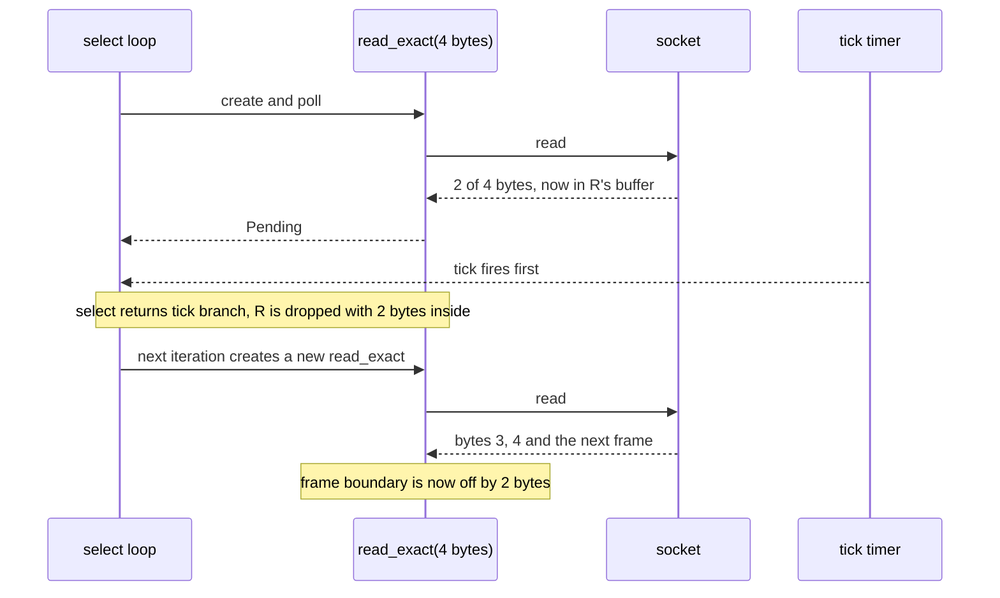
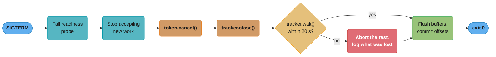
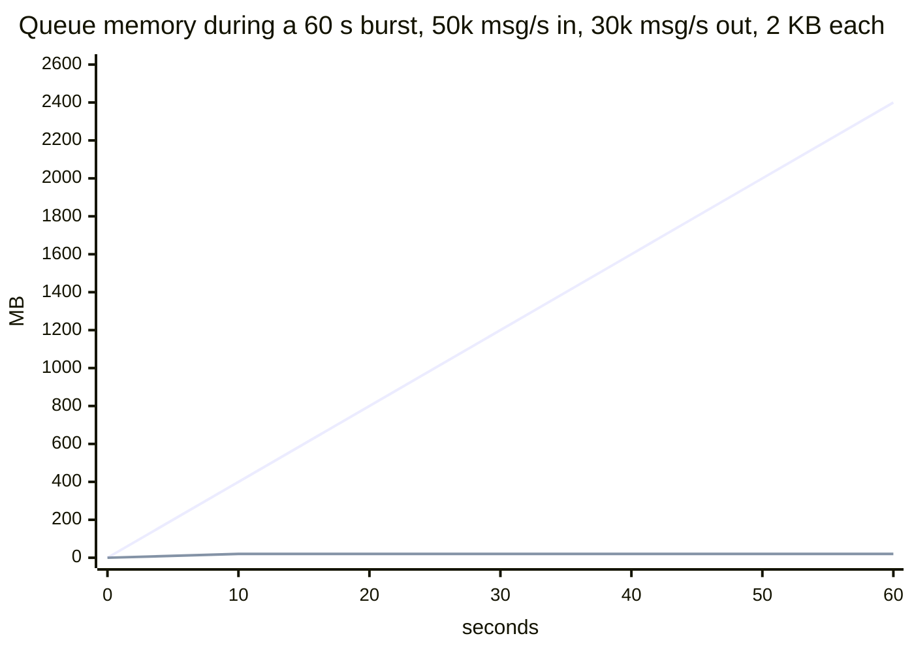

# Async Cancellation and Pitfalls

> **Version anchor (2026-11-06).** Rust 1.99.1 (2026-10-15), edition 2024. Crates: tokio 1.54.1 (MSRV 1.85), tokio-util 0.7.20 (`CancellationToken`, `TaskTracker`), axum 0.8.9, tower 0.5.3. Cancel-safety lists on this page come from the `tokio::select!` docs and the per-method "Cancel safety" sections at tag `tokio-1.54.1`. Rust has no async `Drop` on 1.99.1: `async fn drop` in an `impl Drop` is error E0053. Every version-tagged claim on this page is checked against these rows.

---

## 1. Concept Overview

In Rust, you cancel a future by dropping it. There is no cancel call, no exception and no flag the future must check. The future stops at whichever `.await` it was suspended on, its saved locals run their destructors, and the code after that `.await` never runs.

That rule is simple and it is everywhere:

- `tokio::select!` drops every branch that did not finish.
- `tokio::time::timeout` drops the inner future when the deadline passes.
- `JoinHandle::abort` and dropping a `JoinSet` drop the task's future at its next poll point.
- A web framework drops a handler's future when a timeout layer fires or the connection it serves goes away.
- Shutting down a runtime drops every task that is still pending.

Two consequences carry most of the bugs on this page. First, **cancel safety**: a future that has done half its work when dropped can lose data, for example bytes already read from a socket. Second, **cleanup**: `Drop` is synchronous, so a future cannot `.await` anything when it is cancelled. Flushing a buffer, committing an offset or closing a connection politely must happen before the drop, or in a task that outlives it.

This page also collects the other async traps that show up in production: blocking in async code, locks held across `.await`, unbounded channels, task leaks, unfair `select!` loops and async recursion. The future model is in [Async, Futures and Pinning](../async_futures_and_pinning/async_futures_and_pinning.md). Scheduler internals are in [Tokio Deep Dive](../async_runtimes_and_executors/tokio_deep_dive.md). Go solves the same problem with an explicit `context.Context` that code must check ([Context and Cancellation](../../go/context_and_cancellation/context_and_cancellation.md)), and Python delivers `CancelledError` into the coroutine ([Structured Concurrency in asyncio](../../python/asyncio_and_event_loop/structured_concurrency.md)). Those pages are the contrast, not repeated here.

---

## 2. Intuition

> **One-line analogy**: Cancelling a Rust future is like pulling the plug on a machine, not pressing its stop button. Whatever was half-done stays half-done. Anything that must be tidied up has to be tidy at every moment the plug could be pulled, and the plug can be pulled at every `.await`.

**Mental model.** Treat every `.await` as a line where the function may end with no error and no return value. Ask, for each one: if execution stops here forever, what state is left behind? Data already read but not returned? A row written but its offset not committed? A permit taken but not released? (Permits release in `Drop`, so that one is fine.)

**Why it matters.** Cancellation in Rust is silent. There is no exception to log and no error value to inspect. A `select!` loop that drops a half-finished `read_exact` loses bytes and desynchronizes a protocol. A timeout that drops a database write after the server committed it reports a failure for a success. A shutdown that drops tasks loses whatever they buffered.

**Key insight.** Cancel safety is a property of a specific future at a specific `.await`, and it composes badly. `mpsc::Receiver::recv` is cancel safe, so is `AsyncReadExt::read`, but a function that calls `read` in a loop until it has 4 bytes is not. A function is cancel safe only if dropping it at any of its `.await`s and calling it again gives the same result as not dropping it.

---

## 3. Core Principles

1. **Drop is cancellation.** A dropped future runs no more of its body. Destructors of its saved locals run in reverse order.
2. **Cancellation happens only at `.await`.** Code between two `.await`s runs to completion once started. That is the unit of atomicity in async Rust.
3. **Cancel safe means restartable.** The tokio docs define it: if a future has not completed, it must be a no-op to drop it and recreate it.
4. **Cooperative cancellation is a signal, abort is a drop.** A `CancellationToken` asks tasks to stop at a point they choose. `abort()` drops them at the next poll.
5. **Cleanup is sync.** `Drop` cannot `.await`. Async cleanup runs before the drop, in an explicit `close().await`, or in a spawned task.
6. **Bounded everywhere.** Every queue, channel, task count and blocking-pool use needs a limit. Async code that can accept work faster than it finishes it grows memory until the process dies.
7. **Never block a worker.** A blocking call inside `poll` stops every task queued on that thread, including the ones that would deliver the shutdown signal.

---

## 4. Types / Architectures / Strategies

### Ways to stop async work

| Mechanism | What stops | When it takes effect | Cleanup runs? | Use for |
|---|---|---|---|---|
| Drop the future | That future | Immediately, at its current `.await` | Sync `Drop` only | `select!`, `timeout`, request scope |
| `JoinHandle::abort` | A spawned task | At its next poll | Sync `Drop` only | Killing a task you own |
| Drop a `JoinSet` | Every task in the set | At each task's next poll | Sync `Drop` only | Request-scoped fan-out |
| `CancellationToken::cancel` | Tasks that check the token | When each task next polls `cancelled()` | Yes, the task runs its own async cleanup | Graceful shutdown |
| `timeout(d, fut)` | `fut` | When `d` passes, at `fut`'s current `.await` | Sync `Drop` only | Bounding a call |
| Runtime shutdown | Every pending task | At shutdown | Sync `Drop` only | Process exit |
| Nothing works on | `spawn_blocking` closures already running, `block_in_place` sections | Never; they run to the end | Not applicable | Keep them short |

### Cancel safety of common tokio operations

| Operation | Cancel safe? | What is lost if dropped mid-way |
|---|---|---|
| `mpsc::Receiver::recv`, `UnboundedReceiver::recv` | Yes | Nothing; no message was taken |
| `broadcast::Receiver::recv`, `watch::Receiver::changed` | Yes | Nothing |
| `TcpListener::accept` | Yes | Nothing |
| `AsyncReadExt::read`, `read_buf`; `AsyncWriteExt::write`, `write_buf` | Yes | Nothing; each is one syscall's worth |
| `StreamExt::next` (tokio-stream, futures) | Yes | Nothing |
| `CancellationToken::cancelled`, `TaskTracker::wait` | Yes | Nothing |
| `mpsc::Sender::send` | No data corruption, but | The message is dropped and lost. Use `reserve()` then `permit.send(msg)` |
| `AsyncReadExt::read_exact`, `read_to_end`, `read_to_string` | No | Bytes already read are lost |
| `AsyncWriteExt::write_all` | No | Unknown how much was written |
| `Mutex::lock`, `RwLock::read`, `RwLock::write`, `Semaphore::acquire`, `Notify::notified` | No | The place in the FIFO queue |

### Async pitfalls by family

| Family | Pitfall | Symptom |
|---|---|---|
| Cancellation | Cancel-unsafe future in a `select!` loop | Lost bytes, lost messages, protocol desync |
| Cancellation | Timeout on a non-idempotent call | Duplicate writes after retry |
| Cleanup | Async work needed in `Drop` | Buffers never flushed, connections reset |
| Blocking | Sync I/O or CPU loops on a worker | High latency at low CPU |
| Locking | std `MutexGuard` across `.await` | `!Send` compile error, or deadlock in a local task on `current_thread` |
| Backpressure | Unbounded channel or spawn per message | Memory grows until OOM |
| Leaks | Detached tasks, tasks waiting on channels that never close | `num_alive_tasks` grows |
| Fairness | `biased;` with a hot branch first | Shutdown signal ignored |

---

## 5. Architecture Diagrams

### How a `select!` loop loses data



The two bytes were removed from the socket and lived only inside the dropped future. The fix keeps one future alive across iterations, or reads into a buffer that the loop owns, so the partial frame survives.

### The graceful shutdown sequence



The token tells tasks to finish their current unit of work. The tracker counts them. The deadline must fit inside the orchestrator's grace period (Kubernetes defaults to 30 s), with time left to flush.

### Bounded vs unbounded queue under a burst



The rising line is an unbounded channel: 20,000 extra messages per second at 2 KB each add 40 MB per second, 2.4 GB after a minute. The flat line is a bounded channel of 10,000 messages, which caps the queue at 20 MB and pushes the excess back to the producer as waiting `send` calls.

---

## 6. How It Works - Detailed Mechanics

### 6.1 Drop runs destructors, and nothing else

```rust
use std::future::{Future, pending};
use std::pin::pin;
use std::task::{Context, Poll, Waker};

struct Lease(&'static str);

impl Drop for Lease {
    fn drop(&mut self) {
        println!("released {}", self.0);
    }
}

async fn work() {
    let _lease = Lease("worker-7");
    println!("started");
    pending::<()>().await; // suspended here forever
    println!("this line never runs");
}

fn main() {
    let mut cx = Context::from_waker(Waker::noop());
    {
        let mut fut = pin!(work());
        assert_eq!(fut.as_mut().poll(&mut cx), Poll::Pending);
        println!("dropping the future");
    } // prints "released worker-7"
    println!("after");
}
```

Output: `started`, `dropping the future`, `released worker-7`, `after`. The lease is released, because `Drop` runs for every local saved in the suspended state. The line after the `.await` never runs. Use this property on purpose: anything that must be undone on cancellation (a permit, a lease, a metric gauge) should be undone in a `Drop` impl.

### 6.2 A cancel-safe `select!` loop

The broken shape recreates a non-cancel-safe future on every iteration:

```rust
// fragment: tokio 1.54.1, BROKEN shape
loop {
    tokio::select! {
        res = stream.read_exact(&mut header) => { handle(res?, &header).await?; }
        _ = ticker.tick() => send_heartbeat().await?,
    }
}
```

Two working shapes. The first keeps the in-flight future alive across iterations:

```rust
// fragment: tokio 1.54.1
use std::pin::pin;

// read_frame(rd) owns the read half and its partial buffer, and returns (frame, rd).
let (rd, _wr) = stream.into_split();
let mut read = pin!(read_frame(rd));
loop {
    tokio::select! {
        (frame, rd) = &mut read => {
            handle(frame?).await?;
            read.set(read_frame(rd)); // start the next frame only after this one is done
        }
        _ = ticker.tick() => send_heartbeat().await?,
    }
}
```

The read half moves into the future and comes back with each frame. A pinned future that borrowed `&mut stream` would make `read.set(read_frame(&mut stream))` a second mutable borrow (E0499). That friction is why the second shape is the usual one: keep the partial data in a buffer the loop owns, and use only cancel-safe calls in the `select!`:

```rust
// fragment: tokio 1.54.1, bytes 1.12.1
use bytes::{Buf, BytesMut};
use tokio::io::AsyncReadExt;

let mut buf = BytesMut::with_capacity(64 * 1024);
loop {
    while let Some(frame) = try_parse(&mut buf)? {
        handle(frame).await?;
    }
    tokio::select! {
        n = stream.read_buf(&mut buf) => {   // cancel safe: one read, data lands in `buf`
            if n? == 0 { return Ok(()); }
        }
        _ = ticker.tick() => send_heartbeat().await?,
        _ = shutdown.cancelled() => return Ok(()),
    }
}
```

`tokio_util::codec::FramedRead` packages this pattern: it owns the buffer, and `StreamExt::next` on it is cancel safe.

**Sending inside `select!`.** `tx.send(msg)` in a branch loses `msg` if another branch wins. Reserve capacity first, then send synchronously:

```rust
// fragment: tokio 1.54.1
tokio::select! {
    permit = tx.reserve() => permit?.send(msg), // msg moved only once a slot is held
    _ = shutdown.cancelled() => return Ok(()),
}
```

### 6.3 Fairness: random by default, `biased;` on request

`tokio::select!` picks a random branch to poll first on each call, which spreads attention when several branches are always ready. `biased;` polls in written order, saves the random-number cost and makes order predictable. The tokio docs give the rule for it: you must then keep the order fair yourself. Put shutdown first, or a hot stream starves it:

```rust
// fragment: tokio 1.54.1
loop {
    tokio::select! {
        biased;
        _ = shutdown.cancelled() => break,      // checked first on every iteration
        Some(msg) = rx.recv() => process(msg).await,
        else => break,                           // all branches disabled: channel closed
    }
}
```

A `select!` with no `else` panics when every branch is disabled, for example when `rx.recv()` returns `None` and the pattern `Some(msg)` does not match.

### 6.4 Timeouts and what a dropped call has already done

```rust
// fragment: tokio 1.54.1
use std::time::Duration;
use tokio::time::timeout;

match timeout(Duration::from_millis(250), client.charge(order_id, cents)).await {
    Ok(Ok(receipt)) => Ok(receipt),
    Ok(Err(e)) => Err(e.into()),
    Err(_elapsed) => {
        // The request may have reached the server and succeeded.
        // Retry only with the same idempotency key.
        Err(Error::Unknown { order_id })
    }
}
```

`Err(Elapsed)` means "we stopped waiting", not "it did not happen". Any timeout around a non-idempotent call needs an idempotency key or a status query before a retry. Budget timeouts from the caller's deadline, not as fresh constants at each layer; the deadline-propagation reasoning is in [Context and Cancellation](../../go/context_and_cancellation/context_and_cancellation.md) and applies unchanged.

### 6.5 `CancellationToken`

```rust
// fragment: tokio-util 0.7.20
use tokio_util::sync::CancellationToken;

async fn run(token: CancellationToken, mut jobs: tokio::sync::mpsc::Receiver<Job>) {
    loop {
        tokio::select! {
            biased;
            _ = token.cancelled() => break,
            maybe = jobs.recv() => match maybe {
                Some(job) => {
                    // Finish the current job even if cancel arrives meanwhile.
                    process(job).await;
                }
                None => break,
            },
        }
    }
    flush_local_state().await; // async cleanup is allowed: this is a normal code path
}

fn wire() {
    let root = CancellationToken::new();
    let per_conn = root.child_token();  // cancelling root cancels the child, not the reverse
    let _guard = per_conn.clone().drop_guard(); // cancels per_conn when this scope ends
}
```

| Method | Behaviour |
|---|---|
| `cancel()` | Cancels this token and all children |
| `child_token()` | A token cancelled with its parent, and cancellable alone |
| `cancelled().await` | Completes once cancelled; cancel safe |
| `cancelled_owned()` | Same, owning the token, for `'static` futures |
| `drop_guard()` | Cancels the token when the guard drops, unless disarmed |
| `run_until_cancelled(fut).await` | `Some(output)` if `fut` finished first, `None` if cancelled |

Cooperative cancellation is what makes async cleanup possible. The task sees the signal at a point it chose, finishes the unit of work it was on, and runs any async cleanup as ordinary code.

### 6.6 `TaskTracker` and the shutdown sequence

```rust
// fragment: tokio 1.54.1, tokio-util 0.7.20, axum 0.8.9
use std::time::Duration;
use tokio_util::sync::CancellationToken;
use tokio_util::task::TaskTracker;

#[tokio::main]
async fn main() -> anyhow::Result<()> {
    let token = CancellationToken::new();
    let tracker = TaskTracker::new();

    for i in 0..4 {
        tracker.spawn(consumer(i, token.child_token()));
    }

    let listener = tokio::net::TcpListener::bind("0.0.0.0:8080").await?;
    let server = axum::serve(listener, app())
        .with_graceful_shutdown(shutdown_signal(token.clone()));

    server.await?;              // returns after in-flight requests finish
    token.cancel();             // tell background tasks to stop
    tracker.close();            // wait() can complete once the count reaches zero
    if tokio::time::timeout(Duration::from_secs(20), tracker.wait()).await.is_err() {
        tracing::warn!(left = tracker.len(), "tasks did not stop in 20 s");
    }
    flush_metrics().await;
    Ok(())
}

async fn shutdown_signal(token: CancellationToken) {
    let ctrl_c = tokio::signal::ctrl_c();
    let mut term = match tokio::signal::unix::signal(tokio::signal::unix::SignalKind::terminate()) {
        Ok(s) => s,
        Err(_) => return std::future::pending().await,
    };
    tokio::select! {
        _ = ctrl_c => {},
        _ = term.recv() => {},
        _ = token.cancelled() => {},
    }
}
```

`TaskTracker` differs from `JoinSet` in two ways that matter here: it does not keep task outputs, so finished tasks free their memory at once, and dropping it does not abort tasks. `wait()` completes only after `close()` and when the count is zero.

### 6.7 Abort: when to drop instead of ask

`JoinHandle::abort()` drops the task at its next poll. Use it for tasks with no state worth saving: a cache refresher, a heartbeat, a speculative request that lost a race. Do not use it on a task that is half-way through a multi-step write, because the steps already done stay done. `abort()` has no effect on a `spawn_blocking` closure that is already running.

Dropping a `JoinHandle` does not abort the task. It detaches it, and the task runs on with nobody to observe its result or its panic. That is the most common task leak.

### 6.8 Async cleanup without async `Drop`

`Drop::drop` is a sync method. Declaring it `async` does not compile (E0053). The patterns that work:

| Pattern | How | Weakness |
|---|---|---|
| Explicit async close | `async fn close(self) -> Result<()>` that flushes and shuts down; callers must call it | Forgotten on early returns and on cancellation |
| Close plus a `Drop` fallback | `close()` sets a flag; `Drop` logs or does a best-effort sync cleanup if the flag is unset | The fallback cannot await |
| Spawn from `Drop` | `Drop` calls `tokio::spawn` (or `Handle::spawn`) with the async cleanup | Fails if the runtime is shutting down; no backpressure |
| Owner task | A task owns the resource; handles send it messages; when all senders drop, its `recv` returns `None` and it cleans up | One more task and channel |
| `CancellationToken::drop_guard` | Dropping the guard cancels a token that a cleanup task waits on | Cleanup runs later, not before the drop returns |

### 6.9 Backpressure with bounded channels and semaphores

```rust
// fragment: tokio 1.54.1
use std::sync::Arc;
use tokio::sync::{Semaphore, mpsc};

let (tx, mut rx) = mpsc::channel::<Event>(10_000); // producers wait when 10,000 are queued

let limit = Arc::new(Semaphore::new(64));            // at most 64 concurrent uploads
while let Some(ev) = rx.recv().await {
    let permit = Arc::clone(&limit).acquire_owned().await?;
    tracker.spawn(async move {
        upload(ev).await;
        drop(permit);                                // also released if the task is aborted
    });
}
```

The bounded channel pushes back on producers. The semaphore bounds spawned tasks, and because an `OwnedSemaphorePermit` releases in `Drop`, a cancelled upload still gives its permit back. Spawning a task per message with no limit is an unbounded queue in disguise: each spawned task holds its future and its data until it runs.

### 6.10 Blocking and locks: the short list

These are taught in full on sibling pages. They also break cancellation, which is why they appear here.

- A blocking call on a worker delays every task on that thread, including the task that handles the shutdown signal. A `spawn_blocking` closure ignores cancellation entirely. See [Async Runtimes and Executors](../async_runtimes_and_executors/async_runtimes_and_executors.md).
- A std `MutexGuard` held across `.await` makes the future `!Send`, so `tokio::spawn` rejects it on every runtime flavour. In a task that never moves threads (`spawn_local`, a `LocalSet`, or futures joined inside `block_on`), it compiles and can deadlock. See [Async, Futures and Pinning](../async_futures_and_pinning/async_futures_and_pinning.md).
- `tokio::sync::Mutex::lock` is not cancel safe in the "queue position" sense: a dropped `lock()` loses its place in the FIFO. The lock state stays consistent.

### 6.11 Async recursion and spawn depth

A recursive `async fn` needs `Box::pin` on the recursive call (E0733 without it). Recursion that spawns a task per level can outrun any budget: a crawler that spawns a task per discovered link has no bound on tasks or memory. Use a work queue with a fixed number of worker tasks instead.

---

## 7. Real-World Examples

- **axum** offers `with_graceful_shutdown`, which stops accepting connections and waits for in-flight requests. Its handlers can be dropped mid-way when a tower timeout layer fires, so handler code must be cancel safe at each `.await` ([Web Services with axum, tower and hyper](../web_services_axum_tower_and_hyper/web_services_axum_tower_and_hyper.md)).
- **tonic** clients carry gRPC deadlines; a client-side timeout drops the call future, and the server may still complete the work ([gRPC with tonic](../grpc_with_tonic/grpc_with_tonic.md)).
- **sqlx** transactions roll back in `Drop` when not committed, which makes a cancelled transaction safe by default; the rollback runs on the connection when the pool next uses it ([Databases: sqlx and diesel](../databases_sqlx_and_diesel/databases_sqlx_and_diesel.md)).
- **Ingest pipelines** commit consumer offsets only after the batch is durable; a shutdown that drops a batch mid-upload then replays it instead of losing it ([Design an Async Event Ingest Pipeline](../case_studies/design_an_async_event_ingest_pipeline.md)).
- **Go** passes `context.Context` explicitly and code checks `ctx.Done()`; Rust's equivalent of that cooperative style is `CancellationToken`, and Rust's drop-based cancellation has no Go equivalent ([Concurrency Patterns and Pitfalls](../../go/concurrency_patterns_and_pitfalls/concurrency_patterns_and_pitfalls.md)).
- **Python asyncio** raises `CancelledError` inside the coroutine so `finally` blocks can await; Rust cannot, because `Drop` is sync ([Async Patterns and Pitfalls](../../python/async_patterns_and_pitfalls/async_patterns_and_pitfalls.md)). Java's structured concurrency interrupts subtasks when the scope closes ([Structured Concurrency and Loom](../../java/structured_concurrency_and_loom/structured_concurrency_and_loom.md)). Language-neutral patterns are in [Async and Concurrency Patterns](../../backend/async_and_concurrency_patterns/async_and_concurrency_patterns.md).

---

## 8. Tradeoffs

### Drop-based vs signal-based cancellation

| Property | Drop (`select!`, `timeout`, `abort`) | Signal (`CancellationToken`) | Go `context` | Python `CancelledError` |
|---|---|---|---|---|
| Latency to stop | Next `.await`, immediate for a suspended future | When the task next checks | When code checks `Done()` | Next `await` |
| Async cleanup | No | Yes | Yes | Yes, in `finally` |
| Code must cooperate | No | Yes | Yes | Partly; code can swallow it |
| Risk | Partial work, lost buffered data | A task that never checks never stops | Same | Swallowed cancellation |
| Cost | Zero | One token check per loop | One channel per context | Exception machinery |

### `JoinSet` vs `TaskTracker` vs detached spawn

| | `JoinSet` | `TaskTracker` | Detached `tokio::spawn` |
|---|---|---|---|
| Keeps outputs | Yes, until joined | No | Only in the dropped `JoinHandle` |
| Drop aborts tasks | Yes | No | Not applicable |
| Wait for all | `join_next` loop | `close()` then `wait()` | Not possible |
| Use for | Request-scoped fan-out | Service-wide background tasks at shutdown | Fire and forget, with care |

### Channel capacity choices

| Choice | Memory bound | Producer behaviour when full | Use for |
|---|---|---|---|
| `mpsc::channel(n)` | `n` messages | `send().await` waits | Default for pipelines |
| `mpsc::unbounded_channel()` | None | Never waits | Only when the producer is bounded by something else |
| `try_send` on a bounded channel | `n` messages | Returns `Full`; caller drops or sheds | Load shedding at the edge |
| `broadcast::channel(n)` | `n` per channel | Slow receivers get `Lagged` | Fan-out of state updates |
| `watch::channel` | One value | Overwrites | Latest config or state |

---

## 9. When to Use / When NOT to Use

**Use drop-based cancellation (`select!`, `timeout`) when** the work is read-only, idempotent, or holds its state in values that clean up in `Drop`: a cache lookup, a health probe, a speculative replica read.

**Use a `CancellationToken` when** a task must finish its current unit of work or run async cleanup: consumers, writers, anything that commits.

**Use `JoinSet` when** children belong to one request and must die with it. **Use `TaskTracker` when** you need to wait for long-lived tasks at shutdown.

**Do not put** `read_exact`, `write_all`, `send`, `lock` or any multi-step async function directly in a `select!` loop branch that is recreated each iteration.

**Do not wrap** a non-idempotent remote call in `timeout` and then retry blindly.

**Do not use** unbounded channels, or a spawn per message, on any path fed by the network.

---

## 10. Common Pitfalls

The incidents in 10.3 to 10.7 are composite scenarios. Their numbers are illustrative.

### 10.1 A shutdown flag borrowed by a spawned task

A worker loop checked `stop.load()` on a local `AtomicBool`. It compiled in a test with a scoped executor, then failed when moved to `tokio::spawn`, which needs `'static`. The same bound reproduced with std:

```rust
// BROKEN
use std::sync::atomic::{AtomicBool, Ordering};

fn spawn<F: std::future::Future + Send + 'static>(_f: F) {}
async fn poll_queue() {}

fn main() {
    let stop = AtomicBool::new(false);
    // error[E0373]: async block may outlive the current function, but it borrows `stop`
    spawn(async {
        while !stop.load(Ordering::Relaxed) {
            poll_queue().await;
        }
    });
    stop.store(true, Ordering::Relaxed);
}
```

```rust
// FIX: share ownership of the flag (a CancellationToken clone works the same way)
use std::sync::Arc;
use std::sync::atomic::{AtomicBool, Ordering};

fn spawn<F: std::future::Future + Send + 'static>(_f: F) {}
async fn poll_queue() {}

fn main() {
    let stop = Arc::new(AtomicBool::new(false));
    let flag = Arc::clone(&stop);
    spawn(async move {
        while !flag.load(Ordering::Relaxed) {
            poll_queue().await;
        }
    });
    stop.store(true, Ordering::Relaxed);
}
```

A polled flag also has a latency problem: the task notices only after `poll_queue` returns. `CancellationToken::cancelled()` in a `select!` wakes the task at once.

### 10.2 Trying to write async `Drop`

```rust
// BROKEN
struct Uploader {
    pending: Vec<u8>,
}

impl Drop for Uploader {
    // error[E0053]: method `drop` has an incompatible type for trait
    async fn drop(&mut self) {
        let _ = self.pending.len();
    }
}
```

```rust
// FIX: an explicit async close, plus a Drop that reports a missed close
struct Uploader {
    pending: Vec<u8>,
    closed: bool,
}

impl Uploader {
    async fn flush(&mut self) {
        self.pending.clear(); // upload in the real code
    }

    pub async fn close(mut self) {
        self.flush().await;
        self.closed = true;
    }
}

impl Drop for Uploader {
    fn drop(&mut self) {
        if !self.closed && !self.pending.is_empty() {
            eprintln!("Uploader dropped with {} unflushed bytes", self.pending.len());
        }
    }
}
```

The `Drop` fallback cannot save the data, but it turns a silent loss into a log line that an alert can match.

### 10.3 `read_exact` in a heartbeat loop

A binary-protocol client used `select!` over `read_exact(&mut header)` and a 5-second heartbeat tick. Under normal load, frames arrived fast and the tick rarely won mid-frame. During a slow network event, the tick fired between the first and second TCP segment of a header about once an hour. Each time, the client lost the first segment's bytes and read garbage lengths until the connection was reset. Moving to `FramedRead` with a codec fixed it.

### 10.4 A timeout that created duplicate charges

A checkout service wrapped a payment call in a 2-second `timeout` and retried twice on `Elapsed`. The payment provider's p99.9 was 2.4 s. About 0.05% of orders were charged twice. The fix sent an idempotency key with every attempt and replaced the second retry with a status lookup.

### 10.5 An unbounded channel between the socket and the database

A metrics ingester read from 3,000 TCP connections into an `unbounded_channel` drained by a batch writer. When the database slowed for 4 minutes during a vacuum, the channel grew to 11 million entries and the pod was OOM-killed, losing everything queued. A bounded channel of 50,000 made the socket readers wait, which pushed back through TCP to the senders, and the database slowdown became a lag instead of an outage.

### 10.6 Detached tasks that outlived their request

A handler spawned a "warm the cache" task per request and dropped the `JoinHandle`. When the cache backend hung, those tasks waited forever on a call with no timeout. `num_alive_tasks` grew by 300 per second until memory ran out. The fix put the warm-up in a `JoinSet` owned by the handler, with a 500 ms timeout, so the tasks died with the request.

### 10.7 `biased;` with the shutdown branch last

A consumer used `biased;` for speed with `rx.recv()` first and `token.cancelled()` second. At sustained load `recv()` was always ready, so the shutdown branch was never polled, and every deploy waited the full 30 s grace period before SIGKILL. Moving the shutdown branch first fixed it, as the `select!` docs advise.

---

## 11. Technologies & Tools

| Tool | What it is for |
|---|---|
| `tokio` | `select!`, `time::timeout`, `JoinSet`, `Semaphore`, bounded `mpsc`, signal handling |
| `tokio-util` | `CancellationToken`, `TaskTracker`, `FramedRead` and codecs for cancel-safe framing |
| `axum` | `serve(...).with_graceful_shutdown(...)` for HTTP drain |
| `tower` | Timeout, concurrency-limit and load-shed layers that cancel or reject at the service edge |
| `tokio-console` | Finds leaked tasks, tasks that never yield and lost wakers |
| `loom` | Model-checks shutdown races in code built on std or loom primitives |
| `clippy` | `await_holding_lock` and `await_holding_refcell_ref` lints for guards held across `.await` |

---

## 12. Interview Questions with Answers

**Q: How do you cancel a future in Rust?**
**Short:** You drop it. The future stops at the await where it is suspended, its saved locals run their destructors, and no later code in it runs.

There is no cancel method on `Future`. `select!` drops losing branches, `timeout` drops the inner future at the deadline, `abort()` drops a task at its next poll, and dropping a `JoinSet` drops all its tasks. Because the future simply stops, any work it had done between awaits stays done, and anything it buffered is gone.

**Q: What does "cancel safe" mean for a future used in `tokio::select!`?**
**Short:** It means dropping the unfinished future and creating a new one loses nothing, so a select loop can restart it each iteration safely.

The tokio docs define it as: if the future has not completed, dropping it and recreating it must be a no-op. `mpsc::Receiver::recv` qualifies, because a message is either returned or left in the channel. `read_exact` does not, because bytes already read live inside the dropped future. Check every branch of a `select!` that sits in a loop.

**Q: Why is `read_exact` dangerous inside a `select!` loop?**
**Short:** If another branch wins after read_exact has read some bytes, those bytes are dropped with the future and the stream loses its framing.

`read_exact` reads in several steps into its own progress state. Dropping it mid-way removes data from the socket that nobody will see again. The next frame parse starts at the wrong offset. Read into a buffer the loop owns with the cancel-safe `read_buf`, then parse, or use `FramedRead`, whose `next()` is cancel safe.

**Q: Is `mpsc::Sender::send` safe to use as a `select!` branch?**
**Short:** It does not send twice, but the message is dropped and lost if another branch completes first; reserve a slot first, then send.

The tokio docs say that if `send` loses the race, the message was not sent and is lost. `tx.reserve().await` returns a `Permit` once there is capacity, and `permit.send(msg)` is synchronous, so the message moves only when a slot is held. `reserve` itself loses its queue position if cancelled, which is harmless.

**Q: What does a `timeout` returning `Elapsed` tell you about the wrapped operation?**
**Short:** Only that the caller stopped waiting; the operation may have finished on the remote side, partly finished, or never started.

`timeout` drops the inner future, which stops local work at its current `.await`. A request already written to the socket may still be processed by the server. Retrying a non-idempotent call after `Elapsed` can duplicate it. Send an idempotency key, or query the status before retrying.

**Q: Why can't you run async cleanup in `Drop`?**
**Short:** Drop is a synchronous trait method; declaring it async does not compile, and a drop cannot wait for anything to finish.

`async fn drop` in an `impl Drop` is error E0053. Use an explicit `async fn close(self)`, an owner task that cleans up when its channel closes, or a `Drop` that spawns a cleanup task onto a runtime handle, knowing it fails during runtime shutdown. Add a `Drop` fallback that logs when `close()` was skipped.

**Q: What is the difference between `JoinHandle::abort` and a `CancellationToken`?**
**Short:** abort drops the task at its next poll with no chance to finish; a token is a request that the task sees at a point it chooses and handles itself.

Abort suits tasks with no state to save: a heartbeat, a cache refresher, the loser of a hedged request. A token suits tasks that must finish the current unit of work, commit progress or run async cleanup, which `Drop` cannot do. Neither stops a `spawn_blocking` closure that is already running.

**Q: What happens to a spawned task when you drop its `JoinHandle`?**
**Short:** Nothing stops; the task is detached and keeps running, and its result and any panic go unobserved.

This is the most common task leak. A per-request spawn whose handle is dropped can outlive the request indefinitely if it waits on something that never completes. Keep the handles in a `JoinSet` tied to the request, or use a `TaskTracker` so shutdown can wait for them, and give every external call a timeout.

**Q: What is the graceful shutdown sequence for a tokio service?**
**Short:** On SIGTERM, fail readiness, stop accepting, cancel a token, close the tracker, wait for tasks with a deadline, flush, then exit.

Failing readiness first lets the load balancer drain traffic. `axum::serve(...).with_graceful_shutdown` handles in-flight HTTP requests. `CancellationToken::cancel` reaches background tasks, and `TaskTracker::close` plus `wait` under a `timeout` bounds the wait. Keep the total under the orchestrator's grace period, which defaults to 30 s in Kubernetes.

**Q: Why does `select!` with `biased;` risk ignoring a shutdown signal?**
**Short:** biased polls branches in written order, so a branch that is always ready first can starve every branch after it.

Without `biased;`, `select!` picks a random starting branch on each call, which gives every branch a turn. With it, fairness is your job, and the tokio docs say to put the shutdown future earlier in the list. Use `biased;` when order matters or to save the random-number cost, with the rare-but-urgent branch first.

**Q: Why are unbounded channels dangerous in network services?**
**Short:** They let a fast producer queue work without limit, so a slow consumer turns into unbounded memory growth and an OOM kill.

At 20,000 excess messages per second of 2 KB each, an unbounded channel grows by 40 MB per second. A bounded channel makes `send` wait when full, which propagates backpressure to the producer and, through TCP, to the sender. Use `unbounded_channel` only when something else already bounds the producer.

**Q: How do semaphores give backpressure in async code?**
**Short:** Acquiring a permit before each unit of work caps concurrency; extra callers wait for a permit instead of piling up tasks and memory.

`Arc<Semaphore>` with `acquire_owned()` gives an `OwnedSemaphorePermit` that can move into a spawned task and releases in `Drop`, even if the task is aborted. It bounds concurrent uploads, database calls or `spawn_blocking` use. `Semaphore::acquire` is not cancel safe only in that it loses its FIFO place.

**Q: Which code in an async function can be cancelled, and which cannot?**
**Short:** Only the await points are cancellation points; code between two awaits always runs to completion once it starts.

That makes the stretch between awaits the unit of atomicity. Keep invariants intact at each `.await`: update a struct fully before awaiting, not half before and half after. A multi-step update that spans awaits needs a design that tolerates stopping in the middle, such as a write-ahead record or an idempotent replay.

**Q: Why should a cancelled async task release resources in `Drop` impls?**
**Short:** Drop impls are the only code that runs when a future is cancelled, so permits, leases and gauges released there are released on every path.

Code after an `.await` does not run on cancellation, so `metrics.in_flight.dec()` at the end of a function leaks a count each time the request is dropped. Put the decrement in a guard's `Drop`. Tokio's permits and guards already work this way. Async undo work still needs a token-based path, because `Drop` cannot await.

**Q: What makes a std `Mutex` held across `.await` deadlock on a `current_thread` runtime?**
**Short:** The waiting task blocks the only thread inside lock, so the task holding the guard can never resume to release it.

`tokio::spawn` needs `Send` on every runtime flavour, so the `!Send` guard stops it from compiling there. With `spawn_local` on a `current_thread` runtime or a `LocalSet`, nothing needs `Send`, so it compiles. Task A holds the guard and awaits. Task B calls `lock()` and blocks the thread. A never gets polled again. End the guard before the `.await`, or use `tokio::sync::Mutex` if it must span one.

**Q: How do you stop a task that is running a `spawn_blocking` closure?**
**Short:** You cannot abort it; the closure runs to the end, so it must check a cancellation flag itself or be split into short pieces.

`abort()` on its handle has no effect once the closure starts, and runtime shutdown waits for it unless you use `shutdown_timeout`. Pass an `Arc<AtomicBool>` or check `CancellationToken::is_cancelled()` inside long loops in the closure. Long-running loops that should live for the whole process belong on a dedicated `std::thread`.

**Q: What is the difference between `JoinSet` and `TaskTracker` at shutdown?**
**Short:** JoinSet keeps outputs and aborts its tasks when dropped; TaskTracker keeps no outputs, never aborts, and only counts tasks so shutdown can wait.

A `JoinSet` of long-lived tasks holds every finished task's output until joined, which is a slow leak for service-wide workers. `TaskTracker` frees each task when it ends and offers `close()` and `wait()`. Use `JoinSet` for request-scoped fan-out and `TaskTracker` with a `CancellationToken` for service-wide workers.

**Q: Why does a `select!` loop over `rx.recv()` need an `else` branch or a `None` arm?**
**Short:** When the channel closes, recv returns None; if the pattern is Some(msg), the branch is disabled, and with all branches disabled select panics.

`select!` disables a branch whose pattern does not match. If every branch ends up disabled and there is no `else`, the macro panics. Either match `maybe = rx.recv()` and handle `None`, or add `else => break`. This shows up at shutdown, when every sender drops at the same time.

**Q: How should a recursive or fan-out crawler bound its tasks?**
**Short:** Use a fixed pool of worker tasks pulling from a bounded queue, not a spawn per discovered item, so tasks and memory stay capped.

A spawn per link or per child node grows the task count with the input, and each task holds its future until it runs. A bounded `mpsc` plus N workers caps both, and a `Semaphore` caps any per-item fan-out inside a worker. For recursive `async fn`, `Box::pin` the recursive call, or replace the recursion with an explicit work stack.

**Q: How does Rust's drop-based cancellation compare with Go's `context.Context`?**
**Short:** Go code must check ctx.Done to stop, while a Rust future stops at any await when dropped, with no cooperation and no async cleanup.

Go's style makes cleanup ordinary code but lets a goroutine that never checks run forever. Rust's style stops any suspended future at once but can leave partial work and cannot await during cleanup. `CancellationToken` gives Rust the cooperative style where it is needed. Deadline propagation works the same way in both: pass the caller's remaining budget down.

**Q: Which clippy lints catch guards held across `.await`?**
**Short:** await_holding_lock flags std and parking_lot mutex guards held across an await, and await_holding_refcell_ref flags RefCell borrows.

Both are in clippy's `suspicious` group, which warns by default, and catch the pattern before the `Send` error or a `current_thread` deadlock shows up. They see only the guard types they know. A custom guard type needs the `await_holding_invalid_type` lint configured with its path.

**Q: Why should offsets or acknowledgements be committed only after work is durable?**
**Short:** A task can be cancelled at any await, so committing first and writing second can lose a batch, while writing first means a cancel only causes a replay.

At-least-once delivery depends on that order. If shutdown or a timeout drops the task between the upload and the commit, the batch is replayed on restart, which idempotent writes absorb. The reverse order loses the batch silently. Make the downstream write idempotent so the replay is harmless.

---

## 13. Best Practices

- Read every `.await` as a possible exit. Keep state consistent at each one.
- In `select!` loops, use only cancel-safe calls, or pin one future outside the loop. Keep partial input in a buffer the loop owns, or use `FramedRead`.
- Use `reserve()` then `permit.send()` when sending from a `select!` branch.
- Put shutdown branches first when you use `biased;`. Handle `None` from closed channels or add `else`.
- Use `CancellationToken` for anything that must finish a unit of work or clean up asynchronously. Use `abort` only for stateless tasks.
- Track background tasks with `TaskTracker`. Keep request-scoped children in a `JoinSet`. Never drop a `JoinHandle` you might need.
- Write the shutdown sequence once, with a deadline under the orchestrator's grace period, and test it with a SIGTERM in CI.
- Bound every channel and every spawn loop. Use semaphores for concurrency limits. Never use `unbounded_channel` on a network-fed path.
- Release counters, permits and leases in `Drop` impls so cancellation cannot leak them.
- Give async types an explicit `async fn close`, and log in `Drop` when it was skipped.
- Treat a timeout on a non-idempotent call as "outcome unknown". Retry only with an idempotency key.
- Enable clippy's `await_holding_lock` and `await_holding_refcell_ref`.

---

## 14. Case Study

**A Kafka-to-S3 archiver that lost data on every deploy.**

This is a composite scenario. The numbers are illustrative, not measurements from one real system.

A team ran an archiver on tokio 1.54.1: 6 consumer tasks read from Kafka, buffered events into 64 MB batches, compressed each batch on `spawn_blocking`, uploaded it to S3 and committed the consumer offsets. Throughput was 120,000 events per second. An audit found gaps: about 30,000 events missing per deploy, roughly 2 deploys per day.

**Diagnosis.** Three separate cancellation bugs.

1. **Commit before upload.** The consumer committed offsets when a batch was handed to the upload task, not when the upload finished. On SIGTERM, the runtime shut down and dropped in-flight upload tasks. Their batches were gone, and their offsets were already committed.
2. **No graceful shutdown.** `main` returned when the signal arrived. Returning from `#[tokio::main]` drops the runtime, which drops every pending task at its next poll.
3. **A cancel-unsafe `select!`.** Each consumer ran `select!` over `consumer.recv()` and a flush tick, with `tx.send(batch)` inside a third branch for the upload channel. When the tick won while `send` waited for capacity, the batch inside `send` was dropped.

The first attempt at a fix shared a `stopping` flag by reference with the consumer tasks, and did not compile:

```rust
// BROKEN
use std::sync::atomic::{AtomicBool, Ordering};

fn spawn<F: std::future::Future + Send + 'static>(_f: F) {}
async fn consume_one() {}

fn main() {
    let stopping = AtomicBool::new(false);
    for _ in 0..6 {
        // error[E0373]: async block may outlive the current function, but it borrows `stopping`
        spawn(async {
            while !stopping.load(Ordering::Acquire) {
                consume_one().await;
            }
        });
    }
    stopping.store(true, Ordering::Release);
}
```

```rust
// FIX: each task owns a handle to the shared stop signal
use std::sync::Arc;
use std::sync::atomic::{AtomicBool, Ordering};

fn spawn<F: std::future::Future + Send + 'static>(_f: F) {}
async fn consume_one() {}

fn main() {
    let stopping = Arc::new(AtomicBool::new(false));
    for _ in 0..6 {
        let stop = Arc::clone(&stopping);
        spawn(async move {
            while !stop.load(Ordering::Acquire) {
                consume_one().await;
            }
        });
    }
    stopping.store(true, Ordering::Release);
}
```

The production version used a `CancellationToken` instead of the flag, so a consumer blocked in `recv()` woke at once. The full fix:

```rust
// fragment: tokio 1.54.1, tokio-util 0.7.20
async fn consumer(id: usize, token: CancellationToken, uploads: mpsc::Sender<Batch>) -> Result<()> {
    let mut batch = Batch::new();
    let mut flush = tokio::time::interval(Duration::from_secs(10));
    loop {
        tokio::select! {
            biased;
            _ = token.cancelled() => break,
            _ = flush.tick(), if !batch.is_empty() => {
                let full = std::mem::take(&mut batch);
                // Not in a select branch: if this waits, it waits; nothing is dropped.
                uploads.send(full).await?;
            }
            msg = consumer_recv(id) => {               // cancel safe: message stays in Kafka
                batch.push(msg?);
                if batch.bytes() >= 64 << 20 {
                    uploads.send(std::mem::take(&mut batch)).await?;
                }
            }
        }
    }
    if !batch.is_empty() {
        uploads.send(batch).await?;                    // hand over the partial batch on shutdown
    }
    Ok(())
}

async fn uploader(mut rx: mpsc::Receiver<Batch>) -> Result<()> {
    while let Some(batch) = rx.recv().await {          // ends when every consumer has dropped its sender
        let offsets = batch.offsets();
        let body = tokio::task::spawn_blocking(move || batch.compress()).await?;
        put_object_with_retry(body).await?;            // idempotent: key derived from the offset range
        commit_offsets(offsets).await?;                // commit only after the object is durable
    }
    Ok(())
}
```

Shutdown followed §6.6: cancel the token, wait for the 6 consumers to hand over their partial batches, drop the last senders so the uploader drains and exits, and bound the whole sequence to 25 s inside a 30 s grace period.

| Metric | Before | After |
|---|---|---|
| Events lost per deploy | about 30,000 | 0 in 90 days of audits |
| Events replayed per deploy | 0 | about 8,000, absorbed by idempotent object keys |
| Shutdown time | under 1 s, then data gone | 6 to 14 s |
| Deploys that hit SIGKILL | 0 | 0 |

**Lessons.**

1. Returning from `main` is a cancellation of every task. Write the shutdown sequence explicitly.
2. Commit progress only after the work is durable. Cancellation then causes replays, not loss, and idempotent writes absorb replays.
3. Keep non-cancel-safe calls such as `send` out of `select!` branches, or use `reserve`.
4. The batching, backpressure and memory-bound design of a full pipeline is in [Design an Async Event Ingest Pipeline](../case_studies/design_an_async_event_ingest_pipeline.md). Scheduler behaviour during the drain is in [Tokio Deep Dive](../async_runtimes_and_executors/tokio_deep_dive.md). The channel and atomic choices are in [Channels, Atomics and Shared State](../channels_atomics_and_shared_state/channels_atomics_and_shared_state.md).
