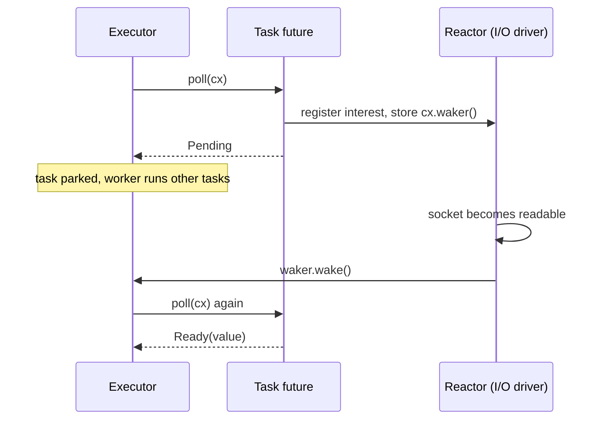
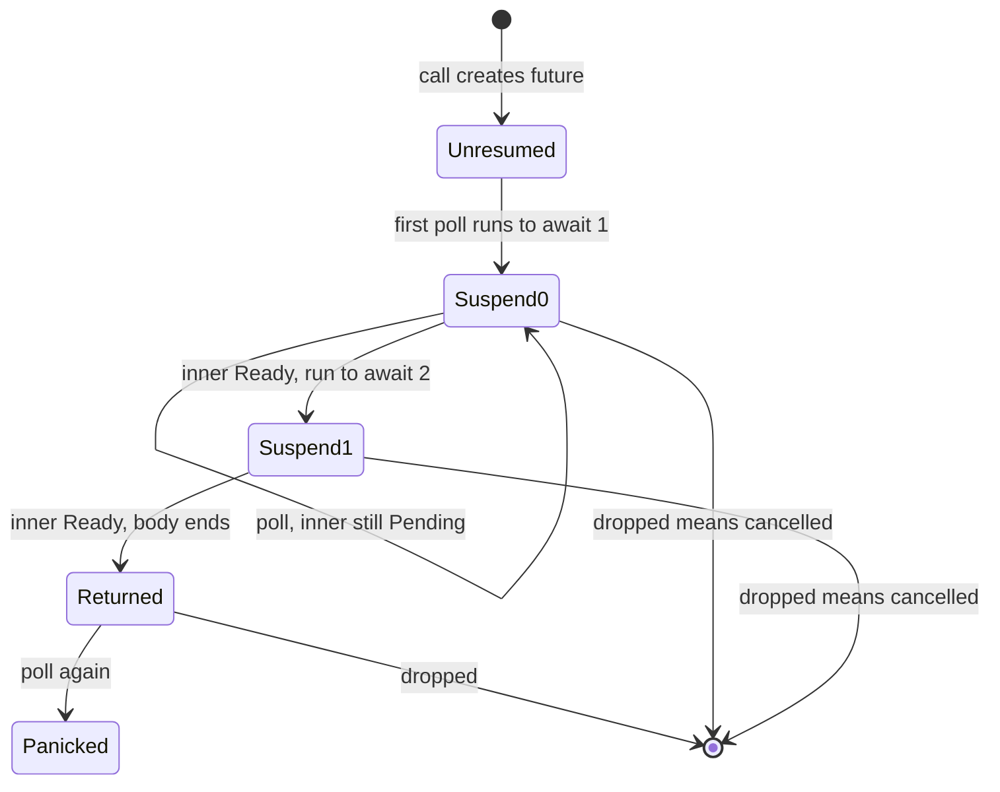
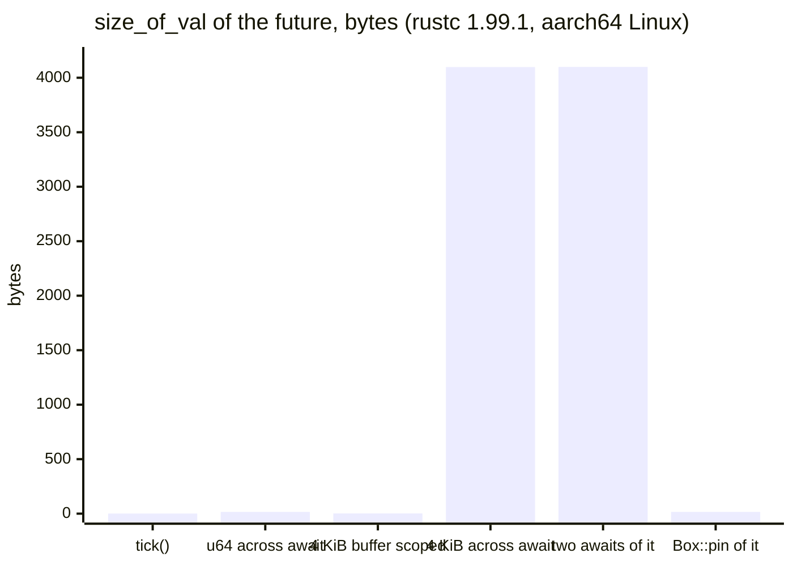

# Async, Futures and Pinning

> **Version anchor (2026-11-06).** Rust 1.99.1 (2026-10-15), edition 2024. `pin!` is stable since 1.68. `async fn` and return-position `impl Trait` in traits are stable since 1.75. Async closures and the `AsyncFn*` traits are stable since 1.85. Edition 2024 puts `Future` and `IntoFuture` in the prelude. `async fn` in `dyn Trait` is not supported on 1.99.1: the Reference's dyn-compatibility rules exclude it. `gen` blocks are not stable. Crates: tokio 1.54.1 (MSRV 1.85), pin-project-lite 0.2.17, trait-variant 0.1.3.

---

## 1. Concept Overview

A Rust future is a value that can make progress when something polls it. The `Future` trait has one method, `poll`, which returns `Poll::Ready(value)` when the work is done or `Poll::Pending` when it is not. An `async fn` does not run when you call it. It returns a future, and the compiler writes that future for you as a state machine: one enum variant per `.await` point, holding the local variables that are still alive at that point.

Three facts make Rust async different from the async model in most other languages:

- **Futures are lazy.** Nothing happens until an executor polls the future. A JavaScript promise or a Python task starts work when you create it. A Rust future that nobody polls never runs a line of its body.
- **Futures are poll-based, not callback-based.** The executor pulls progress out of the future. The future does not push results into a callback. When a future returns `Pending`, it stores a `Waker` so that the I/O driver or a timer can tell the executor to poll it again.
- **The standard library ships the trait, not the runtime.** `std` has `Future`, `Poll`, `Context`, `Waker` and `Pin`. It has no executor, no I/O reactor and no timer. Those come from a runtime crate such as tokio, smol or embassy. See [Async Runtimes and Executors](../async_runtimes_and_executors/async_runtimes_and_executors.md).

The state-machine design has one sharp consequence. The future generated for an `async fn` can contain a reference to one of its own fields, for example a `&buf[..]` borrowed across an `.await`. If that future moves in memory after the first poll, the reference points at the old location. `Pin` is the type-level promise that a value will not move again. That is the reason `Future::poll` takes `self: Pin<&mut Self>` and not `&mut self`.

This page owns the future model: `poll`, `Waker`, the generated state machine, future size, `Pin` and `Unpin`, `Send` futures, async closures, `Stream` and the bridges between sync and async code. Runtime scheduling lives in [Async Runtimes and Executors](../async_runtimes_and_executors/async_runtimes_and_executors.md) and [Tokio Deep Dive](../async_runtimes_and_executors/tokio_deep_dive.md). Dropping a future as cancellation lives in [Async Cancellation and Pitfalls](../async_cancellation_and_pitfalls/async_cancellation_and_pitfalls.md). The kernel side (epoll, kqueue, io_uring, readiness vs completion) is taught in [Async I/O and Event Loops](../../cs_fundamentals/processes_threads_and_context_switching/async_io_and_event_loops.md) and is not repeated here.

---

## 2. Intuition

> **One-line analogy**: A Rust future is a recipe card with a bookmark. Calling the `async fn` prints the card. Nothing cooks until a chef (the executor) picks it up, works until the next "wait for the oven" step, puts the bookmark in, and leaves a buzzer (the `Waker`) with the oven so it can call the chef back.

**Mental model.** Read every `.await` as a possible `return Pending` that saves the local variables into a struct. The struct is the future. Its size is the largest set of locals alive across any one `.await`. Its `Send`-ness is the `Send`-ness of every value in that struct. Its address must stay fixed once polling starts, because some of those saved locals can point at other saved locals.

**Why it matters.** Most async compile errors in Rust are questions about that struct. "Future is not `Send`" means a non-`Send` value is saved across an `.await`. "Recursion in an async fn requires boxing" means the struct would contain itself. "`PhantomPinned` cannot be unpinned" means you tried to get a movable reference to a struct that has promised not to move. A stack overflow in a deep async call chain usually means the struct grew to tens of kilobytes because a large buffer lived across an `.await`.

**Key insight.** Rust async gives you zero heap allocations per `.await`: an entire call tree of `async fn`s compiles into one nested state machine, and the runtime allocates once when you spawn it. The price is that you must reason about what the compiler stores. Go and Java hide that state on a growable stack. Rust shows it to you as a type.

---

## 3. Core Principles

1. **Laziness.** A future does no work until polled. `let f = fetch();` without `.await` or a spawn does nothing. The `#[must_use]` lint warns, but it does not stop the build.
2. **Poll contract.** `poll` must not block. It returns `Ready` once. Before it returns `Pending`, it must arrange for `cx.waker()` to be woken when progress is possible. A future that returns `Pending` with no wake-up registered is never polled again.
3. **Polling after `Ready` is a bug.** A compiler-generated future panics with "`async fn` resumed after completion". Hand-written futures may do anything. Combinators such as `select!` track which branches finished so they never re-poll one.
4. **One allocation per task, not per await.** Nested `async fn` calls inline into the parent's state machine. A spawned task is boxed once by the runtime.
5. **Pinning is a promise about address.** `Pin<P>` says the pointee will not move until it is dropped. It does not stop mutation. It only matters for types that are `!Unpin`. Every type is `Unpin` unless it contains `PhantomPinned` or a compiler-generated future.
6. **`Send` is inferred.** The compiler checks every value held across every `.await`. If one is `!Send` (an `Rc`, a `RefCell` borrow, a `std::sync::MutexGuard`), the whole future is `!Send` and a work-stealing runtime refuses to spawn it.
7. **Colour is real.** An `async fn` can call a sync function. A sync function cannot `.await`. Crossing that line needs an explicit bridge: `block_on` from sync to async, `spawn_blocking` from async to blocking sync.

---

## 4. Types / Architectures / Strategies

### Kinds of futures

| Kind | How you get it | Named type? | Typical use |
|---|---|---|---|
| `async fn` future | call an `async fn` | No, opaque `impl Future` | Almost all application code |
| `async` block | `async { ... }` or `async move { ... }` | No | Spawned tasks, closures, inline concurrency |
| Hand-written `impl Future` | a struct plus `impl Future for T` | Yes | Leaf futures that talk to a reactor, combinators, libraries |
| `poll_fn` future | `std::future::poll_fn(\|cx\| ...)` | No | A small leaf future without a new struct |
| Boxed trait object | `Pin<Box<dyn Future<Output = T> + Send>>` | Yes | Recursion, heterogeneous collections, `dyn` trait methods |
| Combinator output | `tokio::join!`, `tokio::select!`, `futures::future::join_all` | Varies | Running several futures on one task |
| `Stream` | `futures::Stream`, `tokio_stream` | Varies | Many values over time; `poll_next` in place of `poll` |

### Ways to pin

| Constructor | Where the value lives | Works for `!Unpin`? | Cost | Use when |
|---|---|---|---|---|
| `Pin::new(&mut x)` | anywhere | No, needs `T: Unpin` | Free | The type is `Unpin` and an API wants `Pin<&mut T>` |
| `pin!(fut)` `[1.68]` | current stack frame | Yes | Free | Polling a future in a loop or in `select!` inside one function |
| `Box::pin(fut)` | heap | Yes | One allocation | The future must be returned, stored, recursed or type-erased |
| `Pin::new_unchecked` | anywhere | Yes | Free, `unsafe` | Writing a pinning abstraction yourself |

### `Unpin` and `!Unpin`

| Type | `Unpin`? | Why |
|---|---|---|
| `u64`, `String`, `Vec<T>`, `Box<T>` | Yes | No self-references; moving them is always fine |
| `Pin<Box<dyn Future>>` | Yes | Moving the box moves the pointer, not the future |
| A future from an `async fn` or `async` block | No | It can hold a borrow into its own fields |
| A struct with a `PhantomPinned` field | No | Opt-out marker for hand-written self-referential types |
| A struct whose fields are all `Unpin` | Yes | `Unpin` is an auto trait |

---

## 5. Architecture Diagrams

### The poll and wake cycle



The executor never busy-polls a pending future. The only way back onto the run queue is a `wake()` call from whoever owns the event the future waits for. A future that returns `Pending` without storing the waker drops out of this loop forever.

### The state machine an `async fn` becomes



Each `Suspend` state is one enum variant. It stores exactly the locals that are alive across that `.await`. Dropping the future in any state runs the destructors of the locals saved in that state. That is the whole mechanism of cancellation, covered in [Async Cancellation and Pitfalls](../async_cancellation_and_pitfalls/async_cancellation_and_pitfalls.md).

### Why a moved future breaks: the self-reference

```
async fn parse(sock: &mut Socket) {
    let mut buf = [0u8; 1024];
    let slice = &mut buf[..];      // borrow of a local
    sock.read(slice).await;        // buf AND slice saved across this await
}

future at address 0x1000 (after first poll)
+---------------------------+
| state = Suspend0          |
| buf   [0u8; 1024] @0x1008 | <---+
| slice ptr = 0x1008        | ----+   points into the same struct
+---------------------------+

memcpy the future to 0x8000 (a move)
+---------------------------+
| state = Suspend0          |
| buf   [0u8; 1024] @0x8008 |
| slice ptr = 0x1008        | ----> old address: dangling
+---------------------------+
```

`Pin` closes this hole at the type level. After the first poll, the executor only holds a `Pin<&mut F>` or a `Pin<Box<F>>`, and safe code cannot get the `&mut F` that a move needs. The compiler-generated state machine is the sound abstraction. `Pin` alone does not make a hand-written self-referential struct safe.

### Size of the generated future



Measured with `std::mem::size_of_val` on rustc 1.99.1 for the functions in §6.4. A 4 KiB array dropped before the `.await` costs nothing. The same array alive across the `.await` makes the future 4 KiB. Two sequential awaits of that future reuse the same storage, so the parent is 4099 bytes, not 8 KiB. `Box::pin` replaces the 4 KiB with a 16-byte pointer, here a `Pin<Box<_>>` plus the state tag and padding.

---

## 6. How It Works - Detailed Mechanics

### 6.1 The trait

```rust
// fragment: the shape of std::future::Future
pub trait Future {
    type Output;
    fn poll(self: Pin<&mut Self>, cx: &mut Context<'_>) -> Poll<Self::Output>;
}

pub enum Poll<T> {
    Ready(T),
    Pending,
}
```

`Context` carries a `&Waker`. A `Waker` is a cheap, cloneable handle with `wake()` and `wake_by_ref()`. The runtime decides what waking means: push a task id onto a run queue, unpark a thread, or set a flag on a microcontroller. `Waker::will_wake` lets a future skip re-cloning the waker when the executor polls it with the same one.

### 6.2 A hand-written leaf future

A leaf future is where async meets the outside world. This one completes after a background thread fires. It shows the two rules: store the latest waker before returning `Pending`, and make the wake-up visible to the next poll.

```rust
use std::future::Future;
use std::pin::Pin;
use std::sync::{Arc, Mutex};
use std::task::{Context, Poll, Waker};
use std::thread;
use std::time::Duration;

#[derive(Default)]
struct Shared {
    done: bool,
    waker: Option<Waker>,
}

pub struct Delay {
    shared: Arc<Mutex<Shared>>,
}

impl Delay {
    pub fn new(after: Duration) -> Self {
        let shared = Arc::new(Mutex::new(Shared::default()));
        let remote = Arc::clone(&shared);
        thread::spawn(move || {
            thread::sleep(after);
            let waker = {
                let mut s = remote.lock().unwrap_or_else(|e| e.into_inner());
                s.done = true;
                s.waker.take()
            };
            if let Some(w) = waker {
                w.wake();
            }
        });
        Delay { shared }
    }
}

impl Future for Delay {
    type Output = ();

    fn poll(self: Pin<&mut Self>, cx: &mut Context<'_>) -> Poll<()> {
        let mut s = self.shared.lock().unwrap_or_else(|e| e.into_inner());
        if s.done {
            return Poll::Ready(());
        }
        // Keep only the newest waker: a later poll can come from a different task.
        match &s.waker {
            Some(w) if w.will_wake(cx.waker()) => {}
            _ => s.waker = Some(cx.waker().clone()),
        }
        Poll::Pending
    }
}
```

The check of `done` and the store of the waker happen under one lock. If they did not, the timer thread could set `done` and find no waker between the two steps, and the future would sleep forever. That is the lost-wakeup race, and it is the most common bug in hand-written futures.

`Delay` holds only an `Arc`, so it is `Unpin`. That is why `poll` can use `self.shared` through the `Pin` without any projection.

### 6.3 A complete executor in 30 lines

`std` has no executor, but it has the parts. `std::task::Wake` turns an `Arc<T>` into a `Waker`. Thread parking provides the sleep.

```rust
use std::future::Future;
use std::pin::pin;
use std::sync::Arc;
use std::task::{Context, Poll, Wake, Waker};
use std::thread::{self, Thread};

struct ThreadWaker(Thread);

impl Wake for ThreadWaker {
    fn wake(self: Arc<Self>) {
        self.0.unpark();
    }
}

pub fn block_on<F: Future>(fut: F) -> F::Output {
    let mut fut = pin!(fut);
    let waker = Waker::from(Arc::new(ThreadWaker(thread::current())));
    let mut cx = Context::from_waker(&waker);
    loop {
        match fut.as_mut().poll(&mut cx) {
            Poll::Ready(v) => return v,
            Poll::Pending => thread::park(),
        }
    }
}

async fn add(a: u32, b: u32) -> u32 {
    a + b
}

fn main() {
    let total = block_on(async { add(2, 3).await + add(4, 5).await });
    assert_eq!(total, 14);
}
```

`thread::park` can return spuriously, which is harmless here: the loop polls again and gets `Pending` again. An unpark that arrives before the park is remembered as a token, so a wake between `poll` and `park` is not lost. A real runtime adds a task queue, many workers, an I/O reactor and timers. The poll loop stays the same.

### 6.4 What the compiler generates, and why size matters

For this function:

```rust
// fragment: input
async fn handle(id: u64) -> usize {
    let name = lookup(id).await;
    let body = fetch(&name).await;
    body.len()
}
```

the compiler builds roughly this enum, plus a `poll` that switches on it:

```rust
// fragment: illustrative desugaring, not real compiler output
enum HandleFuture {
    Unresumed { id: u64 },
    Suspend0 { lookup_fut: LookupFuture },
    Suspend1 { name: String, fetch_fut: FetchFuture<'self> }, // borrows `name`
    Returned,
}
```

`Suspend1` borrows `name` from its own variant. That is the self-reference from §5, and the reason the generated type is `!Unpin`.

The size is the size of the largest variant plus the tag. These numbers come from rustc 1.99.1 on aarch64 Linux:

```rust
use std::mem::size_of_val;

async fn tick() {}

async fn small() {
    let x = 1u64;
    tick().await;
    let _ = x;
}

async fn big() {
    let buf = [0u8; 4096];
    tick().await;
    let _ = buf.len();
}

async fn big_scoped() {
    {
        let buf = [0u8; 4096];
        let _ = buf.len();
    }
    tick().await;
}

async fn nested() {
    big().await;
    big().await;
}

async fn boxed() {
    Box::pin(big()).await;
}

fn main() {
    assert_eq!(size_of_val(&tick()), 1);
    assert_eq!(size_of_val(&small()), 16);
    assert_eq!(size_of_val(&big()), 4098);
    assert_eq!(size_of_val(&big_scoped()), 2);
    assert_eq!(size_of_val(&nested()), 4099);
    assert_eq!(size_of_val(&boxed()), 16);
}
```

These sizes are layout facts of one compiler version, not language promises. The pattern holds across versions: anything alive across an `.await` is stored, and an inlined child future is stored in full. A request handler that awaits a 64 KiB `[u8; 65536]` read buffer creates a 64 KiB future. If that future runs inside `block_on` on a thread with a small stack, or gets moved into `tokio::spawn` through several stack frames, it can overflow the stack before the runtime ever boxes it. Clippy's `large_futures` lint (pedantic group, `future-size-threshold` default 16384 bytes) flags this.

The fixes, in order of preference:

1. Drop the big value before the `.await` (put it in a block, as `big_scoped` does).
2. Put the buffer on the heap: `vec![0u8; 65536]` is 24 bytes in the future.
3. `Box::pin` the child future so the parent stores a pointer.

### 6.5 `Pin` and `Unpin` in practice

`Pin<P>` wraps a pointer `P`. For `T: Unpin`, `Pin<&mut T>` gives back `&mut T` through `DerefMut`, so pinning changes nothing. For `T: !Unpin`, safe code can only reach `Pin<&mut T>` and `&T`. Getting `&mut T` needs `unsafe { Pin::get_unchecked_mut }`, and the caller then promises not to move out.

```rust
use std::future::Future;
use std::pin::{Pin, pin};
use std::task::{Context, Poll, Waker};

async fn work() -> u8 {
    7
}

fn main() {
    // Stack pinning: the future cannot leave this frame, so no allocation.
    let mut a = pin!(work());
    let mut cx = Context::from_waker(Waker::noop());
    assert_eq!(a.as_mut().poll(&mut cx), Poll::Ready(7));

    // Heap pinning: the future can be returned or stored.
    let mut b: Pin<Box<dyn Future<Output = u8>>> = Box::pin(work());
    assert_eq!(b.as_mut().poll(&mut cx), Poll::Ready(7));
}
```

`as_mut()` reborrows a `Pin<&mut T>` so you can poll it many times without consuming it. `Pin::set` replaces a pinned value in place, which is how a loop restarts a pinned timer.

**Pin projection.** A hand-written future that wraps another future must reach `Pin<&mut Inner>` from `Pin<&mut Self>`. That step is a projection, and it is only sound if the wrapper never moves the inner field, never implements `Unpin` by hand when the field is `!Unpin`, and does not move the field out in `Drop`. `pin-project-lite` generates the projection and enforces those rules:

```rust
// fragment: uses pin-project-lite 0.2.17
use pin_project_lite::pin_project;
use std::future::Future;
use std::pin::Pin;
use std::task::{Context, Poll};
use std::time::Instant;

pin_project! {
    pub struct Timed<F> {
        #[pin]
        inner: F,
        started: Option<Instant>,
    }
}

impl<F: Future> Future for Timed<F> {
    type Output = (F::Output, std::time::Duration);

    fn poll(self: Pin<&mut Self>, cx: &mut Context<'_>) -> Poll<Self::Output> {
        let this = self.project(); // this.inner: Pin<&mut F>, this.started: &mut Option<Instant>
        let start = *this.started.get_or_insert_with(Instant::now);
        match this.inner.poll(cx) {
            Poll::Ready(v) => Poll::Ready((v, start.elapsed())),
            Poll::Pending => Poll::Pending,
        }
    }
}
```

The safe-Rust answer for a self-referential data structure that is not a future is to avoid the self-reference: store indices or offsets into an owned buffer, or use `self_cell` or `ouroboros`. `Pin` is the tool for futures and for intrusive structures written by library authors.

### 6.6 `Send` futures

`tokio::spawn` on the multi-thread runtime requires `F: Future + Send + 'static`, because a worker can steal the task and resume it on another thread. The compiler decides `Send` from the saved state:

```rust
use std::sync::Mutex;

fn require_send<T: Send>(_: T) {}

async fn flush() {}

async fn bump(counter: &Mutex<u64>) {
    {
        let mut n = counter.lock().unwrap_or_else(|e| e.into_inner());
        *n += 1;
    } // guard dropped here, before the await
    flush().await;
}

fn main() {
    let counter = Mutex::new(0);
    require_send(bump(&counter));
}
```

A call to `drop(guard)` before the `.await` does not always help. On rustc 1.99.1, a guard that was written through (`*g += 1`) and then passed to `drop(g)` before `flush().await` still fails the `Send` check, and so does `drop(rc)` on an `Rc` that was read through first. The compiler treats a local that was borrowed as possibly alive until its scope ends. A guard or `Rc` that was never borrowed and is dropped before the `.await` does not count. A `match` on the value behind a fresh `lock()` call keeps the guard temporary alive through every arm, including an `.await` inside one. A block scope that ends before the `.await` is the reliable fix.

**`Send` bounds on `async fn` in traits** `[1.75]`. A trait method `async fn get(&self) -> T` returns an anonymous future, and callers cannot name it to add `+ Send`. A generic caller that spawns the result gets an error. The fixes on 1.99.1:

```rust
// fragment: two ways to require Send from a trait's async methods
use std::future::Future;

// 1. Spell the return type: implementors may still write `async fn`.
pub trait Store {
    fn get(&self, key: u64) -> impl Future<Output = Option<String>> + Send;
}

// 2. Generate a Send variant with trait-variant 0.1.3.
#[trait_variant::make(SendStore: Send)]
pub trait LocalStore {
    async fn get(&self, key: u64) -> Option<String>;
}
```

`async fn` in a trait makes that trait not dyn compatible, so `&dyn Store` is error E0038. For dynamic dispatch, return `Pin<Box<dyn Future<Output = T> + Send + '_>>` from the method by hand, or use the `async-trait` macro, which does the same boxing.

### 6.7 Async closures `[1.85]`

An async closure `async |x| { ... }` returns a future that can borrow from the closure's own captures. A plain closure that returns an `async move` block cannot: each call must clone what the block needs. The `AsyncFn`, `AsyncFnMut` and `AsyncFnOnce` bounds take async closures, `async fn` items and closures that return futures.

```rust
async fn retry<F>(times: u32, op: F) -> Result<u32, String>
where
    F: AsyncFn(u32) -> Result<u32, String>,
{
    let mut last = Err(String::from("never ran"));
    for attempt in 0..times {
        last = op(attempt).await;
        if last.is_ok() {
            break;
        }
    }
    last
}

async fn caller() -> Result<u32, String> {
    let prefix = String::from("try");
    retry(3, async |n| {
        // borrows `prefix` from the closure; no clone per call
        if n == 2 { Ok(n) } else { Err(format!("{prefix} {n} failed")) }
    })
    .await
}

fn main() {
    let _ = caller();
}
```

The `AsyncFn*` traits are not dyn compatible on 1.99.1, so they work as generic bounds, not as `Box<dyn AsyncFn>`.

### 6.8 `Stream`

A `Stream` is the async iterator: `poll_next(self: Pin<&mut Self>, cx) -> Poll<Option<Item>>`. `std` has `AsyncIterator` only as a nightly-only experimental API, so the ecosystem uses the `Stream` trait from the `futures` crate (re-exported by `tokio-stream`). `StreamExt::next()` turns it into a future you can `.await`, and that future is cancel safe in `select!`. A `Stream` is lazy in the same way a future is.

### 6.9 Bridges between sync and async

| Direction | Tool | Rule |
|---|---|---|
| Sync `main` to async | `#[tokio::main]` or `Runtime::block_on` | Never call `block_on` from inside a runtime thread. Tokio panics with "Cannot start a runtime from within a runtime" |
| Async to blocking sync | `tokio::task::spawn_blocking` | Moves the closure to the blocking pool (default cap 512 threads) |
| Async to CPU-heavy work | rayon plus a `oneshot` channel | Keeps the tokio blocking pool for blocking I/O |
| Sync thread to a running runtime | `Handle::block_on` from a non-runtime thread, or a channel | Get the `Handle` with `Handle::current()` before leaving the runtime |
| Library that must not pick a runtime | expose `async fn` and generic I/O traits | See [Async Runtimes and Executors](../async_runtimes_and_executors/async_runtimes_and_executors.md) |

This is function colouring. Rust makes the colour visible and the crossings explicit. Go hides it by making every function able to block a goroutine cheaply ([Goroutines and the Scheduler](../../go/goroutines_and_the_scheduler/goroutines_and_the_scheduler.md)). Java 21+ hides it with virtual threads ([Structured Concurrency and Loom](../../java/structured_concurrency_and_loom/structured_concurrency_and_loom.md)).

---

## 7. Real-World Examples

- **tokio** spawns each task as one heap allocation holding the whole state machine. The multi-thread scheduler needs `Send` futures because workers steal tasks. Details in [Tokio Deep Dive](../async_runtimes_and_executors/tokio_deep_dive.md).
- **hyper and tower.** `tower::Service::call` returns a future, and hyper polls one such future per request. A handler written as `async fn` compiles into the same nested state machine as everything below it.
- **axum** requires handler futures to be `Send`. The usual "handler does not implement `Handler`" error on an axum route is often a `!Send` value held across an `.await` inside the handler. See [Web Services with axum, tower and hyper](../web_services_axum_tower_and_hyper/web_services_axum_tower_and_hyper.md).
- **embassy** runs the same `Future` trait on microcontrollers with no heap. Tasks are statically allocated, and the size of each task's future is a RAM budget you see at link time. See [Embedded Rust and Bare Metal](../embedded_rust_and_bare_metal/embedded_rust_and_bare_metal.md).
- **Python asyncio** creates a coroutine object lazily too, but `asyncio.create_task` schedules it at once, and the event loop is built into the standard library ([asyncio and the Event Loop](../../python/asyncio_and_event_loop/asyncio_and_event_loop.md)).
- **JavaScript** promises start running when created and use a push model of callbacks queued on the microtask queue ([The Event Loop and Scheduling](../../frontend_platform/the_event_loop_and_scheduling/the_event_loop_and_scheduling.md)).

---

## 8. Tradeoffs

### Rust futures vs other concurrency models

| Property | Rust futures | Go goroutines | Java virtual threads | JS promises | Python asyncio |
|---|---|---|---|---|---|
| Start | Lazy, on first poll | At `go` | At `start()` | At creation | Coroutine lazy, task eager |
| Suspended state | Fixed-size struct, sized at compile time | Growable stack, starts at 2 KB | Stack chunks on the heap | Closure captures | Frame object |
| Allocation | One per spawned task | One stack per goroutine | Per virtual thread | Per promise | Per task and per frame |
| Runtime | Library choice | Built in | Built in | Built in | Built into stdlib |
| Preemption | None; cooperative at `.await` | Async preemption | At blocking calls | None | None |
| Thread-safety check | `Send` checked at compile time | Race detector at run time | None at compile time | Single thread | Single thread per loop |
| Colour | Visible, explicit bridges | None | None | Visible | Visible |

### Pinning choices

| Choice | Allocation | Can return it? | Can store in a collection? | Can recurse? |
|---|---|---|---|---|
| `pin!` | None | No | No | No |
| `Box::pin` | One | Yes | Yes, as `Pin<Box<dyn Future>>` | Yes |
| Generic `F: Future` field plus pin projection | None | Yes, inside the wrapper | Only one concrete type | No |

### `Send` vs local futures

| | `Send` futures | `!Send` futures |
|---|---|---|
| Runtime | multi-thread, work stealing | `current_thread`, `LocalSet`, thread-per-core runtimes |
| Shared state | `Arc`, `Mutex`, atomics | `Rc`, `RefCell` |
| Load balance | automatic by stealing | manual, by sharding work |
| Cost | atomic refcounts, `Send` proofs on every `.await` | no atomics; one hot task can starve its thread |

---

## 9. When to Use / When NOT to Use

**Use async futures when:**

- A service holds thousands of mostly idle connections or concurrent outbound calls. Each idle task costs its future's size, often a few hundred bytes to a few KB, not a thread stack.
- You need timeouts, cancellation and fan-out over I/O. `select!`, `timeout` and `JoinSet` compose futures cheaply.
- You target a microcontroller and want concurrency without an RTOS (embassy).

**Do not use async when:**

- The work is CPU-bound. Futures give you no parallelism that rayon or threads do not, and a long `poll` stalls every other task on that worker.
- The program makes a few dozen blocking calls. Plain threads with blocking I/O are easier to debug and to profile. Thread-per-connection is fine into the low thousands of connections.
- The team would need to write hand-written futures and pin projections for the core path, without a reason such as zero-allocation or `no_std`.
- You need a `dyn` trait whose methods are `async fn`. That works only through boxing on 1.99.1. Budget for the allocation or design around generics.

---

## 10. Common Pitfalls

These incidents are illustrative. They show common failure patterns, not specific outages, and their numbers show scale only.

### 10.1 A std `MutexGuard` held across `.await`

A team moved a sync cache into an async handler. The build broke on `tokio::spawn` with "future cannot be sent between threads safely", and the first attempted fix was `unsafe impl Send` on a wrapper, which would have allowed the guard to unlock on a different thread than locked it.

```rust
// BROKEN
use std::sync::Mutex;

fn require_send<T: Send>(_: T) {}
async fn persist() {}

async fn record(hits: &Mutex<u64>) {
    let mut n = hits.lock().unwrap_or_else(|e| e.into_inner());
    *n += 1;
    persist().await; // guard is still alive here
}

fn main() {
    let hits = Mutex::new(0);
    // error: future cannot be sent between threads safely
    // note: has type `std::sync::MutexGuard<'_, u64>` which is not `Send`
    require_send(record(&hits));
}
```

```rust
// FIX: end the guard's scope before the await
use std::sync::Mutex;

fn require_send<T: Send>(_: T) {}
async fn persist() {}

async fn record(hits: &Mutex<u64>) {
    {
        let mut n = hits.lock().unwrap_or_else(|e| e.into_inner());
        *n += 1;
    }
    persist().await;
}

fn main() {
    let hits = Mutex::new(0);
    require_send(record(&hits));
}
```

If the lock really must stay held across the `.await`, use `tokio::sync::Mutex`, whose guard is `Send`. That case is rarer than it looks. See [Async Cancellation and Pitfalls](../async_cancellation_and_pitfalls/async_cancellation_and_pitfalls.md).

### 10.2 A recursive `async fn`

```rust
// BROKEN
// error[E0733]: recursion in an async fn requires boxing
async fn walk(depth: u32) -> u32 {
    if depth == 0 { 0 } else { 1 + walk(depth - 1).await }
}
```

The future would contain itself, so its size is infinite. Box the recursive call:

```rust
// FIX
async fn walk(depth: u32) -> u32 {
    if depth == 0 {
        0
    } else {
        1 + Box::pin(walk(depth - 1)).await
    }
}
```

Each level now allocates once. For a tree walk of 100,000 nodes that is 100,000 allocations. An explicit work stack (`Vec`) in a loop is often faster.

### 10.3 `Pin::new` on a `!Unpin` value

```rust
// BROKEN
use std::marker::PhantomPinned;
use std::pin::Pin;

struct Intrusive {
    _pin: PhantomPinned,
}

fn main() {
    let mut node = Intrusive { _pin: PhantomPinned };
    // error[E0277]: `PhantomPinned` cannot be unpinned
    let _p = Pin::new(&mut node);
}
```

```rust
// FIX: pin it in place, which gives up the right to move it
use std::marker::PhantomPinned;
use std::pin::{Pin, pin};

struct Intrusive {
    _pin: PhantomPinned,
}

fn main() {
    let p: Pin<&mut Intrusive> = pin!(Intrusive { _pin: PhantomPinned });
    let _ = p;
}
```

### 10.4 The forgotten `.await`

An audit-log write was written as `audit.record(event);` with no `.await`. It compiled with an `unused_must_use` warning that drowned among 300 other warnings. For six weeks no audit row was written. The future was created and dropped, and its body never ran. Deny the lint in CI: `#![deny(unused_must_use)]`, or set `CARGO_BUILD_WARNINGS=deny` `[1.97]`.

### 10.5 A 70 KB future overflowing a thread stack

A worker ran `Runtime::block_on(handler())` on threads built with `Builder::stack_size(64 * 1024)`. One handler held a `[u8; 65536]` buffer across an `.await`, so its future alone exceeded the stack. The process died with "thread has overflowed its stack" only on the code path that reached that handler. The fix was `vec![0u8; 65536]`, which made the future about 200 bytes, plus the `clippy::large_futures` lint in CI.

### 10.6 The lost wakeup in a hand-written future

A custom future checked a flag, released the lock, then stored the waker. Under load about one request in 50,000 hung until the client timed out. The producer set the flag in the gap and found no waker to call. The fix was to check the flag and store the waker under the same lock, as `Delay` does in §6.2.

---

## 11. Technologies & Tools

| Tool | What it is for |
|---|---|
| `tokio` | The default runtime: executor, I/O reactor, timers, sync primitives, `spawn_blocking` |
| `pin-project-lite` | Safe pin projection for hand-written futures and stream adapters, as a declarative macro with no proc-macro build cost |
| `trait-variant` | Generates a `Send` variant of a trait that uses `async fn` |
| `async-trait` | Boxes the futures of trait methods so the trait stays dyn compatible |
| `futures` | `Stream`, `StreamExt`, `join_all`, `FuturesUnordered`, and a simple `block_on` |
| `clippy` | The `large_futures` lint, with a `future-size-threshold` of 16384 bytes by default |
| `tokio-console` | Shows each task's poll count, busy time and wake count while the service runs |

---

## 12. Interview Questions with Answers

**Q: Why does calling an `async fn` without `.await` do nothing at all?**
**Short:** An async fn call only builds a future value. No code in its body runs until an executor polls that value, and dropping it unpolled runs nothing.

Rust futures are lazy. The call constructs the state machine in its `Unresumed` state and returns it. Only `poll` advances it, and `.await` or a spawn is what arranges the polling. The compiler emits an `unused_must_use` warning for a dropped future, but the build succeeds. Treat that lint as an error in CI, because a missing `.await` on a write or a log call is a silent data-loss bug.

**Q: Why is a future that keeps a `std::sync::MutexGuard` alive across an `.await` not `Send`?**
**Short:** The guard is stored in the future's state, and MutexGuard is not Send because the OS lock must unlock on the thread that locked it.

The compiler saves every local alive at an `.await` into the generated struct, so the guard becomes a field. `MutexGuard` is `!Send`, so the struct is `!Send`, and `tokio::spawn` rejects it with "future cannot be sent between threads safely". The fix is to end the guard's scope in a block before the `.await`. Use `tokio::sync::Mutex` only when the lock really has to span the `.await`.

**Q: What does `Pin` promise, and what does it not promise?**
**Short:** Pin promises the pointee stays at one address until dropped. It does not prevent mutation and does nothing for Unpin types.

`Pin<&mut T>` removes safe access to `&mut T` when `T: !Unpin`, so safe code cannot `mem::swap` or move the value. Mutation through pin-aware methods is still allowed. For `Unpin` types `Pin` is a no-op wrapper. `Pin` also does not make a hand-written self-referential struct sound by itself: construction and field projection still need a sound abstraction such as `pin-project-lite` or the compiler-generated state machine.

**Q: How does the compiler decide whether an `async fn` returns a `Send` future?**
**Short:** It checks every value that is alive at each await point; the future is Send only if all of them are Send.

The check is on the generated state, not on the function body as a whole. An `Rc` used only between two awaits is fine. An `Rc` alive across an `.await` makes the future `!Send`. The error note names the value and the `.await` where it is held. A local that was borrowed, for example a guard written through with `*g += 1`, counts until its scope ends even after `drop(g)`, because the compiler cannot prove that the borrow ended. A block scope is the reliable fix.

**Q: What happens if `poll` returns `Pending` without storing the waker?**
**Short:** The task is never polled again and hangs forever, because the executor only re-polls a task when something calls its waker.

Executors do not busy-poll. A pending task leaves the run queue and returns only on `wake()`. A leaf future must store `cx.waker()` (or register it with the reactor) before returning `Pending`. It must also make the check-and-store atomic with respect to the event source, or a wake-up between the two steps is lost. Combinators that return `Pending` only because an inner future did are correct, because the inner future registered the waker.

**Q: Why does a recursive `async fn` fail with E0733?**
**Short:** The future would have to contain a copy of itself, so its size would be infinite; boxing the recursive call gives it a fixed size.

Each `async fn` future stores the child futures it awaits inline. A recursive call stores its own type inside itself. `Box::pin(walk(n - 1)).await` stores a pointer instead. The cost is one allocation per level. For deep recursion, an explicit stack in a loop avoids both the allocation per level and the risk of a long pointer chain.

**Q: How large is the future an `async fn` produces?**
**Short:** It is the size of the largest set of locals alive across any single await, plus inlined child futures and a state tag.

On rustc 1.99.1, an `async fn` that keeps a `u64` across one `.await` is 16 bytes, and one that keeps a `[u8; 4096]` across one `.await` is 4098 bytes. Sequential awaits reuse the same storage, so awaiting that 4 KiB child twice gives 4099 bytes, not 8 KiB. These are layout facts of one compiler, not language promises. Measure with `std::mem::size_of_val(&fut)`.

**Q: When should you `Box::pin` a future?**
**Short:** Box it when it must be recursive, stored as a trait object, returned from a dyn method, or when it is large enough to threaten the stack.

`Box::pin` costs one allocation and turns the future into an `Unpin` pointer of fixed size. Use it for recursion, for `Vec<Pin<Box<dyn Future>>>`, for trait objects, and for futures above roughly 16 KB, which is clippy's `large_futures` default. Do not box by reflex on every call: a nested `async fn` call tree inlines into one allocation, and that is the point of the design.

**Q: How do Rust futures differ from JavaScript promises?**
**Short:** A JS promise starts work when created and pushes results to callbacks; a Rust future does nothing until polled and is pulled by an executor.

The pull model lets Rust compile a whole call tree into one state machine with no allocation per await, and it makes cancellation a plain `drop`. The cost is that someone must drive the future, so Rust needs an explicit executor while JS has one built into the engine. A forgotten `.await` in JS still runs the work. In Rust it silently skips it.

**Q: What is in a `Context`, and what is a `Waker` for?**
**Short:** Context carries the Waker of the task being polled; the Waker is the handle an event source calls to put that task back on a run queue.

The `Waker` is a vtable plus a data pointer, so each runtime defines what waking means: push a task id, unpark a thread, or set an interrupt flag on a microcontroller. A future may be polled with a different waker each time, for example when it moves to another task or when a combinator such as `FuturesUnordered` polls it with its own waker. That is why a correct leaf future replaces its stored waker unless `will_wake` says it is the same one.

**Q: Why does the standard library define `Future` but ship no runtime?**
**Short:** Runtimes make platform-specific choices about threads, I/O and timers, so std fixes only the shared interface and leaves executors to crates.

A web server wants work stealing over epoll. A storage engine may want thread-per-core over io_uring. A microcontroller has no threads or heap at all. One trait lets libraries return futures that any of these can drive. The cost is ecosystem coupling: I/O types such as `tokio::net::TcpStream` belong to their runtime, so a library that uses them picks a runtime for its users.

**Q: Can you call an `async fn` trait method through `&dyn Trait` on Rust 1.99.1?**
**Short:** No. A trait with async fn is not dyn compatible on 1.99.1, so dyn use needs methods that return boxed futures.

The Reference's dyn-compatibility rules exclude `async fn` and return-position `impl Trait`, and `&dyn Store` is error E0038. Write the method as `fn get(&self) -> Pin<Box<dyn Future<Output = T> + Send + '_>>`, or use the `async-trait` macro, which generates that boxing. Prefer generics where the set of types is known, because they avoid the allocation per call.

**Q: How do you require the futures from a trait's `async fn` methods to be `Send`?**
**Short:** Declare the method as returning impl Future plus Send, or generate a Send variant of the trait with trait-variant.

Callers cannot name the anonymous future of `async fn` in a trait, so they cannot add `+ Send` at the use site on stable 1.99.1. Writing `fn get(&self) -> impl Future<Output = T> + Send` in the trait puts the bound on every implementation, and implementors can still write `async fn`. `#[trait_variant::make(SendStore: Send)]` produces a second trait with the bound, which suits libraries that serve both local and work-stealing runtimes.

**Q: What is pin projection, and why does `pin-project-lite` exist?**
**Short:** Projection turns a pinned wrapper into pinned references to its fields; doing it by hand needs unsafe code and easy-to-break rules.

A wrapper future must poll its inner future as `Pin<&mut Inner>`. Safe code cannot derive that from `Pin<&mut Self>` when `Inner: !Unpin`. Sound projection needs three rules: never move the pinned field, never implement `Unpin` for the wrapper unless the field is `Unpin`, and never move the field out in `Drop`. `pin-project-lite` generates the projection and makes those rules hold, with no proc-macro build cost.

**Q: What do async closures add over a closure that returns an `async move` block?**
**Short:** An async closure's future can borrow the closure's own captures, so each call need not clone them, and AsyncFn bounds express it.

With `|x| async move { ... }`, the returned block must own what it uses, because a plain closure's output cannot borrow from the closure itself. That forces a clone per call. `async |x| { ... }` `[1.85]` returns a future that borrows from the closure's captures. Accept it with an `AsyncFn(u32) -> T` bound. The `AsyncFn*` traits are not dyn compatible on 1.99.1.

**Q: What is a `Stream`, and why is it not in stable std?**
**Short:** A Stream yields many values through poll_next; std's AsyncIterator is nightly-only, so code uses the Stream trait from the futures crate.

`poll_next` returns `Poll<Option<Item>>`, where `Ready(None)` ends the stream. `StreamExt::next()` wraps one step in a future you can `.await` or use in `select!`, where it is cancel safe. Streams are lazy and need pinning like futures. Async generator syntax is not stable, so stream producers are written with channels plus a wrapper, by hand with `poll_next`, or with a macro crate.

**Q: How do you call async code from sync code, and blocking code from async code?**
**Short:** Use a runtime's block_on from a non-runtime thread to enter async, and spawn_blocking to run blocking calls from inside async code.

`Runtime::block_on` called from inside a tokio worker panics with "Cannot start a runtime from within a runtime", so keep `block_on` to `main`, tests and non-runtime threads. `spawn_blocking` moves a closure to the blocking pool, capped at 512 threads by default in tokio 1.54.1. CPU-heavy work belongs on rayon with a `oneshot` reply, so it does not fill the pool meant for blocking I/O.

**Q: What is function colouring, and how does Rust handle it?**
**Short:** Async and sync functions form two colours that cannot call each other freely; Rust keeps both visible and makes each crossing an explicit bridge call.

An `async fn` can call sync code, but sync code cannot `.await`. Go and Java's virtual threads remove the split by making blocking cheap on a managed stack. Rust keeps the split because it wants no hidden runtime and zero-allocation suspension. The practical result: libraries often ship both a blocking and an async API, or put the core logic in sync code and add a thin async layer.

**Q: Why does `tokio::spawn` require `async move` and a `'static` future?**
**Short:** The spawned task can outlive the caller's stack frame, so it must own its data; async move moves the captures into the future.

A plain `async { ... }` block borrows from the enclosing scope, and that scope may end before the task runs. `spawn` therefore requires `F: 'static`. `async move` moves each captured value into the future. Clone `Arc`s before the block when several tasks need the same data. For borrows of short-lived data, `JoinSet` with owned data or a scoped pattern with `join!` on the same task are the alternatives.

**Q: Should a future polled in a `select!` loop be pinned with `pin!` or `Box::pin`?**
**Short:** Use pin! when the future lives only in that function; use Box::pin only when you must store, return or type-erase it.

`tokio::select!` needs `&mut fut` where `fut: Unpin` to poll the same future across loop iterations. `let mut sleep = pin!(tokio::time::sleep(d));` pins it on the stack with no allocation, and `sleep.as_mut().reset(...)` re-arms it. `Box::pin` gives the same behaviour with one allocation. Recreating the future each iteration is a different program: a fresh `sleep` per loop never fires if messages keep arriving.

**Q: Why must a hand-written future replace its stored waker on every `Pending`?**
**Short:** A later poll can carry a different waker, for example after the future moves to another task, so waking the stale one wakes the wrong task or none.

The `Future` docs say that only the waker from the most recent `poll` should be woken. A future can move to another task, for example through a channel, and combinators such as `FuturesUnordered` give each inner future its own waker. Comparing with `will_wake` and cloning only on a mismatch keeps the common case cheap and the rare case correct. Keeping the first waker forever is the classic cause of tasks that hang only under load.

**Q: Is it safe to poll a future again after it returned `Ready`?**
**Short:** No. A compiler-generated future panics with "async fn resumed after completion", and a hand-written one may do anything.

The `Future` contract leaves behaviour after `Ready` unspecified. Generated state machines move to a `Returned` state and panic if polled again. Combinators such as `join!` and `select!` track completed branches so they never re-poll. If your own loop may poll after completion, wrap the future with `FutureExt::fuse` from the `futures` crate, which returns `Pending` forever after `Ready`.

---

## 13. Best Practices

- Keep large buffers off the `.await` boundary: put them in a block that ends first, or on the heap with `Vec`.
- Enable `clippy::large_futures` in CI. Investigate any future over 16 KB.
- End lock guards in a block scope before every `.await`. Reach for `tokio::sync::Mutex` only when the critical section really contains an `.await`.
- Deny `unused_must_use` so a forgotten `.await` fails the build.
- Prefer `pin!` for futures polled within one function. Use `Box::pin` for recursion, storage and type erasure.
- Write hand-written futures only for leaf I/O or real combinators. Use `pin-project-lite` for projections. Store the waker and check readiness under one lock.
- For public traits with `async fn`, decide the `Send` story in the trait signature (`impl Future + Send`) or with `trait-variant`. Callers cannot add it later.
- Keep `block_on` to `main`, tests and threads the runtime does not own.
- Keep CPU-heavy work off the async workers: rayon for parallel compute, `spawn_blocking` for blocking calls.

---

## 14. Case Study

**A gRPC aggregation service that stopped compiling, then overflowed its stack (illustrative scenario).**

A team ran a tonic service on tokio 1.54.1 that fans each request out to 4 backends and merges the results. Peak load was 12,000 requests per second on 8 workers. Two changes landed in one sprint.

**Change 1: a per-request cache with `RefCell`.** An engineer added a `Rc<RefCell<LruCache>>` shared by the fan-out futures of one request, to avoid repeated lookups. The handler stopped compiling: tonic's generated service needs `Send` futures, and the `Rc` and the `RefMut` were alive across the backend `.await`s.

```rust
// BROKEN
use std::cell::RefCell;
use std::collections::HashMap;
use std::rc::Rc;

fn require_send<T: Send>(_: T) {}
async fn call_backend(_k: u64) -> String {
    String::new()
}

async fn handle(keys: Vec<u64>) -> usize {
    let cache: Rc<RefCell<HashMap<u64, String>>> = Rc::new(RefCell::new(HashMap::new()));
    let mut total = 0;
    for k in keys {
        let hit = cache.borrow().get(&k).cloned();
        let v = match hit {
            Some(v) => v,
            None => call_backend(k).await, // `cache` (an Rc) is alive here
        };
        total += v.len();
        cache.borrow_mut().insert(k, v);
    }
    total
}

fn main() {
    // error: future cannot be sent between threads safely
    // note: has type `Rc<RefCell<HashMap<u64, String>>>` which is not `Send`
    require_send(handle(vec![1, 2, 3]));
}
```

The cache was per request and never shared across tasks, so no lock was needed. The fix was to own the map directly in the future. A plain `HashMap` is `Send`, and only `&mut` access happens between awaits:

```rust
// FIX
use std::collections::HashMap;

fn require_send<T: Send>(_: T) {}
async fn call_backend(_k: u64) -> String {
    String::new()
}

async fn handle(keys: Vec<u64>) -> usize {
    let mut cache: HashMap<u64, String> = HashMap::new();
    let mut total = 0;
    for k in keys {
        let v = match cache.get(&k) {
            Some(v) => v.clone(),
            None => call_backend(k).await,
        };
        total += v.len();
        cache.insert(k, v);
    }
    total
}

fn main() {
    require_send(handle(vec![1, 2, 3]));
}
```

**Change 2: a scratch buffer for response merging.** A second engineer added `let mut scratch = [0u8; 131072];` at the top of the handler and used it after the fan-out. The array was alive across all 4 backend awaits. The handler future grew from about 1.2 KB to about 129 KB. Tokio boxes a spawned task, but this handler was also called from a CLI tool through `Runtime::block_on` on the main thread. In CI, a test that called it from a `std::thread` with a 128 KiB stack crashed with "thread has overflowed its stack".

| Metric | Before | After change 2 | After fix |
|---|---|---|---|
| Handler future size | about 1.2 KB | about 129 KB | about 1.2 KB |
| RSS per 10,000 in-flight requests | about 12 MB | about 1.3 GB | about 12 MB plus buffers in use |
| Stack overflow in 128 KiB thread test | No | Yes | No |

The fix moved the buffer to `Vec::with_capacity(131072)`, created after the last `.await`, and enabled `clippy::large_futures` with the default 16384-byte threshold. The lint flagged two more handlers above 20 KB in the same codebase. Both had a fixed-size array alive across an `.await`.

**Lessons.**

1. A `!Send` error is a statement about the saved state. Find the value the note names and ask whether it must live across the `.await`.
2. Per-task state needs no `Rc` or lock. Own it in the future.
3. Future size is memory per in-flight request. Multiply it by the concurrency before you add a buffer to a handler.
4. The kernel side of this service (epoll readiness under tokio's I/O driver) is in [Async I/O and Event Loops](../../cs_fundamentals/processes_threads_and_context_switching/async_io_and_event_loops.md). The worker and queue behaviour that runs these futures is in [Tokio Deep Dive](../async_runtimes_and_executors/tokio_deep_dive.md). Thread-level `Send` and `Sync` rules are in [Threads, Send, Sync and Locks](../threads_send_sync_and_locks/threads_send_sync_and_locks.md).
