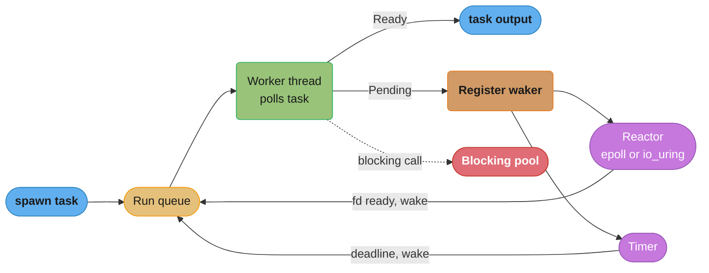
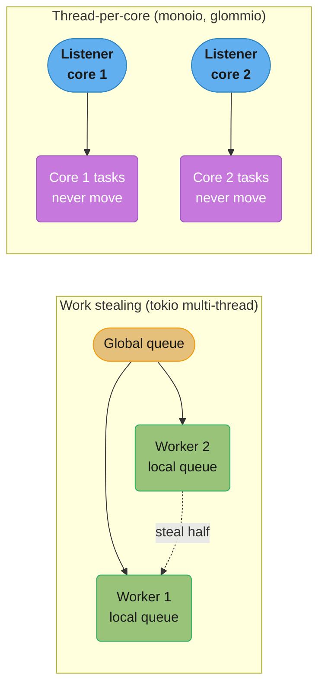
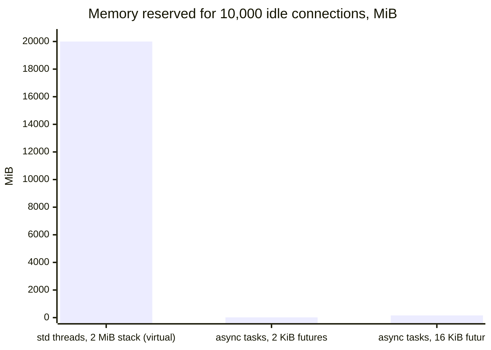
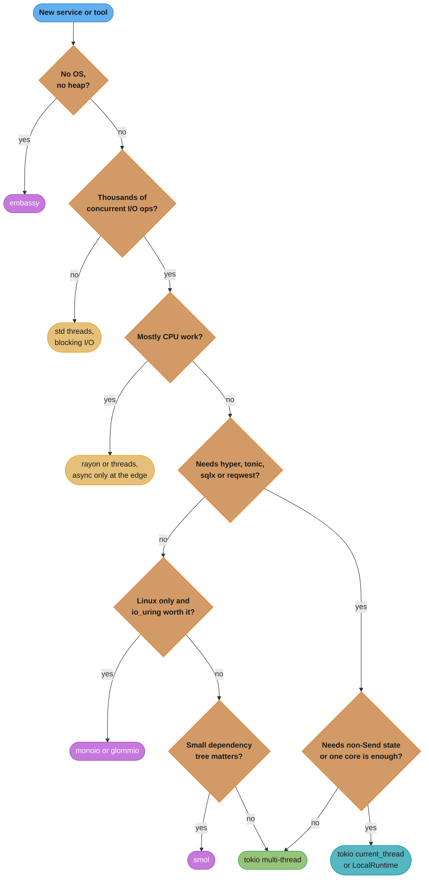

# Async Runtimes and Executors

> **Version anchor (2026-11-06).** Rust 1.99.1 (2026-10-15), edition 2024. Crates: tokio 1.54.1 (MSRV 1.85; LTS lines `1.51.x` until March 2027 and `1.53.x` until September 2027), tokio-util 0.7.20, smol 2.0.2, monoio 0.2.4, glommio 0.9.0, embassy-executor 0.10.0, rayon 1.12.0, hyper 1.12.0. async-std is discontinued; its README says "use `smol` instead", and the last release is 1.13.2 (2025-08-15). Tokio defaults read from source at tag `tokio-1.54.1`: 256-slot local queue, coop budget 128, `max_blocking_threads` 512. Every version-tagged claim on this page is checked against these rows.

---

## 1. Concept Overview

A Rust future does nothing until something polls it, and `std` ships nothing that polls. A **runtime** is the library that does it. Every runtime has three parts:

- **Executor.** Owns the tasks and the run queues. It polls a task when the task is woken and parks the thread when no task is ready.
- **Reactor (I/O driver).** Wraps the OS event API (epoll, kqueue, IOCP or io_uring). It registers sockets and calls the right `Waker` when a socket becomes ready or an operation completes.
- **Timer.** Holds deadlines and wakes tasks when they expire. Without it, `sleep` and `timeout` cannot work.

The runtime choice decides how tasks map to threads, whether tasks must be `Send`, which I/O types your code can use, and what blocking a thread costs. This page holds the section's decision model for that choice: async at all, then tokio multi-thread, tokio `current_thread`, thread-per-core (monoio, glommio), smol or embassy.

The kernel contracts underneath (readiness vs completion, epoll vs io_uring) belong to [Async I/O and Event Loops](../../cs_fundamentals/processes_threads_and_context_switching/async_io_and_event_loops.md). Rust adds one rule on top: with io_uring, the kernel writes into your buffer after you submit, and a Rust future can be dropped at any `.await`, so a completion-based runtime must own the buffer for the life of the operation. That is why monoio and glommio take buffers by value. The future model is in [Async, Futures and Pinning](../async_futures_and_pinning/async_futures_and_pinning.md). Tokio's scheduler internals are in [Tokio Deep Dive](tokio_deep_dive.md).

---

## 2. Intuition

> **One-line analogy**: The executor is a kitchen's head chef deciding which order to work on next. The reactor is the row of oven timers and doorbells. The chef never stares at an oven. A buzzer (the waker) tells the chef which order is ready to continue.

**Mental model.** Picture N worker threads, each with a queue of task pointers. A worker pops a task, calls `poll`, and the task runs until its next `.await` on something not ready. The task registers its waker with the reactor and returns `Pending`. The worker pops the next task. When the reactor sees the socket become readable, it calls `wake`, and the task goes back on a queue. The only time a worker sleeps is when every queue is empty.

**Why it matters.** Three production failures come straight from this model. A task that calls a blocking function holds its worker thread, so every task queued behind it waits. A runtime with work stealing moves tasks between threads, so every task must be `Send`. A library that creates `tokio::net::TcpStream` panics with "there is no reactor running" when called from smol or from a plain thread.

**Key insight.** "Which runtime?" is mostly "where do tasks live, and can they move?". Work stealing lets tasks move and balances load for you, at the cost of `Send` everywhere and some cross-core traffic. Thread-per-core pins each task to one core, drops the `Send` requirement and the atomics, and makes you balance load yourself.

---

## 3. Core Principles

1. **Cooperative scheduling.** A task gives the thread back only at an `.await` that returns `Pending`. No runtime preempts a running `poll`. A 50 ms CPU loop inside `poll` blocks that worker for 50 ms.
2. **Wakers drive everything.** A pending task re-enters a run queue only when its waker is called. The reactor and the timer are the main callers.
3. **I/O types belong to a reactor.** `tokio::net::TcpStream` registers with the tokio reactor on the current thread's runtime context. Outside that context it panics with "there is no reactor running, must be called from the context of a Tokio 1.x runtime".
4. **`Send` follows from task mobility.** A runtime that can move a task between threads requires `Send` futures. A runtime that never moves a task does not.
5. **Blocking work gets its own threads.** Every general-purpose runtime has a separate pool for blocking calls (`spawn_blocking` in tokio, `unblock` in smol) so that a slow `read()` on a file or a DNS lookup does not stall the async workers.
6. **One runtime per process is the normal case.** Two runtimes can coexist, but a future that uses one runtime's I/O types must be polled inside that runtime.

---

## 4. Types / Architectures / Strategies

### Runtimes

| Runtime | Scheduling | Tasks need `Send`? | I/O backend | Platform | Use it for |
|---|---|---|---|---|---|
| tokio multi-thread | Work stealing, one worker per core by default | Yes (`tokio::spawn`) | epoll, kqueue, IOCP through mio | Linux, macOS, Windows, more | Default for network services |
| tokio `current_thread` | One thread runs everything | No for `spawn_local` on a `LocalRuntime`; `tokio::spawn` still needs `Send` | Same as above | Same | Tests, CLIs, one runtime per core by hand, `!Send` state |
| monoio | Thread-per-core, no stealing | No | io_uring on Linux 5.6+, epoll fallback, kqueue on macOS | Linux, macOS | Proxies and gateways that want io_uring |
| glommio | Thread-per-core, cooperative, with task queues and shares | No | io_uring only, Linux 5.8+ | Linux | Storage and I/O-heavy services on Linux |
| smol | Small multi-thread executor plus a reactor, built from smaller crates | Yes for its global spawn | epoll, kqueue, IOCP through async-io | Linux, macOS, Windows | Small binaries, libraries that want few dependencies |
| embassy | Static task arena, interrupt-driven, sleeps the core when idle | No | Hardware peripherals and interrupts | Microcontrollers, `no_std`, no heap | Firmware |
| async-std | Discontinued, last release 1.13.2 | | | | Migrate to smol |

### Async or not

| Workload | Model | Why |
|---|---|---|
| A few hundred concurrent connections, blocking libraries | Thread per connection, `std::thread` | Easier stack traces, no colouring. A std thread reserves 2 MiB of stack address space by default, but only touched pages are resident |
| Thousands to millions of mostly idle connections | Async on a runtime | Each idle task costs its future's size, often well under 10 KB |
| Pure CPU parallelism (parsing, compression, image work) | rayon or threads | Async gives no extra parallelism and a long poll stalls other tasks |
| Mixed: network front, CPU back end | Async plus rayon or `spawn_blocking` | Each pool does one job |
| No OS, no heap | embassy | Static tasks, the core sleeps between interrupts |

### Library strategies for runtime independence

| Strategy | How | Cost |
|---|---|---|
| Sans-I/O core | The protocol is a sync state machine fed with bytes; thin adapters per runtime do the I/O | Two layers to maintain. Easiest to test |
| Generic over I/O traits | Take `T: AsyncRead + AsyncWrite` from one trait family | tokio and `futures` define different traits; adapters needed (`tokio-util::compat`, `async-compat`) |
| Cargo features per runtime | `rt-tokio`, `rt-smol` features select the backend | Feature matrix in CI; features must stay additive |
| Never spawn inside the library | Return futures; let the caller spawn | Caller wiring is more work, but no hidden runtime dependency |

---

## 5. Architecture Diagrams

### Executor, reactor and timer



The executor and the reactor meet only at the waker. The dotted edge is the exception path: a blocking call moved to a separate pool so the worker can return to the run queue.

### Work stealing vs thread-per-core



On the left, an idle worker takes half of a busy worker's queue, so load spreads by itself and every task must be `Send`. On the right, each core accepts its own connections (often with `SO_REUSEPORT`) and its tasks stay there. No `Send`, no stealing, and a hot connection can overload one core while others idle.

### Thread stacks vs task futures at 10,000 connections



The thread column is address space, not resident memory: a thread blocked in `read()` touches only a few pages of its 2 MiB stack, so resident cost is far lower (see [Async I/O and Event Loops](../../cs_fundamentals/processes_threads_and_context_switching/async_io_and_event_loops.md)). The future columns are real heap allocations, one per task. The point of the chart is the ratio of reservations, and the warning that a 16 KiB future multiplies the same way a stack does.

---

## 6. How It Works - Detailed Mechanics

### 6.1 A multi-task executor with `std` only

A runtime is a queue of tasks plus a waker that pushes a task back onto the queue. This executor has no reactor and no timer, but its scheduling loop is the same one tokio and smol run.

```rust
use std::future::Future;
use std::pin::Pin;
use std::sync::mpsc::{Receiver, SyncSender, sync_channel};
use std::sync::{Arc, Mutex};
use std::task::{Context, Poll, Wake, Waker};

type BoxFuture = Pin<Box<dyn Future<Output = ()> + Send>>;

struct Task {
    future: Mutex<Option<BoxFuture>>,
    queue: SyncSender<Arc<Task>>,
}

impl Wake for Task {
    fn wake(self: Arc<Self>) {
        let q = self.queue.clone();
        // A full queue or a stopped executor drops the wake; the task is then never polled.
        let _ = q.try_send(self);
    }
}

pub struct Executor {
    ready: Receiver<Arc<Task>>,
    queue: SyncSender<Arc<Task>>,
}

impl Executor {
    pub fn new(capacity: usize) -> Self {
        let (queue, ready) = sync_channel(capacity);
        Executor { ready, queue }
    }

    pub fn spawn(&self, fut: impl Future<Output = ()> + Send + 'static) {
        let task = Arc::new(Task {
            future: Mutex::new(Some(Box::pin(fut))),
            queue: self.queue.clone(),
        });
        let _ = self.queue.try_send(task);
    }

    pub fn run(self) {
        drop(self.queue); // the loop ends when no task holds a sender
        while let Ok(task) = self.ready.recv() {
            let waker = Waker::from(Arc::clone(&task));
            let mut cx = Context::from_waker(&waker);
            let mut slot = task.future.lock().unwrap_or_else(|e| e.into_inner());
            if let Some(mut fut) = slot.take() {
                if fut.as_mut().poll(&mut cx) == Poll::Pending {
                    *slot = Some(fut);
                }
            }
        }
    }
}

fn main() {
    let ex = Executor::new(1024);
    for i in 0..3 {
        ex.spawn(async move {
            let _ = i * 2;
        });
    }
    ex.run();
}
```

What tokio adds on top: N worker threads with local queues and stealing, a reactor that calls `wake` from epoll events, a hierarchical timer wheel, a blocking pool, a budget that makes a busy task yield, and metrics. The full picture is in [Tokio Deep Dive](tokio_deep_dive.md).

### 6.2 Tokio flavours in code

```rust
// fragment: tokio 1.54.1
use std::time::Duration;
use tokio::runtime::Builder;

fn main() -> std::io::Result<()> {
    // Same as #[tokio::main]: one worker per core, I/O and time drivers on.
    let rt = Builder::new_multi_thread()
        .worker_threads(8)            // default: cores, or TOKIO_WORKER_THREADS
        .max_blocking_threads(64)     // default: 512
        .thread_keep_alive(Duration::from_secs(10)) // default: 10 s for idle blocking threads
        .thread_name("api-worker")
        .enable_all()
        .build()?;

    rt.block_on(async {
        // server code here
    });
    Ok(())
}
```

| Attribute | Runtime it builds |
|---|---|
| `#[tokio::main]` | `new_multi_thread()`, one worker per CPU core |
| `#[tokio::main(flavor = "current_thread")]` | `new_current_thread()`, everything on the main thread |
| `#[tokio::main(flavor = "local")]` | A `LocalRuntime` that supports `spawn_local` for `!Send` tasks |
| `#[tokio::test]` | `new_current_thread()`; the default test runtime is single-threaded |
| `#[tokio::test(flavor = "multi_thread", worker_threads = 2)]` | A real multi-thread runtime, needed for `block_in_place` and for cross-worker races |

The default worker count comes from the CPU count, and tokio's docs point to the caveats of `std::thread::available_parallelism`. In a container, check what that function returns under your CPU quota and set `worker_threads` or `TOKIO_WORKER_THREADS` explicitly if it is wrong. Too many workers for a 2-CPU quota means CFS throttling and long tail latency.

### 6.3 `current_thread` and `!Send` state

A `current_thread` runtime never moves a task, so it can run `!Send` futures through `spawn_local`. That lets you use `Rc` and `RefCell` in task state with no atomics.

```rust
// fragment: tokio 1.54.1
use std::cell::RefCell;
use std::rc::Rc;
use tokio::runtime::{Builder, LocalOptions};

fn main() -> std::io::Result<()> {
    let rt = Builder::new_current_thread()
        .enable_all()
        .build_local(LocalOptions::default())?;

    let hits = Rc::new(RefCell::new(0u64));
    rt.block_on(async {
        let h = Rc::clone(&hits);
        let task = tokio::task::spawn_local(async move {
            *h.borrow_mut() += 1;
        });
        let _ = task.await;
    });
    Ok(())
}
```

A common thread-per-core pattern on tokio is one `current_thread` runtime per core, each on its own OS thread, each with its own `SO_REUSEPORT` listener. It gives the thread-per-core shape with tokio's ecosystem, but without io_uring.

### 6.4 Thread-per-core runtimes and owned buffers

monoio and glommio run one executor per core and never move a task. Tasks need not be `Send`, and per-core state needs no locks.

Their I/O API differs from tokio's because of io_uring. With epoll, a read happens inside `poll`: the kernel says "readable", then the future calls `read(fd, &mut buf)`. If the future is dropped, nothing is in flight. With io_uring, the future submits "read into this buffer" and the kernel may write into the buffer later. If the future is dropped while the operation is in flight and the buffer was a borrowed `&mut [u8]`, the kernel would write into memory that the program has already freed or reused. So these runtimes take the buffer by value and give it back with the result:

```rust
// fragment: monoio 0.2.4, from the project README echo example
use monoio::io::{AsyncReadRent, AsyncWriteRentExt};
use monoio::net::TcpStream;

async fn echo(mut stream: TcpStream) -> std::io::Result<()> {
    let mut buf: Vec<u8> = Vec::with_capacity(8 * 1024);
    let mut res;
    loop {
        (res, buf) = stream.read(buf).await;
        if res? == 0 {
            return Ok(());
        }
        (res, buf) = stream.write_all(buf).await;
        res?;
        buf.clear();
    }
}
```

If the future is dropped, the runtime keeps the buffer alive until the kernel finishes with it. The cost: these I/O traits are not tokio's `AsyncRead`, so most of the tokio ecosystem (hyper, tonic, sqlx) does not run on them without adapters.

| Requirement | monoio | glommio |
|---|---|---|
| Kernel for io_uring | Linux 5.6+, epoll mode below that, kqueue on macOS | Linux 5.8+, io_uring only |
| Locked memory | Configure memlock for io_uring | At least 512 KiB of locked memory |

### 6.5 smol

smol is a small runtime that re-exports smaller crates: `async-executor`, `async-io` (the reactor), `blocking` (the blocking pool), `async-channel` and others. A library can depend on one piece, for example `async-io` for a reactor, without the rest. To use a tokio-based library from smol, wrap it with the `async-compat` adapter, which runs a tokio context alongside. async-std is discontinued and its README points to smol, so new code that wants a small non-tokio runtime uses smol.

### 6.6 embassy

embassy runs the same `Future` trait on microcontrollers. Tasks are statically allocated with `#[embassy_executor::task]`, and `pool_size` sets how many instances of one task function can run at once (default 1). No heap is needed. If the tasks do not fit in RAM, the linker reports it at build time. When no task is ready, the thread-mode executor sleeps the core with `WFE`/`SEV` on Cortex-M, or `WFI` on RISC-V. An `InterruptExecutor` runs tasks at interrupt priority on Cortex-M. See [Embedded Rust and Bare Metal](../embedded_rust_and_bare_metal/embedded_rust_and_bare_metal.md).

### 6.7 Mixing runtimes, and the "no reactor" panic

| Situation | What happens | Fix |
|---|---|---|
| `tokio::net::TcpStream::connect` called from a plain thread | Panics: "there is no reactor running, must be called from the context of a Tokio 1.x runtime" | Call it inside `rt.block_on` or a spawned task, or call `rt.enter()` first |
| A tokio future polled by `smol::block_on` | Same panic on first I/O | Wrap with `async-compat`, or use one runtime |
| `Runtime::block_on` inside a tokio task | Panics: "Cannot start a runtime from within a runtime" | `.await` the future, or use `spawn_blocking` plus a channel |
| A `Runtime` dropped inside async code | Panics, because dropping a runtime blocks | Drop it from sync code, or use `shutdown_background` |
| Two tokio runtimes, one for control plane, one for data plane | Works. Each task must use the I/O types of the runtime that polls it | Keep `Handle`s and spawn onto the right one |

### 6.8 Choosing the worker count

| Workload | Worker threads | Blocking threads |
|---|---|---|
| HTTP API, mostly waiting on a database | CPU quota (often 2 to 8 in containers) | Default 512 cap is fine; most stay idle and exit after 10 s |
| Proxy, CPU spent in TLS and parsing | CPU quota, pinned | Low; set `max_blocking_threads` to bound memory |
| Service that reads many files with `tokio::fs` | CPU quota | Size for concurrent file ops, because each `tokio::fs` call runs on the blocking pool |
| Test suite | 1 (`#[tokio::test]` default) | Default |

---

## 7. Real-World Examples

- **tokio** is the runtime under hyper, axum, tonic, reqwest and sqlx. Choosing any of these crates chooses tokio. See [Web Services with axum, tower and hyper](../web_services_axum_tower_and_hyper/web_services_axum_tower_and_hyper.md) and [gRPC with tonic](../grpc_with_tonic/grpc_with_tonic.md).
- **Thread-per-core designs** are common in proxies and storage engines. The proxy case study compares work stealing with thread-per-core for an L7 proxy ([Design a High-Performance L7 Proxy](../case_studies/design_a_high_performance_l7_proxy.md)). Envoy itself runs one event loop per worker thread in C++ ([Envoy Proxy](../../technologies/envoy_proxy/envoy_proxy.md)).
- **monoio** is developed by ByteDance (GitHub org `bytedance/monoio`). **glommio** is developed at DataDog (`DataDog/glommio`).
- **embassy** runs async firmware on Cortex-M and RISC-V microcontrollers with no heap.
- **Go** has one built-in runtime with work stealing and preemption, so the runtime choice never comes up ([Goroutines and the Scheduler](../../go/goroutines_and_the_scheduler/goroutines_and_the_scheduler.md)). **Python** has asyncio in the standard library, single-threaded per loop ([Event Loop Internals](../../python/asyncio_and_event_loop/event_loop_internals.md)).

---

## 8. Tradeoffs

### Runtime numbers

| Fact | Value | Source |
|---|---|---|
| tokio worker threads | One per CPU core by default; `worker_threads()` or `TOKIO_WORKER_THREADS` overrides | tokio 1.54.1 `Builder` docs |
| tokio worker thread stack | 2 MiB default, "subject to change" | `Builder::thread_stack_size` docs |
| tokio local run queue | 256 tasks per worker; overflow moves half to the global queue | `queue.rs`, runtime module docs |
| tokio coop budget | 128 per task poll | `task/coop/mod.rs` |
| tokio blocking pool | `max_blocking_threads` 512; idle threads exit after 10 s | `builder.rs`, `blocking/pool.rs` |
| tokio event interval | Reactor checked every 61 scheduled tasks | runtime module docs |
| tokio global queue check | Every 31 ticks on `current_thread`; multi-thread self-tunes it from the mean poll time, between 2 and 127 ticks | `current_thread/mod.rs`, `multi_thread/stats.rs` |
| tokio timer granularity | 1 ms | `time::sleep` docs |
| std thread stack | 2 MiB on tier 1 platforms; `RUST_MIN_STACK` overrides | std docs |
| glommio | Linux 5.8+, at least 512 KiB locked memory | glommio README |
| monoio io_uring mode | Linux 5.6+; epoll or kqueue otherwise | monoio README |

### Decision model: runtime choice

| Question | If yes | If no |
|---|---|---|
| More than a few thousand concurrent connections or outbound calls? | Async | Threads and blocking I/O are likely enough |
| Need hyper, axum, tonic, reqwest or sqlx? | tokio | Any runtime fits |
| Need `!Send` task state, or one core is enough? | tokio `current_thread` or `LocalRuntime` | tokio multi-thread |
| Linux only, I/O bound, team can live without the tokio ecosystem, and load per connection is even? | monoio or glommio | tokio |
| Library that must not force a runtime? | Sans-I/O core, generic I/O traits, no internal spawn | Depend on tokio directly |
| Microcontroller, no OS, no heap? | embassy | A hosted runtime |
| Want a small dependency tree for a CLI or library? | smol | tokio with minimal features |

| Option | Load balance | `Send` needed | Ecosystem | Tail latency risk | io_uring |
|---|---|---|---|---|---|
| tokio multi-thread | Automatic stealing | Yes | Largest | A blocking task stalls one worker; stealing hides some of it | No (epoll, kqueue, IOCP) |
| tokio `current_thread` | None | No (local tasks) | Largest | Any blocking call stalls everything | No |
| monoio | Per core, by accept distribution | No | Small, own I/O traits | A hot connection overloads one core | Yes |
| glommio | Per core, with shares between task queues | No | Small, Linux only | Same as monoio | Yes, required |
| smol | Executor dependent | Yes for global spawn | Medium, tokio via adapter | Similar to tokio | No |
| embassy | Static tasks, interrupt priorities | No | Embedded HALs | Bounded by task design | Not applicable |

---

## 9. When to Use / When NOT to Use



Most network services end at the green box. The other exits exist for constraints the service really has: no OS, CPU-bound work, `!Send` state, io_uring, or a dependency budget.

**Use tokio multi-thread when** you build a network service in the tokio ecosystem and want load balancing without thinking about it.

**Use `current_thread` when** you write tests, a CLI that makes a handful of requests, or a per-core design with `!Send` state.

**Use monoio or glommio when** you run on Linux, measure that io_uring helps your workload, can spread connections evenly across cores, and accept a smaller ecosystem.

**Do not use async when** the program has fewer than a few thousand concurrent operations and its libraries are blocking. Threads cost less in debugging time. Do not use async for CPU parallelism at all.

**Do not write a library that hard-codes a runtime** unless it wraps a tokio-only crate anyway. Return futures and let the binary choose.

---

## 10. Common Pitfalls

The incidents below are composite scenarios. Their numbers are illustrative.

### 10.1 Blocking a worker with `std::thread::sleep` or sync I/O

A service on 4 workers called a sync SDK that made a 300 ms HTTP request with a blocking client. At 20 requests per second, 6 calls were in flight on average, more than the 4 workers. p99 went from 40 ms to 2.1 s, and health checks timed out, so Kubernetes restarted healthy pods. CPU was at 15%. The fix moved the call to `spawn_blocking`, then to the SDK's async client. [Async Cancellation and Pitfalls](../async_cancellation_and_pitfalls/async_cancellation_and_pitfalls.md) covers this failure in full.

### 10.2 A runtime per request

A library created a fresh `Runtime` inside a sync function to call one async API, on every call. Each call spawned worker threads for every core and tore them down. Under load the process created and joined about 8,000 threads per second. The fix built one runtime at startup (or used a `current_thread` runtime held in a `LazyLock` `[1.80]`) and reused its `Handle`.

### 10.3 Wrong worker count in a container

A pod with a 2-CPU quota on a 64-core node started 64 workers. The sandbox hid the cgroup files from the process, and the std docs say `available_parallelism` may then overcount and return the host's CPU count. The CFS quota throttled the process every 100 ms period, and p99 latency rose by tens of milliseconds at low CPU usage. The fix set `TOKIO_WORKER_THREADS=2` from the pod's CPU limit.

### 10.4 Spawning a `!Send` task on the multi-thread runtime

A task that keeps an `Rc` across an `.await` cannot go to `tokio::spawn`. Teams then reach for `unsafe impl Send`. The std-only demonstration of the bound:

```rust
// BROKEN
use std::rc::Rc;

fn spawn<F: std::future::Future + Send + 'static>(_f: F) {}
async fn tick() {}

fn main() {
    let counter = Rc::new(0u64);
    // error: future cannot be sent between threads safely
    // note: has type `Rc<u64>` which is not `Send`
    spawn(async move {
        tick().await;
        let _ = *counter + 1;
    });
}
```

```rust
// FIX: Arc for shared state on a work-stealing runtime
use std::sync::Arc;
use std::sync::atomic::{AtomicU64, Ordering};

fn spawn<F: std::future::Future + Send + 'static>(_f: F) {}
async fn tick() {}

fn main() {
    let counter = Arc::new(AtomicU64::new(0));
    spawn(async move {
        tick().await;
        counter.fetch_add(1, Ordering::Relaxed);
    });
}
```

The other valid fix keeps `Rc` and runs the task with `spawn_local` on a `LocalRuntime` or `current_thread` runtime.

### 10.5 A library that needs tokio, used from smol

A database driver used `tokio::net::TcpStream` internally. A team on smol called it and got "there is no reactor running" on the first query. They had to add `async-compat`, which starts a tokio runtime in the background, so the process ran two reactors. The library could have exposed a sans-I/O core or a runtime feature flag.

### 10.6 Unbounded blocking-pool growth

A file-upload service used `tokio::fs` for every chunk. Under a burst, the blocking pool grew to its 512-thread cap. Each blocking thread had a 2 MiB stack reservation and its own buffers, RSS reached 3 GB, and the pod was OOM-killed. The blocking queue applies no backpressure, as tokio's docs say. The fix bounded concurrency with a `Semaphore` of 32 permits and set `max_blocking_threads(64)`.

---

## 11. Technologies & Tools

| Tool | What it is for |
|---|---|
| `tokio` | Work-stealing and `current_thread` runtimes, mio-based reactor, timer wheel, blocking pool |
| `tokio-util` | `CancellationToken`, `TaskTracker`, codecs and `compat` adapters to the `futures` I/O traits |
| `smol` | Small runtime assembled from `async-executor`, `async-io` and `blocking` |
| `async-compat` | Runs tokio-based futures and I/O types under smol or another executor |
| `monoio` | Thread-per-core runtime with io_uring, epoll and kqueue drivers and owned-buffer I/O traits |
| `glommio` | Thread-per-core io_uring runtime for Linux with task queues and shares |
| `embassy-executor` | Static-task async executor for microcontrollers |
| `rayon` | Data-parallel thread pool for CPU work beside an async runtime |
| `tokio-console` | Live view of tasks, polls and wakes on a tokio runtime built with `tokio_unstable` |

---

## 12. Interview Questions with Answers

**Q: What is the difference between an executor and a reactor?**
**Short:** The executor decides which ready task to poll next; the reactor watches the OS for I/O events and calls the wakers of tasks waiting on them.

The executor owns run queues and worker threads. The reactor wraps epoll, kqueue, IOCP or io_uring and maps each event to a `Waker`. They meet only at `wake()`, which moves a task from "waiting" back onto a run queue. A timer is a third component that wakes tasks on deadlines. Tokio bundles all three. smol splits them into `async-executor` and `async-io`.

**Q: Why does `tokio::spawn` require the future to be `Send`, while `spawn_local` does not?**
**Short:** The multi-thread runtime can move a task to another worker at any await, so its state must be Send; a local task never leaves its thread.

Work stealing takes tasks from a busy worker's queue and polls them on an idle one. Every value saved in the future may then be touched from a new thread. `spawn_local` on a `LocalRuntime` or `LocalSet` pins the task to one thread, so `Rc` and `RefCell` are allowed. The `'static` bound applies in both cases, because the task can outlive the caller.

**Q: What happens to other tasks when one task calls `std::thread::sleep` inside async code?**
**Short:** The worker thread running that task stops for the whole sleep, so every task queued on that worker waits and its I/O events go unprocessed.

Scheduling is cooperative: a worker regains control only when `poll` returns. With 4 workers and 4 tasks sleeping 300 ms, the whole runtime stalls for 300 ms. Work stealing moves queued tasks to other workers, but cannot help when all workers block. Use `tokio::time::sleep` for waiting, and `spawn_blocking` for blocking calls.

**Q: Why do you get "there is no reactor running" from a tokio type?**
**Short:** Tokio I/O and timer types register with the runtime found in the current thread's context, and none exists on that thread.

`TcpStream::connect`, `sleep` and `spawn` look up a thread-local runtime handle. A plain thread, a smol executor or a test without `#[tokio::test]` has none, and tokio panics with "there is no reactor running, must be called from the context of a Tokio 1.x runtime". Fix it by running inside `block_on` or a spawned task, by calling `rt.enter()`, or with `async-compat` from another runtime.

**Q: When is thread-per-connection with blocking I/O the better design?**
**Short:** When concurrency stays in the hundreds or low thousands and the libraries are blocking, threads are easier to write, debug and profile.

A std thread reserves a 2 MiB stack by default, but that is address space, and an idle blocked thread keeps only a few pages resident. A thousand threads fit easily on a modern server. Stack traces and profilers show what each thread is doing, and there is no function colouring. Async pays off at tens of thousands of mostly idle connections or many concurrent outbound calls.

**Q: How does `#[tokio::main]` differ from `#[tokio::test]` by default?**
**Short:** tokio::main builds a multi-thread runtime with one worker per core, while tokio::test builds a single-threaded current_thread runtime per test.

A test can pass on `current_thread` and fail in production, because one thread hides races between tasks on different workers. `block_in_place` also panics on `current_thread`. Add `#[tokio::test(flavor = "multi_thread", worker_threads = 2)]` for tests that exercise concurrency or use `block_in_place`.

**Q: Why do io_uring runtimes in Rust take buffers by value?**
**Short:** With io_uring the kernel writes into the buffer after submission, and dropping the Rust future does not stop that write, so the runtime must own the buffer.

Under epoll, the read happens inside `poll` after readiness, so dropping the future leaves nothing in flight. Under io_uring, the read is submitted and runs in the kernel. If the buffer were a borrowed `&mut [u8]` and the future were dropped, the kernel could write into freed memory. monoio's `stream.read(buf).await` returns `(result, buf)`, and the runtime keeps the buffer alive until completion.

**Q: What does thread-per-core give up compared with work stealing?**
**Short:** It gives up automatic load balancing; a hot connection or an uneven accept pattern overloads one core while other cores sit idle.

In exchange, tasks never move, so they need no `Send`, per-core state needs no locks or atomics, and caches stay warm. Balancing moves to the accept layer (`SO_REUSEPORT`, a per-core listener, or hashing). It suits proxies with many small, even connections. It suits a service with a few heavy, long requests badly.

**Q: Is async-std a reasonable choice for new code?**
**Short:** No. async-std is discontinued; its README says to use smol instead, and its last release is 1.13.2 from 2025-08-15.

Existing async-std code keeps working but receives no fixes. smol shares much of its lineage and offers similar APIs. For services that need hyper, tonic or sqlx, the choice is tokio. Migrating means swapping I/O and timer types and the spawn calls, plus the `#[async_std::main]` attribute.

**Q: How do you write a library that does not force a runtime on its users?**
**Short:** Keep the protocol logic in a sans-I/O core, accept generic I/O, and never spawn tasks or create I/O types inside the library.

A sans-I/O core is a sync state machine fed bytes and returning bytes and events, which is also easy to test. Thin adapter crates or Cargo features connect it to tokio or smol. Spawning inside the library hides a runtime dependency, so return futures and let the caller spawn. Note that tokio's `AsyncRead` and the `futures` crate's `AsyncRead` are different traits, so a generic API must pick one and offer an adapter.

**Q: How many worker threads should a tokio service run in a container?**
**Short:** Match the CPU quota, not the host's core count; check what available_parallelism reports and set worker_threads explicitly if it is wrong.

The default is one worker per CPU core reported to the process. A pod limited to 2 CPUs on a 64-core node that starts 64 workers gets throttled by CFS each period, which shows up as tail latency at low average CPU. Set `TOKIO_WORKER_THREADS` or `worker_threads()` from the limit, and measure.

**Q: What is the blocking pool for, and what is its default size?**
**Short:** It runs blocking calls and file I/O off the async workers; tokio 1.54.1 caps it at 512 threads, and idle threads exit after 10 seconds.

`spawn_blocking`, `tokio::fs`, DNS lookups through `ToSocketAddrs` and stdio all use it. Threads are created on demand up to `max_blocking_threads`. Beyond the cap, work waits in a queue that applies no backpressure, so a burst can queue without bound. Bound the callers with a `Semaphore` and lower the cap when each blocking call holds a lot of memory.

**Q: What does embassy do differently from a hosted runtime?**
**Short:** Embassy allocates every task statically with no heap, sizes task storage at link time, and sleeps the core with WFE or WFI when nothing is ready.

`#[embassy_executor::task]` reserves a static slot per task function, and `pool_size` allows several instances. Wakers come from interrupts. There are no threads to block, so a busy loop in a task blocks every other task on that executor. An `InterruptExecutor` on Cortex-M runs higher-priority tasks preemptively at interrupt level.

**Q: Can two tokio runtimes run in the same process?**
**Short:** Yes. Each runtime has its own workers, reactor and timer, and each future must use the I/O types of the runtime that polls it.

Teams split a control plane from a data plane this way, so a burst on one cannot starve the other. Spawn onto a runtime through its `Handle`. Pitfalls: calling `block_on` from inside a runtime panics, dropping a `Runtime` inside async code panics because the drop blocks, and a socket created under one runtime and polled under another misses its wake-ups.

**Q: Why does the smol ecosystem need `async-compat` to call tokio-based crates?**
**Short:** Tokio-based crates use tokio's reactor and timer through a thread-local context, which smol does not provide, so an adapter supplies one.

`async-compat` wraps the future and enters a tokio runtime context around each poll. The process then runs two reactors. That works for a few tokio-only dependencies, but if most of the stack is tokio-based, use tokio directly.

**Q: Why is a runtime created per call a performance bug?**
**Short:** Building a multi-thread runtime spawns a worker per core and an I/O driver; doing that per call costs thread creation and teardown on every request.

Under load this can mean thousands of thread creations per second, plus lost connection pools, because pools bound to the old runtime die with it. Create one runtime at startup, keep its `Handle`, and use `handle.block_on` from non-runtime threads. A `current_thread` runtime in a `LazyLock` is a cheap option for a sync library facade.

**Q: What is the cost of using io_uring through a thread-per-core runtime instead of tokio?**
**Short:** You lose the tokio ecosystem; hyper, tonic and sqlx expect tokio's I/O traits, while monoio and glommio use owned-buffer traits of their own.

The kernel requirements are real too: glommio needs Linux 5.8+ and at least 512 KiB of locked memory, and monoio needs Linux 5.6+ for its io_uring driver. Measure first. Many services spend their time in TLS, parsing and the application, not in syscalls, and see little gain.

**Q: Why might a task never run again after `wake` on a home-made executor?**
**Short:** If wake fails to put the task back on the run queue, for example because the queue is full or closed, the task is lost with no error.

The executor in §6.1 drops a wake when `try_send` fails. Real runtimes use unbounded or overflow-capable queues for exactly this reason: tokio's local queue moves half its tasks to the global queue when its 256 slots fill. Any executor you write must make "wake" infallible, or detect and report a lost wake.

**Q: When does tokio's `current_thread` runtime beat the multi-thread runtime?**
**Short:** It wins for tests, small CLIs and per-core sharded designs, where one thread avoids cross-thread wakes, atomics and the Send requirement.

A cross-thread wake costs a cache-line transfer and sometimes a futex call to unpark a worker. On one thread, wakes are local queue pushes. The cost is that one blocking call or long poll stalls everything. Many teams run one `current_thread` runtime per core with `SO_REUSEPORT` to get thread-per-core on top of the tokio ecosystem.

**Q: Does a runtime preempt a task that loops without awaiting?**
**Short:** No Rust runtime can preempt a running poll; a loop with no pending await keeps the thread until it returns.

Tokio's coop budget of 128 makes tokio resources return `Pending` after enough operations, which forces a yield in a loop that keeps awaiting ready channels or sockets. A loop of pure computation never touches that budget. Insert `tokio::task::yield_now().await` in long loops, or move the work to `spawn_blocking` or rayon.

---

## 13. Best Practices

- Choose the runtime once per binary, in `main`. Libraries return futures.
- Set `worker_threads` from the container CPU limit. Name the threads (`thread_name`) so profiles and panics say which pool they came from.
- Never block a worker. Move blocking calls to `spawn_blocking`, CPU work to rayon, and bound both with a `Semaphore`.
- Keep `max_blocking_threads` at a value you can afford in memory, and bound callers so the queue stays short.
- Use `#[tokio::test(flavor = "multi_thread")]` for tests that check concurrency.
- Build one runtime per process (or one per core in a sharded design). Never build one per call.
- Before you adopt monoio or glommio, measure syscall time under real load and check that every crate you need runs on them.
- Pin tokio to an LTS line (`~1.53`) if you need a stable MSRV of 1.71. tokio 1.54 raised the MSRV to 1.85.

---

## 14. Case Study

**A notification gateway that missed its SLO at 15% CPU.**

This is a composite scenario. The numbers are illustrative, not measurements from one real system.

A team ran a push-notification gateway on tokio 1.54.1 in pods with a 4-CPU limit. Each request validated a token, rendered a template and called a provider over HTTP. Load was 1,500 requests per second, the SLO was p99 under 150 ms, and observed p99 was 1.8 s, with CPU at 15% and no errors.

**Diagnosis.** `tokio-console` showed tasks with long "busy" times and low poll counts. Runtime metrics showed the global queue depth at 400 to 900 during bursts, and all 4 workers busy. The cause was the template engine: a sync library that read templates from disk on a cache miss with `std::fs::read_to_string`, on the async worker. A cold cache after each deploy made 2 to 10 ms disk reads on network storage. With 4 workers, 4 concurrent misses stalled the runtime.

The same pattern reduced to std types, with a worker pool that requires `Send` closures:

```rust
// BROKEN
use std::cell::RefCell;
use std::collections::HashMap;
use std::rc::Rc;

fn spawn<F: std::future::Future + Send + 'static>(_f: F) {}
async fn send_push(_body: String) {}

fn render(cache: &RefCell<HashMap<String, String>>, name: &str) -> String {
    cache.borrow_mut().entry(name.to_string()).or_default().clone()
}

fn main() {
    // The first fix attempt: a per-task cache in Rc to avoid the shared lock.
    let cache = Rc::new(RefCell::new(HashMap::new()));
    // error: future cannot be sent between threads safely
    // note: has type `Rc<RefCell<HashMap<String, String>>>` which is not `Send`
    spawn(async move {
        let body = render(&cache, "welcome");
        send_push(body).await;
        let _ = cache.borrow().len();
    });
}
```

The compiler rejected the first attempt, which tried to remove the lock by keeping a non-`Send` cache alive across the `.await`. The working fix had two parts: an `Arc` cache shared by all tasks, and the disk read moved off the worker.

```rust
// FIX
use std::collections::HashMap;
use std::sync::{Arc, RwLock};

fn spawn<F: std::future::Future + Send + 'static>(_f: F) {}
async fn send_push(_body: String) {}
async fn load_template_blocking(name: String) -> String {
    // In the service: tokio::task::spawn_blocking(move || std::fs::read_to_string(path))
    name
}

async fn render(cache: &RwLock<HashMap<String, String>>, name: &str) -> String {
    let hit = cache
        .read()
        .unwrap_or_else(|e| e.into_inner())
        .get(name)
        .cloned();
    match hit {
        Some(t) => t,
        None => {
            let t = load_template_blocking(name.to_string()).await;
            cache
                .write()
                .unwrap_or_else(|e| e.into_inner())
                .insert(name.to_string(), t.clone());
            t
        }
    }
}

fn main() {
    let cache = Arc::new(RwLock::new(HashMap::new()));
    spawn(async move {
        let body = render(&cache, "welcome").await;
        send_push(body).await;
    });
}
```

The `RwLock` guards live inside single expressions, so none of them crosses an `.await`, and the future stays `Send`.

**Second finding: the worker count.** The pods ran 4 workers on a 4-CPU limit, which was correct. A sidecar team had copied the service config to a 1-CPU sidecar, which also started 4 workers. Its p99 dropped from 90 ms to 35 ms after `TOKIO_WORKER_THREADS=1`.

| Metric | Before | After |
|---|---|---|
| p99 latency | 1.8 s | 62 ms |
| Peak global queue depth | 900 | under 20 |
| CPU | 15% | 18% |
| Blocking threads in use, peak | 0 | 14 of a cap of 64 |

**Lessons.**

1. Low CPU with high latency on an async service means blocked workers, not missing capacity. Look at queue depth and busy time first.
2. A sync library inside async code is a blocking call until proven otherwise. Read what it does on a cache miss.
3. Size workers per pod from the CPU limit, and do not copy runtime config between services with different limits.
4. The scheduler details behind these metrics are in [Tokio Deep Dive](tokio_deep_dive.md). The blocking pitfalls and their cancellation side are in [Async Cancellation and Pitfalls](../async_cancellation_and_pitfalls/async_cancellation_and_pitfalls.md). Thread and lock behaviour is in [Threads, Send, Sync and Locks](../threads_send_sync_and_locks/threads_send_sync_and_locks.md).
