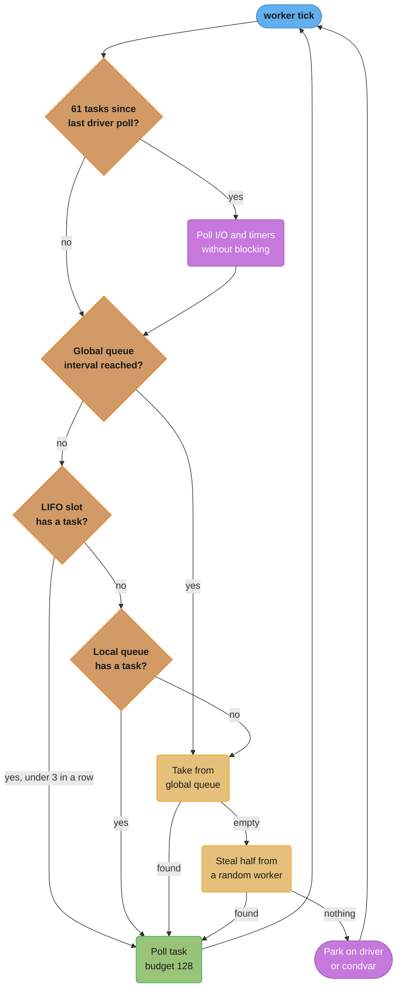
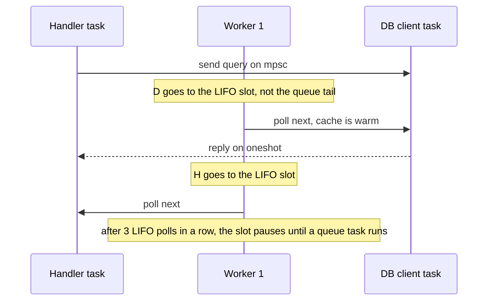

# Tokio Deep Dive

> **Version anchor (2026-11-06).** tokio 1.54.1 (2026-10-21, MSRV 1.85), tokio-util 0.7.20, console-subscriber 0.5.0, tokio-console 0.1.14, on Rust 1.99.1 (2026-10-15). LTS lines: `1.51.x` until March 2027 and `1.53.x` until September 2027, both MSRV 1.71; pin one with `tokio = { version = "~1.53" }`. Scheduler numbers on this page are read from the source and module docs at tag `tokio-1.54.1`: local queue 256 slots, coop budget 128, `max_blocking_threads` 512, LIFO slot limit 3 polls in a row, event interval 61, I/O events per tick 1024, timer wheel of 6 levels with 64 slots each at 1 ms. The runtime module docs label the scheduler description "behavior at the time of writing", so these are implementation facts, not API promises.

---

## 1. Concept Overview

Tokio is the runtime under most Rust network services: hyper, axum, tonic, reqwest and sqlx all run on it. This page explains what the multi-thread runtime does between your `.await` and the next poll, so that a stall, a latency spike or a growing memory graph can be traced to a cause.

The runtime has five parts:

- **Workers.** One OS thread per CPU core by default. Each has a local run queue of 256 tasks and a one-task LIFO slot.
- **The inject (global) queue.** Shared by all workers. Tasks woken from outside a worker, and overflow from full local queues, land here.
- **The blocking pool.** Separate threads, up to 512 by default, for `spawn_blocking`, `tokio::fs` and other blocking work.
- **The I/O driver.** A wrapper around mio, which wraps epoll, kqueue or IOCP. A parked worker polls it for up to 1024 events per call.
- **The time driver.** A hierarchical timer wheel with 1 ms resolution.

The runtime choice (tokio vs smol vs thread-per-core vs embassy) is made in [Async Runtimes and Executors](async_runtimes_and_executors.md). The future and waker model is in [Async, Futures and Pinning](../async_futures_and_pinning/async_futures_and_pinning.md). Shutdown and cancel safety are in [Async Cancellation and Pitfalls](../async_cancellation_and_pitfalls/async_cancellation_and_pitfalls.md). The epoll mechanics under mio are in [Async I/O and Event Loops](../../cs_fundamentals/processes_threads_and_context_switching/async_io_and_event_loops.md).

---

## 2. Intuition

> **One-line analogy**: Each worker is a cashier with a short line (256 people) and one "next up" spot at the counter. A shared overflow line feeds every cashier. A cashier with no line walks over and takes half of a busy cashier's line. Customers who need a long phone call (blocking work) go to a separate call centre so the cashiers keep serving.

**Mental model.** A worker loops: take the LIFO slot task if there is one, else the local queue, else every so often the global queue, else steal, else park on the I/O driver. Every 61 tasks it also checks the driver for new events. A task runs until it returns `Pending`, and each tokio resource it touches spends one unit of a 128-unit budget, so a task that never waits on anything still yields when the budget runs out.

**Why it matters.** Most tokio incidents are one of four shapes: a worker blocked by sync code, a task that never yields, a queue that grows because producers outpace consumers, or a blocking pool that fills. Each has a signature in runtime metrics or `tokio-console`, and each signature only makes sense if you know the loop above.

**Key insight.** Tokio's fairness is cooperative and probabilistic. The LIFO slot favours the task that was just woken, which is fast for request/response pairs. The budget and the global-queue interval exist to stop that bias from starving everyone else. Every one of those mechanisms depends on your code reaching an `.await` on a tokio resource.

---

## 3. Core Principles

1. **Local first.** A worker prefers its LIFO slot, then its local queue, because those need no cross-thread synchronization.
2. **Overflow moves half.** When the 256-slot local queue is full, the worker moves 128 tasks plus the new one to the global queue in one batch.
3. **Steal half.** An idle worker picks a random victim and moves half of its local queue. The runtime lets only about half of the workers search at once, to limit contention.
4. **The budget forces yields.** Each task poll starts with a budget of 128. Tokio resources (channels, sockets, timers) consume it. At zero they return `Pending` and wake the task at once, so it goes to the back of the queue.
5. **Blocking work never runs on a worker.** `spawn_blocking` and `tokio::fs` use the blocking pool. `block_in_place` turns the current worker into a blocking thread and hands its queue to a new worker.
6. **One thread drives I/O at a time.** The driver sits behind a try-lock. A worker that parks with no work takes the driver; other parked workers wait on a condvar.

---

## 4. Types / Architectures / Strategies

### Queues and slots

| Structure | Owner | Capacity | Filled by | Drained by |
|---|---|---|---|---|
| LIFO slot | One worker | 1 task | A task woken by a task running on that worker | The same worker, next. Not stealable |
| Local run queue | One worker | 256 tasks | Spawns and wakes on that worker | The owner (LIFO end) and thieves (half at a time) |
| Inject queue | Runtime | Unbounded linked list | Wakes from non-worker threads, overflow batches | Any worker, every `global_queue_interval` ticks or when local work is empty |
| Blocking queue | Blocking pool | Unbounded, no backpressure | `spawn_blocking`, `tokio::fs` | Up to 512 blocking threads |

### Ways to run work

| API | Runs on | Needs `Send`? | Can be aborted? | Use for |
|---|---|---|---|---|
| `tokio::spawn` | Worker threads | Yes | Yes, at the next `.await` | Async tasks |
| `task::spawn_local` | The `LocalRuntime` or `LocalSet` thread | No | Yes | `!Send` async tasks |
| `task::spawn_blocking` | Blocking pool | Yes | No, once started | Blocking I/O, sync libraries |
| `task::block_in_place` | Current worker, converted to a blocking thread | No | No | Short blocking sections where moving data to another thread is costly |
| `JoinSet::spawn` | Worker threads | Yes | Yes; dropping the set aborts all | A dynamic group of tasks with results |
| `TaskTracker::spawn` (tokio-util) | Worker threads | Yes | Not by the tracker | Waiting for many tasks at shutdown without keeping their results |

### Sync primitives

| Primitive | Lock held across `.await`? | Fair? | Cost | Use when |
|---|---|---|---|---|
| `std::sync::Mutex` | No (guard is `!Send`, and holding it blocks a worker) | No | Lowest | Short critical sections over plain data |
| `tokio::sync::Mutex` | Yes | FIFO | Higher; every `lock` is an async wait | The guard must span an `.await`, for example around a connection |
| `tokio::sync::RwLock` | Yes | FIFO, writers not starved | Higher | Long async reads with rare writes |
| `tokio::sync::Semaphore` | Permits span `.await` | FIFO | Low | Concurrency limits and backpressure |
| An owner task plus `mpsc` | Not applicable | Queue order | One task, one channel | Shared I/O resources, actor style |

---

## 5. Architecture Diagrams

### The worker loop



This is the order described in tokio's runtime module docs for 1.54.1. The global-queue check stops a worker with a busy local queue from ignoring tasks woken from other threads. The 61-task event interval stops a busy worker from ignoring the network.

### Overflow and stealing

```
Worker A local queue (capacity 256) is full; a task wakes on A:

  A.local  [t1 t2 ... t128 | t129 ... t256]  + t257 (new)
            \______________/
                  |  move 128 + t257 in one batch
                  v
  inject   [... t1 ... t128 t257]           (shared, needs a lock)
  A.local  [t129 ... t256]                  (128 left)

Worker B is idle, local queue empty, inject empty:

  B.search  ->  pick random victim A
  A.local  [t129 ... t192 | t193 ... t256]
            \____________/
                  |  steal n - n/2 = 64 of 128
                  v
  B.local  [t129 ... t192]
  A.local  [t193 ... t256]
```

Overflow and stealing both move half a queue at once, so the cost of the shared lock or the atomic handoff is paid once per batch, not once per task.

### LIFO slot and the request/response pattern



The LIFO slot gives message-passing pairs the latency of a direct call: the woken task runs next on the same core while its data is still in cache. The limit of 3 in a row and the shared budget keep two tasks from ping-ponging forever while 255 others wait. Tasks in the LIFO slot cannot be stolen.

### The timer wheel

```
level   slot width      level span (64 slots)
  0       1 ms             64 ms
  1      64 ms              ~4.1 s
  2      ~4.1 s             ~4.4 min
  3      ~4.4 min           ~4.7 h
  4      ~4.7 h             ~12.4 days
  5      ~12.4 days         ~2.2 years   (2^36 ms, MAX_DURATION)

insert sleep(10 s):     lands on level 2, slot = (deadline >> 12) % 64
as time advances:       level-2 slot expires -> entries cascade to level 1, then level 0
fire:                   level-0 slot reached -> waker.wake()
```

Insert and cancel are O(1). Each level is 64 times coarser than the one below, and an entry moves down levels as its deadline approaches. Resolution is 1 ms at the bottom, which is why `tokio::time::sleep` documents millisecond granularity.

---

## 6. How It Works - Detailed Mechanics

### 6.1 Spawning and waking

`tokio::spawn(fut)` allocates one task cell holding the future, the output slot and a header with state bits and a reference count. A spawn from a worker pushes onto that worker's local queue. A spawn from a non-runtime thread goes to the inject queue and unparks an idle worker.

When a task is woken:

| Wake from | Goes to |
|---|---|
| A task running on worker W | W's LIFO slot. The previous occupant, if any, moves to W's local queue |
| A non-worker thread (blocking pool, std thread, signal) | The inject queue, plus an unpark of an idle worker |
| The I/O or time driver run by worker W | W's local queue |

`JoinHandle` reads the output slot. Dropping a `JoinHandle` detaches the task; it keeps running. `JoinHandle::abort` sets a cancel bit, and the task is dropped at its next poll point.

### 6.2 The coop budget

Before polling a task, the worker sets a budget of 128. Each tokio resource operation that could make progress (a channel `recv`, a socket read, a `Semaphore::acquire`) calls `poll_proceed`, which spends one unit. At zero, the resource returns `Pending` and wakes the task right away, so the task goes back on the queue and the worker moves on.

```rust
// fragment: tokio 1.54.1
use tokio::sync::mpsc;
use tokio::task::coop;

async fn drain(mut rx: mpsc::Receiver<u64>) -> u64 {
    let mut sum = 0;
    // If messages arrive faster than this loop consumes them, recv() is always Ready.
    // The budget makes recv() return Pending after 128 operations, so other tasks run.
    while let Some(v) = rx.recv().await {
        sum += v;
    }
    sum
}

async fn hash_all(chunks: Vec<Vec<u8>>) -> u64 {
    let mut h = 0u64;
    for c in chunks {
        h = h.wrapping_add(c.iter().map(|&b| b as u64).sum::<u64>());
        // Pure CPU work spends no budget. Spend it by hand so the loop yields.
        coop::consume_budget().await;
    }
    h
}
```

| Tool | Effect |
|---|---|
| `coop::consume_budget().await` | Spends one unit; yields when the budget is gone |
| `task::yield_now().await` | Always yields once and goes to the back of the queue |
| `coop::unconstrained(fut)` | Runs `fut` with no budget. A busy loop inside it can starve the worker |
| `coop::cooperative(fut)` | Makes a non-tokio future (for example a `futures` channel) take part in the budget |
| `budget_forced_yield_count()` metric | Counts forced yields; available with `tokio_unstable` |

### 6.3 The blocking pool and `block_in_place`

`spawn_blocking(f)` pushes `f` onto the blocking queue. An idle blocking thread takes it. If none is idle and fewer than `max_blocking_threads` (512) exist, a new thread starts. Idle blocking threads exit after 10 seconds (`thread_keep_alive`). Past the cap, work waits in the queue, and the docs warn that the queue applies no backpressure.

`spawn_blocking` closures cannot be aborted once they start, and shutdown waits for them unless you call `shutdown_timeout`. Long-running loops that never end belong on a dedicated `std::thread`, not on the pool.

`block_in_place(f)` runs `f` on the current thread. Before it does, tokio hands the worker's core (its queues and the LIFO slot) to a new thread, so other tasks keep running. Use it when the data is big and on this thread, for example a parsed request you would otherwise move. Three constraints from the docs:

- It panics on a `current_thread` runtime, because there is no other worker to hand off to.
- Other futures in the same task, for example the other branch of a `join!`, are suspended for the whole call.
- It cannot be cancelled.

### 6.4 The I/O driver

A worker that runs out of tasks parks. One parked worker takes the driver through a try-lock and calls `epoll_wait` (or the kqueue or IOCP equivalent) for up to 1024 events (`max_io_events_per_tick`). For each event it looks up the registered resource and calls the stored waker. The other parked workers wait on a condvar.

A busy worker also polls the driver without blocking every 61 tasks (`event_interval`). The tasks woken by that poll go to its local queue. tokio's docs note the tension: a large batch on a busy worker can overflow the 256-slot local queue, and `max_io_events_per_busy_tick` can cap the batch taken while the worker still has work.

Readiness is edge-triggered internally. A resource keeps a readiness bitset, and a read that returns `WouldBlock` clears the readable bit and registers the waker again. That is why tokio I/O types expose `readable().await` plus `try_read` for custom protocols.

### 6.5 The time driver

`sleep`, `timeout` and `interval` register an entry in the wheel shown in §5. The driver fires due entries when a worker polls it. Two practical points:

- The driver rounds every deadline up to the next 1 ms tick, so `sleep(Duration::from_micros(100))` waits until that tick, not 100 µs. For sub-millisecond pacing, use a different design such as batching.
- In tests, `#[tokio::test(start_paused = true)]` or `time::pause()` freezes the clock. When every task is idle, the runtime advances time to the next timer at once, so a 30-second timeout test runs in milliseconds.

### 6.6 Choosing a mutex

The tokio docs state it directly: the std `Mutex` is often preferred in async code. The async mutex is for a guard that must stay held across an `.await`, mainly around an I/O resource. For plain data, wrap a std `Mutex` in a struct with sync methods, so no guard can cross an `.await`:

```rust
use std::collections::HashMap;
use std::sync::{Arc, Mutex};

#[derive(Clone, Default)]
pub struct SessionStore {
    inner: Arc<Mutex<HashMap<u64, String>>>,
}

impl SessionStore {
    pub fn insert(&self, id: u64, user: String) {
        self.inner
            .lock()
            .unwrap_or_else(|e| e.into_inner())
            .insert(id, user);
    }

    pub fn get(&self, id: u64) -> Option<String> {
        self.inner
            .lock()
            .unwrap_or_else(|e| e.into_inner())
            .get(&id)
            .cloned()
    }
}
```

For a shared connection, the docs suggest a task that owns the resource and receives requests over `mpsc`. That turns lock contention into a queue you can measure and bound.

### 6.7 `JoinSet`

```rust
// fragment: tokio 1.54.1
use tokio::task::JoinSet;

async fn fetch_all(ids: Vec<u64>) -> Vec<String> {
    let mut set = JoinSet::new();
    for id in ids {
        set.spawn(async move { format!("item-{id}") });
    }
    let mut out = Vec::with_capacity(set.len());
    while let Some(res) = set.join_next().await {
        match res {
            Ok(v) => out.push(v),
            Err(e) if e.is_panic() => tracing::error!("task panicked: {e}"),
            Err(e) => tracing::warn!("task cancelled: {e}"),
        }
    }
    out
}
```

Results arrive in completion order. When the `JoinSet` is dropped, all its tasks are aborted at once. That makes it the default for request-scoped fan-out: if the handler is cancelled, its children go too. `TaskTracker` from tokio-util differs in two ways: it does not keep results, and dropping it does not abort tasks. It suits "wait for everything at shutdown".

### 6.8 Runtime metrics

`Handle::current().metrics()` returns `RuntimeMetrics`. In tokio 1.54.1 a small set is stable; the rest need `RUSTFLAGS="--cfg tokio_unstable"`.

| Metric | Stable in 1.54.1? | Read it as |
|---|---|---|
| `num_workers()` | Yes | Check that the count matches the CPU limit |
| `num_alive_tasks()` | Yes | Steady growth means a task leak |
| `global_queue_depth()` | Yes | Sustained depth means workers cannot keep up or are blocked |
| `worker_total_busy_duration(i)` | Yes, on 64-bit targets | Busy ratio per worker; one worker at 100% means a hot or blocking task |
| `worker_park_count(i)` | Yes, on 64-bit targets | Few parks under load means workers never idle |
| `worker_local_queue_depth(i)` | `tokio_unstable` | Uneven depths show imbalance |
| `worker_steal_count(i)` | `tokio_unstable` | High steal counts show uneven spawning |
| `worker_overflow_count(i)` | `tokio_unstable` | Local queue overflow to the global queue |
| `budget_forced_yield_count()` | `tokio_unstable` | Tasks that hit the 128 budget |
| `num_blocking_threads()`, `blocking_queue_depth()` | `tokio_unstable` | Blocking pool size and backlog |
| `worker_mean_poll_time(i)` | `tokio_unstable` | Rising mean poll time means long polls |

The `tokio-metrics` crate samples these on an interval and exports them.

### 6.9 tokio-console

`tokio-console` shows each task with its spawn location, poll count, busy time, idle time and wake count, and warns about five patterns by default: `never-yielded` (a task still in its first poll after 1 s), `self-wakes` (more than 50% of a task's wake-ups come from itself), `lost-waker` (an idle task with no waker left, so nothing can wake it again), `large-future` (a future of 1024 bytes or more) and `auto-boxed-future` (a future large enough that the runtime boxed it). Setup, from the console-subscriber README:

```rust
// fragment: console-subscriber 0.5.0; build with RUSTFLAGS="--cfg tokio_unstable"
// and tokio's "tracing" feature enabled.
#[tokio::main]
async fn main() {
    console_subscriber::init();
    // ... service code ...
}
```

Run the `tokio-console` CLI against the process. The instrumentation has a cost, so most teams enable it in staging or behind a build flag.

### 6.10 LTS lines

Tokio publishes LTS minor lines that receive fixes but no MSRV bumps. On 2026-11-06 the README lists `1.51.x` until March 2027 and `1.53.x` until September 2027, both with MSRV 1.71. Tokio 1.54.0 raised the MSRV to 1.85. A service that must build on an older toolchain pins `tokio = { version = "~1.53" }`. MSRV policy as a whole is in [Editions, Toolchains and MSRV](../modules_crates_and_cargo/editions_toolchains_and_msrv.md).

---

## 7. Real-World Examples

- **hyper and axum** spawn one task per connection. For HTTP/2, hyper also runs per-stream work, and the LIFO slot helps the connection task and stream tasks pass messages on one core ([Web Services with axum, tower and hyper](../web_services_axum_tower_and_hyper/web_services_axum_tower_and_hyper.md)).
- **tonic** runs on the same runtime; a slow unary handler holds nothing but its own task, unless it blocks ([gRPC with tonic](../grpc_with_tonic/grpc_with_tonic.md)).
- **sqlx** pools hold connections that tasks borrow across `.await`, which is the use case the async `Mutex` docs describe ([Databases: sqlx and diesel](../databases_sqlx_and_diesel/databases_sqlx_and_diesel.md)).
- **Go's scheduler** also uses per-P local run queues of 256 goroutines, a global queue and stealing of half a queue, and also has a "runnext" slot for the just-woken goroutine. The key difference is preemption: Go can preempt a goroutine in a tight loop, while tokio relies on the budget and on your `.await`s ([Goroutines and the Scheduler](../../go/goroutines_and_the_scheduler/goroutines_and_the_scheduler.md)).
- **The ingest pipeline case study** uses `spawn_blocking` for zstd compression and `TaskTracker` for shutdown ([Design an Async Event Ingest Pipeline](../case_studies/design_an_async_event_ingest_pipeline.md)).

---

## 8. Tradeoffs

### Scheduler knobs

| Knob | Default (1.54.1) | Raise it when | Lower it when | Cost of getting it wrong |
|---|---|---|---|---|
| `worker_threads` | CPU cores | Never above the CPU limit | Container CPU limit is below the core count | Throttling, cross-core traffic |
| `max_blocking_threads` | 512 | Many concurrent blocking calls that really need threads | Each blocking call holds a lot of memory | OOM on bursts, or queued blocking work |
| `thread_keep_alive` | 10 s | Bursty blocking load that recreates threads | Memory-sensitive services | Thread churn |
| `event_interval` | 61 | Throughput matters more than I/O latency | I/O latency under CPU load matters | Late I/O wake-ups, or extra driver polls |
| `global_queue_interval` | 31 on `current_thread`; on multi-thread, self-tuned from the mean poll time to 2 to 127 tasks | Mostly short tasks | Many tasks woken from outside workers | Starved inject queue, or extra lock traffic |
| `max_io_events_per_tick` | 1024 | Many idle connections waking at once | Busy workers overflow local queues | Overflow into the global queue |
| `disable_lifo_slot` | LIFO on | Not applicable | Fairness matters more than ping-pong latency (unstable API) | Higher latency for message pairs |

### `spawn_blocking` vs `block_in_place` vs rayon

| | `spawn_blocking` | `block_in_place` | rayon plus `oneshot` |
|---|---|---|---|
| Data must be `'static` and `Send` | Yes | No | Yes |
| Works on `current_thread` | Yes | No, panics | Yes |
| Other futures in the same task keep running | Yes | No | Yes |
| Bounded threads | 512 by default | Uses worker handoff | rayon pool, cores by default |
| Right for | Blocking I/O, sync SDKs | Short blocking on large local data | CPU-heavy parallel work |

---

## 9. When to Use / When NOT to Use

**Use the multi-thread runtime defaults when** you run a typical network service. The defaults fit most of them. Change one knob at a time and measure.

**Use `spawn_blocking` when** you call blocking code you cannot replace. **Use rayon when** the work is CPU-bound. **Use `block_in_place` only when** moving the data would cost more than the handoff, and never in a library, because the caller may run `current_thread`.

**Use the async `Mutex` when** a guard must span an `.await`. **Do not use it** as the default lock for plain data.

**Use `JoinSet` when** child tasks belong to a request and must die with it. **Use `TaskTracker` when** you only need to wait for tasks at shutdown.

**Do not tune** `event_interval`, `global_queue_interval` or the LIFO slot before metrics show a scheduler problem. Most stalls are blocking calls.

---

## 10. Common Pitfalls

The incidents in 10.2 to 10.6 are composite scenarios. Their numbers are illustrative.

### 10.1 `spawn_blocking` with borrowed data

`spawn_blocking` requires `F: FnOnce() -> R + Send + 'static`, because the closure can outlive the caller. Passing a closure that borrows a local fails. This std-only reproduction uses the same bounds:

```rust
// BROKEN
fn spawn_blocking<F, R>(f: F)
where
    F: FnOnce() -> R + Send + 'static,
    R: Send + 'static,
{
    let _ = f;
}

fn main() {
    let rows = vec![1u8, 2, 3];
    // error[E0373]: closure may outlive the current function, but it borrows `rows`
    spawn_blocking(|| rows.len());
    drop(rows);
}
```

```rust
// FIX: move ownership into the closure, or share with Arc
use std::sync::Arc;

fn spawn_blocking<F, R>(f: F)
where
    F: FnOnce() -> R + Send + 'static,
    R: Send + 'static,
{
    let _ = f;
}

fn main() {
    let rows = Arc::new(vec![1u8, 2, 3]);
    let for_task = Arc::clone(&rows);
    spawn_blocking(move || for_task.len());
    let _ = rows.len();
}
```

### 10.2 A tight loop that never yields

A rate calculator looped over an in-memory `Vec` of 2 million events per tick with no `.await` inside. Each tick held one worker for about 180 ms. `tokio-console` showed the task with a high busy time and one long poll per tick. It raised no `never-yielded` warning, because that lint fires only on a first poll that runs past 1 s. The budget never applied, because the loop touched no tokio resource. The fix chunked the work into batches of 10,000 with `coop::consume_budget().await` between them, and later moved it to `spawn_blocking`.

### 10.3 `block_in_place` in a library tested with `#[tokio::test]`

A library called `block_in_place` around a sync parser. Its own tests used `#[tokio::test(flavor = "multi_thread")]` and passed. A downstream user's tests used the default `#[tokio::test]` and panicked, because `block_in_place` cannot run on `current_thread`. The library switched to `spawn_blocking`.

### 10.4 The blocking pool as an unbounded queue

A log shipper called `spawn_blocking` for each of 50,000 queued files after an outage. The pool grew to 512 threads, and the remaining 49,488 closures sat in the blocking queue, each holding a file path and a 64 KiB buffer. RSS reached 4 GB. A `Semaphore` with 16 permits around the `spawn_blocking` call bounded both thread count and queued memory.

### 10.5 A ping-pong pair starving a worker

Two tasks exchanged messages over a pair of channels in a tight loop. The LIFO slot kept running them back to back on one worker. The 3-in-a-row LIFO limit and the 128 budget broke the cycle, but each cycle still took most of that worker's time, and tasks behind them on its local queue waited until a thief took them. Merging the two tasks into one removed the channel hop entirely.

### 10.6 A std `Mutex` held across `.await` in local tasks

`tokio::spawn` needs `Send` on every runtime flavour, so it rejects a std guard held across an `.await`. Tasks started with `spawn_local` on a `current_thread` runtime never move threads, so nothing requires `Send` and the compiler allows it. Task A locked, awaited a database call, and task B on the same thread then blocked on `lock()`. B blocked the only thread, so A never resumed: a deadlock with zero CPU. The tokio `Mutex` docs warn that this "virtually never leads to correct concurrent code". The fix ended the guard before the `.await`.

---

## 11. Technologies & Tools

| Tool | What it is for |
|---|---|
| `tokio` | The multi-thread and `current_thread` runtimes, I/O and time drivers, sync primitives, `JoinSet` |
| `tokio-util` | `CancellationToken`, `TaskTracker`, codecs and I/O adapters |
| `tokio-console` | Terminal UI that lists tasks, polls, wakes and warnings for a running process |
| `console-subscriber` | The `tracing` layer that exports task data to `tokio-console` |
| `tokio-metrics` | Samples `RuntimeMetrics` and per-task metrics on an interval for export |
| `mio` | The non-blocking I/O layer over epoll, kqueue and IOCP that the tokio I/O driver wraps |
| `loom` | Model checker for the concurrency inside tokio and for code that uses its primitives |

---

## 12. Interview Questions with Answers

**Q: What does tokio do when a worker's local run queue is full?**
**Short:** It moves half of the local queue, 128 tasks, plus the new task to the shared global queue in one batch, then continues.

The local queue holds 256 tasks in tokio 1.54.1. Moving a batch pays for the global queue's lock once per 129 tasks instead of once per task. The `worker_overflow_count` metric (with `tokio_unstable`) counts these events. Frequent overflow means one worker spawns or wakes far more than it can run, often because one connection or one loop creates most of the work.

**Q: How does work stealing pick what to take?**
**Short:** An idle worker starts at a random other worker and moves half of that worker's local queue into its own; only about half the workers may search at once.

Stealing happens only after the worker's own LIFO slot, local queue and the global queue are empty. Taking half a queue means one atomic handoff moves many tasks, and the random start spreads thieves across victims. The searching limit stops all idle workers from hammering the same queues when load is low.

**Q: What is the LIFO slot, and why can it hurt fairness?**
**Short:** It is a one-task slot where a task woken by the running task goes, so it runs next on the same core; it can let a message pair run ahead of queued tasks.

For request/response pairs over channels, running the woken task next keeps data in cache and cuts latency. The cost is that queued tasks wait. Tokio limits it: after 3 LIFO polls in a row the slot pauses until a task from the queue runs, the budget is not reset for LIFO polls, and the slot cannot be stolen. `disable_lifo_slot` turns it off, but it is an unstable API.

**Q: What is the coop budget, and when does it fail to help?**
**Short:** Each task poll gets 128 units, and tokio resources spend one per operation; at zero they force a yield. Pure CPU loops spend nothing and never yield.

The budget stops a task that always finds a ready channel or socket from monopolizing a worker. It only works through tokio resources. A loop over a `Vec`, a hash computation or a sync library call never touches it. For those, call `coop::consume_budget().await` or `yield_now().await` in the loop, or move the work off the worker.

**Q: How many threads does the blocking pool use, and what happens past the cap?**
**Short:** Up to 512 by default; past that, new blocking work waits in an unbounded queue that applies no backpressure.

Threads are created on demand and exit after 10 seconds idle. The queue beyond the cap holds every closure and everything it captured, so a burst can turn into a memory spike long before any thread runs it. Bound the callers with a `Semaphore`, and lower `max_blocking_threads` when each call holds large buffers.

**Q: How is `block_in_place` different from `spawn_blocking`?**
**Short:** block_in_place runs the closure on the current thread after handing this worker's tasks to a new worker; spawn_blocking moves the closure to the blocking pool.

`block_in_place` needs no `'static` or `Send` data, so it avoids moving large values. It panics on `current_thread`, suspends other futures in the same task (such as the other side of a `join!`), and cannot be cancelled. `spawn_blocking` works on every flavour and leaves the calling task free to run other branches.

**Q: When should you use `tokio::sync::Mutex` instead of `std::sync::Mutex`?**
**Short:** Only when the guard must stay held across an await, typically around an I/O resource; for plain data the std mutex is cheaper and the tokio docs prefer it.

The async mutex queues waiters FIFO and returns a `Send` guard, so a task can hold it while it awaits a database call. Each `lock` is an async wait, which costs more than the single atomic operation of an uncontended std lock. For a shared connection, a task that owns it and serves requests over `mpsc` is often clearer still, because the queue is visible and can be bounded.

**Q: What happens when you drop a `JoinHandle`, and when you drop a `JoinSet`?**
**Short:** Dropping a JoinHandle detaches the task, which keeps running; dropping a JoinSet aborts every task in the set.

The difference decides what happens when a request handler is cancelled. Children spawned with `tokio::spawn` and stored as handles keep running after the handler is dropped. Children in a `JoinSet` die with it. Use `JoinSet` for request-scoped fan-out, and keep plain handles for tasks that must finish on their own.

**Q: How does the I/O driver deliver readiness to tasks?**
**Short:** One parked worker holds the driver and calls epoll_wait for up to 1024 events, then calls the waker stored for each ready resource.

The driver sits behind a try-lock, so only one thread blocks in `epoll_wait` at a time; other idle workers wait on a condvar. Busy workers poll the driver without blocking every 61 tasks. Woken tasks go to that worker's local queue. Under heavy load, a big event batch can overflow the 256-slot queue, which `max_io_events_per_busy_tick` can limit.

**Q: How does tokio's timer work, and what is its resolution?**
**Short:** It uses a hierarchical wheel of 6 levels with 64 slots each, 1 ms per slot at the bottom, so timers have millisecond granularity.

Each level is 64 times coarser than the one below. The top level spans 2^36 ms, about 2.2 years. Inserting or cancelling a timer is O(1). As time passes, entries cascade from coarse slots to finer ones and fire at level 0. Deadlines round up to the next 1 ms tick, so a `sleep` shorter than 1 ms waits until that tick.

**Q: Which runtime metrics are stable in tokio 1.54.1, and what do you watch first?**
**Short:** num_workers, num_alive_tasks, global_queue_depth, worker busy duration and park count are stable; watch global queue depth and per-worker busy time first.

A rising global queue with all workers near 100% busy means the service is CPU-bound or blocked. One worker at 100% while others idle points to a task that never yields or a blocking call. Steady growth in `num_alive_tasks` is a task leak. Steal counts, overflow counts, poll-time histograms and blocking-pool metrics need `--cfg tokio_unstable`.

**Q: What does tokio-console need, and what does it show?**
**Short:** It needs console-subscriber, tokio's tracing feature and a build with cfg tokio_unstable; it shows per-task polls, busy and idle time, wakes and warnings.

Its default warnings name the patterns behind most stalls: `never-yielded`, `self-wakes` and `lost-waker`, plus `large-future` and `auto-boxed-future` for oversized task futures. It adds instrumentation cost, so teams run it in staging or in a special build.

**Q: Why do tests with `start_paused = true` run timeouts instantly?**
**Short:** With the clock paused, the runtime advances virtual time to the next timer as soon as every task is idle, so sleeps complete without waiting.

`tokio::time::pause()` or `#[tokio::test(start_paused = true)]` freezes `tokio::time::Instant`. When no task can make progress, the time driver jumps to the next deadline. A test for a 30-second timeout finishes in milliseconds and is deterministic. It needs tokio's `test-util` feature and works only on `current_thread` runtimes, which is the `#[tokio::test]` default.

**Q: Which tokio version should a service pin if it must build on Rust 1.71?**
**Short:** Pin an LTS line such as tokio ~1.53, which keeps MSRV 1.71 and gets fixes until September 2027; tokio 1.54 needs Rust 1.85.

Tokio's README lists `1.51.x` until March 2027 and `1.53.x` until September 2027. A caret requirement such as `tokio = "1.53"` would let Cargo pick 1.54 and break the build on the old toolchain. Cargo's MSRV-aware resolver (resolver 3, the edition 2024 default) also helps by preferring versions whose `rust-version` fits.

**Q: How is tokio's scheduler similar to Go's, and where does it differ?**
**Short:** Both use per-worker queues of 256, a global queue, half-queue stealing and a next-task slot; Go can preempt a busy goroutine and tokio cannot preempt a poll.

Go's async preemption interrupts a goroutine in a tight loop. Tokio relies on the 128 budget, which only applies to tokio resources, and on your `.await` points. Go also parks a goroutine that makes a blocking syscall by handing its P to another thread, which is what `block_in_place` does by hand. Blocking in tokio needs an explicit API call.

**Q: What does the `event_interval` of 61 control?**
**Short:** A busy worker polls the I/O and time drivers without blocking after every 61 scheduled tasks, so network events are not ignored while queues stay full.

Without it, a worker with a long local queue would only check the driver when idle, and new socket events would wait. A lower value cuts I/O latency under CPU load at the cost of more driver polls. Tokio's source notes that 61 was copied from Go. Change it only when metrics show I/O wake-ups arriving late under load.

---

## 13. Best Practices

- Start with the defaults. Set `worker_threads` from the CPU limit and name the threads. Change other knobs only with metrics in hand.
- Export the stable runtime metrics (global queue depth, alive tasks, busy duration) from day one. Build staging with `tokio_unstable` for the rest and for `tokio-console`.
- Put every blocking call on `spawn_blocking`, and bound its callers with a `Semaphore`. Use rayon for CPU-heavy work.
- Add `coop::consume_budget().await` or `yield_now().await` inside long CPU loops that must stay on a worker.
- Use std `Mutex` behind sync methods for data. Use `tokio::sync::Mutex` only for guards that must span an `.await`, or an owner task plus `mpsc` for I/O resources.
- Use `JoinSet` for request-scoped children, so cancellation reaches them.
- Test timeouts with `start_paused = true`. Test concurrency with `flavor = "multi_thread"`.
- Pin `~1.53` if you need MSRV 1.71. Otherwise track the 1.54 line.

---

## 14. Case Study

**A metrics exporter that stalled a payment API every 60 seconds.**

This is a composite scenario. The numbers are illustrative, not measurements from one real system.

A payment API on tokio 1.54.1 ran 8 workers on an 8-CPU pod at 9,000 requests per second with p99 at 25 ms. Every 60 seconds, p99 jumped to 400 ms for about one second.

**Diagnosis.** Stable metrics showed one worker at 100% busy for about 350 ms each minute, with `global_queue_depth` rising to 2,000 during the spike. A staging build with `tokio_unstable` and `tokio-console` named the task: a metrics exporter spawned at startup. Each minute it walked a `HashMap` of 400,000 per-route, per-status counters, formatted them and wrote the result to a socket. The walk and formatting were pure CPU with no `.await`, so the 128 budget never applied, and the task held its worker for the whole walk. The requests in that worker's local queue waited. Other workers stole some of them, but only half at a time, and the LIFO-slot tasks could not be stolen at all.

An engineer first tried to speed up counting by sharing per-worker counters through `Arc<Cell<u64>>`, which the compiler rejected:

```rust
// BROKEN
use std::cell::Cell;
use std::sync::Arc;

fn spawn<F: std::future::Future + Send + 'static>(_f: F) {}
async fn handle_request() {}

fn main() {
    let polls = Arc::new(Cell::new(0u64));
    let p = Arc::clone(&polls);
    // error: future cannot be sent between threads safely
    // note: has type `Arc<Cell<u64>>` which is not `Send`
    spawn(async move {
        handle_request().await;
        p.set(p.get() + 1);
    });
}
```

`Cell` is not `Sync`, so `Arc<Cell<_>>` is not `Send`, and two workers could race on it. The counters became atomics, and the exporter was split so that the CPU-heavy part ran off the workers:

```rust
// FIX
use std::sync::Arc;
use std::sync::atomic::{AtomicU64, Ordering};

fn spawn<F: std::future::Future + Send + 'static>(_f: F) {}
async fn handle_request() {}

fn main() {
    let polls = Arc::new(AtomicU64::new(0));
    let p = Arc::clone(&polls);
    spawn(async move {
        handle_request().await;
        p.fetch_add(1, Ordering::Relaxed);
    });
}
```

```rust
// fragment: the exporter after the fix, tokio 1.54.1
use std::sync::Arc;
use std::time::Duration;

async fn export_loop(counters: Arc<Counters>, sink: Sink) {
    let mut every = tokio::time::interval(Duration::from_secs(60));
    loop {
        every.tick().await;
        let snapshot = Arc::clone(&counters);
        // Format 400,000 series on the blocking pool, not on a worker.
        let body = match tokio::task::spawn_blocking(move || snapshot.render()).await {
            Ok(body) => body,
            Err(e) => {
                tracing::error!("render failed: {e}");
                continue;
            }
        };
        if let Err(e) = sink.write_all(body).await {
            tracing::warn!("export failed: {e}");
        }
    }
}
```

| Metric | Before | After |
|---|---|---|
| p99 during export | 400 ms | 27 ms |
| Longest single poll | about 350 ms | under 1 ms on workers |
| Peak global queue depth | 2,000 | under 50 |
| Blocking threads used by export | 0 | 1, for about 300 ms per minute |

**Lessons.**

1. A periodic latency spike on one worker is almost always a long poll. Find it with busy duration per worker, then name it with `tokio-console`.
2. The coop budget protects you only through tokio resources. Pure CPU work needs `spawn_blocking`, rayon or explicit yields.
3. Shared counters on a work-stealing runtime need atomics. The `Send` error on `Arc<Cell<_>>` is the compiler catching a data race.
4. The runtime choice that led here is in [Async Runtimes and Executors](async_runtimes_and_executors.md). The cancel side of `spawn_blocking` (it cannot be aborted) matters at shutdown, covered in [Async Cancellation and Pitfalls](../async_cancellation_and_pitfalls/async_cancellation_and_pitfalls.md). Atomic orderings are in [Channels, Atomics and Shared State](../channels_atomics_and_shared_state/channels_atomics_and_shared_state.md).
