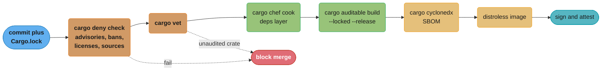
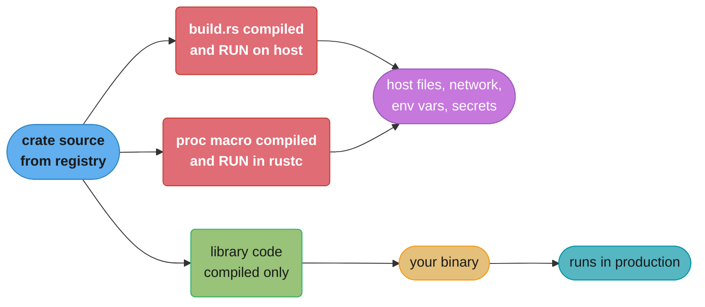

# Rust Build, Deployment and Supply Chain

> **Version anchor (2026-11-06).** Rust 1.99.1 (2026-10-15), edition 2024. LLD is the default linker on `x86_64-unknown-linux-gnu` since 1.90. Rust 1.93 bundles musl 1.2.5. Rust 1.96 fixed Cargo CVE-2026-5223 and CVE-2026-5222, which affect third-party registries only. Cargo `trim-paths` is not stable in 1.99.1. crates.io trusted publishing works from GitHub Actions (announced 2025-07-11) and GitLab CI/CD (announced 2026-01-21). Tools: cargo-deny 0.20.2, cargo-audit 0.22.2, cargo-vet 0.10.3, cargo-auditable 0.7.7, cargo-cyclonedx 0.5.9, cargo-geiger 0.14.0, cargo-chef 0.1.78, cargo-zigbuild 0.24.1, cross 0.2.5, cargo-dist 0.34.0, mimalloc 0.1.52, tikv-jemallocator 0.7.0. rustls 0.23.46 uses aws-lc-rs as its default crypto provider.

## 1. Concept Overview

A Rust service ships as one native binary, the same as a Go service. The details differ in
ways that decide how you build, package and trust it:

- **It links libc dynamically by default.** On `x86_64-unknown-linux-gnu` the binary needs a
  glibc at least as new as the newest symbol version it links. A binary built on a new
  distro fails on an older host with `GLIBC_2.xx not found`. A fully static build needs the
  musl target, and musl brings its own allocator tradeoff.
- **C code arrives through dependencies.** `aws-lc-rs` (the rustls default provider),
  `ring`, `zstd` and many `-sys` crates compile C in their `build.rs`. Then the build image
  needs a C toolchain, and cross-compiling needs a C cross-toolchain too.
- **Code runs at build time.** Every `build.rs` and every procedural macro is a program that
  Cargo compiles and runs on the build machine with the permissions of the user. A malicious
  crate does not need you to run your service. It needs you to run `cargo build`.
- **Builds are slow.** A clean release build of a service with 300 dependencies takes
  minutes. Docker layer caching that works for Go or Node needs extra tooling (cargo-chef or
  BuildKit cache mounts) in Rust.

This module covers the shipping profile, static and dynamic linking, cross-compilation,
container images, reproducible builds, version stamping, and the dependency side of supply
chain security: cargo-audit, cargo-deny, cargo-vet, cargo-auditable, SBOMs and trusted
publishing. It holds the section's decision model for **dependency admission**.

Profile settings as a Cargo feature are in
[modules, crates and Cargo](../modules_crates_and_cargo/modules_crates_and_cargo.md). SLSA,
Sigstore, SBOM formats and admission control are in
[DevSecOps and supply chain security](../../devops/devsecops_and_supply_chain_security/devsecops_and_supply_chain_security.md),
and image structure and distroless are in
[containers and Docker](../../devops/containers_and_docker/containers_and_docker.md). The Go
equivalent is
[Go build, deployment and supply chain](../../go/build_deployment_and_supply_chain/build_deployment_and_supply_chain.md).

---

## 2. Intuition

> **One-line analogy**: `Cargo.lock` is a guest list. cargo-audit checks it against a list of
> known criminals. cargo-deny checks IDs, origins and licenses at the door. cargo-vet asks
> whether someone you trust has met each guest. None of them search the guests' bags, and
> `build.rs` is a bag.

**Mental model**: a Rust release passes through three trust boundaries.

1. **Source to build.** Which crates enter the build, from where, at which exact version.
   `Cargo.lock`, `cargo-deny sources`, `cargo vet`.
2. **Build to artifact.** What code runs on the build machine and what ends up in the
   binary. `build.rs`, proc macros, the linker, path prefixes, the profile.
3. **Artifact to host.** What the binary needs at runtime. glibc version, CA certificates,
   the allocator, the base image.

**Why it matters**: a Rust service has few runtime dependencies and many build-time ones.
The OS package scanner on your image sees one binary and a few `.so` files. It does not see
the 300 crates compiled into it unless you embed the list with cargo-auditable.

**Key insight**: in Rust, "dependency review" and "build security" are the same problem.
Admitting a crate means admitting its build script to your CI runner and every developer
laptop. So admission policy belongs before `cargo build`, not after the scan.

---

## 3. Core Principles

- **Commit `Cargo.lock` and build with `--locked`.** A build that resolves fresh versions is a
  different build. `--locked` fails when the lockfile is stale instead of updating it.
- **Pin the toolchain.** A `rust-toolchain.toml` with an exact version makes local, CI and
  release builds use the same compiler. Different `rustc` versions produce different
  binaries.
- **Choose the libc on purpose.** gnu plus a distroless `cc` image, or musl plus `scratch` or
  distroless `static`. Each has a failure mode. Know which one you picked.
- **Gate on advisories and sources before the build.** `cargo deny check` reads
  `Cargo.lock` in seconds. Run it before you compile 300 crates.
- **Treat build scripts as code you run.** List which crates may have a build script, and
  review new ones.
- **Embed the dependency list in the binary.** `cargo auditable build` costs under 4 kB and
  lets any scanner see what shipped.
- **Make builds reproducible.** Same source, toolchain and flags give the same bytes. That is
  how you prove the artifact came from the commit.
- **Publish without long-lived tokens.** crates.io trusted publishing issues a short-lived
  token through OIDC from CI.

---

## 4. Types / Architectures / Strategies

### Linking strategies on Linux

| Strategy | Target | Runtime needs | Typical base image | Main risk |
|---|---|---|---|---|
| gnu, dynamic glibc | `x86_64-unknown-linux-gnu` | glibc at least as new as the build host's linked symbols, `libgcc_s` | `gcr.io/distroless/cc-debian13`, debian-slim | `GLIBC_2.xx not found` on older hosts |
| musl, static | `x86_64-unknown-linux-musl` | Nothing | `scratch`, `gcr.io/distroless/static-debian13` | musl allocator under heavy multi-threaded load, DNS behavior differences |
| gnu built against an old glibc | `cargo zigbuild --target x86_64-unknown-linux-gnu.2.17` | glibc 2.17 or newer | Any glibc image | Zig as an extra build dependency |

Rust's own floor for the tier 1 gnu targets is glibc 2.17 (`x86_64` with kernel 3.2,
`aarch64` with kernel 4.1), per the platform support page. The musl targets are tier 2 with
host tools and use musl 1.2.5.

### Cross-compilation tools

| Tool | How it works | Good for | Limit |
|---|---|---|---|
| rustup target plus a system linker | `rustup target add`, then a C cross-linker in `.cargo/config.toml` | Pure Rust crates, one or two targets | You maintain the C toolchains |
| cross | Runs the build in a container image that holds the C toolchain for the target | C dependencies on Linux targets | Needs Docker or Podman. 0.2.5 dates from 2023-02-04 |
| cargo-zigbuild | Uses `zig cc` as the linker, accepts a glibc version suffix on the target | Old-glibc gnu builds, macOS `universal2-apple-darwin` | Zig must be installed |
| cargo-dist | Plans and builds release archives and installers for many targets in CI | CLI tools published to GitHub Releases | Opinionated release layout |

### Container build strategies

| Strategy | Cache unit | Rebuild cost after a source change |
|---|---|---|
| Plain `COPY . .` then `cargo build` | Whole layer | Every dependency recompiles |
| cargo-chef (`prepare`, then `cook`) | A recipe built from manifests and `Cargo.lock` | Only your crates recompile |
| BuildKit cache mounts on `target/` and `$CARGO_HOME/registry` | Cargo's own incremental state | Only changed crates, if the cache survives on the runner |

### Dependency admission tiers (decision model)

| Tier | Checks | Stops | Effort to run | Who it fits |
|---|---|---|---|---|
| 0. Lockfile only | `Cargo.lock` committed, `--locked`, `cargo audit` | Known CVEs in RustSec, silent version drift | Minutes to set up | Internal tools, prototypes |
| 1. Deny-only | `cargo deny check` with advisories, bans, licenses, sources. `[bans.build] allow-build-scripts` | Known CVEs, yanked crates, unknown registries and git sources, license violations, unexpected build scripts, duplicate versions | A day to tune `deny.toml` | Most production services |
| 2. Vet with imports | Tier 1 plus `cargo vet` with imported audits from Mozilla, Google, Bytecode Alliance and others, plus exemptions for the rest | A new crate or version that nobody you trust has reviewed | One to two weeks to bootstrap, then review time per new crate | Services that hold money, credentials or personal data |
| 3. Vet with full audits | Tier 2 with a shrinking exemption list, delta audits on every update, `cargo vendor`, an internal mirror | Malicious updates of trusted crates, registry outages | Ongoing reviewer time for every new crate and every update | Browsers, security products, regulated and safety-critical code |

The tiers stack. Each row adds checks to the one above. Tier 1 stops known-bad and
out-of-policy crates. Only tiers 2 and 3 stop an unknown-bad crate, because only a human
review looks at what the code does.

---

## 5. Architecture Diagrams

### Release pipeline with the gates in order



The two policy gates run on `Cargo.lock` before any compile, so a bad crate never gets to run
its `build.rs` on the runner. Signing and attestation are covered in the DevSecOps module.

### Where code runs during `cargo build`



The red nodes run on the build machine, with access to whatever the CI job can reach. The
`faster_log` crates in 2025 hid their payload in library code that ran when a project ran or
tested, which is the green path. Both paths matter.

### Docker layer layout with cargo-chef

```
stage      layer                                  invalidated by              typical time
---------------------------------------------------------------------------------------------
planner    COPY . .  ->  cargo chef prepare        any file change             seconds
builder    COPY recipe.json                        Cargo.toml / Cargo.lock      -
builder    cargo chef cook --release               recipe.json change only     minutes (cached)
builder    COPY . .  ->  cargo build --release     any source change           your crates only
runtime    COPY binary  ->  distroless/cc          new binary                  seconds
```

`recipe.json` holds the manifests and `Cargo.lock`, so it changes only when dependencies
change. A source-only commit reuses the `cook` layer and rebuilds only the workspace crates.

---

## 6. How It Works - Detailed Mechanics

### 6.1 A shipping profile and what it costs

```toml
[profile.release]
codegen-units = 1
lto = "fat"
panic = "abort"
strip = "symbols"
debug = "line-tables-only"
split-debuginfo = "packed"
```

The Cargo defaults for `release` are `opt-level = 3`, `debug = false`, `strip = "none"`,
`lto = false` (thin LTO on the local crate only), `panic = "unwind"` and
`codegen-units = 16`. Each change above trades build time or behavior for size or speed:

| Setting | Effect | Cost |
|---|---|---|
| `codegen-units = 1` | Better optimization across the crate | Slower, less parallel compile |
| `lto = "fat"` | Optimizes across all crates in the graph | Longest link step. `"thin"` gets much of the gain for less time |
| `panic = "abort"` | Smaller binary, no unwind landing pads | `catch_unwind` stops working. A panic in any thread ends the process |
| `strip = "symbols"` | Removes the symbol table | Backtraces show addresses only unless you keep separate debug info |

Measured with rustc 1.99.1 in the `rust:1.99.1-slim` Docker image (Debian 13, glibc 2.41) on an
Apple M5 host, target `aarch64-unknown-linux-gnu`, for a hello-world binary:

| Build | Size in bytes |
|---|---|
| Default `--release` | 468,872 |
| `strip = "symbols"` | 332,632 |
| Plus `lto = true`, `codegen-units = 1`, `panic = "abort"`, `opt-level = "z"` | 266,976 |
| `aarch64-unknown-linux-musl`, static, `strip = "symbols"` | 397,600 |

The musl binary is larger because it carries libc inside it. In return, `ldd` reports "not a
dynamic executable", and it runs on `scratch`. The gnu binary needs `libc.so.6` and
`libgcc_s.so.1` from the host.

For a real service the size difference between profiles matters less than the debuggability.
Keep `debug = "line-tables-only"` with split debug info, store the debug file per release,
and strip the shipped binary. The profiling side of that is in
[profiling and benchmarking](../profiling_and_benchmarking/profiling_and_benchmarking.md).

### 6.2 The glibc floor

A gnu binary records the glibc symbol versions it links. Check the newest one before you ship:

```bash
objdump -T target/release/api | grep -o 'GLIBC_[0-9.]*' | sort -V | tail -1
```

If that prints `GLIBC_2.39` and a customer host has glibc 2.31, the binary does not start.
Three fixes, in order of preference:

1. Ship in a container whose base image matches the build image's glibc, such as a build on
   `rust:1.99.1-slim` (Debian 13) with a runtime of `gcr.io/distroless/cc-debian13`.
2. Build against an old glibc with `cargo zigbuild --target x86_64-unknown-linux-gnu.2.17`.
3. Build for musl and ship a static binary.

### 6.3 Static musl builds and the allocator

```bash
rustup target add x86_64-unknown-linux-musl
cargo build --release --locked --target x86_64-unknown-linux-musl
```

Pure Rust crates need nothing else. Crates that compile C need a musl C compiler, which is
where `cross` or `cargo-zigbuild` helps.

The musl `malloc` is simple and compact. Multi-threaded Rust services that allocate on many
threads often run slower with it than with glibc's allocator. Measure your own service under
load, and if the musl build is slower, swap the global allocator:

```rust
// fragment
use mimalloc::MiMalloc;

#[global_allocator]
static GLOBAL: MiMalloc = MiMalloc;
```

The mechanism is the `GlobalAlloc` trait. This std-only allocator counts live bytes and
forwards to the system allocator, the same shape mimalloc and jemalloc plug into:

```rust
use std::alloc::{GlobalAlloc, Layout, System};
use std::sync::atomic::{AtomicUsize, Ordering};

struct Counting;

static LIVE_BYTES: AtomicUsize = AtomicUsize::new(0);

// SAFETY: every method forwards to System, which meets the GlobalAlloc contract.
unsafe impl GlobalAlloc for Counting {
    unsafe fn alloc(&self, layout: Layout) -> *mut u8 {
        // SAFETY: the caller meets alloc's contract, and we pass the layout unchanged.
        let ptr = unsafe { System.alloc(layout) };
        if !ptr.is_null() {
            LIVE_BYTES.fetch_add(layout.size(), Ordering::Relaxed);
        }
        ptr
    }

    unsafe fn dealloc(&self, ptr: *mut u8, layout: Layout) {
        // SAFETY: ptr came from System.alloc with this same layout.
        unsafe { System.dealloc(ptr, layout) };
        LIVE_BYTES.fetch_sub(layout.size(), Ordering::Relaxed);
    }
}

#[global_allocator]
static GLOBAL: Counting = Counting;

fn main() {
    let before = LIVE_BYTES.load(Ordering::Relaxed);
    let buf: Vec<u64> = Vec::with_capacity(1024);
    let during = LIVE_BYTES.load(Ordering::Relaxed);
    assert!(during - before >= 8 * 1024);
    drop(buf);
}
```

Memory budgets without a GC, including allocator fragmentation and `MALLOC_ARENA_MAX`, are
in [memory budgets without a GC](../case_studies/cross_cutting/memory_budgets_without_a_gc.md).

### 6.4 A cached multi-stage Docker build

```dockerfile
FROM rust:1.99.1-slim AS chef
RUN cargo install cargo-chef --locked --version 0.1.78
WORKDIR /app

FROM chef AS planner
COPY . .
RUN cargo chef prepare --recipe-path recipe.json

FROM chef AS builder
COPY --from=planner /app/recipe.json recipe.json
RUN cargo chef cook --release --locked --recipe-path recipe.json
COPY . .
RUN cargo build --release --locked --bin api

FROM gcr.io/distroless/cc-debian13:nonroot
COPY --from=builder /app/target/release/api /usr/local/bin/api
USER nonroot
ENTRYPOINT ["/usr/local/bin/api"]
```

The cargo-chef README lists these limits: `cook` and `build` must run in the same working
directory, every stage must use the same Rust version, and path dependencies outside the
project always rebuild from scratch. The distroless `cc` image is the base image plus
libgcc1, which is what a gnu Rust binary needs. For a musl build, use
`gcr.io/distroless/static-debian13`.

TLS needs root certificates at runtime. With rustls, either read the OS store (the distroless
images ship `/etc/ssl/certs`) or compile a root list into the binary. A `scratch` image has
neither unless you copy the bundle in.

### 6.5 Cross-compiling

```toml
# .cargo/config.toml
[target.aarch64-unknown-linux-gnu]
linker = "aarch64-linux-gnu-gcc"
```

```bash
rustup target add aarch64-unknown-linux-gnu
cargo build --release --locked --target aarch64-unknown-linux-gnu

# Or let zig provide the linker and pin the glibc floor:
cargo zigbuild --release --locked --target aarch64-unknown-linux-gnu.2.17

# Or run the build in a container with the C toolchain:
cross build --release --locked --target aarch64-unknown-linux-gnu
```

Since 1.90, rustc links `x86_64-unknown-linux-gnu` with LLD by default, which shortens link
times on large binaries. If a custom linker script or a C toolchain needs the system linker,
opt out with `-C linker-features=-lld`.

### 6.6 Reproducible builds

Same source, same toolchain, same flags, same output bytes. Two things break it in practice:
absolute paths and unpinned inputs.

Measured in the same `rust:1.99.1-slim` container with two copies of one hello-world project,
at `/a/hello` and `/b/hello`:

| Build | SHA-256 of `/a` and `/b` binaries |
|---|---|
| Default `--release` (`debug = false`) | Equal |
| `debug = "line-tables-only"` | Different, because debug info stores the absolute build directory |
| Same, with `RUSTFLAGS="--remap-path-prefix=$PWD=/build"` | Equal |

The local crate's panic locations are relative (`src/main.rs`), but dependency sources live
under `$CARGO_HOME/registry/src/...`, and debug info stores absolute paths. Cargo's
`trim-paths` profile option would handle this, but it is not stable in 1.99.1. On stable,
remap the workspace and `$CARGO_HOME` with `--remap-path-prefix`, and build in the same path
in CI.

The other inputs to pin:

- `rust-toolchain.toml` with an exact version, such as `channel = "1.99.1"`.
- `Cargo.lock` committed, and `--locked` on every build.
- No timestamps or random values from `build.rs`.
- The same target, profile and `RUSTFLAGS`.

### 6.7 Stamping a version into the binary

```rust
// build.rs
use std::process::Command;

fn main() {
    println!("cargo:rerun-if-env-changed=BUILD_SHA");
    let sha = std::env::var("BUILD_SHA").ok().or_else(|| {
        let out = Command::new("git")
            .args(["rev-parse", "--short=12", "HEAD"])
            .output()
            .ok()?;
        out.status
            .success()
            .then(|| String::from_utf8_lossy(&out.stdout).trim().to_owned())
    });
    if let Some(sha) = sha {
        println!("cargo:rustc-env=BUILD_SHA={sha}");
    }
}
```

```rust
pub const BUILD_SHA: &str = match option_env!("BUILD_SHA") {
    Some(sha) => sha,
    None => "unknown",
};
```

Pass `BUILD_SHA` from CI as an environment variable. Docker build contexts usually exclude
`.git`, so the `git` fallback finds nothing there, and `option_env!` keeps the build working.
Cargo sets `CARGO_PKG_VERSION` for every crate it compiles, so `env!("CARGO_PKG_VERSION")` is safe
under Cargo.

### 6.8 Advisory and policy checks

`cargo audit` checks `Cargo.lock` against the RustSec advisory database. `cargo deny check`
runs four checks, each configured in `deny.toml`:

```toml
[advisories]
unmaintained = "all"
yanked = "deny"
ignore = [
    # { id = "RUSTSEC-0000-0000", reason = "not reachable: we never parse untrusted input" },
]

[licenses]
allow = ["MIT", "Apache-2.0", "BSD-3-Clause", "ISC", "Unicode-3.0"]
confidence-threshold = 0.8

[bans]
multiple-versions = "warn"
wildcards = "deny"
deny = [{ crate = "openssl", reason = "use rustls" }]

[bans.build]
allow-build-scripts = [
    { crate = "aws-lc-sys" },
    { crate = "zstd-sys" },
    { crate = "proc-macro2" },
]

[sources]
unknown-registry = "deny"
unknown-git = "deny"
```

Defaults worth knowing: `unknown-registry` and `unknown-git` default to `warn`, so set them
to `deny`. `[bans.build] allow-build-scripts` allows every build script when you omit it, and
none when you set it to an empty list. With fetching turned off (`--offline` or
`--disable-fetch`), the advisory database is stale after `P90D` (90 days) by default.

### 6.9 cargo-vet

cargo-vet keeps its state in a `supply-chain/` directory:

| File | Holds | Shareable |
|---|---|---|
| `audits.toml` | Your audits and your custom criteria | Yes, other projects import it |
| `config.toml` | Policy, `[imports]`, `[exemptions]`, default criteria | No |
| `imports.lock` | The fetched copy of imported audits | Generated |

```toml
# supply-chain/config.toml
[imports.mozilla]
url = "https://raw.githubusercontent.com/mozilla/supply-chain/main/audits.toml"

[imports.google]
url = "https://raw.githubusercontent.com/google/supply-chain/main/audits.toml"

[policy.payments-api]
criteria = "safe-to-deploy"

[[exemptions.smallvec]]
version = "1.16.4"
criteria = "safe-to-deploy"
notes = "bootstrap exemption, audit tracked in SEC-412"
```

The two built-in criteria are `safe-to-run` (safe to build, run and test on a workstation or
in CI) and `safe-to-deploy` (does not add a serious vulnerability to production software that
takes untrusted input). `safe-to-deploy` implies `safe-to-run`. A delta audit reviews only
the diff between an audited version and the next one. `cargo vet trust` records a trusted
publisher, with an end date, in `audits.toml`.

The cargo-vet registry lists audit sets from actix, ariel-os, Bytecode Alliance, Embark
Studios, Fermyon, Google, ISRG, Mozilla and Zcash. Importing them is how a team gets coverage
for the common crates on day one.

### 6.10 Knowing what shipped

```bash
cargo auditable build --release --locked
cargo audit bin target/release/api
cargo cyclonedx --format json
```

cargo-auditable embeds the dependency tree as zlib-compressed JSON in a linker section named
`.dep-v0`. Its README states under 4 kB for trees with 400 or more entries, about 1/1000 to
1/10,000 of the binary size. cargo-audit 0.17.3 and later, Trivy 0.31.0 and later, Grype
0.83.0 and later and osv-scanner 2.0.1 and later read it. Without it, an image scanner sees a
Rust binary as an opaque file.

### 6.11 Publishing with trusted publishing

```yaml
jobs:
  publish:
    runs-on: ubuntu-latest
    permissions:
      id-token: write
    steps:
      - uses: actions/checkout@v4
      - uses: rust-lang/crates-io-auth-action@v1
        id: auth
      - run: cargo publish --locked
        env:
          CARGO_REGISTRY_TOKEN: ${{ steps.auth.outputs.token }}
```

The workflow exchanges a GitHub OIDC token for a short-lived crates.io token. No API token
lives in repository secrets. The first release of a crate is still published by hand, and
then the repository is set as a trusted publisher on crates.io.

### 6.12 Offline and mirrored builds

```bash
cargo vendor vendor/ > .cargo/config.toml
cargo build --release --locked --offline
```

`cargo vendor` copies every dependency's source into `vendor/` and prints the
source-replacement config that points Cargo at it. The build then needs no network, and
reviewers see dependency diffs in the PR. The cost is repository size and a large diff on
every update.

---

## 7. Real-World Examples

- **Mozilla and Firefox.** Mozilla built cargo-vet and publishes its audits at
  `mozilla/supply-chain`. Google, the Bytecode Alliance (wasmtime) and Zcash publish audit
  sets that the cargo-vet registry lists for import.
- **`rustdecimal` (2022).** A typosquat of `rust_decimal`. On a call to `Decimal::new` it
  checked for the `GITLAB_CI` environment variable and, if set, downloaded and ran a binary.
  It had fewer than 500 downloads between 2022-03-25 and the report on 2022-05-02. The Rust
  blog advisory is dated 2022-05-10.
- **`faster_log` and `async_println` (2025).** Two crates published 2025-05-25 copied the code
  and docs of a real logging crate under similar names, and searched files for Ethereum and
  Solana private keys at runtime, when a project ran or tested. They had 7,181 and 1,243
  downloads and no dependent crates on crates.io. crates.io deleted them and disabled the publishers after a report on 2025-09-24.
- **Rust 1.96 Cargo fixes.** CVE-2026-5223 and CVE-2026-5222 were fixed in Cargo 1.96 and
  affect only third-party registries. crates.io users were not affected. A team with a third-party
  registry needs Cargo 1.96 or later.
- **Rust-built tools shipped as single binaries.** uv and ruff ship one native binary per
  platform inside a platform wheel, so `pip install ruff` needs no Rust toolchain.
  See [Python packaging and project tooling](../../python/packaging_and_project_tooling/packaging_and_project_tooling.md).

The same supply chain concerns for npm and PyPI are in
[package management and supply chain](../../frontend_platform/package_management_and_supply_chain/package_management_and_supply_chain.md)
and [supply chain and publishing](../../python/packaging_and_project_tooling/supply_chain_and_publishing.md).

---

## 8. Tradeoffs

### gnu or musl

| Concern | gnu (dynamic glibc) | musl (static) |
|---|---|---|
| Runtime image | Needs glibc and libgcc (`distroless/cc`) | `scratch` or `distroless/static` |
| Host compatibility | Breaks on hosts with older glibc | Runs on any Linux with a supported kernel |
| Allocator | glibc malloc | musl malloc. Swap to mimalloc or jemalloc when it is slow |
| C dependencies | Easy with the system toolchain | Need a musl C toolchain |
| NSS, `getaddrinfo` behavior | Full glibc behavior | musl resolver, which differs in edge cases |
| Hello-world size, stripped (measured) | 332,632 bytes | 397,600 bytes |

### Admission tiers

| Tier | Catches known-bad | Catches unknown-bad | Reviewer time | Build-time cost |
|---|---|---|---|---|
| Lockfile plus cargo-audit | Yes | No | None | Seconds |
| cargo-deny | Yes, plus policy | No | Hours to tune | Seconds |
| cargo-vet with imports | Yes | For crates someone reviewed | Days to bootstrap | Seconds |
| cargo-vet with full audits | Yes | Yes, within review quality | Ongoing | Seconds |

### Profile choices

| Setting | Build time | Binary size | Runtime speed | Debuggability |
|---|---|---|---|---|
| Default release | Baseline | Baseline | Baseline | Panic backtraces need debug info |
| `lto = "thin"` | Higher | Smaller | Often faster | Same |
| `lto = "fat"`, `codegen-units = 1` | Much higher | Smallest | Often faster still | Same |
| `panic = "abort"` | Lower | Smaller | Same | No unwinding, no `catch_unwind` |
| `strip = "symbols"` | Same | About 29% smaller (measured hello world) | Same | Needs separate debug files |

---

## 9. When to Use / When NOT to Use

**Use musl static builds when** you ship a CLI to unknown Linux hosts, or you want a
`scratch` image, and you measured that the allocator is not a bottleneck or you swapped it.

**Use gnu plus distroless `cc` when** the service runs only in your own containers, it links C
libraries, or it allocates heavily across many threads.

**Use cargo-zigbuild when** you must support an old glibc on bare hosts without musl.

**Use cargo-deny when** the code reaches production. It is the default tier.

**Use cargo-vet when** the service holds money, credentials or personal data, when it runs in
a regulated environment, or when a compromised dependency would be an incident you report to
customers.

**Do not use cargo-vet when** the team cannot fund reviewer time. An exemptions list that
only grows gives the look of a policy without the review. Stay on cargo-deny and say so.

**Do not use `panic = "abort"` when** a web framework or worker pool relies on unwinding to
contain a panic in one request or task.

**Do not vendor** for a small internal service with a reachable registry mirror. The mirror
gives the same availability without the repository bloat.

---

## 10. Common Pitfalls

### Setting environment variables at startup in edition 2024

A service set `RUST_LOG` from its config file in `main`, after the runtime started worker
threads. In edition 2024, `std::env::set_var` is `unsafe`, because another thread can read
the environment at the same time.

```rust
// BROKEN
fn main() {
    // error[E0133]: call to unsafe function `set_var` is unsafe and requires unsafe block
    std::env::set_var("RUST_LOG", "info");
}
```

```rust
// FIX
use std::env;

struct Config {
    log_filter: String,
}

fn load_config() -> Config {
    let log_filter = env::var("RUST_LOG").unwrap_or_else(|_| "info".to_owned());
    Config { log_filter }
}

fn main() {
    let config = load_config();
    println!("log filter: {}", config.log_filter);
}
```

Read the environment once into a config struct and pass it down. Set variables for child
processes with `Command::env`, which does not touch the parent's environment.

### A release build with a feature turned off

The release job built with `--no-default-features --features tls`. The `metrics` feature was
in `default`, and one module called a function that exists only with it.

```rust
// BROKEN
#[cfg(feature = "metrics")]
fn record(name: &str) {
    println!("metric {name}");
}

pub fn handle_request() {
    // error[E0425]: cannot find function `record` in this scope
    record("requests_total");
}
```

```rust
// FIX
#[cfg(feature = "metrics")]
fn record(name: &str) {
    println!("metric {name}");
}

#[cfg(not(feature = "metrics"))]
fn record(_name: &str) {}

pub fn handle_request() {
    record("requests_total");
}
```

Build every feature combination you ship in CI. `cargo hack check --each-feature` finds
these in minutes.

### Other incidents

These are composite scenarios. Their numbers are illustrative.

- **`GLIBC_2.39 not found` on a customer host.** A CLI built on a new CI image ran on the
  team's machines and failed on a customer's older LTS distro. The fix was a musl build for
  the CLI and a glibc check in the release job.
- **A musl image slower under load.** A team moved to `scratch` with a musl build and saw
  p99 latency rise. The profile showed time in the musl allocator lock. A two-line
  `#[global_allocator]` change to mimalloc fixed it. Measure before and after any libc change.
- **Every commit recompiles 300 crates.** The Dockerfile did `COPY . .` before
  `cargo build`, so every change invalidated the dependency layer. cargo-chef cut the build
  from 14 minutes to 3.
- **cargo-chef stopped caching.** The planner stage used one `rust` image tag and the builder
  another. The README says every stage must use the same Rust version.
- **`cargo install` in a Dockerfile without `--locked`.** It resolved the newest versions of
  the tool's dependencies, and one of them broke the tool's build that morning. Always pass
  `--locked` to `cargo install`.
- **An exemption list that only grew.** A team adopted cargo-vet and ran `cargo vet
  regenerate exemptions` on every red build. After a year, 280 of 300 crates were exempt. The
  gate checked nothing. Track the exemption count as a metric and budget review time against
  it.
- **HTTPS fails in a `scratch` image.** rustls was set to load native roots, and the image had
  no `/etc/ssl/certs`. Copy the bundle in or use distroless `static`.

---

## 11. Technologies & Tools

| Tool | What it does | When you need it |
|---|---|---|
| cargo-deny | Checks advisories, bans, licenses and sources from `Cargo.lock` | Every production repository, as a CI gate |
| cargo-audit | Checks `Cargo.lock` or an auditable binary against RustSec | Quick advisory checks, scanning shipped binaries |
| cargo-vet | Records and imports human audits of crate versions | Services where an unknown-bad dependency is an incident |
| cargo-auditable | Embeds the dependency list in a `.dep-v0` linker section | Every release binary |
| cargo-cyclonedx | Generates a CycloneDX SBOM from Cargo metadata | Customers or regulators that ask for an SBOM |
| cargo-geiger | Counts `unsafe` usage across the dependency graph | Reviewing a new dependency |
| cargo-chef | Splits dependency compilation into a cacheable Docker layer | Docker builds of Rust services |
| cargo-zigbuild | Cross-links with zig and pins a glibc version | Old-glibc and macOS universal2 builds |
| cross | Cross-compiles inside a container with the C toolchain | C dependencies on non-host Linux targets |
| cargo-dist | Builds release archives and installers for many targets | Distributing CLI tools |
| cargo-binstall | Installs prebuilt binaries of Cargo tools | Fast CI tool installs |
| mimalloc | A global allocator crate | musl builds and allocation-heavy services |
| tikv-jemallocator | jemalloc as a global allocator | Long-running services with fragmentation issues |
| Trivy | Image scanner that reads cargo-auditable data | Scanning the final image |

---

## 12. Interview Questions with Answers

**Q: Why can a malicious crate compromise your CI runner even if your service never calls it?**
**Short:** Its build script or proc macro is compiled and run on the build machine during cargo build, with the permissions and secrets of the CI job.

Cargo runs every `build.rs` and loads every proc macro into `rustc` as part of compilation.
That code can read files, environment variables and tokens, and open network connections.
rust-analyzer, with its default settings, also runs build scripts and proc macros when it
loads a project, so a developer laptop is exposed too. Gate dependency admission before the build, restrict which crates may
have a build script with `[bans.build] allow-build-scripts`, and give CI jobs that build
untrusted code no deploy secrets.

**Q: Your Rust binary fails on a server with GLIBC_2.39 not found. What happened and how do you fix it?**
**Short:** The binary was linked on a host with a newer glibc than the server has, so a required symbol version is missing at load time.

A gnu Rust binary links glibc dynamically and records the symbol versions it uses. Building on
a new distro picks up new versions. Fixes: ship in a container whose glibc matches the build
image, build against an old glibc with `cargo zigbuild --target
x86_64-unknown-linux-gnu.2.17`, or build a static musl binary. Rust's own floor for the tier 1
gnu targets is glibc 2.17. Add `objdump -T | grep GLIBC_` to the release job so the floor is
visible before shipping.

**Q: Is a static musl binary always the better choice for containers?**
**Short:** No, because musl's allocator and resolver differ from glibc, and multi-threaded services often need a different global allocator to match glibc performance.

musl gives a binary with no runtime dependencies that runs on `scratch`. The costs: C
dependencies need a musl toolchain, DNS resolution behaves differently in edge cases, and the
musl `malloc` often slows allocation-heavy multi-threaded code. The fix for the allocator is
`#[global_allocator]` with mimalloc or jemalloc. Use musl for CLIs and portable tools. For a
service that only runs in your own containers, gnu plus distroless `cc` is often simpler.

**Q: What does cargo-deny check, and which default should you change first?**
**Short:** It checks advisories, bans, licenses and sources from the lockfile, and unknown registries and git sources default to warn, so set them to deny.

`advisories` matches crates against RustSec, including unmaintained and yanked ones. `bans`
blocks named crates, duplicate versions and wildcard requirements, and its `build` table can
limit which crates have build scripts. `licenses` enforces an allow list. `sources` restricts
where crates come from. With `unknown-registry` and `unknown-git` at their default `warn`, a
dependency from a random git repository passes the gate. Set both to `deny`.

**Q: What does cargo-vet add that cargo-deny cannot?**
**Short:** It requires a recorded human audit, yours or imported, for every crate version, so it can stop a malicious crate that has no advisory yet.

cargo-deny and cargo-audit only know about problems someone already reported. cargo-vet
inverts the check: a crate version passes only if an audit says it meets a criterion such as
`safe-to-deploy`, or it sits on the exemption list. Delta audits keep updates cheap, and
imported audit sets from Mozilla, Google and others cover common crates. The cost is reviewer
time, and the risk is an exemption list that grows until the gate means nothing.

**Q: How do you get Docker layer caching to work for a Rust build?**
**Short:** Build dependencies in their own layer from a recipe of manifests and the lockfile, with cargo-chef, so a source-only change reuses the compiled dependency layer.

Copying the whole source tree before `cargo build` invalidates the layer on every commit, so
every dependency recompiles. cargo-chef's `prepare` step writes `recipe.json` from the
manifests and `Cargo.lock`. `cook` compiles only dependencies from that recipe. Then you copy
the source and build your crates. All stages must use the same Rust version and the same
working directory. BuildKit cache mounts on `target/` and the registry are the other option
when the CI runner keeps its cache.

**Q: Why does a stripped Rust binary still need a debug strategy?**
**Short:** Stripping removes the symbols that turn addresses into function names, so panics and profiles in production become unreadable unless you keep separate debug info.

`strip = "symbols"` cut a measured hello world from 468,872 to 332,632 bytes. The cost is a
backtrace with raw addresses. Build with `debug = "line-tables-only"` and split debug info,
store the debug file per release keyed by build ID, and strip only the shipped binary. Then
symbolize offline when you need it.

**Q: What does panic = "abort" change for a service?**
**Short:** A panic ends the whole process instead of unwinding, so frameworks can no longer contain a panic to one request or task with catch_unwind.

The binary gets smaller and slightly faster because there are no unwind landing pads. But
`catch_unwind` stops working. A tokio runtime normally turns a panicking task into a
`JoinError`, and with abort the process exits. That is acceptable for a CLI or for a service
behind a supervisor that restarts it, and wrong for a server that must survive one bad
request. Decide per binary, and document it.

**Q: How do you make a Rust build reproducible?**
**Short:** Pin the toolchain and lockfile, build with locked deps, remap absolute paths with remap-path-prefix, and keep build scripts free of timestamps and randomness.

In a measured test on rustc 1.99.1, two copies of a project at different paths produced equal
binaries with `debug = false` and different binaries with `debug = "line-tables-only"`,
because debug info stores the build directory. `--remap-path-prefix` made them equal again.
Cargo's `trim-paths` option is not stable in 1.99.1. Pin `rust-toolchain.toml`, commit
`Cargo.lock`, use `--locked`, and rebuild in a second environment to check the hash.

**Q: Why should every release binary be built with cargo-auditable?**
**Short:** It embeds the full dependency list in the binary for under 4 kB, so scanners can find vulnerable crates in a shipped artifact long after the build.

An image scanner sees a Rust binary as one opaque file. With cargo-auditable, the dependency
tree sits in a `.dep-v0` linker section as compressed JSON. cargo-audit, Trivy, Grype and
osv-scanner read it, so a new RustSec advisory can be matched against binaries already in
production. It works with any Cargo command and costs about 1/1000 to 1/10,000 of the binary
size.

**Q: How should a crate be published from CI without a long-lived token?**
**Short:** Use crates.io trusted publishing, which exchanges the CI job's OIDC identity for a short-lived publish token, so no API token sits in repository secrets.

The workflow needs `id-token: write` and the `rust-lang/crates-io-auth-action` step, which
returns a token for `cargo publish`. The first release is published by hand, and then the
repository is configured as a trusted publisher on crates.io. A leaked repository secret can
then no longer publish a malicious version. GitHub Actions and GitLab CI/CD are supported.

**Q: Why should a Dockerfile use cargo install --locked?**
**Short:** Without it, cargo install ignores the tool's lockfile and resolves the newest compatible dependencies, so the same line can build different code on different days.

`cargo install` treats the installed crate as a fresh resolution unless you pass `--locked`.
A new semver-compatible release of any transitive dependency enters the build, which breaks
reproducibility and opens a window for a compromised release. Pin the tool version with
`--version` and pass `--locked`, or install a prebuilt binary with cargo-binstall from a
pinned release.

**Q: What does the LLD default in Rust 1.90 change for a build?**
**Short:** On x86_64 Linux gnu, rustc links with LLD instead of the system linker, which shortens link time, and you can opt out with a linker-features flag.

Link time is a large share of incremental build time for big binaries, so the switch shortens
the edit-build loop. A project with a custom linker script or a C toolchain that expects the
system linker can return to it with `-C linker-features=-lld`. Other targets keep their
previous linker defaults.

**Q: How do you stamp a git SHA into a binary without breaking Docker builds?**
**Short:** Set it from build.rs with rustc-env, read it with option_env so a missing value falls back to a default, and pass it from CI because .git is often excluded.

A `build.rs` prints `cargo:rustc-env=BUILD_SHA=...` from an environment variable or from
`git rev-parse`. In code, `env!("BUILD_SHA")` fails the compile when the variable is missing,
and that is the common case inside a Docker context without `.git`. `option_env!` returns an
`Option`, so the binary builds and reports `unknown`. Add `cargo:rerun-if-env-changed` so a new
SHA triggers a rebuild of that crate only.

**Q: What does cargo vendor buy, and what does it cost?**
**Short:** It copies all dependency sources into the repository so builds run offline and dependency diffs show in review, at the cost of repository size and noisy updates.

`cargo vendor` writes the sources and prints a source-replacement config, and
`cargo build --offline` then needs no registry. Reviewers see the exact code that changed on
every update, which makes delta audits concrete. The cost is hundreds of megabytes for a
large graph and a large diff on each update. A registry mirror gives the availability part
with less churn.

**Q: Which runtime files does a Rust service image need besides the binary?**
**Short:** A gnu binary needs glibc and libgcc_s, and any TLS client needs root certificates, unless it compiles a root store in or is a static musl build on a cert-carrying base.

`ldd` on a gnu binary lists `libc.so.6` and `libgcc_s.so.1`, which the distroless `cc` image
provides. A musl binary needs no libraries. TLS validation needs `/etc/ssl/certs` when rustls
loads native roots, and distroless images ship it while `scratch` does not. Time zone data
matters only if the code reads local time zones.

**Q: How do you limit which dependencies may run build scripts?**
**Short:** List the allowed crates in cargo-deny's bans.build allow-build-scripts, so a new dependency with a build script fails the gate until someone reviews it.

When the option is omitted, every crate may have a build script. An empty list allows none.
A short list of known `-sys` crates and proc-macro support crates makes any new build script
visible in review. It does not inspect what the script does, so pair it with cargo-vet audits
for the crates on the list.

**Q: What did the Rust 1.96 Cargo CVE fixes mean for teams?**
**Short:** They fixed two Cargo vulnerabilities that affect only third-party registries, so teams with a private registry needed the 1.96 toolchain and crates.io-only users did not.

CVE-2026-5223 and CVE-2026-5222 were fixed in Cargo 1.96. The release notes state that
crates.io users were not affected. A team that uses an internal registry should treat the
toolchain version as part of its security baseline, pin it in `rust-toolchain.toml`, and
upgrade when Cargo security fixes land.

**Q: How does a typosquatted crate get into a build, and what stops it?**
**Short:** A developer adds a dependency with a misspelled or look-alike name, and only review, a vet policy or an allow list catches it, because no advisory exists yet.

`rustdecimal` imitated `rust_decimal`, and `faster_log` imitated a real logging crate. Both
compiled and worked. Advisory tools catch them only after a report. cargo-vet blocks any crate
with no audit, a `cargo deny` ban list blocks known names, and a review rule that every new
direct dependency needs a second reviewer catches the rest. Check the crate's repository,
owners and download history before you add it.

---

## 13. Best Practices

- Commit `Cargo.lock` for every binary and library, and build with `--locked`.
- Pin the toolchain in `rust-toolchain.toml`.
- Run `cargo deny check` before compiling. Set `unknown-registry` and `unknown-git` to `deny`.
- List allowed build scripts in `[bans.build]`.
- Build every release with `cargo auditable build`, and generate an SBOM with cargo-cyclonedx.
- Use cargo-chef or BuildKit cache mounts in Docker builds, and the same Rust image in every
  stage.
- Pick gnu plus distroless `cc`, or musl plus distroless `static`, and record why.
- Check the glibc floor of every gnu release binary.
- Measure performance after any change of libc or allocator.
- Keep split debug info for every stripped release.
- Read config from the environment once. Never call `set_var` in a running service.
- Publish crates with trusted publishing, not stored tokens.
- Pass `--locked` and `--version` to every `cargo install` in CI.
- If you adopt cargo-vet, track the exemption count and budget reviewer time against it.

---

## 14. Case Study

### Adding dependency admission to a payments API

**Context.** This is an illustrative scenario. A payments API is a Rust service with 312
crates in `Cargo.lock`. It builds in
GitHub Actions and ships as a container to Kubernetes. A security review after the
`faster_log` report found four gaps: no advisory gate, no record of which crates were in a
given image, crates.io tokens for two published client crates stored as repository secrets, and a
release job that failed on some branches because a version stamp was missing.

**Step 1: the deny gate (week 1).** The team added `cargo deny check` as the first CI job,
with sources set to `deny`, an allow list of 11 licenses, and a `[bans.build]` list of 9
crates allowed to have build scripts. The first run found 3 advisories (2 had fixed
versions, 1 was in a dev-dependency and was ignored with a written reason), 2 crates from a
personal git fork, and 1 license not on the list. The job takes 4 seconds.

**Step 2: knowing what shipped (week 1).** The release build changed to
`cargo auditable build --release --locked`. The binary grew by 3.1 kB. Trivy, already in the
pipeline, started to report Rust crates inside the image.

**Step 3: the version stamp.** Release builds on branches created from a tarball failed:

```rust
// BROKEN
// error: environment variable `BUILD_SHA` not defined at compile time
pub const BUILD_SHA: &str = env!("BUILD_SHA");

fn main() {
    println!("build {BUILD_SHA}");
}
```

The Docker context excluded `.git`, so `build.rs` found no SHA and set nothing.

```rust
// FIX
pub const BUILD_SHA: &str = match option_env!("BUILD_SHA") {
    Some(sha) => sha,
    None => "unknown",
};

fn main() {
    println!("build {BUILD_SHA}");
}
```

CI now passes `BUILD_SHA` as a build argument, and a missing value shows as `unknown` in the
`/version` endpoint instead of breaking the build.

**Step 4: cargo-vet (weeks 2 to 4).** `cargo vet init` created exemptions for all 312 crates.
Importing the Mozilla, Google and Bytecode Alliance audit sets covered 141 of them. Two
engineers spent 6 days auditing the 38 crates that touch network input, TLS and parsing,
which left 133 exemptions. The team set a rule: no new exemptions for direct dependencies,
and the exemption count must not rise quarter over quarter.

**Step 5: trusted publishing.** The two open-source client crates that the team publishes to
crates.io moved to trusted publishing from GitHub Actions, and the stored tokens were revoked.

**Outcome after 6 months.**

| Metric | Before | After |
|---|---|---|
| Crates with a recorded audit or trusted import | 0 | 211 of 318 |
| Exemptions | n/a | 107, down from 133 |
| PRs blocked by cargo-deny | n/a | 14 (9 advisories, 3 sources, 2 licenses) |
| PRs blocked by cargo-vet | n/a | 22, median 1 day to audit and merge |
| Time to answer "which images contain crate X at version Y" | Hours, by rebuilding | Under a minute, from scanner data |
| CI time added | n/a | 11 seconds |

**Lessons.**

- The deny gate is cheap and catches most policy problems on day one. Start there.
- cargo-vet works when imports cover the common crates and the team audits the crates that
  parse untrusted input first.
- The exemption count is the metric that shows whether the vet gate is real.
- Build stamps and other build-time inputs must degrade, not fail, when CI context changes.
