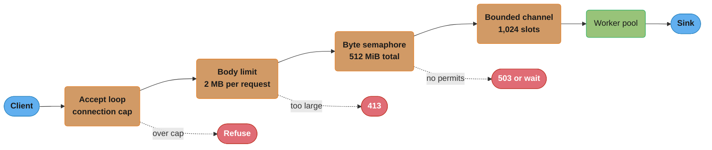
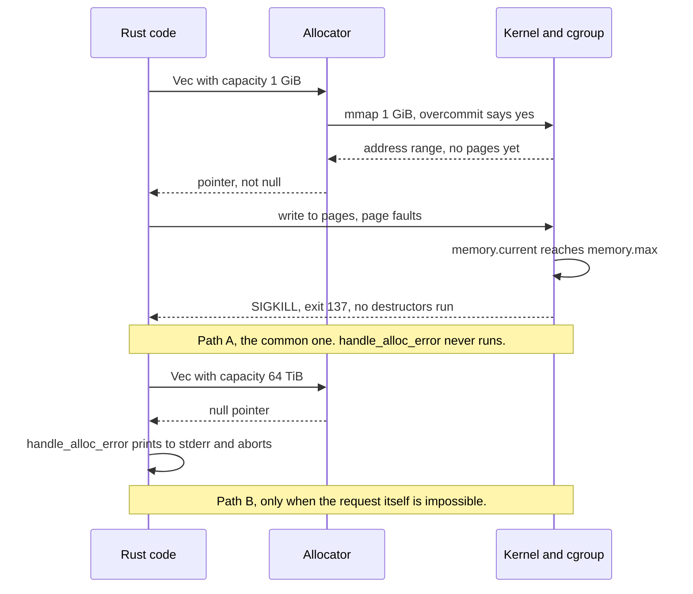

# Memory Budgets Without a GC

> Version anchor (2026-11-06): Rust 1.99.1 (2026-10-15), edition 2024. Crates: tikv-jemallocator 0.7.0, mimalloc 0.1.52, dhat 0.3.3, bumpalo 3.20.3, tokio 1.54.1, axum 0.8.9.
>
> Cross-cutting reference for the Rust case studies. This file is the budget arithmetic for a Rust service in a container: what fills RSS, why RSS stays high after every value is dropped, and where the limit is enforced when no runtime enforces it. The Go version of this problem, with `GOGC` and `GOMEMLIMIT`, is [gc_and_memory_budgets](../../../go/case_studies/cross_cutting/gc_and_memory_budgets.md). Read that file for the collector side. This file does not repeat it.

---

## 1. Concept Overview

A Rust service frees each allocation when its owner drops. There is no collector, no heap target, and no sawtooth. That removes the Go failure where the heap grows to twice the live set before a collection. It does not remove the out-of-memory kill. It moves the cause to two other places.

The first place is concurrency. Peak memory in a Rust service is the number of requests, connections or messages in flight, times the bytes each one holds. Nothing in the language caps that product. A Go service has `GOMEMLIMIT` as a last line of defense: the runtime burns CPU to stay under it. A Rust service has no such knob. If 50,000 requests each hold a 64 KiB buffer, the process holds 3.1 GiB, and the kernel kills it at the cgroup limit. The budget must be enforced in the application: bounded queues, byte semaphores and body-size limits.

The second place is the allocator. When Rust code frees memory, it returns the memory to the allocator, not to the operating system. The allocator decides when to give pages back. glibc malloc, which the standard `System` allocator calls on `*-linux-gnu` targets, keeps per-thread arenas and returns only free space at the top of each heap. A service with 32 worker threads can show 2 GiB of RSS while its live allocations are 400 MiB, and no tool that counts Rust allocations will show the gap.

So the Rust memory budget has a different shape from the Go one:

```
RSS  =  binary and statics
     +  touched thread stacks
     +  live allocations            (in-flight work x bytes per unit, plus caches)
     +  allocator retention         (fragmentation, free pages not yet returned)
     +  memory outside the allocator (mmap'd files, C libraries with their own malloc)
```

The Go budget asks "how far does the heap grow before the next collection". The Rust budget asks "how much work is admitted at once" and "does the allocator give pages back".

Virtual memory, page faults and how the kernel counts RSS are covered in [memory management and virtual memory](../../../cs_fundamentals/memory_management_and_virtual_memory/memory_management_and_virtual_memory.md). This file links there and does not teach them again.

---

## 2. Intuition

**One-line analogy.** A Rust service is a warehouse where every pallet leaves the floor the moment its order ships. The floor space is leased from a landlord (the kernel), and the warehouse manager (the allocator) keeps the lease on empty floor in case more pallets arrive. The lease bill is RSS, not the pallet count.

**Mental model.** Draw three nested boxes. The inner box is live allocations: the bytes your types own at this instant. The middle box is allocator-held memory: the live bytes plus the free chunks the allocator keeps for reuse. The outer box is RSS: the middle box plus stacks, the binary, and any memory that never went through the allocator. A heap profiler such as dhat measures the inner box. The cgroup measures the outer box. The OOM killer acts on the outer box.

**Why it matters.** Rust teams often assume that "no GC" means "memory equals what I hold". That assumption fails in two ways in production. The first is the unbounded queue: a channel with no capacity absorbs a downstream stall until the pod dies. The second is the RSS that climbs over days with no leak: glibc arenas fragment under a multi-threaded allocation pattern. Neither shows up in a unit test.

**Key insight.** In Go, the runtime trades CPU for memory when you approach the limit. In Rust, nothing trades anything. You decide the peak when you set the capacity of each queue and the size of each pool. Every unbounded structure is an unwritten line in the memory budget.

---

## 3. Core Principles

- **Peak live memory is admitted work times bytes per unit.** Write the product down for every queue, pool and cache. If a factor has no bound, the product has no bound.
- **RSS is not live allocations.** Allocator retention and fragmentation sit between them. Measure both, and size the container from RSS under sustained load.
- **The allocator is a production dependency.** The default on Linux GNU targets is glibc malloc. Its arena count scales with cores. A swap to jemalloc or mimalloc is one `#[global_allocator]` line and changes RSS behavior more than most code changes.
- **Allocation failure is rare. The OOM kill is common.** With Linux overcommit, `malloc` usually succeeds and the kernel kills the process when it touches pages past the cgroup limit. `try_reserve` protects against an absurd length, not against a slow climb to the limit.
- **A drop is deterministic, but a leak is still possible.** `Rc` and `Arc` cycles, `Box::leak`, `mem::forget` and caches that only grow are all safe Rust.
- **Capacity outlives contents.** `Vec::clear` and `HashMap::clear` keep the allocation. A map that once held one million entries keeps that table until you shrink it or drop it.
- **Enforce the budget at the edge.** A body limit, a byte semaphore and a bounded channel reject work before it allocates. A check after the allocation is too late.

---

## 4. Types / Architectures / Strategies

There are two independent choices: which allocator holds the memory, and which mechanism caps the work that asks for it.

### Allocators

| Allocator | How you get it | Retention behavior | When it is the right choice |
|---|---|---|---|
| glibc malloc (via `System`) | Default on `*-linux-gnu` | Per-thread arenas, up to 8 per core on 64-bit. Returns memory only from the top of each heap above the trim threshold (128 KiB default) | Low thread counts, short-lived processes, or after you cap arenas with `glibc.malloc.arena_max` |
| musl malloc | Default on `*-linux-musl` targets (musl 1.2.5 bundled since Rust 1.93) | Different algorithm and different retention from glibc | Static binaries. Measure it under your real thread count before you ship |
| jemalloc (`tikv-jemallocator`) | `#[global_allocator]` | Arenas at 4 per CPU by default. Purges dirty pages after `dirty_decay_ms` (10 s default) | Long-running multi-threaded services with mixed allocation sizes. Not for MSVC targets |
| mimalloc (`mimalloc` crate) | `#[global_allocator]` | Per-thread heaps with free lists sharded by page | Services with many small, short-lived allocations |
| Bump arena (`bumpalo`) | Explicit, per scope | Frees the whole arena at once. No per-object free | Per-request or per-parse scratch data with one lifetime |

### Budget enforcement

| Mechanism | What it caps | Cost of rejection | Example |
|---|---|---|---|
| Body-size limit | Bytes per request | Client gets 413 | axum `DefaultBodyLimit`, 2 MB default for `Bytes`, `String`, `Json` and `Form` |
| Bounded channel | Messages in flight between stages | Sender waits or sheds | `tokio::sync::mpsc::channel(cap)`, `std::sync::mpsc::sync_channel(cap)` |
| Byte semaphore | Bytes in flight across all requests | Waits or sheds | `tokio::sync::Semaphore` with one permit per KiB |
| Concurrency limit | Requests in flight | Waits or sheds | tower `ConcurrencyLimitLayer`, one permit per request |
| Connection cap | Sockets and their buffers | Refuses the connection | An accept loop guarded by a semaphore |
| Cache bound | Entries or bytes held for reuse | Evicts | An LRU with a byte weigher, not an entry count |

A concurrency limit alone is not a byte budget. One thousand requests of 1 KiB and one thousand requests of 2 MB both pass a limit of 1,000. If request size varies by three orders of magnitude, weigh permits by bytes.

---

## 5. Architecture Diagrams

### What occupies RSS in a Rust service

```
cgroup memory.max = 2048 MiB
|---------------------------------------------------------------------------------|
| binary + statics    |  40 MiB  ##                                               |
| thread stacks       |  10 MiB  #       (touched pages only, not 2 MiB x threads)|
| live allocations    | 600 MiB  ##############################                   |
|   in-flight buffers |   512 MiB   (8,192 permits x 64 KiB)                      |
|   caches            |    88 MiB                                                 |
| allocator retention | 900 MiB  #############################################    |
|   glibc arenas, 256 of them on 32 cores, each holding free chunks               |
| outside allocator   |  50 MiB  ##      (mmap'd files touched, C library heap)   |
|---------------------------------------------------------------------------------|
RSS = 1600 MiB      dhat peak = 600 MiB      gap = 1000 MiB nobody's profile shows
```

The live-allocation line is the only one a Rust heap profiler reports. Here the allocator-retention line is larger than it. Capping glibc arenas at 2, or switching to jemalloc, is what moves that line. Changing Rust code does not.

### Where the budget is enforced



Each orange node is a factor in the budget product. The red edges are where the service refuses work instead of allocating for it. A design with no red edges has no memory budget.

### Two ways a Rust process dies of memory



Path A is how containers die. The allocation succeeded. The kill comes later, on the write that faults in a page past the limit.

---

## 6. How It Works - Detailed Mechanics

### 6.1 The budget product, worked

Take an HTTP ingest service on a 32-core node with a 2 GiB container limit. The design is axum on Tokio's multi-thread runtime.

| Line | Arithmetic | Bytes |
|---|---|---|
| Worker threads | 32 threads, 2 MiB virtual stack each, about 64 KiB touched each | 2 MiB RSS (64 MiB virtual) |
| Blocking pool | up to 512 threads (Tokio default), 2 MiB virtual each | 1 GiB virtual. RSS only for threads that exist and the pages they touch |
| Request bodies | 8,192 requests in flight x 64 KiB average | 512 MiB |
| Worst-case bodies | 8,192 x 2 MB (axum default limit) | 16 GiB. This is why a concurrency cap alone is not a budget |
| Decode output | 1.5 x body for the parsed form | 768 MiB at the average |
| Batch queue | 1,024 slots x 256 KiB batch | 256 MiB |
| Allocator retention | measured, not derived. glibc with 256 arenas: often 1x to 2x live | 500 MiB to 1.5 GiB |

The average case fits in 2 GiB only if the allocator line is small. The worst case does not fit at any allocator setting. The fix is a byte semaphore: 512 MiB of permits, acquired per request by its `Content-Length` before the body is read. Now the worst case for bodies is 512 MiB by construction, whatever the mix of sizes.

The thread stack line is worth one sentence. The std documentation gives a 2 MiB default stack on all tier 1 platforms and says it may change. That is a virtual reservation. RSS counts only the pages a thread touches. The blocking pool can reach 512 threads, which is 1 GiB of address space and usually tens of MiB of RSS. It is a problem only when the work on those threads uses deep recursion or large stack arrays.

### 6.2 Why glibc RSS climbs with no leak

glibc gives each thread an arena so threads do not contend on one lock. On 64-bit it allows up to 8 arenas per online core (`NARENAS_FROM_NCORES` in `malloc.c`). A 32-core host can reach 256 arenas. Each non-main arena grows in heaps of up to 64 MiB of address space (`HEAP_MAX_SIZE` is twice `DEFAULT_MMAP_THRESHOLD_MAX`, which is 32 MiB on 64-bit).

Three rules make RSS stay high:

- **A free goes back to the arena that allocated the chunk.** Tokio moves tasks between worker threads. A buffer allocated on thread 3 and dropped on thread 17 goes back to thread 3's arena. Arenas fill with free chunks that their own thread does not reuse soon.
- **Only the top of a heap is returned.** glibc trims a heap when the free space at its top exceeds the trim threshold (128 KiB default). One live 100-byte allocation near the top of a 64 MiB heap pins every free page below it.
- **The mmap threshold moves up.** Allocations of 128 KiB and more start out as separate `mmap` regions, which go back to the kernel on free. When a block between the threshold and 32 MiB is freed, glibc raises the threshold to that size. After the service frees one 1 MiB buffer, later 1 MiB buffers come from arenas instead of `mmap`, and they stay in the arenas.

The fix that changes no code is to cap the arenas:

```bash
# Tunable syntax. It supersedes MALLOC_ARENA_MAX and has the same effect.
GLIBC_TUNABLES=glibc.malloc.arena_max=2 ./ingest

# Older form, still read by glibc.
MALLOC_ARENA_MAX=2 ./ingest
```

Two arenas means more lock contention on `malloc` and `free`. Measure p99 latency before and after. For most services the contention cost is small and the RSS drop is large. If the contention cost is not small, swap the allocator instead.

These variables affect only glibc malloc. A binary with jemalloc or mimalloc as its global allocator ignores them for Rust allocations.

### 6.3 Swapping the global allocator

`#[global_allocator]` replaces the allocator for every Rust allocation in the binary. It can appear once in the crate graph. Put it in the binary crate, never in a library.

```rust
// fragment: binary crate root, tikv-jemallocator 0.7.0
#[cfg(not(target_env = "msvc"))]
use tikv_jemallocator::Jemalloc;

#[cfg(not(target_env = "msvc"))]
#[global_allocator]
static GLOBAL: Jemalloc = Jemalloc;
```

jemalloc facts that matter for a budget:

| Option | Default | Effect on RSS |
|---|---|---|
| `narenas` | 4 x CPUs | Fewer arenas than glibc's 8 x cores, so less spread |
| `dirty_decay_ms` | 10,000 (10 s) | Freed pages go back to the kernel over about 10 s |
| `muzzy_decay_ms` | 0 (disabled) | No second stage of purging |
| `background_thread` | off | With it on, purging runs on a jemalloc thread instead of during allocation calls |

`tikv-jemallocator` builds jemalloc with a `_rjem_` symbol prefix by default, so C code in the same process still calls glibc. Runtime options go in `_RJEM_MALLOC_CONF` for that prefixed build, for example `_RJEM_MALLOC_CONF=background_thread:true,dirty_decay_ms:5000`. The `unprefixed_malloc_on_supported_platforms` feature removes the prefix, and then C code in the process uses jemalloc too, configured through `MALLOC_CONF`.

mimalloc is the same one-line swap with `mimalloc::MiMalloc`. Pick between jemalloc and mimalloc by measuring RSS and p99 under a replay of production traffic. Neither wins on every workload.

### 6.4 Counting live bytes yourself

A counting allocator wraps `System` and keeps two atomics. It costs two atomic operations per allocation, which is small enough to leave on in a canary. It gives you the inner box of the §2 model as a metric, next to RSS from the cgroup.

```rust
use std::alloc::{GlobalAlloc, Layout, System};
use std::sync::atomic::{AtomicUsize, Ordering};

pub struct Counting;

pub static LIVE: AtomicUsize = AtomicUsize::new(0);
pub static PEAK: AtomicUsize = AtomicUsize::new(0);

// SAFETY: every method forwards to `System` with the caller's arguments unchanged, so the
// `GlobalAlloc` contract that `System` upholds holds here too. The counters never touch the memory.
unsafe impl GlobalAlloc for Counting {
    unsafe fn alloc(&self, layout: Layout) -> *mut u8 {
        // SAFETY: the caller guarantees `layout` has a non-zero size, as `GlobalAlloc::alloc` requires.
        let p = unsafe { System.alloc(layout) };
        if !p.is_null() {
            let now = LIVE.fetch_add(layout.size(), Ordering::Relaxed) + layout.size();
            PEAK.fetch_max(now, Ordering::Relaxed);
        }
        p
    }

    unsafe fn dealloc(&self, ptr: *mut u8, layout: Layout) {
        // SAFETY: the caller guarantees `ptr` came from this allocator with this same `layout`.
        unsafe { System.dealloc(ptr, layout) };
        LIVE.fetch_sub(layout.size(), Ordering::Relaxed);
    }
}

#[global_allocator]
static GLOBAL: Counting = Counting;

fn main() {
    let before = LIVE.load(Ordering::Relaxed);
    let v: Vec<u64> = Vec::with_capacity(1024);
    let during = LIVE.load(Ordering::Relaxed);
    drop(v);
    let after = LIVE.load(Ordering::Relaxed);
    assert_eq!(during - before, 8 * 1024);
    assert_eq!(after, before);
    println!("peak live bytes: {}", PEAK.load(Ordering::Relaxed));
}
```

`realloc` is not overridden, so the trait's default implementation calls this `alloc` and `dealloc`, and the counters stay correct. `Relaxed` is enough because the counters are statistics, not synchronization. Export `LIVE` as a gauge. Alert on `RSS - LIVE`, the allocator-retention line, as well as on RSS.

### 6.5 Allocation failure, and what it does not cover

`Vec::try_reserve` and `try_reserve_exact` (stable since 1.57) return `Err(TryReserveError)` instead of aborting. The default handler for a failed infallible allocation, `handle_alloc_error`, prints a message to stderr and aborts the process when `std` is linked. The std documentation notes that a future version may panic by default instead.

Under Linux overcommit, neither path runs for an ordinary climb to the cgroup limit. The allocation succeeds and the kernel kills the process later (path A in §5). So use `try_reserve` for one job: a length that comes from outside the process. A 4-byte length prefix of `0xFFFF_FFFF` asks for 4 GiB. Check it against a hard cap first, then reserve fallibly.

```rust
use std::io::{self, Read};

const MAX_FRAME: usize = 16 * 1024 * 1024;

fn read_frame(r: &mut impl Read) -> io::Result<Vec<u8>> {
    let mut len_bytes = [0u8; 4];
    r.read_exact(&mut len_bytes)?;
    let len = u32::from_be_bytes(len_bytes) as usize;
    if len > MAX_FRAME {
        return Err(io::Error::new(io::ErrorKind::InvalidData, "frame over 16 MiB"));
    }
    let mut buf = Vec::new();
    buf.try_reserve_exact(len)
        .map_err(|e| io::Error::new(io::ErrorKind::OutOfMemory, e))?;
    r.take(len as u64).read_to_end(&mut buf)?;
    if buf.len() != len {
        return Err(io::Error::from(io::ErrorKind::UnexpectedEof));
    }
    Ok(buf)
}

fn main() {
    let mut wire: &[u8] = &[0, 0, 0, 3, b'a', b'b', b'c'];
    match read_frame(&mut wire) {
        Ok(frame) => assert_eq!(frame, b"abc"),
        Err(e) => eprintln!("bad frame: {e}"),
    }
    let mut hostile: &[u8] = &[0xFF, 0xFF, 0xFF, 0xFF];
    assert!(read_frame(&mut hostile).is_err());
}
```

The cap does the real work. `try_reserve_exact` covers the case where the cap is generous and the process is already close to its address-space limit.

### 6.6 Bounded queues are memory caps

A bounded channel turns "bytes in the queue" into a constant: capacity times the largest message. An unbounded channel turns it into "however long the consumer is slow, times the arrival rate".

```rust
use std::sync::mpsc::{TrySendError, sync_channel};

fn main() {
    // 1,024 slots x 64 KiB largest message = 64 MiB worst case held by this queue.
    let (tx, rx) = sync_channel::<Vec<u8>>(1024);
    match tx.try_send(vec![0u8; 64 * 1024]) {
        Ok(()) => {}
        Err(TrySendError::Full(_)) => eprintln!("queue full, shed this message"),
        Err(TrySendError::Disconnected(_)) => return,
    }
    drop(tx);
    let total: usize = rx.iter().map(|m| m.len()).sum();
    assert_eq!(total, 64 * 1024);
}
```

In Tokio, `mpsc::channel(cap)` is the same contract. The capacity must be at least 1, and a send waits when the buffer is full. Use `send().await` to apply backpressure to the producer, or `try_send` to shed.

When message size varies widely, cap bytes, not slots. A Tokio `Semaphore` with one permit per KiB does that:

```rust
// fragment: tokio 1.54.1
use std::sync::Arc;
use tokio::sync::{OwnedSemaphorePermit, Semaphore};

const BUDGET_KIB: usize = 512 * 1024; // 512 MiB of request bodies in flight

pub fn budget() -> Arc<Semaphore> {
    Arc::new(Semaphore::new(BUDGET_KIB))
}

/// Returns a permit sized to the body, or None when the budget is spent.
pub fn admit(sem: &Arc<Semaphore>, content_length: usize) -> Option<OwnedSemaphorePermit> {
    let kib = u32::try_from(content_length.div_ceil(1024)).ok()?;
    Arc::clone(sem).try_acquire_many_owned(kib).ok()
}
```

Hold the permit for as long as the body and anything decoded from it are alive. Drop the permit early and the budget counts bytes that are still in memory.

### 6.7 Leaks in safe Rust

Safe Rust does not promise that memory is freed. Four patterns cause real leaks:

| Pattern | Mechanism | Detection |
|---|---|---|
| `Rc` or `Arc` cycle | "A cycle between `Rc` pointers will never be deallocated" (std docs). Strong counts never reach zero | dhat `curr_bytes` at exit, or a `strong_count` assertion in a test |
| `Box::leak`, `mem::forget` | Explicit. Fine for one config struct at startup, a leak when called per request | grep, and a per-request allocation count |
| Grow-only cache | A `HashMap` keyed by user input with no eviction. `remove` and `clear` keep the table capacity | Track `len()` and `capacity()` as metrics |
| Task that never ends | A spawned task waiting on a channel whose sender is held somewhere forever | tokio-console task list, task count metric |

The cycle fix is to make the back edge `Weak`:

```rust
use std::cell::RefCell;
use std::rc::{Rc, Weak};

struct Node {
    parent: RefCell<Weak<Node>>,
    children: RefCell<Vec<Rc<Node>>>,
}

fn node() -> Rc<Node> {
    Rc::new(Node {
        parent: RefCell::new(Weak::new()),
        children: RefCell::new(Vec::new()),
    })
}

fn main() {
    let parent = node();
    let child = node();
    *child.parent.borrow_mut() = Rc::downgrade(&parent);
    parent.children.borrow_mut().push(Rc::clone(&child));

    assert_eq!(Rc::strong_count(&parent), 1);
    assert_eq!(Rc::weak_count(&parent), 1);
    drop(parent);
    assert!(child.parent.borrow().upgrade().is_none());
}
```

With a strong `Rc` as the parent link, `strong_count(&parent)` would be 2, and dropping the local handle would free nothing.

### 6.8 Measuring

| Question | Tool | Notes |
|---|---|---|
| What is RSS? | `/proc/self/status` `VmRSS`, cgroup `memory.current` | `memory.current` includes page cache. The kernel reclaims clean file pages before it kills, so compare against `memory.max` with that in mind |
| What does Rust code hold? | Counting allocator (§6.4), dhat | dhat records total bytes, peak (`t-gmax`) and bytes at exit (`t-end`) |
| Which call site allocates the most? | dhat, heaptrack, jemalloc profiling | dhat writes `dhat-heap.json` for DHAT's viewer. heaptrack wraps the process on Linux and needs no code change |
| Is the allocator the gap? | `RSS - LIVE` over time | A growing gap with flat `LIVE` is retention or fragmentation, not a leak |
| Did a change add allocations? | dhat testing mode | `dhat::HeapStats::get()` plus `dhat::assert!` in an integration test |

dhat runs only inside `main`, slows the program noticeably, and needs `debug = 1` in the release profile for useful stacks. Use it on a load test, not in production. The profiling method itself, flame graphs and sampling, is in [performance profiling](../../../backend/performance_profiling/performance_profiling.md) and [profiling and benchmarking](../../profiling_and_benchmarking/profiling_and_benchmarking.md).

### 6.9 Layout numbers that feed the budget

Per-item overhead is part of "bytes per unit". On 64-bit targets these are implementation facts, not documented promises, except the null-pointer niche for `Option<&T>` and `Option<Box<T>>`:

```rust
use std::mem::size_of;
use std::sync::Arc;

#[cfg(target_pointer_width = "64")]
fn main() {
    assert_eq!(size_of::<String>(), 24);
    assert_eq!(size_of::<Box<str>>(), 16);
    assert_eq!(size_of::<Arc<str>>(), 16);
    assert_eq!(size_of::<Option<Box<u8>>>(), 8);
    assert_eq!(size_of::<Vec<u8>>(), 24);
}

#[cfg(not(target_pointer_width = "64"))]
fn main() {}
```

A map of 10 million short keys stored as `String` spends 80 MB more on headers than the same keys stored as `Box<str>`, before any capacity slack. `Arc<str>` adds a 16-byte header on the heap for the two counts, on 64-bit targets.

---

## 7. Real-World Examples

**The multi-threaded service with flat dhat and rising RSS.** This is the glibc arena pattern from §6.2. The service runs Tokio on every core, allocates request buffers on one worker and frees them on another, and RSS climbs for days before it plateaus well above the live set. The two standard fixes are `glibc.malloc.arena_max=2` or a jemalloc swap. The [L7 proxy case study](../design_a_high_performance_l7_proxy.md) works through the memory-per-connection side of this.

**The ingest pipeline with an unbounded channel.** A stage that writes to object storage slows during a storage incident. The upstream stage keeps reading from the network into an unbounded channel. Memory grows at the ingest rate until the cgroup kill, and then every buffered event is lost. The [async event ingest pipeline](../design_an_async_event_ingest_pipeline.md) designs the bounded version with an explicit memory bound.

**The storage engine with mmap.** A memory-mapped data file is outside the allocator. Its touched pages count toward the cgroup as page cache, which the kernel can reclaim, so they rarely cause a kill but do confuse an RSS alert. The [zero-copy storage engine](../design_a_zero_copy_storage_engine.md) covers mmap soundness and budgeting.

**jemalloc as a published crate for large Rust services.** The `tikv-jemallocator` crate is published from the `tikv` GitHub organization. Its README lists build and run support for targets that include x86_64 and aarch64 Linux and aarch64 macOS, and excludes MSVC in every example.

**Firmware with no allocator at all.** On a 256 KB microcontroller the budget is static: `heapless` collections with capacity in the type. The [sensor node firmware](../design_a_sensor_node_firmware.md) study shows the far end of this file's argument, where every buffer size is a compile-time constant.

---

## 8. Tradeoffs

### Go budget versus Rust budget

| Question | Go (see [gc_and_memory_budgets](../../../go/case_studies/cross_cutting/gc_and_memory_budgets.md)) | Rust |
|---|---|---|
| What sets peak heap? | `GOGC` ratio times live heap | In-flight work times bytes per unit |
| Runtime knob near the limit | `GOMEMLIMIT`, which trades CPU for memory | None. The application rejects work, or the kernel kills |
| Main cause of RSS above live | Heap growth before the next cycle | Allocator retention and fragmentation |
| What the heap profile misses | Garbage not yet collected, stacks, cgo | Allocator retention, stacks, C allocations |
| How it fails | Gradual: GC CPU rises, latency rises | Sudden: SIGKILL at the limit |
| Main control | Two environment variables | Code: capacities, semaphores, body limits, allocator choice |

The Rust failure is sharper. A Go service near its limit slows down. A Rust service near its limit runs at full speed until the kernel kills it. That is why admission control is a design requirement in Rust and a tuning step in Go.

### Allocator choice

| Factor | glibc, default | glibc, `arena_max=2` | jemalloc | mimalloc |
|---|---|---|---|---|
| Code change | None | None (env only) | One static, one dependency | One static, one dependency |
| RSS under many threads | Highest risk of fragmentation | Lower | Lower, with timed purge | Lower |
| Lock contention | Lowest | Higher | Low | Low |
| Covers C code in the process | Yes | Yes | Only when unprefixed | Only with its override option |
| Build cost | None | None | Builds jemalloc from C source | Builds mimalloc from C source |
| Tooling | heaptrack | heaptrack | Built-in heap profiling (`profiling` feature) | Its own statistics output |

### Enforcement choice

| Mechanism | Precision | Overhead | Failure mode if misconfigured |
|---|---|---|---|
| Concurrency limit | Low: counts requests, not bytes | One semaphore op | Large requests still OOM |
| Byte semaphore | High | One semaphore op, needs a size before reading | Permit dropped early, budget undercounts |
| Bounded channel | Medium: slots times largest message | None beyond the channel | Capacity sized for the average message |
| Body limit | Per request only | None | Disabled to "fix" a 413, then no ceiling |

---

## 9. When to Use / When NOT to Use

**Write the full budget table (§6.1) when:**
- The service runs in a container with a memory limit and handles variable-size input.
- The service has a queue between two stages that run at different speeds.
- A cache key or cache size comes from user input.

**Cap glibc arenas when:**
- RSS rises over hours while the counting allocator's `LIVE` stays flat.
- The service runs many threads and frees memory on a different thread than it allocated.
- You cannot add a dependency, or C code in the process also allocates heavily.

**Swap to jemalloc or mimalloc when:**
- Capping arenas costs measurable p99 from lock contention.
- You want a timed purge (`dirty_decay_ms`) or built-in heap profiling.

**Do not swap the allocator when:**
- The gap between RSS and live bytes is small. A swap adds a C build step and a dependency for no gain.
- The real problem is an unbounded queue. No allocator fixes unbounded live memory.
- The target is MSVC and the crate does not support it.

**Use `try_reserve` when** a length or count comes from outside the process. **Do not use it** as a substitute for a budget. It does not fire under overcommit.

**Use a bump arena when** a request or parse builds many small objects that all die together. **Do not use one** for data that outlives the scope, because an arena frees nothing until the whole arena drops.

---

## 10. Common Pitfalls

The team stories and figures in this section are illustrative composites, not reports from a named company.

### 10.1 Sizing the container from the dhat peak

A team ran a load test under dhat, saw a peak of 600 MiB, and set the limit to 1 GiB. In production, with 32 worker threads, RSS settled at 1.4 GiB and the pod restarted every few hours. dhat counts what Rust code holds. It does not count glibc's 256 arenas of retained free chunks.

Fix: size from RSS during a sustained load test on the production core count and allocator, then add headroom for the worst-case admitted work. Track `RSS - LIVE` as a metric so the retention line is visible.

### 10.2 Sharing a cache across threads with `Rc`

A per-thread cache moved to a shared cache during a refactor. The first attempt kept `Rc`:

```rust
// BROKEN
use std::collections::HashMap;
use std::rc::Rc;
use std::thread;

fn main() {
    let cache: Rc<HashMap<u32, Vec<u8>>> = Rc::new(HashMap::new());
    let c = Rc::clone(&cache);
    // error[E0277]: `Rc<HashMap<u32, Vec<u8>>>` cannot be sent between threads safely
    let h = thread::spawn(move || c.len());
    let _ = h.join();
}
```

`Rc` uses a non-atomic count, so it is not `Send`. The fix is `Arc`, which costs an atomic count and the same 16-byte header on 64-bit targets. One shared copy instead of one per thread is the memory win.

```rust
// FIX
use std::collections::HashMap;
use std::sync::Arc;
use std::thread;

fn main() {
    let cache: Arc<HashMap<u32, Vec<u8>>> = Arc::new(HashMap::new());
    let c = Arc::clone(&cache);
    let h = thread::spawn(move || c.len());
    match h.join() {
        Ok(n) => println!("entries: {n}"),
        Err(_) => eprintln!("worker panicked"),
    }
}
```

### 10.3 The unbounded channel as a "queue"

`tokio::sync::mpsc::unbounded_channel` never makes a sender wait. Take an ingest stage at 50,000 events/s with 2 KiB events, about 100 MB/s. A 20-minute outage of the downstream store would need 120 GB of buffer. The cgroup kills the process at 4 GiB, about 40 seconds in. Every buffered event was lost, which is worse than shedding them at the edge with a 503.

Fix: `mpsc::channel(cap)` with `cap` derived from the budget (§6.6), and a decision about what happens when it is full: wait, which pushes backpressure to the network, or shed with an explicit error.

### 10.4 `Arc` cycles through callbacks

A connection registry held `Arc<Conn>`, and each `Conn` held a callback closure that captured an `Arc` of the registry. Closed connections never freed. The cycle was invisible in the type signatures because it ran through a boxed closure.

Fix: capture `Weak` in the closure and `upgrade()` on each call. Add a test that drops the registry and asserts the `Conn` count reaches zero.

### 10.5 `MALLOC_ARENA_MAX` on a jemalloc binary

A team set `MALLOC_ARENA_MAX=2` after reading about glibc fragmentation, saw no change, and concluded the advice was wrong. The binary had a jemalloc `#[global_allocator]`. The variable did nothing for Rust allocations.

Fix: check which allocator the binary uses before you tune it. For jemalloc, tune `narenas`, `dirty_decay_ms` and `background_thread` through `_RJEM_MALLOC_CONF`.

### 10.6 A map that shrank in `len` but not in bytes

A session map peaked at 4 million entries during a traffic spike, then fell to 200,000. RSS did not fall. `HashMap::remove` and `clear` keep the table, and the std docs promise only lower bounds after `shrink_to`.

Fix: call `shrink_to(len * 2)` on a timer when `capacity()` is far above `len()`, or rebuild the map. Better, bound the map with an eviction policy so the spike never reaches 4 million.

---

## 11. Technologies & Tools

| Tool | Role | Note |
|---|---|---|
| tikv-jemallocator | jemalloc as `#[global_allocator]` | 0.7.0. Prefixed symbols by default. Not for MSVC |
| mimalloc | mimalloc as `#[global_allocator]` | 0.1.52 |
| dhat | Heap profiling and heap-usage tests | 0.3.3. Writes `dhat-heap.json`. Slow, use on load tests |
| heaptrack | Allocation profiler for Linux processes | No code change. Covers C allocations too |
| bumpalo | Bump arena for scoped allocations | 3.20.3 |
| tokio | `mpsc::channel` and `Semaphore` for budgets | 1.54.1. Blocking pool default 512 threads |
| axum | `DefaultBodyLimit` | 0.8.9. 2 MB default for `Bytes`-based extractors |
| tower | `ConcurrencyLimitLayer` | 0.5.3. Counts requests, not bytes |
| tokio-console | Live task list | 0.1.14. Finds tasks that never finish |
| glibc tunables | `glibc.malloc.arena_max`, `glibc.malloc.trim_threshold` | Set through `GLIBC_TUNABLES` |
| cgroup v2 | `memory.max`, `memory.current`, `memory.high` | `memory.high` throttles before the kill |

---

## 12. Interview Questions with Answers

**Q: Rust has no garbage collector, so why does a Rust service get OOM-killed?**
**Short:** Because nothing caps how much work is in flight, and the allocator keeps freed memory, so RSS can exceed the container limit with no leak at all.

Two causes cover almost every case. The first is unbounded admitted work: in-flight requests times bytes per request has no ceiling unless the code sets one. The second is allocator retention: freed memory goes back to the allocator, and glibc keeps much of it in per-thread arenas. The kernel counts RSS, so both causes look the same to the OOM killer. Fix the first with bounded queues and byte semaphores, and the second with an arena cap or an allocator swap.

**Q: Why does RSS stay high after the Rust code has dropped everything?**
**Short:** A drop returns memory to the allocator, and the allocator decides when to give pages back to the kernel. glibc returns only free space at the top of each heap.

glibc trims a heap only when the free space at its top exceeds the trim threshold, 128 KiB by default. One live allocation near the top pins every free page below it. With many arenas, many heaps are pinned. jemalloc purges freed pages on a timer instead (`dirty_decay_ms`, 10 s by default), so its RSS follows live memory more closely.

**Q: What is the Rust equivalent of GOMEMLIMIT?**
**Short:** There is none. No runtime trades CPU for memory near a limit, so the budget must be enforced in code with capacities, semaphores and body limits.

`GOMEMLIMIT` works because Go has a collector that can run more often. A Rust program frees memory at drop, so there is no extra work to run. The closest tools are admission controls at the edge: a body limit (axum defaults to 2 MB), a byte semaphore, and bounded channels. The result is a sharper failure profile than Go: full speed until the kernel kill, with no gradual slowdown as a warning, unless admission control rejects work first.

**Q: How do glibc arenas cause fragmentation in a Tokio service?**
**Short:** Each thread allocates from its own arena, Tokio moves tasks across threads, and a free goes back to the arena of origin, so many arenas fill with free chunks.

On 64-bit glibc allows up to 8 arenas per core, so 256 on a 32-core host. A buffer allocated on one worker and freed on another returns to the first worker's arena, which may not reuse it soon. Each arena's heap returns memory only from its top. The usual fix is `GLIBC_TUNABLES=glibc.malloc.arena_max=2`, at the cost of more lock contention, or a jemalloc or mimalloc swap.

**Q: Does handle_alloc_error protect a containerized service from the OOM killer?**
**Short:** No. Under Linux overcommit the allocation usually succeeds, and the kernel kills the process later when it touches pages past the cgroup limit.

`handle_alloc_error` runs only when the allocator returns null. With overcommit, a large `malloc` gets address space without pages. The kill comes on a later write, as SIGKILL with exit code 137, and no destructor or log flush runs. The default handler, when it does run, prints to stderr and aborts. Plan for the kernel kill, not for the handler.

**Q: When is Vec::try_reserve the right tool?**
**Short:** When a length or count comes from outside the process, after a hard cap check, so a hostile or corrupt length becomes an error instead of an abort.

A 4-byte length prefix can ask for 4 GiB. Check it against a protocol maximum first, then call `try_reserve_exact` (stable since 1.57) and map the `TryReserveError` to a protocol error. The cap does most of the work. `try_reserve` does not help against a slow climb to the cgroup limit, because overcommit hides that failure until a page fault.

**Q: Why is a concurrency limit not a memory budget?**
**Short:** It counts requests, not bytes. A thousand 2 MB requests pass the same limit as a thousand 1 KiB requests, and the first set holds 2,000 times more memory.

When request size varies widely, weigh admission by size. A Tokio `Semaphore` with one permit per KiB, acquired with `try_acquire_many_owned` from `Content-Length` before the body is read, caps bytes in flight. Hold the permit until the body and everything decoded from it drop, or the budget undercounts.

**Q: How do you leak memory in safe Rust?**
**Short:** With an Rc or Arc cycle, Box::leak or mem::forget, a cache that only grows, or a task that never finishes. All of these are safe code.

The std docs say a cycle between `Rc` pointers will never be deallocated, and that `Weak` breaks cycles. `Box::leak` is fine once at startup and a leak per request. A `HashMap` keyed by user input with no eviction grows without bound, and `clear` keeps its table. A spawned task that waits forever holds everything it captured.

**Q: How do you find which kind of memory problem you have?**
**Short:** Compare RSS with live Rust bytes over time. Rising live bytes means a leak or unbounded work. Flat live bytes with rising RSS means allocator retention.

Get live bytes from a counting `GlobalAlloc` wrapper or dhat, and RSS from the cgroup's `memory.current` or `/proc/self/status`. If both rise together, find the call site with dhat or heaptrack. If only RSS rises, cap glibc arenas or change allocator before you touch code.

**Q: What does it cost to wrap the global allocator with a counter?**
**Short:** Two relaxed atomic operations per allocation and one per free, which is cheap enough to run in a canary and gives live bytes as a metric.

The wrapper forwards to `System` and adds `fetch_add`, `fetch_max` and `fetch_sub` on `AtomicUsize`. The default `realloc` calls the wrapper's `alloc` and `dealloc`, so it stays correct without an override. Under heavy contention on one cache line the atomics can show up in a profile. Shard the counter per thread if they do.

**Q: Why does setting MALLOC_ARENA_MAX sometimes do nothing?**
**Short:** It configures glibc malloc only. A binary whose global allocator is jemalloc or mimalloc ignores it for every Rust allocation.

Check the binary for a `#[global_allocator]` before tuning. `tikv-jemallocator` uses prefixed symbols by default, so C code in the same process still uses glibc and still reads the glibc variables. For the Rust side, jemalloc options go in `_RJEM_MALLOC_CONF`. glibc's own manual says the `glibc.malloc.arena_max` tunable supersedes `MALLOC_ARENA_MAX` with identical features.

**Q: How much memory do 512 blocking-pool threads cost?**
**Short:** About 1 GiB of virtual address space at the 2 MiB default stack, but RSS counts only touched pages, which is usually far less.

Tokio's blocking pool defaults to 512 threads at most, and std's default thread stack is 2 MiB on tier 1 platforms. The reservation is virtual. A thread that runs shallow code touches a few pages of stack. The cost becomes real with deep recursion or large arrays on the stack, or when a `RLIMIT_AS` limit counts address space.

**Q: Why prefer Box of str over String for a large set of long-lived keys?**
**Short:** On 64-bit targets Box of str is 16 bytes and has no spare capacity, while String is 24 bytes and can carry slack from how it was built.

The 8-byte difference is an implementation fact on 64-bit targets, not a documented promise. Across 10 million keys it is 80 MB, and the capacity slack can be larger than that. Convert with `into_boxed_str()` when the key stops changing. Use `Arc<str>` when many owners share one key.

**Q: When is jemalloc the wrong choice?**
**Short:** When the gap between RSS and live bytes is already small, when the target is MSVC, or when the real problem is unbounded live memory that no allocator can fix.

A swap adds a C build step, a dependency, and different tuning knobs. It changes retention, not demand. If live bytes are rising, the fix is a bound in the code. Measure RSS and p99 under replayed traffic for glibc with capped arenas, jemalloc and mimalloc, and pick from the numbers.

**Q: What memory bound does a bounded channel give you?**
**Short:** That the queue never holds more than capacity times the largest message, so its share of the budget is a constant you can write down.

For a 1,024-slot channel of messages up to 64 KiB, the queue holds at most 64 MiB. Tokio's `mpsc::channel` needs a capacity of at least 1 and makes a sender wait when full. `try_send` lets you shed instead. The bound covers only the queue, so the producer's own buffers need their own line in the budget.

**Q: How does a bump arena change the memory profile of a request?**
**Short:** It replaces many small allocations with a few large chunks that are all freed together when the arena drops, which cuts allocator calls and fragmentation.

bumpalo hands out memory by moving a pointer. There is no per-object free, so objects in the arena do not run their own deallocation, and the whole arena is released at once. That suits a parse or a request whose objects share one lifetime. It is wrong for data that outlives the scope, because an arena that lives too long holds every object ever placed in it.

**Q: What does memory.high do that memory.max does not?**
**Short:** memory.high throttles the cgroup and forces reclaim when usage passes it, while memory.max is the hard limit where the kernel OOM-kills.

Setting `memory.high` a little below `memory.max` gives a period of slow allocation and reclaim before the kill. That period shows up as latency, which an alert can catch. For a Rust service that has no runtime slowdown of its own, it is the only gradual signal the platform offers.

**Q: Why can an mmap'd file make RSS look alarming without causing a kill?**
**Short:** Touched pages of a file mapping count toward the cgroup as page cache, but clean file pages are reclaimable, so the kernel drops them before it kills.

A storage engine that maps a 4 GiB file and reads it end to end shows a large `memory.current`. Those pages are not allocator memory and dhat does not see them. Alert on anonymous memory, or on RSS minus file-backed pages, not on raw `memory.current`.

---

## 13. Best Practices

- Write the budget table (§6.1) in the design doc. Every queue, pool, cache and buffer gets a row with a capacity and a per-item size.
- Enforce at the edge: connection cap, body limit, byte semaphore, bounded channel. Reject before the allocation.
- Never use an unbounded channel between stages that can run at different speeds.
- Export live bytes from a counting allocator and RSS from the cgroup. Alert on both and on their difference.
- On glibc with many threads, start with `GLIBC_TUNABLES=glibc.malloc.arena_max=2` and measure. Swap the allocator only when the numbers say so.
- Set the allocator in the binary crate only. A library must not declare `#[global_allocator]`.
- Treat every length from the wire as hostile: hard cap, then `try_reserve_exact`.
- Make every back edge in a graph of `Rc` or `Arc` a `Weak`. Test that dropping the root frees the graph.
- Bound every cache by bytes, not entries, and record `len()` and `capacity()`.
- Set `memory.high` below `memory.max` so the platform gives a slow signal before the kill.
- Size the container from a sustained load test on the production core count and allocator, not from a heap profile.

---

## 14. Case Study

### Scenario: an event indexer with 3 GiB of RSS and 450 MiB of live data

The scenario and its numbers are illustrative. An event indexer reads newline-delimited records over TCP, counts events per user, and flushes the counts to a database every 10 seconds. It runs on a 32-core node with a 4 GiB limit. After a week in production it restarts every 18 to 30 hours with exit code 137. The team's dhat run on a load test shows a 450 MiB peak.

**Step 1: split the gap.** The team adds the counting allocator from §6.4 and exports `LIVE`. Over 24 hours, `LIVE` rises from 300 MiB to 1.1 GiB and RSS rises from 900 MiB to 3.8 GiB. Both rise, so there is a real growth in live memory. The gap also grows, so allocator retention is a second problem.

**Step 2: find the live growth.** The per-user map grows with every new user and never evicts. The keys are `String` values cut from the read buffer. A sample shows 11 million keys after 24 hours, average key length 18 bytes, and an average `String` capacity of 32 because each key was built by pushing characters. Headers alone are 264 MB, and spare capacity adds 154 MB.

The first rewrite tried to avoid the key allocation by borrowing from the read buffer:

```rust
// BROKEN
use std::collections::HashMap;

fn main() {
    let mut counts: HashMap<&str, u64> = HashMap::new();
    for line in ["user=42 click", "user=7 view"] {
        let buf = line.to_string(); // the read buffer, reused per line
        let key = buf.split(' ').next().unwrap_or("");
        // error[E0597]: `buf` does not live long enough
        *counts.entry(key).or_insert(0) += 1;
    }
    println!("{}", counts.len());
}
```

The compiler is right. The buffer is reused for the next line, so a borrowed key would dangle. The fix stores exact-size owned keys, allocates only for keys not yet in the map, and bounds the map:

```rust
// FIX
use std::collections::HashMap;

const MAX_USERS: usize = 2_000_000;

fn record(counts: &mut HashMap<Box<str>, u64>, key: &str) -> bool {
    if let Some(n) = counts.get_mut(key) {
        *n += 1;
        return true;
    }
    if counts.len() >= MAX_USERS {
        return false;
    }
    counts.insert(Box::from(key), 1);
    true
}

fn main() {
    let mut counts: HashMap<Box<str>, u64> = HashMap::new();
    for line in ["user=42 click", "user=7 view", "user=42 view"] {
        let buf = line.to_string();
        let key = buf.split(' ').next().unwrap_or("");
        if !record(&mut counts, key) {
            eprintln!("user map full, flushing early");
        }
    }
    assert_eq!(counts.get("user=42").copied(), Some(2));
}
```

The flush now drains the map every 10 seconds and calls `shrink_to(MAX_USERS / 4)` when capacity is more than four times the length. With `Box<str>` keys and the 2 million cap, the map's worst case is about 2 million x (16-byte key header + 18 bytes of key + 8-byte count + table overhead), roughly 100 MiB, instead of an unbounded number.

**Step 3: close the retention gap.** With live memory bounded, RSS still settles at 1.6 GiB against 400 MiB of `LIVE`. The service frees read buffers on different workers than it allocates them. The team sets `GLIBC_TUNABLES=glibc.malloc.arena_max=2` in a canary. RSS settles at 620 MiB. p99 flush latency moves from 41 ms to 44 ms, inside the 100 ms objective. They keep glibc with capped arenas and record jemalloc as the next step if contention grows.

**Step 4: write the budget down.**

| Line | Bound | Bytes |
|---|---|---|
| Per-user map | 2,000,000 entries | about 100 MiB |
| Read buffers | 4,096 connections x 64 KiB | 256 MiB |
| Flush batch | one batch of 2,000,000 rows x 48 bytes | 92 MiB |
| Allocator retention | measured with `arena_max=2` | about 220 MiB |
| Stacks, binary | measured | about 50 MiB |
| Total | | about 720 MiB against a 4 GiB limit |

**Outcome.** No restarts in the following 30 days. The team lowered the limit from 4 GiB to 1.5 GiB, which kept 2x headroom over the measured 720 MiB and let the scheduler fit two more pods per node. The budget table went into the design doc, and every new queue or cache now needs a row in it before review.

The lesson for an interview: the GC-free memory story has two halves. Live memory is bounded by design decisions you make in code. The distance from live memory to RSS is set by the allocator. A team that fixes only one half sees only half the drop.
