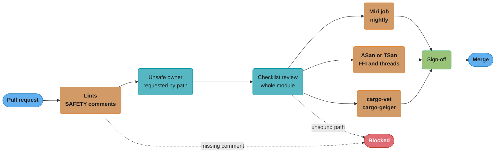

# Unsafe Review and Soundness Checklist

> Version anchor (2026-11-06): Rust 1.99.1 (2026-10-15), edition 2024. Tools: cargo-geiger 0.14.0, cargo-vet 0.10.3, cargo-deny 0.20.2, cargo-audit 0.22.2, kani-verifier 0.68.0, loom 0.7.2, cargo-fuzz 0.13.2. Miri and `-Zsanitizer` run on a nightly toolchain only.
>
> Cross-cutting reference for the Rust case studies. This file is the per-change review procedure for code that contains `unsafe`: what the author writes, what the reviewer checks, which jobs run in CI, and who signs off. The UB catalogue and the crate-level policy decision (forbid, allow in one module, or allow with gates) live in [unsafe Rust and undefined behavior](../../unsafe_rust_and_undefined_behavior/unsafe_rust_and_undefined_behavior.md). The verification ladder lives in [testing, fuzzing and Miri](../../testing_fuzzing_and_miri/testing_fuzzing_and_miri.md).

---

## 1. Concept Overview

An `unsafe` block is a promise from the author to the compiler: "I checked the rules you cannot check here." Soundness is the property that makes that promise useful to everyone else. A safe API is sound when no safe caller, with any input and any interleaving, can cause undefined behavior through it. One unsound function in a dependency means a safe caller of that crate can hit UB with no unsafe code of its own.

The compiler checks nothing inside the promise. Miri, sanitizers and fuzzers check some executions. Review is the only step that checks the argument itself: what invariant the code relies on, where that invariant is established, and whether any safe path can break it. This file turns that review into a checklist that a team can apply the same way on every pull request.

The checklist has five parts:

- **Author obligations.** A `// SAFETY:` comment on every unsafe block and `unsafe impl`, a `# Safety` doc section on every `pub unsafe fn`, one unsafe operation per block, and unsafe code kept inside small private modules.
- **Lints that enforce the obligations.** `unsafe_op_in_unsafe_fn` (warn by default in edition 2024), `clippy::undocumented_unsafe_blocks` and `clippy::multiple_unsafe_ops_per_block` (both in the `restriction` group, so you turn them on), and `clippy::missing_safety_doc` (in the `style` group).
- **Reviewer questions.** A fixed list, applied to every unsafe block in the diff and to every safe function in the same module.
- **CI jobs.** Miri on the module's tests, sanitizers for FFI code that Miri cannot run, loom for custom atomics, cargo-geiger and cargo-vet for dependencies.
- **Sign-off.** Who must approve which kind of change.

The boundary with the module page: [unsafe Rust and undefined behavior](../../unsafe_rust_and_undefined_behavior/unsafe_rust_and_undefined_behavior.md) teaches what UB is and decides whether a crate allows unsafe at all. This file assumes the crate allows it and asks how each change gets reviewed.

---

## 2. Intuition

**One-line analogy.** An `unsafe` block is a structural change to a building. The inspector does not sign because the wall looks straight. The inspector signs because the load calculation is attached, names the beams it relies on, and nobody else can remove those beams without a new permit.

**Mental model.** Draw a box around the module that holds the unsafe code. Inside the box, private fields carry invariants ("slots `0..len` are initialized", "this pointer came from `Box::into_non_null` and is freed once"). The box's public functions are the only doors. Soundness is a property of the whole box: every door, safe or unsafe, must keep every invariant. A reviewer who reads only the lines inside `unsafe { }` checks the beam and ignores the people who can walk in and remove it.

**Why it matters.** Unsafe bugs do not fail where they are written. A wrong length check corrupts the heap, and the crash comes later in code that has no unsafe at all. Production debugging of heap corruption costs days. The review costs an hour. Tools catch a subset: Miri finds UB only on paths the tests execute and cannot run most FFI calls, and a sanitizer finds only what the run touches.

**Key insight.** The unit of review is the module, not the block. Unsafe code is sound only if the safe code that maintains its invariants is correct too. A one-character change to a safe `len += 1` in the same module can be the soundness bug, and a diff-only review will not look at it.

---

## 3. Core Principles

- **Soundness is a property of the public API.** If a safe function can cause UB for some input, the function is unsound, even if no current caller passes that input.
- **The module is the unsafe boundary.** Field privacy is the one boundary the compiler enforces. Every invariant that unsafe code relies on must live in private fields of a type whose module contains all code that can change them.
- **Every unsafe block states its argument.** The `// SAFETY:` comment names the precondition of each unsafe operation and where the code establishes it. A comment that restates the code ("calls `get_unchecked`") is not an argument.
- **Unsafe code never trusts safe code it does not own.** A safe trait method such as `Iterator::size_hint`, `Hash`, `Ord` or `Read::read` can return anything. Unsafe code that depends on its result being correct is unsound.
- **One unsafe operation per block.** Each operation gets its own precondition and its own comment. A block with three operations hides which comment covers which.
- **Tools find bugs. They do not prove absence.** Miri's README says that when Miri finds no UB, you may just have to test more inputs. Review owns the argument. Tools test it.
- **Unsafe lives in known files.** Ownership rules such as CODEOWNERS match paths. Keep unsafe in a few named modules so the right reviewer is requested every time.

---

## 4. Types / Architectures / Strategies

Unsafe code falls into categories with different risk and different checks. Classify each change before review.

| Category | Typical code | Main risk | Required checks |
|---|---|---|---|
| Unchecked access for speed | `get_unchecked`, `from_utf8_unchecked`, `unreachable_unchecked` | Out-of-bounds read, invalid value | SAFETY comment citing the check, a benchmark showing the gain, Miri |
| Raw-pointer data structure | Linked list, arena, ring buffer, `MaybeUninit` storage | Use after free, double free, uninit read, aliasing | Module-privacy review of every method, Miri with Stacked and Tree Borrows, fuzz |
| `unsafe impl Send` or `Sync` | Wrappers over raw pointers or FFI handles | Data race | Written thread-safety argument, TSan or loom where shared state exists |
| FFI | `unsafe extern "C"` blocks, callbacks | Wrong signature, ownership mismatch, unwinding across the boundary | Signature check against the C header, ASan job (Miri cannot run it), `extern "C-unwind"` where unwinding must cross |
| Layout and transmute | `transmute`, `#[repr(C)]` casts, `from_raw_parts` | Invalid bit patterns, size mismatch | `size_of` assertions, prefer safe conversions |
| Global state | `static mut` (references to it are denied in edition 2024), `std::env::set_var` | Data race across threads | Replace with atomics, `LazyLock` or passed configuration |
| Custom atomics | Lock-free queues, seqlocks | Wrong memory ordering | loom model test, Miri with many seeds |

Two strategies for where unsafe lives in a codebase:

| Strategy | How | Review cost | Fits |
|---|---|---|---|
| Quarantine crate | All unsafe in one internal crate with `#![forbid(unsafe_code)]` everywhere else | One crate to audit. Path-based ownership is trivial | Services and applications |
| Per-module encapsulation | Unsafe allowed in named private modules, each with a safe API | More modules to audit, but each stays small | Libraries such as storage engines and parsers |

---

## 5. Architecture Diagrams

### The review pipeline for a change that touches unsafe



Lints run first because they are cheap and block the most common gap, a missing argument. The checklist review comes before the slow jobs because a reviewer often finds the bug in the safe code around the block, which no tool targets.

### The module-privacy boundary

```
 crate (any code)                 mod ring  (the unsafe boundary)
+--------------------------+     +----------------------------------------------+
|                          |     |  pub struct Ring {                           |
|  ring.push(x)   ---------+---->|      buf: [MaybeUninit<T>; N],   (private)   |
|  ring.pop()     ---------+---->|      len: usize,                 (private)   |
|                          |     |  }                                           |
|  ring.len = 9   ---X     |     |  invariant: slots 0..len are initialized     |
|  (error[E0616]: field    |     |                                              |
|   `len` is private)      |     |  pub fn push  safe, keeps the invariant      |
|                          |     |  pub fn pop   unsafe read, relies on it      |
+--------------------------+     |  fn grow      safe, MUST keep it too         |
                                 +----------------------------------------------+
```

The compiler stops outside code from writing `len`. It does not stop safe code inside the module. That is why the reviewer reads every function in the box, including `grow`, which has no unsafe block.

---

## 6. How It Works - Detailed Mechanics

### 6.1 The lint set

Put the lints at the crate root so they apply to every module. For a crate with no unsafe code, forbid it. `forbid` cannot be overridden lower down, so a later `#[allow(unsafe_code)]` fails to compile.

```rust
#![forbid(unsafe_code)]

pub fn parse_port(s: &str) -> Option<u16> {
    s.parse().ok()
}
```

For a crate that allows unsafe code, turn on the documentation lints:

```rust
#![deny(unsafe_op_in_unsafe_fn)]
#![warn(clippy::undocumented_unsafe_blocks)]
#![warn(clippy::multiple_unsafe_ops_per_block)]
#![warn(clippy::missing_safety_doc)]

/// Returns the byte at `i` without a bounds check.
///
/// # Safety
///
/// `i` must be less than `bytes.len()`.
pub unsafe fn byte_at(bytes: &[u8], i: usize) -> u8 {
    // SAFETY: the caller guarantees `i < bytes.len()`, per this function's `# Safety` section.
    unsafe { *bytes.get_unchecked(i) }
}
```

What each lint does:

| Lint | Group or default | Effect |
|---|---|---|
| `unsafe_code` | rustc, allow by default | With `forbid`, rejects every `unsafe` keyword in the crate |
| `unsafe_op_in_unsafe_fn` | rustc, warn in edition 2024 | The body of an `unsafe fn` is no longer one implicit unsafe block. Each operation needs its own block and comment |
| `clippy::undocumented_unsafe_blocks` | `restriction`, off until enabled | Flags an unsafe block or `unsafe impl` with no `// SAFETY:` comment |
| `clippy::multiple_unsafe_ops_per_block` | `restriction`, off until enabled | Flags a block with more than one unsafe operation |
| `clippy::missing_safety_doc` | `style`, warn | Flags a `pub unsafe fn` with no `# Safety` doc section |

Run clippy with `-D warnings` in CI so the warnings block the merge.

### 6.2 What a SAFETY comment must contain

A good comment answers three questions: which precondition does this operation have, what establishes it, and why can nothing change it between the check and the use.

```rust
/// Sums the first `n` values, or returns None when `n` is past the end.
pub fn prefix_sum(xs: &[u64], n: usize) -> Option<u64> {
    if n > xs.len() {
        return None;
    }
    let mut sum = 0u64;
    for i in 0..n {
        // SAFETY: `i < n` from the loop range and `n <= xs.len()` from the check above.
        // `xs` is a shared borrow, so its length cannot change during the loop.
        sum = sum.wrapping_add(unsafe { *xs.get_unchecked(i) });
    }
    Some(sum)
}
```

Comments that fail review:

| Comment | Why it fails |
|---|---|
| `// SAFETY: this is safe` | States the conclusion, not the argument |
| `// SAFETY: calls get_unchecked` | Restates the code |
| `// SAFETY: index is always valid` | Does not say what makes it valid |
| `// SAFETY: the iterator returns at most n items` | Relies on a safe trait method that may lie (see §7) |
| `// SAFETY: only called from main` | Relies on the caller, but the function is safe and public |

The last row is the most common review finding. If correctness depends on how the caller behaves, the function must be `unsafe fn` with a `# Safety` section, or the check must move inside the function.

### 6.3 The module-privacy boundary in code

Here is a fixed-capacity stack built on `MaybeUninit`. The invariant is "slots `0..len` are initialized". Only code in `mod stack` can change `len`.

```rust
mod stack {
    use std::mem::MaybeUninit;

    /// Fixed-capacity stack. Invariant: slots `0..len` hold initialized values.
    pub struct Stack<T, const N: usize> {
        buf: [MaybeUninit<T>; N],
        len: usize,
    }

    impl<T, const N: usize> Stack<T, N> {
        pub fn new() -> Self {
            Self {
                buf: [const { MaybeUninit::uninit() }; N],
                len: 0,
            }
        }

        pub fn push(&mut self, value: T) -> Result<(), T> {
            if self.len == N {
                return Err(value);
            }
            self.buf[self.len].write(value);
            self.len += 1;
            Ok(())
        }

        pub fn pop(&mut self) -> Option<T> {
            if self.len == 0 {
                return None;
            }
            self.len -= 1;
            // SAFETY: the slot at the new `len` was below the old `len`, so the invariant says it
            // is initialized. `len` already excludes it, so no later call reads it a second time.
            Some(unsafe { self.buf[self.len].assume_init_read() })
        }

        pub fn len(&self) -> usize {
            self.len
        }
    }

    impl<T, const N: usize> Drop for Stack<T, N> {
        fn drop(&mut self) {
            while self.pop().is_some() {}
        }
    }
}

use stack::Stack;

fn main() {
    let mut s: Stack<String, 2> = Stack::new();
    assert!(s.push("a".to_string()).is_ok());
    assert!(s.push("b".to_string()).is_ok());
    assert!(s.push("c".to_string()).is_err());
    assert_eq!(s.pop().as_deref(), Some("b"));
    assert_eq!(s.len(), 1);
}
```

The review questions for this module:

- Does every safe method keep "slots `0..len` are initialized"? `push` writes before it increments. `pop` decrements before it reads. Swap either order and the invariant breaks.
- Can a panic leave the invariant broken? `write` and `assume_init_read` do not panic. Indexing `self.buf[self.len]` in `push` cannot go out of bounds after the `len == N` check.
- Does `Drop` drop each initialized value once? It calls `pop` until empty, which reads each slot once.
- Would a new safe method break it? A `pub fn truncate(&mut self, n: usize)` that sets `len = n` without dropping leaks values. One that sets `len` higher than the initialized count makes `pop` read uninitialized memory. Both are safe code, and the second is a soundness bug.

### 6.4 Reviewing `unsafe impl Send` and `Sync`

A type that holds a raw pointer or `NonNull` is neither `Send` nor `Sync` by default. The author who adds `unsafe impl Send` claims that moving the value to another thread cannot cause a data race or break a thread-affinity rule of the thing it points to.

The reviewer asks:

- Does the type own what it points to uniquely, as `Box` does? If yes, `Send` follows the pointee: `Send` when the pointee is `Send`.
- Does the pointee have thread affinity? Some C libraries require every call on a handle from the thread that created it. Then the wrapper must not be `Send`.
- Is `Sync` claimed too? `Sync` means `&T` is shared across threads. Any method on `&self` that mutates through the pointer needs synchronization. Most FFI handles are `Send` and not `Sync`.
- Is the impl generic? `unsafe impl<T> Send for Wrapper<T>` without a `T: Send` bound is a classic soundness bug. It lets an `Rc` cross threads.

### 6.5 Miri in CI and its limits

Miri interprets the program and checks each operation against Rust's rules. Its README lists what it detects: out-of-bounds access and use after free, invalid use of uninitialized data, misaligned access and invalid values such as a `bool` that is not 0 or 1, data races and some weak-memory effects, aliasing violations under Stacked Borrows or Tree Borrows (both experimental), and memory leaks.

```bash
rustup +nightly component add miri
cargo +nightly miri test -p ring

# A second run with the other aliasing model.
MIRIFLAGS="-Zmiri-tree-borrows" cargo +nightly miri test -p ring

# Vary scheduling and allocation addresses across 16 seeds.
MIRIFLAGS="-Zmiri-many-seeds=0..16" cargo +nightly miri test -p ring
```

Limits that change the review:

| Limit | Consequence for the checklist |
|---|---|
| No access to most platform APIs or FFI. Networking is not supported | FFI code needs a sanitizer job instead. Structure FFI wrappers so their pure-Rust logic is testable under Miri |
| Tests one of many possible executions | A clean run on concurrent code is weak evidence. Add many-seeds runs and loom models |
| Reports UB only on paths the tests execute | Miri is only as good as the tests. Pair it with property tests or fuzz inputs replayed under Miri |
| Stacked Borrows and Tree Borrows are experimental models | A Miri error under either model is a real finding. A pass under both does not settle future rules |
| Much slower than native execution | Run Miri on the unsafe module's tests, not the whole workspace |

The README states the asymmetry directly: when Miri finds UB, the code "is definitely unsound", and when it finds none, you may just have to test more inputs or more non-deterministic choices.

### 6.6 Sanitizers for what Miri cannot run

`-Zsanitizer` is an unstable flag, so it needs nightly. AddressSanitizer finds out-of-bounds access and use after free in native code, C code linked through FFI included. ThreadSanitizer finds data races. MemorySanitizer finds uninitialized reads and needs an instrumented standard library through `-Zbuild-std`.

```bash
RUSTFLAGS="-Zsanitizer=address" \
  cargo +nightly test -Zbuild-std --target x86_64-unknown-linux-gnu -p zstd-wrap

RUSTFLAGS="-Zsanitizer=thread" \
  cargo +nightly test -Zbuild-std --target x86_64-unknown-linux-gnu -p zstd-wrap
```

The Unstable Book recommends an instrumented standard library for every sanitizer. Sanitizers do not check Rust's aliasing rules, so they complement Miri instead of replacing it.

### 6.7 loom and Kani for the narrow cases

loom runs a concurrent test under every interleaving its model allows, within a bound. Use it for custom atomics where a wrong `Ordering` is the likely bug. Memory-model theory itself is in [memory models and concurrency theory](../../../cs_fundamentals/memory_models_and_concurrency_theory/memory_models_and_concurrency_theory.md).

Kani is a bounded model checker. A proof harness covers every input within a bound instead of the inputs a test picks:

```rust
// fragment: kani-verifier 0.68.0, harness for the Stack in §6.3
#[cfg(kani)]
#[kani::proof]
#[kani::unwind(5)]
fn pop_returns_last_push() {
    let x: u32 = kani::any();
    let mut s: Stack<u32, 4> = Stack::new();
    assert!(s.push(x).is_ok());
    assert_eq!(s.pop(), Some(x));
    assert_eq!(s.len(), 0);
}
```

Both tools are expensive to set up. Use them where a review finds the argument hard to state, not as a default for every module.

### 6.8 Dependencies: cargo-geiger, cargo-vet, cargo-deny

Your own unsafe code is a small share of the unsafe code in your binary. Three tools cover the rest:

```bash
cargo geiger                       # unsafe usage per dependency, used and unused
cargo vet                          # every dependency needs an audit or an exemption
cargo deny check advisories        # fails on a RustSec advisory in the lockfile
```

cargo-geiger counts. It does not judge. A crate with 400 unsafe expressions and Miri in CI can be safer than one with 4 and no tests. Use the count to decide which crates need a human audit. cargo-vet records that audit: an audit at the `safe-to-deploy` criterion says a reviewer read the crate's code for the version you use. cargo-deny turns RustSec advisories such as the ones in §7 into a CI failure. Dependency admission policy as a whole is decided in [Rust build, deployment and supply chain](../../build_deployment_and_supply_chain/build_deployment_and_supply_chain.md).

### 6.9 The reviewer checklist

Apply this list to every unsafe block in the diff, and to every function in each module that the diff touches.

| Check | Question | Typical finding |
|---|---|---|
| Argument present | Does each unsafe block and `unsafe impl` have a `// SAFETY:` comment that names a precondition and its source? | Comment restates the code |
| One operation | Does each block hold one unsafe operation? | Two pointer writes under one comment |
| Caller trust | Does the safe function rely on how callers behave? | Should be `unsafe fn`, or check inside |
| Safe-trait trust | Does correctness rely on `size_hint`, `Hash`, `Ord`, `Read` or another safe trait? | The smallvec pattern in §7 |
| Arithmetic | Can a length or offset calculation overflow before an allocation or pointer add? | Unchecked `len * n` |
| Panic safety | If code between two unsafe steps panics, is every invariant still true for `Drop`? | `len` incremented before the write |
| Lifetimes | Does every reference made from a raw pointer carry a lifetime tied to a borrow of the owner? | Unbounded `'a` returned from a pointer |
| Send and Sync | Is each `unsafe impl` argued, and bounded on `T: Send` or `T: Sync` where generic? | Missing bound |
| FFI | Do signatures match the C header? Who frees each pointer? Can a panic cross the boundary? | `extern "C"` where `C-unwind` was needed |
| Module scope | Can any safe method in the module break an invariant? | A new `truncate` or `set_len` |
| Tests | Do the module's tests run under Miri, and do they reach every unsafe block? | Unsafe branch only reached in production |

### 6.10 Sign-off policy

| Change | Approvals | Required jobs |
|---|---|---|
| New unsafe block in a module that already has unsafe | 1 unsafe owner | Lints, Miri on the module |
| New unsafe module, or a new invariant | 2 reviewers, 1 unsafe owner | Lints, Miri with both aliasing models, fuzz target or property test |
| `unsafe impl Send` or `Sync` | 2 reviewers, 1 unsafe owner | TSan or loom where shared mutable state exists |
| FFI binding or signature change | 2 reviewers, 1 unsafe owner, header diff attached | ASan job, signature check against the header |
| New dependency with unsafe code | 1 unsafe owner | cargo-vet audit or recorded exemption, cargo-geiger report |
| Removal of unsafe | 1 reviewer | Benchmark if it was there for speed |

"Unsafe owner" is a small named group, matched by path through CODEOWNERS on the files that may contain unsafe. That only works when unsafe is kept in known paths (§3).

---

## 7. Real-World Examples

All four bugs below shipped in published releases. Each one maps to a row of the §6.9 checklist.

**smallvec, RUSTSEC-2021-0003 (issued 2021-01-08).** `SmallVec::insert_many` allocated less memory than it needed and wrote past the end of the buffer, which corrupted the heap. The trigger was an iterator that produced more items than the lower bound of its `size_hint`. `size_hint` is a safe method. Any iterator may return a wrong value. Patched in 0.6.14 and 1.6.1. Checklist row: safe-trait trust.

**lru, RUSTSEC-2021-0130 (issued 2021-12-21).** `LruCache::iter` and `iter_mut` returned references to keys and values. A call such as `pop()` removed and freed a value while those references could still reach it, which is a use after free. Patched in 0.7.1. Checklist row: lifetimes. A reference built from a raw pointer must borrow from the owner, so that the borrow checker rejects `pop()` while the reference lives.

**simple-slab, RUSTSEC-2020-0039 (issued 2020-10-01).** `Slab::index()` did no bounds check, so a safe call could read out of bounds. `remove()` also had an off-by-one error that could leak memory or drop uninitialized memory. Patched in 0.3.3. Checklist rows: caller trust and module scope. A safe index function with an unchecked read is unsound for every caller.

**The standard library's `str::repeat` (advisory 2018-09-21).** A large repeat count overflowed an integer in the size calculation, which led to an out-of-bounds write. Code that did not call `str::repeat` was not affected. The fix shipped in Rust 1.29.1. Checklist row: arithmetic. A size calculation before an unsafe write must use checked arithmetic.

The pattern across all four: the unsafe operation was correct for the inputs the author pictured. The bug was a safe input nobody pictured. Fuzzing with the module's tests under Miri targets exactly that gap, and the [zero-copy storage engine](../design_a_zero_copy_storage_engine.md) case study builds that combination into its CI.

---

## 8. Tradeoffs

### What each check catches

| Check | Catches | Misses | Cost |
|---|---|---|---|
| Review with this checklist | Wrong arguments, safe-path bugs, caller trust | Bugs the reviewer does not picture | 30 to 90 minutes per unsafe module change |
| Clippy unsafe lints | Missing comments and docs, grouped operations | Every wrong comment | Seconds |
| Miri | UB on executed paths, aliasing, leaks, races in tested schedules | FFI, unexecuted paths, untested interleavings | Nightly toolchain, slow, scoped to modules |
| AddressSanitizer | Out-of-bounds and use after free in native and C code | Aliasing rules, paths not run | Nightly, instrumented std, typical slowdown 2x (Clang docs) |
| ThreadSanitizer | Data races in native and C code | Races in schedules not run | Nightly, instrumented std, typical slowdown 5x to 15x (Clang docs) |
| loom | Wrong atomic orderings, within the model | Code outside the loom model | Test code written against loom types |
| Kani | All inputs within a bound | Unbounded loops past the unwind limit, FFI | Harness code, solver time |
| Fuzzing | Inputs nobody pictured | Bugs that need specific timing | CPU hours, a corpus to keep |
| cargo-geiger | Where unsafe exists in dependencies | Whether it is correct | Seconds |
| cargo-vet | Records that a human read the code | Bugs the auditor missed | Audit hours per crate version |

### Quarantine versus per-module encapsulation

| Factor | Quarantine crate | Per-module encapsulation |
|---|---|---|
| Ownership by path | One directory | Several, listed in CODEOWNERS |
| `forbid(unsafe_code)` coverage | Every other crate | Only crates with no unsafe modules |
| Performance-sensitive unsafe near its caller | No, needs a cross-crate API | Yes |
| Risk of unsafe spreading | Low, a new crate needs explicit admission | Medium, a new module needs review to notice |

---

## 9. When to Use / When NOT to Use

**Apply the full checklist when:**
- A pull request adds, edits or moves an unsafe block, an `unsafe fn`, or an `unsafe impl`.
- A pull request edits any safe function in a module that contains unsafe code.
- A dependency with unsafe code is added or bumped across a major version.

**Use the lighter path (lints plus one owner) when:**
- The change is a pure removal of unsafe code.
- The change touches only comments or tests in an unsafe module, and Miri still passes.

**Do not add unsafe code when:**
- A safe API exists with the same cost. `chunks_exact` and iterators remove most bounds checks. Measure first.
- The gain is under the noise floor of a real benchmark. The [profiling and benchmarking](../../profiling_and_benchmarking/profiling_and_benchmarking.md) page covers how to measure that.
- The team has no unsafe owner to review it. Unreviewed unsafe is a liability with no owner.

**Do not rely on this file when** the question is whether the crate should allow unsafe at all. That is the policy decision in [unsafe Rust and undefined behavior](../../unsafe_rust_and_undefined_behavior/unsafe_rust_and_undefined_behavior.md).

---

## 10. Common Pitfalls

The team stories in this section are illustrative composites, not reports from a named project.

### 10.1 `set_var` in a multi-threaded service

Edition 2024 made `std::env::set_var` and `remove_var` unsafe, because another thread can read the environment at the same time through C code. A migration to edition 2024 fails to compile here:

```rust
// BROKEN
fn configure_logging() {
    // error[E0133]: call to unsafe function `set_var` is unsafe and requires unsafe block
    std::env::set_var("RUST_LOG", "info");
}

fn main() {
    configure_logging();
}
```

The tempting fix is an unsafe block with a hopeful comment. The real question is whether any other thread exists yet. In a Tokio service, by the time this runs, the runtime's workers do. The fix passes the value as configuration and drops the environment write:

```rust
// FIX
struct LogConfig {
    filter: String,
}

fn configure_logging(cfg: &LogConfig) -> String {
    format!("logging at {}", cfg.filter)
}

fn main() {
    let cfg = LogConfig {
        filter: "info".to_string(),
    };
    println!("{}", configure_logging(&cfg));
}
```

When the write is unavoidable, it goes first in `main`, before any thread starts, with a SAFETY comment that says so and a test that fails if a thread starts earlier.

### 10.2 Assuming field privacy covers the module

The compiler blocks outside code from breaking the invariant:

```rust
// BROKEN
mod ring {
    pub struct Ring {
        len: usize,
    }

    impl Ring {
        pub fn new() -> Self {
            Ring { len: 0 }
        }
    }
}

fn main() {
    let mut r = ring::Ring::new();
    // error[E0616]: field `len` of struct `Ring` is private
    r.len = 9;
}
```

That is the good part. The pitfall is to stop there. A team added `pub fn reset_to(&mut self, n: usize) { self.len = n; }` inside the module for a test helper. It is safe code, it compiled, and the next `pop` read an uninitialized slot. The fix is to keep invariant-changing helpers private or `#[cfg(test)]`, and to review every function in the module on every change:

```rust
// FIX
mod ring {
    pub struct Ring {
        len: usize,
    }

    impl Ring {
        pub fn new() -> Self {
            Ring { len: 0 }
        }

        pub fn len(&self) -> usize {
            self.len
        }

        #[cfg(test)]
        fn reset_for_test(&mut self) {
            self.len = 0;
        }
    }
}

fn main() {
    let r = ring::Ring::new();
    assert_eq!(r.len(), 0);
}
```

### 10.3 Trusting `size_hint`

This function compiles, has SAFETY comments on every block, and is unsound:

```rust
// UNSOUND: the SAFETY argument relies on a safe trait method.
pub fn append_from(v: &mut Vec<u32>, it: impl Iterator<Item = u32>) {
    let (lower, _) = it.size_hint();
    v.reserve(lower);
    let start = v.len();
    let mut n = 0;
    for x in it {
        // SAFETY: the iterator yields at most `lower` items, and `reserve` made room for them.
        unsafe { v.as_mut_ptr().add(start + n).write(x) };
        n += 1;
    }
    // SAFETY: the loop wrote `n` items into reserved space.
    unsafe { v.set_len(start + n) };
}
```

An iterator whose `size_hint` returns `(0, None)` and then yields 1,000 items writes past the allocation. That is the smallvec bug from §7. The fix has no unsafe:

```rust
pub fn append_from(v: &mut Vec<u32>, it: impl Iterator<Item = u32>) {
    v.extend(it);
}
```

`Vec::extend` uses `size_hint` as a hint for `reserve` and checks capacity on every write.

### 10.4 Size arithmetic that overflows

A buffer of `count * size` bytes followed by unchecked writes is the `str::repeat` bug. In release builds, integer overflow wraps by default, so a huge `count` produces a small allocation. Use `checked_mul` and return an error:

```rust
pub fn repeat_bytes(s: &[u8], n: usize) -> Option<Vec<u8>> {
    let total = s.len().checked_mul(n)?;
    let mut out = Vec::with_capacity(total);
    for _ in 0..n {
        out.extend_from_slice(s);
    }
    Some(out)
}
```

### 10.5 Reading a green Miri run as proof

A team ran Miri on a lock-free queue, saw it pass, and shipped. The tests used one producer and one consumer with 10 items. The bug needed two producers. Miri tested the executions the tests created. Fix: add a loom model with two producers, run Miri with many seeds, and record in the SAFETY comment which ordering argument the loom test covers.

### 10.6 `unsafe impl<T> Send` without a bound

```rust
// fragment: unsound, shown for review
pub struct Shared<T> {
    ptr: *mut T,
}

// SAFETY: claimed "the pointer is owned", but this impl lets Shared<Rc<u8>> cross threads.
unsafe impl<T> Send for Shared<T> {}
```

The fix adds `T: Send`. A reviewer checks every generic `unsafe impl` for the bound before reading anything else.

---

## 11. Technologies & Tools

| Tool | Role | Note |
|---|---|---|
| Miri | Interpreter that detects UB on executed paths | Nightly. `cargo miri test`. No FFI, no networking |
| AddressSanitizer | Out-of-bounds and use-after-free detection | Nightly, `-Zsanitizer=address`. Covers C code |
| ThreadSanitizer | Data race detection | Nightly, `-Zsanitizer=thread` |
| MemorySanitizer | Uninitialized read detection | Nightly, needs `-Zbuild-std` |
| Clippy | `undocumented_unsafe_blocks`, `multiple_unsafe_ops_per_block`, `missing_safety_doc` | First two in `restriction`, so enable them |
| loom | Exhaustive interleaving tests for atomics | 0.7.2 |
| Kani | Bounded model checking with proof harnesses | kani-verifier 0.68.0 |
| cargo-fuzz | libFuzzer targets | 0.13.2. Replay the corpus under Miri |
| cargo-geiger | Counts unsafe usage per dependency | 0.14.0 |
| cargo-vet | Records human audits of dependencies | 0.10.3 |
| cargo-deny | Fails CI on RustSec advisories and license or source rules | 0.20.2 |
| cargo-audit | Checks the lockfile against the RustSec database | 0.22.2 |

---

## 12. Interview Questions with Answers

**Q: What does it mean for a safe Rust API to be sound?**
**Short:** No safe caller can cause undefined behavior through it, for any input and any thread interleaving, whether or not a current caller does so.

Soundness is a property of the API, not of today's callers. A safe function that does an unchecked read when given a large index is unsound even if every caller passes small ones. The fix is to check inside, or to mark the function `unsafe fn` and move the precondition into a `# Safety` doc section that callers must uphold.

**Q: Why is the unit of unsafe review the module and not the unsafe block?**
**Short:** Unsafe code relies on invariants that safe code in the same module maintains, so a safe edit in that module can introduce UB that a block-only review misses.

Field privacy stops code outside the module from changing the fields. It does nothing about code inside. In a `MaybeUninit` stack, a safe `self.len += 1` placed before a write, or a safe helper that sets `len` directly, makes the unsafe read in `pop` undefined behavior. Review every function in the module whenever any of them changes.

**Q: What should a SAFETY comment contain?**
**Short:** The precondition of the unsafe operation, the code that establishes it, and why nothing can change it between that check and the use.

"This is safe" and "calls get_unchecked" fail. "`i < n` from the loop range, `n <= xs.len()` from the check above, and `xs` is a shared borrow so its length cannot change" passes. If the argument depends on the caller, the function needs to be `unsafe fn` with a `# Safety` section instead.

**Q: Why can unsafe code not trust size_hint?**
**Short:** It is a safe method, so any iterator may return a wrong value, and unsafe code that writes based on it can overflow a buffer.

The smallvec advisory RUSTSEC-2021-0003 is this exact bug: `insert_many` sized its buffer from the lower bound of `size_hint` and wrote past it when the iterator yielded more. The same rule applies to `Hash`, `Eq`, `Ord` and `Read::read`. Use the hint only for capacity, and check bounds on every write.

**Q: Does a clean Miri run prove the code is sound?**
**Short:** No. Miri checks only the executions the tests produce, cannot run most FFI, and uses experimental aliasing models, so a pass is evidence, not proof.

Miri's README says it directly: when Miri finds UB, the code is definitely unsound, and when it finds none, you may just have to test more inputs. Concurrent code is the weakest case because Miri explores one schedule per run. Add `-Zmiri-many-seeds`, loom models, and tests that reach every unsafe branch.

**Q: Which clippy lints enforce unsafe documentation, and are they on by default?**
**Short:** undocumented_unsafe_blocks and multiple_unsafe_ops_per_block are restriction lints you must enable. missing_safety_doc is a style lint that warns by default.

Turn the first two on at the crate root with `#![warn(...)]` and run clippy with `-D warnings` in CI. Combine them with `unsafe_op_in_unsafe_fn`, which edition 2024 makes a warning by default, so the body of an `unsafe fn` needs explicit blocks and comments.

**Q: What does unsafe_op_in_unsafe_fn change?**
**Short:** It stops treating the whole body of an unsafe fn as one unsafe block, so each unsafe operation inside needs its own block and its own SAFETY comment.

Before the lint, marking a function `unsafe fn` silently allowed every unsafe operation in its body. That mixed two meanings: "callers must uphold a contract" and "this body does unsafe things". Edition 2024 warns on it by default. Deny it in CI so each operation carries its own argument.

**Q: How do you review an unsafe impl Send?**
**Short:** Check unique ownership of the pointee, thread affinity of any FFI handle, a T: Send bound on generic impls, and that Sync is not claimed without synchronization.

A wrapper that owns its pointee like a `Box` is `Send` when the pointee is. A C handle that must stay on its creating thread must not be `Send`. A generic `unsafe impl<T> Send` with no bound lets an `Rc` cross threads. Most FFI handles are `Send` and not `Sync`.

**Q: What can Miri not test, and what replaces it there?**
**Short:** Most FFI calls and platform APIs, including networking. AddressSanitizer and ThreadSanitizer on nightly cover native and C code instead.

Structure an FFI wrapper so that its pure-Rust logic, such as buffer management and length checks, can be tested under Miri with the C call replaced by a fake. Run the real FFI path under ASan and TSan with an instrumented standard library through `-Zbuild-std`.

**Q: What is the module-privacy boundary?**
**Short:** The rule that only code in a module can access its private fields, which makes the module the smallest unit that can own an invariant for unsafe code.

It is the one boundary the compiler enforces for you: outside code writing a private field fails with error E0616. Put every field that an unsafe invariant depends on behind it, give the type a small safe API, and keep invariant-changing helpers private or test-only.

**Q: How would you set up sign-off for unsafe changes in a 40-engineer team?**
**Short:** Keep unsafe in named paths, map those paths to a small owner group, and require more approvals and CI jobs as the change category gets riskier.

A new block in an existing unsafe module needs one owner and Miri. A new invariant or a new `unsafe impl Send` needs two reviewers. FFI changes add an ASan job and a header diff. New dependencies with unsafe need a cargo-vet audit or recorded exemption. Path-based ownership only works if unsafe stays in known files.

**Q: What does cargo-geiger tell you, and what does it not?**
**Short:** It counts unsafe usage per dependency so you know where to look. It says nothing about whether that unsafe code is correct.

A crate with hundreds of unsafe expressions, Miri in CI and fuzzing can be safer than one with four lines and no tests. Use the counts to choose which crates get a human audit, then record that audit in cargo-vet so the decision is reviewable and repeatable.

**Q: What lesson does the lru RUSTSEC-2021-0130 advisory teach?**
**Short:** References built from raw pointers must carry a lifetime tied to a borrow of the owner, or the owner can free the data while the references live.

The advisory: `LruCache::iter` and `iter_mut` returned references, and `pop()` could free a value they still reached, a use after free. When the returned lifetime comes from `&self` or `&mut self`, the borrow checker rejects the `pop()` call while an iterator lives. The review check is to trace each pointer-to-reference conversion back to a borrow.

**Q: Why use checked arithmetic before an unsafe write?**
**Short:** Integer overflow wraps in release builds by default, so an overflowed size produces a small buffer and the following writes go out of bounds.

The std `str::repeat` advisory of 2018-09-21 was this bug, fixed in Rust 1.29.1. Compute every allocation size and pointer offset with `checked_mul` and `checked_add`, and return an error on overflow. Better, use safe APIs such as `Vec::extend_from_slice` that check capacity themselves.

**Q: When is it right to add unsafe code for performance?**
**Short:** When a benchmark shows a gain above the noise floor, no safe API reaches the same speed, and an owner exists to review it now and later.

Most bounds checks vanish with iterators, `chunks_exact` or an explicit length assertion before a loop. Measure with the safe form first. If unsafe wins, keep it in a small module with a safe API, a SAFETY comment per block, and tests that reach every unsafe branch under Miri.

**Q: How does a panic between two unsafe steps cause UB?**
**Short:** If code panics after an invariant is broken and before it is restored, Drop runs on a value whose invariant is false and can read or free invalid memory.

In a `MaybeUninit` container, incrementing `len` before writing the slot means a panic in the write path leaves `len` covering an uninitialized slot, and `Drop` reads it. The fix is ordering: make the state valid before any call that can panic, or use a guard type whose `Drop` restores the invariant.

**Q: What does forbid(unsafe_code) give that deny does not?**
**Short:** forbid cannot be overridden by an allow attribute further down the crate, so no module can opt back into unsafe code without editing the crate root.

With `deny`, a module can write `#[allow(unsafe_code)]` and the crate-level rule silently loses. With `forbid`, that `allow` is itself a compile error. Use `forbid` in every crate that should hold no unsafe, which makes the exceptions visible in one line per crate.

**Q: Why are sanitizers and Miri complementary rather than redundant?**
**Short:** Miri checks Rust's own rules, including aliasing, but cannot run FFI. Sanitizers run native and C code far faster than Miri but do not check aliasing.

A wrapper around a C library needs both. The Clang docs give a typical slowdown of 2x for ASan and 5x to 15x for TSan, against the much larger cost of interpreting every operation in Miri. Miri covers the Rust logic with the C call faked, and ASan and TSan cover the real calls. Neither covers paths the tests never reach, which is why fuzzing feeds both.

---

## 13. Best Practices

- Put `#![forbid(unsafe_code)]` in every crate that should have no unsafe. Make the exceptions explicit.
- In crates that allow unsafe, enable `undocumented_unsafe_blocks`, `multiple_unsafe_ops_per_block` and `missing_safety_doc`, deny `unsafe_op_in_unsafe_fn`, and run clippy with `-D warnings`.
- Keep unsafe in small private modules with a safe API. Put invariants in doc comments on the type.
- Write one SAFETY comment per unsafe operation: precondition, where it is established, why it cannot change.
- Never let unsafe code depend on the correctness of a safe trait you do not own.
- Use checked arithmetic for every size and offset that feeds an allocation or a pointer.
- Order state changes so a panic at any point leaves every invariant true.
- Run Miri on unsafe modules in CI, under both aliasing models and with many seeds for concurrent code.
- Run ASan and TSan on FFI code. Miri cannot run it.
- Add `T: Send` or `T: Sync` bounds on every generic `unsafe impl`.
- Map unsafe paths to a named owner group, and scale approvals with the §6.10 table.
- Audit dependencies with unsafe code in cargo-vet, and block on RustSec advisories with cargo-deny.

---

## 14. Case Study

### Scenario: reviewing a compression-context wrapper for the ingest path

The scenario and its numbers are illustrative. The [async event ingest pipeline](../design_an_async_event_ingest_pipeline.md) compresses batches on Tokio's blocking pool. A pull request replaces a safe crate with a direct FFI wrapper over a C compression library, to reuse one compression context per worker. The author's benchmark shows batch compression time down from 3.1 ms to 2.4 ms at p50. The diff adds 140 lines: a `Ctx` type that owns a C context through a pointer, a `compress` method, and `Drop`.

**Step 1: classify.** The change is FFI plus an `unsafe impl Send`. Per §6.10 it needs two reviewers, one unsafe owner, a header diff, and an ASan job.

**Step 2: the first CI failure.** The author's first version did not compile when the handle moved into the blocking pool:

```rust
// BROKEN
use std::ptr::NonNull;
use std::thread;

/// Owns one heap value through a raw pointer, as an FFI handle owns a C context.
struct Ctx {
    raw: NonNull<u8>,
}

fn main() {
    let ctx = Ctx {
        raw: Box::into_non_null(Box::new(7u8)),
    };
    // error[E0277]: `NonNull<u8>` cannot be sent between threads safely
    let h = thread::spawn(move || ctx.raw.as_ptr() as usize);
    let _ = h.join();
}
```

The compiler is right to refuse. `NonNull` carries no thread-safety claim. The author must make one, and the reviewer must check it. The C library's documentation says a context may be used from any thread but not from two threads at once. That supports `Send` and rules out `Sync`.

```rust
// FIX
use std::ptr::NonNull;
use std::thread;

/// Owns one heap value through a raw pointer, as an FFI handle owns a C context.
struct Ctx {
    raw: NonNull<u8>,
}

impl Ctx {
    fn new(v: u8) -> Self {
        Ctx {
            raw: Box::into_non_null(Box::new(v)),
        }
    }

    fn get(&self) -> u8 {
        // SAFETY: `raw` came from `Box::into_non_null` in `new` and is freed only in `drop`,
        // so it points to a live `u8` for as long as `self` exists.
        unsafe { *self.raw.as_ptr() }
    }
}

impl Drop for Ctx {
    fn drop(&mut self) {
        // SAFETY: `raw` came from `Box::into_non_null` of a `Box<u8>`, and `Ctx` is its only
        // owner, so rebuilding the box here frees it exactly once.
        drop(unsafe { Box::from_non_null(self.raw) });
    }
}

// SAFETY: `Ctx` owns its allocation uniquely and the pointee has no thread affinity, so moving
// a `Ctx` to another thread is equivalent to moving a `Box<u8>`. `Ctx` is deliberately not
// `Sync`: the real context forbids use from two threads at once.
unsafe impl Send for Ctx {}

fn main() {
    let ctx = Ctx::new(7);
    let h = thread::spawn(move || ctx.get());
    match h.join() {
        Ok(v) => assert_eq!(v, 7),
        Err(_) => eprintln!("worker panicked"),
    }
}
```

**Step 3: the checklist review.** The two reviewers walked the §6.9 table against the full module, not only the diff:

| Check | Finding | Resolution |
|---|---|---|
| Argument present | `compress` had one SAFETY comment over three FFI calls | Split into three blocks, one comment each |
| Arithmetic | Output buffer sized as `input.len() + input.len() / 255 + 16` with plain `+` | `checked_add`, and the bound function from the C header instead of a copied formula |
| Caller trust | `compress` assumed the output `Vec` had capacity from an earlier call | Reserve inside `compress` on every call |
| FFI | `extern "C"` on a callback that could panic through a logging hook | Callback body wrapped in `catch_unwind`. A Rust panic that reaches an `extern "C"` boundary aborts the process since 1.81 |
| Send and Sync | `Send` argued from the C docs, no `Sync` | Accepted |
| Panic safety | `set_len` after the C call returned, with a `?` in between | Moved `set_len` to directly after the length check |
| Tests | No test reached the error branch of the C call | Added a test with a corrupt input |

**Step 4: CI.** Miri cannot run the C calls, so the team split the wrapper. The length arithmetic and buffer handling moved into a pure-Rust function, tested under Miri with both aliasing models. The real FFI path ran under AddressSanitizer on nightly with `-Zbuild-std`, over the fuzz corpus of 12,000 recorded batches. ASan found nothing after the review fixes. Run against the original diff, it reported a heap-buffer-overflow on 3 of the 12,000 inputs, all from the hand-copied bound formula.

**Step 5: sign-off.** One unsafe owner and one ingest-team reviewer approved. The header diff, the ASan job link and the benchmark went into the pull request description.

**Outcome.** The wrapper shipped with the 0.7 ms p50 gain intact. The review cost about three engineer-hours and two CI jobs. The 3 overflowing inputs would have corrupted the heap in production on batches with highly incompressible data, and the crash would have appeared somewhere in the Tokio runtime, far from the wrapper. The team added the copied-formula pattern to the checklist's arithmetic row: a size bound for a C call comes from the C library's own bound function, never from a formula copied into Rust.
