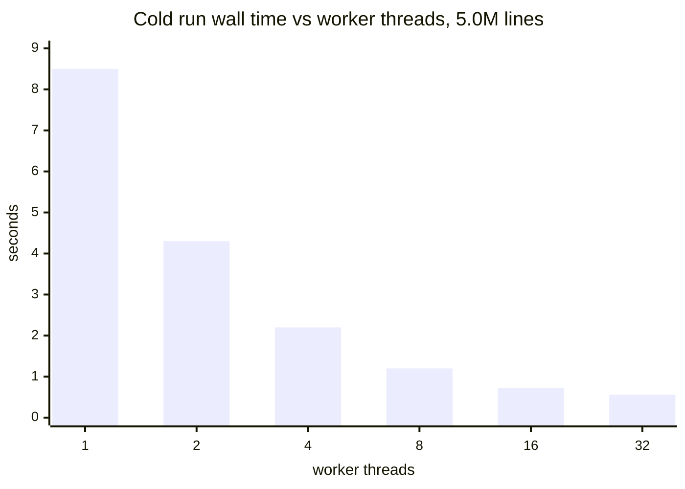

# Case Study: Design a Fast Developer Tool in Rust

> Version anchor (2026-11-06): Rust 1.99.1 on edition 2024. Crates: `ignore` 0.4.34, `rayon` 1.12.0, `memmap2` 0.9.12, `bumpalo` 3.20.3, `rustc-hash` 2.1.3, `salsa` 0.28.5, `mimalloc` 0.1.52, `cargo-dist` 0.34.0, `criterion` 0.8.2, `insta` 1.49.0, `proptest` 1.12.0.

## Intuition

> **Design intuition**: a linter that checks 5 million lines in under a second has no single fast part. It is a pipeline of ordinary steps (walk, read, parse, check, report) where each step does almost no work it does not need. Rust makes the waste visible and cheap to remove: no collector traces a million-node tree, a token can point into the source buffer without a copy, a whole syntax tree frees in one call when the file is done, and the compiler refuses a parallel plan that shares a non-thread-safe value.

**The Rust-specific thesis.** The tool's speed comes from three properties that Rust checks at compile time, and a fourth that it makes cheap:

1. **Borrowed syntax.** Tokens and identifier nodes hold `&'src str` slices into the file's source buffer. The lifetime `'src` ties every node to that buffer, so "the tree outlives its file" is a compile error (E0515) and not a use-after-free.
2. **Arena trees.** One file's nodes live in one `Vec` (or one bump arena) and refer to each other by `u32` index. Dropping the arena frees the whole tree at once. No per-node `Box`, no reference counts, no tracing.
3. **Checked parallelism.** The rule registry is shared by reference across 16 worker threads. The `Sync` bound on the rule trait makes "a rule holds an `Rc` or a `RefCell`" a compile error (E0277) and not a data race found in CI.
4. **Cheap determinism.** With no garbage collector, cost per file is predictable, so a size-sorted schedule and a per-worker memory cap are arithmetic, not tuning.

This study is the hot path of a [ruff](https://github.com/astral-sh/ruff)/[uv](https://github.com/astral-sh/uv)/[ripgrep](https://github.com/BurntSushi/ripgrep)-class tool. It does not cover the CLI surface around that path. The command tree, configuration precedence, the stdout and stderr contract, exit codes, Ctrl-C handling, credentials and plugins are in [Go: Design a Cross-Platform CLI Tool](../../go/case_studies/design_a_cross_platform_cli_tool.md), and those answers do not change in Rust. Read that study for the shell; read this one for the engine.

Everything here builds on [Ownership, Borrowing and RAII](../ownership_borrowing_and_raii/ownership_borrowing_and_raii.md), [Lifetimes and the Borrow Checker](../lifetimes_and_the_borrow_checker/lifetimes_and_the_borrow_checker.md), [Threads, Send, Sync and Locks](../threads_send_sync_and_locks/threads_send_sync_and_locks.md), [Performance and Zero-Cost Abstractions](../performance_and_zero_cost_abstractions/performance_and_zero_cost_abstractions.md), [Profiling and Benchmarking](../profiling_and_benchmarking/profiling_and_benchmarking.md) and [Rust Build, Deployment and Supply Chain](../build_deployment_and_supply_chain/build_deployment_and_supply_chain.md). Two cross-cutting files carry the shared rules: [Memory Budgets Without a GC](cross_cutting/memory_budgets_without_a_gc.md) for the RSS arithmetic and [Unsafe Review and Soundness Checklist](cross_cutting/unsafe_review_and_soundness_checklist.md) for the one `unsafe` decision in this design (mmap).

---

## 1. Requirements Clarification

### The system

We are building `sift`, a Python linter written in Rust. Engineers run it from the shell and from pre-commit hooks. CI runs it on every pull request. An editor runs it through a language-server mode on every keystroke.

```
sift check .                      # whole repository, the CI path
sift check src/payments/          # one subtree
sift check --stdin-filename a.py  # editor and pre-commit path
sift server                       # language-server mode, incremental
```

### Functional requirements

- Walk a repository and lint every `.py` and `.pyi` file that git would not ignore.
- About 120 enabled rules out of a catalog of 400. Rules are pure functions of one file's syntax tree plus the settings.
- Report diagnostics as `path:line:col: CODE message`, or as JSON for machines.
- A persistent cache: a second run on an unchanged tree returns the same output without parsing.
- A server mode that re-lints one edited file within the editor's keystroke budget.
- Ship one static binary per target, through shell and PowerShell installers, PyPI wheels and a package manager.

### Non-functional requirements

| Requirement | Target | Measured where |
|---|---|---|
| Cold run, 5.0M lines, no cache | under 1.0 s p50, under 1.5 s p95 | 16-vCPU CI runner, warm page cache |
| Warm run, no files changed | under 150 ms | same runner |
| One-file re-lint in server mode | under 30 ms p95 | developer laptop |
| Peak RSS, cold run | under 1 GiB worst case, under 300 MiB typical | same runner, from `/usr/bin/time -v` |
| Output | byte-identical across runs and across thread counts | CI diff check |
| Binary | under 30 MiB per target, no runtime dependency | release job |

### Explicitly out of scope

- Cross-file type inference. A type checker needs a module graph and a much larger incremental engine. ty does that; `sift` stays per-file, which is what makes the work embarrassingly parallel.
- Autofix. It changes the write path, not the read path this study is about.
- The CLI surface. See the Go study linked in the Intuition.

### Clarifying questions worth asking in the interview

1. **Is the rule set per-file or cross-file?** Per-file rules parallelize by file with no shared mutable state. One cross-file rule ("unused export across the repo") forces a second phase and a global index.
2. **Cold or warm is the number that matters?** CI on ephemeral runners is mostly cold unless the cache is restored. Developer runs are mostly warm. Design for cold, and make warm almost free.
3. **What is the largest file?** A single 8 MiB generated file decides the wall clock on 16 cores (see §2). The answer sets the size cap and the scheduling order.

---

## 2. Scale Estimation

### The repository

```
Python files linted:        40,000
Lines:                      5,000,000      (125 lines per file on average)
Bytes:                      180 MB         (36 bytes per line, 4.5 KB per file)
Directories walked:          4,000
Ignored entries (.venv, node_modules, build/, .git):   600,000
Largest file (generated protobuf stubs):  8 MiB, about 233,000 lines
```

The 600,000 ignored entries matter more than the 40,000 real files. A walker that reads `.gitignore` after it descends into `.venv` stats 15 times more entries than it lints. A walker that prunes at the directory reads one directory entry for `.venv` and never opens it.

### CPU budget, cold run

```
Step              Rate per core (design budget)    Work           Core-seconds
--------------    -----------------------------    -----------    ------------
walk + stat       ~25,000 dir entries per ms           44,000        0.05
read              ~5 GB/s from page cache              180 MB        0.04
lex + parse       1.5M lines/s                         5.0M lines    3.30
rules (one pass)  1.0M lines/s for 120 rules           5.0M lines    5.00
sort + print      serial                               25,000 diags  0.02
                                                                    -----
                                                       total         8.41 core-s

16 cores:  8.41 / 16 = 0.53 s of perfectly parallel work
+ serial start (config, walker setup, thread pool)      ~0.04 s
+ serial end (sort, write, cache flush)                 ~0.04 s
+ tail imbalance                                        ~0.10 s with size-sorted jobs
                                                        ------
                                                        ~0.71 s   (budget 1.0 s)
```

Parse and rules are 98% of the CPU. Walk and read are noise once the walker prunes ignored directories and the files are in the page cache. Every design decision in §4 is about the two big rows.

### The tail: one big file

```
8 MiB file at 36 bytes per line  = 233,000 lines
parse + rules on one core        = 233,000 / 1.5M + 233,000 / 1.0M = 0.39 s
```

If that file starts last, the run takes 0.53 s of parallel work plus 0.39 s of one core working alone: 0.92 s, right at the budget. If it starts first, the other 15 workers finish the rest while it runs. Size-sorted scheduling (§4.1) cuts the tail from 0.39 s to about 0.10 s. A size cap (`max-file-size = 8 MiB`, files above it are reported and skipped) bounds the worst case.

### Allocation count: why the tree shape decides the budget

At about 10 nodes per line, a cold run builds 50M nodes. A `Box`-per-node tree makes 50M allocations and 50M frees; at about 20 ns per pair (a design estimate) that is 1.0 core-second in the allocator, plus a cache miss per pointer hop on every rule traversal. An arena tree (one `Vec` per file, reused by the worker) makes about 2 growth reallocations per file after warm-up, about 80,000 for the run, and reads node `i` at `base + i * 24` bytes.

One core-second of allocator time is 12% of the whole CPU budget, spent on bookkeeping. The arena removes it. See §4.4 and, for the RSS side, [Memory Budgets Without a GC](cross_cutting/memory_budgets_without_a_gc.md).

### Warm run

A warm run stats 40,000 files in parallel (about 25 ms), loads a 6 MB cache file (about 20 ms), compares keys and prints cached diagnostics (about 15 ms), plus about 10 ms to start and exit: about 70 ms against a 150 ms budget. It never opens a source file whose size and modification time match the cache. Content hashing is the fallback when they do not match (§4.8).

---

## 3. High-Level Architecture

```mermaid
flowchart LR
    classDef io      fill:#61afef,stroke:#2e86c1,color:#1a1a1a,font-weight:bold
    classDef frozen  fill:#c678dd,stroke:#9b59b6,color:#fff
    classDef train   fill:#98c379,stroke:#27ae60,color:#1a1a1a
    classDef mathOp  fill:#d19a66,stroke:#e67e22,color:#1a1a1a,font-weight:bold
    classDef lossN   fill:#e06c75,stroke:#c0392b,color:#fff,font-weight:bold
    classDef req     fill:#56b6c2,stroke:#0097a7,color:#1a1a1a
    classDef base    fill:#e5c07b,stroke:#f39c12,color:#1a1a1a

    ARGS(["argv + settings"]):::io
    WALK(["parallel walk<br/>ignore crate<br/>prune at dirs"]):::mathOp
    JOBS(["file jobs<br/>sorted by size,<br/>largest first"]):::base
    CACHE{"cache key<br/>matches?"}:::req
    HIT(["cached<br/>diagnostics"]):::train
    READ(["bounded read<br/>into String"]):::mathOp
    PARSE(["lex + parse<br/>into arena"]):::frozen
    RULES(["one visitor pass<br/>120 rules"]):::frozen
    MERGE(["merge + sort<br/>by path, line, col"]):::base
    OUT(["stdout"]):::io
    STORE(["cache write<br/>atomic rename"]):::lossN

    ARGS --> WALK --> JOBS --> CACHE
    CACHE -->|"yes"| HIT --> MERGE
    CACHE -->|"no"| READ --> PARSE --> RULES --> MERGE
    MERGE --> OUT
    MERGE --> STORE
```



The purple nodes run on the rayon pool, one file per job, and own nothing shared except a `&Registry` and a `&Settings`. Everything after the merge is serial and small. The cache sits in front of the read, so a hit costs a `stat` and a lookup.

### Ownership at a glance

The main thread owns `Settings`, the rule `Registry`, the job list and the cache, and lends `&Settings` and `&Registry` to every worker. Each of the 16 rayon workers owns a `Worker` (source buffer, arena, interner, scratch vectors), clears and reuses them across files, and returns an owned `FileResult`. Inside one file, tokens borrow the source and arena nodes link by `u32` id; all three end when the worker moves on. That is the whole concurrency design: no `Mutex`, no channel and no `Arc` on the hot path. The only shared values are immutable, and the compiler checks that they are `Sync`.

---

## 4. Component Deep Dives

### 4.1 The walk: prune early, then sort by size

The `ignore` crate (the walker ripgrep is built on) reads `.gitignore`, `.ignore`, `.git/info/exclude` and the global git excludes file, and applies them while it descends. Its `WalkParallel` walks directories on several threads. The point is the prune: when `.venv/` matches an ignore rule, the walker does not open it.

```rust
use ignore::{WalkBuilder, WalkState};
use std::path::PathBuf;
use std::sync::Mutex;

pub struct FileJob {
    pub path: PathBuf,
    pub len: u64,
}

pub fn collect_jobs(root: &str, threads: usize) -> Vec<FileJob> {
    let found = Mutex::new(Vec::with_capacity(64 * 1024));
    WalkBuilder::new(root)
        .threads(threads) // 0 lets the crate pick
        .build_parallel()
        .run(|| {
            let found = &found;
            Box::new(move |entry| {
                let Ok(entry) = entry else {
                    return WalkState::Continue; // unreadable dir: report later, keep walking
                };
                let is_py = entry
                    .path()
                    .extension()
                    .is_some_and(|e| e == "py" || e == "pyi");
                if is_py {
                    if let Ok(meta) = entry.metadata() {
                        let job = FileJob { path: entry.into_path(), len: meta.len() };
                        if let Ok(mut v) = found.lock() {
                            v.push(job);
                        }
                    }
                }
                WalkState::Continue
            })
        });
    let mut jobs = found.into_inner().unwrap_or_default();
    // Largest first: the 8 MiB file starts at t=0, not at t=0.5 s.
    jobs.sort_unstable_by(|a, b| b.len.cmp(&a.len).then_with(|| a.path.cmp(&b.path)));
    jobs
}
```

The `Mutex` here takes 40,000 short locks over about 50 ms of walk. That is fine. A per-thread `Vec` merged at the end avoids it, and is worth doing only if a profile shows the lock. The walker is not the bottleneck (§2), so the simple version stays.

The sort carries two decisions. **Largest first** is the longest-processing-time heuristic: with one file per rayon job, the thread that starts the iteration takes the first jobs and idle threads steal the rest, so the big file starts first and the tail shrinks from 0.39 s to about 0.10 s. **Path as tie-breaker** makes the job order deterministic, so a profile from one run is comparable to the next. Output order is fixed separately by an explicit sort (§4.7).

### 4.2 Reading: `read` into a reused buffer, not `mmap`

Two ways to get bytes from a file: copy them into a buffer with `read`, or map the file with `mmap` and let page faults bring them in. ripgrep's README states the result for its own workload: memory maps are better for single files, and incremental reading with a buffer is better for large directories. A linter's workload is the large-directory case: 40,000 files at 4.5 KB each.

| | `read` into a buffer | `mmap` (memmap2) |
|---|---|---|
| Syscalls per 4.5 KB file | open, fstat, read, close | open, fstat, mmap, close, munmap |
| Page-table work | none | map, then unmap with a TLB flush that other threads can feel |
| File changes during the run | the buffer is a private copy | `memmap2` documents undefined behavior if the file is modified, in or out of process |
| Truncation during the run | the read returns fewer bytes | access past the new end raises `SIGBUS` on Linux |
| Safe Rust | yes | `Mmap::map` is `unsafe` |

The last three rows decide it for a developer tool. In server mode the editor writes the file the tool is reading. A formatter on save truncates and rewrites. With `mmap`, that is a crash in the best case and a wrong lint in the worst, and the `unsafe` block's SAFETY comment would have to claim that no other process writes the file, which is false on a developer laptop. The [Unsafe Review and Soundness Checklist](cross_cutting/unsafe_review_and_soundness_checklist.md) rejects an `unsafe` block whose invariant the code cannot hold, so `sift` has no `mmap` and no `unsafe` on the read path.

The read itself is bounded, single-open and UTF-8 checked:

```rust
use std::fs::File;
use std::io::{self, Read};
use std::path::Path;

pub enum Source {
    Text,
    TooLarge(u64),
    NotUtf8,
}

/// Reads `path` into `buf`, reusing its capacity. At most `max` bytes.
pub fn read_source(path: &Path, max: u64, buf: &mut String) -> io::Result<Source> {
    buf.clear();
    let file = File::open(path)?;
    let len = file.metadata()?.len();
    if len > max {
        return Ok(Source::TooLarge(len));
    }
    let mut bytes = std::mem::take(buf).into_bytes();
    // The file can grow between metadata() and read: take(max + 1) bounds it anyway.
    file.take(max + 1).read_to_end(&mut bytes)?;
    if bytes.len() as u64 > max {
        return Ok(Source::TooLarge(bytes.len() as u64));
    }
    match String::from_utf8(bytes) {
        Ok(mut text) => {
            if text.starts_with('\u{feff}') {
                text.drain(..'\u{feff}'.len_utf8());
            }
            *buf = text;
            Ok(Source::Text)
        }
        Err(e) => {
            let mut bytes = e.into_bytes();
            bytes.clear();
            // Keep the allocation for the next file even on the error path.
            *buf = String::from_utf8(bytes).unwrap_or_default();
            Ok(Source::NotUtf8)
        }
    }
}
```

The buffer belongs to the worker and lives across files. After the first few files it has grown to the size of the largest file that worker has seen, and `read_to_end` stops allocating. That turns 40,000 allocations into about 16 growth steps per worker.

### 4.3 Tokens borrow the source: what the lifetime buys

A token does not need its own copy of the text. It needs to know where its text is. In Rust that is a `&'src str` slice into the source buffer, 16 bytes on 64-bit targets, and the compiler tracks that the buffer outlives every slice.

The tempting API is "give me a path, get tokens back". It does not compile, and the error is the design lesson:

```rust
// BROKEN
pub struct Token<'src> {
    pub text: &'src str,
    pub offset: usize,
}

/// A toy lexer: word tokens only. `substr_range` is [1.98].
pub fn lex(src: &str) -> Vec<Token<'_>> {
    src.split(|c: char| !(c.is_alphanumeric() || c == '_'))
        .filter(|w| !w.is_empty())
        .map(|w| Token { text: w, offset: src.substr_range(w).map_or(0, |r| r.start) })
        .collect()
}

pub fn lex_file(path: &std::path::Path) -> std::io::Result<Vec<Token<'_>>> {
    let text = std::fs::read_to_string(path)?;
    // error[E0515]: cannot return value referencing local variable `text`
    Ok(lex(&text))
}
```

`text` is dropped at the end of `lex_file`, and every token points into it. In C this compiles and returns dangling pointers. In a garbage-collected language it compiles and keeps the whole buffer alive through the tokens, which is fine until something caches one token and retains 8 MiB. Rust rejects it, which forces the owner of the bytes to be explicit.

The fix moves ownership up one level. The caller (the worker) owns the buffer. Tokens and nodes borrow it for the duration of one file:

```rust
// FIX
pub struct Token<'src> {
    pub text: &'src str,
    pub offset: usize,
}

/// A toy lexer: word tokens only. `substr_range` is [1.98].
pub fn lex(src: &str) -> Vec<Token<'_>> {
    src.split(|c: char| !(c.is_alphanumeric() || c == '_'))
        .filter(|w| !w.is_empty())
        .map(|w| Token { text: w, offset: src.substr_range(w).map_or(0, |r| r.start) })
        .collect()
}

/// The worker owns the bytes. Everything derived from them is scoped to one call.
pub struct Worker {
    source: String,
}

impl Worker {
    pub fn lint(&mut self, text: &str) -> usize {
        self.source.clear();
        self.source.push_str(text);
        let tokens = lex(&self.source);
        // A stand-in rule: count identifiers named `print`.
        tokens.iter().filter(|t| t.text == "print").count()
    } // tokens drop here; self.source keeps its capacity for the next file
}

fn main() {
    let mut w = Worker { source: String::with_capacity(4096) };
    assert_eq!(w.lint("print(x)\nprint(y)\n"), 2);
    assert_eq!(w.lint("x = 1\n"), 0);
}
```

Three things to see in the fix:

- **The lifetime is the file.** `Token<'src>` cannot escape `Worker::lint`, because `self.source` is mutably reused on the next call. A rule that tries to stash a token in a field of the worker gets a borrow error, not a stale pointer.
- **Diagnostics own their data.** A `Diagnostic` stores `line`, `col`, a `&'static str` rule code and a `String` message. It never stores a `&'src str`, so it can leave the worker. This is the boundary between borrowed per-file data and owned results.
- **Zero copies on the hot path.** 5M lines produce about 25M tokens. None of them allocates.

Lifetime elision, variance and the `'src` naming convention are in [Lifetimes and the Borrow Checker](../lifetimes_and_the_borrow_checker/lifetimes_and_the_borrow_checker.md). The general "who owns the buffer" rule is in [Ownership, Borrowing and RAII](../ownership_borrowing_and_raii/ownership_borrowing_and_raii.md).

### 4.4 The arena tree: indices, not boxes

A textbook syntax tree is a recursive enum with `Box` children. Each node is its own heap allocation, and each traversal is a pointer chase across the heap. The arena version stores all nodes of one file in one `Vec` and links them with 4-byte indices:

```rust
use std::mem::size_of;

#[derive(Clone, Copy, Debug, PartialEq, Eq)]
pub struct NodeId(u32);

#[derive(Clone, Copy, Debug, PartialEq, Eq)]
pub enum Op {
    Add,
    Mul,
}

/// Arena node. Children are indices into `Ast::nodes`; names borrow the source.
pub enum Expr<'src> {
    Name(&'src str),
    Int(i64),
    Call { func: NodeId, args: (u32, u32) }, // range into `Ast::extra`
    BinOp { op: Op, lhs: NodeId, rhs: NodeId },
}

/// Textbook node: owned strings, boxed children.
pub enum BoxExpr {
    Name(String),
    Int(i64),
    Call(Box<BoxExpr>, Vec<BoxExpr>),
    BinOp(Op, Box<BoxExpr>, Box<BoxExpr>),
}

#[derive(Default)]
pub struct Ast<'src> {
    nodes: Vec<Expr<'src>>,
    extra: Vec<NodeId>, // call arguments, referenced by range
}

impl<'src> Ast<'src> {
    pub fn push(&mut self, e: Expr<'src>) -> NodeId {
        let id = u32::try_from(self.nodes.len()).expect("file has more than u32::MAX nodes");
        self.nodes.push(e);
        NodeId(id)
    }

    pub fn call(&mut self, func: NodeId, args: &[NodeId]) -> NodeId {
        let start = self.extra.len() as u32;
        self.extra.extend_from_slice(args);
        self.push(Expr::Call { func, args: (start, self.extra.len() as u32) })
    }

    pub fn get(&self, id: NodeId) -> &Expr<'src> {
        &self.nodes[id.0 as usize]
    }

    /// Visits every node in creation order: one linear scan, no recursion.
    pub fn count_calls_to(&self, name: &str) -> usize {
        self.nodes
            .iter()
            .filter(|n| match n {
                Expr::Call { func, .. } => matches!(self.get(*func), Expr::Name(f) if *f == name),
                _ => false,
            })
            .count()
    }
}

fn main() {
    // Layout numbers hold on 64-bit targets with rustc 1.99.1. The docs do not promise them.
    #[cfg(target_pointer_width = "64")]
    {
        assert_eq!(size_of::<NodeId>(), 4);
        assert_eq!(size_of::<Expr<'static>>(), 24);
        assert_eq!(size_of::<BoxExpr>(), 32); // plus one heap block per boxed child
    }

    let src = String::from("print(a + 1)");
    let mut ast = Ast::default();
    let f = ast.push(Expr::Name(&src[0..5]));
    let a = ast.push(Expr::Name(&src[6..7]));
    let one = ast.push(Expr::Int(1));
    let sum = ast.push(Expr::BinOp { op: Op::Add, lhs: a, rhs: one });
    ast.call(f, &[sum]);
    assert_eq!(ast.count_calls_to("print"), 1);
}
```

Against the `Box` tree, the arena node is 24 bytes and contiguous instead of 32 bytes plus a heap block, a child link is 4 bytes instead of 8, a typical file makes 0 allocations instead of about 1,250, and rules scan a slice instead of chasing pointers. `Expr<'src>` has no `Drop` glue that walks children, because children are integers. `nodes.clear()` drops nothing and keeps the capacity. That is why the worker can reuse the arena across files.

**When to use `bumpalo` instead.** `bumpalo` 3.20.3 hands out `&'bump T` references from a bump allocator and frees everything on `reset()`. It fits trees whose node types vary in size (a `Vec` of one enum pays the size of the largest variant for every node). It does not run `Drop` for values it holds, which is fine for nodes made of `&str` and integers and a leak for nodes that own a `String`. `sift` uses the `Vec` arena because every node fits in 24 bytes and indices are half the size of references.

**The arena's one trap is retained capacity.** A worker that once parsed the 8 MiB file holds an arena sized for 233,000 lines (about 56 MiB of nodes at 10 nodes per line) for the rest of the run. Sixteen workers that each meet one big file hold 900 MiB. The fix is a cap: after each file, if `nodes.capacity()` is above 4 MiB worth of nodes, call `shrink_to(4 MiB worth)`. The general rule (retained capacity is live memory that no profiler calls a leak) is in [Memory Budgets Without a GC](cross_cutting/memory_budgets_without_a_gc.md).

The decision between `Box`, `Rc`, indices and arenas, and when each is right, is the decision model in [Smart Pointers and Interior Mutability](../smart_pointers_and_interior_mutability/smart_pointers_and_interior_mutability.md).

### 4.5 Interning: compare integers, not strings

Rules compare names all the time: "is this call to `print`", "is this import `os`", "is this name in the builtins set". A string compare reads both strings. An interned symbol compare reads two `u32`s.

```rust
use std::collections::HashMap;
use std::sync::LazyLock;

#[derive(Clone, Copy, Debug, PartialEq, Eq, Hash)]
pub struct Sym(u32);

#[derive(Clone, Default)]
pub struct Interner {
    ids: HashMap<Box<str>, Sym>,
    names: Vec<Box<str>>,
}

impl Interner {
    pub fn intern(&mut self, s: &str) -> Sym {
        if let Some(&sym) = self.ids.get(s) {
            return sym;
        }
        let sym = Sym(u32::try_from(self.names.len()).expect("interner overflow"));
        self.names.push(s.into());
        self.ids.insert(s.into(), sym);
        sym
    }

    pub fn resolve(&self, sym: Sym) -> &str {
        &self.names[sym.0 as usize]
    }
}

/// Names that rules test for. Fixed ids, assigned once, before any worker starts.
pub const PRINT: Sym = Sym(0);
pub const EVAL: Sym = Sym(1);

pub static SEED: LazyLock<Interner> = LazyLock::new(|| {
    let mut i = Interner::default();
    for (want, name) in [(PRINT, "print"), (EVAL, "eval")] {
        assert_eq!(i.intern(name), want);
    }
    i
});

fn main() {
    // Each worker starts from a clone of the seed: well-known ids match, no lock.
    let (mut a, mut b) = (SEED.clone(), SEED.clone());
    assert_eq!(a.intern("print"), PRINT);
    // Local ids are per worker: equal numbers, different names. Never compare across workers.
    let (x, y) = (a.intern("payment_id"), b.intern("customer"));
    assert_eq!(x, y);
    assert_ne!(a.resolve(x), b.resolve(y));
}
```

The design choice is **per-worker interners seeded from a frozen table**. A global interner behind a `Mutex` takes a lock on each of 25M identifier lookups per run. A sharded or lock-free global table removes the lock but still pays atomic traffic for each new name. Per-worker tables cost 16 copies of a few thousand common names, and take no lock.

Per-file rules only ever compare a name from this file with a well-known name or with another name from the same file, so cross-worker equality is not needed. That makes the lock disappear. §9.3 is the incident that came from the global `Mutex` version.

`LazyLock` is `[1.80]`. In the real tool the `HashMap` uses `rustc-hash` 2.1.3's `FxHashMap`, a fast non-cryptographic hasher, in place of the default flood-resistant hasher. FxHash is not resistant to hash flooding. The input is the repository being linted, so a hostile file can at worst slow its own lint; that is an accepted risk for a local tool and a reason to keep the per-file size cap in CI.

### 4.6 Parallel lint: rayon, `Sync` rules and one panic per file

The work is CPU-bound, per-file and independent. That is data parallelism, so it runs on `rayon`'s work-stealing pool. It is not async: there is no network wait to overlap, and a file read from the page cache returns in microseconds. A Tokio runtime here adds a scheduler and `spawn_blocking` hops for no gain. The general "do we need async at all" decision is in [Async Runtimes and Executors](../async_runtimes_and_executors/async_runtimes_and_executors.md).

The shared state is the rule registry. Every worker reads it, none writes it. The first draft held a shared `Rc` to it, and the compiler stopped it before it reached CI:

```rust
// BROKEN
use std::rc::Rc;
use std::thread;

pub struct Registry {
    pub rules: Vec<&'static str>,
}

fn main() {
    let registry = Rc::new(Registry { rules: vec!["E501", "F401"] });
    let files = vec!["a.py", "b.py"];
    thread::scope(|s| {
        for f in &files {
            let reg = Rc::clone(&registry);
            // error[E0277]: `Rc<Registry>` cannot be sent between threads safely
            s.spawn(move || reg.rules.len() + f.len());
        }
    });
}
```

`Rc` updates its count without atomics, so two threads cloning it at once corrupt the count. `Rc` is not `Send`, and `thread::scope`'s `spawn` requires a `Send` closure. The fix is not `Arc`. Scoped threads (and rayon) can borrow from the caller's stack, so a plain shared reference is enough, and the rule trait carries the `Sync` bound that makes the reference shareable:

```rust
// FIX
use std::thread;

/// `Sync` is the contract: a rule may be called from 16 threads at once.
pub trait Rule: Sync {
    fn code(&self) -> &'static str;
    fn check(&self, src: &str) -> Vec<(usize, &'static str)>;
}

struct LineTooLong {
    max: usize,
}

impl Rule for LineTooLong {
    fn code(&self) -> &'static str {
        "E501"
    }
    fn check(&self, src: &str) -> Vec<(usize, &'static str)> {
        src.lines()
            .enumerate()
            .filter(|(_, l)| l.chars().count() > self.max)
            .map(|(i, _)| (i + 1, "E501"))
            .collect()
    }
}

pub struct Registry {
    rules: Vec<Box<dyn Rule>>,
}

fn main() {
    let registry = Registry { rules: vec![Box::new(LineTooLong { max: 10 })] };
    let files = ["short\n", "this line is too long\nok\n"];
    let reg = &registry;
    let total: usize = thread::scope(|s| {
        let handles: Vec<_> = files
            .iter()
            .map(|src| s.spawn(move || reg.rules.iter().map(|r| r.check(src).len()).sum::<usize>()))
            .collect();
        handles.into_iter().map(|h| h.join().unwrap_or(0)).sum()
    });
    assert_eq!(total, 1);
}
```

`Box<dyn Rule>` is `Sync` because `Rule: Sync`. A rule author who adds a `RefCell<HashMap>` cache to a rule struct gets a compile error at the `impl Rule` line, which is the right place: a per-rule cache shared by 16 threads is a design question, not a typo. The answer is to keep scratch state in the worker and pass it in as `&mut`. The full `Send` and `Sync` rules are in [Threads, Send, Sync and Locks](../threads_send_sync_and_locks/threads_send_sync_and_locks.md).

The production version uses rayon. A thread-local `Worker` gives each rayon thread one set of buffers that it reuses for every file it runs. `map_init` would not: rayon calls its `init` once per job, and with `with_max_len(1)` every job is one file. `catch_unwind` turns a panicking rule into a diagnostic for that one file:

```rust
use rayon::prelude::*;
use std::cell::RefCell;
use std::panic::{self, AssertUnwindSafe};

thread_local! {
    // Worker::lint must not call into rayon: a nested job on this thread would borrow it again.
    static WORKER: RefCell<Worker> = RefCell::new(Worker::new());
}

pub fn lint_all(jobs: &[FileJob], registry: &Registry, settings: &Settings) -> Vec<FileResult> {
    let mut results: Vec<FileResult> = jobs
        .par_iter()
        .with_max_len(1) // one file per job, so idle threads steal single files
        .map(|job| {
            WORKER.with_borrow_mut(|worker| {
                let run = panic::catch_unwind(AssertUnwindSafe(|| {
                    worker.lint(job, registry, settings)
                }));
                run.unwrap_or_else(|payload| {
                    worker.reset(); // its arena may be half-built
                    FileResult::internal_error(&job.path, panic_message(&payload))
                })
            })
        })
        .collect();
    results.sort_unstable_by(|a, b| a.path.cmp(&b.path));
    results
}
```

Two conditions make this work, and both are easy to lose:

- **`panic = "unwind"` in the release profile.** With `panic = "abort"`, `catch_unwind` catches nothing and one bad file kills the whole run with no output for the other 39,999 files. §9.4 is that incident.
- **`AssertUnwindSafe` is a promise.** It says that the code after the catch does not observe broken state. That is true only because the worker resets its arena and buffers after a panic. Without `worker.reset()`, the next file on that worker could start with half a tree in the arena.

Panic and error design in general is in [Error Handling and Panics](../error_handling_and_panics/error_handling_and_panics.md).

### 4.7 One visitor pass and deterministic output

**One pass, not 120.** A rule engine that lets each rule walk the tree does 120 traversals per file. `sift` walks the tree once. At startup the registry builds a dispatch table from node kind to the rules that care about it (`Call` maps to 31 rules, `Import` to 9, and so on). The visitor looks up the node kind and calls only those rules. With 120 rules, 120 separate walks against a single dispatched pass is, by our estimate, the difference between the 5.0 core-second budget in §2 and roughly 40.

**Determinism is a sort, done once, at the end.** rayon documents that `collect` into a `Vec` from an indexed iterator such as `par_iter` keeps input order, but the input was sorted by size, and the user wants path order. So the merge step sorts by `(path, line, col, code)` with `sort_unstable_by`. 25,000 diagnostics sort in about 2 ms. Any other approach (a `Mutex<Vec>` that workers push into, a channel drained by a printer thread) produces output that differs between runs, and a CI job that diffs lint output against a baseline then fails at random.

**Bounded diagnostics per file.** A generated file can trigger a rule on every line. Each `Diagnostic` is about 80 bytes plus its message. A cap of 1,000 per file per rule, with one summary diagnostic for the rest, bounds the result size. §9.5 is what happened without it.

### 4.8 The content-hash cache

The cache maps a file to its diagnostics, under a key that changes whenever the output could change:

```rust
use seahash::hash;
use std::path::PathBuf;
use std::time::SystemTime;

/// Everything that can change a file's diagnostics. If any field differs, re-lint.
#[derive(PartialEq, Eq, Hash)]
pub struct CacheKey {
    pub path: PathBuf,
    pub len: u64,
    pub mtime: SystemTime,
    pub content: u64,       // seahash of the bytes, checked only when len or mtime differ
    pub settings: u64,      // hash of the resolved settings that apply to this file
    pub tool: &'static str, // env!("CARGO_PKG_VERSION") plus the git commit
}

pub fn content_hash(bytes: &[u8]) -> u64 {
    hash(bytes)
}
```

The lookup runs in two tiers:

1. **Stat tier.** If path, length, modification time, settings hash and tool version all match, the entry is a hit. No read, no hash. This is the 70 ms warm run in §2.
2. **Content tier.** If length or modification time differ (a `git checkout` touches every file's mtime), read the file and hash it. A matching content hash is still a hit, and the entry's stat fields are refreshed. Hashing is one linear pass over the bytes, much cheaper than lexing and parsing them.

Four rules keep the cache correct:

- **The hash must be stable across builds.** `std::collections::hash_map::DefaultHasher` documents that its algorithm "is not specified, and so it and its hashes should not be relied upon over releases." A persisted key built with it can change when the tool is rebuilt with a different Rust version. Use a hash with a fixed specification, such as `seahash`, xxHash or BLAKE3. §9.1 is the incident.
- **The tool version is part of the key.** A rule fix changes diagnostics without changing any input file. Include the version and the commit, so a dev build never reads a release build's cache.
- **Settings are hashed per file, after resolution.** Two directories with different `pyproject.toml` overrides produce different keys for the same file content.
- **The cache file is written atomically.** Write to `cache.tmp` in the same directory, `fsync`, then rename over the old file. Two `sift` processes started by a pre-commit hook and an editor at the same time then each see a whole cache file, never a torn one.

Ruff's README lists "built-in caching, to avoid re-analyzing unchanged files" as a feature, and its workspace depends on `seahash`. The design above is the general shape; the key fields are this study's choice.

### 4.9 Server mode: salsa-style incremental recompute

In the editor, the unit of work is one keystroke in one file, and the budget is 30 ms. Re-reading the file from disk is wrong (the editor's buffer is the truth, and it is unsaved). Re-parsing the file is usually right (a 125-line file parses in about 80 microseconds). Re-running the rules is the part to skip when the edit cannot change the result.

The model comes from salsa, which describes itself as "a generic framework for on-demand, incrementalized computation". Inputs are set by the client. Derived queries are pure functions of inputs and other queries. Results are memoized, and on a change the framework decides which memos it can reuse. rust-analyzer's architecture document says it uses salsa "for incremental and on-demand computation", and Ruff's workspace declares `salsa` 0.28.5 as a dependency.

The key idea is **early cutoff**. Adding a blank line or editing a comment changes the input text, so `parse` reruns. If the parse result is equal to the old one, `lint` does not rerun, because none of its inputs changed. The mechanics fit in a std-only sketch with revision numbers:

```rust
use std::collections::HashMap;
use std::collections::hash_map::DefaultHasher;
use std::hash::{Hash, Hasher};

type Rev = u64;

#[derive(Clone, Copy)]
struct Memo {
    value: u64,
    changed_at: Rev,  // last revision where `value` became different
    verified_at: Rev, // last revision where we checked it is still valid
}

#[derive(Default)]
pub struct Db {
    rev: Rev,
    files: HashMap<String, (String, Rev)>, // text and its changed-at revision
    parse_memo: HashMap<String, Memo>,
    lint_memo: HashMap<String, Memo>,
    pub parses: u32,
    pub lints: u32,
}

impl Db {
    pub fn set_text(&mut self, path: &str, text: &str) {
        if self.files.get(path).is_some_and(|f| f.0 == text) {
            return; // same text: no new revision
        }
        self.rev += 1;
        self.files.insert(path.to_string(), (text.to_string(), self.rev));
    }

    /// Stand-in for a parse: a fingerprint that ignores whitespace and comments.
    /// DefaultHasher is fine here: this value lives in memory for one process only.
    fn parse(&mut self, path: &str) -> Memo {
        let input_changed = self.files[path].1;
        if let Some(m) = self.parse_memo.get_mut(path) {
            if input_changed <= m.verified_at {
                m.verified_at = self.rev;
                return *m;
            }
        }
        self.parses += 1;
        let mut h = DefaultHasher::new();
        for line in self.files[path].0.lines() {
            let code = line.split('#').next().unwrap_or("");
            code.split_whitespace().for_each(|w| w.hash(&mut h));
        }
        let value = h.finish();
        let changed_at = match self.parse_memo.get(path) {
            Some(old) if old.value == value => old.changed_at, // early cutoff
            _ => self.rev,
        };
        let m = Memo { value, changed_at, verified_at: self.rev };
        self.parse_memo.insert(path.to_string(), m);
        m
    }

    pub fn lint(&mut self, path: &str) -> u64 {
        let parsed = self.parse(path);
        if let Some(m) = self.lint_memo.get_mut(path) {
            if parsed.changed_at <= m.verified_at {
                m.verified_at = self.rev;
                return m.value;
            }
        }
        self.lints += 1;
        let value = parsed.value % 7; // stand-in for running 120 rules
        let m = Memo { value, changed_at: self.rev, verified_at: self.rev };
        self.lint_memo.insert(path.to_string(), m);
        value
    }
}

fn main() {
    let mut db = Db::default();
    db.set_text("a.py", "x = 1\n");
    db.lint("a.py");
    assert_eq!((db.parses, db.lints), (1, 1));
    db.set_text("a.py", "x  =  1   # spacing and a comment\n");
    db.lint("a.py");
    assert_eq!((db.parses, db.lints), (2, 1)); // parse reran, lint did not
    db.set_text("a.py", "x = 2\n");
    db.lint("a.py");
    assert_eq!((db.parses, db.lints), (3, 2)); // a real change reaches the rules
}
```

The `salsa` crate records the dependencies while each query runs, so nobody writes the `parsed.changed_at` check by hand. `sift` uses the hand-written memo above in server mode, and the batch CLI needs neither: a batch run has no previous revision in memory, and the persistent cache in §4.8 covers the warm case. Per-file rules have a dependency graph one level deep. salsa pays off when the graph is deep and wide, as in a type checker, where an edit in one module invalidates inference in its importers. Adopt it when the first cross-file rule lands.

### 4.10 Release engineering: profile, allocator and cargo-dist

The release profile trades compile time for run time, once, in the release job:

```toml
[profile.release]
lto = "fat"
codegen-units = 16
panic = "unwind"      # catch_unwind in 4.6 depends on it
debug = "line-tables-only" # readable profiles and backtraces from release builds

[profile.release.package.sift_parser]
codegen-units = 1     # the parser is the hot loop; let LLVM see all of it
```

Ruff's workspace uses `lto = "fat"` and `codegen-units = 16`, with per-package overrides to `codegen-units = 1` for its parser, its AST crate and `salsa`. The pattern is the same: whole-program optimization for the binary, maximum optimization scope only for the crates that dominate the profile. Measure each step with the benchmark harness in §8; a build-time cost with no measured run-time gain is just CI time.

**The global allocator is one line to swap.** A parallel tool that allocates diagnostics and strings on 16 threads depends on how the allocator handles many threads, and that differs by target: the musl targets use musl's own allocator unless the binary replaces it. `sift` ships `mimalloc` 0.1.52 and keeps the choice behind a benchmark, not a belief:

```rust
use mimalloc::MiMalloc;

#[global_allocator]
static GLOBAL: MiMalloc = MiMalloc;
```

Ruff's workspace declares both `mimalloc` (pinned to its v2 feature, with a comment that a v3 release crashed on Windows CPUs without POPCNT) and `tikv-jemallocator`. That comment is the reason to treat the allocator as a dependency with its own release risk, not as a free speedup. Allocator behavior and RSS are covered in [Memory Budgets Without a GC](cross_cutting/memory_budgets_without_a_gc.md).

**Targets and static linking.** Rust names a platform by a target triple, and each triple is a separate build. The `x86_64-unknown-linux-musl` and `aarch64-unknown-linux-musl` targets link the C library statically; Rust 1.93 bundles musl 1.2.5. The `-gnu` targets link glibc dynamically and need a baseline glibc no newer than the oldest machine you support. The general static-versus-dynamic linking discussion is in [Rust Build, Deployment and Supply Chain](../build_deployment_and_supply_chain/build_deployment_and_supply_chain.md).

**cargo-dist** (0.34.0, "shippable application packaging for Rust") generates the release CI: one build job per target, archives, checksums, shell and PowerShell installers, and a GitHub release. Its config lives in `dist-workspace.toml`:

```toml
[workspace]
members = ["cargo:."]

[dist]
cargo-dist-version = "0.34.0"
ci = "github"
installers = ["shell", "powershell"]
targets = [
    "aarch64-apple-darwin", "x86_64-apple-darwin",
    "aarch64-unknown-linux-gnu", "x86_64-unknown-linux-gnu",
    "aarch64-unknown-linux-musl", "x86_64-unknown-linux-musl",
    "x86_64-pc-windows-msvc", "aarch64-pc-windows-msvc",
]
github-attestations = true
```

Ruff's `dist-workspace.toml` lists 17 targets, the same installers and GitHub attestations, plus custom jobs that build wheels and Docker images and publish to PyPI. The wheel job is the pattern for a Rust tool with Python users: the same binary goes into a wheel so `pip install` and `uv tool install` work. The wheel side (maturin, the manylinux and musllinux tags) is in [Design a PyO3 Python Extension](design_a_pyo3_python_extension.md). Signing, self-update and the support cost of each platform are as in the Go CLI study.

---

## 5. Design Decisions & Tradeoffs

| Decision | Chosen | Alternative | Why |
|---|---|---|---|
| Parallelism | rayon, one file per job, size-sorted | Tokio tasks | CPU-bound work with page-cache reads. No I/O wait to overlap. |
| Read | `read` into a reused `String`, 8 MiB cap | `mmap` via memmap2 | 4.5 KB files favor `read`. `mmap` needs `unsafe` with an invariant (no concurrent writer) an editor breaks. |
| Tokens | `&'src str` into the source | owned `String` per token | 25M tokens per run with zero allocations. The lifetime keeps them inside the file. |
| Tree | `Vec` arena, `u32` ids, 24-byte nodes | `Box` tree | Removes about 1 core-second of allocator time per cold run and halves link size. |
| Interning | per-worker, seeded from a frozen table | global `Mutex` interner | No lock on 25M lookups. Per-file rules never compare names across workers. |
| Shared state | `&Registry` with `Rule: Sync` | `Arc<Mutex<Registry>>` | Read-only after startup. The `Sync` bound turns a racy rule into a compile error. |
| Rule panics | `catch_unwind` per file, `panic = "unwind"` | `panic = "abort"` for size | One bad file must not erase 39,999 good results. |
| Output order | one sort at the end | ordered channel to a printer | 2 ms for 25,000 diagnostics, and byte-identical output across thread counts. |
| Cache hash | `seahash`, tool version and settings in the key | `DefaultHasher` | `DefaultHasher` output is not specified across releases. |
| Incremental | memo with early cutoff in server mode; salsa when cross-file rules arrive | salsa from day one | Per-file rules have a one-level dependency graph. salsa's value grows with graph depth. |

### The tradeoff worth arguing about: arena indices or references?

An arena can hand out `&'arena Node` references (`bumpalo`, or `typed-arena`) or `u32` indices (a `Vec`). References read like a normal tree: `node.lhs.rhs`. Indices need the arena at every access: `ast.get(ast.get(id).lhs)`.

`sift` chose indices for three measurable reasons and one structural one:

- A `NodeId` is 4 bytes. A reference is 8 on 64-bit targets. `BinOp` drops from 24 to 12 bytes of payload.
- Index arenas need no extra lifetime parameter on every node type. A reference arena makes every node `Node<'src, 'arena>`, and that second lifetime spreads into every rule signature.
- A `Vec` arena serializes trivially (for the parse cache, if it is ever added): the ids are already offsets.
- **Structural:** indices allow back-links (parent pointers) without `Rc<RefCell<..>>` or `unsafe`. A reference arena makes a parent link a cycle that the borrow checker cannot express without interior mutability.

The cost is a bounds check per access. In the profile it is under 1% of rule time, because the access pattern is linear and the bounds-check branch is almost never taken. When a rule needs a tree-shaped view, a thin `NodeRef<'a> { ast: &'a Ast, id: NodeId }` wrapper gives back the `node.lhs()` syntax.

---

## 6. Real-World Implementations

**Ruff (Astral)** is the reference for this study. Its README says it is "written in Rust", claims "10-100x faster than existing linters (like Flake8) and formatters (like Black)", lists "over 900 built-in rules", and lists "built-in caching, to avoid re-analyzing unchanged files". It quotes Nick Schrock of Elementl: pylint takes "about 2.5 minutes" on Dagster's 250k-line codebase, and Ruff "takes .4 seconds". Its README names Apache Airflow, Apache Superset, FastAPI, Hugging Face, pandas and SciPy as users. The workspace `Cargo.toml` shows the building blocks this study uses: `ignore`, `rayon`, `salsa` 0.28.5, `rustc-hash`, `seahash`, `mimalloc` and `tikv-jemallocator`, with `lto = "fat"` and `codegen-units = 1` for the parser crate. Its `dist-workspace.toml` drives a 17-target cargo-dist release with shell and PowerShell installers and GitHub attestations.

**uv (Astral)** is the same team's package manager, described in its README as "an extremely fast Python package and project manager, written in Rust" and "10-100x faster than pip". It applies the cache idea at a larger scale: "a global cache for dependency deduplication". It ships through a standalone `curl` or PowerShell installer, `pip` and `pipx`, which is the distribution pattern §4.10 describes.

**ty (Astral)** is the cross-file case this study scopes out: "an extremely fast Python type checker and language server, written in Rust", with "fine-grained incremental analysis designed for fast updates when editing files in an IDE". Its README says it is in beta with `0.0.x` versioning.

**ripgrep** (Andrew Gallant) is the reference for the walk and the read. Its README states that it respects gitignore rules and skips hidden and binary files by default, that it "uses a lock-free parallel recursive directory iterator" built on the `crossbeam` and `ignore` crates, and that it picks between memory maps and incremental buffered reads, with maps better for single files and buffered reads better for large directories. Its Linux-kernel benchmark (search for `[A-Z]+_SUSPEND` on an Intel i9-12900K) takes 0.082 s against 0.443 s for The Silver Searcher. The `ignore` crate in §4.1 is the crate extracted from it.

**rust-analyzer** (the Rust project) is the reference for server-mode incrementality. Its architecture document says it uses salsa "for incremental and on-demand computation", that its `base-db` crate holds the salsa inputs, and that files are referred to by opaque `FileId`s with no way to get a path back. That last rule is the interning idea from §4.5 applied to files. Its parser is "a hand-written recursive descent parser" that emits start-node and finish-node events, which a tree builder (rowan) turns into a syntax tree.

**cargo-dist (axo)** is the release tool from §4.10. Ruff uses it (its config pins `cargo-dist-version = "0.31.0"`), and the crate on crates.io is 0.34.0.

---

## 7. Technologies & Tools

| Tool | Version | Role | Note |
|---|---|---|---|
| `ignore` | 0.4.34 | Parallel, gitignore-aware directory walk | `.ignore` overrides `.gitignore`; nested files beat parent files at the same level |
| `rayon` | 1.12.0 | Work-stealing data parallelism | Thread count from `RAYON_NUM_THREADS`, else `available_parallelism()` |
| `memmap2` | 0.9.12 | Memory-mapped files | All file-backed constructors are `unsafe`; not used on `sift`'s read path |
| `bumpalo` | 3.20.3 | Bump arena with `reset()` | Does not run `Drop` for values it holds |
| `rustc-hash` | 2.1.3 | `FxHashMap` for interners and dispatch tables | Fast on short keys; not flood-resistant |
| `salsa` | 0.28.5 | Incremental query framework | Server mode, when cross-file rules arrive |
| `seahash` | | Stable content hash for the cache key | A dependency in Ruff's workspace |
| `mimalloc` | 0.1.52 | Global allocator | Benchmark per target, especially musl |
| `cargo-dist` | 0.34.0 | Release CI, installers, attestations | Config in `dist-workspace.toml` |
| `criterion` | 0.8.2 | Statistical micro-benchmarks for the lexer and parser | Wall time; noisy on shared CI |
| `gungraun` | 0.20.0 | Instruction-count benchmarks | Stable numbers on noisy CI runners |
| `samply` | 0.13.1 | Sampling profiler | Needs debug line tables in the profiled build |
| `insta` | 1.49.0 | Snapshot tests of diagnostic output | One snapshot per rule fixture |
| `proptest` | 1.12.0 | Property tests: parser never panics, round-trips | Finds the inputs that hit `catch_unwind` |
| `cargo-fuzz` | 0.13.2 | Coverage-guided fuzzing of the lexer and parser | Nightly toolchain for the fuzz job only |

---

## 8. Operational Playbook

### Performance guard in CI

A 5M-line repository is not in every pull request, so the guard uses a fixed corpus and two kinds of measurement:

1. **Instruction counts** (`gungraun`) for the lexer, the parser and the rule visitor on a pinned 200,000-line corpus. Fail the build on a regression above 2%. Instruction counts do not move with CI noisy neighbors, so a 2% threshold holds.
2. **Wall time on the full corpus** (`hyperfine`-style, 10 runs after 3 warm-ups) on a dedicated runner, nightly. Alert above 1.2 s p50. Wall time catches what instruction counts miss: lock contention, allocator contention, a serial step that grew.
3. **Peak RSS** from `/usr/bin/time -v` on the same nightly run. Alert above 700 MiB.

The statistics behind a regression threshold and the noise floor are in [Benchmarking Methodology](../../backend/benchmarking_methodology/benchmarking_methodology.md). The Rust harness choices (`black_box`, criterion, divan, instruction counts) are in [Profiling and Benchmarking](../profiling_and_benchmarking/profiling_and_benchmarking.md).

### Release

1. Tag. CI runs tests on Linux, macOS and Windows, and the fuzz job for 10 minutes per target.
2. Run `cargo deny check` and `cargo audit`. Fail on an advisory against a dependency in the binary.
3. cargo-dist builds the 8 targets. Smoke-test each artifact on a 3-file fixture with a known output, then publish wheels before the GitHub release.

### Runbook

| Report | First check | Usual cause |
|---|---|---|
| "Slow on my machine, fast in CI" | `sift check --stats`: files walked vs files linted | A `.venv` or `node_modules` that is not in `.gitignore`, so the walker descends into 600,000 entries |
| "Every run is a cold run" | Compare the cache's tool version with `sift --version` | A dev build and a release build sharing one cache directory, or a CI cache restored for a different version |
| "Output differs between two runs" | Diff sorted against unsorted output | A diagnostic path that bypasses the final sort |
| "Internal error in rule X on file Y" | Re-run with `--rule X` on that file and `RUST_BACKTRACE=1` | A rule that indexes a slice without a bounds check; add the file to the fuzz corpus |
| "RSS spike in CI" | `--stats` peak per-worker arena capacity | One huge file; check the size cap and the arena shrink threshold |

### Debugging a slow run

Start with `sift check --stats`, which prints per-phase time and the 10 slowest files; one dominant file is the tail problem from §2. Then profile with `samply record sift check .` on a build with `debug = "line-tables-only"`. If `pthread_mutex_lock` or allocator frames are above 5% of samples, the problem is contention, not compute (§9.3).

---

## 9. Common Pitfalls & War Stories

These incidents are illustrative. They happen to `sift`, and their figures are scenario numbers, not reports from Ruff, ripgrep or any other real project.

### 9.1 The cache that missed after every toolchain bump

**What happened.** The first cache keyed content with `std::collections::hash_map::DefaultHasher` and wrote the `u64` to disk. The team updated the pinned Rust toolchain. The new build hashed the same bytes to different values, so every lookup missed. The CI cache was large and restored correctly, so nothing looked wrong: runs were just cold.

**The measurement.** Median CI lint time went from 0.15 s (warm) to 0.85 s (cold) across 1,900 pipelines a day for 11 days before someone compared the cache hit rate (0%) with the week before (97%). At 0.7 s of extra wall time per pipeline, plus the CPU it held on shared runners, the cost was about 4 runner-hours and a week of "is the linter slower?" threads.

**The fix.** A hash with a fixed specification, and a version field in the key:

```rust
// fragment
// Wrong for a persisted key: DefaultHasher's algorithm "is not specified".
let mut h = std::collections::hash_map::DefaultHasher::new();
bytes.hash(&mut h);
// Right: a hash with a published specification, plus the tool version in the key.
let key = (seahash::hash(bytes), env!("CARGO_PKG_VERSION"));
```

**The guard.** A test that hashes a fixed byte string and asserts a hard-coded value. If the algorithm ever changes, the test fails in the PR that changes it, not in production.

### 9.2 The `mmap` prototype and the editor that saved mid-read

**What happened.** A prototype of server mode mapped files with `memmap2` to skip the copy. On a developer laptop, the formatter-on-save rewrote a file by truncating it and writing the new content. When the truncation landed while `sift` was scanning the map, the access past the new end raised `SIGBUS`, and the language server died. The editor restarted it, it re-read the workspace, and on a large workspace this happened several times an hour.

**The numbers.** 38 crash reports in the first week of the internal beta, from 120 users. Each crash cost a full workspace re-index of about 2 s with no diagnostics shown.

**The fix.** `read` into a worker-owned buffer (§4.2). The copy costs about 1 microsecond per 4.5 KB file. The `unsafe` block's SAFETY comment had said "files are not modified while mapped", and that claim was false for the exact workload the feature existed for. The [Unsafe Review and Soundness Checklist](cross_cutting/unsafe_review_and_soundness_checklist.md) now asks of every `unsafe` block: who outside this process can break the invariant?

### 9.3 The global interner that capped scaling at 5x

**What happened.** The first parallel version used one interner behind a `Mutex`, so symbols were comparable across files. On 4 cores it scaled well. On the 16-vCPU CI runners it plateaued.

**The measurement.** 1 thread took 8.6 s, 4 threads 2.3 s (3.7x), 8 threads 1.9 s (4.5x) and 16 threads 1.8 s (4.8x).

`samply` showed 41% of samples in `pthread_mutex_lock` and the futex path. 25M interning calls per run all serialized on one lock.

**The fix.** Per-worker interners seeded from a frozen table (§4.5). 16 threads went from 1.8 s to 0.72 s. Cross-worker symbol equality turned out to be used by one rule, which was rewritten to compare strings for its 30 lookups per file.

### 9.4 `panic = "abort"` and the run that printed nothing

**What happened.** A size-reduction PR set `panic = "abort"` in the release profile, which removed 1.1 MiB from the binary. Weeks later a rule hit an out-of-bounds slice on a file with a Windows line ending in an unusual place. With `abort`, the `catch_unwind` in §4.6 caught nothing, and the process ended with SIGABRT and no diagnostics for any file.

**The blast radius.** One commit to a shared repository added the file. 240 pull requests in 6 hours failed lint with no diagnostic output, only a signal exit code. Developers retried, then added `--exit-zero` to their CI config to unblock, and 31 of those changes outlived the fix.

**The fix.** `panic = "unwind"` back in the profile, with a comment pointing at §4.6, and a test that runs the release binary on a fixture whose rule panics on purpose and asserts that the other files' diagnostics still print and the exit code is the internal-error code.

### 9.5 The generated file that took 1.3 GiB

**What happened.** A team checked in a 7 MiB generated module. A style rule fired on nearly every one of its 190,000 lines. Diagnostics were uncapped, each with a formatted message of about 120 bytes plus the struct, and the JSON reporter built the whole output as one `serde_json::Value` before writing.

**The measurement.** Peak RSS 1.3 GiB on a CI runner with a 2 GiB container limit, next to the test job. The container was OOM-killed on about 1 in 8 runs, depending on which job peaked first.

**The fix.** A per-file, per-rule cap of 1,000 diagnostics with one summary line, and a streaming JSON writer. Peak RSS fell to 240 MiB. The general lesson (bound every collection whose size comes from input) is in [Memory Budgets Without a GC](cross_cutting/memory_budgets_without_a_gc.md).

### 9.6 The output that changed with the thread count

**What happened.** An early reporter printed diagnostics from each worker as soon as a file finished. Locally on 8 threads the order looked stable. On a 16-thread runner, a baseline-diff job ("fail only on new diagnostics") compared order-sensitive text and failed on 6% of runs with no code change.

**The fix.** Collect, sort by `(path, line, col, code)`, then print. It costs 2 ms and one `Vec` of results, and makes the output a pure function of the input and the settings. A CI test runs the corpus with `RAYON_NUM_THREADS=1` and `=16` and asserts byte-identical output.

---

## 10. Capacity Planning

### CPU and thread scaling



The curve follows Amdahl's law with about 0.08 s of serial work (startup, sort, write) and about 0.10 s of tail. Going from 16 to 32 threads saves 0.16 s, not 0.36 s, because the serial part and the largest file do not shrink. Past 32 threads the tool is bound by the largest file and the serial steps; more cores do not help.

Growth to 10M lines on the same 16 vCPU gives 8.4 x 2 / 16 = 1.05 s of parallel work plus 0.18 s of serial work and tail: 1.23 s, over budget. The options, cheapest first: restore the cache in CI so most pull requests take the warm path (about 0.1 s); move to a 32-vCPU runner (about 0.70 s); raise the parse rate from 1.5M to 2.0M lines per second per core with profile-driven work on the lexer.

### Memory budget

```
Per worker, typical file:
  source buffer ~64 KiB, arena 24 B x 10 nodes/line ~30 KiB, tokens ~15 KiB,
  interner ~200 KiB, rule scratch ~100 KiB                        ~0.5 MiB
Per worker, just after the 8 MiB file, before shrink:
  8 MiB source + 56 MiB arena + 28 MiB tokens                     ~92 MiB

Process:
  16 workers typical                                              ~8 MiB
  16 workers worst case, no shrink                                ~1.5 GiB  <-- over budget
  16 workers worst case, shrink above 4 MiB  (15 x 12 + 1 x 92)   ~270 MiB
  diagnostics ~5 MiB, cache in memory ~12 MiB, binary + libc ~40 MiB
```

The shrink threshold in §4.4 is what turns the worst case from 1.5 GiB into about 270 MiB. Without it, the memory a worker holds depends on the largest file it happened to process, which is a function of scheduling, and two identical runs can differ by a gigabyte. RSS versus live allocation, and why a freed `Vec` does not always return memory to the OS, are in [Memory Budgets Without a GC](cross_cutting/memory_budgets_without_a_gc.md).

### Cache size on disk

40,000 entries at about 80 bytes of key plus about 72 bytes of diagnostics is about 6 MB. It grows with the file count, not the run count, because each path has one entry that is replaced on change.

### The tool's own build time

A release build on a 16-vCPU runner takes about 95 s for the `sift` crates with fat LTO and one codegen unit for the parser, and about 70 s for dependencies on a cold CI cache. Fat LTO adds about 60 s per target against thin LTO. That cost is paid once per release and saves CPU on every run on every machine. Pull-request CI tests a debug build and runs the performance guard on a `release-fast` profile with thin LTO. Compile-time cost and codegen units are covered in [Modules, Crates and Cargo](../modules_crates_and_cargo/modules_crates_and_cargo.md).

---

## 11. Interview Discussion Points

**Q: Why does a Rust linter beat a Python or JavaScript linter by 10 to 100 times, concretely?**
**Short:** Native code plus zero per-token allocation: tokens borrow the source, nodes sit in one arena, rules run in one pass, and 16 cores share read-only state with no locks.

The interpreter gap is part of it, but most of the gain is design that Rust makes cheap and safe. Tokens are `&str` slices into the source buffer, so 25M tokens allocate nothing. Nodes live in a per-file `Vec` arena with `u32` links, so a file's tree frees with one `clear()`. Rules run in a single visitor pass with a dispatch table by node kind, not 120 tree walks. And the files are linted in parallel on a work-stealing pool, with the rule registry shared by `&` because its trait has a `Sync` bound. A Python linter that does the same work also pays for object headers, reference counts and, under the GIL, mostly one core. The published numbers are Ruff's "10-100x" over Flake8 and Black, and a quoted 2.5 minutes for pylint against 0.4 s for Ruff on Dagster's 250k lines.

**Q: Why rayon and not Tokio for the lint phase?**
**Short:** The work is CPU-bound with page-cache reads that return in microseconds, so there is no I/O wait for async to overlap; a work-stealing thread pool fits.

Async helps when a task spends most of its time waiting for a socket or a disk, so one thread can serve many waiting tasks. A linter spends its time parsing and running rules. File reads after the first run are page-cache copies. Putting this on Tokio means either blocking a runtime worker with CPU work (which starves other tasks) or wrapping every file in `spawn_blocking`, which is a thread pool with extra hops. rayon gives one job per file, work stealing for balance, and a thread-local `Worker` holds reusable buffers per pool thread. Async is the right tool for the server mode's LSP transport, which waits on stdin; the lint inside it still runs on rayon.

**Q: Would you `mmap` the source files?**
**Short:** No: for many small files `read` into a reused buffer is cheaper, and `mmap` is `unsafe` with an invariant an editor saving the file breaks.

ripgrep's README states the trade for its own workload: memory maps win for single large files and buffered reads win for large directories. A linter's input is 40,000 files of about 4.5 KB, where map and unmap syscalls and TLB flushes cost more than a copy. The stronger reason is soundness. `memmap2` marks every file-backed map `unsafe` because a modification by another process is undefined behavior, and a truncation raises `SIGBUS` on access past the new end. A developer tool runs next to an editor and a formatter that rewrite files, so the SAFETY comment would make a false claim. The copy costs about a microsecond per file.

**Q: What does the borrow checker stop you from doing with the syntax tree?**
**Short:** It stops a token or node from outliving the source buffer it points into, so returning tokens from a function that owns the text fails with E0515.

Tokens hold `&'src str` slices. If `lex_file` reads a file into a local `String` and returns tokens from it, the compiler reports E0515: the function returns a value that references data it owns and drops. The fix moves the buffer up to the worker, which keeps it across the per-file call, and every derived value is scoped to that call. The same check stops a rule from caching a token in a long-lived field. Diagnostics, which do leave the worker, own their data: line, column, a `&'static str` code and a `String` message. That split, borrowed per-file data and owned results, is the module boundary of the whole engine.

**Q: Arena with indices or a tree of `Box` nodes?**
**Short:** An index arena: 24-byte contiguous nodes, 4-byte links, no per-node allocation, one-call free, and parent links without `Rc` or `RefCell`.

A `Box` tree makes one heap allocation per node, about 50M per cold run here, which is roughly a core-second of allocator time, and every child access is a pointer hop. A `Vec` arena stores nodes contiguously and links them with `u32` ids. The worker reuses the arena across files with `clear()`, so after warm-up there are almost no allocations. Indices also make parent links trivial, where references would form a cycle the borrow checker cannot express without interior mutability. The costs are a bounds check per access, which is under 1% in the profile, and retained capacity, which needs a shrink threshold so one huge file does not pin 56 MiB per worker for the rest of the run.

**Q: Global or per-thread interner?**
**Short:** Per-worker interners cloned from a frozen seed of well-known names: no lock on 25M lookups, and per-file rules never compare local symbols across workers.

A global interner behind a `Mutex` serializes every identifier lookup. In this design that capped 16 threads at 4.8x speedup, with 41% of samples in lock code. The seed table assigns fixed ids to names rules test for (`print`, `eval`, builtins) before any worker starts, and each worker clones it. Rules compare a local symbol with a constant, or with another local symbol from the same file, so ids never need to match across workers. The one cost is that a symbol id is meaningless outside its worker, so diagnostics carry resolved strings, not ids. If cross-file rules arrive, they need a global table, and that is the point where a sharded or lock-free interner or salsa's interning becomes worth its cost.

**Q: How do you design the cache key so it is never wrong?**
**Short:** Key on path, size, mtime, a stable content hash, resolved settings and tool version, with stat-tier fast hits and a content-hash fallback.

Anything that can change the output is in the key. Size and modification time give a hit without reading the file. When they differ (a `git checkout` touches mtimes), a content hash decides, so a branch switch back does not force a re-lint. The resolved settings for that file and the tool version plus commit are in the key, because a rule fix changes output without changing input. The hash must have a fixed specification. `DefaultHasher` documents that its algorithm is unspecified and should not be relied on across releases; persisting it caused a silent 0% hit rate after a toolchain bump. Write the cache file to a temp file and rename it, so two concurrent processes never read a torn file.

**Q: How does salsa-style incrementality decide not to re-run the rules?**
**Short:** Each memo records when its value last changed; if a re-parse yields an equal result, its change revision stays old, so the dependent lint memo is still valid.

Inputs carry a revision when they change. A derived query stores its value, the revision where that value last changed, and the revision where it was last verified. On a new edit, `parse` sees its input changed and reruns. If the new tree fingerprint equals the old one (a whitespace or comment edit), it keeps the old changed-at revision. That is early cutoff. `lint` then sees that its only dependency has not changed since its own last verification, and returns the memo without running any rule. salsa adds automatic dependency recording, durability levels and cancellation on a newer edit. For per-file rules a hand-written memo gives most of this; salsa earns its place with cross-file analysis, as in ty and rust-analyzer.

**Q: A rule panics on one file in a run of 40,000. What should happen?**
**Short:** Catch it at the per-file boundary with `catch_unwind`, report an internal error for that file, reset the worker, and print every other file's results.

Each file's lint runs inside `catch_unwind(AssertUnwindSafe(..))`. On a panic, the result for that file is an internal-error diagnostic with the panic message, and the worker resets its arena and buffers, because `AssertUnwindSafe` is a promise that nothing after the catch sees broken state. This depends on `panic = "unwind"` in the release profile. With `panic = "abort"`, the catch does nothing and the whole run dies with no output for any file. Add the failing file to the fuzz corpus, and fuzz the parser so that panics are found before users find them.

**Q: Parallel workers finish in random order. How do you keep the output deterministic?**
**Short:** Collect every file's results, sort once by path, line, column and rule code, then print; it costs about 2 ms and makes output independent of thread count.

Printing as files finish, or pushing into a shared `Mutex<Vec>`, makes output order a function of scheduling. A baseline-diff CI job then fails at random. The input order is already changed on purpose (largest file first, for the tail), so the output needs its own sort anyway. 25,000 diagnostics sort in about 2 ms. Back it with a test that runs the corpus at 1 and 16 threads and asserts byte-identical output.

**Q: How do you ship one Rust binary to every developer and every CI image?**
**Short:** cargo-dist builds one archive per target triple with installers and attestations, musl targets give static Linux binaries, and the same binary is wrapped in a wheel for pip.

Each target triple is a separate build: macOS x86_64 and arm64, Windows x86_64 and arm64, Linux gnu and musl for both architectures. The musl builds link the C library statically, so they run on any distribution and in minimal images; Rust 1.93 bundles musl 1.2.5. cargo-dist generates the release CI from `dist-workspace.toml`: build jobs, checksums, shell and PowerShell installers and GitHub attestations. Ruff's config lists 17 targets this way and adds custom jobs that publish wheels to PyPI. The release profile keeps `panic = "unwind"`, uses fat LTO with one codegen unit for the parser crate, and swaps the global allocator only after a benchmark on each target shows a gain.
