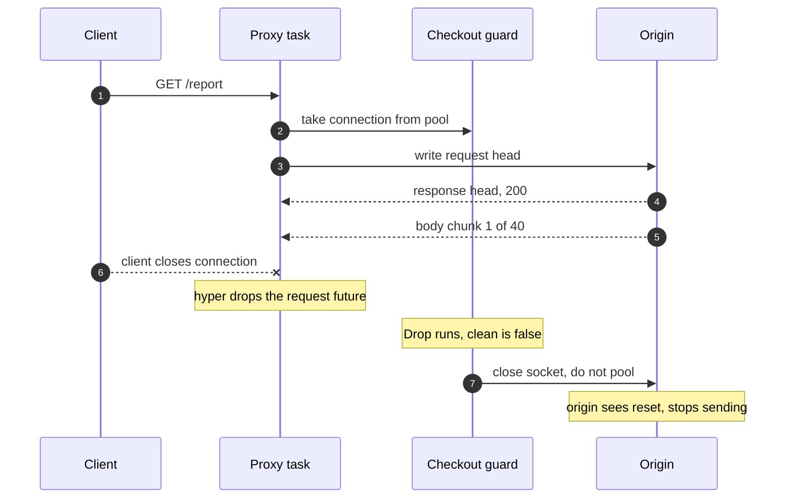

# Case Study: Design a High-Performance L7 Proxy in Rust

## Intuition

> **Design intuition**: A Go proxy fights its garbage collector. A Rust proxy has no collector to fight, so every cost the collector used to hide moves into code you write and can read. Memory per connection is the size of a future plus the buffers it owns, and the compiler knows that number. Freeing memory happens at the exact line where the last owner drops it, which can be on a request thread in the middle of a p99 sample. Cancellation is not a context you check: it is `drop`, and it can happen at any `.await`. So the design question becomes: who owns each byte, where does it die, and what state is left behind when a future stops halfway?

This is a **Rust runtime** case study. The sibling study [Design a gRPC Edge Proxy in Go](../../go/case_studies/design_a_grpc_edge_proxy.md) already covers the proxy patterns that are the same in every language: a passthrough codec for opaque gRPC frames, interceptor order (metrics outside recovery, per-IP limits before authentication), retry budgets, outlier ejection, label cardinality, fd handover for zero-downtime restart, and TLS identity re-assertion. This study does not repeat them. It covers what changes when the data plane is written in Rust on Tokio, hyper and tower: the scheduler model you choose, where `Bytes` saves copies and where it pins memory, why a connection pool must be shared across workers, how `arc-swap` replaces a lock and what it does not solve, how to forward a request so that a dropped future cannot corrupt a pooled connection, and how the allocator, not a GC, decides your RSS.

The question: **what does one Rust binary need to look like to terminate TLS for 200,000 concurrent client connections, forward about 1,000,000 HTTP requests per second on 32 cores, reload its routing table under full load, and add less than 2 ms at p99?**

**Key insight for this design**: in Rust the proxy's resource use is a property of its types. A request future that holds a 16 KiB array across an `.await` is 16 KiB per connection, at compile time, for all 200,000 connections. A `Bytes` slice that outlives its read buffer keeps the whole buffer. An `Arc` whose last clone dies on a worker frees its contents on that worker. Read the types and you can predict the memory, the latency tail and the failure modes before the first load test.

Everything here builds on:
[Async Runtimes and Executors](../async_runtimes_and_executors/async_runtimes_and_executors.md),
[Tokio Deep Dive](../async_runtimes_and_executors/tokio_deep_dive.md),
[Async Cancellation and Pitfalls](../async_cancellation_and_pitfalls/async_cancellation_and_pitfalls.md),
[Web Services with axum, tower and hyper](../web_services_axum_tower_and_hyper/web_services_axum_tower_and_hyper.md),
[Channels, Atomics and Shared State](../channels_atomics_and_shared_state/channels_atomics_and_shared_state.md),
[Threads, Send, Sync and Locks](../threads_send_sync_and_locks/threads_send_sync_and_locks.md),
[Performance and Zero-Cost Abstractions](../performance_and_zero_cost_abstractions/performance_and_zero_cost_abstractions.md),
and [Profiling and Benchmarking](../profiling_and_benchmarking/profiling_and_benchmarking.md).
The two cross-cutting files carry the shared material: [Memory Budgets Without a GC](cross_cutting/memory_budgets_without_a_gc.md) for RSS, allocators and container limits, and [Unsafe Review and Soundness Checklist](cross_cutting/unsafe_review_and_soundness_checklist.md) for the `unsafe` that sits under every proxy's dependency tree.

---

## 1. Requirements Clarification

### Functional Requirements

- Terminate TLS 1.3 and TLS 1.2 from clients with per-SNI certificates. Negotiate HTTP/1.1 or HTTP/2 through ALPN.
- Forward HTTP/1.1 and HTTP/2 requests to named upstream clusters (origins). Upstream legs use TLS with connection reuse (keep-alive for HTTP/1.1, multiplexed streams for HTTP/2).
- Route on host, path prefix and a small set of headers. Rewrite request and response headers per route.
- Stream request and response bodies without buffering whole bodies, with a per-route cap on buffered bytes for the retry path.
- Retry a failed upstream attempt only when the retry cannot duplicate a side effect (§4.6).
- Reload routes, clusters, certificates and policy without a restart and without dropping a connection.
- Emit per-route latency histograms, connection-reuse ratio, pool sizes and runtime metrics.

### Non-Functional Requirements

- **1,000,000 requests per second** per instance at steady state, on a 32-core host (64 GiB RAM, one 100 GbE NIC).
- **200,000 concurrent downstream connections**, most of them idle keep-alive connections.
- **Added latency under 2 ms at p99** and under 10 ms at p99.9. "Added" is proxy-observed total time minus upstream time.
- Container memory limit **6 GiB**. Steady RSS target under 3 GiB, so a 2x burst in active connections fits.
- A config push takes effect within 5 s on every worker and never fails an in-flight request.
- Median request: 800 bytes of headers, no body for 85% of requests. Median response: 6 KiB. p99 response: 256 KiB.

### Out of Scope (and where it lives instead)

- Proxy patterns that do not depend on the language: interceptor and filter order, retry budgets, outlier ejection, metric label rules, fd handover on restart. See [Design a gRPC Edge Proxy in Go](../../go/case_studies/design_a_grpc_edge_proxy.md).
- Operating Envoy and its xDS configuration. See [Technologies: Envoy Proxy](../../technologies/envoy_proxy/envoy_proxy.md).
- HTTP/1.1, HTTP/2 and HTTP/3 framing and flow control. See [Backend: HTTP Protocols](../../backend/http_protocols/http_protocols.md).
- Load-balancing algorithms and rate-limit policy. See [HLD: Load Balancing](../../hld/load_balancing/load_balancing.md) and [HLD: Rate Limiting](../../hld/rate_limiting/rate_limiting.md).
- Sidecar and ambient mesh data planes (linkerd2-proxy, ztunnel) as an architecture. See [Ambient Mesh and Workload Identity](../../backend/service_mesh_and_service_discovery/ambient_mesh_and_workload_identity.md). §6 uses them only as Rust examples.
- epoll, readiness and completion I/O. See [Async I/O and Event Loops](../../cs_fundamentals/processes_threads_and_context_switching/async_io_and_event_loops.md).

---

## 2. Scale Estimation

### CPU budget per request

```
Host:                          32 cores
Rate:                          1,000,000 req/s
Per core:                      1,000,000 / 32 = 31,250 req/s
Core time per request:         1 s / 31,250 = 32 microseconds

Headroom reserve (30%):        9.6 microseconds
Budget per request:            22.4 microseconds of core time, all included:
                               TLS, parsing, routing, syscalls, allocator,
                               scheduler, metrics
```

There is no line for garbage collection. In the Go study the GC reserve and the allocation rate decide the design. Here the allocator is a plain cost per call, and the reserve goes to syscalls and crypto instead.

### Bytes and crypto

```
Egress (median 6 KiB x 1M/s):         6.0 GB/s  (about 48 Gbit/s on the NIC)
Ingress (800 B headers x 1M/s):       0.8 GB/s

TLS on both legs:
  upstream decrypt + downstream encrypt of responses:  2 x 6.0 = 12.0 GB/s
  downstream decrypt + upstream encrypt of requests:   2 x 0.8 =  1.6 GB/s
  total AEAD:                                                   13.6 GB/s

Assumption: AES-128-GCM at about 3 GB/s per core with hardware AES
Crypto cores:                          13.6 / 3.0 = 4.5 cores (14% of the host)
```

Bulk crypto is a fixed tax. It does not depend on the language. The costs that do depend on the language are copies (does each byte get copied once or three times) and handshakes (how many connections does the proxy open).

### Handshake arithmetic and the reuse ratio

```
Assumption: full ECDSA P-256 handshake about 0.15 ms of CPU, resumption 0.03 ms

Downstream: 200,000 connections, mean life 60 s  -> 3,333 new connections/s
            60% resume                             -> 1,333 full + 2,000 resumed
            CPU: 1,333 x 0.15 ms + 2,000 x 0.03 ms = 0.26 cores

Upstream, by reuse ratio (new upstream connections = (1 - ratio) x 1M/s):
  ratio 87.1%  -> 129,000 new/s x 0.15 ms = 19.4 cores   (more than half the host)
  ratio 99.0%  ->  10,000 new/s x 0.15 ms =  1.5 cores
  ratio 99.9%  ->   1,000 new/s x 0.15 ms =  0.15 cores
```

The upstream reuse ratio is the single biggest CPU lever in the design. The jump from 87.1% to 99.9% saves about 19 cores, more than all bulk crypto. Every request that misses the pool also pays one or two extra round trips to the origin, which goes straight into the latency tail. §4.4 shows why a per-worker pool cannot reach 99.9% at 32 workers and a shared pool can. Cloudflare reported this exact effect for Pingora (§6).

### Connections, Little's Law and the idle majority

```
Upstream time, mean:              4 ms
Requests in flight (L = lambda x W):  1,000,000 x 0.004 = 4,000

Downstream connections:          200,000
Connections with a live request:  about 4,000   (2%)
Idle keep-alive connections:      about 196,000  (98%)
```

This ratio decides the memory design. A connection that holds 64 KiB of buffers while idle costs 12 GiB across 196,000 idle connections. A connection that releases its plaintext buffers when idle costs a few KiB. The proxy needs cheap idle connections far more than it needs cheap active ones.

### Memory per connection: two designs

```
                                   Naive design       Lean design
Read buffer                        16 KiB, always     8 KiB, only while active
Write buffer                       16 KiB, always     released after flush
TLS record buffers                 34 KiB, always     34 KiB active, about 4 KiB idle
Connection future (state machine)  16.4 KiB           about 1.5 KiB
                                   ---------          ---------
Per idle connection                82 KiB             about 6 KiB
Idle total (196,000)               15.3 GiB           1.1 GiB
Active total (4,000 x about 60 KiB) 0.23 GiB          0.23 GiB
```

The naive design does not fit in a 6 GiB container. The lean design fits with room for the route table, the upstream pool and allocator overhead. The 16.4 KiB future line is not a guess: §4.7 shows a `size_of_val` check that prints 16386 bytes for a future holding a 16 KiB array across an `.await`, and 32 bytes when the same buffer is on the heap.

### Targets after the design in §4

The naive and lean columns are illustrative scenario figures for this study's design. They are not measurements of a named production system.

| Metric | Naive build | Target | Lean build |
|---|---|---|---|
| Upstream reuse ratio | 87% (per-worker pools) | over 99.5% | 99.9% (shared pool) |
| Core time per request | 41 us | under 22.4 us | 20.6 us |
| RSS at 200,000 connections | 16.8 GiB (OOM) | under 3 GiB | 2.3 GiB |
| p99 added latency | 6.8 ms | under 2 ms | 1.1 ms |
| p99.9 during config push | 48 ms | under 10 ms | 3.2 ms |
| Allocations per request | 61 | under 30 | 22 |

---

## 3. High-Level Architecture

```mermaid
flowchart LR
    classDef io      fill:#61afef,stroke:#2e86c1,color:#1a1a1a,font-weight:bold
    classDef frozen  fill:#c678dd,stroke:#9b59b6,color:#fff
    classDef train   fill:#98c379,stroke:#27ae60,color:#1a1a1a
    classDef mathOp  fill:#d19a66,stroke:#e67e22,color:#1a1a1a,font-weight:bold
    classDef lossN   fill:#e06c75,stroke:#c0392b,color:#fff,font-weight:bold
    classDef req     fill:#56b6c2,stroke:#0097a7,color:#1a1a1a
    classDef base    fill:#e5c07b,stroke:#f39c12,color:#1a1a1a

    cli(["Clients<br/>200k connections"])
    acc(["Accept loop<br/>one listener"])
    rt(["Tokio multi-thread<br/>32 workers<br/>work stealing"])
    tls(["rustls accept<br/>SNI cert from snapshot"])
    hy(["hyper auto builder<br/>HTTP/1.1 or HTTP/2"])
    stack(["tower stack<br/>load shed, limit<br/>timeout, route"])
    fwd(["Forwarder<br/>cancel-safe checkout"])
    pool(["Shared upstream pool<br/>sharded by origin"])
    org(["Origins<br/>TLS keep-alive"])
    snap(["ArcSwap snapshot<br/>routes, clusters, certs"])
    cp(["Config watcher<br/>builds next snapshot"])
    reap(["Reaper thread<br/>drops old snapshots"])
    obs(["Metrics and traces<br/>runtime metrics"])

    cli --> acc --> rt --> tls --> hy --> stack --> fwd --> pool --> org
    cp -->|"store"| snap
    snap -->|"load"| tls
    snap -->|"load"| stack
    cp -->|"old Arc"| reap
    stack -.-> obs
    fwd -.-> obs

    class cli,org io
    class acc,rt base
    class tls,hy,stack,fwd train
    class pool req
    class snap,cp mathOp
    class reap frozen
    class obs lossN
```



A request enters through one accept loop, runs as one Tokio task per connection on a 32-worker work-stealing runtime, passes through a tower middleware stack inside hyper, and leaves through a pool that every worker shares. Config arrives as a whole new snapshot behind an `ArcSwap`, and a dedicated thread drops the old one.

| Component | What it holds or removes | What happens without it |
|---|---|---|
| Work-stealing runtime | Long-lived HTTP/2 connections cannot pin load to one core | One hot connection saturates a core while 31 sit idle |
| Lean connection future | About 6 KiB per idle connection | 82 KiB per idle connection, OOM at 200,000 connections |
| `Bytes` from the read buffer | Header values and body chunks forwarded without a copy | Two or three copies per byte, about 3 extra cores at 6 GB/s |
| tower `load_shed` + `concurrency_limit` | A fast 503 when the proxy is full | Unbounded queueing in front of `poll_ready`, latency grows without limit |
| Shared upstream pool | Reuse ratio near 99.9% | Each of 32 workers opens its own connections, reuse near 87% |
| Checkout drop guard | Only a clean connection returns to the pool | A cancelled request leaves half a response on a pooled socket |
| `ArcSwap` snapshot | One atomic load per request, no lock | Lock and refcount contention on every request |
| Reaper thread | Old snapshots are freed off the request path | A worker frees a 120 MiB route table inside a request |
| jemalloc or mimalloc | RSS tracks live memory | glibc arenas grow RSS to 3x live memory |

---

## 4. Component Deep Dives

### 4.1 Runtime: work stealing or thread-per-core

Rust has no built-in scheduler, so the runtime model is a design decision. The full decision model lives in [Async Runtimes and Executors](../async_runtimes_and_executors/async_runtimes_and_executors.md). For this proxy, two shapes are on the table.

**Tokio multi-thread runtime (work stealing).** Each worker has a local run queue of 256 slots, a LIFO slot for the task it just woke, and a shared inject queue. An idle worker steals half of a busy worker's queue. Each task gets a cooperative budget of 128 operations per poll, after which Tokio resources return `Pending` and the task yields. Blocking work goes to a separate pool of up to 512 threads. The cost: every spawned future must be `Send + 'static`, so shared state goes behind `Arc` and atomics or locks, and a task can resume on a different core with a cold cache. [Tokio Deep Dive](../async_runtimes_and_executors/tokio_deep_dive.md) covers each of these mechanisms.

**Thread-per-core.** One `current_thread` runtime per core, one listener per core with `SO_REUSEPORT` so the kernel spreads accepted connections, and no movement of tasks between cores. Futures can be `!Send`, so per-core state uses `Rc` and `RefCell` with no atomics. The cost: the kernel balances connections, not requests. A proxy's load per connection is very uneven. One HTTP/2 connection from a CDN tier can carry 2,000 concurrent streams while another carries one request per minute, and the core that accepted the busy one cannot hand any of it off.

```
Illustrative: thread-per-core, 32 cores, 200,000 connections, one heavy HTTP/2 client:

  core 7:  heavy connection, 2,000 streams    -> 100% busy, p99 = 14 ms
  core 0-6, 8-31: average connections         ->  55% busy, p99 = 0.9 ms

  Overall p99 is set by the 6% of requests on core 7.

Work stealing, same load:
  core 7 runs the connection task, but each stream is its own spawned task
  idle cores steal stream tasks from core 7's queue -> all cores near 58%
```

That imbalance is why this design uses the work-stealing runtime. It matches Pingora's published reasoning (§6): Cloudflare chose multithreading over multiprocessing to share connection pools, and decided that work stealing was required to avoid some classes of performance problems. Thread-per-core wins when connections are uniform and short, or when the I/O layer needs it (io_uring runtimes such as `monoio` and `glommio` are thread-per-core by design).

```rust
// fragment: runtime setup for the proxy binary
use std::time::Duration;

fn build_runtime() -> std::io::Result<tokio::runtime::Runtime> {
    tokio::runtime::Builder::new_multi_thread()
        .worker_threads(32)
        .max_blocking_threads(64) // default is 512; cert loads and DNS only
        .thread_name("proxy-worker")
        .thread_keep_alive(Duration::from_secs(30))
        .enable_all()
        .build()
}
```

`max_blocking_threads(64)` is a deliberate cut from the default of 512. The blocking pool here handles certificate file reads and the occasional system DNS lookup. If 512 of them pile up, the proxy has a bug, and 512 threads with 2 MiB stacks reserve 1 GiB of address space while hiding it.

### 4.2 Request path: a tower stack inside hyper

hyper owns the connection: HTTP/1.1 parsing, HTTP/2 framing and flow control, keep-alive. tower owns the policy: a `Service` is a function from request to future, and a `Layer` wraps one `Service` in another. The proxy is a tower stack that hyper calls once per request.

```rust
// fragment: per-connection serve loop
use std::sync::Arc;
use std::time::Duration;

use hyper_util::rt::{TokioExecutor, TokioIo};
use hyper_util::server::conn::auto;
use hyper_util::service::TowerToHyperService;
use tower::ServiceBuilder;

async fn serve_conn(tls: TlsStream, proxy: Arc<Proxy>) {
    let svc = ServiceBuilder::new()
        .load_shed() // outermost: turn "not ready" into an immediate 503
        .concurrency_limit(proxy.per_conn_limit) // 256 in flight per connection
        .timeout(Duration::from_secs(30)) // whole request, including retries
        .service(ForwardService::new(Arc::clone(&proxy)));

    let mut builder = auto::Builder::new(TokioExecutor::new());
    builder.http2().max_concurrent_streams(256);
    if let Err(err) = builder
        .serve_connection(TokioIo::new(tls), TowerToHyperService::new(svc))
        .await
    {
        tracing::debug!(%err, "connection closed with error");
    }
}
```

**`poll_ready` is the backpressure signal.** tower's `Service` has two methods. `poll_ready` returns `Ready(Ok(()))` when the service can take a request and `Pending` when it is at capacity. `call` dispatches. The tower docs state that a service may panic if `call` runs without a `Ready(Ok(()))` from `poll_ready`. `concurrency_limit` returns `Pending` when 256 requests are in flight. Without `load_shed` in front of it, the caller waits for capacity and the request sits in a queue that no metric shows. With `load_shed` outermost, `Pending` becomes an error that the proxy maps to a 503 in about 2 microseconds. The order matters: `ServiceBuilder` applies the first layer you add as the outermost.

**Cloning a ready service is a bug the compiler does not catch.** A service that must move into a boxed future has to be cloned, and the clone is a different instance that has not been polled for readiness. The tower docs give the fix: `std::mem::replace(&mut self.inner, clone)`, which keeps the instance that is ready and leaves the fresh clone behind.

```rust
// fragment: inside impl Service<Request<Incoming>> for ForwardService
fn call(&mut self, req: Request<Incoming>) -> Self::Future {
    // WRONG: let inner = self.inner.clone();  (the clone was never polled ready)
    let clone = self.inner.clone();
    let mut inner = std::mem::replace(&mut self.inner, clone);
    Box::pin(async move { inner.call(req).await })
}
```

With a `concurrency_limit` below this service, the wrong form takes a permit that `poll_ready` reserved on one instance and calls through another instance that holds none. Under load that admits requests past the limit, so the limit no longer bounds concurrency.

### 4.3 `Bytes`: zero-copy headers and bodies, and the memory they pin

`bytes::Bytes` is a cheaply cloneable, sliceable view into shared memory. The docs describe `slice`, `split_to` and `split_off` as `O(1)` operations that increase a reference count and set indices. They do not copy. hyper reads from the socket into a `BytesMut`, parses the request head, and hands out header values and body chunks as `Bytes` views into that one buffer. The proxy forwards those views to the upstream write with no copy.

```
One 8 KiB read buffer, refcount 4:

  [ GET /api/v2/items HTTP/1.1\r\nhost: shop.example\r\n ... body ... ]
    ^^^ method view     ^^^^^^^^^^^^ path view    ^^^^ body chunk view

  Copy count per byte:  socket -> buffer (1), buffer -> TLS encrypt (2)
  Naive String headers: socket -> buffer (1), buffer -> String (2),
                        String -> write buffer (3), write buffer -> TLS (4)
```

At 6.8 GB/s of combined payload, each extra copy costs about one and a half cores of `memcpy` plus cache pollution. Two avoided copies pay for most of the routing logic.

The same property has a cost. **A `Bytes` view keeps the whole buffer alive.** A 40-byte header value cloned into a long-lived cache keeps its 8 KiB, or 64 KiB, read buffer allocated until the cache entry dies. §9 has the incident. The fix is a deliberate copy at the boundary where data stops being request-scoped: `Bytes::copy_from_slice(&value)` for anything that goes into a cache, a metric label table or a log batch.

The idea behind `Bytes` fits in std. The broken version tries to send a borrowed slice of the read buffer to another thread:

```rust
// BROKEN: a borrowed slice cannot outlive the buffer it points into
// error[E0597]: `buf` does not live long enough
use std::thread;

fn main() {
    let buf: Vec<u8> = b"GET /a HTTP/1.1\r\nhost: x\r\n\r\n".to_vec();
    let method: &[u8] = &buf[..3];
    let worker = thread::spawn(move || method.len());
    let _ = worker.join();
}
```

`thread::spawn` and `tokio::spawn` both need `'static`. A `&[u8]` into a stack-owned `Vec` is not `'static`, so the compiler rejects it. Copying the slice into a `Vec` compiles, and is the copy `Bytes` exists to avoid. The fix shares ownership of the buffer and keeps a range:

```rust
// FIX: shared ownership plus a range, the core idea of bytes::Bytes
use std::ops::Range;
use std::sync::Arc;
use std::thread;

#[derive(Clone)]
struct Shared {
    buf: Arc<[u8]>,
    range: Range<usize>,
}

impl Shared {
    fn new(bytes: Vec<u8>) -> Self {
        let len = bytes.len();
        Shared { buf: bytes.into(), range: 0..len }
    }

    fn slice(&self, sub: Range<usize>) -> Option<Shared> {
        let start = self.range.start.checked_add(sub.start)?;
        let end = self.range.start.checked_add(sub.end)?;
        if start > end || end > self.range.end {
            return None;
        }
        Some(Shared { buf: Arc::clone(&self.buf), range: start..end })
    }

    fn as_bytes(&self) -> &[u8] {
        &self.buf[self.range.clone()]
    }
}

fn main() {
    let read = Shared::new(b"GET /a HTTP/1.1\r\nhost: x\r\n\r\n".to_vec());
    let Some(method) = read.slice(0..3) else {
        return;
    };
    let worker = thread::spawn(move || method.as_bytes().len());
    let n = worker.join().unwrap_or(0);
    assert_eq!(n, 3);
    // The 3-byte view kept all 29 bytes alive until the worker dropped it.
    assert_eq!(Arc::strong_count(&read.buf), 1);
}
```

The real `Bytes` adds a vtable so a view can sit over a `Vec`, a static slice or a custom owner, and `BytesMut` adds a growable write end. The memory rule is the same as in this sketch: the backing buffer lives as long as the last view.

### 4.4 Upstream connection pool: shared, sharded, never locked across `.await`

A per-worker pool looks attractive in Rust because it needs no `Send` and no lock. It loses on reuse. With 32 workers and 400 origins, a request lands on a worker whose own idle list for that origin is often empty, even when another worker holds idle connections to it. The proxy opens a connection it did not need, and the other worker's idle connection times out unused.

```
Per-worker pool, 32 workers, origin O gets 3,000 req/s, idle timeout 60 s:

  Requests per worker for O:   3,000 / 32 = 94 req/s
  A busy instant needs 12 concurrent connections to O in total.
  Per-worker: each of 32 workers needs its own peak, about 3 each = 96 idle
  Shared:     12 idle connections serve the whole process

  Every time a worker's private list is empty and another's is not, the
  request pays a TCP + TLS handshake: about 2 RTT to the origin.
```

The design uses one pool shared by all workers, sharded by origin. Each shard is a short critical section: lock, pop or push, unlock. The lock is a plain `std::sync::Mutex`, because no `.await` happens while it is held, and an uncontended std mutex costs tens of nanoseconds. A `tokio::sync::Mutex` would be the wrong tool. It exists for locks that must be held across an `.await`, which is the thing this pool must never do.

The broken checkout holds the guard while it connects:

```rust
// BROKEN: std MutexGuard held across .await, so the future is not Send
// error: future cannot be sent between threads safely
use std::collections::VecDeque;
use std::future::Future;
use std::sync::{Arc, Mutex};

struct Conn {
    id: u64,
}

struct Pool {
    idle: Mutex<VecDeque<Conn>>,
}

fn spawn<F>(_task: F)
where
    F: Future<Output = ()> + Send + 'static,
{
}

async fn connect_new() -> Conn {
    Conn { id: 0 }
}

async fn checkout(pool: Arc<Pool>) {
    let mut idle = pool.idle.lock().unwrap_or_else(|e| e.into_inner());
    let conn = match idle.pop_front() {
        Some(c) => c,
        None => connect_new().await, // the guard is still alive here
    };
    idle.push_back(conn);
}

fn main() {
    let pool = Arc::new(Pool { idle: Mutex::new(VecDeque::new()) });
    spawn(checkout(pool));
}
```

`spawn` here has the same bound as `tokio::spawn`: `Future + Send + 'static`. `MutexGuard` is not `Send`, and rustc reports that the future "is not `Send` as this value is used across an await". The error catches a real bug: if the code compiled, every other worker that wanted any connection to this origin would block its OS thread for the full connect time, 2 to 40 ms.

The fix takes the connection out in a block that ends before any `.await`, and returns it through a drop guard that §4.6 needs anyway:

```rust
// FIX: lock only for pop and push; return through a guard that checks state
use std::collections::VecDeque;
use std::sync::{Arc, Mutex};

pub struct Conn {
    pub id: u64,
}

pub struct Pool {
    idle: Mutex<VecDeque<Conn>>,
    max_idle: usize,
}

pub struct Checkout {
    conn: Option<Conn>,
    pool: Arc<Pool>,
    clean: bool,
}

impl Checkout {
    pub fn conn(&mut self) -> Option<&mut Conn> {
        self.conn.as_mut()
    }

    /// Call only after the full response was read and the connection is reusable.
    pub fn mark_clean(&mut self) {
        self.clean = true;
    }
}

impl Drop for Checkout {
    fn drop(&mut self) {
        let Some(conn) = self.conn.take() else { return };
        if !self.clean {
            return; // dropped mid-request: close the socket, never reuse it
        }
        let mut idle = self.pool.idle.lock().unwrap_or_else(|e| e.into_inner());
        if idle.len() < self.pool.max_idle {
            idle.push_back(conn);
        }
    }
}

impl Pool {
    pub fn new(max_idle: usize) -> Arc<Pool> {
        Arc::new(Pool { idle: Mutex::new(VecDeque::new()), max_idle })
    }

    pub fn take(self: &Arc<Self>, fresh: impl FnOnce() -> Conn) -> Checkout {
        let reused = self.idle.lock().unwrap_or_else(|e| e.into_inner()).pop_front();
        Checkout { conn: Some(reused.unwrap_or_else(fresh)), pool: Arc::clone(self), clean: false }
    }

    pub fn idle_len(&self) -> usize {
        self.idle.lock().unwrap_or_else(|e| e.into_inner()).len()
    }
}
```

In the real proxy `fresh` is an async connect that runs after `take` returns `None`, outside the lock. The two properties carry over: the lock never spans an `.await`, and a connection goes back to the pool only through `mark_clean`. A poisoned lock is recovered with `into_inner`, because a panic in another request does not corrupt a `VecDeque` of sockets.

**Sharding.** One `Mutex` per origin is enough at 3,000 req/s per origin. For the top 10 origins, which carry 60% of traffic, split each origin's idle list into 8 sub-shards picked by worker index, with a fallback scan of the other 7 on a miss. Pad each shard to a cache line (`crossbeam::utils::CachePadded`) so two hot shards do not share one. The [Channels, Atomics and Shared State](../channels_atomics_and_shared_state/channels_atomics_and_shared_state.md) page has the general decision between a sharded lock, a channel and an atomic.

**HTTP/2 upstreams** need a different shape: one connection carries many streams, so the pool holds a small set of shared `SendRequest` handles per origin, checked out by clone, not by pop. hyper's HTTP/2 client handle is cheap to clone and multiplexes on one connection, so contention moves from the pool lock to the connection's stream limit, which the origin advertises.

### 4.5 Config reload: `arc-swap`, and where the old snapshot dies

Every request reads the routing snapshot. The Go study explains why a reader lock on that path is wrong and how an atomic pointer with immutable snapshots fixes it. That part is the same in Rust and is not repeated here. The `arc-swap` docs name the problem with the obvious Rust form, `RwLock<Arc<T>>`: it suffers from CPU-level contention on the lock and on the `Arc` reference count. Even a read-only `Arc::clone` writes to the shared count, so 1,000,000 clones per second across 32 cores bounce one cache line.

```rust
// fragment: snapshot holder
use std::sync::Arc;
use std::sync::mpsc::Sender;

use arc_swap::ArcSwap;

pub struct Snapshot {
    pub version: u64,
    pub routes: RouteTable,     // about 120 MiB at 400,000 routes
    pub clusters: ClusterMap,
}

pub struct Config {
    current: ArcSwap<Snapshot>,
    reaper: Sender<Arc<Snapshot>>,
}

impl Config {
    pub fn route(&self, req: &RequestHead) -> Option<RouteHit> {
        let snap = self.current.load(); // a Guard, not an Arc clone
        snap.routes.lookup(req).map(RouteHit::from) // copy out what the request needs
    } // guard dropped here: never hold it across an .await

    pub fn publish(&self, next: Snapshot) {
        let old = self.current.swap(Arc::new(next));
        // The old snapshot may still have readers. Hand our reference to the
        // reaper so the last drop is unlikely to happen on a request worker.
        let _ = self.reaper.send(old);
    }
}
```

`load()` returns a guard that is cheaper than cloning an `Arc`, and the request copies out the small route result (cluster id, timeouts, header rules as `Arc`s) before it awaits anything. Holding the guard across an `.await` defeats its fast path, so the rule is the same as for the pool lock: load, copy out, drop.

**The Rust-specific problem is reclamation.** In Go, the old snapshot becomes garbage and the collector frees it later on its own threads. In Rust, the old snapshot is freed by `drop`, on whichever thread drops the last `Arc`. A request that loaded the old snapshot through `load_full()`, or kept one route's `Arc<RouteTable>`, can be the last owner. Then that request's worker runs the destructor for a 120 MiB table built from about 2 million small allocations. That is 30 to 45 ms of `free` calls inside one request, and every other task queued on that worker waits too.

The reaper thread takes the swap's reference and holds it for a grace period longer than the longest request (30 s here), then drops it. Most of the time the reaper is the last owner. When a slow request outlives the grace period, that request still pays, so the routes keep large tables behind one more `Arc` and the reaper retries `Arc::try_unwrap` until it succeeds, which makes the reaper the last owner in every case where request code only holds small per-route pieces. The p99.9 effect is in §2: 48 ms during a config push without the reaper, 3.2 ms with it.

### 4.6 Cancel-safe forwarding

In Rust, cancelling an async operation means dropping its future. The future stops at whatever `.await` it last reached, its destructors run, and no further code in it runs. In this proxy, a request future is dropped when:

- the client closes the connection or resets an HTTP/2 stream, so hyper drops the service future;
- the tower `timeout` layer fires and drops the inner future;
- a `tokio::select!` that races the upstream response against a deadline or a shutdown signal picks another branch.

The Tokio `select!` docs call a method cancel safe if it behaves correctly when it is restarted while waiting at an `.await`. They list `AsyncReadExt::read` and `mpsc::Receiver::recv` as cancel safe and `read_exact`, `read_to_end` and `write_all` as not cancel safe. A proxy is a chain of exactly these operations on a socket it will reuse.



The danger is the step the diagram avoids. Without the guard, the dropped future would return the connection to the pool with 39 body chunks still in flight. The next request on that connection reads chunk 2 of somebody else's report as its own response head. With HTTP/1.1 keep-alive, that is a cross-request data leak. The `Checkout` guard from §4.4 makes "return to pool" a positive action (`mark_clean`) that only runs after the response body was fully read. Every other way out of the future, including a drop at any `.await`, closes the socket.

```rust
// fragment: forwarding one HTTP/1.1 request over a pooled connection
use std::time::Duration;

use tokio::time::timeout;

async fn forward(
    route: &RouteHit,
    req: ProxyRequest,
    pool: &OriginPool,
) -> Result<ProxyResponse, ForwardError> {
    let mut attempt = 0;
    loop {
        attempt += 1;
        let mut checkout = pool.checkout(route.origin).await?; // no lock held here
        let sent = SendState::default();

        let result = timeout(route.attempt_timeout, async {
            checkout.write_head(&req.head, &sent).await?; // sets sent.head_started
            checkout.write_body(&req.body, &sent).await?; // replayable body only
            checkout.read_head().await
        })
        .await;

        let err = match result {
            // The body streams to the client. The guard goes with it and is
            // marked clean only when the last chunk was read from the origin.
            Ok(Ok(head)) => return Ok(ProxyResponse::streaming(head, checkout)),
            Ok(Err(e)) => ForwardError::from(e),
            Err(_elapsed) => ForwardError::Timeout,
        };
        drop(checkout); // not clean: the socket closes here
        if !may_retry(&req, &sent, &err, attempt) {
            return Err(err);
        }
    }
}
```

**When a retry is safe.** A retry is safe only if it cannot run a side effect twice:

| Condition | Retry? | Reason |
|---|---|---|
| Reused keep-alive connection failed before any request byte was written | Yes, any method | The origin closed an idle connection. It never saw this request |
| Method is GET, HEAD, OPTIONS, PUT or DELETE, and no response byte went to the client | Yes | RFC 9110 defines these methods as idempotent |
| POST with an idempotency key the origin honours | Yes | The origin deduplicates |
| POST, request head or body partly written, no key | No | The origin may have started work |
| Any response byte already forwarded to the client | No | The client has a partial response. Abort the stream instead |

`SendState` records `head_started` and `body_started` in `Cell<bool>` fields that the write functions set. Those flags survive the cancellation because they live outside the future that was dropped. That is the general pattern for cancel safety in a proxy: put the facts the retry decision needs in state that the `select!` or `timeout` does not own.

**Request bodies.** A streaming request body is consumed as it is forwarded, so it cannot be replayed. The proxy buffers bodies up to 64 KiB per route that allows retries, as `Bytes`, which makes replay a cheap clone. A larger body streams and is never retried after its first byte leaves. [Async Cancellation and Pitfalls](../async_cancellation_and_pitfalls/async_cancellation_and_pitfalls.md) covers the general rules and the `select!` traps.

### 4.7 Memory per connection: the future is the budget

Every async function compiles to a state machine. Each local that is alive across an `.await` becomes a field of that state machine, and the future's size is the size of its largest suspended state. One spawned task per connection means the connection's memory floor is `size_of` its top-level future, decided at compile time.

```rust
// Future size is decided by what lives across .await
use std::future::ready;
use std::mem::size_of_val;

async fn relay_stack() -> usize {
    let mut buf = [0u8; 16 * 1024];
    ready(()).await;
    buf[0] = 1;
    buf.len()
}

async fn relay_heap() -> usize {
    let mut buf = vec![0u8; 16 * 1024];
    ready(()).await;
    buf[0] = 1;
    buf.len()
}

fn main() {
    let on_stack = relay_stack();
    let on_heap = relay_heap();
    // rustc 1.99.1 on a 64-bit target prints 16386 and 32.
    println!("{} {}", size_of_val(&on_stack), size_of_val(&on_heap));
    assert!(size_of_val(&on_stack) >= 16 * 1024);
    assert!(size_of_val(&on_heap) <= 64);
}
```

The stack-array version is 16 KiB per connection whether the connection is busy or idle, because the task's future is allocated once by `tokio::spawn` and never shrinks. At 200,000 connections that is 3.1 GiB for buffers that are idle 98% of the time. The heap version is 32 bytes of future plus a 16 KiB allocation that the code can drop when the connection goes idle.

Three rules keep the per-connection floor near 6 KiB:

1. **No large arrays across `.await`.** Measure with `size_of_val` in a unit test on the top-level connection future and fail the build if it grows past 2 KiB. Box a large sub-future (`Box::pin(big_step()).await`) to move its state to the heap only while it runs.
2. **Release buffers when idle.** Between requests on a keep-alive connection, drop the read `BytesMut` if its capacity is over 8 KiB and allocate on the next read. A 4 KiB allocation per new request costs about 40 ns. Holding 16 KiB on 196,000 idle connections costs 3 GiB.
3. **Spawn per HTTP/2 stream, not one task per connection that does everything.** The connection task stays small. Stream tasks carry the request state and die with the request, which also lets work stealing spread one connection's streams across cores (§4.1).

### 4.8 The allocator decides RSS

Rust frees memory the instant the owner drops it, so live memory tracks load closely. RSS does not have to. The default global allocator on Linux is glibc `malloc`, which gives threads separate arenas to cut lock contention. The `mallopt` man page says the arena limit is implementation defined and usually a multiple of the number of CPUs, with `M_ARENA_TEST` defaulting to 8 on 64-bit systems. Memory freed into one arena is not reused by a thread that allocates from another, and an arena with live blocks spread across its pages returns little of that memory to the kernel.

A proxy is the worst case for this. A request's buffers are allocated on the worker that read the socket and often freed on a different worker after work stealing moved the task. Each arena keeps a high-water mark of mixed-size blocks.

```
Illustrative soak: 32 workers, glibc malloc, 1M req/s for 24 h:

  live heap (allocator stats, bytes in use):   2.1 GiB, flat after 10 min
  RSS:                                          2.4 GiB at 1 h
                                                4.9 GiB at 8 h
                                                6.3 GiB at 19 h -> OOMKilled (6 GiB limit)

Same build with jemalloc:
  live heap:                                    2.1 GiB
  RSS:                                          2.3 GiB at 24 h, flat
```

Three options, in order of preference for this workload:

- **Switch the global allocator** to jemalloc (`tikv-jemallocator` 0.7.0) or mimalloc (`mimalloc` 0.1.52). Both use size classes and per-thread caches that return memory across threads without arena isolation. Pick one with a 24 h soak test, not a microbenchmark.
- **Cap glibc arenas** with `MALLOC_ARENA_MAX=2` (or 4). It trades lock contention in `malloc` for less fragmentation. A cheap stopgap when a dependency change is not possible.
- **Allocate less.** Pooled `BytesMut` buffers, `SmallVec` for header lists under 16 entries, and interned header names cut allocations per request from 61 to 22 in this design. Fewer allocations means less fragmentation on any allocator.

```rust
// fragment: one line in main.rs swaps the allocator for the whole process
use tikv_jemallocator::Jemalloc;

#[global_allocator]
static GLOBAL: Jemalloc = Jemalloc;
```

The full memory model, including container limits, allocation-failure aborts, dhat and heaptrack, is in [Memory Budgets Without a GC](cross_cutting/memory_budgets_without_a_gc.md). The point for this proxy: alert on RSS minus allocator-reported live bytes, not on RSS alone. That gap is fragmentation, and no amount of tuning the code's allocation rate will close it on glibc.

### 4.9 The `unsafe` surface

The proxy's own code has no `unsafe`. Its dependencies do: Tokio's scheduler and I/O driver, `bytes` (the vtable in §4.3), hyper's buffer handling, `aws-lc-rs` (rustls 0.23.46's default crypto provider, C and assembly behind FFI), and the allocator. The proxy terminates untrusted TLS from the internet, so a soundness bug in that stack is a remote memory-safety bug.

The practical controls are policy, not code. `#![forbid(unsafe_code)]` in the proxy crates, so any `unsafe` must live in a separate reviewed crate. `cargo-geiger` 0.14.0 in CI to report `unsafe` counts per dependency, with a diff on every lockfile change. `cargo-vet` 0.10.3 or `cargo-deny` 0.20.2 to admit new dependencies. Miri on the proxy's own pure-Rust buffer logic in CI. The checklist and the sign-off policy are in [Unsafe Review and Soundness Checklist](cross_cutting/unsafe_review_and_soundness_checklist.md). The language-level rules are in [Unsafe Rust and Undefined Behavior](../unsafe_rust_and_undefined_behavior/unsafe_rust_and_undefined_behavior.md).

---

## 5. Design Decisions & Tradeoffs

### Work stealing vs thread-per-core

| | Tokio multi-thread (chosen) | Thread-per-core |
|---|---|---|
| Load balance | Per task, across cores | Per accepted connection, by the kernel |
| Shared state | `Arc`, atomics, short locks | `Rc`, `RefCell`, no atomics |
| Uneven HTTP/2 connections | Streams spread by stealing | One heavy connection pins one core |
| Cache locality | A task can move cores | A connection stays on its core |
| Compiler help | `Send` bound catches a guard across `.await` | `!Send` futures allowed, the check is gone (§9) |
| Best fit | Mixed long-lived connections, shared pools | Uniform short requests, io_uring I/O |

### Shared pool vs per-worker pools

| | Shared, sharded by origin (chosen) | Per worker |
|---|---|---|
| Reuse ratio at 32 workers | 99.9% | about 87% |
| Upstream connections held | One set per process | Up to 32 sets |
| Lock cost | One uncontended `Mutex` per checkout, about 40 ns | None |
| Failure mode | Lock held across `.await` (prevented by the guard pattern) | Fragmented reuse, handshake storms |

The lock costs 40 ns per request. The handshakes it avoids cost about 19 cores (§2).

### Snapshot publication

| | `ArcSwap<Snapshot>` (chosen) | `RwLock<Arc<Snapshot>>` | `tokio::sync::watch` |
|---|---|---|---|
| Read path | Guard load, no shared write | Lock plus refcount write | Borrow of a lock-protected value |
| Contention at 1M reads/s on 32 cores | Low | Cache-line bounce on lock and count | Lock on every borrow |
| Change notification | None (readers poll the pointer) | None | Built in |
| Reclamation | Last `Arc` drop, so add a reaper | Same | Same |

`watch` is the right tool for the control path that wakes the snapshot builder. `ArcSwap` is the right tool for the hot read path. None of the three decides where the old snapshot is freed, which is why the reaper exists.

### Allocator

| | glibc malloc | jemalloc | mimalloc |
|---|---|---|---|
| Build cost | none | C build in `tikv-jemallocator` | C build in `mimalloc` |
| RSS vs live at 24 h (§4.8 scenario) | 3.0x | 1.1x | 1.1x |
| Introspection | `malloc_stats` | rich stats, heap profiling | stats |
| Container image (musl target) | n/a | works | works |

On a musl target the default allocator is musl's `malloc`. ripgrep's `main.rs` sets jemalloc as the global allocator on 64-bit musl builds because, in its source comment, musl's allocator "appears to slow down ripgrep quite a bit". A proxy allocates far more per second than ripgrep, so a static musl build of it should set a global allocator and confirm the choice with a load test. [Rust Build, Deployment and Supply Chain](../build_deployment_and_supply_chain/build_deployment_and_supply_chain.md) covers the musl and static-binary choices.

### Rust vs Go vs Envoy for this data plane

The Go study argues the Go-versus-Envoy case. The Rust case is different in one way: Rust removes the GC term from the tail without moving the custom logic into C++ filters or Wasm. What you pay is build time (in this scenario, an estimated 6 minutes for a clean release build of this proxy and its dependency tree on 16 cores, against well under a minute for the Go one), a smaller hiring pool, and the cancellation and ownership discipline in §4. Choose Rust when the proxy is both the product and the place custom logic lives, at a scale where cores and memory per connection are a budget line. [Rust vs C++, Go, Java and Python](../rust_vs_cpp_go_java_and_python/rust_vs_cpp_go_java_and_python.md) holds the general adoption scorecard.

---

## 6. Real-World Implementations

- **Pingora (Cloudflare).** Cloudflare's post "How we built Pingora" (September 14, 2022) describes a Rust proxy that replaced an NGINX-based service and served over 1 trillion requests a day. With the same traffic, it used about 70% less CPU and 67% less memory than the old service. It made a third as many new connections per second across all customers. For one major customer the connection reuse ratio went from 87.1% to 99.92%, which cut new connections to origins by 160x. Median TTFB dropped by 5 ms and p95 by 80 ms, and the post attributes this to connection reuse, not faster code. The design reasons match §4.1 and §4.4: Cloudflare chose multithreading over multiprocessing to share connection pools across threads (NGINX pools are per worker), and decided that work stealing was required to avoid some classes of performance problems. Tokio is the runtime. Cloudflare open-sourced the framework on February 28, 2024 under Apache 2.0, and that post reports nearly a quadrillion requests handled since the first one. Pingora's configuration documents `work_stealing` with "default true", and `upstream_keepalive_pool_size` as idle upstream connections kept per Tokio worker, so the effective ceiling is that value times `threads`. The crate is `pingora` 0.9.1.
- **linkerd2-proxy (Linkerd).** The Linkerd post "Why Linkerd doesn't use Envoy" (December 3, 2020) describes a sidecar proxy written in Rust on Tokio, Tower and Hyper, the same three layers as this design. In Linkerd's own benchmark at about 4,000 RPS of ingress traffic, linkerd2-proxy instances stayed between 14 MB and 15 MB of memory against 135 MB to 175 MB for Istio's Envoy, and used 15 ms of CPU per instance against 22 ms to 156 ms. The post calls this not an entirely fair comparison, since it covers one application and one configuration. It also credits Rust's memory safety with reducing reliance on human review, and claims fewer vulnerabilities, not none.
- **ztunnel (Istio).** The Istio blog post on the Rust-based ztunnel (February 28, 2023) explains the move from an Envoy-based ztunnel, announced with ambient mesh on September 7, 2022, to one written in Rust on Tokio and Hyper. A Go prototype did not meet the performance and footprint requirements, and C++ was rejected over memory safety and developer experience. The Envoy-based version looped through its filters 4 times per connection, and its configuration had N squared scaling in some areas. ztunnel handles mTLS, authentication, L4 authorization and telemetry without terminating workload HTTP traffic, so it is an L4 example of the same stack. The post gives no memory or latency numbers.
- **Envoy.** The C++ reference data plane, and the system linkerd2-proxy and ztunnel were measured against. Operating it is covered in [Technologies: Envoy Proxy](../../technologies/envoy_proxy/envoy_proxy.md). Writing Rust extensions for it is a Wasm topic in [WebAssembly and WASI](../webassembly_and_wasi/webassembly_and_wasi.md).

---

## 7. Technologies & Tools

| Tool | Version | Role in this design |
|---|---|---|
| `tokio` | 1.54.1 | Multi-thread work-stealing runtime, timers, `select!`, blocking pool. MSRV 1.85. |
| `hyper` | 1.12.0 | HTTP/1.1 and HTTP/2 server and client connections. |
| `hyper-util` | 0.1.21 | `auto::Builder` for ALPN-based HTTP/1.1 or HTTP/2, `TokioIo`, the tower adapter. |
| `tower` | 0.5.3 | `Service` and `Layer`, `load_shed`, `concurrency_limit`, `timeout`. |
| `tower-http` | 0.7.1 | Request ids, trace layer, header rewrite layers. |
| `bytes` | 1.12.1 | `Bytes` and `BytesMut` for zero-copy header and body forwarding. |
| `rustls` | 0.23.46 | TLS 1.3 and 1.2 on both legs. Default provider is aws-lc-rs. |
| `aws-lc-rs` | 1.19.0 | rustls crypto provider (AES-GCM, ECDSA, X25519). |
| `arc-swap` | 1.9.3 | Lock-free read path for the config snapshot. |
| `crossbeam` | 0.8.5 | `CachePadded` for pool shards. |
| `tikv-jemallocator` / `mimalloc` | 0.7.0 / 0.1.52 | Global allocator with cross-thread reuse. |
| `tracing` / `tracing-subscriber` | 0.1.44 / 0.3.23 | Structured logs and spans, sampled on the hot path. |
| `metrics` | 0.24.6 | Route-keyed counters and histograms. |
| `console-subscriber` / `tokio-console` | 0.5.0 / 0.1.14 | Live view of task poll times and wakeups. Needs `--cfg tokio_unstable`. |
| `pingora` | 0.9.1 | The framework to evaluate before building this from parts. |
| `dhat` | 0.3.3 | Heap profiling of allocations per request in tests. |
| `samply` | 0.13.1 | Sampling CPU profiler with Firefox Profiler output. |
| `criterion` | 0.8.2 | Benchmarks of the parse, route and checkout paths. |
| `cargo-geiger` / `cargo-vet` | 0.14.0 / 0.10.3 | `unsafe` inventory and dependency audit. |

---

## 8. Operational Playbook

### Dashboards

1. **Added latency p50, p99, p99.9 per route.** Proxy total minus upstream time. The only latency the proxy owns.
2. **Upstream reuse ratio per origin.** `1 - new_upstream_connections / upstream_requests`. Alert under 99%. A drop is the earliest sign of a pool bug or an origin closing idle connections early.
3. **RSS minus allocator live bytes.** jemalloc `stats.allocated` against cgroup RSS. A growing gap is fragmentation. A growing live number is a leak or a load change.
4. **Tokio runtime metrics.** Worker busy ratio, global and local queue depth, steal count, blocking-pool threads. A local queue near its 256 slots on one worker with idle peers means stealing is not keeping up, usually because tasks are too coarse.
5. **Task poll time histogram.** Any poll over 1 ms is a bug: a blocking call or a long synchronous loop on a worker.
6. **Shed and limit counters.** `load_shed` 503s per route and `concurrency_limit` saturation. Shedding is correct behavior at capacity. Shedding below 60% CPU is a stuck dependency.
7. **Config version per instance and reaper queue depth.** A reaper queue that grows means snapshots outlive the grace period, so some request holds old routes.

### Runbook: p99 added latency over 2 ms

1. Check the reuse ratio. A drop below 99% adds handshakes to the tail. Find which origin and whether it closes idle connections before the proxy's idle timeout. Set the proxy's idle timeout below the origin's.
2. Check the poll time histogram. Polls over 1 ms point at a blocking call. Use `tokio-console` on a canary to find the task, then move the work to `spawn_blocking` or remove it.
3. Check whether the spike lines up with config pushes. If so, check the reaper queue and look for code that holds a full snapshot `Arc` through a request.
4. Check worker queue depth and steal counts. One hot worker with idle peers means one connection's streams are not split into tasks.
5. Only after these, take a `samply` CPU profile of a canary under load and compare per-request cost against the last release.

### Runbook: RSS growing, container near its limit

1. Compare RSS with allocator live bytes. If live bytes are flat, it is fragmentation: confirm the global allocator is jemalloc or mimalloc in this build (`ldd` or `nm` on the binary, or the allocator's stats endpoint).
2. If live bytes grow with connection count, compute bytes per connection. Over 10 KiB idle means a buffer is not released or a future grew. Check the `size_of_val` test on the connection future.
3. If live bytes grow over time at constant load, take a jemalloc heap profile on a canary and look for `Bytes` held in caches (§9) and `Arc` cycles between route objects.
4. As a stopgap on a glibc build, set `MALLOC_ARENA_MAX=2` and restart the canary. If RSS stops growing, the root cause is arena fragmentation.

### Settings worth knowing

| Setting | Value | Why |
|---|---|---|
| `worker_threads` | 32 (= cores in the cgroup limit) | More workers than cores adds context switches with no throughput |
| `max_blocking_threads` | 64 | The default 512 hides blocking bugs and reserves 1 GiB of stack address space |
| HTTP/2 `max_concurrent_streams` (downstream) | 256 | Bounds per-connection work. Matches the per-connection concurrency limit |
| Upstream idle timeout | 4 s below the origin's keep-alive timeout | Stops the proxy from reusing a connection the origin is about to close |
| Retryable body buffer | 64 KiB per request | Above it, the body streams and is not retried |
| `MALLOC_ARENA_MAX` | unset with jemalloc, 2 on a glibc build | Arena fragmentation control |
| `RUST_BACKTRACE` | 1 | Panics in production carry a backtrace in the log |
| `panic` profile setting | `unwind` | A panic in one request kills that task, not the process. Tokio catches it at the task boundary |

### Deployment

Release profile with `lto = "thin"`, `codegen-units = 1` and debuginfo split out for symbolized profiles. Build in a `cargo-chef` cached layer, ship a distroless image, run as non-root. The rolling restart uses the fd handover described in the Go study. Pingora ships the same idea as its zero-downtime graceful restart. The readiness probe fails at the start of the drain, and the drain gives in-flight requests 30 s before the process exits.

---

## 9. Common Pitfalls & War Stories

These incidents are illustrative. Each one shows a real failure pattern for this design, but the teams, durations and costs are scenario figures, not reports from a named company.

**A std mutex held across `.await` after a move to thread-per-core.** The team moved a canary to one `current_thread` runtime per core to test cache locality. The pool code had an old helper that held a `std::sync::Mutex` guard across a connect `.await`. Under the multi-thread runtime that code never compiled into a spawned task, because `tokio::spawn` needs `Send`. Under the per-core `LocalSet` it compiled, because `spawn_local` does not. The first time a connect took longer than a few milliseconds, a second task on the same core tried to lock the same shard and blocked the only thread that could ever release it. **Cost: one core fully deadlocked per occurrence, 3% of canary traffic timing out for 40 minutes before the watchdog restarted it.** The fix was the guard pattern in §4.4 plus a clippy rule (`await_holding_lock`) set to deny. A runtime change can remove a compiler check you relied on.

**A 40-byte header pinned a 64 KiB buffer.** A rate-limit cache stored the client's `x-api-key` header as `Bytes` taken straight from the request head. Each entry looked like 40 bytes. Each one kept its connection's whole 64 KiB read buffer alive for the 10 minute cache TTL. At 180,000 distinct keys per 10 minutes, the cache held 11 GiB of read buffers. **Cost: OOMKilled every 3 hours on every instance for two days, and the heap profile blamed hyper's read path, not the cache.** The fix was one call: `Bytes::copy_from_slice` at the cache insert. Data that leaves request scope gets copied.

**The last `Arc` dropped a route table on a worker.** A logging middleware kept a full `Arc<Snapshot>` for each request so it could print the config version at the end. During a config push, the last of those requests finished after the swap and dropped the old 120 MiB table on its worker. **Cost: p99.9 of 48 ms for about 2 s after every push, about 12 pushes per hour, which used 30% of the monthly p99.9 error budget.** The fix: copy the `u64` version out instead of the snapshot, and add the reaper thread from §4.5.

**glibc arenas turned 2.1 GiB of live memory into 6.3 GiB of RSS.** The soak test ran for 2 hours and passed. Production ran for 19 hours and was OOMKilled, and RSS had grown linearly the whole time while allocator live bytes stayed flat. The cause was cross-thread frees with work stealing on 32 workers, each with its own glibc arena. **Cost: a rolling OOM restart on 120 instances once a day for a week, each one dropping its 200,000 client connections.** The fix was a jemalloc global allocator, and a 24 hour soak became a release gate.

**A cancelled request returned a dirty connection to the pool.** An early version returned the upstream connection to the pool in an `async` cleanup step at the end of the forward function. When a client disconnected mid-body, hyper dropped the future, the cleanup step never ran, and that part was safe. Then someone moved the return into an `impl Drop` to "fix a leak" and returned the connection unconditionally. The next request on that connection read the tail of the previous response as its own. **Cost: 0.002% of responses, about 20 per second, served another client's data for 6 hours before a customer report. A security incident with a disclosure.** The fix is the `clean` flag in §4.4: a connection returns to the pool only after the response was fully read.

**A retried POST charged a card twice.** The retry logic checked for an idempotent method only on the second attempt's error path. A timeout during the request body upload on a POST triggered a retry because the timeout branch used a different condition. **Cost: 1,400 duplicate payment authorizations in one afternoon.** The fix: one `may_retry` function that reads `SendState`, used by every error path, with a property test that no POST without an idempotency key is ever retried after `head_started`.

**A blocking DNS lookup on a worker.** A new upstream type used `std::net::ToSocketAddrs` to resolve a hostname inside a request path. That is a blocking `getaddrinfo` call. When the resolver was slow (2 to 5 s timeouts), each lookup froze one of 32 workers. **Cost: p99 at 900 ms for 25 minutes, with CPU at 30%, because the workers were blocked, not busy.** The fix: resolve through an async resolver or `spawn_blocking`, cache results by TTL, and alert on poll times over 1 ms.

---

## 10. Capacity Planning

### CPU at 1,000,000 req/s on 32 cores

The per-request costs below are planning estimates for the §2 scenario, not benchmark results. Replace them with a profile of the real build.

| Component | Cost per request | Cores |
|---|---|---|
| TLS bulk crypto, both legs | 13.6 GB/s at 3 GB/s per core | 4.5 |
| TLS handshakes, downstream and upstream (99.9% reuse) | | 0.4 |
| HTTP parse and framing (hyper) | 4.0 us | 4.0 |
| Routing, header rewrite, tower stack | 3.0 us | 3.0 |
| Syscalls (epoll, read, write, about 4 per request) | 6.0 us | 6.0 |
| Allocator (22 allocations at about 45 ns) | 1.0 us | 1.0 |
| Metrics, sampled tracing, logs | 1.1 us | 1.1 |
| Scheduler and work stealing | 0.6 us | 0.6 |
| **Total** | **20.6 us of core time** | **20.6 (64%)** |

At 64% the host has 36% headroom, above the 30% reserve. Syscalls are the largest single term. Batching writes (one `writev` for head plus first body chunk) and HTTP/2 upstreams (many requests per socket read) are the next levers. The CPU ceiling is 32 cores / 20.6 us, about 1.55M req/s, but queueing delay at p99.9 rises sharply past about 75% utilization, so plan for 1.15M req/s per host.

### Memory at 200,000 connections

```
Idle downstream connections:      196,000 x 6 KiB             = 1.12 GiB
Active requests:                    4,000 x 60 KiB            = 0.23 GiB
Upstream pool (HTTP/1.1 + HTTP/2): 18,000 conns x 8 KiB idle  = 0.14 GiB
Route snapshot (current):                                       0.12 GiB
Route snapshot (previous, in reaper during a push):             0.12 GiB
Metrics, tracing buffers, runtime:                              0.10 GiB
                                                               ---------
Live total:                                                     1.83 GiB
jemalloc overhead (about 1.1x):                                 0.18 GiB
Binary, stacks (32 workers + 64 blocking x 2 MiB reserved):     0.25 GiB
                                                               ---------
Expected RSS:                                                   2.26 GiB
Container limit:                                                6.00 GiB
```

The term that scales with load is active requests, and it grows with upstream latency through Little's Law, not with request rate alone. If origin latency goes from 4 ms to 40 ms at the same rate, in-flight requests go from 4,000 to 40,000, and active memory goes from 0.23 GiB to 2.3 GiB. The per-connection `concurrency_limit` and the `load_shed` layer put a ceiling on it: the process sheds before it runs out of memory. Kernel socket buffers for 200,000 sockets are outside RSS but count against the node, so size the node from the kernel's TCP memory limits too. See [OS and I/O Performance](../../backend/os_and_io_performance/os_and_io_performance.md). The headroom rule for the container limit and the abort-on-allocation-failure behavior are in [Memory Budgets Without a GC](cross_cutting/memory_budgets_without_a_gc.md).

### Connection ceilings

```
File descriptors:  200,000 downstream + 18,000 upstream + spare
                   -> set RLIMIT_NOFILE to 262,144

HTTP/2 downstream: 256 streams per connection, per-connection concurrency 256
Upstream HTTP/2:   origin advertises 100 streams per connection
                   peak 4,000 in flight across 400 origins, 10 per origin
                   top origin peaks at 900 in flight -> 9 connections minimum
```

### Growth model

| Traffic | Hosts (32 cores) | Binding constraint |
|---|---|---|
| 1M req/s | 1 (3 for redundancy) | none: 64% CPU, 2.3 GiB RSS |
| 3M req/s | 3 + 1 spare | CPU at 64% each. Upstream connections per origin triple |
| 10M req/s | 10 + 2 spare | Origin connection count: 10 hosts x 18,000 upstream connections |
| 30M req/s | 30 + a second tier | Origins cannot accept 540,000 connections. Add a regional tier that pools for the edge tier |

Hosts are stateless except for TLS session-ticket keys, which the fleet shares so resumption works across hosts. The constraint that arrives first is the origin side: every edge host holds its own upstream pool, so total origin connections grow with host count. Pingora's numbers show the same effect at a smaller scale inside one host. A shared pool across workers cut new origin connections by 160x for one customer.

---

## 11. Interview Discussion Points

**Q: What replaces the GC-driven design of a Go proxy when you write it in Rust?**
**Short:** Ownership does: per-connection memory is the future's size, memory is freed where the last owner drops it, and cancellation is drop at any await.

There is no collector, so there is no allocation rate to drive down for the collector's sake and no GC term in the tail. The costs move to three places you design explicitly. Memory per connection is `size_of` the connection's future plus the buffers it owns, which is fixed at compile time. Reclamation happens on the thread that drops the last `Arc`, which can be a request worker freeing a large table mid-request. Cancellation is dropping a future, which can stop the code at any `.await` and leave a socket half used. A Rust proxy that ignores those three has the same tail problems as a Go proxy, from different causes.

**Q: Work stealing or thread-per-core for an L7 proxy with long-lived HTTP/2 connections?**
**Short:** Work stealing: the kernel balances connections, not requests, and one heavy HTTP/2 connection would pin a core under thread-per-core.

Thread-per-core with `SO_REUSEPORT` spreads accepted connections across cores, and it never moves work after that. Proxy load per connection is very uneven: one CDN-tier HTTP/2 connection with 2,000 concurrent streams lands on one core, and that core's p99 sets the fleet's p99. Tokio's multi-thread runtime lets idle workers steal tasks, so if each stream is its own task, one connection's load spreads across cores. Cloudflare's Pingora post gives the same reasoning: multithreading to share connection pools, and work stealing to avoid some classes of performance problems. Thread-per-core wins with uniform short requests or io_uring runtimes that require it.

**Q: Why does a shared upstream pool beat per-worker pools, with numbers?**
**Short:** Per-worker pools miss when another worker holds the idle connection, and at 1M req/s each 1% of misses costs about 1.5 cores of handshakes.

With 32 workers, a request for an origin lands on a worker whose private idle list is often empty while another worker has an idle connection to the same origin. The proxy opens a new connection, paying a TCP and TLS handshake and one or two origin round trips. At an assumed 0.15 ms of CPU per handshake, 87.1% reuse costs about 19 cores at 1M req/s, and 99.9% costs 0.15 cores. Pingora reported this effect: one customer's reuse ratio went from 87.1% to 99.92% after moving from NGINX's per-worker pools to a pool shared across threads, a 160x cut in new origin connections. The shared pool costs one uncontended mutex per checkout.

**Q: A pool helper held a std MutexGuard across an await. Why did it compile on one runtime and deadlock on another?**
**Short:** `tokio::spawn` needs `Send` and rejects the guard, but `spawn_local` does not, so on a per-core runtime the waiting task blocks the only thread.

`std::sync::MutexGuard` is not `Send`, so a future that holds one across an `.await` is not `Send`, and `tokio::spawn` refuses it with "future cannot be sent between threads safely". On a `current_thread` runtime with a `LocalSet`, `spawn_local` accepts `!Send` futures, so the code compiles. Then the task suspends at the connect `.await` while holding the lock. A second task on the same thread calls `lock()`, which blocks the OS thread, so the first task can never resume to release it. The fix is to lock only for pop and push in a block that ends before any `.await`, and to deny clippy's `await_holding_lock`.

**Q: What does cancellation mean in a Rust proxy, and how do you keep forwarding cancel-safe?**
**Short:** Cancellation is dropping the future at its last await. Keep retry facts outside the future and return connections to the pool only on an explicit clean signal.

hyper drops the service future when the client disconnects, `timeout` drops its inner future when the deadline fires, and `select!` drops the losing branches. In each case no further code in that future runs, only destructors. Tokio documents `write_all` and `read_exact` as not cancel safe because progress is lost when they are dropped. For a proxy this means two rules. First, track what was sent (`head_started`, `body_started`) in state the dropped future does not own, so the retry decision is correct after a cancel. Second, use a checkout guard whose `Drop` closes the socket unless the code called `mark_clean` after the full response was read. Otherwise a cancelled request can put a half-read connection back in the pool.

**Q: When may the proxy retry a failed upstream attempt?**
**Short:** Only when a retry cannot repeat a side effect: idempotent method or idempotency key, and no response bytes already sent to the client.

Any method may be retried when a reused keep-alive connection failed before the proxy wrote a single byte, because the origin never saw the request. GET, HEAD, OPTIONS, PUT and DELETE are idempotent under RFC 9110 and may be retried while nothing has gone to the client. A POST is retried only with an idempotency key the origin honours. Once a response byte has been forwarded, the client holds a partial response, so the proxy aborts the stream instead. Streaming request bodies cannot be replayed, so buffer small bodies as `Bytes` up to a cap such as 64 KiB and never retry a larger body after its first byte leaves. Put the rule in one function that every error path calls.

**Q: How can a 40-byte `Bytes` value cost 64 KiB of memory?**
**Short:** A `Bytes` view shares and keeps alive its whole backing buffer, so a small slice stored long term pins the entire read buffer.

`Bytes::slice` and `split_to` are O(1) because they bump a reference count and adjust indices over the same allocation. That is what makes zero-copy forwarding possible. The backing buffer is freed only when the last view drops. A header value taken from a 64 KiB read buffer and stored in a 10 minute cache keeps all 64 KiB alive for 10 minutes. With 180,000 cache entries that is 11 GiB. The heap profile shows the allocation in the HTTP read path, not in the cache, which makes it hard to find. Copy with `Bytes::copy_from_slice` whenever data leaves request scope.

**Q: Config reload uses arc-swap. Where is the old snapshot freed, and why does it matter?**
**Short:** On the thread that drops its last `Arc`, which can be a request worker freeing a large table mid-request, so a reaper thread should own that drop.

`ArcSwap::load` gives readers a cheap guard with no lock and no refcount write, which removes the contention the arc-swap docs describe for `RwLock<Arc<T>>`. It does not decide when memory is freed. In Go the collector frees the old snapshot later on its own threads. In Rust the destructor runs on whichever thread drops the last reference. If a request kept a full snapshot `Arc` and finished after the swap, its worker frees a 120 MiB table of about 2 million allocations, 30 to 45 ms of `free`, and stalls every task queued on that worker. Send the old `Arc` from `swap` to a reaper thread that holds it past the longest request and drops it there, and copy small values out of the snapshot instead of keeping the snapshot.

**Q: How do you estimate memory per connection for 200,000 connections?**
**Short:** Use Little's Law to split idle from active connections, then add future size, buffers held while idle, and TLS state for each group.

At 1M req/s and 4 ms mean upstream time, about 4,000 requests are in flight, so 196,000 of 200,000 connections are idle. Idle cost is the connection future's size plus any buffers held between requests plus TLS state. A future that holds a 16 KiB array across an `.await` is 16 KiB per connection for its whole life. A `size_of_val` check shows 16386 bytes against 32 bytes when the buffer is a `Vec`. Releasing read and write buffers when idle takes the idle cost from about 82 KiB to about 6 KiB, which is 15.3 GiB against 1.1 GiB across the idle connections. Put a `size_of_val` assertion on the top-level connection future in a test so it cannot grow unseen.

**Q: RSS grows for hours while the allocator's live bytes stay flat. What is going on?**
**Short:** Allocator fragmentation, usually glibc per-thread arenas with cross-thread frees. Switch to jemalloc or mimalloc, or cap arenas with MALLOC_ARENA_MAX.

Rust frees memory at drop, so live bytes follow load. RSS is what the allocator holds from the kernel. glibc gives threads separate arenas, with a limit that is usually a multiple of the CPU count. A work-stealing proxy allocates a buffer on one worker and frees it on another, so each arena holds a high-water mark of mixed-size free blocks that it returns to the kernel slowly or not at all. In this study's illustrative soak, 2.1 GiB of live memory reached 6.3 GiB of RSS after 19 hours. Confirm by graphing RSS minus allocator live bytes. Fix with `#[global_allocator]` set to jemalloc or mimalloc, use `MALLOC_ARENA_MAX=2` as a stopgap, and make a 24 hour soak test a release gate.

**Q: What does `poll_ready` do in a tower stack, and how does cloning a service break it?**
**Short:** `poll_ready` signals capacity before `call`. A clone was never polled ready, so calling the clone bypasses the reservation and can over-admit past a limit.

tower separates readiness from dispatch. `concurrency_limit` returns `Pending` from `poll_ready` when its permits are gone, and the caller must not call until it sees `Ready(Ok(()))`. The tower docs allow a service to panic if `call` runs without readiness. Placing `load_shed` outermost turns `Pending` into an immediate error that the proxy maps to a 503. A service that must move into a boxed future gets cloned, and the clone has not reserved anything. The tower docs give the fix: `std::mem::replace(&mut self.inner, clone)` keeps the ready instance for the call and leaves the fresh clone behind for the next `poll_ready`.

**Q: Why does one blocking call in a request path raise p99 for unrelated requests?**
**Short:** A blocking call freezes a worker thread, so every task queued on it waits, and the cooperative budget cannot preempt code that never awaits.

Tokio schedules tasks cooperatively. A task gives up its worker only at an `.await` that returns `Pending`. The 128-operation coop budget forces a yield on Tokio resources after a task has done enough work, which stops one busy task from starving its neighbours. It cannot help with a synchronous call such as `ToSocketAddrs` or a large file read, because no Tokio resource is polled during it. With 32 workers, each frozen worker removes about 3% of capacity and adds its whole block time to every task in its local queue, while CPU looks low. Move blocking work to `spawn_blocking` with a small `max_blocking_threads`, and alert on poll times over 1 ms.

**Q: Where is the `unsafe` in a Rust proxy, and how do you control the risk?**
**Short:** In the dependencies: the runtime, bytes, hyper, the crypto provider and the allocator. Forbid it in your crates and audit and inventory it in the rest.

The proxy's own crates should carry `#![forbid(unsafe_code)]`, so any new `unsafe` must go into a separate crate with its own review. The real exposure is the stack below: Tokio's scheduler and I/O driver, `bytes`' shared-buffer vtable, hyper's buffer handling, aws-lc-rs (C and assembly behind FFI, the default rustls provider in 0.23) and the allocator. Because the proxy parses untrusted input from the internet, a soundness bug there is a remote memory-safety bug. Run `cargo-geiger` on every lockfile change to diff `unsafe` counts, admit dependencies through `cargo-vet` or `cargo-deny`, and run Miri on your own buffer logic. Linkerd's position is a fair summary: Rust gives fewer memory-safety vulnerabilities, not zero.

**Q: When would you build this proxy from crates instead of adopting Pingora?**
**Short:** Adopt Pingora unless your needs fall outside its model. It already solved the shared pool, work stealing and graceful restart this design rebuilds.

Pingora is Cloudflare's open-source Rust proxy framework (Apache 2.0, crate 0.9.1). Its published design choices match this study: multithreading to share connection pools, work stealing on by default, HTTP/1 and HTTP/2 end to end, load-balancing strategies and zero-downtime restarts. It also comes with years of production at Cloudflare's scale. Build from tokio, hyper and tower when the proxy is mostly custom protocol logic that does not fit Pingora's request phases, when you need a smaller dependency tree for audit, or when the team already owns a tower stack. In both cases the rules in this study still apply, because they come from Rust's ownership and cancellation model, not from the framework.
