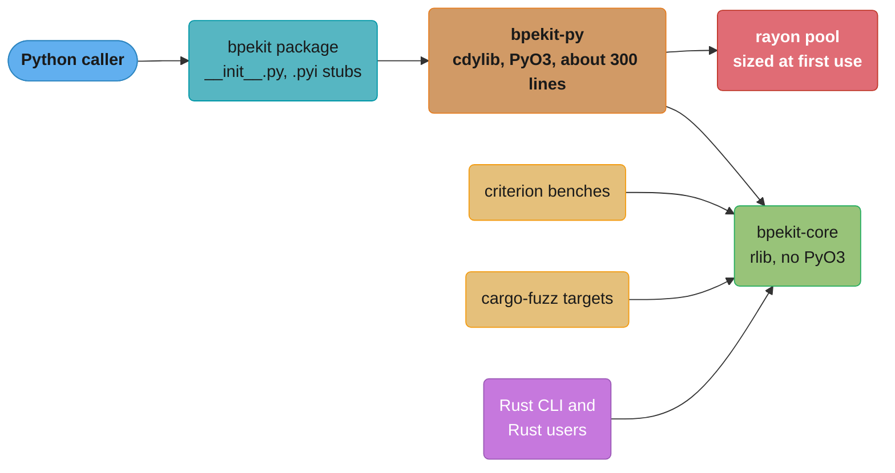

# Case Study: Design a PyO3 Python Extension for 10M Monthly Installs

> Versions on 2026-11-06: Rust 1.99.1 on edition 2024, PyO3 0.30.1 (2026-10-14, MSRV 1.85),
> maturin 1.16.0 (2026-10-29), rayon 1.12.0, criterion 0.8.2. CPython 3.15.0 shipped
> 2026-10-09 and CPython 3.10 reached end of life on 2026-10-01. In §6, wheel sets are each
> project's newest release (PyPI JSON API) and downloads are pypistats "last month", read 2026-11-06.

## Intuition

> **Design intuition**: The Python side of a PyO3 extension is a solved problem in this repo.
> [C Extensions and Native Interop §6.1](../../python/c_extensions_and_native_interop/c_extensions_and_native_interop.md)
> builds one end to end, with `py.detach`, free threading, abi3 and `abi3t`, and §14 of the same page
> shows that the algorithm often delivers more of the speedup than the language. This study starts where that page
> stops. At 10 million installs a month, two Rust problems decide whether the extension works: the
> crate under the binding, and the release matrix that turns one crate into 24 separate binaries.

The thesis has two halves. First, every type you expose is shared across threads you do not
control, so PyO3 requires every `#[pyclass]` to be `Send + Sync`, and on a free-threaded
interpreter that bound is no longer theoretical. An immutable core passes it for free. A `RefCell`
cache fails to compile, and the shortcut around that error becomes a production crash (§4.2, §9).
Second, every wheel is a separate compiled program. A release is 8 platforms times 3 ABIs, and a
missing cell in that grid reaches the user as a Rust compiler error from an sdist build. The ABI
plan, the cross-compilation toolchain and the release gates are Rust engineering.

The specific question: **what does a Rust BPE tokenizer published to PyPI have to look like to
serve 10 million installs a month on 8 platforms, on GIL and free-threaded CPython 3.11 to 3.16,
with no sdist fallback for any supported user and no crash a Python `except` cannot see?**

Sibling studies this one must not repeat:
[Design a Validation Library](../../python/case_studies/design_a_validation_library.md) teaches the
"compile the schema once, run it fast" shape in pure Python and treats pydantic-core as the Rust
version of the same idea.
[pydantic-core and Performance](../../fastapi/pydantic_v2_deep_dive/pydantic_core_and_performance.md)
covers pydantic-core itself, and [FFI and Language Interop](../ffi_and_language_interop/ffi_and_language_interop.md)
owns the Rust side of PyO3 in general. This study applies those rules to one package at one scale.

---

## 1. Requirements Clarification

### Functional Requirements

- A package `bpekit` with one class, `Encoder(merges)`, and methods `encode`, `decode` and
  `encode_batch`. Input is `bytes` or `str`. Output is a `u32` buffer that NumPy and
  `memoryview.cast("I")` read with no copy.
- One `Encoder` is shared across all threads of a process. Construction loads a vocabulary of up to
  200,000 merges and takes under 300 ms.
- Errors arrive as Python exceptions in a published hierarchy (`BpeError`, a subclass of
  `ValueError`). A Rust panic never kills the interpreter. Type stubs ship in every wheel.

### Non-Functional Requirements

- **10 million installs a month**, mostly CI jobs and container builds with a cold cache and no
  Rust toolchain, so an sdist fallback is a failed install.
- **Interpreters**: CPython 3.11 to 3.15 on the GIL build, 3.14t and 3.15t on the free-threaded
  build, and 3.16 and 3.16t on release day with no new upload. 3.10 is out because it reached end of
  life on 2026-10-01.
- **Platforms**: manylinux x86_64 and aarch64, musllinux x86_64 and aarch64 (Alpine images),
  macOS arm64 and x86_64, Windows x86_64 and arm64. Eight targets.
- **Throughput**: 50 MB/s per core for the encoder on English text, `encode_batch` within 85% of
  linear scaling to 8 threads on 3.14t, and under 1 µs of boundary cost per call.
- **Wheel size** under 5 MB each. **Releases** monthly, and a security fix within 24 hours.

### Out of Scope (and where it lives instead)

- How the GIL, `py.detach`, `Py_mod_gil`, the Limited API and the buffer protocol work:
  [C Extensions and Native Interop](../../python/c_extensions_and_native_interop/c_extensions_and_native_interop.md).
- Whether to go native at all, and the algorithm-versus-language split of a speedup: §9 and §14 of
  the same page. This study assumes the profile already justified the extension.
- Trusted publishing, attestations and PyPI supply-chain controls:
  [Packaging and Project Tooling](../../python/packaging_and_project_tooling/packaging_and_project_tooling.md)
  and [Supply Chain and Publishing](../../python/packaging_and_project_tooling/supply_chain_and_publishing.md).
- PyPy and GraalPy wheels, which need their own per-version wheels, and BPE vocabulary training.

---

## 2. Scale Estimation

### Install rate and what one missing wheel costs

```
10,000,000 installs / month
  = ~333,000 / day
  = ~3.9 / second, averaged

Install mix assumed for this design, by platform:
  manylinux x86_64       70%   7,000,000 / month
  manylinux aarch64      12%   1,200,000
  macOS arm64             6%     600,000
  Windows x86_64          5%     500,000
  musllinux x86_64        3%     300,000
  musllinux aarch64       2%     200,000
  macOS x86_64            1%     100,000
  Windows arm64          <1%      30,000
```

The smallest cell still holds 30,000 installs a month. A release without the musllinux aarch64
wheel sends 200,000 installs a month to the sdist, where each one fails ("can't find Rust
compiler") or compiles for minutes inside someone's CI job.

### Wheel count by ABI strategy

```
Per-version wheels:
  GIL builds      3.11, 3.12, 3.13, 3.14, 3.15         5 ABIs
  Free-threaded   3.14t, 3.15t                          2 ABIs
  7 ABIs x 8 platforms                                = 56 wheels per release
  Each new CPython minor: +16 wheels (GIL + t), and a release on its first day

Stable-ABI plan (§4.5):
  cp311-abi3           3.11 to 3.14 GIL                 1 ABI
  cp314-cp314t         3.14t only                       1 ABI
  cp315-abi3.abi3t     3.15+ GIL and 3.15t+             1 ABI
  3 ABIs x 8 platforms                                = 24 wheels per release
  Each new CPython minor: +0 wheels. After cp314t leaves the window: 16 wheels
```

### Storage against the PyPI project limit

```
Wheel size, budgeted at 4 MB (Rust extensions of this shape publish 3-5 MB wheels, §6)

Per-version plan:  56 x 4 MB + 1 MB sdist = 225 MB per release
Stable-ABI plan:   24 x 4 MB + 1 MB sdist =  97 MB per release

PyPI default project limit: 10 GB (docs.pypi.org, storage limits)
  Per-version plan:  10,000 / 225 = 44 releases  -> 3.7 years at 12 releases/year
  Stable-ABI plan:   10,000 /  97 = 103 releases -> 8.6 years
```

A wheel that grows from 4 MB to 13 MB because the release profile kept debug info cuts the
stable-ABI runway from 103 releases to 31. §9 has that incident.

At 10 million installs, every 1 MB of wheel is 10 TB a month from PyPI's CDN. PyPI pays for the
bytes and users pay for them as CI time, so wheel size is a performance property of the package.

### Call shapes and the boundary budget

```
Service caller: 2,000 requests/s x 4 KB of text = 8 MB/s
  At 50 MB/s per core: 0.16 core. Boundary cost: 2,000 x 1 us = 2 ms/s. Irrelevant.

Short-string caller: 64-byte inputs, one call each
  Encode at 50 MB/s:   64 B / 50 MB/s = 1.28 us
  Boundary at 1 us:    1.00 us
  Boundary share:      1.00 / 2.28 = 44% of every call

Pipeline caller: 1 TB/day corpus = 11.6 MB/s sustained
  One thread:  11.6 / 50 = 0.23 core
  Backfill of 30 days in 24 hours = 348 MB/s -> 7 cores -> encode_batch on 8 threads
```

The short-string case is why `encode_batch` exists. The pipeline case is why it must release the
interpreter and scale across cores. Neither case needs a faster per-byte kernel.

### Memory per process

```
Vocabulary: 200,000 merges, on 64-bit targets
  ranks: HashMap<(u32, u32), u32>   13 B per bucket x 262,144 buckets          ~ 3.4 MB
  pieces: Vec<Vec<u8>>              24 B header + ~6 B bytes + ~16 B allocator ~ 9.2 MB
  One Encoder                                                               ~ 13 MB

gunicorn with 32 prefork workers, Encoder built per worker:   32 x 13 MB = 416 MB
Encoder built once before fork, pages shared copy-on-write:          ~ 13 MB
```

Python objects lose copy-on-write sharing because refcount writes dirty their pages. Rust memory
behind one Python object is never touched by refcounting, so it stays shared after fork, but any
thread pool started before the fork is gone in the child (§4.3, §9). The budget method is in
[Memory Budgets Without a GC](cross_cutting/memory_budgets_without_a_gc.md).

---

## 3. High-Level Architecture



*The core crate holds every algorithm and has no Python dependency, so benches, fuzzers and Rust
users link it directly and `cargo test` runs with no interpreter. The binding crate is the only
place that knows about Python, and it is small enough to review in one sitting.*

The installer picks one wheel per interpreter from the stable-ABI plan. The grid below is the
contract the tag census checks.

```
                     cp311-abi3     cp314-cp314t    cp315-abi3.abi3t     installer picks
CPython 3.11-3.14      loads            -                 -              cp311-abi3
CPython 3.14t            x            loads               -              cp314-cp314t
CPython 3.15           loads            -               loads            cp315-abi3.abi3t
CPython 3.15t            x              -               loads            cp315-abi3.abi3t
CPython 3.16           loads            -               loads            cp315-abi3.abi3t
CPython 3.16t            x              -               loads            cp315-abi3.abi3t

x = a free-threaded build cannot load an abi3 wheel (PyO3 building-and-distribution guide)
```

*Three binaries cover every interpreter in the support window, including two that do not exist
on release day. On 3.15 and later the installer ranks `cp315-abi3` above `cp311-abi3`, so GIL
users of 3.15 run the `abi3t` binary. Benchmark that combination too (§4.8).*

---

## 4. Component Deep Dives

### 4.1 Workspace layout: a core crate and a binding crate

The workspace has two members. The core crate owns every algorithm and every invariant. The
binding crate converts Python values into core types and core errors into Python exceptions, and
nothing else.

```toml
# Cargo.toml (workspace root)
[workspace]
members = ["bpekit-core", "bpekit-py"]
resolver = "3"

[workspace.package]
edition = "2024"
rust-version = "1.85"

[profile.release]
lto = "fat"
codegen-units = 1
strip = "debuginfo"
panic = "unwind"

# bpekit-py/Cargo.toml: [lib] name = "_bpekit", crate-type = ["cdylib"]
# [dependencies]
# bpekit-core = { path = "../bpekit-core" }
# pyo3 = { version = "0.30.1", features = ["abi3-py311", "abi3t"] }
# rayon = "1.12"
```

`pyproject.toml` names maturin 1.16 as the build backend, sets `requires-python = ">=3.11"`, and
under `[tool.maturin]` sets `manifest-path`, `module-name = "bpekit._bpekit"`,
`compatibility = "pypi"` and `strip = true`.

Four choices in these files carry weight.

- **No `extension-module` feature on PyO3.** It stopped linking `libpython` (manylinux requires
  that) for every target, so it broke `cargo test` and benches. PyO3 0.30 deprecates it in favor
  of the `PYO3_BUILD_EXTENSION_MODULE` variable, which maturin 1.9.4+ sets only for its builds.
- **`rust-version = "1.85"`** matches PyO3 0.30's MSRV and binds only sdist users. Policy:
  [Editions, Toolchains and MSRV](../modules_crates_and_cargo/editions_toolchains_and_msrv.md).
- **`panic = "unwind"`** is deliberate (§4.4).
- **`compatibility = "pypi"`** makes maturin refuse a platform tag PyPI would reject, before upload.

The core crate's public API is the contract the binding crate wraps. It is plain Rust: borrowed
input, an output buffer the caller can reuse, a typed error, and a type that is immutable after
construction.

```rust
use std::collections::HashMap;
use std::fmt;

pub const MAX_INPUT_BYTES: usize = 64 << 20;

#[derive(Debug, Clone, PartialEq, Eq)]
#[non_exhaustive]
pub enum EncodeError {
    InputTooLarge { len: usize, max: usize },
    UnknownToken(u32),
    VocabTooLarge,
}

impl fmt::Display for EncodeError {
    fn fmt(&self, f: &mut fmt::Formatter<'_>) -> fmt::Result {
        match self {
            Self::InputTooLarge { len, max } => write!(f, "input is {len} bytes, limit is {max}"),
            Self::UnknownToken(id) => write!(f, "token id {id} is not in the vocabulary"),
            Self::VocabTooLarge => write!(f, "vocabulary does not fit in u32 ids"),
        }
    }
}

impl std::error::Error for EncodeError {}

/// Immutable after `new`, so one `Encoder` serves every thread.
pub struct Encoder {
    ranks: HashMap<(u32, u32), u32>,
    pieces: Vec<Vec<u8>>,
}

impl Encoder {
    pub fn new(merges: &[(u32, u32)]) -> Result<Self, EncodeError> {
        let mut pieces: Vec<Vec<u8>> = (0..=255u8).map(|b| vec![b]).collect();
        let mut ranks = HashMap::with_capacity(merges.len());
        for &(a, b) in merges {
            let left = pieces.get(a as usize).ok_or(EncodeError::UnknownToken(a))?;
            let right = pieces.get(b as usize).ok_or(EncodeError::UnknownToken(b))?;
            let piece = [left.as_slice(), right.as_slice()].concat();
            let id = u32::try_from(pieces.len()).map_err(|_| EncodeError::VocabTooLarge)?;
            ranks.insert((a, b), id);
            pieces.push(piece);
        }
        Ok(Self { ranks, pieces })
    }

    pub fn encode_into(&self, input: &[u8], out: &mut Vec<u32>) -> Result<(), EncodeError> {
        if input.len() > MAX_INPUT_BYTES {
            return Err(EncodeError::InputTooLarge { len: input.len(), max: MAX_INPUT_BYTES });
        }
        out.clear();
        out.extend(input.iter().map(|&b| u32::from(b)));
        // O(n^2) merge loop. Production encoders keep a heap of pair ranks.
        while let Some((id, at)) = self.best_merge(out) {
            out[at] = id;
            out.remove(at + 1);
        }
        Ok(())
    }

    pub fn encode(&self, input: &[u8]) -> Result<Vec<u32>, EncodeError> {
        let mut out = Vec::with_capacity(input.len());
        self.encode_into(input, &mut out)?;
        Ok(out)
    }

    pub fn decode(&self, ids: &[u32]) -> Result<Vec<u8>, EncodeError> {
        let mut out = Vec::with_capacity(ids.len() * 4);
        for &id in ids {
            let piece = self.pieces.get(id as usize).ok_or(EncodeError::UnknownToken(id))?;
            out.extend_from_slice(piece);
        }
        Ok(out)
    }

    fn best_merge(&self, tokens: &[u32]) -> Option<(u32, usize)> {
        tokens
            .windows(2)
            .enumerate()
            .filter_map(|(i, w)| self.ranks.get(&(w[0], w[1])).map(|&id| (id, i)))
            .min()
    }
}

// The same bound #[pyclass] puts on the type that wraps this one.
const _: () = {
    const fn assert_shareable<T: Send + Sync>() {}
    assert_shareable::<Encoder>();
};

fn main() -> Result<(), EncodeError> {
    // Merge "a"+"b" into 256, then 256+"c" into 257.
    let enc = Encoder::new(&[(97, 98), (256, 99)])?;
    let ids = enc.encode(b"abcab")?;
    assert_eq!(ids, vec![257, 256]);
    assert_eq!(enc.decode(&ids)?, b"abcab");

    let lens = std::thread::scope(|s| {
        let a = s.spawn(|| enc.encode(b"cab").map(|v| v.len()));
        let b = s.spawn(|| enc.encode(b"ababab").map(|v| v.len()));
        (a.join().ok(), b.join().ok())
    });
    assert_eq!(lens, (Some(Ok(2)), Some(Ok(3))));
    Ok(())
}
```

The `const` block is the cheapest test in the workspace. It fails the core crate's own build the
day someone adds a `Cell`, an `Rc` or a raw pointer field, long before the binding crate turns
that into a confusing error inside a macro expansion. The scoped threads in `main` are the same
sharing pattern a free-threaded interpreter applies, with no Python involved.

`#[non_exhaustive]` on the error enum is a semver decision. Adding a variant later is a minor
release, and the binding crate's `match` must carry a wildcard arm. See
[Library API Design and SemVer](../library_api_design_and_semver/library_api_design_and_semver.md).

### 4.2 The `Send + Sync` bound: a cache that cannot cross threads

PyO3's guide states the rule plainly: Python decides which thread drops a `#[pyclass]` object, so
`Send` is required, and several threads can read it at once, so `Sync` is required. The common way
to break it is a memo cache added for speed.

#### BROKEN: a `RefCell` cache

```rust
// BROKEN: a per-encoder word cache in a RefCell, exposed through #[pyclass]
// error[E0277]: `RefCell<HashMap<Vec<u8>, Vec<u32>>>` cannot be shared between threads safely
use std::cell::RefCell;
use std::collections::HashMap;

pub struct CachedEncoder {
    cache: RefCell<HashMap<Vec<u8>, Vec<u32>>>,
}

impl CachedEncoder {
    pub fn encode(&self, word: &[u8]) -> Vec<u32> {
        if let Some(hit) = self.cache.borrow().get(word) {
            return hit.clone();
        }
        let ids: Vec<u32> = word.iter().map(|&b| u32::from(b)).collect();
        self.cache.borrow_mut().insert(word.to_vec(), ids.clone());
        ids
    }
}

// The bound #[pyclass] places on every exposed type.
fn assert_pyclass<T: Send + Sync>() {}

pub fn check() {
    assert_pyclass::<CachedEncoder>();
}
```

The compiler is right. On 3.14t, or on any build once `py.detach` releases the lock, two threads
run `encode` at once and two overlapping `borrow_mut` calls panic. The tempting escape is
`#[pyclass(unsendable)]`, and PyO3's docs say what it does: an `unsendable` class
panics when another thread accesses it. The compile error becomes a `PanicException` in every
multithreaded user's process (§9).

#### FIX: sharded locks with a size cap, or no cache

```rust
use std::collections::HashMap;
use std::hash::{BuildHasher, RandomState};
use std::sync::Mutex;

const SHARDS: usize = 16;
const MAX_ENTRIES_PER_SHARD: usize = 4096;

pub struct CachedEncoder {
    hasher: RandomState,
    shards: [Mutex<HashMap<Vec<u8>, Vec<u32>>>; SHARDS],
}

impl CachedEncoder {
    pub fn new() -> Self {
        Self {
            hasher: RandomState::new(),
            shards: std::array::from_fn(|_| Mutex::new(HashMap::new())),
        }
    }

    pub fn encode(&self, word: &[u8]) -> Vec<u32> {
        let shard = &self.shards[(self.hasher.hash_one(word) as usize) % SHARDS];
        // A poisoned cache is still a valid cache: recover the map instead of panicking.
        if let Some(hit) = shard.lock().unwrap_or_else(|p| p.into_inner()).get(word) {
            return hit.clone();
        }
        let ids: Vec<u32> = word.iter().map(|&b| u32::from(b)).collect();
        let mut map = shard.lock().unwrap_or_else(|p| p.into_inner());
        if map.len() < MAX_ENTRIES_PER_SHARD {
            map.insert(word.to_vec(), ids.clone());
        }
        ids
    }
}

fn assert_pyclass<T: Send + Sync>() {}

pub fn check() {
    assert_pyclass::<CachedEncoder>();
}
```

Sixteen shards keep 8 threads from queueing on one lock. The cap turns an unbounded memory leak
into a fixed 64k-entry budget, which matters because Rust allocations behind a Python object are
invisible to `tracemalloc`. The poison recovery is a choice for this cache only: a half-written
cache entry cannot exist here, because `insert` either completes or the panic happens before it.

The better fix is often no cache: one that saves 20% of encode time and adds a lock per word can
lose under 8 threads. The lock-versus-atomic-versus-immutable decision is in
[Channels, Atomics and Shared State](../channels_atomics_and_shared_state/channels_atomics_and_shared_state.md),
and lock rules in [Threads, Send, Sync and Locks](../threads_send_sync_and_locks/threads_send_sync_and_locks.md).

### 4.3 The binding layer: input types, output buffers, and the thread pool

The binding crate is about 300 lines. Every function in it follows one shape: borrow or copy the
input, release the interpreter, call the core, convert the result.

```rust
// bpekit-py/src/lib.rs
use bpekit_core::{EncodeError, Encoder};
use pyo3::create_exception;
use pyo3::exceptions::PyValueError;
use pyo3::prelude::*;
use pyo3::types::PyBytes;

create_exception!(bpekit, BpeError, PyValueError);
create_exception!(bpekit, InputTooLargeError, BpeError);

fn to_py_err(e: EncodeError) -> PyErr {
    match e {
        EncodeError::InputTooLarge { .. } => InputTooLargeError::new_err(e.to_string()),
        _ => BpeError::new_err(e.to_string()),
    }
}

#[pyclass(frozen, name = "Encoder", module = "bpekit")]
struct PyEncoder {
    inner: Encoder,
}

#[pymethods]
impl PyEncoder {
    #[new]
    fn new(merges: Vec<(u32, u32)>) -> PyResult<Self> {
        Encoder::new(&merges).map(|inner| Self { inner }).map_err(to_py_err)
    }

    /// `bytes` arrives as a borrowed slice with no copy.
    fn encode<'py>(&self, py: Python<'py>, data: &[u8]) -> PyResult<Bound<'py, PyBytes>> {
        let ids = py.detach(|| self.inner.encode(data)).map_err(to_py_err)?;
        PyBytes::new_with(py, ids.len() * 4, |buf| {
            for (chunk, id) in buf.chunks_exact_mut(4).zip(&ids) {
                chunk.copy_from_slice(&id.to_ne_bytes());
            }
            Ok(())
        })
    }
}
```

**`#[pyclass(frozen)]`.** Without `frozen`, PyO3 guards every instance with a runtime borrow
flag, and on a free-threaded build overlapping `&self` and `&mut self` calls raise
`RuntimeError: Already borrowed`. A frozen class has no `&mut self` methods, so there is no flag
to contend on. The core's immutability from §4.1 is what makes `frozen` free.

**Input types are a soundness decision.** PyO3 converts `bytes` to `&[u8]` by borrowing, and
`bytearray` only to an owned `Vec<u8>` or `Cow<[u8]>`. The difference is mutability. A `bytes`
object cannot change, so holding a borrowed slice while the interpreter is released is sound. A
`bytearray` can be resized or written by another thread while `py.detach` runs, which on a
free-threaded build is a data race on memory Rust believes is immutable. PyO3 0.30.0 deprecated
`PyBuffer::as_slice` for this reason ("this function is unsound") and points to
`as_slice_ptr`, which returns a `NonNull<[T]>` and leaves the aliasing proof to you. This package
copies mutable buffers. The rule for any future zero-copy path over a mutable buffer goes through
[the unsafe review checklist](cross_cutting/unsafe_review_and_soundness_checklist.md) before it
merges.

**The output is one buffer, not a list.** Returning `Vec<u32>` makes PyO3 build a Python `list`
of `int` objects, one allocation per token above the small-int cache. `PyBytes::new_with` writes
the ids straight into the bytes object's storage, and the caller reads them with no copy:

```python
ids = memoryview(enc.encode(data)).cast("I")   # native-endian u32, zero copy
arr = numpy.frombuffer(enc.encode(data), dtype=numpy.uint32)
```

`to_ne_bytes` matches `memoryview.cast`, which uses native byte order. All eight targets are
little-endian, so the stubs document the buffer as little-endian `uint32`.

**The batch path and the rayon pool.** `encode_batch` copies a list of inputs into owned
`Vec<u8>`s, calls `py.detach`, runs `par_iter` inside the package's own pool, and returns two
buffers: flat ids and `u64` end offsets. A batch of 10,000 strings costs two Python allocations,
not 10,000 lists.

Three rules govern the pool.

1. Call `detach` before any rayon work. PyO3's parallelism guide: a rayon worker that needs the
   interpreter blocks forever if the calling thread still holds it.
2. Use a pool the package owns, not rayon's global pool, which a process can build only once.
   Size it as rayon does: `RAYON_NUM_THREADS`, else `std::thread::available_parallelism()`, which
   reads cgroup CPU quotas on Linux.
3. Rebuild the pool after `fork`. The child keeps only the forking thread, so an inherited pool has
   no workers and `install` waits forever. Hugging Face tokenizers turns parallelism off in the
   child from a `pthread_atfork` handler. This package checks the pid and builds a new pool.

### 4.4 Errors and panics at the boundary

Error mapping in general is owned by
[FFI and Language Interop](../ffi_and_language_interop/ffi_and_language_interop.md). Two parts are
specific to this package's crate split.

#### BROKEN: implementing `From` for a type you do not own

The obvious move is `impl From<EncodeError> for PyErr` in the binding crate, which owns none of
the three, so the orphan rule rejects it. The same shape with std types:

```rust
// BROKEN: this crate owns neither the trait, the source type nor the target type
// error[E0117]: only traits defined in the current crate can be implemented for types defined outside of the crate
use std::io;
use std::num::ParseIntError;

impl From<ParseIntError> for io::Error {
    fn from(e: ParseIntError) -> Self {
        io::Error::new(io::ErrorKind::InvalidData, e)
    }
}
```

#### FIX: a mapping function at the edge

```rust
use std::io;
use std::num::ParseIntError;

fn to_io(e: ParseIntError) -> io::Error {
    io::Error::new(io::ErrorKind::InvalidData, e)
}

pub fn parse_port(s: &str) -> Result<u16, io::Error> {
    s.parse::<u16>().map_err(to_io)
}
```

`to_py_err` in §4.3 is this fix. tiktoken's layout, PyO3 as an optional dependency of the core
crate behind a `python` feature, makes a `From` impl legal and puts a PyO3 pin in the core crate.

The exception hierarchy is public API. `BpeError` subclasses `ValueError`, so older
`except ValueError` handlers keep working, and reparenting an exception is a breaking change. See
[Error Design for Libraries and Applications](../error_handling_and_panics/error_design_for_libraries_and_applications.md).

#### Panics: unwind, not abort

PyO3 catches a panic that unwinds out of a `#[pyfunction]` or method and raises
`pyo3::panic::PanicException`. The docs add the detail that matters: "Like SystemExit, this
exception is derived from BaseException", so `except Exception` does not catch it and it usually
ends the program. That is the right behavior for a bug, and it still leaves a traceback.

With `panic = "abort"` in the release profile there is nothing to catch. The process exits with
SIGABRT, no traceback, inside a web worker or a notebook kernel that did not choose Rust. orjson
builds with `panic = "abort"`, `lto = "fat"` and `codegen-units = 1`, and it pays for that with a
no-panic discipline across its whole codebase. A package that cannot audit every path to that
standard keeps `unwind`.

The core crate treats a panic as a bug, not an error path. It denies `clippy::unwrap_used`,
`clippy::expect_used` and `clippy::panic` in non-test code, and a fuzz target drives `Encoder::new`
and `encode` with arbitrary merges and bytes. The fuzz and Miri setup is in
[Testing, Fuzzing and Miri](../testing_fuzzing_and_miri/testing_fuzzing_and_miri.md).

### 4.5 The ABI plan: abi3 floor, cp314t, and abi3t

The Python page explains what abi3 and `abi3t` are. This section is the decision for one package.

**The floor is 3.11, and the buffer API sets it.** PyO3's guide lists what does not work under the
Limited API, and one row decides the floor: "The buffer API is not supported until Python 3.11 or
greater." Any zero-copy input over the buffer protocol needs `abi3-py311` at least. 3.10 left the
support window on 2026-10-01, so the floor costs nothing.

**Free-threaded builds need two more wheels.** A free-threaded interpreter cannot load an `abi3`
wheel. PyO3 recommends enabling both `abi3` and `abi3t` and building three times: an `abi3` wheel
for the minimum version, a version-specific `cp314t` wheel with a free-threaded 3.14 interpreter,
and an `abi3t` wheel with a 3.15 interpreter. With both features on, PyO3 produces `abi3` when the
target is 3.14 or older and `abi3t` for 3.15 and newer. maturin 1.14 and later can tag `abi3t`
wheels.

```
interpreter used by the build     features on        wheel produced
CPython 3.11                      abi3-py311, abi3t  bpekit-1.8.0-cp311-abi3-<plat>.whl
CPython 3.14t                     abi3-py311, abi3t  bpekit-1.8.0-cp314-cp314t-<plat>.whl
CPython 3.15                      abi3-py311, abi3t  bpekit-1.8.0-cp315-abi3.abi3t-<plat>.whl
```

**The hybrid option.** Installers rank tags in a fixed order: for CPython 3.15 the list starts
`cp315-cp315`, then `cp315-abi3`, then `cp314-abi3` down to `cp32-abi3` (read from
`packaging.tags.sys_tags()` on 3.15.2). A package can therefore ship the stable-ABI set plus
version-specific wheels for the newest version only, and 3.15 users get the version-specific
binary while everyone else falls back to abi3. That adds 8 wheels to buy PyO3's version-specific
optimizations. This package declines until §4.8 measures a boundary gain above 5% on the
short-string benchmark. For a tokenizer whose calls spend most of their time in the kernel, that
bar is rarely met.

**What abi3 cannot catch in Rust.** The Python page's warning that nothing verifies Limited API
conformance applies to C. PyO3's `abi3` feature restricts which FFI functions the crate can call,
so a PyO3 extension cannot reach a non-limited macro by accident. The remaining risk lives in a C
dependency compiled into the same cdylib, which PyO3's `cfg` gates never see. `abi3audit` still
runs on every abi3-tagged wheel, because it checks the binary rather than the source.

### 4.6 The wheel matrix: targets, toolchains, and libc floors

Every row below is a Rust target, and the target's floor becomes the wheel's platform tag.

| Wheel platform | Rust target | Rust tier | Floor that sets the tag | How it is built |
|---|---|---|---|---|
| manylinux x86_64 | `x86_64-unknown-linux-gnu` | 1 | glibc 2.17, so `manylinux2014` at minimum | manylinux2014 container, or `--zig` |
| manylinux aarch64 | `aarch64-unknown-linux-gnu` | 1 | glibc 2.17 | native arm64 runner, or `--zig` |
| musllinux x86_64 | `x86_64-unknown-linux-musl` | 2 with host tools | musl 1.2.5 bundled by Rust, so `musllinux_1_2` | musllinux container |
| musllinux aarch64 | `aarch64-unknown-linux-musl` | 2 with host tools | musl 1.2.5 | native arm64 runner |
| macOS arm64 | `aarch64-apple-darwin` | 1 | macOS 11.0 deployment target | macOS arm64 runner |
| macOS x86_64 | `x86_64-apple-darwin` | 2 with host tools since 1.90 | macOS 10.12 deployment target | cross from the arm64 runner |
| Windows x86_64 | `x86_64-pc-windows-msvc` | 1 | none beyond Windows 10 | Windows runner |
| Windows arm64 | `aarch64-pc-windows-msvc` | 1 since 1.91 | none beyond the target | Windows arm64 runner or cross |

Four facts from that table shape the CI design.

- **glibc 2.17 is Rust's floor**, so `manylinux2014` is the oldest tag a Rust wheel can claim.
  maturin runs its own auditwheel check and stamps the lowest compatible tag, so a build on a
  modern runner without a manylinux image or zig gets that runner's glibc, which older distros
  cannot install.
- **zig removes the container for glibc targets.** `maturin build --zig` links against a chosen
  glibc version from any host, defaulting to `manylinux2014`, with no QEMU emulation.
- **`x86_64-apple-darwin` is tier 2 since Rust 1.90.** Rust still builds and ships it, but the
  project no longer runs the test suite on it. This package keeps the wheel, since 100,000 installs
  a month use it, and runs its own smoke test under Rosetta on the arm64 runner.
- **Static musl changes the size budget.** Hugging Face tokenizers 0.23.3 publishes musllinux
  wheels near 10 MB next to manylinux wheels near 3.4 MB for the same code. Whatever the cause in
  that project, the lesson is to gate wheel size per platform, not per release.

`maturin generate-ci github` writes the starting workflow. This package edits it to 24 jobs: the
8 targets on `ubuntu-24.04`, `ubuntu-24.04-arm`, `macos-15`, `windows-2025` and `windows-11-arm`
runners, times the interpreters 3.11, 3.14t and 3.15, one wheel per job. At a budget of 8 runner-minutes per wheel with fat LTO and one
codegen unit, a release costs 192 runner-minutes. The per-version plan costs 448.

### 4.7 Release engineering

A release is a sequence of gates. Each one exists because skipping it ships a specific failure.

1. **Build the 24 wheels and the sdist.** The sdist carries `Cargo.lock`, so a source build
   resolves the same dependency graph CI tested.
2. **Import smoke test per wheel, on its own target.** Install the wheel into a clean venv on the
   matching runner, import it, encode one string, and on `t` interpreters assert the GIL stayed off.
   The assertion pattern is in
   [C Extensions and Native Interop, Pitfall 5](../../python/c_extensions_and_native_interop/c_extensions_and_native_interop.md).
3. **Tag census.** A script lists `dist/` and compares it to the expected set of 24 filenames. A
   missing or extra file fails the release. This is the gate the grid in §3 defines.
4. **`abi3audit --strict` and the size gate.** Every abi3-tagged wheel is audited. Every wheel
   over 5 MB fails, per platform, so one musl regression cannot hide inside an average.
5. **TestPyPI and the install canary.** Upload to TestPyPI, then run
   `pip install --only-binary :all: bpekit==1.8.0` in a fresh container per platform. The
   `--only-binary` flag turns "fell back to the sdist" into a hard failure instead of a slow success.
6. **Publish with trusted publishing.** maturin's generated workflow uses an API token by default;
   switch it to trusted publishing. The mechanism is covered in
   [Packaging and Project Tooling](../../python/packaging_and_project_tooling/packaging_and_project_tooling.md).
7. **Post-release watch.** For 48 hours, compare per-platform download counts from PyPI's public
   BigQuery dataset against the previous release. A platform whose share drops to near zero usually
   has a wheel that installs but fails at import.

A broken release is yanked, never deleted, and a fixed version ships. PyPI never lets a filename
be reused, so a fix always has a new version number.

The Rust supply chain is in
[Rust Build, Deployment and Supply Chain](../build_deployment_and_supply_chain/build_deployment_and_supply_chain.md).
For an extension, `cargo-auditable` matters most: it embeds the crate list in the `.so`, so wheel
scanners find a vulnerable crate version without the source.

### 4.8 Honest benchmarking: three numbers, reported separately

§14 of the Python page separates the algorithm's share of a speedup from the language's. A PyO3
package needs a finer split, because one end-to-end number hides three different costs.

| Layer | What it measures | Tool | Reported as |
|---|---|---|---|
| Kernel | `Encoder::encode` on a fixed corpus, in Rust | criterion or divan, release profile | ns per byte, median and p90 |
| Boundary | the same call from Python on a 1-byte input | `pyperf` against the built wheel | ns per call |
| End to end | the user's real call shape: short strings, 4 KB requests, batches | `pyperf` | calls/s and MB/s |
| Scaling | `encode_batch` on 1, 2, 4, 8 threads, 3.14t and 3.14 | `pyperf` plus `perf stat` | speedup vs 1 thread |

Optimize the kernel number, shape the API from the boundary number, and put only the end-to-end
number in a README, with every version in it.

The kernel bench reports a median and a p90 over at least 20 runs, never a single best run, and
wraps both input and result in `std::hint::black_box` so the optimizer cannot delete the work. The
statistics and the A/A noise floor are owned by
[Benchmarking Methodology](../../backend/benchmarking_methodology/benchmarking_methodology.md);
the Rust tools are in [Profiling and Benchmarking](../profiling_and_benchmarking/profiling_and_benchmarking.md).

Five rules specific to a PyO3 extension:

- **Benchmark the wheel, not `maturin develop`.** maturin's docs say `develop` builds "in debug
  mode by default", and a debug BPE loop can lose to pure Python. Install the release job's wheel.
- **Benchmark each ABI you ship.** A 3.15 GIL user runs the `abi3t` binary (§3). Measure 3.11
  abi3, 3.14t, and 3.15 abi3t separately.
- **Measure the free-threaded single-thread cost.** The free-threaded build costs roughly 1% to 8%
  single-thread depending on platform. If `encode_batch` on 3.14t at 8 threads is less than 8
  times the 3.14 single-thread number, find out whether the gap is the interpreter or the pool.
- **Pin both sides of a comparison.** tiktoken's README says it is "between 3-6x faster than a
  comparable open source tokeniser", measured against `tokenizers==0.13.2`; tokenizers is at 0.23.3
  on 2026-11-06. Naming versions keeps a claim honest, and it still decays. Rerun it each release.
- **Use instruction counts for CI regressions.** Wall-clock noise on shared runners hides a 3%
  regression. An instruction-count bench (gungraun) catches it, with the caveats in
  [Profiling and Benchmarking](../profiling_and_benchmarking/profiling_and_benchmarking.md).

---

## 5. Design Decisions & Tradeoffs

### Decision 1: a two-crate workspace, not one crate with a `python` feature

| Option | Pros | Cons |
|---|---|---|
| Core crate plus binding crate (chosen) | `cargo test`, benches and fuzzers never link Python; the binding is small and reviewable; the core can publish to crates.io | Error mapping needs a function (§4.4); two crates to version |
| One crate, PyO3 behind a `python` feature (tiktoken) | One crate; `From` impls for `PyErr` are legal | Every Rust user's lockfile carries a PyO3 version; two feature combinations to test |
| One crate, PyO3 always on | Least setup | The whole crate is a Python extension; Rust users cannot use it |

The deciding factor is who else links the core. Hugging Face tokenizers ships the core as its own
crate and the binding as `tokenizers-python`, and Rust programs use the core with no Python in the
build. A package with no Rust consumers can use the feature approach and lose little.

### Decision 2: the stable-ABI plan, not per-version wheels

24 wheels and zero work on a CPython release day, against 56 wheels and a rebuild on every
release. The cost is PyO3's version-specific optimizations, which for a kernel-heavy tokenizer is
a few percent of boundary cost on short strings. The hybrid in §4.5 is the escape hatch if the
benchmark disagrees. pydantic-core ships per-version wheels (§6); a validator called per field is
the boundary-heavy case where that matrix pays for itself.

### Decisions 3 to 6

| Decision | Chosen | Rejected because |
|---|---|---|
| Shared state | Immutable `Encoder`, `#[pyclass(frozen)]`, no cache by default | A cache must earn back a lock per call and a memory budget; immutable data is `Sync` for free and stays shared after `fork` |
| Input buffers | Borrow `bytes` and `str`; copy `bytearray`, writable `memoryview` and NumPy arrays | A borrowed mutable buffer under `detach` is a data race; a 4 KB copy is far below the encode cost |
| Panic strategy | `panic = "unwind"` plus a no-panic core | `abort` turns every missed bug into a dead interpreter with no traceback inside someone else's process |
| Fallback | No pure-Python fallback | It doubles the code that must agree byte for byte and hides a missing wheel behind a slow path |

---

## 6. Real-World Implementations

- **Hugging Face `tokenizers` 0.23.3** (2026-10-09), 167 million downloads a month. 23 wheels: 16
  `cp310-abi3` wheels for 16 platforms (including armv7l, i686, ppc64le, s390x, riscv64, win32 and
  win_arm64) and 7 `cp314-cp314t` wheels. The Python binding is a separate crate,
  `tokenizers-python`, that depends on the core `tokenizers` crate by path and uses PyO3 0.29 with
  `abi3-py310`. A `pthread_atfork` child handler turns parallelism off after a `fork` if the
  parent already used it, unless `TOKENIZERS_PARALLELISM` is set.
- **pyca `cryptography` 50.0.2**, 1.07 billion downloads a month. 58 wheels and a full stable-ABI
  plan: `abi3` at two floors (`cp39` and `cp311`), `cp314-cp314t`, and
  `cp315-abi3.abi3t`, each across three manylinux glibc levels (2_17, 2_28, 2_34) plus musllinux,
  macOS and Windows, and separate PyPy wheels. Shipping two abi3 floors uses the installer's tag
  ranking from §4.5: a 3.11 or later interpreter picks the `cp311` build, older ones get `cp39`.
- **`tiktoken` 0.14.0** (2026-08-17), 179 million downloads a month. 63 per-version wheels: 9 ABIs
  (cp39 to cp315t) times 7 platforms. One crate, `crate-type = ["cdylib", "rlib"]`, with PyO3 as an
  optional dependency behind a `python` feature. That is the single-crate option from Decision 1.
- **`pydantic-core` 2.50.4** (2026-11-05), 808 million downloads a month. 139 wheels per release:
  per-version CPython from cp310 to cp315t including both free-threaded builds, plus PyPy, GraalPy
  and an Emscripten wheel. A per-field validator is boundary-heavy, the case where
  per-version wheels pay for their matrix.
- **`orjson` 3.13.0** (2026-10-07), 179 million downloads a month. 58 per-version wheels from cp310
  to cp315 and no free-threaded wheels in that release. It uses `pyo3-ffi` only, the raw C API
  bindings without PyO3's safe layer, and its release profile sets `panic = "abort"`. It is the
  counter-example to Decision 5, backed by a codebase written so that panics do not happen.
- **`rpds-py` 2026.9.1**, 470 million downloads a month, 127 wheels including `cp314t`, `cp315t`
  and two PyPy lines. A persistent-data-structure library.

---

## 7. Technologies & Tools

| Tool | Version (2026-11-06) | Role in this design |
|---|---|---|
| **PyO3** | 0.30.1 | Binding layer: `#[pyclass(frozen)]`, `create_exception!`, `PyBytes::new_with`, `py.detach`, `abi3-py311` and `abi3t` features |
| **maturin** | 1.16.0 | Build backend; `--zig`, `--compatibility pypi`, auditwheel check, `generate-ci github`, `develop --release` |
| **PyO3/maturin-action** | v1 (v1.51.0, 2026-04-09) | GitHub Action that runs maturin inside manylinux and musllinux images |
| **zig** (via `maturin[zig]`) | - | Cross-links glibc targets at a chosen manylinux version without containers |
| **rayon** | 1.12.0 | `encode_batch` parallelism in an explicit pool sized from `available_parallelism` |
| **criterion** / **divan** | 0.8.2 / 0.1.21 | Kernel benchmarks in Rust |
| **gungraun** | 0.20.0 | Instruction-count benchmarks for noise-free CI regression checks |
| **pyperf** | - | Boundary and end-to-end benchmarks from Python |
| **cargo-fuzz** | 0.13.2 | Fuzz targets on `Encoder::new` and `encode` |
| **cargo-auditable** | 0.7.7 | Embeds the dependency list in the cdylib for wheel scanners |
| **cargo-deny** | 0.20.2 | Licenses and advisories for every crate linked into the wheel |
| **abi3audit** | 0.0.26 | Checks that abi3-tagged wheels use only stable-ABI symbols |
| **samply** | 0.13.1 | Sampling profiler that resolves Rust frames inside a Python process |

---

## 8. Operational Playbook

### The panels that matter

- Installs by platform tag per release, from PyPI's BigQuery download dataset. A drop in one cell
  after a release is a broken or missing wheel. The sdist share should stay near zero.
- Issue labels for `PanicException`, `RuntimeWarning: GIL` and "can't find Rust compiler", one per
  runbook below.
- Release runner minutes against the 192-minute budget, and wheel size per platform against 5 MB.

### Runbook: users report "can't find Rust compiler" on install

1. Ask for `pip debug --verbose`, which prints the interpreter's compatible tags.
2. Compare those tags against the release's file list. The usual causes: a missing matrix cell, a
   wheel built on a host glibc newer than the user's, or a new interpreter (for example 3.16t
   before `abi3t` existed) with no wheel.
3. If a cell is missing, rebuild and upload only that wheel under the same version. PyPI allows
   adding files to an existing release.
4. Add the missing filename to the tag census expectation.

### Runbook: `PanicException` in a user's traceback

1. The traceback names the Rust panic message. Reproduce with the user's input against the core
   crate in a Rust test, then add it to the fuzz corpus.
2. If the panic came from a `RefCell` borrow or an `unsendable` class, the bug is a `Sync`
   violation, not bad input. Fix it in the type, per §4.2.

### Runbook: `encode_batch` hangs in a gunicorn or multiprocessing worker

1. Check whether the parent process used `encode_batch` before forking (`--preload` in gunicorn).
2. Dump threads with `py-spy dump --native`. A hang inside rayon's `install` with no worker
   threads in the child confirms a pool inherited across `fork`.
3. The fix is the pid check from §4.3. The workaround for users is to build the `Encoder` before
   fork and call `encode_batch` only after.

### Runbook: worker RSS grows with no growth in Python objects

1. `tracemalloc` shows nothing, because Rust allocations bypass pymalloc. Compare RSS against the
   §2 budget: 13 MB per `Encoder`, plus the capped cache.
2. Count `Encoder` instances. One per request instead of one per process is the usual cause. The method for RSS versus live allocations is in
   [Memory Budgets Without a GC](cross_cutting/memory_budgets_without_a_gc.md).

---

## 9. Common Pitfalls & War Stories

These incidents are illustrative. They happen to `bpekit`, and their figures come from the §2
install model, not from tokenizers, orjson or any other real project.

**`unsendable` to silence E0277.** An engineer added a `RefCell` word cache, hit the `Sync` error,
and added `#[pyclass(unsendable)]` to ship the 18% speedup on a deadline. On GIL builds with one
thread nothing changed. Every user with a thread pool started getting `PanicException` the first
time a second thread touched a shared `Encoder`, and because it derives from `BaseException`,
their `except Exception` handlers did not catch it. **Cost: 1.8.1 was yanked 31 hours after
release, after 430,000 installs; three downstream projects pinned `<1.8.1` and two of them did
not unpin for four months.** The fix was the sharded cache from §4.2. The review rule since then:
`unsendable` in the binding crate needs the same sign-off as an `unsafe` block, per
[the unsafe review checklist](cross_cutting/unsafe_review_and_soundness_checklist.md).

**The missing musllinux aarch64 wheel.** A CI refactor merged two Linux jobs and dropped the
musllinux aarch64 cell. Nothing failed: 23 wheels uploaded, every test green. Alpine arm64 images
fell back to the sdist. **Cost: about 60,000 installs over 9 days failed or compiled from source,
and one user's Graviton image builds went from 40 seconds to 6 minutes before anyone filed an
issue.** The tag census gate exists because of this release.

**Debug info in the release profile.** Someone set `debug = true` in `[profile.release]` to get
symbolized profiles and forgot it. Wheels grew from 4 MB to 13 MB. **Cost: 90 TB a month of extra
transfer from PyPI, roughly 4 extra seconds per install on slow CI networks, and the stable-ABI
storage runway in §2 fell from 103 releases to 31.** The per-platform size gate now fails any
wheel over 5 MB. Keep debug info out of the wheel and publish it as a separate artifact.

**`panic = "abort"` copied from orjson.** A contributor copied orjson's release profile for
smaller binaries. Three weeks later a malformed vocabulary file reached `Encoder::new`, hit an
`expect`, and aborted a Jupyter kernel with no traceback. **Cost: two days of "the kernel dies on
import" reports with nothing to debug, because SIGABRT left no Python frame.** orjson can afford
`abort` because of how it is written. This crate could not, and it went back to `unwind`.

**A benchmark of a debug build.** The prototype was benchmarked after a plain `maturin develop`
and came out 2.6x slower than the pure-Python reference. **Cost: three weeks of a stalled proposal
before someone rebuilt with `--release` and measured 31x.** Benchmark the artifact you ship.

**rayon after gunicorn `--preload`.** A warm-up `encode_batch` call ran before the fork into 16
workers, and every worker's first batch call hung in rayon's `install`. **Cost: a 40-minute outage
while health checks restarted workers into the same hang.** The pid check from §4.3 fixed it.

---

## 10. Capacity Planning

### Release budget per version

```
Wheels:          24 (3 ABIs x 8 platforms)          -> 16 when cp314t leaves the window
CI time:         24 x 8 runner-min = 192 runner-min  (per-version plan: 448)
Upload size:     24 x 4 MB + 1 MB = 97 MB
PyPI runway:     10 GB / 97 MB = 103 releases       (organization projects: 20 GB, 206 releases)
Gates:           smoke 24, census 1, abi3audit on abi3-tagged wheels, size 24, canary 8
Wall clock:      ~25 min to publish with 24 parallel jobs and gates
```

### Memory per process

```
Encoder (200,000 merges)                      ~13 MB
Word cache, 16 shards x 4,096 entries        ~ 6 MB at ~90 B per entry
rayon pool, 8 threads x 2 MiB stack reserve   16 MiB virtual, mostly not resident
Per-call buffers, encode_batch of 10,000 x 4 KB:
  input copies 40 MB + ids ~40 MB + offsets 80 KB  ~ 80 MB transient
```

The transient batch buffer dominates: 1 GB in one call needs about 2 GB of headroom, so the
binding rejects batches over a documented cap with `InputTooLargeError` before copying anything.

---

## 11. Interview Discussion Points

**Q: Why must every `#[pyclass]` type be `Send + Sync`, and what goes wrong if you use `unsendable` to get past the compile error?**
**Short:** Python can drop or share any object on any thread, so PyO3 requires both bounds. The unsendable escape turns the compile error into a panic on cross-thread use.

PyO3's guide gives the two reasons: Python decides which thread drops an object, which requires
`Send`, and several threads may read it at once, which requires `Sync`. A `RefCell` or `Rc` field
fails the bound with E0277. `#[pyclass(unsendable)]` removes the bound and replaces it with a
runtime check that panics when another thread accesses the object. The panic arrives as
`PanicException`, which slips past `except Exception`. Fix the type instead: make it immutable, or
move mutable state behind sharded locks or atomics, and mark the class `frozen`.

**Q: How do you choose between per-version wheels, abi3, and abi3t for a package with 10 million monthly installs?**
**Short:** Ship abi3 at the lowest floor your API allows, cp314t for 3.14 free-threaded, and abi3t from 3.15; add per-version wheels only if a benchmark proves the gain.

Per-version wheels give PyO3 its version-specific optimizations and cost a rebuild every CPython
release: 7 ABIs times 8 platforms is 56 wheels. The stable-ABI plan is 3 ABIs and 24 wheels, and a
new CPython needs zero uploads. Free-threaded builds cannot load abi3 wheels, so 3.14t needs its
own `cp314t` wheel, and from 3.15 an `abi3t` wheel serves both GIL and free-threaded builds. The
floor comes from the API you use: PyO3's buffer API needs abi3 3.11 or later. If short-call
boundary cost matters, the installer ranks `cp315-cp315` above `cp315-abi3`, so you can add
version-specific wheels for the newest version only.

**Q: Why does a missing wheel for one platform look like a Rust compiler error on the user's machine, and how do you stop it before release?**
**Short:** With no matching wheel, pip falls back to the sdist and tries to compile; a tag census and an only-binary install canary catch the gap before upload.

The installer walks the interpreter's compatible tags and takes the first wheel that matches. If
none matches, it downloads the sdist and runs the build backend, which needs a Rust toolchain. A
container without one reports "can't find Rust compiler". The bug report says the package is
broken, but the cause is a missing file. Two gates catch it: a census script that compares `dist/`
with the expected filenames, and a canary that runs `pip install --only-binary :all:` per platform
in a fresh container, which fails instead of falling back.

**Q: Why can the binding crate not write `impl From<EncodeError> for PyErr`, and what do you do instead?**
**Short:** The orphan rule forbids it, because the binding crate owns neither the trait nor either type. Use a mapping function at each call site instead.

Rust allows a trait impl only when the crate owns the trait or at least one of the types involved,
so foreign trait plus two foreign types is error E0117. In a two-crate design, `EncodeError` lives
in the core crate and `PyErr` in PyO3, so the binding crate cannot connect them with `From`. A
`fn to_py_err(e: EncodeError) -> PyErr` plus `.map_err(to_py_err)` costs one line per call site and
lets the binding choose an exception class per variant. A `From` impl in the core crate behind a
`python` feature also works, at the cost of a PyO3 version in the core's dependency graph.

**Q: What happens when Rust code in a PyO3 extension panics, and should the release profile use `panic = "abort"`?**
**Short:** With unwinding, PyO3 raises PanicException, a BaseException subclass with a traceback; with abort, the whole interpreter dies with no traceback.

PyO3 catches an unwinding panic at the function boundary and raises `PanicException`. Because it
derives from `BaseException`, normal `except Exception` handlers do not catch it, and it usually
ends the program, but the user gets a traceback and the panic message. With `panic = "abort"`
there is no unwinding to catch: the process gets SIGABRT inside a web worker or notebook kernel
that did not choose Rust. Keep `unwind`, deny `unwrap`, `expect` and `panic` in the core's
non-test code, and fuzz every public entry point.

**Q: Why accept `bytes` with no copy but copy a `bytearray` before releasing the interpreter?**
**Short:** bytes is immutable, so a borrowed slice stays valid; a bytearray can change while the interpreter is released, which is a data race.

PyO3 converts `bytes` to `&[u8]` by borrowing, and `bytearray` only to an owned `Vec<u8>` or
`Cow<[u8]>`. Once `py.detach` runs, other Python threads run too, and on a free-threaded build
they run truly in parallel. A borrowed slice over a `bytearray` would let another thread resize or
write it while Rust treats the memory as immutable, which is undefined behavior. PyO3 0.30.0
deprecated `PyBuffer::as_slice` as unsound for this reason and offers `as_slice_ptr`, which hands
the aliasing proof to you. A 4 KB copy costs far less than the encode it precedes.

**Q: What breaks when a process forks after the extension has started a rayon pool, and how do you handle it?**
**Short:** A forked child has only the forking thread, so the inherited pool has no workers and the next parallel call hangs; rebuild the pool when the pid changes.

`fork` copies memory but only the calling thread. A rayon pool created in the parent still looks
valid in the child, but its worker threads do not exist there, so `install` queues work that
nobody runs. gunicorn `--preload` and `multiprocessing` with `fork` both trigger it if the parent
used the pool. Hugging Face tokenizers registers a `pthread_atfork` child handler that turns
parallelism off in the child. A pid check at the pool accessor that builds a new pool keeps the
child parallel, and needs a pool the package owns: rayon's global pool cannot be replaced.

**Q: How do you benchmark a PyO3 extension honestly?**
**Short:** Report the Rust kernel, the per-call boundary cost and the end-to-end call shape separately, on the shipped release wheels, with every compared version named.

One end-to-end number hides three costs. Measure the kernel in Rust with criterion or divan in
ns per byte, the boundary from Python with pyperf on a near-empty input, and the user's real call
shape end to end. Benchmark the wheel the release job built, since `maturin develop` builds in
debug mode by default. Benchmark each shipped ABI, because a 3.15 GIL user runs the `abi3t`
binary. Name every version on both sides of a comparison: tiktoken's README claim names
`tokenizers==0.13.2`, which keeps it honest and also shows how fast such a claim goes stale.

**Q: Why does `tracemalloc` not see the encoder's memory, and how do you budget it?**
**Short:** Rust allocates through its own allocator, not pymalloc, so Python's tools miss it; budget it in RSS terms and cap every cache and batch.

`tracemalloc` hooks Python's allocator domains. A Rust `HashMap` inside a `#[pyclass]` allocates
through the Rust global allocator (the system malloc by default in a cdylib), so a 13 MB
vocabulary appears only in RSS. Budget per process: the `Encoder` itself, any cache with a fixed
entry cap, and transient batch buffers with a per-call input cap. Rust memory behind one Python
object stays shared after `fork`, because refcount writes never touch it: building the `Encoder`
before fork cuts 32 workers from 416 MB to about 13 MB.

**Q: Who does a PyO3 extension's MSRV affect, and how do you set it?**
**Short:** It affects only users who build from the sdist. Set rust-version to the highest MSRV among your dependencies, which for PyO3 0.30 is Rust 1.85.

Wheel users never run rustc, so for them MSRV does not exist. sdist users, such as distro
packagers and users on platforms you do not ship, compile with whatever Rust they have.
`rust-version` in `Cargo.toml` makes the failure an explicit "requires rustc 1.85" message instead
of a cryptic syntax error. PyO3 0.30 needs 1.85, which is also the first release with edition 2024,
so the floor is set by your dependencies. Raise it in a minor release, and run one CI job on
exactly that toolchain so the claim stays true.

**Q: Why ship a `cp314t` wheel when the `abi3t` wheel already covers free-threaded builds?**
**Short:** abi3t starts at CPython 3.15, so free-threaded 3.14 users can load only a version-specific cp314t wheel.

PEP 803's `abi3t` shipped with Python 3.15, and PyO3's lowest `abi3t` floor is `abi3t-py315`. A
3.14t interpreter cannot load an abi3 wheel and has no `abi3t` it can use, so without a
`cp314-cp314t` wheel those users fall to the sdist. The wheel is a temporary cell: when 3.14 leaves
the support window, the matrix drops from 24 wheels to 16 and every free-threaded user is on
`abi3t`. Until then it is the cell a CI refactor is most likely to drop.
