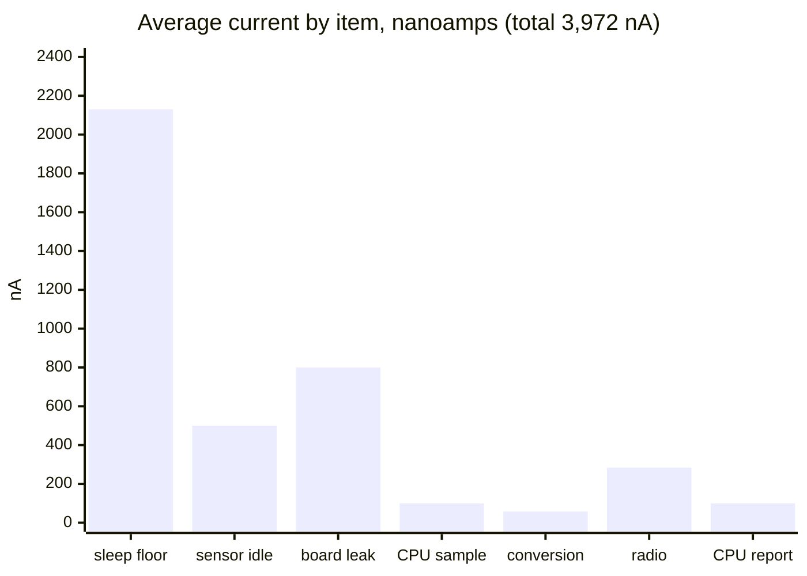
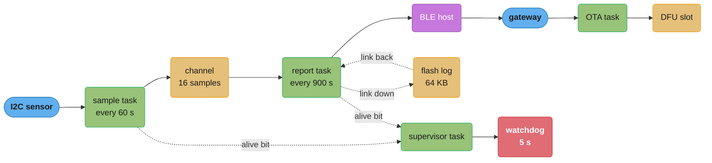
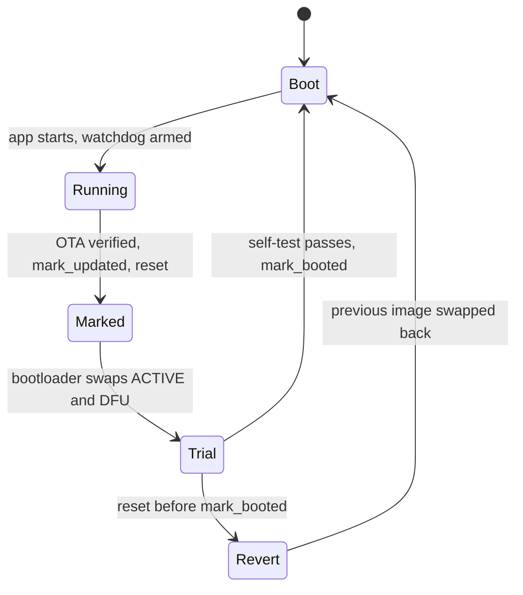

# Case Study: Design a Sensor Node Firmware in Rust (no_std and Embassy)

> **Version anchor (2026-11-06).** Rust **1.99.1** (2026-10-15) on **edition 2024**. Crates from
> the section pin table: **embassy-executor 0.10.0**, **embassy-boot 0.7.0**, **embedded-hal 1.0.0**,
> **heapless 0.9.3**, **critical-section 1.2.0** (1.3.0 is yanked), **defmt 1.2.0**, **defmt-rtt 1.3.1**,
> **probe-rs-tools 0.32.0**, **flip-link 0.1.12**. Read from the crates.io API on 2026-11-06:
> embassy-nrf 0.11.0, embassy-boot-nrf 0.12.0, embassy-time 0.5.1, embassy-sync 0.8.0,
> embedded-hal-async 1.0.0, embedded-hal-mock 0.11.1, static_cell 2.1.1, cortex-m-rt 0.7.7,
> panic-probe 1.0.0, defmt-test 0.5.1, sequential-storage 8.0.2, trouble-host 0.8.0. Part
> figures come from the Nordic nRF52840 product brief v2.3.

## Intuition

> **Design intuition**: A battery sensor node has three budgets that C firmware enforces by habit and finds on the bench: RAM, microamps, and the right to replace its own code in the field. Rust with `no_std` and Embassy moves two of them into the compiler and the linker. Every task is a `static` whose size the compiler computes, so a RAM overrun is a link error, not a field crash. Every peripheral is a value that one owner holds, so a UART cannot stay on after its driver drops. The executor puts the core to sleep whenever no future is ready, so idle is the default state instead of a loop you write. The third budget, the field update, still needs a design: embassy-boot's A/B swap, a watchdog, and a self-test that decides when the new image is good.

This is a **Rust runtime** case study about a `no_std` binary on a microcontroller. No Go or Python study covers this ground, because neither language runs on a 256 KB part without a runtime under it, so this study has no sibling to avoid. The word "edge" means something else in [MLOps: Edge and On-Device Deployment](../../mlops/edge_and_on_device_deployment/edge_and_on_device_deployment.md), which is about models on phones and gateways. Here the edge is a coin cell and a radio.

The specific question: **what does the firmware of a coin-cell temperature and humidity node look like in Rust, if it must run 3 years on one CR2032-class cell, report every 15 minutes over Bluetooth Low Energy, accept signed firmware updates without a truck roll, and never brick a node when an update is bad?**

**Key insight for this design**: the battery budget is spent almost entirely while the chip does nothing. The sleep floor is about 54 percent of the average current in §2, and every compute and radio item together is 14 percent. So the firmware's main job is to make sleep real and keep it real across every code path, every peripheral, and every update. Rust's ownership model and Embassy's executor are tools for exactly that job. The rest of the design (signed A/B updates, host tests, hardware-in-the-loop CI) is about not losing the budget to a bug after the first release.

Everything here builds on:
[Embedded Rust and Bare Metal](../embedded_rust_and_bare_metal/embedded_rust_and_bare_metal.md),
[Async Futures and Pinning](../async_futures_and_pinning/async_futures_and_pinning.md),
[Async Runtimes and Executors](../async_runtimes_and_executors/async_runtimes_and_executors.md),
[Ownership, Borrowing and RAII](../ownership_borrowing_and_raii/ownership_borrowing_and_raii.md),
[Lifetimes and the Borrow Checker](../lifetimes_and_the_borrow_checker/lifetimes_and_the_borrow_checker.md),
[Unsafe Rust and Undefined Behavior](../unsafe_rust_and_undefined_behavior/unsafe_rust_and_undefined_behavior.md),
[Testing, Fuzzing and Miri](../testing_fuzzing_and_miri/testing_fuzzing_and_miri.md),
[Rust Build, Deployment and Supply Chain](../build_deployment_and_supply_chain/build_deployment_and_supply_chain.md),
and the cross-cutting files [Memory Budgets Without a GC](cross_cutting/memory_budgets_without_a_gc.md) and [Unsafe Review and Soundness Checklist](cross_cutting/unsafe_review_and_soundness_checklist.md).

---

## 1. Requirements Clarification

### Functional Requirements

- Measure temperature and relative humidity from an I2C sensor every 60 seconds.
- Store each sample as an 8-byte record: a 32-bit timestamp in seconds, temperature in hundredths of a degree Celsius as `i16`, and humidity in hundredths of a percent as `u16`.
- Report a batch of 15 samples every 15 minutes to a gateway over a Bluetooth Low Energy (BLE) connection.
- Keep samples when the gateway is out of range. Write them to a flash log and send the backlog when the link returns.
- Accept a firmware update from the gateway over BLE. The node checks an ed25519 signature before it marks the image for install.
- After an update, run a self-test. If the self-test fails, or the image hangs or resets before it passes, the node returns to the previous image without help.
- Report health with each batch: battery voltage, reset reason, firmware version, boot state, and a count of dropped samples.

### Non-Functional Requirements

- **Battery life of 3 years** on one CR2032-class lithium coin cell, rated 220 mAh. The design uses 80 percent of the rated capacity to cover cold storage, self-discharge and the voltage drop under radio peaks. That gives 176 mAh and an average current ceiling of **6.69 µA** over 3 years.
- **MCU: Nordic nRF52840.** A 64 MHz Arm Cortex-M4 with FPU, 1 MB flash, 256 KB RAM, and a Bluetooth 5 radio. The Rust target is `thumbv7em-none-eabihf`.
- **No heap.** Every buffer has a size known at link time. The firmware does not link `alloc`.
- **Fleet: 40,000 nodes** in cold-chain warehouses, about 100 nodes per gateway, 400 gateways.
- **An update must survive power loss at any point.** A cell that dies in the middle of a flash swap must leave the node bootable on one of the two images.
- **A bad release must not need a site visit.** A node that cannot reach the gateway after an update has failed, even if its sensor loop runs.
- **Logs cost nothing in production.** The release build keeps structured logs for the debug probe, and they must not raise the sleep current.

### Out of Scope (and where it lives instead)

- The decision between RTIC, Embassy, a bare HAL and an RTOS as a general model. [Embedded Rust and Bare Metal](../embedded_rust_and_bare_metal/embedded_rust_and_bare_metal.md) owns that decision table. §5 only applies it to this node.
- The gateway, the cloud ingest path and the fleet database. This study stops at the BLE link.
- The BLE protocol itself (advertising, connection intervals, GATT). This study treats the BLE host as a library with a connect, send and receive surface.
- Cache and memory-hierarchy theory for Cortex-M. See [CS Fundamentals: Computer Architecture and Memory Hierarchy](../../cs_fundamentals/computer_architecture_and_memory_hierarchy/computer_architecture_and_memory_hierarchy.md).
- Supply-chain policy for the crates in the firmware. See [Rust Build, Deployment and Supply Chain](../build_deployment_and_supply_chain/build_deployment_and_supply_chain.md) and [DevOps: Regulated Supply Chain](../../devops/devsecops_and_supply_chain_security/regulated_supply_chain.md).

---

## 2. Scale Estimation

### The number that governs everything: the average current

The battery does not care about peak speed. It cares about the average current over 3 years. Price every activity as charge per period, then add the sleep floor.

```
Battery
  Rated capacity (CR2032 class)              220 mAh
  Usable at 80 percent                       176 mAh = 176,000 uAh
  Target life: 3 years x 8,766 h             26,298 h
  Average current ceiling                    176,000 / 26,298 = 6.69 uA

nRF52840 product brief v2.3, DC/DC at 3 V
  System OFF, no RAM retention               0.40 uA
  System OFF, full RAM retention             1.86 uA
  System ON, no RAM retention                0.97 uA
  System ON, full RAM retention              2.35 uA
  System ON, full RAM retention and RTC      3.16 uA
  Radio TX at 0 dBm                          6.40 mA
  Radio RX at 1 Mbps                         6.26 mA
```

The node must keep the RTC running to wake every 60 seconds. The brief lists 3.16 µA for System ON with full RAM retention and the RTC running. That one figure is 47 percent of the ceiling, before the CPU runs one instruction.

### RAM retention: the one floor item the firmware can change

The difference between full RAM retention and no RAM retention, both in System ON, is 2.35 - 0.97 = 1.38 µA for 256 KB. That is about 5.4 nA per KB, if the cost is linear in the retained size. The design keeps all live state in the first 64 KB and powers off the other 192 KB.

```
Retention saving (linear estimate)     192 KB x 5.4 nA/KB   = 1.04 uA
Sleep floor with 64 KB retained        3.16 - 1.04          = 2.12 uA
Budget value used below                                     = 2.13 uA (rounded up)
```

The estimate is an input, not a fact. The hardware-in-the-loop rig in §4.7 measures the real floor on every merge, and the gate fails when the measured value moves.

### The full budget

| Item | Active current | Active time | Period | Average |
|---|---|---|---|---|
| Sleep floor, 64 KB retained, RTC on | | | | 2,130 nA |
| Sensor standby (sensor datasheet) | | | | 500 nA |
| Regulator quiescent and board leakage (bench) | | | | 800 nA |
| CPU, one sample | 3.0 mA | 2 ms | 60 s | 100 nA |
| Sensor conversion | 0.35 mA | 10 ms | 60 s | 58 nA |
| Radio, one report | 6.4 mA | 40 ms | 900 s | 284 nA |
| CPU, one report (protocol, flash log) | 3.0 mA | 30 ms | 900 s | 100 nA |
| **Total** | | | | **3,972 nA** |



The three standby items are 86 percent of the total. Every active item together is 542 nA. A firmware change that halves the radio time saves 142 nA. A firmware change that leaves one peripheral clock running while the core sleeps can add hundreds of microamps, which is a thousand times more. That asymmetry decides where the review effort goes.

```
Expected life at 3,972 nA      176,000,000 nAh / 3,972 nA = 44,310 h = 5.05 years
Margin against the ceiling     6,690 nA - 3,972 nA        = 2,718 nA (41 percent)
Life if the core never sleeps  176 mAh / 3.0 mA            = 59 h = 2.4 days
```

The margin of 41 percent is for things the table cannot see: cold cells, a gateway that is out of range and makes the node retry, and four firmware updates a year.

### Memory arithmetic

```
Flash, 1,024 KB in 4 KB pages
  Bootloader                      24 KB
  Bootloader state                 4 KB   (embassy-boot needs 1,544 B, see 4.5)
  ACTIVE image slot              384 KB   (96 pages)
  DFU slot                       388 KB   (97 pages = ACTIVE + 1 page)
  Sample log                      64 KB   (16 pages, one 128 B item per 15-sample batch)
  Reserved                       160 KB
  Release image size             182 KB   (47 percent of the slot)

RAM, 64 KB retained of 256 KB
  BLE host buffers                16 KB
  Embassy task arena              11 KB   (sizes from the linker map, see 4.3)
  Flash write buffer               4 KB   (one page, aligned)
  Sample channel (16 x 8 B)      128 B
  defmt RTT buffer                 1 KB
  Other statics                   14 KB
  Stack (one stack for all tasks) 16 KB
  Total                           62 KB   (2 KB headroom)
```

Embassy runs every task on one stack. The 11 KB task arena holds each task's future as a `static`, so the stack carries only the call chain of the task that is polling at that moment. An RTOS with five threads would need five stacks, each sized for its own worst case.

### Backlog arithmetic

```
Sample rate                  1 per 60 s = 1,440 per day
Item size                    15 samples x 8 B + 8 B item header = 128 B
Items per 4 KB page          (4,096 - 8 B page state) / 128 = 31 items = 465 samples
Flash log capacity           16 pages x 465 = 7,440 samples
Outage the log covers        7,440 / 1,440 = 5.1 days
RAM channel                  16 records = 16 minutes before the report task drains it
```

sequential-storage puts an 8-byte header (data CRC, length and length CRC) in front of every item and pads each item to the 4-byte flash word. One item per 8-byte sample would spend half the log on headers, so the report task writes one item per batch.

A warehouse gateway that is down for a long weekend does not lose data. A gateway that is down for a week loses the oldest samples first, and the health report counts every drop.

---

## 3. High-Level Architecture



Four async tasks share one thread-mode executor. The sample task owns the I2C bus. The report task owns the BLE host and the flash log. The OTA task owns the flash controller for the DFU slot. The supervisor owns the watchdog handle and pets it only when every other task has set its alive bit since the last pet. No two tasks share a peripheral, and the type system enforces that, because each driver takes its peripheral singleton by value.



The update cycle is a state machine that lives in the BOOTLOADER_STATE page, not in RAM. A reset at any point resumes it. The only way out of `Trial` toward the new image is a call to `mark_booted` from the new image itself, after the self-test.

### Workspace layout

```
firmware/
  Cargo.toml                 workspace, resolver 3
  sensor-core/               no_std, no HAL: Sample, CRC, batch codec, budget math
  sensor-driver/             no_std, generic over embedded-hal and embedded-hal-async traits
  node/                      the binary: Embassy tasks, embassy-nrf, BLE, OTA
    .cargo/config.toml       target thumbv7em-none-eabihf, runner probe-rs, linker flip-link
    memory.x                 ACTIVE slot and the 64 KB RAM region
  bootloader/                embassy-boot-nrf binary, linked at 0x0000_0000
  xtask/                     sign, size gate, HIL driver (runs on the host)
```

The split is the testing strategy. `sensor-core` and `sensor-driver` build and test on the host with `cargo test`. Only `node` and `bootloader` need the target. Most logic bugs never reach a board.

---

## 4. Component Deep Dives

### 4.1 The executor: why idle is the default

An Embassy task is an `async fn`. The compiler turns it into a state machine, and `#[embassy_executor::task]` places that state machine in a `static`. The executor polls a task only after its waker fires, and when no task is ready it executes `WFE` and the core sleeps until an interrupt. The embassy-executor README states the properties this design depends on: no `alloc`, tasks statically allocated with sizes computed at compile time, "If tasks don't fit in RAM, this is detected at compile time by the linker", and "No busy-loop polling: CPU sleeps when there's no work to do, using interrupts or `WFE/SEV`".

That last property holds only while tasks yield. A task that never returns `Poll::Pending` keeps the core awake. The two ways to do that by accident are a blocking driver call inside an async task, and a loop that polls a status bit. §9 has the cost of the first one.

The main task and the task set:

```rust
#![no_std]
#![no_main]

use defmt::{info, unwrap, warn};
use embassy_executor::Spawner;
use embassy_nrf::twim::{self, Twim};
use embassy_nrf::wdt::{self, Watchdog, WatchdogHandle};
use embassy_nrf::{bind_interrupts, peripherals};
use embassy_sync::blocking_mutex::raw::ThreadModeRawMutex;
use embassy_sync::channel::Channel;
use embassy_time::{Duration, Ticker};
use sensor_core::Sample;
use sensor_driver::Sensor;
use static_cell::ConstStaticCell;
use {defmt_rtt as _, panic_probe as _};

bind_interrupts!(struct Irqs {
    TWISPI0 => twim::InterruptHandler<peripherals::TWISPI0>;
});

static SAMPLES: Channel<ThreadModeRawMutex, Sample, 16> = Channel::new();

#[embassy_executor::main]
async fn main(spawner: Spawner) {
    let p = embassy_nrf::init(Default::default());

    // The bootloader started the watchdog. Take the handle it left, or wait for the reset.
    let wdt_config = unwrap!(wdt::Config::try_new(&p.WDT));
    let (_wdt, [dog]) = match Watchdog::try_new(p.WDT, wdt_config) {
        Ok(x) => x,
        Err(_) => loop {
            cortex_m::asm::wfe();
        },
    };

    static TWI_BUF: ConstStaticCell<[u8; 16]> = ConstStaticCell::new([0; 16]);
    let twi = Twim::new(
        p.TWISPI0,
        Irqs,
        p.P0_26,
        p.P0_27,
        twim::Config::default(),
        TWI_BUF.take(),
    );

    info!("boot");
    spawner.spawn(unwrap!(sample(Sensor::new(twi))));
    spawner.spawn(unwrap!(supervise(dog)));
    // report and ota tasks are spawned the same way after the self-test in 4.5
}

#[embassy_executor::task]
async fn sample(mut sensor: Sensor<Twim<'static>>) {
    let mut tick = Ticker::every(Duration::from_secs(60));
    loop {
        match sensor.read().await {
            Ok(r) => {
                if SAMPLES.try_send(Sample::now(r)).is_err() {
                    sensor_core::stats::dropped_inc();
                }
            }
            Err(e) => warn!("sensor read failed: {}", e),
        }
        sensor_core::alive::set(sensor_core::alive::SAMPLER);
        tick.next().await;
    }
}

#[embassy_executor::task]
async fn supervise(mut dog: WatchdogHandle) {
    let mut tick = Ticker::every(Duration::from_secs(2));
    loop {
        tick.next().await;
        if sensor_core::alive::take_all() {
            dog.pet();
        }
    }
}
```

Three choices in this code carry the design:

- `Sensor<Twim<'static>>` is concrete. Embassy task functions cannot be generic, so the driver stays generic in `sensor-driver` and becomes concrete at the task boundary. The host tests use the same generic driver with a mock bus.
- `try_send` and a drop counter, not `send().await`. The sampler never waits for the reporter. If the channel is full, the sample goes to the counter, and the counter goes to the gateway. A blocked sampler would also stop setting its alive bit, and the watchdog would reset a node whose only fault is a slow radio.
- The supervisor pets the watchdog only when every task reported since the last pet. A watchdog that one task pets proves only that this one task runs.

### 4.2 Peripheral ownership: why a forgotten peripheral is hard to write

`embassy_nrf::init` returns a `Peripherals` struct, once. Each field is a singleton of type `Peri<'static, T>`. `Twim::new` takes `p.TWISPI0` by value, so no other code can build a second driver on the same block. When the `Twim` value drops, its `Drop` implementation disables the peripheral.

In C, the sleep-current bug is a function that enables a UART for a debug print and returns early on an error path before it disables it. In Rust with an owned driver, the early return drops the driver, and the drop disables the block. The bug class does not disappear, because a driver can still live in a `static` for the whole program and keep its clock running. But it moves from "every early return" to "every `static` that holds a driver", which a reviewer can list with one search.

### 4.3 Static memory: the RAM budget at link time

There is no allocator, so there is no out-of-memory at run time. Every buffer is one of three things:

1. A task future, placed in a `static` by the task macro. Its size is the compiler's layout of the state machine, so a large local array that lives across an `.await` grows the task, not the stack.
2. A `static` with a const initializer: the `Channel`, the BLE buffers, the flash page buffer.
3. A `static` that needs a run-time value, such as a driver that takes a peripheral. `static_cell::StaticCell::init` writes the value once and returns `&'static mut T`.

The third case is where Rust's lifetime rules meet the executor. A spawned task can outlive `main`'s stack frame in the type system's view, so every argument must be `'static`. A stack buffer is not. This is the most common first compile error in Embassy code.

The BROKEN version passes a stack buffer to a type that the spawn function needs as `'static`:

```rust
// BROKEN: a spawned task must own 'static data, and a stack buffer is not 'static
// error[E0597]: `rx_buf` does not live long enough
struct Uart<'d> {
    buf: &'d mut [u8],
}

fn spawn(task: Uart<'static>) {
    let _ = task.buf.len();
}

fn main() {
    let mut rx_buf = [0u8; 64];
    spawn(Uart { buf: &mut rx_buf });
}
```

The FIX is a cell in a `static`. The code below is a small version of what `static_cell` does, written in std-only Rust so it compiles anywhere. The `swap` lets one caller through, and that caller gets the only `&'static mut` to the value.

```rust
use std::cell::UnsafeCell;
use std::mem::MaybeUninit;
use std::sync::atomic::{AtomicBool, Ordering};

pub struct StaticCell<T> {
    used: AtomicBool,
    val: UnsafeCell<MaybeUninit<T>>,
}

// SAFETY: `init` hands out at most one `&mut T`, guarded by the atomic swap, so shared
// access to the cell from several threads cannot create two live mutable references.
// `T: Send` is required because the value may be initialized on one thread and used on another.
unsafe impl<T: Send> Sync for StaticCell<T> {}

impl<T> StaticCell<T> {
    pub const fn new() -> Self {
        Self {
            used: AtomicBool::new(false),
            val: UnsafeCell::new(MaybeUninit::uninit()),
        }
    }

    pub fn init(&'static self, value: T) -> &'static mut T {
        if self.used.swap(true, Ordering::AcqRel) {
            panic!("StaticCell initialized twice");
        }
        // SAFETY: the swap above returned false for exactly one caller, so no other
        // reference to the contents exists. The cell is 'static, so the memory outlives
        // the returned reference.
        unsafe { (*self.val.get()).write(value) }
    }
}

struct Uart<'d> {
    buf: &'d mut [u8],
}

fn spawn(task: Uart<'static>) -> usize {
    task.buf.len()
}

static RX_BUF: StaticCell<[u8; 64]> = StaticCell::new();

fn main() {
    let buf: &'static mut [u8; 64] = RX_BUF.init([0; 64]);
    assert_eq!(spawn(Uart { buf }), 64);
}
```

The second call to `init` panics. On the node that panic happens at boot, before the self-test, so a firmware that calls `init` twice never passes the trial boot and the bootloader reverts it. The `unsafe` here has two invariants and a SAFETY comment for each, which is the review standard in [Unsafe Review and Soundness Checklist](cross_cutting/unsafe_review_and_soundness_checklist.md). Production firmware uses the `static_cell` crate instead of this copy, because a reviewed crate with one job is a smaller audit than local `unsafe`.

The RAM gate in CI reads the linker map. After the release build, `xtask size` sums `.data`, `.bss` and `.uninit` and fails when the total passes 46 KB, which leaves the 16 KB stack inside the 64 KB retained region. The task arena appears in the map as one symbol per task, so a review can see which task grew. A 4 KB array that lives across an `.await` in the report task shows up as a 4 KB jump in that one symbol. [Memory Budgets Without a GC](cross_cutting/memory_budgets_without_a_gc.md) covers the server-side version of the same idea: a bounded queue is a memory cap. Here every queue is bounded because no unbounded queue type exists without `alloc`.

### 4.4 Stack overflow: flip-link and the 64 KB region

Static allocation does not bound the stack. Recursion, a large local in a deep call, or an interrupt handler that runs on top of the deepest task poll can still overflow it. In the default cortex-m-rt layout the overflow runs into `.bss` and `.data`, and the flip-link README says such a program "can run into *undefined behavior*" with no `unsafe` block in it. flip-link puts the stack below the statics, so an overflow leaves the RAM region and raises a `HardFault`. [Embedded Rust and Bare Metal](../embedded_rust_and_bare_metal/embedded_rust_and_bare_metal.md) draws both layouts.

On this node, `memory.x` declares RAM as `0x2000_0000` with `LENGTH = 64K`. flip-link puts the 46 KB of statics at the top of that region, up to `0x2001_0000`, and the stack grows down from just below them toward `0x2000_0000`. The 192 KB above `0x2001_0000` is powered off.

The RAM region in `memory.x` is 64 KB, not 256 KB, for two reasons. The linker and flip-link then place everything inside the retained sections, and an overflow below `0x2000_0000` faults instead of running into powered-off RAM. The firmware powers off the upper sections at boot through the POWER peripheral's RAM registers. That raw register write gets the same review as an `unsafe` block (Decision 6).

```toml
# node/.cargo/config.toml
[target.'cfg(all(target_arch = "arm", target_os = "none"))']
runner = "probe-rs run --chip nRF52840_xxAA"
linker = "flip-link"

[build]
target = "thumbv7em-none-eabihf"

[env]
DEFMT_LOG = "info"
```

The `HardFault` handler resets the chip. The reset reason register survives the reset, so the next health report tells the gateway that a fault happened, and the fleet dashboard counts it. A stack overflow is now a counted reset instead of silent corruption of a sample counter.

flip-link does not measure stack depth. Interrupt handlers run on the same main stack as the tasks, so the deepest task poll plus the deepest nested interrupt must fit in 16 KB together, and only a test can show how close that sum gets. The design adds a stack-paint check in the HIL suite: the startup code fills the stack with a pattern, and after 24 hours of soak the test reads how deep the pattern was overwritten. The gate is 75 percent of 16 KB.

### 4.5 Updates: embassy-boot A/B swap with a trial boot

embassy-boot splits flash into four partitions: BOOTLOADER, ACTIVE, DFU and BOOTLOADER STATE. The application writes the next image into DFU. On reset the bootloader swaps the two partitions page by page, in both directions, and boots the result. The Embassy book describes the swap as power-fail safe because the old ACTIVE image moves into DFU during the swap, so "the operation can be reversed if the update is interrupted or the new firmware does not flag that it booted successfully".

Two sizing rules come from the same book:

- DFU must be at least one page bigger than ACTIVE, because the swap uses the extra page for a power-safe copy. ACTIVE is 384 KB (96 pages), so DFU is 388 KB (97 pages).
- The state partition holds a magic field and the swap progress. Its size is `2 x write_size + 4 x write_size x active_size / page_size`. With a 4-byte write size and 96 ACTIVE pages that is `8 + 1,536 = 1,544` bytes, which fits in one 4 KB page.

```
nRF52840 flash, 1,024 KB, 4 KB pages

0x0000_0000 +--------------------------------+
            | BOOTLOADER              24 KB  |  embassy-boot-nrf, watchdog start
0x0000_6000 +--------------------------------+
            | BOOTLOADER_STATE         4 KB  |  magic + swap progress, 1,544 B used
0x0000_7000 +--------------------------------+
            | ACTIVE (FLASH)         384 KB  |  96 pages, the running image
0x0006_7000 +--------------------------------+
            | DFU                    388 KB  |  97 pages, ACTIVE + 1 page
0x000C_8000 +--------------------------------+
            | SAMPLE_LOG              64 KB  |  16 pages, sequential-storage ring
0x000D_8000 +--------------------------------+
            | reserved               160 KB  |
0x0010_0000 +--------------------------------+
```

The application's `memory.x` names these regions, and the bootloader crate reads the partition bounds from the linker symbols:

```text
MEMORY
{
  BOOTLOADER       : ORIGIN = 0x00000000, LENGTH = 24K
  BOOTLOADER_STATE : ORIGIN = 0x00006000, LENGTH = 4K
  FLASH            : ORIGIN = 0x00007000, LENGTH = 384K
  DFU              : ORIGIN = 0x00067000, LENGTH = 388K
  RAM        (rwx) : ORIGIN = 0x20000000, LENGTH = 64K
}

__bootloader_state_start = ORIGIN(BOOTLOADER_STATE);
__bootloader_state_end = ORIGIN(BOOTLOADER_STATE) + LENGTH(BOOTLOADER_STATE);
__bootloader_dfu_start = ORIGIN(DFU);
__bootloader_dfu_end = ORIGIN(DFU) + LENGTH(DFU);
```

The bootloader starts the watchdog with a 5-second timeout (`32768 * 5` ticks of the 32.768 kHz clock) before it jumps to the application, through `WatchdogFlash::start`. A new image that hangs in its first seconds cannot pet the watchdog, the chip resets, and because the image never called `mark_booted`, the bootloader swaps the old image back.

The application side of the cycle has two parts. The OTA task receives the image, writes it, checks the signature, and marks it:

```rust
// fragment
#[embassy_executor::task]
async fn ota(mut link: OtaLink, mut updater: FirmwareUpdater<'static, DfuFlash, StateFlash>) {
    loop {
        let offer = link.next_offer().await;
        if offer.len > DFU_LEN - PAGE {
            link.reject(Reject::TooLarge).await;
            continue;
        }
        let mut offset = 0;
        while offset < offer.len {
            let chunk = link.next_chunk().await; // 4 KB, zero padded at the end
            if let Err(e) = updater.write_firmware(offset, &chunk).await {
                warn!("dfu write failed at {}: {}", offset, e);
                link.reject(Reject::Flash).await;
                break;
            }
            offset += chunk.len();
        }
        // ed25519 over the SHA-512 of the image (embassy-boot feature `ed25519-salty`),
        // checked against the public key compiled into this image.
        match updater
            .verify_and_mark_updated(&PUBLIC_SIGNING_KEY, &offer.signature, offer.len as u32)
            .await
        {
            Ok(()) => {
                link.ack_and_close().await;
                cortex_m::peripheral::SCB::sys_reset();
            }
            Err(_) => link.reject(Reject::Signature).await,
        }
    }
}
```

The main task decides whether the running image is good. It reads the boot state, runs the self-test only in `Swap`, and calls `mark_booted` last:

```rust
// fragment
let state = unwrap!(updater.get_state().await);
if state == State::Swap {
    // Trial boot of a new image. Prove the parts the next update depends on.
    let ok = selftest::sensor(&mut sensor).await.is_ok()
        && selftest::flash_log(&mut log).await.is_ok()
        && selftest::gateway_round_trip(&mut ble, Duration::from_secs(120)).await.is_ok();
    if !ok {
        warn!("self-test failed, resetting to revert");
        cortex_m::peripheral::SCB::sys_reset();
    }
    unwrap!(updater.mark_booted().await);
}
if state == State::Revert {
    sensor_core::stats::reverted_set();
}
```

The gateway round trip is in the self-test on purpose. An image whose sensor loop works but whose BLE stack cannot connect would pass a sensor-only test, mark itself good, and leave the node with no path for the next update. The rule: the self-test must exercise every component the next update needs.

The swap copies 97 pages both ways. On the reference board a full swap takes about 3 seconds at the CPU's active current, which is 0.0025 mAh. Four updates a year cost the battery nothing measurable. The radio transfer costs more: 182 KB at an effective 10 KB/s over BLE is 18 seconds of radio at 6.4 mA, or 0.032 mAh per update.

### 4.6 Drivers that test on the host

`sensor-driver` depends on `embedded-hal` and `embedded-hal-async`, not on embassy-nrf. Its `Sensor<B>` is generic over the bus trait, so the same code runs against `Twim` on the node and against a mock in `cargo test`. The std-only example below copies the one method of embedded-hal 1.0's blocking `I2c` trait that the driver uses, so the whole file compiles and runs with no crates.

```rust
/// The one method of embedded-hal 1.0 `I2c` that this driver uses.
pub trait I2c {
    type Error;
    fn write_read(&mut self, addr: u8, write: &[u8], read: &mut [u8]) -> Result<(), Self::Error>;
}

#[derive(Debug, PartialEq)]
pub enum Error<E> {
    Bus(E),
    Crc,
}

#[derive(Debug, PartialEq, Clone, Copy)]
pub struct Reading {
    pub centi_c: i32,
    pub centi_rh: u32,
}

const ADDR: u8 = 0x44;
const MEASURE: [u8; 1] = [0xE0];

pub struct Sensor<B> {
    bus: B,
}

impl<B: I2c> Sensor<B> {
    pub fn new(bus: B) -> Self {
        Self { bus }
    }

    pub fn read(&mut self) -> Result<Reading, Error<B::Error>> {
        let mut buf = [0u8; 6];
        self.bus
            .write_read(ADDR, &MEASURE, &mut buf)
            .map_err(Error::Bus)?;
        let t = word(&buf[0..3])?;
        let h = word(&buf[3..6])?;
        Ok(Reading {
            centi_c: -4500 + (17500 * t as i32) / 65535,
            centi_rh: (10000 * h as u32) / 65535,
        })
    }
}

fn word<E>(chunk: &[u8]) -> Result<u16, Error<E>> {
    if crc8(&chunk[..2]) != chunk[2] {
        return Err(Error::Crc);
    }
    Ok(u16::from_be_bytes([chunk[0], chunk[1]]))
}

/// CRC-8, polynomial 0x31, initial value 0xFF.
fn crc8(data: &[u8]) -> u8 {
    let mut crc = 0xFFu8;
    for &b in data {
        crc ^= b;
        for _ in 0..8 {
            crc = if crc & 0x80 != 0 {
                (crc << 1) ^ 0x31
            } else {
                crc << 1
            };
        }
    }
    crc
}

struct MockBus {
    reply: [u8; 6],
    fail: bool,
}

impl I2c for MockBus {
    type Error = &'static str;
    fn write_read(&mut self, addr: u8, write: &[u8], read: &mut [u8]) -> Result<(), Self::Error> {
        assert_eq!(addr, ADDR);
        assert_eq!(write, &MEASURE);
        if self.fail {
            return Err("nack");
        }
        read.copy_from_slice(&self.reply);
        Ok(())
    }
}

fn frame(t: [u8; 2], h: [u8; 2]) -> [u8; 6] {
    [t[0], t[1], crc8(&t), h[0], h[1], crc8(&h)]
}

fn main() {
    // 0x6666 is 25.00 C and 0x8000 is 50.00 percent RH under the conversion above.
    let good = frame([0x66, 0x66], [0x80, 0x00]);
    let mut s = Sensor::new(MockBus { reply: good, fail: false });
    assert_eq!(s.read(), Ok(Reading { centi_c: 2500, centi_rh: 5000 }));

    let mut bad = good;
    bad[2] ^= 0x01;
    let mut s = Sensor::new(MockBus { reply: bad, fail: false });
    assert_eq!(s.read(), Err(Error::Crc));

    let mut s = Sensor::new(MockBus { reply: good, fail: true });
    assert_eq!(s.read(), Err(Error::Bus("nack")));
}
```

The real driver has an async twin over `embedded_hal_async::i2c::I2c`, with the same parsing code. The host test for it uses embedded-hal-mock's transaction list, which also fails the test when the driver issues a bus transaction that the test did not expect:

```rust
// fragment
use embedded_hal_mock::eh1::i2c::{Mock, Transaction};

#[test]
fn reads_one_frame() {
    let expect = [Transaction::write_read(0x44, vec![0xE0], frame([0x66, 0x66], [0x80, 0x00]).to_vec())];
    let mut bus = Mock::new(&expect);
    let mut sensor = Sensor::new(&mut bus);
    assert_eq!(
        futures::executor::block_on(sensor.read()),
        Ok(Reading { centi_c: 2500, centi_rh: 5000 })
    );
    bus.done();
}
```

`bus.done()` is the line people forget. Without it, a driver that skips a transaction passes the test.

### 4.7 The budget as code, and the CI that checks it

The energy table in §2 is a Rust file in `sensor-core`, and a test asserts it against the 3-year ceiling. When a pull request changes the report interval or the radio time, the test result changes in the same pull request.

```rust
/// Average current of a periodic activity, in nanoamps.
/// `active_ua` is the current while active, `active_us` the active time per period,
/// and `period_s` the period.
const fn avg_na(active_ua: u64, active_us: u64, period_s: u64) -> u64 {
    active_ua * active_us / (period_s * 1_000)
}

struct Item {
    name: &'static str,
    na: u64,
}

const BUDGET: [Item; 7] = [
    Item { name: "sleep floor, 64 KB retained, RTC", na: 2_130 },
    Item { name: "sensor standby", na: 500 },
    Item { name: "regulator and board leakage", na: 800 },
    Item { name: "CPU, sample every 60 s", na: avg_na(3_000, 2_000, 60) },
    Item { name: "sensor conversion", na: avg_na(350, 10_000, 60) },
    Item { name: "radio, report every 900 s", na: avg_na(6_400, 40_000, 900) },
    Item { name: "CPU, report every 900 s", na: avg_na(3_000, 30_000, 900) },
];

const HOURS_PER_YEAR: u64 = 8_766;

fn main() {
    // 220 mAh rated, 80 percent usable, in nanoamp-hours.
    let usable_nah: u64 = 220 * 800 * 1_000;
    let ceiling_na = usable_nah / (3 * HOURS_PER_YEAR);
    let total_na: u64 = BUDGET.iter().map(|i| i.na).sum();

    for i in &BUDGET {
        println!("{:<36} {:>6} nA", i.name, i.na);
    }
    let life_h = usable_nah / total_na;
    println!("total {total_na} nA, ceiling {ceiling_na} nA, life {life_h} h");

    assert_eq!(total_na, 3_972);
    assert_eq!(ceiling_na, 6_692);
    assert!(total_na <= ceiling_na);
    assert!(life_h >= 3 * HOURS_PER_YEAR);
}
```

The model can only be as good as its inputs, so the CI also measures. The pipeline has three stages, and each one catches a bug class the earlier stage cannot see.

| Stage | Where | Time | What it runs | What it catches |
|---|---|---|---|---|
| Host | GitHub-hosted runner | about 40 s | `cargo test` for `sensor-core` and `sensor-driver`, `cargo clippy`, the budget test | parsing, CRC, codec, batching, budget regressions |
| Build | GitHub-hosted runner | about 90 s | `cargo build --release` for `node` and `bootloader`, `xtask size` | flash and RAM growth, a missing `#![no_std]` in a dependency |
| HIL | self-hosted runner, 4 boards | about 25 min | probe-rs flash, `defmt-test` on target, OTA cycle, power cut, sleep current | driver timing, flash swap, revert, real microamps |

The HIL stage runs on two nRF52840 development kits and two production boards. Each board has a debug probe, a power analyzer on the supply rail, and a relay that cuts power. The OTA test flashes image N, sends image N+1 over BLE, cuts power at a random point in the swap, restores it, and checks that the node boots on N or N+1 and reports the right boot state. A second variant sends an image whose self-test fails on purpose and checks for `Revert`. The sleep gate measures the average current over 10 minutes with the probe detached, because an attached probe keeps the debug domain powered. It fails the merge above 4.5 µA, which is the §2 total plus about 13 percent for analyzer and board spread.

### 4.8 Logging with defmt

defmt formats on the host, not on the device. The format strings go into the ELF file, and the device sends only an index and the argument bytes over RTT. `probe-rs run` decodes them with the ELF. On the node this means a log call costs a few bytes in a 1 KB ring buffer and no string formatting code.

One mode setting needs care. The defmt-rtt docs say that probe-rs puts RTT into blocking mode to avoid losing data, and that the program "may block forever if probe-rs disconnects at runtime", because the buffer fills and the next write waits. A technician who attaches a probe in the field and then unplugs it can stop the node. The release build enables the crate's `disable-blocking-mode` feature, so a full buffer drops messages instead.

`DEFMT_LOG=info` in the release build removes `debug!` and `trace!` calls at compile time. The error and warn levels stay, because a field return goes to the bench and the probe reads the RTT buffer from RAM after a halt.

---

## 5. Design Decisions & Tradeoffs

### Decision 1: Embassy, not RTIC or an RTOS in C

The general model lives in [Embedded Rust and Bare Metal](../embedded_rust_and_bare_metal/embedded_rust_and_bare_metal.md). For this node:

| | Embassy | RTIC 2 | Zephyr (C) | Bare HAL superloop |
|---|---|---|---|---|
| Concurrency model | async tasks on one stack | tasks as interrupt handlers, priority ceiling | threads, one stack each | one loop, flags |
| Sleep when idle | executor default (`WFE`) | default when no task is pending | idle thread | written by hand |
| RAM for 4 tasks | one 16 KB stack + 11 KB static futures | one stack, static resources | 4 stacks, each sized for its worst case | one stack |
| BLE host | trouble or nrf-softdevice | bring your own | Zephyr's own stack | bring your own |
| Bootloader | embassy-boot | bring your own | MCUboot | bring your own |
| Fit for this node | timers, radio waits and flash waits are all `.await` | strong for hard deadlines this node does not have | mature, but loses Rust's checks | grows into an executor by hand |

The node has no hard real-time deadline. A sample that runs 50 ms late is still a good sample. Its work is mostly waiting: for the timer, for the I2C transfer, for the radio, for a flash erase. Async expresses waiting with the least code, and Embassy brings the time driver, the HAL and the bootloader as one set. RTIC would be the choice if the node also ran a control loop with a fixed deadline. Embassy can approximate that with a second executor at interrupt priority, but RTIC's priority-ceiling analysis is the stronger tool for that case.

### Decision 2: BLE connection every 15 minutes, not an advertisement every minute

Broadcasting each sample in an advertisement every minute avoids a connection but sends 15 times as many radio events, with no acknowledgment. A connection every 15 minutes sends one batch, gets an acknowledgment, and gives the gateway a channel for time sync and updates. At 40 ms of radio per report the connection costs 284 nA. The trade is 15 minutes of data latency, which the cold-chain requirement accepts.

### Decision 3: one stack and a 64 KB retained region

Shrinking `memory.x` to 64 KB wastes 192 KB of RAM on paper. It buys about 1 µA of sleep current, which is 15 percent of the 3-year ceiling, and it makes flip-link's fault boundary also the retention boundary. The firmware does not need the RAM. If a later release needs more, the cost is visible in the budget test before it ships.

### Decision 4: drop samples, never block the sampler

The channel holds 16 samples. When it is full, the sampler drops the newest sample and counts it. The alternative, `send().await`, would hold the sampler behind a stalled radio, stop its alive bit, and turn a radio problem into a watchdog reset loop. A dropped sample is visible in the health report. A reset loop drains the battery.

### Decision 5: self-test before `mark_booted`, including the gateway round trip

Calling `mark_booted` at the top of `main` is the most common embassy-boot mistake, and it removes the revert path for every bug after that line. Calling it after a sensor-only self-test still marks good an image that cannot reach the gateway. The design calls it last, after a round trip to the gateway with a 120-second limit. The cost is 120 seconds of extra radio-on time in the worst case of a trial boot, or 0.21 mAh, once per update.

### Decision 6: `unsafe` only in the HardFault handler and `BootLoader::load`

The firmware has two `unsafe` sites. cortex-m-rt requires the `HardFault` handler to be an `unsafe fn`, and embassy-boot-nrf's `BootLoader::load` is an `unsafe fn` that sets the stack pointer and jumps into the ACTIVE image. Each has a SAFETY comment and a named reviewer, per [Unsafe Review and Soundness Checklist](cross_cutting/unsafe_review_and_soundness_checklist.md). The RAM power-off register write gets the same review even where the PAC exposes it as a safe call, because a wrong mask powers off RAM that holds live statics. Everything else that would be `unsafe` in C (static buffers, interrupt-shared state, the DMA buffer of the TWI driver) goes through a crate API with a safe surface: `static_cell`, `embassy-sync`, and embassy-nrf's drivers.

---

## 6. Real-World Implementations

- **Embassy** (`embassy-rs/embassy`) is the framework this design uses. Its README lists HALs for STM32, the Nordic nRF52, nRF53, nRF54 and nRF91 series, the Raspberry Pi RP2040 and RP23xx, and several others, plus embassy-boot, embassy-net, embassy-usb, and the `trouble` BLE host. The Embassy book is the primary source for the A/B swap and partition sizing in §4.5.
- **Tweede Golf** published "Async Rust vs RTOS showdown!" on January 31, 2022. On an STM32F446 at 180 MHz, the author compared FreeRTOS in C with Embassy in Rust. Embassy measured 3.738 µs average interrupt latency against 4.973 µs, a `.text` section of 14,272 bytes against 20,676, and 872 bytes of `.data` and `.bss` against 5,480. The author noted that FreeRTOS resumed a thread after the interrupt slightly faster. This is one benchmark on one chip from 2022, so treat it as evidence that async Rust is in the same class as an RTOS, not as a fixed ratio.
- **Volvo Cars** ships Rust in a production ECU. Tweede Golf's article "Rust is rolling off the Volvo assembly line" (October 7, 2024) says the low-power processor ECU is "responsible for the (low) power management of the car", runs on "an Arm Cortex-M processor", is in EX90 and Polestar 3 cars, and "was not classified as a safety-critical component". The article names the Knurling project tooling (the project behind flip-link, defmt and defmt-test) as a help. It does not name Embassy or RTIC.
- **Espressif** released esp-hal 1.0.0 on October 30, 2025, and calls it "the first vendor-backed Rust SDK". The stable scope covers HAL initialization and the GPIO, UART, SPI and I2C drivers in blocking and async modes, and the async drivers work with Embassy's executor. Everything else sits behind an `unstable` feature. For this design it means the same `embedded-hal-async` driver crate could move to an ESP32 part with a different HAL underneath.
- **Oxide Computer Company** builds Hubris, which its repository describes as "a lightweight, memory-protected, message-passing kernel for deeply embedded systems". It is the contrast case: where Embassy runs every task in one address space and one stack, Hubris isolates tasks from each other with the memory protection unit. A node with third-party code or a safety split would look at that model.
- **Ferrous Systems** ships Ferrocene, a qualified Rust toolchain, and the Rust Project adopted the FLS (formerly the Ferrocene Language Specification), announced on March 26, 2025. A sensor node like this one does not need a qualified toolchain. A node that is part of a certified safety function would.
- **Nordic Semiconductor's** nRF52840 product brief v2.3 is the source of every current figure in §2. Real boards measure above the brief, often because of regulator quiescent current and leakage, which is why the budget has a separate board line and why the HIL rig measures.

---

## 7. Technologies & Tools

| Tool | Version | Role in this design |
|---|---|---|
| **embassy-executor** | 0.10.0 | Static task arena, one stack, `WFE` when idle, `Spawner` |
| **embassy-nrf** | 0.11.0 | HAL for nRF52840: `Twim`, `Watchdog`, `Nvmc`, RTC1 time driver (`time-driver-rtc1`) |
| **embassy-time** | 0.5.1 | `Ticker`, `Timer`, `Duration` on the RTC, so timers run in System ON sleep |
| **embassy-sync** | 0.8.0 | `Channel` with a fixed capacity, `ThreadModeRawMutex` for tasks on the thread executor |
| **embassy-boot** / **embassy-boot-nrf** | 0.7.0 / 0.12.0 | A/B swap, trial boot, revert, `FirmwareUpdater`, `WatchdogFlash` |
| **embedded-hal** / **embedded-hal-async** | 1.0.0 / 1.0.0 | The bus traits the driver crate depends on, so it tests on the host |
| **embedded-hal-mock** | 0.11.1 | Transaction-list mocks for I2C in host tests |
| **heapless** | 0.9.3 | `Vec` and `Deque` with a capacity in the type, for the report batch |
| **static_cell** | 2.1.1 | `StaticCell` and `ConstStaticCell` for `'static` driver buffers |
| **critical-section** | 1.2.0 | The global lock behind `CriticalSectionRawMutex` (1.3.0 is yanked) |
| **sequential-storage** | 8.0.2 | Wear-spread ring of sample batches in the 64 KB log partition |
| **trouble-host** | 0.8.0 | Pure Rust BLE host over a `bt-hci` controller |
| **defmt** / **defmt-rtt** | 1.2.0 / 1.3.1 | Deferred formatting, logs over RTT, no format code on the device |
| **panic-probe** | 1.0.0 | Panic handler that prints through defmt, then halts or resets |
| **defmt-test** | 0.5.1 | Test harness for on-target tests in the HIL stage |
| **probe-rs-tools** | 0.32.0 | `probe-rs run` as the cargo runner, flashing and RTT decode |
| **flip-link** | 0.1.12 | Linker wrapper that puts the stack below the statics |
| **cortex-m-rt** | 0.7.7 | Reset handler, vector table, `HardFault` hook |
| **esp-hal** | 1.2.2 | Not used here. The port target if the node moves to an ESP32 part |
| **Rust** | 1.99.1, edition 2024 | `thumbv7em-none-eabihf`, `#[unsafe(no_mangle)]` on handlers as edition 2024 requires |

---

## 8. Operational Playbook

### The fleet panels

1. **Battery voltage by node age.** Plot voltage at the end of each radio event against days since install. A cohort that falls faster than the budget curve has a sleep-current bug, and the slope tells you how large.
2. **Reset reasons per 1,000 nodes per day.** Separate watchdog, `HardFault`, brownout and software reset. A brownout rise in winter is a cold battery. A watchdog rise after a release is a stuck task.
3. **Boot state after each update ring.** Count `Boot`, `Revert`, and nodes that did not report within 2 hours. `Revert` above 0.5 percent of a ring stops the rollout.
4. **Dropped-sample counter.** Sum the per-node counter. A rise means the report task cannot drain the channel, usually because the gateway is down.
5. **Firmware version distribution.** Each node reports its version. A long tail of old versions means nodes that cannot complete an update, usually because they are at the edge of radio range.

### Rollout rings

| Ring | Nodes | Soak | Stop condition |
|---|---|---|---|
| Lab | 4 HIL boards | full HIL suite | any gate fails |
| Canary | 40 nodes in one warehouse | 72 h | any `Revert`, any reset rate above baseline |
| Ring 1 | 400 nodes (1 percent) | 48 h | `Revert` above 0.5 percent, battery slope above budget |
| Ring 2 | 4,000 nodes (10 percent) | 48 h | same |
| Fleet | 40,000 nodes | | |

Each gateway updates two nodes at the same time. One node takes about 18 seconds of transfer, a swap of about 3 seconds, and up to 120 seconds of trial boot. With 100 nodes per gateway that is about 50 transfers in sequence at 2 nodes each, roughly 2 hours per gateway, and all 400 gateways run in parallel.

### Runbook: battery voltage falls faster than the budget after a release

- Find the cohort. If only nodes on the new version fall faster, the release has a sleep bug. If all nodes fall faster, look at the weather and the gateway, not the firmware.
- Take one node from the cohort to the bench, attach the power analyzer with the probe detached, and measure the sleep floor. A floor above 10 µA means a peripheral or a clock stays on. A floor at budget with a high average means a task wakes too often.
- Diff the task set and the `static` drivers between the two versions. Look for a driver that moved into a `static` (it never drops) and for a new `Ticker` with a short period.
- Roll back with a signed build of the previous version. embassy-boot does not distinguish a downgrade from an upgrade, so the version check that blocks rollback attacks must allow it for a signed rollback build.

### Runbook: a ring shows `Revert` on some nodes

- Read the reset reason that the reverted node reports. A watchdog reset during trial means the new image hung in its first 5 seconds or a task stopped setting its alive bit. A `HardFault` reset means a fault in startup code.
- If the reverted nodes cluster at the edge of radio range, the self-test's gateway round trip timed out. The self-test worked as designed. Raise the limit only if the radio data shows the round trip completes slowly, not to make the number go down.
- Never mark a reverted image as good from the gateway. The revert path is the fleet's only protection against a bad image.

### Runbook: a node stops reporting

- If the gateway sees its advertisements but no connection completes, the BLE stack is up and the report task is not. A watchdog that the supervisor pets only on all alive bits should have reset it. Check whether the supervisor itself is the stuck task.
- If the gateway sees nothing, the node is in a reset loop, has a dead cell, or has a crystal fault. A site visit with a probe reads the RTT buffer and the reset reason.

### Settings worth knowing here

| Setting | Why |
|---|---|
| `DEFMT_LOG=info` | Removes `debug!` and `trace!` at compile time in release builds |
| defmt-rtt feature `disable-blocking-mode` | A full RTT buffer drops frames. Without it, a probe that disconnects after it set blocking mode can stop the node |
| Watchdog timeout `32768 * 5` ticks | 5 seconds. Long enough for a flash page erase and a slow I2C read, short enough to catch a hang in the trial boot |
| `memory.x` RAM `LENGTH = 64K` | Keeps statics and stack inside the retained sections |
| `linker = "flip-link"` | Stack overflow becomes a `HardFault`, not silent corruption |
| `[profile.release] debug = 2`, `lto = "fat"`, `opt-level = "s"`, `codegen-units = 1` | Full debug info costs no flash and keeps defmt and probe-rs useful. Size optimization keeps the image well inside 384 KB |
| `panic = "abort"` | No unwinding tables in the image, and a panic ends in the handler, which resets |

---

## 9. Common Pitfalls & War Stories

The incidents below are illustrative composites for this design. Their node counts, costs and timings are scenario figures, not reports from a named company.

**A blocking driver inside an async task.** The first prototype read the sensor with the blocking `write_read` and a polled "conversion ready" pin in a loop. On the bench with a probe attached, nobody saw it, because the debug domain hides the sleep floor. In the 40-node canary the cells fell from 3.0 V to 2.6 V in two days. The polling loop never returned `Poll::Pending`, so the executor never reached `WFE`, and the node averaged 3.0 mA. **Cost: 40 coin cells replaced by hand, a 9-day slip of the canary, and the finding that 176 mAh at 3.0 mA is 59 hours.** The fix was the async driver with a GPIOTE interrupt on the ready pin, and the lasting fix was the HIL sleep gate with the probe detached.

**`mark_booted` at the top of `main`.** A release moved the BLE initialization behind a configuration read that failed on boards from one PCB lot. The image called `mark_booted` in its first line, so the trial boot passed, and the sensor loop ran. The node never reached the gateway again. **Cost: 380 of 400 nodes in ring 1 stuck on an image with no update path, and a site visit per node at about 25 minutes each, close to 160 engineer hours.** The fix moved `mark_booted` after the self-test and put the gateway round trip into the self-test.

**A stack overflow that looked like a sensor fault.** Before flip-link, a 6 KB local array in the batch encoder ran on top of the deepest BLE call path. The stack grew into `.bss` and overwrote the sample timestamp base. Nodes reported samples dated 1970, the gateway rejected them, and the dashboard showed a "sensor fault" rate of 1.8 percent. **Cost: 11 days of debugging the sensor and its I2C pull-ups before anyone read the linker map.** flip-link turned the next overflow into a counted `HardFault` reset, and moving the array into the report task's state (across an `.await`, so it lives in the task arena) removed the overflow.

**The internal RC oscillator.** A board revision left the 32.768 kHz crystal unpopulated to save cost, and the time driver ran on the internal RC oscillator. Timestamps drifted 21 seconds per day against the gateway, which is about 243 ppm, and the batch order at the gateway broke after 3 weeks. **Cost: one board revision of 2,000 units with a time error the gateway had to correct.** The fix was a time-sync field in every gateway acknowledgment. The node applies the offset at each report. That calibration step stays in the design even on boards with a crystal, because crystals drift with temperature and cold-chain warehouses are cold.

**A UART left on for debug.** A field build enabled UARTE for a debug console and kept the driver in a `static` so the console was always available. The driver never dropped, so the peripheral and its clock never stopped. The sleep floor went from 3.9 µA to about 0.6 mA on the bench. **Cost: caught by the HIL gate in 25 minutes, before the canary.** The rule since then: no driver in a `static` without a line in the budget file, and the sleep gate is a required check.

**A channel shared across executors with the wrong mutex.** An engineer moved the sampler to an interrupt-priority executor to reduce jitter and kept the `Channel<ThreadModeRawMutex, ...>`. It did not fail at compile time, because `ThreadModeRawMutex` is `Sync`. It failed at run time: it panics when used from interrupt mode. **Cost: one HIL run and a reading of the embassy-sync docs.** Across priorities the channel needs `CriticalSectionRawMutex`.

---

## 10. Capacity Planning

### Energy per node

| Scenario | Average current | Life on 176 mAh |
|---|---|---|
| Budget (§2) | 3.97 µA | 5.05 years |
| HIL gate limit | 4.50 µA | 4.46 years |
| 3-year ceiling | 6.69 µA | 3.00 years |
| Gateway down, node retries a connection every 5 minutes | about 4.6 µA | 4.4 years |
| Four updates a year (transfer, swap, trial) | +0.02 to +0.11 µA | under 3 percent shorter |
| Full RAM retained (no power-off) | about 5.0 µA | 4.0 years |
| Core never sleeps | 3.0 mA | 2.4 days |

The design has room for a gateway outage and for updates. It has no room for a clock or a peripheral that stays on, which is why the HIL gate is a required check and not a nightly job.

### Flash per release

```
ACTIVE slot                        384 KB
Release image, version 1.0         182 KB
Growth per release (last 6)        +3 to +9 KB
Releases before the slot is full   (384 - 182) / 9 = 22 at the worst observed rate
```

The size gate in CI fails at 300 KB, which leaves 84 KB for a BLE stack update. A slot change later means a new bootloader and a new partition map, which embassy-boot cannot apply over the air to a node that is in the field. The partition map is fixed for the life of the hardware, so it is sized for growth on day one.

### RAM per feature

```
Retained region                     64 KB
In use at 1.0                       62 KB  (46 KB statics, 16 KB stack)
Per extra Embassy task              size of its future, from the linker map
Per extra 16-sample channel         128 B plus the channel header
Next retention step                 96 KB costs about 0.17 uA more (32 KB x 5.4 nA)
```

Each added 32 KB of retained RAM costs about 0.17 µA. That makes RAM growth a budget decision with a number, which a code review can discuss.

### Fleet radio time for an update

```
Nodes                              40,000
Per-node transfer                  182 KB at 10 KB/s = 18 s
Per-gateway (100 nodes, 2 at once) 50 x (18 s + 3 s swap + up to 120 s trial) = about 2 h
Fleet, gateways in parallel        about 2 h of wall clock per ring
Rings, with soak                   lab, canary 72 h, ring 1 48 h, ring 2 48 h, fleet
Calendar time to full fleet        about 8 days
```

---

## 11. Interview Discussion Points

**Q: Why must every argument to an Embassy task be `'static`, and how do you pass it a buffer?**
**Short:** A spawned task can outlive the function that spawned it, so its data must too. Put the buffer in a static and hand out one exclusive reference with a cell.

The executor stores the task future in a `static` and polls it for the rest of the program. The type system cannot prove that a stack buffer in `main` lives that long, so a reference to it fails with E0597. The answer is a `static` that the task can borrow for `'static`: a const-initialized `static` for a channel, or a `StaticCell` for a value that needs run-time data such as a peripheral. `StaticCell::init` uses an atomic swap so that only one caller ever gets the `&'static mut T`, and a second call panics at boot, which on this node means the trial boot fails and the bootloader reverts the image.

**Q: The node draws 3 µA on the bench and 400 µA in the field. Where do you look?**
**Short:** Something keeps a clock or a peripheral on, or a task never yields. Measure the sleep floor with the probe detached, then list every driver held in a static.

First, confirm the bench number is real: an attached debug probe keeps the debug domain powered and changes the floor, so measure with the probe detached. A floor of hundreds of microamps is a high-frequency clock or a peripheral that never stops, not a task that wakes too often. In Rust with owned drivers, a peripheral stays on only while its driver value lives, so search for drivers held in a `static` and for drivers moved into a task that never ends. If the floor is low but the average is high, look for a task with no `.await` in a loop, such as a blocking driver call or a polled status bit, because the executor sleeps only when every task returns `Pending`.

**Q: How does embassy-boot recover when a new image boots but is broken?**
**Short:** The new image runs as a trial. Unless it calls mark_booted, the next reset makes the bootloader swap the old image back from the DFU partition.

The application writes the new image to DFU and calls `mark_updated` (or `verify_and_mark_updated` with a signature). On reset the bootloader swaps ACTIVE and DFU page by page and records progress in the state partition, so the old image now sits in DFU. The new image runs in trial. If it resets before it calls `mark_booted`, for any reason including a watchdog timeout, the bootloader swaps the pages back and boots the old image, and `get_state` returns `Revert` there. The watchdog is what turns a hang into a reset, so the bootloader starts it before it jumps to the application.

**Q: When exactly should the firmware call `mark_booted`?**
**Short:** Last, after a self-test that proves every part the next update needs, including a real round trip to the gateway, never at the top of main.

`mark_booted` removes the revert path, so it is a claim that this image can receive the next one. A self-test that checks only the sensor will mark good an image that cannot connect to the gateway, and then the node has no way back. The test must cover the radio connection, the flash writes for the DFU slot, and the watchdog pet path, with a time limit. If the test fails, reset at once: the bootloader then reverts. The cost is extra radio time once per update, which is small against a site visit.

**Q: What does flip-link fix, and what does it leave open?**
**Short:** It places the stack below the statics, so an overflow faults at the RAM edge instead of silently overwriting static data. It does not measure stack depth or prevent overflow.

In the default Cortex-M layout the stack grows down toward `.bss` and `.data`, and an overflow overwrites them with no fault, which is undefined behavior in a program with no `unsafe`. flip-link links the program so that the stack is at the bottom of the RAM region, and an overflow leaves RAM and raises a `HardFault`. The handler resets the chip and the reset reason gets counted. It does not tell you how close you are to the edge, so a stack-paint check in long-running tests is still needed, and it does not make an overflow less likely. Big locals that live across an `.await` should move into the task future, where the linker map shows their size.

**Q: How do you test a sensor driver without the board?**
**Short:** Make the driver generic over the embedded-hal bus traits, keep it in a crate with no HAL dependency, and run it against a transaction-list mock with cargo test on the host.

The driver crate depends on `embedded-hal` and `embedded-hal-async`, not on embassy-nrf, so it builds for the host. A mock bus records the expected transactions and their replies. The test checks the parsed values, the CRC failure path, and the bus error mapping, and calls `done()` on the mock so a driver that skips a transaction fails. The task on the node uses the same generic driver with `Twim` as the bus. Host tests catch parsing and protocol bugs in seconds. Timing, interrupts and flash behavior still need the board, which is the HIL stage.

**Q: Why Embassy instead of RTIC for this node?**
**Short:** The node mostly waits for timers, buses, the radio and flash, with no hard deadline. Async expresses waiting with less code, and Embassy brings the HAL, time driver and bootloader.

RTIC models tasks as interrupt handlers with a priority-ceiling protocol, which gives provable response times and no lock deadlocks. That is the right tool for a control loop with a fixed deadline. This node has no such loop: a sample that is 50 ms late is still correct. Every task is a sequence of waits, and `async fn` writes a sequence of waits as straight-line code. Embassy's time driver on RTC1 keeps timers running in sleep, embassy-boot covers updates, and one stack serves all tasks. If a hard-deadline task appears later, it can run on an interrupt-priority Embassy executor, or the node can move to RTIC for that part.

**Q: How do you bound RAM when there is no heap at all?**
**Short:** Every buffer is a static, a task future, or a fixed-capacity collection, so the linker map holds the full budget and an overrun is a link error.

Task futures are statics sized by the compiler. Channels and batches use fixed capacities in the type, such as `Channel<_, Sample, 16>` and `heapless::Vec<Sample, 16>`. Driver buffers come from `StaticCell`. That leaves one region the linker does not size: the stack. CI sums the static sections from the linker map against a limit, so a change that grows a task by 4 KB fails in the pull request. Each queue also needs an overflow policy, because a bounded queue that blocks its producer moves the problem into the scheduler. Here the sampler drops and counts.

**Q: Why is the DFU partition one page larger than ACTIVE?**
**Short:** The swap needs one spare page to move data both ways without a point where a power loss leaves a page in neither slot.

embassy-boot swaps the two images page by page, in both directions, so that the old image ends up in DFU and the revert path exists. To exchange two pages safely it copies one page into spare space before it overwrites the other, and records each step in the state partition. The Embassy book states the rule as DFU size equals ACTIVE size plus one ACTIVE page. With 96 ACTIVE pages of 4 KB, DFU is 97 pages, and the state partition needs 1,544 bytes for the progress words.

**Q: What does defmt change about the cost of logging on a sensor node?**
**Short:** Format strings stay in the ELF on the host, the device sends only an index and raw argument bytes, and compile-time levels remove debug logs from release.

A `printf`-style logger links formatting code and stores every string in flash, and a UART transport keeps a peripheral and its clock on. defmt interns the strings into the ELF, sends small binary frames over RTT, and lets `probe-rs` decode them on the host. `DEFMT_LOG` filters levels at compile time. One trap remains: probe-rs switches RTT to blocking mode, so a node can halt on a full buffer after a probe disconnects, and release builds enable defmt-rtt's `disable-blocking-mode` feature to drop frames instead. The practical effect is that the release build can keep warn and error logs without a flash or power cost, and a technician with a probe can read them in the field.

**Q: Two tasks on different executor priorities share a channel. What changes?**
**Short:** The channel's raw mutex must be one that is sound across interrupt priorities, such as the critical-section one, not the thread-mode one.

Embassy-sync channels are generic over a raw mutex. `NoopRawMutex` is not `Sync`, so it cannot sit in a `static` that tasks on different executors share. `ThreadModeRawMutex` is `Sync`, but it is only valid from thread mode and panics when an interrupt-priority executor uses it. `CriticalSectionRawMutex` masks interrupts for the short critical section and works across priorities. The type system catches the first mistake at compile time. The second needs a test that runs the code at the real priority, which is a reason to keep the HIL stage.

**Q: How do you sign updates, and where does the private key live?**
**Short:** Sign each image with ed25519 in the release pipeline, embed only the public key in the firmware, and keep the private key in a secrets store outside the build.

The firmware compiles the public key in, for example with `include_bytes!`, and calls `verify_and_mark_updated` with the signature and image length. A failed check leaves the image unmarked, so the bootloader never installs it. The private key never enters the firmware repository or a developer laptop. The signing step runs in the release job with the key from the secrets store, and the job also records the image hash. Rotating the key needs an update signed with the old key that carries the new public key, so key rotation is a planned release, not an emergency action.

**Q: What does hardware-in-the-loop CI catch that host tests cannot?**
**Short:** Real sleep current, flash swap and revert under power loss, interrupt timing, and driver behavior on the real bus, all of which depend on silicon.

Host tests prove the logic of parsing, batching and the budget model. They cannot see a peripheral clock that stays on, an executor that never reaches `WFE`, a flash erase that takes longer than the watchdog timeout, or a swap that corrupts a page when power drops. The HIL rig flashes real boards with probe-rs, runs defmt-test on target, cuts power during an update with a relay, and measures the average current with the probe detached. Each of the costly field bugs in §9 would have failed one of those checks.
