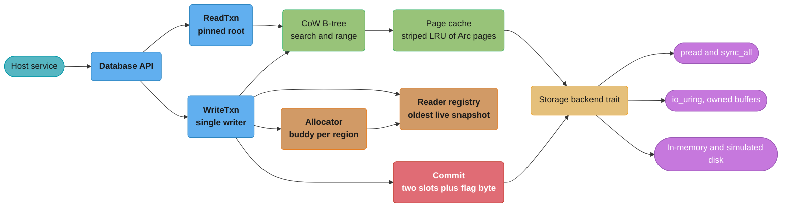
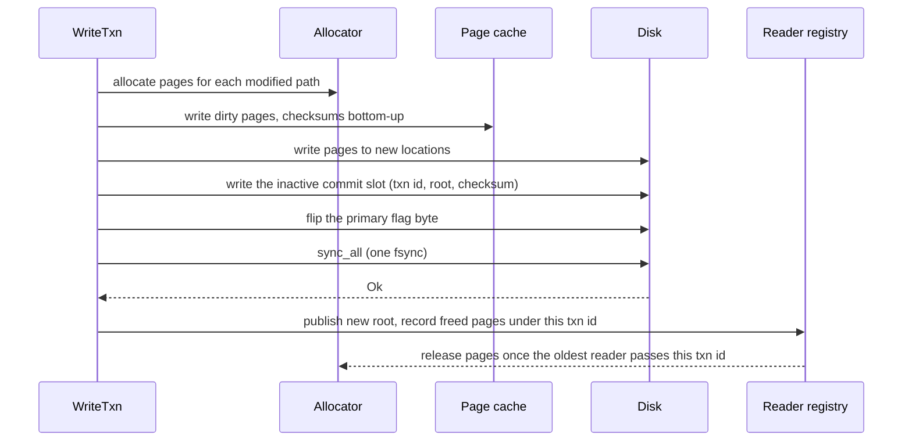

# Case Study: Design a Zero-Copy Embedded Storage Engine in Rust

> Versions as of 2026-11-06: Rust 1.99.1 on edition 2024. redb 4.5.0, fjall 3.1.13, memmap2 0.9.12, loom 0.7.2, turmoil 0.7.2, madsim 0.2.34, cargo-fuzz 0.13.2, kani-verifier 0.68.0, cargo-geiger 0.14.0.

## Intuition

> **Design intuition**: In C, a zero-copy read API is a sentence in a header file: "the returned pointer is valid until the transaction ends." Every caller must read that sentence and obey it. In Rust, the same promise is a signature: `fn get<'txn>(&'txn self, key: &[u8]) -> Option<&'txn [u8]>`. The borrow checker rejects every caller that keeps the slice after the transaction is gone. The whole design of a Rust storage engine is a choice about where that lifetime comes from: a compile-time borrow of the transaction, a run-time reference count on the page, or an `unsafe` promise that the caller makes once when the file is opened.

This is a **Rust-runtime** case study. [Go: Design an Embedded Key-Value Store](../../go/case_studies/design_an_embedded_kv_store.md) designs an LSM store whose shape comes from the Go garbage collector, and it already covers group commit, directory `fsync`, torn writes, record checksums and the general mmap versus `pread` argument. [Database: Storage Engines Internals](../../database/storage_engines_internals/storage_engines_internals.md) owns B-tree, LSM and copy-on-write theory. This study repeats none of that. It explains the parts that only exist in Rust: lifetimes that tie a borrowed value to its read transaction and when a reference-counted guard is the better contract, why every file-backed mapping constructor is `unsafe` and why redb removed its mmap backend, why io_uring forces owned buffers, how `Send` and `Sync` on transaction types decide whether the engine works in an async service, why a leaked read transaction is safe but can fill the disk, and what fuzzing, Miri, loom and deterministic simulation can each see.

The specific question: **what must a redb-shaped, copy-on-write B-tree key-value store look like in Rust to hold 200 million keys in a 70 GB file, serve 500,000 point reads per second from 32 threads with no copy of the value, accept 10,000 writes per second through one writer, survive a power cut, and expose an API that safe code cannot misuse?**

**Key insight for this design**: the borrow checker can enforce "valid until the transaction ends" for free, but only if the bytes cannot change under the borrow. A memory map breaks that condition, because another process, or the same process through another handle, can change the file. So the engine has two honest options. It can own its pages (`pread` into an `Arc<[u8]>` cache, safe `open`), or it can make the caller sign for the mapping (`unsafe fn open`, the heed and LMDB contract). Everything else in this study follows from that one choice.

Everything here builds on: [Lifetimes and the Borrow Checker](../lifetimes_and_the_borrow_checker/lifetimes_and_the_borrow_checker.md),
[Smart Pointers and Interior Mutability](../smart_pointers_and_interior_mutability/smart_pointers_and_interior_mutability.md),
[Threads, Send, Sync and Locks](../threads_send_sync_and_locks/threads_send_sync_and_locks.md),
[Unsafe Rust and Undefined Behavior](../unsafe_rust_and_undefined_behavior/unsafe_rust_and_undefined_behavior.md),
[Async Cancellation and Pitfalls](../async_cancellation_and_pitfalls/async_cancellation_and_pitfalls.md), [Testing, Fuzzing and Miri](../testing_fuzzing_and_miri/testing_fuzzing_and_miri.md),
and the two cross-cutting files [Memory Budgets Without a GC](cross_cutting/memory_budgets_without_a_gc.md) and [Unsafe Review and Soundness Checklist](cross_cutting/unsafe_review_and_soundness_checklist.md).

---

## 1. Requirements Clarification

### Functional Requirements

- An **embedded library**. It links into the host process. The host is a Rust service, sometimes async (Tokio), sometimes a plain thread pool.
- API shape, close to redb: safe `Database::create` and `open`, `begin_read()` and `begin_write()` (one writer, any number of readers), `get` with no copy out of the engine's page, ordered `range` both ways, savepoints, and `commit()` that makes a batch durable and visible atomically. Dropping an uncommitted `WriteTxn` aborts it.
- **Snapshot isolation (MVCC).** A read transaction sees one committed version for its whole life. A concurrent commit never blocks a reader, and a reader never blocks the writer.
- **Crash safety.** After `kill -9` or a power cut, every commit that returned `Ok` is present, and no part of an uncommitted batch is visible.
- **Corruption detection.** A page that fails its checksum produces an error. It never produces a panic, an out-of-bounds read or undefined behavior.

### Non-Functional Requirements

- 200 million keys. Keys are 32 bytes, values average 200 bytes. About 46 GB of user data.
- 500,000 point reads per second across 32 reader threads. p99 read latency under 200 µs on a cache miss and under 5 µs on a hit.
- 10,000 key writes per second, grouped by the host into about 100 commits per second. p99 commit latency under 5 ms on NVMe.
- Read-mostly: 50 reads per write.
- Memory budget: 12 GiB for the engine inside a 16 GiB container.
- **Safe API.** No public `unsafe fn` except where the caller holds information the engine cannot check. No undefined behavior reachable from safe code, including on corrupt input.
- Runs on Linux (production) and macOS (developer laptops) with the same durability semantics.

### Out of Scope (and where it lives instead)

| Topic | Where it lives |
|---|---|
| B-tree, LSM and CoW theory, read, write and space amplification | [Storage Engines Internals](../../database/storage_engines_internals/storage_engines_internals.md) |
| `fsync` semantics, directory `fsync`, torn writes, record CRCs, group commit | [Go: Embedded KV Store](../../go/case_studies/design_an_embedded_kv_store.md) §4.4 and §4.7 |
| Page faults, page cache and virtual memory | [Memory Management and Virtual Memory](../../cs_fundamentals/memory_management_and_virtual_memory/memory_management_and_virtual_memory.md) |
| io_uring, epoll and completion vs readiness | [Async I/O and Event Loops](../../cs_fundamentals/processes_threads_and_context_switching/async_io_and_event_loops.md) |
| Choosing an embedded database product (SQLite, RocksDB, redb, Turso) | [Embedded and Edge Databases](../../database/embedded_and_edge_databases/embedded_and_edge_databases.md) |
| Replication and consensus over this store | [Consensus Algorithms](../../hld/consensus_algorithms/consensus_algorithms.md) |

---

## 2. Scale Estimation

### Page and tree arithmetic

Pages are 4 KiB, the OS page size, which redb also uses as its default base size. A copy-on-write B-tree that takes random inserts settles near 69% leaf fill (ln 2).

```
Leaf entry       = 32 B key + 200 B value + 8 B slot (two u32 end offsets) = 240 B
Useful leaf bytes = 4096 B x 0.69                                           = 2,826 B
Entries per leaf  = 2,826 / 240                                             = about 12
Leaf pages        = 200 M / 12                                              = 16.7 M
File size         = 16.7 M x 4 KiB, plus 1.4 GB of branches                 = 70 GB

Branch child      = 32 B routing key + 8 B page number + 16 B XXH3-128 checksum = 56 B
Branch fanout     = 4096 / 56 x 0.69                                        = about 50

Level        Pages      Bytes
leaf         16.7 M     68 GB
L1           334 k      1.37 GB
L2           6.7 k      27 MB
L3           134        549 KB
L4           3          12 KB
root         1          4 KB
                        height = 6 pages from root to leaf
```

All branch pages together are 341,000 pages, about 1.4 GB. They fit in the cache with room to spare, so a point read costs at most one disk read: the leaf.

### Copy-on-write write arithmetic

CoW never changes a committed page in place. A commit writes a new copy of every page on every modified root-to-leaf path. With 100 random keys per commit:

```
Distinct pages written per commit (100 random keys):
  leaves  100
  L1      100     (100 of 334 k)
  L2       99     (6.7 k x (1 - e^(-100/6700)))
  L3       70     (134 x (1 - e^(-100/134)))
  L4        3
  root      1
  total   373 pages = 1.5 MB per commit

100 commits/s x 1.5 MB         = 153 MB/s of page writes
User bytes: 10,000 x 232 B     = 2.3 MB/s
Write amplification            = about 66x
```

That number is the price of the read path. A CoW B-tree is a read-optimized structure, and 50 reads per write is the workload it fits. At 1,000 keys per commit and 10 commits per second the total falls to about 125 MB/s (54x), because the upper levels are shared across more keys. Leaves set a floor of 10,000 x 4 KiB = 41 MB/s regardless of batching. Decision 2 in section 5 compares fjall's LSM.

### Read arithmetic

```
Cache: 8 GiB of the 12 GiB budget = 2.1 M pages
  all branch pages                 1.4 GB   (always resident)
  leaves                           7.2 GB   = 1.75 M of 16.7 M leaves (10.5%)
Assumed leaf hit rate (skewed keys)  80%
Leaf misses: 500 k x 0.2           = 100 k random 4 KiB reads/s = 410 MB/s
Per reader thread                  = 3.1 k reads/s, about 90 µs each = 28% of the thread blocked
```

100,000 random reads per second is a small load for one NVMe device. The open questions are in the CPU path: how the 500,000 hits per second find their page, and what each one pays for the right to keep the bytes.

### The number that drives the MVCC design

Each commit frees the 373 old page versions it replaced. A free page cannot be reused while any read transaction that started before that commit is alive.

```
Pages freed per second = 373 x 100 = 37,300 pages/s = 153 MB/s
Reader held 60 s       -> 2.2 M pages pinned  =   9.2 GB the file cannot reuse
Reader held 1 hour     -> 134 M pages pinned  = 550 GB, past the 70 GB file and onto a full disk
```

One forgotten read transaction is a disk-capacity incident within the hour. Section 4.7 shows why Rust cannot stop it with types, and what the engine does instead.

---

## 3. High-Level Architecture



The storage backend is a trait with three implementations: `pread` for production, io_uring for an async host with deep queues, and an in-memory disk for tests. That trait exists for verification. Miri cannot run real file I/O beyond basic access, and a deterministic simulator needs to own the disk, so every test-only backend plugs in at that one seam.

A commit follows this order:



This is redb's default "1PC+C" protocol: one `fsync` per commit, with a monotonic transaction id and an XXH3-128 checksum tree that lets recovery tell a complete commit from a torn one. redb's design document also describes a two-phase mode with two `fsync` calls, which it recommends for untrusted input because XXH3 is not collision resistant.

---

## 4. Component Deep Dives

### 4.1 The borrowed-read API: a lifetime as the transaction contract

The cheapest possible read returns a slice into a page the engine already holds. The only question is how long that slice may live. In Rust the answer goes in the signature: `get<'txn>(&'txn self, key: &[u8]) -> Option<&'txn [u8]>`. The value lives inside memory the transaction keeps alive. The caller may hold it for as long as it holds the transaction, and not one statement longer.

#### BROKEN: return a borrowed value from a helper that owns the transaction

```rust
// BROKEN
use std::collections::BTreeMap;
use std::sync::Arc;

pub struct ReadTxn {
    root: Arc<BTreeMap<Vec<u8>, Vec<u8>>>,
}

impl ReadTxn {
    pub fn get<'txn>(&'txn self, key: &[u8]) -> Option<&'txn [u8]> {
        self.root.get(key).map(Vec::as_slice)
    }
}

pub struct Db {
    root: Arc<BTreeMap<Vec<u8>, Vec<u8>>>,
}

// Elision ties the output to `db`, but the slice borrows `txn`.
pub fn read_one(db: &Db) -> Option<&[u8]> {
    let txn = ReadTxn { root: Arc::clone(&db.root) };
    txn.get(b"k") // error[E0515]: cannot return value referencing local variable `txn`
}
```

In C this function compiles, returns a pointer into a page, and fails weeks later when the page is recycled after the transaction ends. In Rust it never compiles, and the error names the transaction as the owner.

#### FIX: a working model with three correct read shapes

The tree is a `BTreeMap` behind an `Arc`, so a commit swaps in a new root and every open reader keeps the root it started with. A real CoW B-tree copies only the modified root-to-leaf paths, and the ownership shape is the same.

```rust
// FIX
use std::collections::BTreeMap;
use std::sync::{Arc, Mutex, MutexGuard, PoisonError};

type Tree = BTreeMap<Vec<u8>, Vec<u8>>;

pub struct Db {
    root: Mutex<Arc<Tree>>,
}

pub struct ReadTxn {
    root: Arc<Tree>,
}

pub struct WriteTxn<'db> {
    db: &'db Db,
    tree: Tree,
}

impl Db {
    fn root(&self) -> MutexGuard<'_, Arc<Tree>> {
        self.root.lock().unwrap_or_else(PoisonError::into_inner)
    }

    pub fn begin_read(&self) -> ReadTxn {
        ReadTxn { root: Arc::clone(&self.root()) }
    }

    pub fn begin_write(&self) -> WriteTxn<'_> {
        let base = Arc::clone(&self.root());
        WriteTxn { db: self, tree: (*base).clone() }
    }
}

impl ReadTxn {
    pub fn get<'txn>(&'txn self, key: &[u8]) -> Option<&'txn [u8]> {
        self.root.get(key).map(Vec::as_slice)
    }
}

impl WriteTxn<'_> {
    pub fn insert(&mut self, key: &[u8], value: &[u8]) {
        self.tree.insert(key.to_vec(), value.to_vec());
    }

    pub fn commit(self) {
        *self.db.root() = Arc::new(self.tree);
    }
}

// 1. The caller owns the transaction. Zero copies, and the caller picks the scope.
pub fn read_in<'txn>(txn: &'txn ReadTxn) -> Option<&'txn [u8]> {
    txn.get(b"k")
}

// 2. Copy out. One allocation, and the value outlives everything.
pub fn read_owned(db: &Db) -> Option<Vec<u8>> {
    db.begin_read().get(b"k").map(<[u8]>::to_vec)
}

// 3. Run the caller's code inside the transaction scope.
pub fn with_value<R>(db: &Db, f: impl FnOnce(Option<&[u8]>) -> R) -> R {
    let txn = db.begin_read();
    f(txn.get(b"k"))
}

fn main() {
    let db = Db { root: Mutex::new(Arc::new(Tree::new())) };
    let mut w = db.begin_write();
    w.insert(b"k", b"v1");
    w.commit();

    let reader = db.begin_read();
    let v1 = read_in(&reader);

    let mut w = db.begin_write();
    w.insert(b"k", b"v2");
    w.commit();

    // The old snapshot still answers v1 after the commit, with no copy.
    assert_eq!(v1, Some(&b"v1"[..]));
    assert_eq!(read_owned(&db).as_deref(), Some(&b"v2"[..]));
    assert_eq!(with_value(&db, |v| v.map(<[u8]>::len)), Some(2));
}
```

Shape 3 is the closure form that Go's Badger uses to bound a value's lifetime. In Go it is a convention, because nothing stops the closure from storing the slice in a global. In Rust the higher-ranked bound `FnOnce(Option<&[u8]>) -> R` makes that store a compile error, because `R` cannot name the borrow's lifetime. The model has no single-writer rule yet, so two concurrent `begin_write` calls would lose an update. Section 4.6 adds it.

### 4.2 Borrow or guard: what redb 2.0 changed and why

The borrowed API has a cost that shows up the moment the host is async or multi-threaded. A `&'txn [u8]` cannot cross a `tokio::spawn` boundary, which requires `'static`. A struct that holds both the transaction and a value from it is self-referential, and safe Rust cannot build one without `self_cell` or `ouroboros`. Users hit both walls on day one.

redb's 2.0.0 changelog (2024-03-22) lists "Remove lifetimes from read-only tables" and "Remove lifetime from `WriteTransaction` and `ReadTransaction`", and adds `get()` and `range()` with the `'static` lifetime on read-only tables. The source shows how. A read-only table holds an `Arc<TransactionGuard>`, the read cache stores pages as `Arc<[u8]>` in lock-striped LRU shards, and the value guard holds the page `Arc` plus an offset and a length. The lifetime moved from the type system into a reference count.

```rust
use std::ops::{Deref, Range};
use std::sync::Arc;
use std::thread;

/// A value that keeps its page alive by reference count, not by borrow.
pub struct ValueGuard {
    page: Arc<[u8]>,
    range: Range<usize>,
}

impl Deref for ValueGuard {
    type Target = [u8];
    fn deref(&self) -> &[u8] {
        &self.page[self.range.clone()]
    }
}

impl ValueGuard {
    pub fn new(page: &Arc<[u8]>, range: Range<usize>) -> Option<Self> {
        page.get(range.clone())?; // check bounds once, so deref cannot panic
        Some(ValueGuard { page: Arc::clone(page), range })
    }
}

fn assert_send_static<T: Send + 'static>() {}

fn main() {
    assert_send_static::<ValueGuard>();
    let cached_page: Arc<[u8]> = Arc::from(&b"hello world"[..]);
    let Some(guard) = ValueGuard::new(&cached_page, 6..11) else { return };
    drop(cached_page); // cache eviction: the guard keeps its page alive on its own
    let worker = thread::spawn(move || guard.to_vec());
    assert_eq!(worker.join().ok(), Some(b"world".to_vec()));
}
```

| Contract | Read cost | Composes with `spawn` and `.await` | What can go wrong |
|---|---|---|---|
| Borrow: `&'txn [u8]` | zero: a pointer and a length | no, needs `'static` | users fight E0515 and E0597, and self-referential structs |
| Guard: `Arc<[u8]>` plus range | one atomic increment and one decrement | yes, `Send + 'static` | contended refcount on hot pages, and guards that pin pages for hours |
| Copy: `Vec<u8>` | one allocation and a 200 B copy | yes | allocator pressure at 500 k reads/s |

The guard is the right public contract for a general-purpose library. The borrow is still the right internal contract. Section 4.3 shows why traversal must not take an `Arc` at every level.

### 4.3 Hot-page refcounts: borrow inside, count at the edge

Every point read visits 6 pages. If the traversal clones an `Arc` for each page, then every read increments and decrements the root page's counter. At 500,000 reads per second from 32 cores, that is 1 M atomic read-modify-write operations per second on one cache line. Each one must take exclusive ownership of the line from whichever core touched it last. Contended atomic increments typically cost 50 to 100 ns where uncontended ones cost a few nanoseconds, so the root counter alone can add tens of microseconds of queueing at peak and caps throughput regardless of core count.

The fix uses both contracts in one call. All 341 k branch pages stay resident (section 2), and the transaction pins its snapshot, so traversal borrows branch pages for the length of the call:

```rust
// fragment
let mut page: &[u8] = &self.root_page;
for _ in 1..self.height {
    let child = branch::find_child(page, key)?; // also checks the stored checksum
    page = self.branches.get(child)?;           // a borrow, no refcount
}
self.cache.leaf_guard(leaf::locate(page, key)?) // the one Arc clone, for the value that escapes
```

The rule is general for Rust data structures: use borrows on the paths that stay inside one call, and use reference counts only on values that leave it. The borrow checker proves the inner path is safe, so the reference count is spent only where the type system cannot follow.

### 4.4 mmap soundness: why `Mmap::map` is `unsafe`

The memmap2 0.9.12 documentation says: "All file-backed memory map constructors are marked `unsafe` because of the potential for _Undefined Behavior_ (UB) using the map if the underlying file is subsequently modified, in or out of process."

The reason is the type, not the crash. `Mmap` dereferences to `&[u8]`, and a shared reference promises the compiler that the bytes do not change while the reference lives. The optimizer may read a byte once and reuse the value, or read it twice and assume both reads agree. If another process writes the file, or this process writes through a second `File` handle, that promise is false. The result is undefined behavior even if nothing crashes. `SIGBUS` on a truncated file is a second problem on top of that one.

The Go study answers mmap versus `pread` by asking what the scheduler can see. The Rust answer starts one step earlier: what does the signature promise? An engine has four options.

| Option | Who carries the proof | Example |
|---|---|---|
| `unsafe fn open`: the caller promises no outside writer touches the file | the caller, once, at open | heed: `EnvOpenOptions::open` is `unsafe`, and its Safety section lists the LMDB rules (no remote file systems, avoid long transactions, do not break the lock file) |
| Safe `open` plus a mapping: the engine claims a safety it cannot check | nobody. This is unsound | the trap this section exists to prevent |
| Map, but read only through raw pointers with `ptr::read_volatile` or atomics, never `&[u8]` | the engine, at every access | possible, but every parser loses slices and iterators |
| Own the bytes: `pread` into buffers the engine allocated | the engine, by construction | redb since 0.11.0 |

redb took the last row in public. Its changelog for 0.11.0 (2022-12-26) says: "Add a non-mmap based backend which is now the default. This makes `Database::create()` and `Database::open()` safe, but has worse performance in some cases." Release 0.14.0 (2023-03-26) removed `create_mmapped()` and `open_mmapped()`. The 1.0.0 release followed on 2023-06-16.

When the mapping is the right call, the `unsafe` goes in one place with a contract the caller can check:

```rust
// fragment
use memmap2::Mmap;
use std::fs::File;
use std::path::Path;

pub struct ReadOnlyImage {
    map: Mmap,
}

impl ReadOnlyImage {
    /// # Safety
    /// No process may write, truncate or replace the file at `path` while the
    /// returned value exists. That includes this process through another handle.
    pub unsafe fn open(path: &Path) -> std::io::Result<Self> {
        let file = File::open(path)?;
        // SAFETY: the caller upholds the no-writer contract in this function's
        // Safety section, so the mapped bytes stay immutable for the map's life.
        let map = unsafe { Mmap::map(&file)? };
        Ok(Self { map })
    }
}
```

That pattern fits immutable files: an exported snapshot, a read-only index that a build step writes once, a model file. A live database that its own writer changes is the case it does not fit. The [Unsafe Review and Soundness Checklist](cross_cutting/unsafe_review_and_soundness_checklist.md) has the review rule: an `unsafe` constructor whose Safety section the caller cannot check is a soundness bug in the API, whatever the code inside does.

### 4.5 Decoding pages without `unsafe` casts

A page arrives as `&[u8]` with alignment 1. Casting it to `&LeafHeader` or `&[u64]` is undefined behavior when the address is misaligned, and the same cast trusts every field of a page that came from disk. Corrupt input is in the requirements, so the parser treats every page as untrusted.

The safe path is `from_le_bytes` on bounds-checked slices. It compiles to a single unaligned load on x86-64 and AArch64, so it costs nothing that a cast would save. The parser validates all offsets once, and the view it returns borrows the page with the same lifetime as section 4.1:

```rust
#[derive(Debug, PartialEq)]
pub enum PageError {
    Truncated,
    BadOffset { index: usize },
}

/// Leaf layout: count (u16 LE), 2 pad bytes, `count` slots of (key_end u32, value_end u32),
/// then the data area. Offsets are relative to the data area and never decrease.
pub struct Leaf<'p> {
    slots: &'p [u8],
    data: &'p [u8],
}

fn u16_at(b: &[u8], at: usize) -> Option<u16> {
    Some(u16::from_le_bytes(b.get(at..at + 2)?.try_into().ok()?))
}

fn u32_at(b: &[u8], at: usize) -> Option<usize> {
    let v = u32::from_le_bytes(b.get(at..at + 4)?.try_into().ok()?);
    usize::try_from(v).ok()
}

impl<'p> Leaf<'p> {
    pub fn parse(page: &'p [u8]) -> Result<Self, PageError> {
        let count = usize::from(u16_at(page, 0).ok_or(PageError::Truncated)?);
        let slots_end = 4 + count * 8;
        let slots = page.get(4..slots_end).ok_or(PageError::Truncated)?;
        let data = page.get(slots_end..).ok_or(PageError::Truncated)?;
        let mut prev = 0;
        for i in 0..count {
            let k = u32_at(slots, i * 8).ok_or(PageError::Truncated)?;
            let v = u32_at(slots, i * 8 + 4).ok_or(PageError::Truncated)?;
            if !(prev <= k && k <= v && v <= data.len()) {
                return Err(PageError::BadOffset { index: i });
            }
            prev = v;
        }
        Ok(Leaf { slots, data })
    }

    pub fn len(&self) -> usize {
        self.slots.len() / 8
    }

    pub fn entry(&self, i: usize) -> Option<(&'p [u8], &'p [u8])> {
        let (slots, data) = (self.slots, self.data);
        let start = if i == 0 { 0 } else { u32_at(slots, i * 8 - 4)? };
        let k = u32_at(slots, i * 8)?;
        let v = u32_at(slots, i * 8 + 4)?;
        Some((data.get(start..k)?, data.get(k..v)?))
    }
}

fn main() {
    // Two entries: apple=red, kiwi=green. Slots hold (key_end, value_end).
    let mut page = vec![2, 0, 0, 0, 5, 0, 0, 0, 8, 0, 0, 0, 12, 0, 0, 0, 17, 0, 0, 0];
    page.extend_from_slice(b"appleredkiwigreen");
    let leaf = match Leaf::parse(&page) {
        Ok(leaf) => leaf,
        Err(e) => panic!("valid page rejected: {e:?}"),
    };
    assert_eq!(leaf.len(), 2);
    assert_eq!(leaf.entry(1), Some((&b"kiwi"[..], &b"green"[..])));

    let mut corrupt = page.clone();
    corrupt[8..12].copy_from_slice(&9_999u32.to_le_bytes()); // value_end past the data area
    assert_eq!(Leaf::parse(&corrupt).err(), Some(PageError::BadOffset { index: 0 }));
    assert_eq!(Leaf::parse(&page[..3]).err(), Some(PageError::Truncated));
}
```

For headers with many fixed fields, the zerocopy crate (0.8.63 on crates.io, MSRV 1.56) derives `FromBytes`, `KnownLayout` and `Immutable`, and its `Ref` type checks size and alignment before it hands out `&T`. Use it when a struct view saves real code. The bounds checks stay either way, because a valid layout does not make the offsets inside it valid. The [Performance and Zero-Cost Abstractions](../performance_and_zero_cost_abstractions/performance_and_zero_cost_abstractions.md) page shows how to confirm in the assembly that the `get(..)?` checks fold into one comparison per access.

### 4.6 `Send` and `Sync` on transaction types

Transaction types decide whether the engine works inside an async service. Three facts drive the design:

- `tokio::spawn` needs the future to be `Send + 'static`. A future that holds a `WriteTxn` across `.await` is `Send` only if `WriteTxn: Send`.
- `std::sync::MutexGuard` is `!Send`. Some platforms require the thread that locked a mutex to unlock it, and std encodes that in the type.
- A `Table<'txn>` that holds `&'txn WriteTxn` is `Send` only if `WriteTxn: Sync`, because `&T: Send` requires `T: Sync`. redb's `Table` holds exactly that reference.

The obvious single-writer lock is a `Mutex<()>` whose guard lives inside the write transaction. That makes the transaction `!Send`.

#### BROKEN: the writer lock guard inside the transaction

```rust
// BROKEN
use std::sync::{Mutex, MutexGuard, PoisonError};
use std::thread;

pub struct WriteTxn<'db> {
    _writer: MutexGuard<'db, ()>,
    pending: Vec<(Vec<u8>, Vec<u8>)>,
}

fn main() {
    let writer_lock = Mutex::new(());
    thread::scope(|s| {
        let txn = WriteTxn {
            _writer: writer_lock.lock().unwrap_or_else(PoisonError::into_inner),
            pending: Vec::new(),
        };
        // error[E0277]: `MutexGuard<'_, ()>` cannot be sent between threads safely
        s.spawn(move || {
            let txn = txn; // move the whole txn, not only the field
            txn.pending.len()
        });
    });
}
```

The same error appears with Tokio, one level removed: "future cannot be sent between threads safely" on the `tokio::spawn` call, with a note that points at the `WriteTxn` held across an `.await`.

#### FIX: hold the writer slot as state, not as a guard

```rust
// FIX
use std::sync::{Condvar, Mutex, PoisonError};
use std::thread;

pub struct Db {
    writer_busy: Mutex<bool>,
    writer_freed: Condvar,
}

pub struct WriteTxn<'db> {
    db: &'db Db,
    pending: Vec<(Vec<u8>, Vec<u8>)>,
}

impl Db {
    pub fn new() -> Self {
        Db { writer_busy: Mutex::new(false), writer_freed: Condvar::new() }
    }

    /// Blocks until no other write transaction exists. The mutex guard is
    /// released before this returns, so the transaction holds no guard.
    pub fn begin_write(&self) -> WriteTxn<'_> {
        let mut busy = self.writer_busy.lock().unwrap_or_else(PoisonError::into_inner);
        while *busy {
            busy = self.writer_freed.wait(busy).unwrap_or_else(PoisonError::into_inner);
        }
        *busy = true;
        WriteTxn { db: self, pending: Vec::new() }
    }
}

impl WriteTxn<'_> {
    pub fn insert(&mut self, k: &[u8], v: &[u8]) {
        self.pending.push((k.to_vec(), v.to_vec()));
    }
}

impl Drop for WriteTxn<'_> {
    fn drop(&mut self) {
        *self.db.writer_busy.lock().unwrap_or_else(PoisonError::into_inner) = false;
        self.db.writer_freed.notify_one();
    }
}

fn assert_send_sync<T: Send + Sync>() {}

fn main() {
    assert_send_sync::<WriteTxn<'static>>();
    let db = Db::new();
    thread::scope(|s| {
        let mut txn = db.begin_write();
        txn.insert(b"k", b"v");
        let n = s.spawn(move || txn.pending.len()).join().ok();
        assert_eq!(n, Some(1));
    });
    drop(db.begin_write()); // the slot was released when the moved txn dropped
}
```

Two more design points come from the same rules:

- **Do not block an async worker in `begin_write`.** A blocking wait inside a Tokio task stalls that worker thread. An async host gets an async variant that waits on a `tokio::sync::Semaphore` with one permit. The owned permit (`OwnedSemaphorePermit`) is `Send`, so the transaction stays `Send`.
- **A read transaction that uses thread-local state must say so in its type.** heed's `RoTxn<WithTls>` is `!Send`, and `RoTxn<WithoutTls>` is `Send` (section 6).

[Threads, Send, Sync and Locks](../threads_send_sync_and_locks/threads_send_sync_and_locks.md) covers the auto-trait rules, and [Async Cancellation and Pitfalls](../async_cancellation_and_pitfalls/async_cancellation_and_pitfalls.md) covers guards held across `.await`.

### 4.7 MVCC page reclamation, and why a leak is safe but fatal

A commit records which old pages it freed, tagged with its transaction id. A page freed by commit `N` belonged to snapshots older than `N`, so the allocator can reuse it once the oldest live reader started at or after `N`. Readers register on `begin_read` and deregister in `Drop`.

```rust
use std::collections::BTreeMap;
use std::mem;
use std::sync::{Arc, Mutex, MutexGuard, PoisonError};

/// Live read snapshots: snapshot txn id -> number of open readers.
pub struct Registry {
    live: Mutex<BTreeMap<u64, usize>>,
}

pub struct ReaderPin {
    registry: Arc<Registry>,
    snapshot: u64,
}

impl Registry {
    pub fn new() -> Arc<Self> {
        Arc::new(Registry { live: Mutex::new(BTreeMap::new()) })
    }

    fn live(&self) -> MutexGuard<'_, BTreeMap<u64, usize>> {
        self.live.lock().unwrap_or_else(PoisonError::into_inner)
    }

    pub fn pin(self: &Arc<Self>, snapshot: u64) -> ReaderPin {
        *self.live().entry(snapshot).or_insert(0) += 1;
        ReaderPin { registry: Arc::clone(self), snapshot }
    }

    pub fn oldest(&self) -> Option<u64> {
        self.live().keys().next().copied()
    }

    /// Pages freed by commit `freed_by` are reusable once no older snapshot is open.
    pub fn reusable(&self, freed_by: u64) -> bool {
        self.oldest().is_none_or(|oldest| oldest >= freed_by)
    }
}

impl Drop for ReaderPin {
    fn drop(&mut self) {
        let mut live = self.registry.live();
        if let Some(n) = live.get_mut(&self.snapshot) {
            *n -= 1;
            if *n == 0 {
                live.remove(&self.snapshot);
            }
        }
    }
}

fn main() {
    let reg = Registry::new();
    let old = reg.pin(7);
    assert!(!reg.reusable(8)); // snapshot 7 can still reach pages freed by commit 8
    drop(old);
    assert!(reg.reusable(8));
    mem::forget(reg.pin(9)); // safe code, and Drop never runs
    assert_eq!(reg.oldest(), Some(9)); // pinned for the life of the process
    assert!(!reg.reusable(10));
}
```

`mem::forget` is a safe function. Rust promises memory safety, not that destructors run, so `Rc` cycles and `forget` leak without `unsafe`. The design rule that follows:

- **Soundness must never depend on `Drop`.** If skipping a reader's `Drop` could let the allocator hand out a page that a live `&[u8]` still points into, safe code could cause a use-after-free. Here, a missed `Drop` only keeps a snapshot registered forever. Pages stay pinned, and memory stays valid.
- **Space must be watched, because types cannot bound it.** Section 2 computed 550 GB of pinned pages for a reader held for an hour. The engine exports the age of the oldest live snapshot as a metric, logs the backtrace captured at `begin_read` for any reader older than a threshold, and lets the host set a maximum reader age, after which the reader's next call returns `Err(SnapshotExpired)`. An expired reader is still memory safe, because its guards hold `Arc` pages.

[Smart Pointers and Interior Mutability](../smart_pointers_and_interior_mutability/smart_pointers_and_interior_mutability.md) covers `Rc` cycles and `Weak`. [Memory Budgets Without a GC](cross_cutting/memory_budgets_without_a_gc.md) covers the general rule: a Rust service can leak without `unsafe`, so memory and disk budgets need metrics and alerts.

### 4.8 Crash consistency: the Rust-specific parts

The `fsync` rules are in the Go study (§4.7) and apply unchanged. Three things differ in Rust.

**`File::sync_all` on Apple targets is `fcntl(F_FULLFSYNC)`.** The std source (`library/std/src/sys/fs/unix.rs`) calls `F_FULLFSYNC` for both `sync_all` and `sync_data` when `target_vendor = "apple"`. A Rust engine gets real durability on macOS laptops without platform code. It also pays the real cost, so a macOS `sync_all` benchmark is slower than a naive C `fsync` benchmark on the same machine, and that result is correct.

**`Drop` cannot return an error, so commit must be an explicit call.** An engine that flushes in `Drop` loses every I/O error that happens there. The `WriteTxn` API therefore has `commit(self) -> Result<(), CommitError>`, and dropping an uncommitted transaction means abort. `Result` is already `#[must_use]`, so `wtxn.commit();` with the result ignored produces a warning that CI can deny.

**A failed `fsync` poisons the engine, and the type system can carry the state.** After a sync error, the kernel may have dropped the dirty pages and cleared the error, so a retry can report success for data that is gone. The committer records the failure and refuses every later commit:

```rust
use std::io;

pub trait Disk {
    fn write_at(&mut self, offset: u64, data: &[u8]) -> io::Result<()>;
    fn sync(&mut self) -> io::Result<()>;
}

#[derive(Debug)]
pub enum CommitError {
    Io(io::Error),
    Poisoned,
}

pub struct Committer<D: Disk> {
    disk: D,
    poisoned: bool,
    primary: u8,
    txn: u64,
}

impl<D: Disk> Committer<D> {
    pub fn commit(&mut self, root_page: u64) -> Result<u64, CommitError> {
        if self.poisoned {
            return Err(CommitError::Poisoned);
        }
        let next = self.txn + 1;
        let slot = 1 - self.primary;
        let mut record = [0u8; 16];
        record[..8].copy_from_slice(&next.to_le_bytes());
        record[8..].copy_from_slice(&root_page.to_le_bytes());
        let disk = &mut self.disk;
        let written = disk
            .write_at(64 + u64::from(slot) * 128, &record) // the inactive slot
            .and_then(|()| disk.write_at(9, &[slot])) // flag byte: flip the primary
            .and_then(|()| disk.sync());
        match written {
            Ok(()) => {
                self.primary = slot;
                self.txn = next;
                Ok(next)
            }
            Err(e) => {
                self.poisoned = true;
                Err(CommitError::Io(e))
            }
        }
    }
}

/// Test disk whose sync fails exactly once, on the given call number.
struct FlakyDisk {
    syncs: u32,
    fail_on: u32,
}

impl Disk for FlakyDisk {
    fn write_at(&mut self, _offset: u64, _data: &[u8]) -> io::Result<()> {
        Ok(())
    }

    fn sync(&mut self) -> io::Result<()> {
        self.syncs += 1;
        if self.syncs == self.fail_on {
            return Err(io::Error::other("EIO from writeback"));
        }
        Ok(())
    }
}

fn main() {
    let disk = FlakyDisk { syncs: 0, fail_on: 2 };
    let mut c = Committer { disk, poisoned: false, primary: 0, txn: 0 };
    assert_eq!(c.commit(100).ok(), Some(1));
    assert!(matches!(c.commit(200), Err(CommitError::Io(_))));
    // The disk would succeed now, but the engine refuses: it cannot know what was lost.
    assert!(matches!(c.commit(300), Err(CommitError::Poisoned)));
}
```

The `Disk` trait in that program is the storage-backend seam from section 3. The same trait lets a fuzzer, Miri and a simulator replace the file.

### 4.9 io_uring and owned buffers

A blocking `pread` is the right default for a thread-pool host. An async host has two choices for leaf misses: send them to `spawn_blocking` (Tokio's blocking pool defaults to 512 threads), or submit them to io_uring. io_uring changes the buffer API, and the reason is cancellation.

A Rust future can be dropped at any `.await`, for example by a `select!` branch or a timeout. A read API that borrows the destination looks natural:

```rust
// fragment
// Unsound with io_uring: the kernel keeps the buffer address after the future is dropped.
async fn read_at(&self, buf: &mut [u8], offset: u64) -> io::Result<usize>;
```

The submission queue entry holds the buffer's address. If the caller drops the future after submission, the borrow ends and the caller can free or reuse the buffer, and the kernel then writes into memory that someone else owns. A safe API cannot depend on the caller to await completion, so the buffer must move into the operation:

```rust
// fragment
use tokio_uring::fs::File;

async fn read_leaf(file: &File, page_no: u64) -> std::io::Result<Vec<u8>> {
    let buf = vec![0u8; 4096];
    // Ownership of `buf` moves into the operation and comes back on completion.
    // If this future is dropped, the runtime keeps the buffer alive until the
    // kernel reports completion.
    let (res, buf) = file.read_at(buf, page_no * 4096).await;
    let n = res?;
    if n != buf.len() {
        return Err(std::io::Error::from(std::io::ErrorKind::UnexpectedEof));
    }
    Ok(buf)
}
```

tokio-uring 0.5.0 documents this model ("Ownership of resources are passed to the kernel"), and requires Linux 5.10 or later. monoio and glommio use the same owned-buffer shape. The completed `Vec<u8>` becomes the cache's `Arc<[u8]>` with `Arc::from(vec)`. That call copies once into the `Arc` allocation, so a cache that wants zero copies allocates `Arc<[u8]>`-compatible buffers up front or registers a fixed buffer pool with the ring.

A thread-pool host keeps `pread` on the reader thread: 100 k misses per second across 32 threads is 28% blocked time. A Tokio host with a moderate miss rate uses `spawn_blocking`. A thread-per-core runtime with deep queues uses io_uring, and tests use the in-memory `Disk`.

The CS page [Async I/O and Event Loops](../../cs_fundamentals/processes_threads_and_context_switching/async_io_and_event_loops.md) owns io_uring itself. [Async Runtimes and Executors](../async_runtimes_and_executors/async_runtimes_and_executors.md) owns the runtime choice.

### 4.10 Verification: four tools, four bug classes

Each tool below catches a class of bug the others miss, and each one needs the storage seam to exist.

| Tool | Bug class it finds | What it cannot see | Cost in CI |
|---|---|---|---|
| cargo-fuzz (libFuzzer) on page decode and on op sequences | panics, infinite loops, unchecked offsets, huge allocations from corrupt length fields | UB that does not crash, thread interleavings | minutes per target per night |
| Miri on the in-memory backend | UB in `unsafe` code: misaligned or out-of-bounds reads, aliasing violations, use-after-free | real file I/O, FFI, most syscalls, every interleaving | 10x to 100x slower than native, so small inputs |
| loom on the reader registry and cache refcounts | missing happens-before edges, lost wakeups, bad atomic orderings | anything outside `loom::sync` types, full `SeqCst` semantics | exponential in threads and operations, so 2 or 3 threads |
| Deterministic simulation (turmoil with turmoil-fs, or madsim) | crash-recovery bugs, torn writes, I/O errors at the worst moment, reproducible from a seed | bugs in the real kernel or device | one seed is cheap, so thousands per night |

**Fuzzing.** redb ships two cargo-fuzz targets. `fuzz_redb.rs` drives random operation sequences, savepoints included, and keeps a reference `BTreeMap` in sync to compare against. `fuzz_corruption.rs` damages a committed database (commit slots, free and live pages, truncation, bit flips), then opens it with integrity checks and repair, and requires every call to return `Ok` or `Err` and never panic. It runs on an in-memory implementation of redb's public `StorageBackend` trait, the same seam as this design's `Disk`. The engine here adds a third, smaller target that calls `Leaf::parse` and then `entry(i)` for every index on arbitrary bytes.

**Miri.** Miri runs one execution of the program and checks it for undefined behavior. Its README says it "does not catch every violation of the Rust specification", that it cannot prove soundness, and that FFI and most platform APIs are unavailable. So the engine runs its whole test suite under Miri against the in-memory `Disk`, and adds `-Zmiri-many-seeds` to try 64 schedules and address layouts. A test that needs a real file stays out of the Miri job, and that list is reviewed.

**loom.** loom runs a test many times and permutes the possible concurrent executions under the C11 memory model. The registry and cache refcounts import their `Arc`, `Mutex` and atomics from a small shim module that re-exports `loom::sync` under `cfg(loom)` and `std::sync` otherwise:

```rust
// fragment
#[cfg(loom)]
#[test]
fn pin_and_drop_race() {
    loom::model(|| {
        let reg = Registry::new();
        let r = reg.clone();
        let t = loom::thread::spawn(move || drop(r.pin(5)));
        let _current = reg.pin(6);
        assert!(t.join().is_ok());
        assert_eq!(reg.oldest(), Some(6)); // holds in every interleaving
    });
}
```

loom's README lists what it does not model. It treats `SeqCst` loads and stores as `AcqRel`, which can raise false alarms, and it does not explore load-buffering executions, so a clean loom run is evidence, not proof. The [memory-model theory page](../../cs_fundamentals/memory_models_and_concurrency_theory/memory_models_and_concurrency_theory.md) explains both terms.

**Deterministic simulation.** turmoil describes itself as deterministic simulation testing that injects "latency, drops, partitions, crashes, torn writes" into a simulated network and file system under a seeded RNG. turmoil-fs and turmoil-io-uring, both 0.1.0 on crates.io (2026-10-19), replace `std::fs` and io_uring. madsim does the same job for whole async programs, and RisingWave lists it as its deterministic test runtime. The engine's simulation test does this per seed:

1. Run a random workload against the engine on the simulated disk.
2. Crash at a random point, keeping only bytes that were synced, plus random torn sectors from unsynced writes.
3. Reopen and run recovery.
4. Check that every commit that returned `Ok` is present and that no uncommitted key is visible.
5. On failure, print the seed. The seed replays the same run bit for bit.

[Testing, Fuzzing and Miri](../testing_fuzzing_and_miri/testing_fuzzing_and_miri.md) owns the verification ladder in general.

---

## 5. Design Decisions & Tradeoffs

### Decision 1: `pread` and an owned page cache, not a mapping

The owned cache gives a safe `open`, `io::Result` errors instead of `SIGBUS`, a memory counter the engine controls, and correct behavior on network file systems, where the LMDB rules that heed repeats forbid a mapping. It costs a shard lock, a hash lookup and a refcount per hit, and a syscall plus a copy per miss. A safe `open` is a requirement, so choose the owned cache. Section 6 has redb's own numbers against LMDB.

### Decision 2: copy-on-write B-tree, not an LSM

| Factor | CoW B-tree (this design, redb, LMDB) | LSM (fjall, RocksDB) |
|---|---|---|
| Point read | one root-to-leaf walk, at most one disk read | memtable plus several levels, bloom filters |
| Range scan | leaves in key order | merge across levels |
| Write amplification at 100 keys per commit | about 66x (§2) | lower for random writes, paid later by compaction |
| Background work | none: free pages return on commit | compaction threads |
| Snapshot | an `Arc` to a root | a sequence number plus compaction rules |
| Space | 69% leaf fill | compression, LZ4 by default in fjall |

At 50 reads per write the B-tree wins. A write-heavy workload, or one where disk space dominates cost, goes to fjall. redb's benchmark table shows the same split: fjall wins batch writes and removals, and LMDB and redb win random reads.

### Decision 3: one `fsync` per commit with checksummed slots

The 1PC+C protocol needs one `fsync` per commit. Two-phase commit needs two. At 100 commits per second and 1 ms per `fsync` on cloud block storage, 1PC+C uses 10% of a device's sequential sync budget and 2PC uses 20%. Offer 2PC as an option for files that untrusted parties can write, as redb's design document does.

### Decision 4: no `unsafe` in the engine core

The page parser, tree, cache and registry are safe Rust. `unsafe` exists only behind optional features: an io_uring backend through its crate, and an mmap read-only snapshot export with an `unsafe fn open`. cargo-geiger counts both in CI, and each `unsafe` block carries a `// SAFETY:` comment that the review checklist checks.

---

## 6. Real-World Implementations

**redb.** The README describes "A simple, portable, high-performance, ACID, embedded key-value store", with a "Zero-copy, thread-safe, `BTreeMap` based API", MVCC for concurrent readers and a writer without blocking, savepoints and multi-process access. The design document describes the parts this study uses: a 512-byte super-header with two 128-byte commit slots, a "god byte" whose single-byte write makes commits atomic, an XXH3-128 Merkle checksum tree, CoW pages that are never changed after commit, pending-free pages released only after every transaction that could reference them ends, and a buddy allocator per region. The history matters as much as the design: a non-mmap backend became the default in 0.11.0 to make `create` and `open` safe, mmap was removed in 0.14.0, 1.0.0 shipped on 2023-06-16, and 2.0.0 removed the transaction lifetimes in favor of `'static` read-only tables.

redb's README benchmark (Ryzen 9950X3D, Samsung 9100 PRO NVMe) shows what the owned cache costs and what it does not:

| Benchmark | redb | lmdb | rocksdb | fjall |
|---|---|---|---|---|
| individual writes | 920 ms | 1598 ms | 2432 ms | 3488 ms |
| batch writes | 1595 ms | 942 ms | 451 ms | 353 ms |
| random reads (32 threads) | 410 ms | 125 ms | 1100 ms | 576 ms |
| compacted size | 1.69 GiB | 1.26 GiB | 454.71 MiB | 1000.95 MiB |

LMDB's mapped reads are about 3.3x faster at 32 threads. Part of that gap is the cost of a lock, a lookup and a refcount per page against a pointer dereference. That is the measured price of a safe `open`.

**LMDB through heed (Meilisearch).** heed describes itself as "Rust-centric LMDB abstractions with minimal overhead". Meilisearch's indexing crate `milli` depends on heed 0.23.0. heed is the example of the other contract: `EnvOpenOptions::open` is an `unsafe fn` because LMDB is a memory map, and its Safety section lists the rules the caller accepts. Its `RoTxn<WithTls>` and `RoTxn<WithoutTls>` types turn LMDB's thread-local reader slots into a `Send` distinction (§4.6). Its `get` signature, `get<'a, 'txn>(&self, txn: &'txn RoTxn, ...)`, ties decoded values to the transaction's lifetime, the same shape as §4.1.

**fjall.** "A log-structured, embeddable key-value storage engine written in Rust", LSM-based "similar to `RocksDB`", with keyspaces, optional serializable transactions, LZ4 compression by default and optional key-value separation. Its README says "100% safe & stable Rust". By default an operation flushes to OS buffers but not to disk, and `Database::persist` with a `PersistMode` controls durability. It is the comparison point for Decision 3.

**TiKV.** A distributed transactional KV store "Built in Rust", "powered by Raft", and a graduated CNCF project. Each store keeps its data in a RocksDB instance. TiKV shows the other common answer: wrap a C++ engine through FFI and spend the Rust effort on the distributed layer. [FFI and Language Interop](../ffi_and_language_interop/ffi_and_language_interop.md) covers what that boundary costs.

**The mmap argument in research.** Crotty, Leis and Pavlo, "Are You Sure You Want to Use MMAP in Your Database Management System?" (CIDR 2022), argue that mmap is a poor substitute for a traditional buffer pool, and they document systems that moved from mmap to their own file I/O after significant engineering cost. redb's 0.11 to 0.14 path is a Rust instance of the same move, with soundness as an additional reason.

---

## 7. Technologies & Tools

| Tool | Version (2026-11-06) | Role here |
|---|---|---|
| redb | 4.5.0, MSRV 1.90 | reference CoW B-tree design |
| fjall | 3.1.13, MSRV 1.90 | LSM comparison point |
| memmap2 | 0.9.12, MSRV 1.65 | read-only snapshot export behind `unsafe fn open` |
| zerocopy | 0.8.63, MSRV 1.56 (crates.io) | checked struct views over page headers |
| tokio-uring | 0.5.0 (crates.io), Linux 5.10+ | owned-buffer async file I/O on Tokio (monoio 0.2.4 and glommio 0.9.0 use the same model) |
| tokio | 1.54.1, MSRV 1.85 | async host, `spawn_blocking`, `Semaphore` |
| cargo-fuzz | 0.13.2 | page and operation fuzz targets |
| loom | 0.7.2, MSRV 1.65 | registry and refcount interleavings |
| turmoil | 0.7.2 | deterministic simulation |
| turmoil-fs, turmoil-io-uring | 0.1.0 (crates.io) | simulated file system and ring with torn writes |
| madsim | 0.2.34 | whole-program deterministic simulation |
| kani-verifier | 0.68.0 | bounded proofs of the page parser's bounds checks |
| cargo-geiger | 0.14.0, MSRV 1.97 | `unsafe` inventory in CI |

Miri runs from the nightly toolchain (`cargo +nightly miri test`). Its two flags in this design are `-Zmiri-many-seeds` for schedule variety and, for the few tests that need it, `-Zmiri-disable-isolation`, which gives up determinism.

---

## 8. Operational Playbook

### Metrics the engine exports

| Metric | Healthy | Page someone at |
|---|---|---|
| `oldest_snapshot_age_seconds` | under 5 s | over 300 s |
| `pending_free_pages` | under 100 k (400 MB) | over 2 M (8 GB) |
| `cache_hit_ratio` (leaves) | over 0.75 | under 0.5 |
| `commit_latency_p99` | under 5 ms | over 20 ms |
| `checksum_failures_total`, `engine_poisoned` | 0 | any |

### Runbook: the file grows while user data is flat

1. Read `oldest_snapshot_age_seconds`. If it is high, a read transaction is open somewhere.
2. Read the log line the engine writes for readers older than the threshold. It carries the backtrace captured at `begin_read`.
3. Common causes: a read-only table handle stored in a long-lived struct, a streaming `range` iterator held by a slow HTTP client, a task stuck on `.await` while it holds a `ReadTxn`, or a `mem::forget` or an `Arc` cycle.
4. Fix the holder. Pinned pages return to the free list at the next commit after the reader drops. The file does not shrink until the host runs compaction.

### Runbook: the engine reports `Poisoned`

1. Do not retry writes. The engine refuses them on purpose (§4.8).
2. Read the kernel log for the device error that preceded the poison.
3. Restart the process. Recovery picks the newest commit slot with a valid checksum and discards the rest.
4. If recovery reports checksum failures in data pages, restore from a backup or a replica. The CoW tree detects bad pages but has no second copy to repair from.

---

## 9. Common Pitfalls & War Stories

The incidents below are illustrative. They apply this design's numbers to known failure modes, and none of them is a report from redb, heed or another named project.

**A stored table handle pinned 92 GB of disk.** A host service kept a read-only table handle in a long-lived struct so that it did not reopen the table on each request. A read-only table keeps its read transaction registered (redb's `ReadOnlyTable` holds an `Arc<TransactionGuard>`), so the snapshot never advanced. At 37,300 freed pages per second, a 10-minute-old handle pinned 22 M pages, or 92 GB. The fix was to open a read transaction per request (one registry insert, well under a microsecond) and to alert on `oldest_snapshot_age_seconds`.

**`Drop`-based flush lost writes silently.** An early design committed in `WriteTxn::drop` so that callers "could not forget". During a disk-full test, 3% of batches were lost with no error anywhere, because `Drop` cannot return the `ENOSPC`. The fix was the explicit `commit(self) -> Result` and abort-on-drop.

**A safe `open` over a mapping caused a heisenbug.** A prototype mapped the file inside a safe `open`. A backup tool on the same host rewrote the file in place during a restore test. Readers returned keys from two different versions within one page. Miri cannot see this, because the writer is another process. The fix was the owned cache, the same change redb made in 0.11.0. The bug class has no test that reliably finds it, so the fix that holds is an API that does not allow it.

**A `MutexGuard` in the write transaction blocked the async migration.** Moving the host to Tokio failed to compile on every handler that held a `WriteTxn` across an `.await`, about 40 call sites. The tempting patch was a `current_thread` runtime, which caps the service at one core. The real fix was the guard-free writer slot from §4.6, one change in the engine instead of 40 in the host.

**A fuzzer found a 4 GiB allocation in eight minutes.** A length field in the overflow-page header was trusted and passed to `vec![0; len]`. cargo-fuzz produced a 12-byte input that requested 4 GiB and aborted the process on allocation failure. Validating the length against the remaining file size before allocating closed it. Every header parser now validates lengths the same way as `Leaf::parse`.

**A 2 KiB page test passed on x86-64 and failed under Miri.** A header cast through `ptr::read` on a `*const u64` worked on x86-64, which tolerates unaligned loads. Miri reported an unaligned read on the first run, because a `Vec<u8>` only promises alignment 1. The fix was `from_le_bytes` (§4.5), and the release binary's speed did not change.

---

## 10. Capacity Planning

### Memory budget, 12 GiB engine share of a 16 GiB container

| Item | Size | Note |
|---|---|---|
| Page cache data | 8 GiB | 2.1 M pages of 4 KiB |
| Cache metadata | about 135 MB | about 64 B per entry: `Arc` header (16 B on 64-bit targets), LRU links, hash slot |
| Write transaction dirty pages | 64 MB | 1,000-key commits are about 12 MB, with headroom |
| Reader registry and guards in flight | under 10 MB | 32 threads with a few guards each |
| Allocator state | about 70 MB | buddy bitmaps over 17 M pages |
| Headroom for allocator fragmentation | 3.5 GiB | see the cross-cutting file |
| Total | about 12 GiB | |

The cache counts its own bytes, so RSS should track it within the fragmentation margin. If RSS grows past the cache counter, the cause is outside the cache: guards held by the host, or allocator fragmentation from many 4 KiB `Arc<[u8]>` allocations freed in random order. [Memory Budgets Without a GC](cross_cutting/memory_budgets_without_a_gc.md) covers glibc arenas, `MALLOC_ARENA_MAX`, and the jemalloc and mimalloc options.

### Disk and device

```
Data                       70 GB    (16.7 M leaves + 341 k branches)
Pending-free, normal        0.8 GB  (5 s oldest-reader budget x 153 MB/s)
Savepoint allocator copy    3 MB    (about 64 KB per GB of values, redb design doc)
Provision                  90 GB    (25% growth margin), alert at 80 GB
Writes 153 MB/s, 100 fsync/s, reads 100 k x 4 KiB = 410 MB/s
```

A single enterprise NVMe device covers this with room left. On cloud block storage, provisioned IOPS for 100 k reads per second is the cost driver. A bigger cache is often cheaper than more IOPS: each extra GiB of cache adds 262,000 leaves (1.6% of the tree).

### Growth model

At 10% more keys per quarter, the tree stays at height 6 until about 312 M leaves (50^5 branch capacity at 69% fill), which is 3.7 billion keys. The branch set grows linearly. It reaches 2 GB at about 290 M keys, and the cache must grow with it or point reads start to miss on L1 pages. Plan the cache as branch bytes plus the leaf hot set, and recompute the branch bytes each quarter.

---

## 11. Interview Discussion Points

**Q: How can a Rust storage engine return a value without copying it, and what stops a caller from keeping it after the transaction ends?**
**Short:** The read method returns a slice whose lifetime is tied to the read transaction, so the borrow checker rejects any use after the transaction drops.

The signature is `fn get<'txn>(&'txn self, key: &[u8]) -> Option<&'txn [u8]>`. The slice points into a page the transaction keeps alive, and the lifetime says the slice lives no longer than the borrow of the transaction. A helper that opens a transaction and returns its value fails with E0515, and a value used after `drop(txn)` fails with E0505. C needs a comment and a careful reader for the same contract. The practical guidance: give callers the borrowed form for in-scope work, and a closure form, `with_value(|v| ...)`, when they want the engine to own the scope.

**Q: redb 2.0 removed the lifetimes from its transactions. Why trade a compile-time borrow for a reference count?**
**Short:** Borrowed values cannot cross tokio::spawn or live in structs next to their transaction, so redb moved the lifetime into Arc-counted pages and guards.

A `&'txn [u8]` is not `'static`, so it cannot move into a spawned task, and a struct that stores both the transaction and a value from it is self-referential. Users hit both walls in async services. In 2.0.0 redb's read-only tables hold an `Arc<TransactionGuard>`, the cache stores `Arc<[u8]>` pages, and a value guard holds the page `Arc` plus an offset and a length. The cost is one atomic increment and decrement per value. The guard is the better public contract for a general library. Keep borrows on internal paths where nothing escapes the call.

**Q: Why is every file-backed mmap constructor in memmap2 `unsafe`, and what does that mean for a safe `Database::open`?**
**Short:** A mapping hands out a shared byte slice, which promises the bytes do not change, but any writer to the file can change them, which is undefined behavior.

The memmap2 docs say UB is possible "if the underlying file is subsequently modified, in or out of process." The optimizer may merge or reorder reads through `&[u8]` because it assumes immutability, so the result is wrong data with no crash. A safe `open` that maps a live file claims a property the engine cannot check, which makes the API unsound. The two honest designs are an `unsafe fn open` with a written contract, as heed does for LMDB, or owned buffers filled by `pread`, as redb has used since 0.11.0. Pick owned buffers when safe-code callers must not be able to cause UB.

**Q: The prototype's reads scale to 8 threads and then stop. The cache returns `Arc<[u8]>` for every page. What is wrong?**
**Short:** Every read clones and drops the root page's Arc, so all cores contend on one refcount cache line. Borrow branch pages and refcount only the leaf.

A point read visits 6 pages, and the root and top branches are the same for every read. Each `Arc::clone` and drop is an atomic read-modify-write that must take exclusive ownership of the counter's cache line. At 500,000 reads per second that is a million contended operations per second on one line. Traversal does not need ownership: all branch pages stay resident and the transaction pins its snapshot, so branch pages can be borrowed for the length of the call. Only the leaf value leaves the function, so only the leaf takes a refcount. The general rule: borrows on internal paths, reference counts at the API edge.

**Q: Why must an io_uring read API take an owned buffer in Rust?**
**Short:** A future can be dropped after submission, ending the borrow while the kernel still holds the buffer address, so the buffer must move into the operation.

With a borrowed `&mut [u8]`, dropping the future returns the buffer to the caller. The caller can then free or reuse it while the kernel still writes to that address. Safe code must not be able to cause that, and Rust cannot force a caller to await to completion. So tokio-uring, monoio and glommio take the buffer by value and return it with the result, `(io::Result<usize>, Vec<u8>)`. If the future is dropped, the runtime keeps the buffer until the completion arrives. Design the page cache so a completed buffer becomes a cache page with at most one copy.

**Q: The write transaction holds a `MutexGuard` for the single-writer lock. What breaks when the host moves to Tokio?**
**Short:** MutexGuard is not Send, so the write transaction is not Send, and any future that holds it across an await cannot be passed to tokio::spawn.

std's `MutexGuard` is `!Send` because some platforms require the locking thread to unlock. That property flows into every type that contains the guard, then into every future that holds the transaction across `.await`, and `tokio::spawn` rejects the future. It also blocks `Table<'txn>` from being `Send`, because `&WriteTxn: Send` needs `WriteTxn: Sync`. The fix is to hold the writer slot as state: a flag under a mutex with a condition variable, released in `Drop`, or a one-permit semaphore whose owned permit is `Send`. Check `Send` and `Sync` on every public transaction type with a compile-time assertion.

**Q: A caller passes a read transaction to `mem::forget`. Is that undefined behavior, and what happens to the database?**
**Short:** It is safe and causes no UB, but the snapshot stays registered forever, so pages freed after it can never be reused and the file grows without bound.

Rust's safety promise does not include running destructors, so `mem::forget` is a safe function and `Rc` cycles leak without `unsafe`. The engine's soundness must not depend on `Drop`: a missed deregistration may only pin pages, never free a page that a live slice points into. The space cost is real. At 37,300 freed pages per second, one pinned snapshot holds 9 GB after a minute and 550 GB after an hour. The defense is operational: export the oldest snapshot's age, log the backtrace captured at `begin_read`, and let the host set a maximum reader age.

**Q: How do you read fixed-width fields out of a page without `unsafe` pointer casts, and when is zerocopy worth adding?**
**Short:** Slice with get, convert to arrays and call from_le_bytes. zerocopy helps when many header fields justify a checked struct view.

A page buffer has alignment 1, so casting to `&u64` or `&Header` is UB on a misaligned address, and the cast also trusts every field from disk. `u32::from_le_bytes(page.get(a..a + 4)?.try_into().ok()?)` compiles to one unaligned load on x86-64 and AArch64, and it returns `None` on short input. Validate every offset once at parse time, and then return a view that borrows the page. zerocopy's `FromBytes`, `KnownLayout` and `Immutable` derives with `Ref` check size and alignment for struct views. Offsets inside a valid struct still need bounds checks.

**Q: `fsync` returns an error during commit. What does the engine's Rust API do, and why can't the commit happen in `Drop`?**
**Short:** The engine poisons itself and refuses all later commits, and commit is an explicit call returning Result because Drop cannot return an error.

After a writeback error, the kernel may have dropped the dirty pages and cleared the error, so a retry can succeed while the data is gone. The committer sets a poisoned state and returns `Err(Poisoned)` for every later commit until restart and recovery. Commit cannot live in `Drop`, because `Drop::drop` returns `()`, so `ENOSPC` or `EIO` there would be lost. Make `commit(self) -> Result<_, CommitError>` the only way to persist, make drop mean abort, and deny ignored `Result` values in CI. On Apple targets, `File::sync_all` already uses `F_FULLFSYNC`.

**Q: What can Miri find in this engine, and what can it not see?**
**Short:** Miri finds UB in the executions it runs, like misaligned reads and use-after-free, but it has no FFI, only basic file I/O, and it does not explore every interleaving.

Miri interprets the program and checks each memory access against Rust's rules, so it finds an unaligned header load on its first run, even on x86-64. Its README states that it does not catch every violation of the specification and cannot prove soundness. It has no FFI and only basic file system support, and it tests one execution per run, so `-Zmiri-many-seeds` adds 64 schedules. The design answer is a storage-backend trait with an in-memory implementation, so the whole test suite runs under Miri. Real-file tests go to other jobs.

**Q: Where do loom and deterministic simulation fit, given you already fuzz and run Miri?**
**Short:** loom explores thread interleavings of the registry and refcounts, and deterministic simulation explores crashes and torn writes, both reproducibly.

Fuzzing finds crashes on bad input and Miri finds UB in one run, but neither searches interleavings or crash points. loom permutes executions of a small test under the C11 model, though it treats `SeqCst` as `AcqRel`, so it fits the reader registry, the writer slot and the cache refcounts at 2 or 3 threads. Deterministic simulation with turmoil-fs or madsim runs the whole engine on a simulated disk, crashes it at a seeded point with torn unsynced writes, and checks recovery. Run both nightly with thousands of seeds, and keep the failing seed as a regression test.

**Q: When would you pick fjall's LSM design over this copy-on-write B-tree?**
**Short:** When writes dominate or disk space is the main cost. CoW rewrites a whole root-to-leaf path per change, while an LSM appends and compacts later.

At 100 random keys per commit this design writes about 66 bytes for every user byte, and leaves alone set a floor of one 4 KiB page per changed key. fjall batches writes in a memtable, compresses with LZ4 by default and can separate large values. redb's own benchmark shows fjall winning batch writes and removals, and redb and LMDB winning random reads. The CoW tree has no compaction threads and gives a snapshot as one `Arc` to a root. Choose by the read to write ratio: 50 reads per write here favors the B-tree.

**Q: Which parts of this design are specific to Rust, and which would be the same in C++?**
**Short:** The CoW tree, checksums and commit protocol are language-neutral. The lifetime-checked read API, the mmap safety contract and Send on transactions are Rust's.

A C++ engine uses the same pages, slots, XXH3 tree and reader registry. What Rust adds is enforcement: the value lifetime is a signature, the mmap risk is an `unsafe` contract at one function, and thread rules are `Send` and `Sync` checks. Rust also adds constraints. A safe `open` cannot map a live file, io_uring needs owned buffers, and soundness cannot depend on `Drop`. Present the design by naming which promises the compiler checks and which ones the engine checks at run time.
