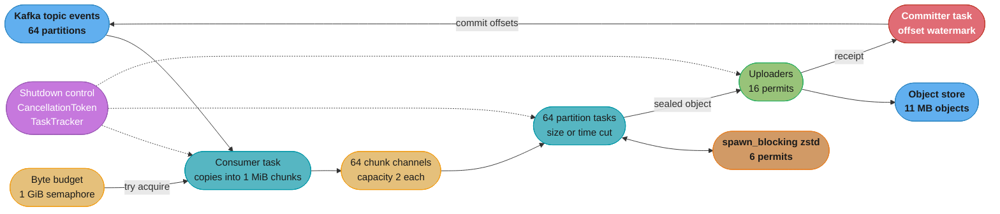
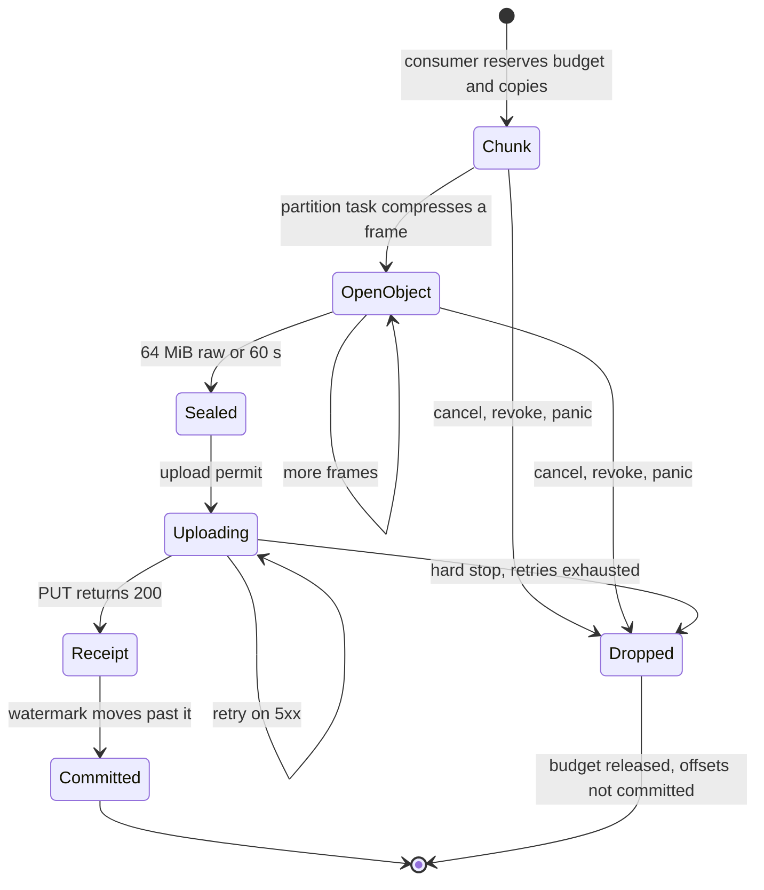

# Case Study: Design an Async Event Ingest Pipeline in Rust

> Versions as of 2026-11-06: Rust 1.99.1 on edition 2024; tokio 1.54.1 (MSRV 1.85);
> tokio-util 0.7.20; bytes 1.12.1; zstd 0.14.3; tracing 0.1.44; metrics 0.24.6;
> tikv-jemallocator 0.7.0. Tokio defaults read from the `tokio-1.54.1` source: the blocking
> pool caps at 512 threads, and the coop budget is 128 per task poll.

## Intuition

> **Design intuition**: A pipeline that reads 500,000 events per second from Kafka and writes them to object storage keeps two promises. It holds a fixed amount of memory, whatever the downstream does. It never commits an offset for an event that is not durable. In Rust both promises live in one value. A batch owns its bytes, a permit from the byte budget, and the offset range it covers. That value has two exits. A successful upload consumes it and returns a receipt, and only a receipt can advance a commit. Every other path drops it, and the drop returns the memory and leaves the offsets uncommitted, so Kafka delivers those events again. Async cancellation is a drop, so a cancelled task is safe as long as no code commits before the receipt exists.

This is a **Rust runtime** case study. The sibling study,
[Go: Design a High-Throughput Ingest Service](../../go/case_studies/design_a_high_throughput_ingest_service.md),
takes events over HTTP, acknowledges on enqueue, and pushes them into Kafka. Its hard parts are
allocation rate, garbage-collector assist, shard mutexes and shedding with a 429. This study
does not repeat them. It runs the other half of the data path: it pulls from Kafka and writes
compressed files to object storage. There is no garbage collector, no client to send a 429 to,
and no acknowledgement before durability. The hard parts are blocking work (zstd) on an async
runtime, backpressure into a pull consumer that the broker evicts if it stops polling,
cancellation at any `.await`, offset bookkeeping when uploads finish out of order, and a
memory bound that holds with no collector to free memory for you.

The study stops where `hld/` starts. Partition counts, group protocols and exactly-once
semantics across systems live in [HLD: Message Queues](../../hld/message_queues/message_queues.md)
and [HLD: Stream Processing](../../hld/stream_processing/stream_processing.md).

**The design rule**: acquire memory in one place, before the bytes exist, and let every later
stage only shrink or release it. Advance a commit in one place, after the object exists.

Everything here builds on:
[Ownership, Borrowing and RAII](../ownership_borrowing_and_raii/ownership_borrowing_and_raii.md),
[Lifetimes and the Borrow Checker](../lifetimes_and_the_borrow_checker/lifetimes_and_the_borrow_checker.md),
[Async Runtimes and Executors](../async_runtimes_and_executors/async_runtimes_and_executors.md),
[Tokio Deep Dive](../async_runtimes_and_executors/tokio_deep_dive.md),
[Async Cancellation and Pitfalls](../async_cancellation_and_pitfalls/async_cancellation_and_pitfalls.md),
[Channels, Atomics and Shared State](../channels_atomics_and_shared_state/channels_atomics_and_shared_state.md),
and the cross-cutting file [Memory Budgets Without a GC](cross_cutting/memory_budgets_without_a_gc.md).

---

## 1. Requirements Clarification

### Functional Requirements

- Consume the Kafka topic `events` (64 partitions) as one consumer group. Events are
  newline-free JSON: median 400 bytes, p99 2 KiB, hard cap 1 MiB.
- Write the events to an S3-compatible store as newline-delimited JSON compressed with zstd.
  One object holds events from one partition only, in offset order.
- Key layout: `events/dt=2026-11-06/hr=14/p=017/00000000004181920000.ndjson.zst`. The hour
  comes from the Kafka timestamp of the first event. The last segment is the object's first
  offset, zero-padded to 20 digits so that keys sort in offset order.
- Commit a Kafka offset only after every event below it is in a durable object.
- Send events that fail the envelope check (not UTF-8, contains a newline, over 1 MiB) to a
  `dead-letter/` prefix. The pipeline does not parse the JSON.
- Follow rebalances: stop work on a revoked partition, start on an assigned one.

### Non-Functional Requirements

- **Sustained 500,000 events/second** per process, **800,000/second for 15 minutes** to drain
  a backlog after an outage.
- **Freshness p99 under 90 seconds** from Kafka append to object visible.
- **Container: 8 vCPU, 4 GiB.** Bytes the pipeline owns (chunks, frames, objects) stay under a
  **1 GiB byte budget**. Steady-state RSS stays under 2.5 GiB.
- **At-least-once.** Zero events lost on a crash, deploy or rebalance. Duplicates are bounded
  by the commit interval (§5), and a clean shutdown produces none.
- **Survive a 10-minute object-store brownout** with no OOM kill and no eviction from the group.
- **Shut down inside a 30-second grace period.**

### Out of Scope

- Broker topology and replication: [HLD: Message Queues](../../hld/message_queues/message_queues.md).
- Atomic visibility of many files: [Apache Iceberg](../../technologies/apache_iceberg/apache_iceberg.md)
  and [Lakehouse and Table Formats](../../database/lakehouse_and_table_formats/lakehouse_and_table_formats.md).
- Queueing math: [Queueing Theory for Capacity](../../backend/queueing_theory_for_capacity/queueing_theory_for_capacity.md).

---

## 2. Scale Estimation

### Ingress and compression

```
Sustained rate:            500,000 events/s x 400 B = 200 MB/s raw
Per partition (64):        3.1 MB/s, about 7,800 events/s
Daily raw volume:          200 MB/s x 86,400 s = 17.3 TB/day
Catch-up rate:             800,000 events/s = 320 MB/s raw
```

The zstd project README publishes 510 MB/s compression and 1,550 MB/s decompression for
`zstd 1.5.7 -1` on an Intel Core i7-9700K at 4.9 GHz, on the Silesia corpus, ratio 2.896. A
cloud vCPU is slower than that desktop core, so this design budgets half.

```
Budget per vCPU, level 1:  255 MB/s
zstd CPU:                  200 / 255 = 0.8 vCPU sustained, 1.3 vCPU at catch-up
Ratio on event JSON:       6x (assumed: repeated field names compress far better than Silesia)
Compressed output:         33 MB/s, 2.9 TB/day
```

Measure the ratio on real events before you size storage. A 3x ratio doubles object bytes,
open-object memory and upload concurrency.

### Objects, chunks and uploads

An object is cut at 64 MiB raw or 60 seconds, whichever comes first.

```
Compressed per object:     67.1 MB / 6 = 11.2 MB
Fill time per partition:   67.1 MB / 3.1 MB/s = 21.6 s   (size cut wins at full load)
Objects:                   200 / 67.1 = 2.98 /s, 257,500 /day
```

The time cut is for quiet and skewed partitions. A partition at one tenth of the average rate
fills 64 MiB in 216 seconds, which breaks the 90-second freshness target.

The consumer copies events into 1 MiB chunks, and the chunk is the unit that moves between
tasks: about 2,600 events per chunk and 190 chunk sends per second, against 500,000 sends per
second for an event-per-send design.

```
Upload arrival:            2.98 objects/s (sustained), 4.8 objects/s (catch-up)
PUT latency, 11 MB:        p50 0.4 s, p99 1.2 s (budget for one region)
L = lambda x W:            2.98 x 1.2 = 3.6 in flight; catch-up with slow PUTs 4.8 x 2.0 = 9.6
Upload permits:            16
Tokio workers:             8 (one per vCPU, the multi-thread default)
Compression permits:       6 (leaves 2 vCPU for the consumer, librdkafka and uploads)
Partition tasks:           64, one per assigned partition
```

---

## 3. High-Level Architecture



### Lifecycle of one batch



Every path to `Dropped` releases the budget through `Drop` and leaves the Kafka offsets where
they were. The only path that moves an offset passes through `Receipt`.

---

## 4. Component Deep Dives

### 4.1 From borrowed messages to owned chunks

A Rust Kafka client hands you a message that borrows from the client. In rdkafka the type is
`BorrowedMessage<'a>`. Its docs say that messages from a consumer "are removed from the
consumer buffer once they are dropped", and warn that holding many of them can make the
consumer block. `detach()` returns an `OwnedMessage` that "can outlive the consumer", at the
cost of an allocation per message.

The example below models the consumer with std types. `recv` returns a message that borrows the
consumer's buffer, and the loop tries to send the payload slice to a writer thread.

```rust
// BROKEN
// error[E0597]: `consumer` does not live long enough
use std::sync::mpsc::sync_channel;
use std::thread;

struct Message<'a> {
    offset: i64,
    payload: &'a [u8],
}

struct Consumer {
    buf: Vec<u8>,
    next: i64,
}

impl Consumer {
    fn recv(&mut self) -> Message<'_> {
        self.next += 1;
        Message { offset: self.next, payload: &self.buf }
    }
}

fn main() {
    let mut consumer = Consumer { buf: b"{\"e\":1}".to_vec(), next: 0 };
    let (tx, rx) = sync_channel::<&[u8]>(32);
    let writer = thread::spawn(move || rx.iter().map(|p| p.len()).sum::<usize>());
    for _ in 0..3 {
        let msg = consumer.recv();
        let _ = msg.offset;
        tx.send(msg.payload).expect("writer alive");
    }
    drop(tx);
    let _ = writer.join();
}
```

A channel into a spawned thread needs `'static` data, and the payload borrows `consumer`. The
Go sibling's §9 describes the same aliasing mistake: it compiled, passed the race detector and
corrupted events in production. Here it does not compile.

The fix copies each payload into an owned chunk. That is the only copy in the pipeline, and
moving a chunk between tasks moves three words of `Vec` header, not the bytes.

```rust
use std::sync::mpsc::sync_channel;
use std::thread;

struct Message<'a> {
    offset: i64,
    payload: &'a [u8],
}

/// An owned run of events from one partition, newline-delimited.
struct Chunk {
    first: i64,
    next: i64,
    bytes: Vec<u8>,
}

impl Chunk {
    fn push(&mut self, msg: &Message<'_>) {
        self.bytes.extend_from_slice(msg.payload);
        self.bytes.push(b'\n');
        self.next = msg.offset + 1;
    }
}

fn main() {
    let buf = b"{\"e\":1}".to_vec();
    let (tx, rx) = sync_channel::<Chunk>(2);
    let writer = thread::spawn(move || rx.iter().map(|c| c.bytes.len()).sum::<usize>());

    let mut chunk = Chunk { first: 1, next: 1, bytes: Vec::with_capacity(1 << 20) };
    for offset in 1..=3 {
        chunk.push(&Message { offset, payload: &buf });
    }
    assert_eq!((chunk.first, chunk.next), (1, 4));
    if tx.send(chunk).is_err() {
        return;
    }
    drop(tx);
    assert_eq!(writer.join().unwrap_or(0), 3 * 8);
}
```

Two fields matter later. `next` is the offset after the last event, which is the value a
Kafka commit takes: the rdkafka docs for `commit` call it "the next message to be consumed",
the last consumed offset plus one. `first` is set by the caller, not by the first message, and
§4.7 explains why.

The copy is a `memcpy` of 200 MB/s, a small fraction of one core. The chunk is also the owned
buffer that zstd and the store client want, so no later stage copies again.

rdkafka wraps librdkafka, a C library. The pipeline has no `unsafe` blocks of its own, but it
links a large C dependency through FFI. Admit and review it with the rules in
[Unsafe Review and Soundness Checklist](cross_cutting/unsafe_review_and_soundness_checklist.md):
pin the version, run it under the sanitizer job, and track it in the `cargo-geiger` report.

### 4.2 The byte budget is a permit that travels with the bytes

The consumer reserves budget before it copies an event. The reservation is a value, and it
moves with the chunk into the frame, the open object and the sealed object. When the last
owner drops, the bytes go back to the budget. That covers the paths nobody plans for: a
cancelled task, a revoked partition, an `Err` returned through `?`, and a panic that unwinds.

```rust
use std::panic;
use std::sync::Arc;
use std::sync::atomic::{AtomicUsize, Ordering};

pub struct ByteBudget {
    used: Arc<AtomicUsize>,
    limit: usize,
}

/// Bytes held against the budget. Dropping it gives them back.
pub struct Reservation {
    used: Arc<AtomicUsize>,
    bytes: usize,
}

impl ByteBudget {
    pub fn try_reserve(&self, bytes: usize) -> Option<Reservation> {
        let limit = self.limit;
        self.used
            .fetch_update(Ordering::AcqRel, Ordering::Acquire, |u| {
                u.checked_add(bytes).filter(|&n| n <= limit)
            })
            .ok()?;
        Some(Reservation { used: Arc::clone(&self.used), bytes })
    }
}

impl Drop for Reservation {
    fn drop(&mut self) {
        self.used.fetch_sub(self.bytes, Ordering::AcqRel);
    }
}

fn main() {
    const MIB: usize = 1 << 20;
    let budget = ByteBudget { used: Arc::new(AtomicUsize::new(0)), limit: 4 * MIB };

    let chunk = budget.try_reserve(3 * MIB).map(|r| (vec![0u8; 16], r));
    assert!(chunk.is_some());
    assert!(budget.try_reserve(2 * MIB).is_none(), "over the limit: pause the partition");

    // A task that panics while it owns the chunk still returns the bytes.
    let result = panic::catch_unwind(move || {
        let owned = chunk;
        assert!(owned.is_some());
        panic!("compression failed");
    });
    assert!(result.is_err());
    assert_eq!(budget.used.load(Ordering::Acquire), 0);
    assert!(budget.try_reserve(2 * MIB).is_some());
}
```

In the service the budget is a `tokio::sync::Semaphore` with 1,048,576 permits, one per KiB.
The consumer calls `try_acquire_many_owned`, which never waits, and stores the
`OwnedSemaphorePermit` in the chunk. After compression, `OwnedSemaphorePermit::split(n)` moves
the permits for the bytes that compression removed into a new permit, and dropping that permit
returns them. The frame keeps only the permits for its compressed size.

**Why this budget cannot deadlock.** A budget deadlocks when a stage holds permits and waits
for more. Here the consumer is the only code that acquires permits, and it never waits: on a
failed `try_acquire` it pauses the partition (§4.3). Every later stage shrinks its permit
(compression) or drops it (upload done, cancel, revoke). No stage waits for budget while it
holds budget, so no wait cycle can form. If a frame grows on incompressible input, it keeps its
whole permit, and the overshoot is at most one chunk per compression permit.

The budget covers bytes the pipeline owns. It does not cover librdkafka's C heap, TLS buffers or
allocator overhead. §10 adds those up, and
[Memory Budgets Without a GC](cross_cutting/memory_budgets_without_a_gc.md) explains why RSS and
live allocations differ.

### 4.3 Backpressure into a consumer that must keep polling

A push service can reject a request. A pull consumer can only stop asking. The obvious way to
stop asking is to `await` a full channel inside the poll loop, and it fails twice:

- One consumer task serves all 64 partitions. A full channel for partition 17 stops the loop,
  and the other 63 partitions stop with it.
- librdkafka's `max.poll.interval.ms` defaults to 300,000, the "maximum allowed time between
  calls to consume messages". A brownout longer than 5 minutes removes the process from the
  group, the group rebalances, and the new owner hits the same slow store.

The consumer uses `try_send` and rdkafka's per-partition `pause` and `resume` instead.

```rust
// fragment
use rdkafka::TopicPartitionList;
use rdkafka::consumer::Consumer;
use tokio::sync::mpsc::error::TrySendError;

fn hand_off(&mut self, chunk: Chunk) -> Result<(), PipelineError> {
    let p = chunk.partition;
    let Some(tx) = self.senders.get(&p).cloned() else { return Ok(()) }; // revoked: drop it
    match tx.try_send(chunk) {
        Ok(()) | Err(TrySendError::Closed(_)) => Ok(()),
        Err(TrySendError::Full(chunk)) => {
            let mut tpl = TopicPartitionList::new();
            tpl.add_partition(&self.topic, p);
            self.consumer.pause(&tpl)?;
            self.paused.insert(p);
            let consumer = Arc::clone(&self.consumer);
            self.tracker.spawn(async move {
                let Ok(permit) = tx.reserve_owned().await else { return };
                permit.send(chunk);
                if let Err(e) = consumer.resume(&tpl) {
                    tracing::error!(partition = p, error = %e, "resume failed");
                }
            });
            Ok(())
        }
    }
}
```

The poll loop never waits on downstream, so it keeps polling and keeps its membership. A pause
stops new fetches, but messages that librdkafka fetched before the pause can still arrive. The
consumer appends them to the partition's open chunk. If that chunk fills while the partition is
paused, the consumer drops it and seeks the partition back to the chunk's `first` offset.
Nothing was committed, so Kafka serves those events again after the resume. A paused partition
holds at most one parked chunk and one open chunk, 2 MiB. An empty byte budget takes the same
path: pause, and retry the reservation from the resume task.

### 4.4 Size-or-time batching in the partition task

Each assigned partition gets one task. It receives chunks, compresses each into a zstd frame,
appends frames to an open object, and seals the object at 64 MiB raw or 60 seconds.

```rust
// fragment
use tokio::time::{Instant, sleep_until};
use tokio_util::sync::CancellationToken;

pub async fn run_partition(
    mut chunks: mpsc::Receiver<Chunk>,
    objects: mpsc::Sender<SealedObject>,
    cpu: Arc<Semaphore>,
    stop: CancellationToken,
    cfg: BatchConfig,
) -> Result<(), PipelineError> {
    let mut open: Option<OpenObject> = None;
    let mut inbox = Vec::with_capacity(2);
    loop {
        let deadline = open.as_ref().map(|o| o.opened_at + cfg.max_age);
        tokio::select! {
            biased;
            _ = stop.cancelled() => return Ok(()), // drops `open`: budget back, offsets uncommitted
            n = chunks.recv_many(&mut inbox, 2) => {
                if n == 0 {
                    return Ok(()); // sender dropped: revoked or consumer stopped
                }
                for chunk in inbox.drain(..) {
                    let frame = compress(chunk, &cpu).await?;
                    let obj = open.get_or_insert_with(|| OpenObject::new(&frame, Instant::now()));
                    obj.append(frame);
                    if obj.raw_len >= cfg.max_raw_bytes {
                        seal(&mut open, &objects).await?;
                    }
                }
            }
            _ = sleep_until(deadline.unwrap_or_else(Instant::now)), if deadline.is_some() => {
                seal(&mut open, &objects).await?;
            }
        }
    }
}
```

Three choices here are deliberate:

1. **`biased;` with the stop branch first.** Without it, `select!` polls ready branches in
   random order, and during shutdown a partition with a full inbox can keep compressing for
   several iterations before it sees the token.
2. **`recv_many` is cancel safe.** The tokio docs say so for `recv` and `recv_many`: if
   another branch completes first, no message was taken from the channel. `recv_many` returns 0
   only when the channel is closed and empty.
3. **The deadline is an `Instant` fixed when the object opens.** The timer branch builds a new
   `sleep_until` future every iteration, and that is fine because the deadline does not move.
   The common bug writes `sleep(cfg.max_age)` here, which restarts a 60-second timer on every
   chunk. A partition that receives a chunk every 50 seconds then never reaches its time cut
   (§9).

`seal` sends the object over a bounded channel to the uploaders, and that `await` waits when
all 16 upload permits are busy. The partition task then stops reading its chunk channel, the
channel fills, and §4.3 pauses the partition. Backpressure travels from the store to the broker
through bounded channels only.

### 4.5 zstd belongs on the blocking pool

Compressing a 1 MiB chunk at 255 MB/s takes about 4 ms. On a Tokio worker those 4 ms block
every task queued on that worker: other partitions, timers and the consumer loop. At 190 chunks
per second that is 0.8 seconds of blocked worker time per second. The coop budget (128 per task
poll) makes Tokio resources return `Pending` so that a task yields. It cannot interrupt CPU work
that never awaits.

```rust
// fragment
pub async fn compress(chunk: Chunk, cpu: &Arc<Semaphore>) -> Result<Frame, PipelineError> {
    let permit = Arc::clone(cpu).acquire_owned().await?;
    let job = tokio::task::spawn_blocking(move || {
        let _cpu = permit; // released when compression ends, even if the caller was dropped
        let z = zstd::bulk::compress(&chunk.bytes, 1)?;
        Ok::<_, std::io::Error>(Frame::from_chunk(chunk, z))
    });
    Ok(job.await??)
}
```

The permit moves into the closure on purpose. A `spawn_blocking` closure cannot be cancelled
once it starts. If the partition task is dropped while it awaits `job`, the closure still runs
to the end. A permit held by the awaiting future would be released at the drop, and a seventh
compression could start while the sixth still runs.

Each frame is a complete zstd frame. The zstd format allows concatenated frames, and a decoder
reads them as one stream, so an object is its frames appended in order, with no index. A
partial object is never visible, because the object is written by one PUT after it is sealed.

`block_in_place` has no CPU cap, takes a worker away for the whole call, and is not allowed on
a `current_thread` runtime. A dedicated rayon pool of 6 threads gives the same cap with one more
pool to size and observe. The semaphore version reuses the pool Tokio already runs.

glibc gives threads their own malloc arenas, so blocking-pool threads multiply fragmentation.
The service sets the global allocator to jemalloc through `tikv-jemallocator`, so Rust
allocations no longer use glibc arenas. librdkafka calls `malloc` from C, so its allocations
still go to glibc unless jemalloc is built with unprefixed symbols.
[Memory Budgets Without a GC](cross_cutting/memory_budgets_without_a_gc.md) covers
`MALLOC_ARENA_MAX` and how to measure the difference.

### 4.6 Upload, and the receipt that unlocks a commit

The uploader takes a sealed object and writes it with one `object_store` PUT. On a 5xx it makes
up to 8 attempts, with backoff from 200 ms doubling to a 10 s cap, about 23 seconds of waiting. The
body is `Bytes`, so a retry clones a reference count, not 11 MB. After the last attempt the
object is dropped, its offsets stay uncommitted, and the partition restarts from the committed
offset. The retry window is shorter than the brownout requirement on purpose: a long outage
fills the upload permits, backpressure pauses the partitions, and no data waits in memory
beyond one object per permit.

The receipt is the only type the committer accepts. `upload(obj)` takes the sealed object by
value and returns `Result<Uploaded, PipelineError>`, so code that reads `obj.next` after that
call, to commit early, fails with `error[E0382]: borrow of moved value`. `Uploaded` lives in the
uploader module with private fields and no public constructor, and it carries
`#[must_use]`, so a caller that drops a receipt without sending it to the committer gets a
warning. The module boundary enforces the rule, and no reviewer has to.

### 4.7 The offset watermark

Objects for one partition can finish out of order. Object B can succeed while object A still
retries. Committing B's end would tell Kafka that A is durable. The committer keeps a watermark
per partition and moves it only across a contiguous run of receipts.

Kafka offsets are not dense. Log compaction removes offsets, and transaction markers take
offsets the consumer never sees. So a range cannot start at its first event's offset. The
partition task makes ranges tile the offset space: the first range starts at the committed
offset the partition was assigned with, and each later range starts at the `next` of the range
before it.

```
offsets in the log:   1000 ......... 1997  (compacted gap)  2003 ......... 2999  3000 .. 3499
events delivered:     |=== object A ===|                     |=== object B ===|   |= object C =|
ranges, as tiled:     [1000 ............................ 2003)[2003 ........... 3000)[3000 .. 3500)
upload finishes:            third                                  first                second
watermark:            1000 -> 1000 (B done) -> 1000 (C done) -> 3500 (A done, jumps two ranges)
```

A's range ends at 2003, the start of B, so the compacted gap is covered and the watermark can
cross it.

```rust
use std::collections::BTreeMap;

/// Durable offset ranges for one partition. `committed` is the next offset to read.
pub struct OffsetTracker {
    committed: i64,
    done: BTreeMap<i64, i64>,
}

impl OffsetTracker {
    pub fn new(committed: i64) -> Self {
        OffsetTracker { committed, done: BTreeMap::new() }
    }

    /// Records the durable range [first, next). Returns the commit offset if it moved.
    pub fn complete(&mut self, first: i64, next: i64) -> Option<i64> {
        if next <= self.committed {
            return None;
        }
        self.done.insert(first, next);
        let start = self.committed;
        while let Some(next) = self.done.remove(&self.committed) {
            self.committed = next;
        }
        (self.committed > start).then_some(self.committed)
    }

    pub fn pending(&self) -> usize {
        self.done.len()
    }
}

fn main() {
    let mut t = OffsetTracker::new(1_000);
    assert_eq!(t.complete(2_003, 3_000), None, "B first: A is missing");
    assert_eq!(t.complete(3_000, 3_500), None, "C next: still blocked on A");
    assert_eq!(t.pending(), 2);
    assert_eq!(t.complete(1_000, 2_003), Some(3_500), "A closes the gap");
    assert_eq!(t.pending(), 0);
    assert_eq!(t.complete(1_000, 2_003), None, "a duplicate receipt is ignored");
}
```

`pending()` is exported as a metric. A partition whose pending count climbs has one stuck
object that holds the watermark back, and every receipt behind it is a duplicate if the process
crashes.

The committer task owns a `HashMap<i32, (u64, OffsetTracker)>` keyed by partition, with the
assignment generation (§4.8) next to each tracker. It reads one channel of events: `Assigned`
creates a tracker, `Revoked` removes it, and a receipt calls `complete` when its generation
matches. A `tokio::time::interval` of 5 seconds, with `MissedTickBehavior::Delay`, commits the
watermarks that moved with `commit(&tpl, CommitMode::Async)`. When the channel closes, the
committer runs one last `CommitMode::Sync` commit and exits. The pipeline sets
`enable.auto.commit=false`, so no other code commits.

### 4.8 Rebalances and the generation check

When the group rebalances, partition 17 can move to another process while an upload for it is
still in flight here. If that upload succeeds later, its receipt must not commit. An old commit
would move the group's offset backward and replay events.

Each assignment gets a generation number from a counter in the rebalance callback. The
partition task stamps it on every object, the receipt carries it, and the committer ignores a
receipt whose generation does not match. On revoke, the consumer drops the partition's chunk
sender, the partition task sees `recv_many` return 0 and drops its open object, and the
committer removes the tracker. Uploads already in flight finish or fail on their own. Their
objects can land in the store while the new owner starts from the committed offset, so those
events appear twice. §5 bounds the count.

The rebalance callback runs on the thread that polls the consumer. It sends messages to tasks
and never waits on them.

### 4.9 Shutdown inside 30 seconds

The Go sibling must flush partial batches on shutdown, because it acknowledged those events to
producers. This pipeline acknowledged nothing. An open object holds events above the committed
offset, so dropping it loses nothing: the next owner reads them again.

```rust
// fragment
use tokio::time::{Instant, timeout_at};

pub async fn shutdown(p: Pipeline, grace: Duration) {
    let deadline = Instant::now() + grace - Duration::from_secs(5);
    p.stop_consuming.cancel(); // partition tasks drop open objects
    p.tracker.close(); // wait() can now return once the tracker is empty
    if timeout_at(deadline, p.tracker.wait()).await.is_err() {
        tracing::warn!("uploads still running at the deadline, dropping them");
        p.hard_stop.cancel(); // dropped uploads leave no receipt, so no commit
        p.tracker.wait().await;
    }
    // The committer saw its channel close and ran a final synchronous commit.
    p.consumer.unsubscribe();
}
```

The order matters. Consuming stops first, so no chunk enters a draining pipeline. The tokio-util
docs say `wait` returns once the tracker is closed and empty, after every task's future has been
dropped. The 5-second margin keeps the kubelet's SIGKILL away from the final commit. A hard stop
drops hung PUTs, which leave no receipt and so no commit. `unsubscribe` lets the group reassign
now instead of after `session.timeout.ms` (default 45,000 ms).

`TaskTracker` is used instead of `JoinSet`. The tokio-util docs note that a `JoinSet` keeps the
return value of every task until `join_next` reads it, and "This can cause the process to run
out of memory". A tracker removes tasks as they exit, and nothing here needs task results.

A clean shutdown produces no duplicates, because every receipt that exists is committed. The
cost is re-reading the open objects. The average open object is half full, so the next owners
re-read about 64 x 32 MiB = 2 GiB. At 300 MB/s of catch-up fetch that is about 7 seconds.

---

## 5. Design Decisions & Tradeoffs

### Decision 1: one partition per object

Mixing partitions gives fewer, larger objects, but each object then covers many offset ranges,
and one slow partition holds back the commit for the rest. One partition per object maps an
object to one range in one tracker. The cost is 257,500 objects a day, which a table-format
compaction job can merge later.

### Decision 2: 1 MiB chunks between tasks

One event per send means 500,000 sends per second. 64 KiB chunks mean 3,050. 1 MiB chunks mean
190 sends and 2 MiB of channel memory per partition at capacity 2, and a 1-second chunk age cut
limits the added freshness to 1 s. 8 MiB chunks add up to 2.7 s per partition at full load.

### Decision 3: pause partitions, do not block the poll loop

| Option | One slow partition | 5+ minute brownout | Memory |
|---|---|---|---|
| `await` a full channel in the poll loop | Stops all 64 | Evicted by `max.poll.interval.ms`, rebalance loop | Bounded |
| Unbounded channels | No effect | No eviction, then OOM kill | Unbounded |
| Drop events when full | No effect | Data loss: offsets move past dropped events | Bounded |
| Pause, park one chunk, seek back if needed | Stops only that partition | Membership kept | 2 MiB per paused partition |

### Decision 4: at-least-once, duplicates bounded by the commit interval

A crash loses nothing, because commits trail durability. It can repeat data: receipts that
arrived after the last commit, and uploads that succeeded with no receipt.

```
Commit interval:          5 s
Raw bytes per interval:   200 MB/s x 5 s = 1 GB, about 2.5 million events
Upper bound per crash:    2.5 M + 16 in-flight objects x 167,000 events = about 5.2 million
Clean shutdown:           0 (final synchronous commit)
```

The key layout removes part of that. The first object after a restart starts at the committed
offset, the same first offset as an orphan object from before the crash, so it gets the same
key and overwrites the orphan. Later orphans collide only if the new cuts land on the same
offsets, so readers still dedupe by `(partition, offset)`.

Exactly-once needs the offsets and the object list to change in one atomic write. Quickwit's
docs say its checkpoints "are stored in the metastore and updated atomically each time a new
split is published". With Iceberg, the equivalent is to write the Kafka offsets into the
snapshot that adds the files. The Rust code changes little: the receipt type stays, and the
committer writes a table commit instead of a Kafka commit.

### Decision 5: Tokio multi-thread runtime

The work is I/O plus bounded CPU on the blocking pool, with 64 partition tasks that are idle
most of the time. Work stealing lets an idle worker take tasks from a busy one. Thread-per-core
runtimes (monoio, glommio) pay off when every connection is hot, which is the case in
[Design a High-Performance L7 Proxy](design_a_high_performance_l7_proxy.md). The decision model
is in [Async Runtimes and Executors](../async_runtimes_and_executors/async_runtimes_and_executors.md).

### Decision 6: one PUT per object, not multipart streaming

AWS says to consider multipart uploads once an object reaches 100 MB. Parts are 5 MiB to 5 GiB,
the last part has no minimum, and an upload has at most 10,000 parts. At 11 MB a single PUT is
simpler, and the object never exists half-written. Multipart becomes the answer if objects
grow: 1 GiB raw objects (about 170 MB compressed) would need 64 x 170 MB = 10.9 GB of open
objects, while streaming 8 MiB parts keeps open-object memory at one or two parts per
partition. The cost is an `AbortIncompleteMultipartUpload` lifecycle rule for parts that a
crash leaves behind.


---

## 6. Real-World Implementations

**Vector (Datadog).** Vector is "a high-performance, end-to-end (agent & aggregator)
observability data pipeline". Its README says it is "Built in Rust" and "maintained by
Datadog's Community Open Source Engineering team". Two of its documented mechanisms match this
design:

- Buffers. A sink's memory buffer defaults to 500 events, and buffers between components are
  typically 100. When a buffer is full the default `when_full` behavior is `block`, and the
  alternative `drop_newest` discards incoming events. A disk buffer has a minimum size of about
  256 MiB. `block` is the pause in §4.3, and `drop_newest` is the "drop when full" row of
  Decision 3, offered as an explicit choice.
- End-to-end acknowledgements. A participating source waits for sink status before it
  acknowledges. The `kafka` and `aws_sqs` sources acknowledge the event directly, because they
  "have native support for acknowledging messages". The `socket` source cannot acknowledge, and Vector warns at startup that "silent
  data loss may occur" when acknowledging sinks are fed by a source that cannot acknowledge.
  That is the receipt rule in §4.6, applied across a pipeline graph.

**Quickwit.** Quickwit is a search engine that stores its index on Amazon S3, Azure Blob
Storage or Google Cloud Storage, with native Kafka, Kinesis and Pulsar sources. Its Kafka
source "manages commit offsets internally using the checkpoint API" and "forces auto-commits to
be disabled". Its indexing docs say "Quickwit achieves exactly-once processing using
checkpoints". Quickwit ships the exactly-once option from Decision 4.

**InfluxDB 3 Core (InfluxData).** The README lists it as "Built with: Rust, Apache Arrow,
DataFusion", storing "Apache Parquet on object storage (S3, Azure, GCP) or local disk". Its
write path has the shape of this pipeline: accept a stream, hold a bounded amount in memory,
and persist columnar files to object storage.

**librdkafka (Confluent).** The defaults that shape this design come from its
`CONFIGURATION.md`: `max.poll.interval.ms` 300,000, `session.timeout.ms` 45,000,
`enable.auto.commit` true, `auto.commit.interval.ms` 5,000, `queued.max.messages.kbytes` 65,536
and `fetch.max.bytes` 52,428,800. The pipeline turns auto-commit off and lowers
`queued.max.messages.kbytes` to 32,768 so that the C-side prefetch fits the memory plan.

**zstd (the facebook/zstd project).** The README benchmark behind §2: level 1 at 510 MB/s
compress and 1,550 MB/s decompress, ratio 2.896, on an i7-9700K at 4.9 GHz. `--fast=1` gives
545 MB/s at ratio 2.439, an option if compression ever becomes the CPU limit.

---

## 7. Technologies & Tools

| Tool | Version | Role in this design | Note |
|---|---|---|---|
| Rust | 1.99.1, edition 2024 | Language and toolchain | Pin with `rust-toolchain.toml` |
| tokio | 1.54.1 | Runtime, `mpsc`, `Semaphore`, `time` | `recv_many` is documented cancel safe |
| tokio-util | 0.7.20 | `CancellationToken`, `TaskTracker` | `TaskTracker` over `JoinSet` when results are not needed |
| rdkafka | 0.39.0 (crates.io, 2026-01-25, MSRV 1.74) | Kafka consumer over librdkafka | `BorrowedMessage` borrows from the consumer |
| object_store | 0.14.2 (crates.io, 2026-09-15, MSRV 1.85) | One API for S3, GCS, Azure and local disk | `PutPayload` from `Bytes` |
| bytes | 1.12.1 | Object bodies | Clone is a reference-count increment |
| zstd | 0.14.3 | Frame compression on the blocking pool | Level 1, frames concatenated |
| tracing | 0.1.44 | Spans per partition and per object | See [Observability with tracing](../observability_tracing_and_opentelemetry/observability_tracing_and_opentelemetry.md) |
| metrics | 0.24.6 | Budget, pause, watermark and latency metrics | Low-cardinality labels only |
| tikv-jemallocator | 0.7.0 | Global allocator | Covers Rust allocations, not librdkafka's |
| tokio-console | 0.1.14 | Live task view in staging | Finds tasks that run long without yielding |
| thiserror | 2.0.21 | `PipelineError` enum | See [error design](../error_handling_and_panics/error_design_for_libraries_and_applications.md) |
| cargo-deny | 0.20.2 | Dependency admission in CI | librdkafka's C build is the large surface |

---

## 8. Operational Playbook

### Dashboard panels

| Panel | Metric | Alert |
|---|---|---|
| Byte budget in use | `ingest_budget_used_kib` against 1,048,576 | Above 90% for 5 minutes |
| Paused partitions | `ingest_paused_partitions` | Above 0 for 10 minutes |
| Oldest open object | `ingest_open_object_age_seconds`, max | Above 75 s (time cut is 60 s) |
| Upload latency | `ingest_put_seconds` p99 | Above 3 s |
| Watermark backlog | `ingest_tracker_pending`, max | Above 4 |
| Consumer lag | Group lag per partition | Above 45 s of traffic |
| Blocking pool | Tokio runtime metrics: blocking threads and queue depth | Queue depth above 0 for 1 minute |
| RSS against budget | Container RSS and `ingest_budget_used_kib` on one panel | RSS above 2.5 GiB |

Freshness is the sum of consumer lag, the oldest open object and upload latency. When it breaks,
those three panels show which stage holds the time.

### Runbook: object-store brownout

1. Confirm on the upload panels that PUT 5xx is the cause.
2. Watch paused partitions climb. That is backpressure working. Do not restart pods: a restart
   drops open objects and adds re-reads to the brokers.
3. Confirm the budget stays at or under 100% and RSS stays flat.
4. After recovery, lag drains at 800,000 events/s. New traffic takes 500,000 of that, so each
   minute of outage takes about 1.7 minutes to clear.

### Runbook: lag climbing with the store healthy

1. If the oldest open object is far above 60 s on some partitions, a timer is not firing (§9).
2. If the blocking queue depth is above 0, compression is the limit. Add one compression
   permit, or switch to `--fast=1`.
3. Run `tokio-console` against a canary. A task with a long busy time and few polls is doing
   CPU work on a worker thread.

### Runbook: RSS far above the budget, or a rebalance storm

1. A gap of a few hundred MiB between RSS and the budget is normal (§10). A growing gap with a
   flat budget is memory outside the budget: take a jemalloc heap profile and read librdkafka's
   statistics for queue bytes. The method is in
   [Memory Budgets Without a GC](cross_cutting/memory_budgets_without_a_gc.md).
2. For repeated rebalances, look for poll-interval timeouts in the broker logs. They mean the
   poll loop is blocked, usually by a change that awaits downstream inside it. Do not raise
   `max.poll.interval.ms`: a larger value only delays the eviction.

### Deployment

Roll one pod at a time with the 30 s grace period from §4.9, and run a 30-minute canary that
compares duplicate rate, freshness p99 and RSS. A dependency change that touches librdkafka or
zstd's C sources goes through
[Unsafe Review and Soundness Checklist](cross_cutting/unsafe_review_and_soundness_checklist.md).

---

## 9. Common Pitfalls & War Stories

These incidents are illustrative. Each one shows a real failure pattern for this design, but the
dates, counts and impacts are scenario figures, not reports from a named company.

**A timer that reset on every chunk.** The first partition loop used `_ = sleep(cfg.max_age) =>`
in its `select!`, so every chunk built a new 60-second sleep. At full load the size cut fired
first. On a Sunday, 6 low-volume partitions dropped to one chunk every 40 seconds and never
sealed. **Impact: objects on 6 partitions stayed open for up to 38 minutes, freshness p99 went
from 41 s to 2,280 s, and a downstream fraud model trained on a window with 9% of its events
missing.** The fix is the fixed `Instant` deadline in §4.4, plus a test that sends one chunk
every 59 seconds and asserts a seal at 60.

**zstd on the worker threads.** An early build compressed inline in the partition task. CPU
use looked fine at 38%, but a worker running a 4 ms compression could not poll its timers.
**Impact: the 5-second commit tick ran every 7.8 seconds on average, duplicates per crash rose
by 56%, and the poll loop showed gaps of up to 120 ms.** `spawn_blocking` with 6 permits brought
tick lateness under 2 ms. `tokio-console` found it in minutes: partition tasks had busy times
far above their poll counts.

**`await` on a full channel in the poll loop.** A refactor replaced `try_send` with
`send().await` "to keep it simple". During an 11-minute brownout the loop stopped, librdkafka
hit `max.poll.interval.ms` after 300 seconds, and the process left the group. The new owner hit
the same brownout and was evicted too. **Impact: 23 rebalances in 11 minutes, every one dropped
all open objects, the brokers served 46 GiB of re-reads, and lag took 52 minutes to clear
instead of the expected 19.** The pause path in §4.3 is the fix, with a test that fails the
build if the consumer module awaits a chunk sender.

**Committing on hand-off.** A contributor moved the commit into `seal` "to commit sooner",
which needed a second constructor for the receipt, named `Uploaded::pending`. It passed review.
A pod was OOM-killed with 14 sealed objects waiting for upload permits. **Impact: 3.2 million
events committed and never written, found 9 days later by a reconciliation job.** The fix
deleted the constructor and made the receipt's fields private to the uploader module (§4.6).

**glibc arenas from the blocking pool.** Before jemalloc, a catch-up run spiked compression to
6 concurrent jobs, each blocking thread got its own glibc arena, and freed chunk memory stayed
in the arenas. **Impact: RSS reached 3.6 GiB while the budget read 0.9 GiB, and 2 pods were
OOM-killed during the catch-up.** `tikv-jemallocator` brought steady RSS from 1.9 GiB to
0.8 GiB. The librdkafka share did not change.

**A tracker that outlived its assignment.** The first committer kept a partition's tracker
across a revoke. Partition 41 moved to another pod, which committed 2.9 million events further,
and then moved back. The old tracker, with its old watermark, took receipts again, and its next
5-second commit wrote that watermark. **Impact: the group offset for partition 41 went back by
2.9 million events, and all of them were written twice.** The fix is §4.8: a new tracker per
assignment, built from the committed offset, and a generation on every receipt. The test runs
revoke, assign and a late receipt in that order.

---

## 10. Capacity Planning

### Memory plan (one process, 8 vCPU, 4 GiB)

| Where | Worst case | Steady state | In budget |
|---|---|---|---|
| librdkafka prefetch (`queued.max.messages.kbytes` 32,768) | 32 MiB | 32 MiB | No (C heap) |
| librdkafka fetch responses (`fetch.max.bytes` 52,428,800) | 50 MiB | 20 MiB | No (C heap) |
| Open chunks, 64 x 1 MiB | 64 MiB | 32 MiB | Yes |
| Parked chunks, at most 1 per partition | 64 MiB | 0 | Yes |
| Chunk channels, 64 x 2 x 1 MiB | 128 MiB | 4 MiB | Yes |
| Compression in flight, 6 x (1 MiB in plus the frame) | 12 MiB | 4 MiB | Yes |
| Open objects, 64 x 11.2 MB | 683 MiB | 340 MiB | Yes |
| Sealed objects, 16 uploading plus 16 queued | 342 MiB | 34 MiB | Yes |
| **Budgeted items with nothing to stop them** | **1,293 MiB** | **414 MiB** | |
| **Byte budget** | **1,024 MiB** | | Caps the worst case |
| TLS, HTTP and store-client buffers | 120 MiB | 60 MiB | No |
| Tokio runtime, task state, metrics | 60 MiB | 40 MiB | No |
| Allocator overhead and retention (jemalloc) | 300 MiB | 150 MiB | No |
| **RSS** | **about 1.6 GiB** | **about 0.7 GiB** | |

The budgeted items could reach 1,293 MiB, more than the budget. That is the point of the budget:
when it runs out, the consumer pauses partitions until uploads free memory. Without it, the
sealed-object queue alone grows without limit during a brownout.

### CPU plan (8 vCPU, sustained 500k events/s)

```
Component                                   vCPU    % of 8
  librdkafka fetch and lz4 decompression    1.10    13.8%
  Envelope check and copy into chunks       0.30     3.8%
  zstd level 1, 200 MB/s at 255 MB/s/vCPU   0.80    10.0%
  Object-store PUT, TLS at 33 MB/s          0.15     1.9%
  Tokio scheduling, timers, channels        0.20     2.5%
  tracing, metrics                          0.15     1.9%
                                           -----   ------
  Total                                     2.70    33.8%
  Catch-up at 800k/s (linear):              4.32    54.0%
```

These are planning budgets. Replace them with a profile of the real service before you trust
the headroom. [Profiling and Benchmarking](../profiling_and_benchmarking/profiling_and_benchmarking.md)
covers how to take one.

### What grows with what

| Input grows | Term that grows | First limit hit |
|---|---|---|
| Event rate | zstd CPU, upload rate | Compression permits at about 6 x 255 = 1.5 GB/s raw |
| Partition count | Open objects, chunk channels | Byte budget: 128 partitions need 1.4 GB of open objects |
| Object size | Open objects | Byte budget, then the single-PUT choice (Decision 6) |
| Store latency | Sealed objects in flight | Upload permits, then pauses |
| Compression ratio drops | Open and sealed object bytes | Byte budget |

### Scaling out

One process handles 500,000 events/s at 34% of 8 vCPU and 800,000/s at 54%. Partitions are the
unit of parallelism, so 64 partitions allow at most 64 consumers. Run 3 replicas at about 21
partitions and 170,000 events/s each. When one dies, the other two own 32 partitions each at
250,000 events/s, inside the single-process numbers. At 32 partitions the open-object term
halves, so a replica can also run a 512 MiB budget in a 2 GiB container if cost matters more
than headroom.

---

## 11. Interview Discussion Points

**Q: A Go colleague says the pipeline must flush partial batches on SIGTERM or it loses data. Why is that wrong here?**
**Short:** Nothing is acknowledged before it is durable, so a dropped open batch has uncommitted offsets and Kafka redelivers it to the next owner.

The Go sibling acknowledges producers on enqueue, so a batch in memory holds events nobody else
has. This pipeline pulls from Kafka and commits only after a receipt. An open object holds
events above the committed offset, and dropping it returns its budget and leaves the offsets
where they are. On shutdown, drop open objects, let sealed objects finish uploading, and run a
final synchronous commit. That gives zero duplicates on a clean shutdown and avoids 64 small
objects per deploy. The cost is a re-read of about 2 GiB, about 7 seconds at catch-up rates.

**Q: Where does the offset commit sit relative to the upload `.await`, and why does that make cancellation safe?**
**Short:** After it, and only from a receipt the upload returns. A future dropped at any earlier await never produces a receipt, so nothing commits.

A cancelled future stops at the `.await` it was suspended on, and its locals are dropped. If the
commit follows `upload(obj).await` returning `Ok`, a cancelled task has two outcomes. It
stopped before the receipt existed, so the offsets stay uncommitted and Kafka redelivers. Or
the receipt already reached the committer, and the commit is correct. The bug is code that
moves an offset earlier, such as committing when a sealed object enters the upload queue. A
receipt type that only the uploader module can build turns that rule into a compile error.

**Q: zstd on a 1 MiB chunk takes 4 ms. Why not run it in the async task?**
**Short:** A 4 ms CPU burst blocks every task queued on that worker, including timers and the consumer loop, and the coop budget cannot preempt it.

Tokio schedules cooperatively, and a task gives its worker back only when it returns `Pending`.
Compression never awaits. At 190 chunks a second that is 0.8 seconds of blocked worker time per
second, landing at random on 8 workers, so timers fire late, the commit tick drifts, and the
poll loop stalls. The coop budget of 128 only makes Tokio resources return `Pending` early, and
it cannot interrupt a loop inside zstd. Use `spawn_blocking`, cap it with a semaphore, and move
the permit into the closure.

**Q: Why does the consumer use `try_send` and pause a partition instead of awaiting a full channel?**
**Short:** One loop serves all partitions, and librdkafka evicts a consumer that stops polling for 300 s, so awaiting downstream stalls everything and then rebalances.

Awaiting partition 17's full channel stops the poll loop for all 64 partitions. If the stall
outlasts `max.poll.interval.ms`, the consumer leaves the group and its partitions move to a pod
that hits the same slow store. Pausing only partition 17 keeps the loop polling and the
membership alive. A small task waits on `reserve_owned`, sends the parked chunk, and resumes the
partition. Prefetched messages that overflow a paused partition are dropped and the partition
seeks back, which costs re-reads and loses nothing.

**Q: How does the byte budget avoid deadlock?**
**Short:** Only the consumer acquires budget, it never waits for it, and every later stage only shrinks or releases, so nothing waits for budget while holding budget.

A budget deadlocks when a stage holds permits, waits for more, and the permits it needs belong
to a stage waiting on it. The consumer calls a non-blocking `try_acquire_many_owned` before the
bytes exist and pauses the partition on failure. Compression shrinks the permit with `split`,
sealing moves it, and upload success, cancellation, revoke and panic all drop it. No path takes
a second permit, so no cycle forms. The case to watch is a frame that grows on incompressible
input: it keeps the whole permit, and the overshoot is at most one chunk per compression permit.

**Q: A partition that gets a chunk every 50 seconds never seals an object. What is the bug?**
**Short:** The select loop builds a fresh relative sleep each iteration, so every chunk restarts the 60 s timer and a steady trickle keeps it from firing.

`sleep(Duration)` measures from the moment the future is created. In a `select!` inside a loop,
every iteration creates a new one, so each chunk resets the countdown. At full load the size cut
hides the bug. On a quiet partition the object stays open forever. Compute an `Instant` deadline
when the object opens and use `sleep_until(deadline)` guarded by `if deadline.is_some()`, so a
rebuilt future still targets the same moment. A pinned `Sleep` with `reset` also works.

**Q: Uploads for one partition finish out of order. What do you commit?**
**Short:** Only the end of the contiguous run of finished ranges that starts at the committed offset, tracked as a per-partition watermark.

Committing object B's end while object A still retries tells Kafka that A is durable. The
tracker stores finished ranges in a `BTreeMap` and moves the watermark only while the next range
starts exactly at it. The ranges must tile the offset space: each starts at the previous range's
`next`, and the first starts at the assigned offset. Starting a range at its first event's
offset breaks on compacted gaps and transaction markers, and the watermark then stops at the
first gap forever.

**Q: Why does the compiler reject sending a `BorrowedMessage` payload to another task, and what does the fix cost?**
**Short:** The payload borrows the consumer's buffer while a spawned task needs owned data. The fix is one copy into a chunk, about 200 MB/s of memcpy.

`BorrowedMessage<'a>` points into librdkafka's buffer, which is released when the message drops.
A channel to a spawned task or thread needs `'static` data, so the borrow checker reports that
the consumer does not live long enough (E0597 in the std model). `detach()` gives an
`OwnedMessage` at one allocation per message. Copying payloads into a 1 MiB chunk costs one
allocation per 2,600 messages, and the chunk is the owned buffer that zstd and the upload want
anyway.

**Q: RSS is 1.2 GiB and the byte budget reads 400 MiB. Where is the rest?**
**Short:** In memory the budget does not count: librdkafka's C heap, TLS and client buffers, runtime state and allocator retention, each measured with its own tool.

The budget counts event bytes the pipeline owns. librdkafka allocates its prefetch queue and
fetch responses with `malloc` in C, outside Rust's global allocator, up to about 80 MiB with the
§10 settings. TLS and the store client hold buffers per connection. The allocator keeps freed
pages for reuse, and per-thread glibc arenas did worse before the switch to jemalloc. Measure
each part: librdkafka statistics for queue bytes, a jemalloc heap profile for Rust allocations,
and container RSS. The method is in the memory-budgets cross-cutting file.

**Q: How would you move this design to exactly-once?**
**Short:** Commit the offsets in the same atomic metadata write that makes the objects visible, as Quickwit does with checkpoints in its metastore.

At-least-once comes from two separate writes: the object to the store and the offset to Kafka.
A crash between them repeats data. Exactly-once makes them one write: keep the offsets in the
table's metadata, such as an Iceberg snapshot property or a metastore row, update them in the
commit that adds the files, and read them from the table on restart. The Rust side barely
changes: the receipt type stays, and the committer writes a table commit. The protocol side
belongs in `hld/`.
