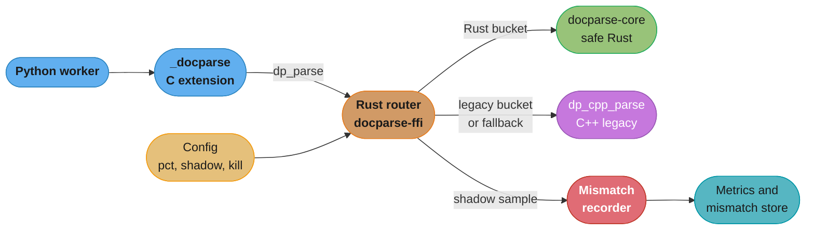

# Case Study: Design an Incremental Rust Migration

> Targets Rust 1.99.1 on edition 2024 (versions fetched 2026-11-06). Tools in this design:
> cbindgen 0.29.4, bindgen 0.73.2, cargo-nextest 0.9.151, cargo-fuzz 0.13.2, cargo-chef 0.1.78,
> cargo-geiger 0.14.0, cargo-deny 0.20.2, cargo-vet 0.10.3. Company facts: primary posts in §6.

## Intuition

> **Design intuition**: a Rust migration is a seam decision more than a language decision. Rust
> has no runtime and no garbage collector, so it can sit inside a C, C++ or Python process behind a
> plain C ABI and replace one module at a time. That property makes an incremental migration
> possible. It also puts all of the risk in one place: the seam. Every `unsafe` block, every
> ownership hand-off, every panic that could reach the host and every allocator mix-up lives in a
> few hundred lines at the boundary. Pick the right module, keep the seam narrow, staff the review
> of that seam, and keep the old code running behind a switch until the numbers say you can
> delete it.

The scenario: a 40-engineer company runs a document-ingest platform. Python workers call a
70,000-line C++ parsing library through a CPython C extension. The library causes most of the
platform's crashes and all of its memory-safety bugs. The task is to move the dangerous part to
Rust without a feature freeze, without a big-bang cutover, and with a rollback under one minute.
The company, its numbers and its incidents are illustrative. Real companies appear only in §6 and
in the Cloudflare entry in §9, each with its primary source.

This study owns the Rust axis of a migration: the scorecard, the C ABI seam and its unsafe policy,
panic and allocator rules, CI compile cost, review capacity, and the shadow-and-switch rollout. The
runtime comparison of Go, Java and Python is in
[Go vs Java and Python](../../go/go_vs_java_and_python/go_vs_java_and_python.md), and "should we
adopt Rust at all" is in
[Rust vs C++, Go, Java and Python](../rust_vs_cpp_go_java_and_python/rust_vs_cpp_go_java_and_python.md).
This study starts after that decision says yes for one module.

**Key insight for this design**: the old implementation is the most useful asset the migration
has. It is the oracle for differential fuzzing, the reference for shadow mode, and the fallback
when the new path fails. A rewrite that deletes it on day one throws away all three.

Builds on [FFI and Language Interop](../ffi_and_language_interop/ffi_and_language_interop.md),
[Unsafe Rust and Undefined Behavior](../unsafe_rust_and_undefined_behavior/unsafe_rust_and_undefined_behavior.md),
[Error Handling and Panics](../error_handling_and_panics/error_handling_and_panics.md),
[Lifetimes and the Borrow Checker](../lifetimes_and_the_borrow_checker/lifetimes_and_the_borrow_checker.md),
[Testing, Fuzzing and Miri](../testing_fuzzing_and_miri/testing_fuzzing_and_miri.md),
[Rust Build, Deployment and Supply Chain](../build_deployment_and_supply_chain/build_deployment_and_supply_chain.md),
[Unsafe Review and Soundness Checklist](cross_cutting/unsafe_review_and_soundness_checklist.md)
and [Memory Budgets Without a GC](cross_cutting/memory_budgets_without_a_gc.md).

---

## 1. Requirements Clarification

### The organization and the system

- 40 engineers in 6 teams. A platform team of 7 owns the ingest workers and `libdocparse`. Two
  engineers have shipped Rust before.
- `libdocparse` is 70,000 lines of C++. It extracts text, metadata and page structure from PDF,
  Office and image files that customers upload. All input is untrusted.
- A 1,200-line CPython C extension, `_docparse`, wraps it. Python calls one function per document,
  `_docparse.parse(buf: bytes) -> dict`. The extension talks to the library through a small C API:
  `dp_parse`, six accessors and `dp_free`. This C API is the seam the design reuses. Workers
  deploy daily, and `libdocparse` ships inside the worker wheel.

### Functional requirements

- Replace the dangerous part of `libdocparse` with Rust, one module at a time.
- Python does not change. `_docparse.parse` keeps its signature and output shape.
- At every stage the old C++ path stays in the same binary and can take 100% of traffic again
  through config, with no deploy.
- Shadow mode: run both paths on a sample, return the old result, record every difference.
- The new path reports parse failures as error codes. It never crashes the worker on bad input.

### Non-functional requirements

- No feature freeze. Product teams keep shipping parser features during the migration.
- Rollback: the full fleet back on C++ in under 60 seconds.
- CPU: the Rust path may cost up to 5% more than C++. Performance is a guard rail, not the goal.
- p99 parse latency no worse than C++ (410 ms over the production document mix).
- The median CI pipeline for affected PRs grows by no more than 4 minutes.
- Budget: 4 engineers for 3 quarters, plus 2 unsafe reviewers at 20% of their time.

### Success metrics, agreed before the first line of Rust

| Metric | Baseline | Target after cutover |
|---|---|---|
| Worker segfaults per day | 1,120 | under 50 (from the C++ that remains) |
| Memory-safety bugs per year in the replaced code | 3.5 (7 in 24 months) | 0 |
| Documents retried per day after a crash | 35,840 | under 2,000 |
| Shadow mismatch rate at cutover | n/a | under 0.01% |
| Parse CPU on the replaced path | 100% | 105% or less |

### Out of scope, and where it lives

- A Python extension written in Rust from scratch (PyO3, maturin, wheels): the
  [PyO3 Python Extension](design_a_pyo3_python_extension.md) case study and
  [C Extensions and Native Interop](../../python/c_extensions_and_native_interop/c_extensions_and_native_interop.md).
  This design keeps the C extension and swaps what is behind it.
- ABI theory and linking:
  [ABIs, Linking and Wasm](../../cs_fundamentals/how_code_runs_compilers_and_interpreters/abis_linking_and_wasm.md).
- Canary deploys: [Deployment Strategies](../../devops/deployment_strategies/deployment_strategies.md).
  This design rolls out per document inside one binary, which is a different mechanism.
- The proposal: [Design Docs, RFCs and ADRs](../../soft_skills/design_docs_rfcs_and_adrs/design_docs_rfcs_and_adrs.md).

---

## 2. Scale Estimation

### Traffic and CPU

```
Documents per day                     28,000,000
Average rate                          28,000,000 / 86,400 s      = 324 docs/s
Peak rate (3.4x average)                                         = 1,100 docs/s
Document size                         median 380 KB, mean 1.1 MB, p99 14 MB
Bytes parsed per second at peak       1,100 x 1.1 MB             = 1.2 GB/s
Parse time                            median 38 ms, p99 410 ms

Worker fleet                          96 pods x 4 vCPU           = 384 vCPU
Share of worker CPU in libdocparse    58%                        = 223 vCPU
PDF object-stream and font decoders   64% of 223                 = 143 vCPU
```

The PDF decoders are 12,000 of the library's 70,000 lines (17%). They use 37% of fleet CPU.

### Crashes and bugs

```
Segfault rate                         0.004% of documents
Segfaults per day                     28,000,000 x 0.00004       = 1,120
Documents in flight per worker        32 (one batch)
Documents retried per day             1,120 x 32                 = 35,840
Warm-up after each crash              6 s                        = 1.9 worker-hours/day
```

| Code | Lines | Share | Commits (24 months) | Memory-safety bugs |
|---|---|---|---|---|
| PDF object-stream and font decoders | 12,000 | 17% | 80% | 7 (4 heap overflows, 2 use-after-free, 1 double free) |
| Office (OOXML) reader | 21,000 | 30% | 9% | 1 |
| Image metadata (EXIF, XMP) | 9,000 | 13% | 6% | 1 |
| Everything else | 28,000 | 40% | 5% | 0 |

Bugs follow change. The code nobody has touched for years has almost no bugs, which matches the
Android data in §6. A migration that starts with the stable 40% buys almost nothing.

### What each seam costs at this scale

```
FFI seam (in-process C ABI)
  crossings per document              1 parse + 6 accessors      = 7
  cost per document                   well under 1 us, against a 38 ms median parse
  extra copies                        metadata only, about 2 KB per document

Subprocess seam (child process, pipe)
  extra copies                        every document, twice      = 2.4 GB/s at peak
  new parts                           a process pool, framing, child restarts

Service seam (gRPC parse service)
  network at peak                     1.2 GB/s, about 10 Gbit/s
  added latency                       1 to 3 ms p50 per document (staging measurement)
  new parts                           a deploy unit, a fleet, an SLO
```

### People and review

The team of 4 opens about 20 PRs a week, and 25% touch the unsafe crate. At 45 minutes each, that
is 3.75 hours of unsafe review a week against 16 hours available from 2 reviewers at 20%.
Review capacity is not the bottleneck while the unsafe crate stays small. It becomes the
bottleneck if `unsafe` spreads into the safe crate, which §4.5 forbids with a lint.

---

## 3. High-Level Architecture

The Rust static library takes over the existing `dp_*` symbol names. The C extension links
against the same header and calls the same functions. The C++ library is renamed to `dp_cpp_*`
and becomes the legacy engine that Rust calls through an `unsafe extern "C"` block.



The router is the only code that knows two engines exist. On every call it reads three config
values: the share of documents Rust serves, the shadow sample rate, and a kill switch. A
document's bucket comes from a hash of its id, so a retried document lands on the same engine on
every worker.

The work runs in four phases, one per quarter: ship the seam with Rust at 0%, shadow at 1%, ramp
through 1, 5, 25, 50 and 100%, then delete the C++ decoders. Phase 0 proves the seam itself
(linking, symbol names, panic handling, allocator rules) on 100% of traffic before any Rust
parsing code runs. The exit gate for each phase is in §8.

### Crate layout

```
docparse/                         Cargo workspace inside the worker repo
├─ rust-toolchain.toml            channel = "1.99.1"
├─ Cargo.toml                     [workspace], [profile.release] panic = "unwind"
├─ docparse-core/                 #![forbid(unsafe_code)], pure parsing, no FFI types
│  └─ src/pdf/{lexer,xref,objstm,font}.rs
├─ docparse-ffi/                  crate-type = ["staticlib"], all unsafe lives here
│  ├─ src/lib.rs                  dp_* exports, router, catch_unwind, handles
│  ├─ src/legacy.rs               unsafe extern "C" { fn dp_cpp_parse(...) } from bindgen
│  └─ cbindgen.toml               generates include/docparse.h, checked in CI
└─ fuzz/                          cargo-fuzz targets, differential against dp_cpp_parse
```

The split carries the policy. `docparse-core` cannot contain `unsafe`, so its review is ordinary
code review. `docparse-ffi` is small, owned by the two unsafe reviewers, and every change to it
needs one of their approvals.

---

## 4. Component Deep Dives

### 4.1 The candidate scorecard

Five candidates came out of the first planning week. Each is scored 0 to 5 on six criteria. The
weights were agreed before scoring, so nobody could tune them toward a favorite.

| Criterion | Weight | What a 5 means |
|---|---|---|
| Bug class Rust removes | 25 | Memory-safety or data-race bugs are the main incident source |
| Churn | 15 | The code changes every week, so new bugs keep arriving |
| CPU or latency share | 15 | A large share of fleet cost or of p99 |
| Seam width | 15 | Few calls per request, flat data, one owner of each buffer |
| Test oracle | 15 | An old implementation exists to compare against |
| Ownership and staffing | 15 | One team owns it and can staff 4 engineers |

| Candidate | Bug | Churn | CPU | Seam | Oracle | Owner | Weighted (of 500) |
|---|---|---|---|---|---|---|---|
| A. PDF object-stream and font decoders | 5 | 5 | 4 | 4 | 5 | 5 | 470 |
| B. All of `libdocparse` at once | 4 | 2 | 5 | 4 | 5 | 2 | 370 |
| C. Python feature-scoring loop (PyO3) | 0 | 3 | 3 | 3 | 4 | 3 | 240 |
| D. Go notification gateway (GC tails) | 0 | 2 | 2 | 1 | 3 | 2 | 150 |
| E. Greenfield thumbnail service | 1 | 1 | 2 | 5 | 0 | 4 | 205 |

Why the others lost:

- **B** fails on churn and staffing. 70,000 lines at the team's pace is years of work, and the 40%
  with no bugs returns the least. Dropbox did rewrite its whole sync engine in Rust, and it took
  four years (§6). That fits a core product, not a library where 17% of the code holds 78% of the
  bugs.
- **C** is a Python speed problem with no bug class for Rust to remove. NumPy vectorization is the
  cheaper first step. If that fails, it is a PyO3 job.
- **D** is a garbage-collector tail-latency problem, and the Go fix (`GOMEMLIMIT`, fewer pointers
  in the live heap) comes first. Discord's Go-to-Rust move for a service with GC spikes is covered
  in [Realtime WebSocket Fanout](../../go/case_studies/design_a_realtime_websocket_fanout.md).
- **E** has no oracle and no existing bug class. New services in Rust is a sound long-term policy
  (the Android strategy in §6), but it does not fix today's crashes.

The scorecard forces a decision. Its main output is the written reason each loser lost, which
stops the same debate from reopening every quarter.

### 4.2 The seam: FFI, subprocess or service

| Property | FFI (in-process C ABI) | Subprocess (pipe) | Service (gRPC) |
|---|---|---|---|
| Cost per document | well under 1 us | 2 extra copies of the input | 1 to 3 ms, 1.2 GB/s on the network |
| Crash blast radius | the worker and its 32-document batch | the child only | one service instance |
| Unsafe code in Rust | yes, at the boundary | none | none |
| Rollback | config flag, in-process | config flag, process pool | traffic shift between fleets |
| Shadow mode cost | a second in-process parse | a second round trip | a second RPC and 1.2 GB/s more |
| Memory accounting | one RSS for host and Rust | separate RSS per child | separate pods |

The subprocess row deserves a fair hearing. Figma took that path: its Rust code ran as a child
process and talked to the Node.js host over stdin and stdout (§6). For a parser of untrusted
input, a child process adds crash isolation that the in-process seam cannot give.

The team chose FFI anyway. Subprocess isolation is aimed at memory corruption, the bug class Rust
removes. What remains in the Rust path is a panic, and `catch_unwind` at the seam turns it into an
error code (§4.3), so a subprocess would copy 2.4 GB/s at peak to isolate a failure the seam
already contains. The C API also exists already, with tests, so Python and the C extension do not
change. And shadow mode needs both engines on the same bytes, which in-process is one more call.

The price of the FFI seam is the `unsafe` code in `docparse-ffi`. That price is fixed and small:
the seam is 7 functions.

### 4.3 The C ABI surface

Lifetimes and ownership stop at an `extern "C"` signature, so the seam follows six written rules.

1. **Copy at the seam.** Rust never keeps a pointer into a buffer the host lent for one call.
   Python can free its `bytes` object as soon as `dp_parse` returns.
2. **Opaque handles.** The host gets a `*mut DpDoc` and reads it only through accessors. Struct
   layout never crosses the boundary.
3. **One allocator per object.** A handle that Rust allocated is freed by `dp_free`. The host
   never calls `free()` on it.
4. **No unwinding across the boundary.** Since Rust 1.81 a panic that reaches an `extern "C"`
   function aborts the process. An abort kills the worker and its batch, the exact failure the
   migration exists to remove. So every export runs its body in `catch_unwind` and maps a panic to
   `DP_ERR_PANIC`. `extern "C-unwind"` `[1.71]` is for the case where unwinding must cross, and
   this seam does not need it.
5. **Stable error codes.** Each `ParseError` variant maps to an integer that never changes meaning.
6. **Null checks** on every pointer argument, before any `unsafe` read.

The compiler enforces rule 1 only while the code stays in safe Rust. The first draft kept a
registry of borrowed views into the input to skip a copy:

```rust
// BROKEN: the registry outlives the buffer the host lent for one call
// error[E0521]: borrowed data escapes outside of method
pub struct Doc<'a> {
    pub title: &'a str,
}

pub struct Registry {
    docs: Vec<Doc<'static>>,
}

impl Registry {
    pub fn add(&mut self, input: &[u8]) -> Result<usize, std::str::Utf8Error> {
        let title = std::str::from_utf8(input)?;
        self.docs.push(Doc { title });
        Ok(self.docs.len() - 1)
    }
}
```

The borrow checker rejects it: `input` lives only for the call, and `Vec<Doc<'static>>` asks for
data that lives forever. That is the C++ font-cache use-after-free, caught at compile time. The
same mistake compiles one layer down. `std::slice::from_raw_parts` returns a slice with an
unbounded lifetime, so an FFI shim that builds a `Doc` from a raw pointer and stores it in a
handle passes the borrow checker and is undefined behavior. That is why rule 1 is also a review
checklist item.

The fix keeps zero-copy `parse` for use inside the call, converts to an owned type before anything
outlives the call, and exports a C ABI that follows all six rules:

```rust
// FIX: copy into owned data at the seam, and export a C ABI that cannot unwind or leak
use std::panic;
use std::ptr;

pub struct Doc<'a> {
    pub title: &'a str,
    pub pages: u32,
}

#[derive(Debug, PartialEq)]
pub enum ParseError {
    Truncated,
    BadUtf8,
    TooManyPages,
}

pub const MAX_PAGES: u32 = 100_000;

pub fn parse(input: &[u8]) -> Result<Doc<'_>, ParseError> {
    let (head, rest) = input.split_first_chunk::<6>().ok_or(ParseError::Truncated)?;
    let pages = u32::from_le_bytes([head[0], head[1], head[2], head[3]]);
    if pages > MAX_PAGES {
        return Err(ParseError::TooManyPages);
    }
    let len = usize::from(u16::from_le_bytes([head[4], head[5]]));
    let raw = rest.get(..len).ok_or(ParseError::Truncated)?;
    let title = std::str::from_utf8(raw).map_err(|_| ParseError::BadUtf8)?;
    Ok(Doc { title, pages })
}

pub struct OwnedDoc {
    pub title: String,
    pub pages: u32,
}

impl From<Doc<'_>> for OwnedDoc {
    fn from(d: Doc<'_>) -> Self {
        OwnedDoc { title: d.title.to_owned(), pages: d.pages }
    }
}

pub const DP_OK: i32 = 0;
pub const DP_ERR_NULL: i32 = 1;
pub const DP_ERR_TRUNCATED: i32 = 2;
pub const DP_ERR_UTF8: i32 = 3;
pub const DP_ERR_PAGES: i32 = 4;
pub const DP_ERR_PANIC: i32 = 99;

impl ParseError {
    fn code(&self) -> i32 {
        match self {
            ParseError::Truncated => DP_ERR_TRUNCATED,
            ParseError::BadUtf8 => DP_ERR_UTF8,
            ParseError::TooManyPages => DP_ERR_PAGES,
        }
    }
}

/// Opaque to C. The generated header declares `typedef struct DpDoc DpDoc;`.
pub struct DpDoc(OwnedDoc);

/// # Safety
/// `ptr` must be readable for `len` bytes until this call returns.
/// `out` must be valid for one pointer write.
#[unsafe(no_mangle)]
pub unsafe extern "C" fn dp_parse(ptr: *const u8, len: usize, out: *mut *mut DpDoc) -> i32 {
    if ptr.is_null() || out.is_null() {
        return DP_ERR_NULL;
    }
    // SAFETY: the caller keeps `len` bytes at `ptr` readable for this call. The slice does
    // not outlive the call, because `OwnedDoc::from` copies everything the handle keeps.
    let input = unsafe { std::slice::from_raw_parts(ptr, len) };
    match panic::catch_unwind(|| parse(input).map(OwnedDoc::from)) {
        Ok(Ok(doc)) => {
            let handle = Box::into_raw(Box::new(DpDoc(doc)));
            // SAFETY: `out` is non-null and the caller guarantees it is valid for one write.
            unsafe { out.write(handle) };
            DP_OK
        }
        Ok(Err(e)) => e.code(),
        Err(_) => DP_ERR_PANIC,
    }
}

/// # Safety
/// `doc` must be null or a live handle from `dp_parse`.
#[unsafe(no_mangle)]
pub unsafe extern "C" fn dp_doc_pages(doc: *const DpDoc) -> u32 {
    // SAFETY: the caller passes null or a live handle, and `as_ref` maps null to `None`.
    match unsafe { doc.as_ref() } {
        Some(d) => d.0.pages,
        None => 0,
    }
}

/// # Safety
/// `doc` must be null or a handle from `dp_parse` that was not freed before.
#[unsafe(no_mangle)]
pub unsafe extern "C" fn dp_free(doc: *mut DpDoc) {
    if !doc.is_null() {
        // SAFETY: the handle came from `Box::into_raw` in `dp_parse` and is freed only once.
        drop(unsafe { Box::from_raw(doc) });
    }
}

fn main() {
    let mut input = 12u32.to_le_bytes().to_vec();
    input.extend_from_slice(&6u16.to_le_bytes());
    input.extend_from_slice(b"Report");

    let mut handle: *mut DpDoc = ptr::null_mut();
    // SAFETY: `input` is live for the call and `handle` is a valid slot for one write.
    let rc = unsafe { dp_parse(input.as_ptr(), input.len(), &mut handle) };
    assert_eq!(rc, DP_OK);
    drop(input); // the handle owns its data, so the host may free its buffer now
    // SAFETY: `handle` is a live handle from `dp_parse`, freed exactly once below.
    unsafe {
        assert_eq!(dp_doc_pages(handle), 12);
        dp_free(handle);
    }

    let short = [1u8, 0, 0];
    let mut none: *mut DpDoc = ptr::null_mut();
    // SAFETY: `short` is live for the call. A null input pointer is checked before any read.
    unsafe {
        assert_eq!(dp_parse(short.as_ptr(), short.len(), &mut none), DP_ERR_TRUNCATED);
        assert_eq!(dp_parse(ptr::null(), 0, &mut none), DP_ERR_NULL);
    }
    assert!(none.is_null());
    println!("seam checks passed");
}
```

Two details in the example carry the seam. `#[unsafe(no_mangle)]` is required on edition 2024
because a `no_mangle` symbol can clash with another of the same name at link time, which is why
the C++ symbols became `dp_cpp_*` before both engines were linked into one `.so`. And
`catch_unwind` works only with `panic = "unwind"` in the release profile (§9). The `// SAFETY:`
comments are the contract the reviewer checks against the C caller, using the
[Unsafe Review and Soundness Checklist](cross_cutting/unsafe_review_and_soundness_checklist.md).

The C side sees only the header that cbindgen generates. CI regenerates it on every PR and fails
on a diff, so a changed signature shows up in review where the C extension's owners see it:

```c
typedef struct DpDoc DpDoc;

int32_t dp_parse(const uint8_t *ptr, size_t len, DpDoc **out);
uint32_t dp_doc_pages(const DpDoc *doc);
void dp_free(DpDoc *doc);
```

### 4.4 The router: shadow mode, percentage rollout and fallback

The router is plain safe Rust with atomics, so it compiles and tests without the C++ library:

```rust
use std::sync::atomic::{AtomicBool, AtomicU32, AtomicU64, Ordering::Relaxed};

#[derive(Debug, Clone, PartialEq)]
pub enum Fail {
    BadInput,
    Internal,
}

pub type Engine = fn(&[u8]) -> Result<u32, Fail>;

#[derive(Default)]
pub struct Router {
    /// Basis points (0 to 10_000) of documents the Rust engine serves.
    pub rust_bp: AtomicU32,
    /// Basis points of the remaining documents that also run on Rust, for comparison only.
    pub shadow_bp: AtomicU32,
    pub kill: AtomicBool,
    pub mismatches: AtomicU64,
    pub fallbacks: AtomicU64,
}

impl Router {
    pub fn parse(&self, id: u64, input: &[u8], legacy: Engine, rust: Engine) -> Result<u32, Fail> {
        if self.kill.load(Relaxed) {
            return legacy(input);
        }
        let b = bucket(id);
        let rust_bp = self.rust_bp.load(Relaxed);
        if b < rust_bp {
            return match rust(input) {
                Err(Fail::Internal) => {
                    self.fallbacks.fetch_add(1, Relaxed);
                    legacy(input)
                }
                other => other,
            };
        }
        let old = legacy(input);
        if b < rust_bp.saturating_add(self.shadow_bp.load(Relaxed)) && rust(input) != old {
            self.mismatches.fetch_add(1, Relaxed);
        }
        old
    }
}

/// FNV-1a over the id, so one document maps to one bucket on every worker.
fn bucket(id: u64) -> u32 {
    let mut h: u64 = 0xcbf2_9ce4_8422_2325;
    for byte in id.to_le_bytes() {
        h ^= u64::from(byte);
        h = h.wrapping_mul(0x0000_0100_0000_01b3);
    }
    (h % 10_000) as u32
}

fn legacy(input: &[u8]) -> Result<u32, Fail> {
    input.first().map(|&n| u32::from(n)).ok_or(Fail::BadInput)
}

fn rust(input: &[u8]) -> Result<u32, Fail> {
    match input.first() {
        Some(0xFF) => Err(Fail::Internal),
        _ => legacy(input),
    }
}

fn main() {
    let r = Router::default();
    r.rust_bp.store(10_000, Relaxed);
    assert_eq!(r.parse(7, &[3], legacy, rust), Ok(3));
    assert_eq!(r.parse(8, &[0xFF], legacy, rust), Ok(255)); // Internal, so C++ answers
    assert_eq!(r.fallbacks.load(Relaxed), 1);

    r.rust_bp.store(0, Relaxed);
    r.shadow_bp.store(10_000, Relaxed);
    assert_eq!(r.parse(10, &[0xFF], legacy, rust), Ok(255));
    assert_eq!(r.mismatches.load(Relaxed), 1);

    r.kill.store(true, Relaxed);
    assert_eq!(r.parse(9, &[], legacy, rust), Err(Fail::BadInput));
    println!("router checks passed");
}
```

Design points:

- **`Relaxed` is enough.** The flags publish no other data. A worker that reads the old percentage
  for a few more documents does no harm. The ordering model is in
  [Channels, Atomics and Shared State](../channels_atomics_and_shared_state/channels_atomics_and_shared_state.md).
- **Fallback only on `Internal`.** A `BadInput` from Rust is a real answer, and retrying it on C++
  would hide a disagreement. An `Internal` error (a caught panic, a resource limit) falls back to
  C++, and the fallback counter is a headline metric. Cloudflare's FL2 used the same idea: a
  request FL2 could not handle went to FL1 (§6).
- **Shadow mode stays off the request path.** The example compares inline to stay short. The
  production router hands the input and the legacy result to a bounded background queue with 4
  threads and drops the sample when the queue is full (§9 has the inline story).
- **Mismatches are grouped by signature.** At 1% shadow, 280,000 documents a day are compared, and
  a 0.8% rate is 2,240 records a day. The team triages by differing field and PDF object type.

### 4.5 Unsafe policy at the seam

| Rule | How it is enforced |
|---|---|
| `docparse-core` contains no `unsafe` | `#![forbid(unsafe_code)]`, which an inner `allow` cannot override |
| Every unsafe block has a `// SAFETY:` comment | `clippy::undocumented_unsafe_blocks = "deny"` |
| Unsafe operations in an `unsafe fn` need their own block | `unsafe_op_in_unsafe_fn = "deny"` |
| No `unwrap` or `expect` in either crate | `clippy::unwrap_used` and `clippy::expect_used` set to `deny` |
| Every PR that touches `docparse-ffi` has an unsafe reviewer's approval | CODEOWNERS lists the two reviewers |
| The unsafe count does not grow without a reason | cargo-geiger report, posted on the PR when the count changes |
| Every legacy call goes through one module | `legacy.rs` holds the only `unsafe extern "C"` block |

```toml
# docparse-ffi/Cargo.toml (the workspace root sets panic = "unwind" in [profile.release])
[lib]
crate-type = ["staticlib"]

[lints.rust]
unsafe_op_in_unsafe_fn = "deny"

[lints.clippy]
undocumented_unsafe_blocks = "deny"
unwrap_used = "deny"
expect_used = "deny"
```

bindgen generates the `dp_cpp_*` declarations, and edition 2024 requires the block to be written
`unsafe extern "C"`. That keyword is where the author states that the declarations match the C++
library. A wrong signature there is undefined behavior that no Rust tool finds, so the generated
file is never edited by hand.

After two quarters, `docparse-ffi` held 23 unsafe blocks in about 600 lines, against about 15,000
lines of safe Rust in `docparse-core`. Android puts about 4% of its Rust code inside `unsafe{}`
blocks (§6). A parser needs `unsafe` only at its boundary, so this seam stays far below that.

### 4.6 Compile cost in CI

Google's survey in §6 found slow builds to be the top challenge Rust developers reported. The
team measured before it promised a CI budget.

| Step | Cold | Warm (cached deps) | Runs |
|---|---|---|---|
| `cargo clippy --workspace --all-targets` | 3 min 50 s | 45 s | PRs that touch `docparse/` |
| `cargo nextest run --workspace` | 4 min 10 s | 1 min 20 s | PRs that touch `docparse/` |
| cbindgen header check, `cargo fmt --check` | 10 s | 10 s | PRs that touch `docparse/` |
| `cargo deny check` | 15 s | 15 s | PRs that change `Cargo.lock` |
| Miri on `docparse-core` and router tests | 26 min | 26 min | nightly |
| Differential fuzzing, 4 targets x 30 min | 2 h | 2 h | nightly, 4 runners |
| Release build for the wheel | 4 min 40 s | 2 min 10 s | every merge to main |

Against a 7-minute Python-only pipeline, an affected PR runs 9 min 15 s at p50 with a warm cache
and 15 min 10 s cold. 70% of PRs run no Rust job, so the org-wide median grew by under a minute.

Three changes held the warm number. Path filters run Rust jobs only when a PR changes
`docparse/`, `Cargo.lock` or the C extension. A dependency cache is keyed on the `Cargo.lock`
hash, and in the worker image build cargo-chef puts dependency compilation in its own Docker
layer. And `docparse-core` depends on 4 crates, each admitted through cargo-deny and cargo-vet,
because every dependency is both a compile-time cost and a supply-chain decision (admission rules
in [Rust Build, Deployment and Supply Chain](../build_deployment_and_supply_chain/build_deployment_and_supply_chain.md)).

```yaml
rust-pr:
  if: changed("docparse/**", "Cargo.lock", "ext/_docparse/**")
  cache: { key: "cargo-${{ hashFiles('Cargo.lock') }}", paths: [target/, ~/.cargo/registry] }
  steps:
    - cargo fmt --check
    - cargo clippy --workspace --all-targets -- -D warnings
    - cargo nextest run --workspace
    - cbindgen --crate docparse-ffi --output include/docparse.h && git diff --exit-code include/
    - cargo deny check

rust-nightly:
  schedule: "0 2 * * *"
  steps:
    - cargo +nightly miri test -p docparse-core
    - cargo +nightly miri test -p docparse-ffi router
    - cargo +nightly fuzz run parse_diff -- -max_total_time=1800
```

Miri cannot execute the C++ engine behind the FFI, so it covers `docparse-core` and the router
with pure-Rust test engines. The C++ boundary gets coverage from fuzz targets built with
AddressSanitizer. The cost model for Miri, fuzzing and sanitizers is in
[Testing, Fuzzing and Miri](../testing_fuzzing_and_miri/testing_fuzzing_and_miri.md).

### 4.7 Differential fuzzing with the old engine as the oracle

```rust
// fragment
#![no_main]
use libfuzzer_sys::fuzz_target;

fuzz_target!(|data: &[u8]| {
    let new = docparse_core::parse(data).map(docparse_core::OwnedDoc::from);
    let old = docparse_ffi::legacy::parse(data);
    match (&new, &old) {
        (Ok(n), Ok(o)) => assert_eq!(n.summary(), o.summary()),
        (Err(_), Err(_)) => {}
        _ => docparse_ffi::diff::record(data, &new, &old),
    }
});
```

A disagreement on success or failure is recorded rather than asserted, because in the first
weeks most of those cases were C++ bugs: the old engine accepted documents it should have
rejected. The corpus started from 40,000 production documents (sampled, customer text scrubbed)
plus every document from the 9 historical memory-safety bugs.

First-quarter results: 41 distinct mismatch signatures. 32 were Rust bugs, fixed. 9 were C++ bugs,
where the old engine read past a length field or accepted a cyclic cross-reference table. For
those, the team recorded the C++ behavior as wrong, kept the Rust behavior, and added an
allow-list entry so the known difference did not drown new ones. The C++ engine, built with
AddressSanitizer in the same target, produced 3 new heap-overflow reports in code that was about
to be replaced. The Rust path was the fix.

### 4.8 Ramp and review capacity

The ramp: weeks 1 and 2 pair on the router, weeks 3 and 4 port the PDF lexer under review by the
two experienced engineers, and in weeks 5 to 8 each new engineer owns one decoder. Google's survey
(§6) found more than two thirds of developers confident contributing to a Rust codebase within two
months, and the 8 weeks at half output budgeted here matched the measured ramp within a week.
Reviewing `unsafe` is the real limit. The design handles it with structure (one small crate) and
names (two reviewers, a third in training by month four). They spend about 4 of 16 budgeted hours
a week, which leaves a reviewer free when `docparse-ffi` needs a change during an incident.

### 4.9 Rollback and deletion

Three rollback levels, each faster than a deploy:

1. **Kill switch.** Workers poll config every 10 s and the router reads the flag on every
   document, so the fleet is back on C++ within 10 s plus one in-flight batch.
2. **Percentage down.** `rust_bp` from 5,000 to 100 keeps a small Rust population for debugging.
3. **Per-type deny list.** PDF features (for example "Type 3 fonts") that always route to C++.
   This handles a bug in one document shape without losing the rest of the rollout.

Deleting the C++ decoders is a separate decision with written criteria: 30 days at 100% Rust with
zero kill-switch use, mismatch under 0.01% with C++ now running as the shadow, fallback rate under
0.001%, and sign-off from the C extension's owners. Until then both engines ship in every wheel,
which costs 3.1 MB of binary size.

---

## 5. Design Decisions & Tradeoffs

| Decision | Alternative | Cost accepted | Why |
|---|---|---|---|
| Migrate the 17% of the library with 78% of the bugs | The whole library | A mixed C++ and Rust build for years, two toolchains | Old stable code has few bugs, so its rewrite returns little |
| In-process FFI seam | Subprocess or service | `unsafe` at the boundary, shared blast radius | Zero per-document cost, no new deploy unit, shadow on the same bytes |
| Rust takes over the `dp_*` names | Router in the C extension, C++ keeps `dp_*` | Rust calls C++ through a bindgen block | Rollout logic is safe Rust with tests and Miri, the C extension does not change |
| Copy at the seam | Hand borrowed views to the host | About 2 KB of copying per document | No Rust object depends on a Python `bytes` lifetime |
| `panic = "unwind"` plus `catch_unwind` | `panic = "abort"` | Landing pads and a slightly larger binary | A panic becomes a failed document, not a dead worker |
| Per-document routing in one binary | Canary deploy of a new binary | 3.1 MB larger wheel, a router to keep | 10-second rollback with no deploy |

The seam decision has a written exit: a crash class `catch_unwind` cannot contain moves the seam to
a subprocess. Stack overflow on deep PDF nesting is one, so the parser caps nesting at 256.

---

## 6. Real-World Implementations

- **Android.** Google's Android team writes new code in memory-safe languages instead of
  rewriting old C and C++. The September 25, 2024 post
  ([Eliminating Memory Safety Vulnerabilities at the Source](https://security.googleblog.com/2024/09/eliminating-memory-safety-vulnerabilities-Android.html))
  reports memory-safety issues falling from 76% of Android vulnerabilities in 2019 to 24% in 2024,
  and 5-year-old code having a 3.4x to 7.4x lower vulnerability density than new code. Bugs live
  in new and changing code, so the return on rewriting old code falls with its age. That is the
  argument behind the churn criterion in §4.1. The November 13, 2025 follow-up
  ([Rust in Android: move fast and fix things](https://blog.google/security/rust-in-android-move-fast-fix-things/))
  reports roughly 5 million lines of Rust in the Android platform, memory-safety issues below 20%
  of all vulnerabilities for the first time, and an estimated 0.2 memory-safety vulnerabilities per
  million lines of Rust against a historical figure near 1,000 for C and C++. For medium and large
  changes, the Rust rollback rate is about 4x lower than C++. Rust changes of similar size need
  about 20% fewer revisions and spend about 25% less time in code review. The post also describes a
  near miss, a linear buffer overflow in the Rust component CrabbyAVIF, which the hardened Scudo
  allocator made non-exploitable, and puts about 4% of the Rust code inside `unsafe{}` blocks.
- **Cloudflare, Pingora.** Cloudflare replaced NGINX for traffic to origin servers with Pingora,
  written in Rust ([How we built Pingora](https://blog.cloudflare.com/how-we-built-pingora-the-proxy-that-connects-cloudflare-to-the-internet/),
  September 14, 2022). It reports over 1 trillion requests a day, about 70% less CPU and 67% less
  memory than the old service under the same load, and one large customer's origin connection
  reuse going from 87.1% to 99.92%. That is a full component replacement, closer to candidate B.
- **Cloudflare, FL2.** Cloudflare's core proxy FL was built on NGINX, OpenResty and LuaJIT. The
  September 26, 2025 post ([Cloudflare just got faster and more secure, powered by Rust](https://blog.cloudflare.com/20-percent-internet-upgrade/))
  describes FL2, written in Rust on Cloudflare's Oxy framework, the closest public match to this
  design. Teams first wrote Rust modules that ran inside FL1. A test system called Flamingo ran the
  same requests through FL1 and FL2 and compared them. When FL2 could not handle a request it
  passed the raw request to FL1. Free customers moved first, then paying customers. The post
  reports a 10 ms faster median response (25%) and FL2 using less than half the CPU of FL1.
- **Cloudflare, November 18, 2025.** FL2 later had a global outage
  ([Cloudflare outage on November 18, 2025](https://blog.cloudflare.com/18-november-2025-outage/)).
  A database permission change put duplicate rows in a Bot Management feature file. The file
  doubled and passed a limit of 200 features that FL2 preallocated memory for. FL2 called
  `unwrap()` on the resulting `Err`, and workers panicked with "called Result::unwrap() on an Err
  value". FL2 customers saw HTTP 5xx errors. FL1 customers saw no errors, but all their traffic got
  a bot score of zero. Main impact ran from 11:20 to 14:30 UTC, and all services recovered at
  17:06 UTC. Remediations include treating Cloudflare-generated config files like user input and
  adding more global kill switches for features.
- **Dropbox, Nucleus.** Dropbox rewrote its desktop sync engine as Nucleus, in Rust
  ([Rewriting the heart of our sync engine](https://dropbox.tech/infrastructure/rewriting-the-heart-of-our-sync-engine),
  March 9, 2020). The rewrite took four years. The team credits Rust's type system for letting the
  compiler check the engine's invariants, and it tested with pseudorandom simulation, running
  millions of scenarios a day. This is the full-rewrite path done well, for a core product.
- **Figma.** Figma moved the performance-sensitive part of its TypeScript multiplayer server into a
  Rust child process that talks to the Node.js host over stdin and stdout
  ([Rust in production at Figma](https://www.figma.com/blog/rust-in-production-at-figma/), May 2,
  2018). It reports serialization over 10x faster and an order-of-magnitude gain in server-side
  editing performance. It also lists the costs: borrow-checker friction, errors without stack
  traces, immature libraries (two Rust compression libraries had correctness issues, so Figma used
  a C library), and hard async Rust, which kept networking in Node.js.
- **Discord.** The Read States move from Go to Rust is a GC tail-latency case, covered in
  [Realtime WebSocket Fanout](../../go/case_studies/design_a_realtime_websocket_fanout.md).
- **Google developer survey.** [Rust fact vs. fiction](https://opensource.googleblog.com/2023/06/rust-fact-vs-fiction-5-insights-from-googles-rust-journey-2022.html)
  (June 27, 2023) surveyed over 1,000 Google developers who wrote Rust in 2022. More than two thirds
  felt confident contributing to a Rust codebase within two months, and a third became as
  productive as in their previous language within two months. Slow builds were by far the top
  challenge. More than half said Rust code is incredibly easy to review, and 85% were confident
  their Rust code is correct.

---

## 7. Technologies & Tools

| Tool | Version | Role in this design |
|---|---|---|
| **rustc and cargo** | 1.99.1, edition 2024 | Pinned in `rust-toolchain.toml`. Edition 2024 requires `unsafe extern` and `#[unsafe(no_mangle)]` |
| **cbindgen** | 0.29.4 | Generates `include/docparse.h` from the `dp_*` exports. CI fails on drift |
| **bindgen** | 0.73.2 | Generates the `dp_cpp_*` declarations in `legacy.rs` from the C++ headers |
| **cxx** | 1.0.205 | Considered for a wider C++ boundary. Not needed for a 7-function C API |
| **`std::panic::catch_unwind`** | std | Turns a panic into `DP_ERR_PANIC` at every export |
| **clippy** | toolchain | `undocumented_unsafe_blocks`, `unwrap_used`, `expect_used` set to `deny` |
| **Miri** | nightly toolchain | Nightly run over `docparse-core` and the router. Cannot run the C++ path |
| **cargo-fuzz** | 0.13.2 | Differential targets against `dp_cpp_parse`, AddressSanitizer on the C++ side |
| **proptest** | 1.12.0 | Invariant tests for the lexer and the cross-reference table |
| **cargo-nextest** | 0.9.151 | Runs each test in its own process, so a test that aborts does not hide the others |
| **cargo-geiger** | 0.14.0 | Counts `unsafe` per crate, posted on the PR when the count changes |
| **cargo-deny** and **cargo-vet** | 0.20.2, 0.10.3 | License, advisory and audit checks on every lockfile change |
| **cargo-chef** | 0.1.78 | Caches dependency compilation as its own layer in the worker image build |
| **samply** and **criterion** | 0.13.1, 0.8.2 | CPU profiles and saved-baseline benchmarks of Rust against C++ on the same corpus |

CPU guard-rail method: [Profiling and Benchmarking](../profiling_and_benchmarking/profiling_and_benchmarking.md).

---

## 8. Operational Playbook

### Dashboard panels

| Panel | Alert |
|---|---|
| Documents per engine (Rust, C++, fallback) | fallback rate over 0.01% for 10 min |
| Shadow mismatches per 10,000 compared, by signature | a new signature over 5 per hour |
| `DP_ERR_PANIC` per hour | any non-zero value pages the migration on-call |
| Worker SIGSEGV and SIGABRT per hour | SIGABRT over 0, SIGSEGV over baseline |
| Parse CPU per MB, Rust vs C++ | Rust over 105% of C++ for 1 h |
| Worker RSS p99, Rust bucket vs C++ bucket | gap over 15% |
| Kill switch and `rust_bp` | any change posts to the team channel |

SIGABRT has its own alert because the C++ path segfaults and never aborts, so an abort means a
panic escaped an export or the build uses `panic = "abort"`. The memory panels follow
[Memory Budgets Without a GC](cross_cutting/memory_budgets_without_a_gc.md): Rust allocations count
against the same RSS and cgroup limit as Python and C++.

### Phase exit gates

| From | To | Gate |
|---|---|---|
| Seam at 0% | Shadow 1% | 7 days with the Rust router linked, zero SIGABRT, header check green |
| Shadow 1% | Ramp 1% | mismatch under 0.05% outside allow-listed signatures for 7 days |
| 1% | 5% | zero `DP_ERR_PANIC` for 3 days, CPU and p99 inside guard rails |
| 5% | 25% | as above, plus 1 week of on-call with no Rust-related page |
| 25% | 100% | mismatch under 0.01%, fallback under 0.001%, CPU within 105% |
| 100% | Delete C++ | criteria in §4.9 |

### Runbooks

| Signal | First action | Then |
|---|---|---|
| `DP_ERR_PANIC` non-zero | Add the document's PDF feature to the deny list, or lower `rust_bp` to 100 | Add the document to the fuzz corpus. Fix by returning an error variant, never by catching closer to the source |
| SIGABRT on workers | Flip the kill switch: an abort kills a whole batch | Check the wheel's release profile for `panic = "abort"`, then any export without `catch_unwind`, then deep nesting |
| Mismatch rate rises with no Rust deploy | Check for a C++ deploy, since product teams still ship C++ features | Group by signature. Decide which engine is right from the PDF specification, not from the old output |

---

## 9. Common Pitfalls & War Stories

Every story except the last is an illustrative incident from this study's scenario. The last one
is Cloudflare's published outage report.

**A panic that met the C ABI.** The first decoder release wrapped `dp_parse` in `catch_unwind`
but not `dp_doc_font_names`, an accessor added a week later. A malformed font table caused an
index-out-of-bounds panic inside it, and since Rust 1.81 that aborts the process at the
`extern "C"` boundary. **Cost: 3 hours at 1% rollout, 212 aborts, 6,784 documents retried, caught
by the SIGABRT alert.** The fix was a macro that every export uses to wrap its body, plus
`clippy::indexing_slicing = "deny"` in `docparse-core`. The checklist item had already missed one
export, and the macro covers every export by construction.

**`panic = "abort"` copied from a size-tuning guide.** An engineer set it in the release profile
to shrink the wheel. Nothing failed to compile, and the tests ran in the debug profile, which still
unwound. In production every caught-panic path became an abort. **Cost: 41 minutes at 5% rollout,
380 aborts, 12,160 retried documents.** The fix: a CI step that fails on `abort` in the release
profile, and a release-profile test that checks a deliberate panic comes back as `DP_ERR_PANIC`.

**Shadow mode on the request path.** The first shadow build compared inline, as §4.4's example
does. Large documents ran both engines in series on the worker thread. **Cost: p99 parse latency
on the shadow sample went from 410 ms to 760 ms, and 3 customers' SLA reports flagged it within a
day.** A bounded background queue that drops samples when full brought p99 back to 415 ms.

**Fixing Rust to match a C++ bug.** Rust rejected PDFs with a cyclic cross-reference table and C++
accepted them, so an engineer changed Rust to accept them. The C++ behavior was a loop guard that
gave up after 10,000 iterations and returned partial data. **Cost: 2 weeks of a Rust path that
spent up to 900 ms on those documents, found by the CPU-per-MB panel.** The rule since then: the
specification decides a mismatch, and each "C++ is wrong" decision gets an allow-list entry with a
written reason.

**Freeing a Rust handle with `free()`.** A C extension change released a `DpDoc` with `free()` in
one error path instead of `dp_free`. With Rust on the system allocator, the `Box` memory came from
the same `malloc`, so the wrong call worked in tests. When the team later set `#[global_allocator]`
to mimalloc in the staticlib, that `free()` handed a mimalloc block to glibc and corrupted the
heap. **Cost: 2 days of intermittent SIGSEGV at 25% rollout, and the kill switch on for 19
hours.** The header now names each handle type's free function, and a CI check rejects `free(` on
a `DpDoc` in the C extension.

**CI without a dependency cache.** For the first month every Rust job built cold. **Cost: affected
PRs waited 15 min 10 s at p50 instead of 9 min 15 s, about 120 engineer-hours of waiting in the
month.** The lockfile-keyed cache and cargo-chef took one day of work.

**Cloudflare, November 18, 2025** (facts in §6). A config file past a preallocated limit met an
`unwrap()` in FL2. **Impact: about 3 hours of main impact, almost 6 until full recovery.** It maps
onto this design three ways: `clippy::unwrap_used = "deny"` for data from outside the process,
dashboards for each engine's failure mode (FL1 failed with zero bot scores, not errors), and kill
switches per feature, which is the deny list in §4.9.

### Scenario impact after the ramp to 100%

| Metric | Before | After |
|---|---|---|
| Worker segfaults per day | 1,120 | 38 (Office and image code still in C++) |
| Documents retried per day | 35,840 | 1,216 |
| Memory-safety bugs in the replaced code, first 6 months | 3.5 per year baseline | 0 |
| `DP_ERR_PANIC` per day, steady state | n/a | 2 to 5, each one a new fuzz corpus entry |
| Parse CPU on PDF documents | 100% | 82% |
| p99 parse latency | 410 ms | 290 ms |
| Worker fleet | 384 vCPU | 336 vCPU (12 fewer pods) |
| Unsafe surface | 12,000 lines of C++ | 23 blocks in `docparse-ffi` |
| Median pipeline for PRs touching `docparse/` | 7 min | 9 min 15 s |

The CPU win was a side effect. Most of it came from removing a copy of each content stream that the
C++ code made to manage its own buffer ownership. The Rust lexer borrows within the call instead.

---

## 10. Capacity Planning

### Cost and return

```
Migration team                    4 engineers x 9 months         = 36 engineer-months
Unsafe reviewers                  2 x 20% x 9 months             = 3.6 engineer-months
Ramp loss (2 new to Rust)         2 x 2 months x 50%             = 2 engineer-months
Total                                                            = about 42 engineer-months

Memory-safety incident and patch  7 bugs in 24 months x 2 weeks  = about 1.6 engineer-months/year
Crash rework                      1,120 restarts x 6 s warm-up   = 1.9 worker-hours/day
Fleet                             384 to 336 vCPU                = 12 pods of 4 vCPU
```

The return on engineering hours and fleet cost alone does not pay back 42 engineer-months. The
case rests on removing a bug class from code that parses untrusted customer uploads, where one
exploited heap overflow is a breach. Say that plainly in the proposal. A migration that claims a
CPU payback it cannot show loses credibility the first time someone checks the numbers.

### Memory per worker

```
Worker container limit                     2 GiB
Python interpreter and app                 420 MB
C++ parser peak, p99 input                 14 MB input, up to 9x working set   = 126 MB
Rust parser peak, p99 input                14 MB input (borrowed), up to 4x    = 56 MB
4 concurrent parses, worst case            C++ 504 MB, Rust 224 MB
Shadow queue: 4 threads, 16 queued docs    worst case about 730 MB
```

Without the bound on the shadow queue, a burst of large PDFs turns shadow mode into an OOM kill.
Method: [Memory Budgets Without a GC](cross_cutting/memory_budgets_without_a_gc.md).

### CI capacity

54 of 180 daily PR pipelines run warm Rust jobs (2 runner-hours), and nightly Miri plus fuzzing
adds 2.4 runner-hours: about 4.5 runner-hours a day in total.

### The next migration

The Office reader (21,000 lines, 1 bug in 24 months) scores 290 on the same scorecard. With the
seam, router, CI jobs and reviewers in place, the estimate is 18 engineer-months, about a quarter
of the first migration's cost per line. The team deferred it: the reader is stable code, and the Android data
says stable code gets safer with age. The standing rule instead is that new parser features for
any format are written in Rust behind the router.

---

## 11. Interview Discussion Points

**Q: How do you choose which module to move to Rust first?**
**Short:** Score candidates on the bug class Rust removes, churn, CPU share, seam width, test oracle and ownership, with weights fixed before anyone scores.

Agree the weights first: whether Rust removes the module's main bug class, how often the code
changes, its share of CPU or latency, how narrow the seam is, whether an old implementation can
serve as an oracle, and whether one team can staff it. Here the PDF decoders won with 470 of 500,
because 17% of the code held 78% of the memory-safety bugs and 80% of the commits. The written
reasons the losers lost matter as much as the winner, since they stop the debate from reopening.

**Q: Why not rewrite the whole C++ library at once?**
**Short:** Most of the library is stable code with almost no bugs, and a full rewrite delays every safety gain until a multi-year project ends.

The untouched 40% of `libdocparse` had zero memory-safety bugs in 24 months. Google's Android data
shows the same pattern at scale: 5-year-old code has a 3.4x to 7.4x lower vulnerability density
than new code, so rewrite returns fall with code age. Dropbox did rewrite its sync engine in Rust,
and it took four years. That suits a core product with a staffed team. When the bugs sit in one
module, an incremental migration gets most of the safety gain in three quarters.

**Q: FFI seam, subprocess or service: how do you decide?**
**Short:** Compare per-document cost, crash isolation, the unsafe code each needs and how rollback works. At 1.2 GB/s of input, only in-process FFI is cheap enough here.

FFI costs a few nanoseconds per call and needs `unsafe` at the boundary. A subprocess, as Figma
used, isolates crashes and needs no Rust `unsafe`, but copies every document twice. A service adds
a network hop, a fleet and an SLO. The bug class being removed is memory corruption, so subprocess
isolation mostly protects against a failure Rust code no longer has, and `catch_unwind` contains
panics. If a crash class appears that `catch_unwind` cannot contain, move the seam to a subprocess.

**Q: What happens when Rust code panics inside a function called from C?**
**Short:** Since Rust 1.81 a panic that reaches an extern "C" boundary aborts the process. Wrap each export in catch_unwind and return an error code instead.

The abort is defined behavior, but here it kills a worker and its 32-document batch. Each export
wraps its body in `catch_unwind` and maps a caught panic to `DP_ERR_PANIC`. That works only with
`panic = "unwind"` in the release profile, so CI checks the profile. `extern "C-unwind"` is for
the case where unwinding must cross, which a parser with error codes does not need. Stack overflow
aborts regardless, so recursion depth needs an explicit limit.

**Q: The borrow checker protects Rust code. Why does the seam still need a human reviewer?**
**Short:** Lifetimes stop at a raw pointer. slice::from_raw_parts returns an unbounded lifetime, so code that keeps host memory past the call compiles and is undefined behavior.

In safe Rust, keeping a borrowed view of the host's buffer in a long-lived registry fails with
E0521. A slice built from a raw pointer has whatever lifetime the code asks for, so the same
mistake compiles one layer down. The `unsafe extern "C"` declarations of the legacy C++ functions
have the same problem: a wrong signature is undefined behavior that no tool checks. The reviewer
checks each `// SAFETY:` comment against what the C caller actually does.

**Q: How do you keep `unsafe` from spreading through the new codebase?**
**Short:** Put it in one small crate, forbid it in the core crate, require SAFETY comments by lint, and route every change to that crate through named reviewers.

`docparse-core` carries `#![forbid(unsafe_code)]`, which no inner attribute can override.
`docparse-ffi` holds all 23 unsafe blocks in about 600 lines, with
`clippy::undocumented_unsafe_blocks` set to deny and CODEOWNERS pointing at two trained reviewers.
cargo-geiger posts the count on the PR when it changes. Android puts about 4% of its Rust code in
`unsafe{}` blocks. A parser seam can stay far below that, and the crate split makes the number
visible.

**Q: What does shadow mode give you that tests do not?**
**Short:** It runs both engines on real production documents and records every difference, which finds input shapes no test corpus or fuzzer reached.

Tests check what the team thought of, and fuzzing checks what the fuzzer reaches. Shadow mode
checks what customers send, including PDF generators the team has never seen. Here 1% shadow
compares 280,000 documents a day. It costs CPU and memory, so it runs on a bounded background queue
off the request path, and mismatches are grouped by signature because 2,240 a day is too many to
read one by one.

**Q: The old and new engines disagree. Which one is right?**
**Short:** Neither by default. Decide each mismatch from the format specification, and put known old-engine bugs on an allow list with a written reason.

In the first quarter, 9 of 41 mismatch signatures were C++ bugs. One engineer changed Rust to match
a C++ loop guard and cost two weeks of slow parses. The old engine is an oracle for "did the
behavior change", not for "is the behavior correct". The allow list keeps known differences from
hiding new ones.

**Q: How do you roll back a Rust migration?**
**Short:** Ship both engines in one binary behind a per-document router with a kill switch, a percentage and a per-type deny list, all changed through config.

The kill switch returns the fleet to C++ within about 10 seconds with no deploy. The percentage
keeps a small Rust population for debugging. The deny list removes one document shape from Rust
without stopping the rollout. Deleting the old code is a separate decision with written criteria:
30 days at 100% with no kill-switch use, mismatch under 0.01% with C++ as the shadow, and sign-off
from the C extension's owners.

**Q: How much does Rust add to CI, and how do you keep it down?**
**Short:** Measure cold and warm builds first. Path filters, a lockfile-keyed cache, cargo-chef and few dependencies kept the added time on affected PRs to about 2 minutes.

Slow builds were the top challenge in Google's survey of over 1,000 developers who wrote Rust. Here
the cold Rust job took 8 min 10 s and the warm one 2 min 15 s. Path filters keep 70% of PRs from
starting a Rust job, so the org-wide median grew by under a minute. Miri and fuzzing run nightly.
The first month ran without a cache and cost about 120 engineer-hours of waiting.

**Q: When is an incremental Rust migration the wrong answer?**
**Short:** When the problem is not a bug class Rust removes, when no team can staff the seam, or when a fix in the current language costs a fraction of the migration.

Candidate C, a Python scoring loop, had no memory-safety bugs and a vectorization fix to try
first. Candidate D, a Go gateway with GC tails, had a `GOMEMLIMIT` fix to try first. A migration
also fails when nobody owns the unsafe review, because the seam then becomes the least reviewed
code in the system. The scorecard makes these cases visible before anyone writes Rust.
