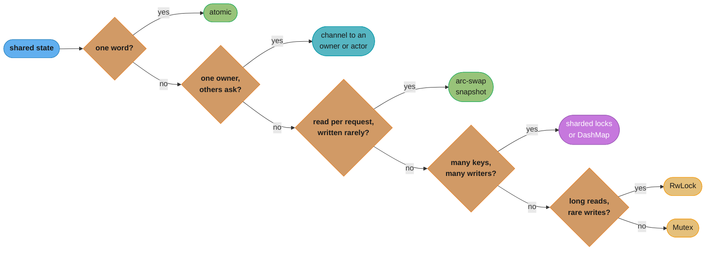
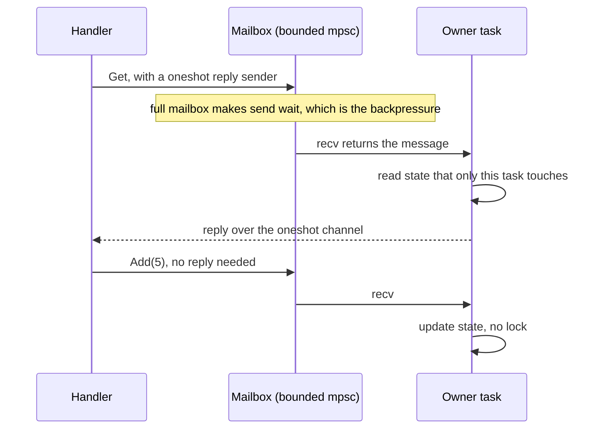
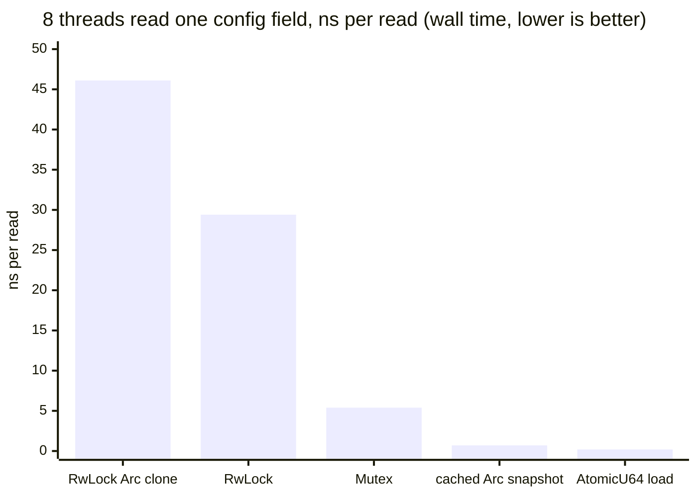

# Channels, Atomics and Shared State

> **Version anchor (2026-11-06).** Rust 1.99.1 (2026-10-15) on edition 2024. `std::sync::mpsc` is a port of crossbeam-channel since `[1.67]`. Atomic `update` and `try_update` are `[1.95]`. The generic `Atomic<T>` is nightly-only in 1.99.1, so this page uses `AtomicUsize`, `AtomicU64` and `AtomicBool`. Crates: crossbeam 0.8.5, flume 0.12.0, tokio 1.54.1, arc-swap 1.9.3, dashmap 6.2.1, ractor 0.16.5, kameo 0.22.2, loom 0.7.2.

---

## 1. Concept Overview

Threads that cooperate need a way to see each other's results. Rust gives you three, and every concurrent design picks one or mixes them:

1. **Send ownership.** A channel moves a value from one thread to another. The sender gives it up, so there is nothing shared to race on. The actor pattern is this idea with a single owner of some state and a mailbox in front of it.
2. **Share with a lock.** `Arc<Mutex<T>>`, `RwLock`, a sharded map. The lock owns the data, and the guard is the only way in. The lock mechanics live in [Threads, Send/Sync and Locks](../threads_send_sync_and_locks/threads_send_sync_and_locks.md).
3. **Share with atomics.** `AtomicU64`, `AtomicBool`, compare-and-swap, and snapshot types built on them such as arc-swap. No lock, but you must choose a memory `Ordering` for each operation.

The compiler checks all three for data races through `Send` and `Sync`. It does not check that you picked the right one. A config map read on every request behind an `RwLock`, a counter behind a `Mutex`, and an unbounded channel in front of a slow consumer all compile and all fail in production for different reasons. That is why this page holds the section's **shared-state decision model** (§8.1 and §5.1): which of `Arc<Mutex<T>>`, `RwLock`, sharded locks, channels, actors and atomics or arc-swap to use, chosen by who owns the state, how contended it is, and the read:write ratio.

The memory-model theory behind `Ordering` (happens-before, acquire and release, DRF-SC, litmus tests) is in [Memory Models and Concurrency Theory](../../cs_fundamentals/memory_models_and_concurrency_theory/memory_models_and_concurrency_theory.md); this page maps Rust's `Ordering` onto it in one paragraph and teaches the API. Cache lines and false sharing are in [Computer Architecture and Memory Hierarchy](../../cs_fundamentals/computer_architecture_and_memory_hierarchy/computer_architecture_and_memory_hierarchy.md); this page gives the Rust fix.

---

## 2. Intuition

> **One-line analogy**: a channel is handing someone a sealed envelope, a lock is a shared whiteboard with one marker, and an atomic is a single tally counter that everyone may click.

**Mental model**: ask "who owns this state?" first. If one component owns it and others only ask for changes, the state sits behind a mailbox: a channel to an owner thread or actor. If many components own it equally, it sits behind a lock, and you choose the lock by how often each side reads and writes. If the state is one machine word, it is an atomic. If it is a large value that changes rarely and is read constantly, you publish whole new versions and readers grab the latest one, which is what arc-swap does.

**Why it matters**: the wrong choice compiles and passes tests. It shows up as a p99 latency spike when a config reload waits behind readers, as an out-of-memory kill when an unbounded channel absorbs a burst, or as throughput that falls when you add cores because eight threads fight over one cache line. The §6.12 measurements show a factor of 30 to 100 between the best and worst ways to read the same config value.

**Key insight**: **channels move contention, they do not remove it.** An owner thread behind a channel serializes every update just as a single `Mutex` does, and the §6.12 benchmark measured them at the same cost. What a channel buys is a place where no lock is held during I/O, a natural backpressure point, and code that reasons about one thread. Contention goes down only when you split the state (shards, per-thread copies) or stop writing it on the hot path (snapshots, atomics).

---

## 3. Core Principles

1. **Decide ownership before mechanism.** Single owner: channel or actor. Shared and written often: lock, sharded if contended. Shared and written rarely: snapshot. One word: atomic.
2. **Every queue is bounded, by you or by the OOM killer.** Use bounded channels by default. An unbounded channel turns a slow consumer into unbounded memory growth.
3. **A channel closes when the last sender drops.** `recv` returns `Err` only after every `Sender` clone is gone. A leftover clone keeps a consumer loop alive forever.
4. **An atomic is correct only with the right `Ordering`.** `Relaxed` is enough when the atomic's own value is the only thing that matters. Use `Release` on the store and `Acquire` on the load when the atomic publishes other data.
5. **Compare-and-swap retries, so its closure may run more than once.** Code inside `try_update`, `update` or a CAS loop must be free of side effects.
6. **Contended writes to one cache line do not scale.** Adding threads to one hot atomic or one hot lock adds cache-line traffic, not throughput. Split the state.
7. **Lock-free code is tested with a model checker.** Run loom over every hand-written atomic protocol. Code review and stress tests miss rare interleavings.

---

## 4. Types / Architectures / Strategies

### 4.1 Channels

| Channel | Producers and consumers | Bound | Blocking style | Notes |
|---|---|---|---|---|
| `std::sync::mpsc::channel` | Many to one | Unbounded | Blocking `recv` | `send` never blocks; `Sender` is `Sync` since 1.72 |
| `std::sync::mpsc::sync_channel(n)` | Many to one | `n` | Blocking `send` and `recv` | `n = 0` is a rendezvous: each `send` waits for a `recv` |
| crossbeam-channel (`crossbeam::channel`) | Many to many | Bounded, unbounded, zero | Blocking | `select!` over several channels, `tick` and `after` timers |
| flume | Many to many | Bounded or unbounded | Blocking and async on the same channel | One channel type for sync and async halves |
| `tokio::sync::mpsc` | Many to one | Bounded or unbounded | Async | `send().await` waits when full; bounded capacity must be at least 1 |
| `tokio::sync::oneshot` | One to one | One value | Async | The reply channel of a request |
| `tokio::sync::broadcast` | Many to many, each receiver sees each value | Ring of `n` | Async | A slow receiver gets `RecvError::Lagged(skipped)` |
| `tokio::sync::watch` | Many to many | Latest value only | Async | Receivers see the newest value, not every value |

### 4.2 Atomic types and operations

| Operation | Methods | Use it for |
|---|---|---|
| Load and store | `load`, `store` | Flags, published pointers, config values in one word |
| Read-modify-write | `fetch_add`, `fetch_sub`, `fetch_or`, `fetch_max`, `swap` | Counters, bit sets, high-water marks |
| Compare-and-swap | `compare_exchange`, `compare_exchange_weak` | Lock-free state machines and stacks |
| Closure update `[1.95]` | `update`, `try_update` | Any read-modify-write that is a pure function of the old value |
| Fence | `std::sync::atomic::fence` | Ordering across several relaxed operations |

The types are `AtomicBool`, `AtomicI8` to `AtomicI64`, `AtomicU8` to `AtomicU64`, `AtomicIsize`, `AtomicUsize` and `AtomicPtr<T>`. All have `const fn new`, so they work in a `static` with no lazy initialization.

### 4.3 Shared-state containers

| Container | Crate | Shape |
|---|---|---|
| `Arc<Mutex<T>>` | std | One lock, any data |
| `Arc<RwLock<T>>` | std | One lock, many readers or one writer |
| Sharded `Vec<Mutex<HashMap>>` | std, hand-written in §6.8 | N locks chosen by key hash |
| `DashMap` | dashmap 6.2.1 | A sharded concurrent map, each shard behind its own lock |
| `ArcSwap<T>` | arc-swap 1.9.3 | An atomically replaceable `Arc<T>` for read-mostly data |
| Actor | std threads, tokio, ractor 0.16.5, kameo 0.22.2 | One owner task or thread plus a mailbox |
| Epoch-reclaimed lock-free structures | crossbeam 0.8.5 (`crossbeam::epoch`) | Lock-free stacks and queues with safe memory reclamation |

---

## 5. Architecture Diagrams

### 5.1 Shared-state decision flowchart



Ask the questions in this order. The earlier answers avoid shared writes completely, so they scale with cores. `Mutex` is the default at the end, not the first choice. The same model as a table, with measured costs, is in §8.1.

### 5.2 Actor request and reply



The owner task is the only code that touches the state, so the state needs no lock and no `Sync`. The messages and the reply sender must be `Send`. The bounded mailbox is where a slow owner pushes back on its callers.

### 5.3 Cost of reading one config value from 8 threads (measured)



One run of the §14 benchmark. Every `RwLock` read writes the reader count, and every `Arc` clone writes the reference count, so both put all eight threads on one contended cache line. The cached snapshot and the plain atomic load do not write anything shared on the read path. §6.12 gives the range over three runs.

---

## 6. How It Works - Detailed Mechanics

### 6.1 `std::sync::mpsc`

```rust
use std::sync::mpsc;
use std::thread;

fn main() {
    let (tx, rx) = mpsc::sync_channel::<u64>(1024);
    let producers: Vec<_> = (0..4)
        .map(|id| {
            let tx = tx.clone();
            thread::spawn(move || {
                for i in 0..1000 {
                    if tx.send(id * 1000 + i).is_err() {
                        break;
                    }
                }
            })
        })
        .collect();
    drop(tx);
    let total: u64 = rx.iter().sum();
    for p in producers {
        let _ = p.join();
    }
    println!("total = {total}");
}
```

- `drop(tx)` matters. `rx.iter()` ends only when every `Sender` is gone, and the original `tx` would otherwise stay alive in `main` and the loop would never end.
- `send` on a bounded channel blocks while the buffer is full. That is backpressure: a slow consumer slows the producers instead of growing memory.
- `send` returns `Err(SendError(value))` when the receiver is gone, and gives the value back. `Ok` means the value was queued, not that anyone received it.
- Since Rust 1.67 the implementation is a port of crossbeam-channel. `Sender` is `Sync` since 1.72, so a `&Sender` can be shared across scoped threads. `Receiver` stays single-consumer: it is not `Clone`, and to share it you must wrap it in `Arc<Mutex<Receiver<T>>>` or switch to crossbeam-channel.
- `sync_channel(0)` is a rendezvous channel. Each `send` waits until a `recv` takes the value, which costs a thread wake per message (2.2 to 2.8 µs in §6.12).

### 6.2 crossbeam-channel and flume

```rust
// fragment
use crossbeam::channel::{bounded, select, tick};
use std::time::Duration;

let (tx, rx) = bounded::<Job>(1024);
let ticker = tick(Duration::from_secs(1));
for _ in 0..workers {
    let rx = rx.clone(); // many consumers: the Receiver is Clone
    pool.spawn(move || {
        loop {
            select! {
                recv(rx) -> msg => match msg {
                    Ok(job) => run(job),
                    Err(_) => break, // every sender dropped
                },
                recv(ticker) -> _ => flush_metrics(),
            }
        }
    });
}
```

crossbeam-channel (part of crossbeam 0.8.5) is multi-producer multi-consumer: clone the `Receiver` and each message goes to exactly one consumer, which is a work queue. `select!` waits on several channels and timers at once, which std's channel cannot do on stable. flume 0.12.0 is also MPMC and adds `send_async` and `recv_async` on the same channel, which helps when a sync thread and an async task share one queue.

### 6.3 tokio channels

```rust
// fragment
use tokio::sync::{broadcast, mpsc, oneshot, watch};

let (job_tx, mut job_rx) = mpsc::channel::<Job>(1024); // send().await waits when full
let (done_tx, done_rx) = oneshot::channel::<Report>(); // exactly one value
let (evt_tx, _) = broadcast::channel::<Event>(256); // each receiver sees each value
let (cfg_tx, cfg_rx) = watch::channel(Config::default()); // keeps only the newest value
```

The tokio docs describe the four: `mpsc` sends many values from many producers to one consumer, `oneshot` sends a single value, `broadcast` delivers each value to each consumer, and `watch` stores only the most recent value with no promise that a consumer sees every one. A `broadcast` receiver that falls more than the ring capacity behind gets `RecvError::Lagged(n)` and skips `n` values. Choose the policy you want before load chooses it for you. Cancel safety of `recv` inside `select!` and the unbounded-channel trap in async code are in [Async Cancellation and Pitfalls](../async_cancellation_and_pitfalls/async_cancellation_and_pitfalls.md).

### 6.4 The actor pattern

An actor is a thread or task that owns some state, plus a channel of messages that ask it to read or change that state. It needs nothing more than a channel:

```rust
use std::sync::mpsc;
use std::thread;

enum Msg {
    Add(u64),
    Get(mpsc::Sender<u64>),
}

fn main() {
    let (tx, rx) = mpsc::sync_channel::<Msg>(1024);
    let owner = thread::spawn(move || {
        let mut total = 0u64;
        for msg in rx {
            match msg {
                Msg::Add(n) => total += n,
                Msg::Get(reply) => {
                    let _ = reply.send(total);
                }
            }
        }
    });

    for n in 1..=10 {
        if tx.send(Msg::Add(n)).is_err() {
            break;
        }
    }
    let (reply_tx, reply_rx) = mpsc::channel();
    if tx.send(Msg::Get(reply_tx)).is_ok() {
        match reply_rx.recv() {
            Ok(total) => println!("total = {total}"),
            Err(_) => eprintln!("owner stopped before replying"),
        }
    }
    drop(tx);
    let _ = owner.join();
}
```

The async form is the same shape with `tokio::sync::mpsc` for the mailbox and `oneshot` for the reply:

```rust
// fragment
use tokio::sync::{mpsc, oneshot};

enum Msg {
    Add(u64),
    Get(oneshot::Sender<u64>),
}

async fn counter(mut rx: mpsc::Receiver<Msg>) {
    let mut total = 0u64;
    while let Some(msg) = rx.recv().await {
        match msg {
            Msg::Add(n) => total += n,
            Msg::Get(reply) => {
                let _ = reply.send(total);
            }
        }
    }
}
```

ractor 0.16.5 and kameo 0.22.2 add supervision, typed actor references and lifecycle hooks on top of this pattern. Reach for one when you need supervision trees or remote actors. A plain task plus a channel covers most services.

### 6.5 Atomics and `Ordering`

Rust's `Ordering` enum names the C++20 memory orders: `Relaxed`, `Release`, `Acquire`, `AcqRel` and `SeqCst`. `Relaxed` makes the operation atomic and orders nothing else. A `Release` store paired with an `Acquire` load that reads the stored value creates a happens-before edge, so every write before the store is visible after the load. `AcqRel` is both, for read-modify-write operations. `SeqCst` adds one total order over all `SeqCst` operations. The model and its litmus tests are in [Memory Models and Concurrency Theory](../../cs_fundamentals/memory_models_and_concurrency_theory/memory_models_and_concurrency_theory.md), and Java's spelling of the same model is in [Java Memory Model](../../java/java_memory_model/java_memory_model.md).

A counter needs only atomicity, so `Relaxed` is correct:

```rust
use std::sync::atomic::{AtomicU64, Ordering};

static REQUESTS: AtomicU64 = AtomicU64::new(0);

pub fn on_request() {
    REQUESTS.fetch_add(1, Ordering::Relaxed);
}

pub fn requests() -> u64 {
    REQUESTS.load(Ordering::Relaxed)
}
```

A flag that publishes other data needs `Release` and `Acquire`:

```rust
use std::sync::atomic::{AtomicBool, AtomicU64, Ordering};
use std::thread;

static PAYLOAD: AtomicU64 = AtomicU64::new(0);
static READY: AtomicBool = AtomicBool::new(false);

fn main() {
    let producer = thread::spawn(|| {
        PAYLOAD.store(42, Ordering::Relaxed);
        READY.store(true, Ordering::Release);
    });
    while !READY.load(Ordering::Acquire) {
        std::hint::spin_loop();
    }
    assert_eq!(PAYLOAD.load(Ordering::Relaxed), 42);
    let _ = producer.join();
}
```

If `READY` used `Relaxed`, the reader could see `true` and still read `0` on a weakly ordered CPU such as ARM, and the compiler may reorder the two stores on any CPU. The code would still compile, because every access is atomic and there is no data race. This is a race condition the type system cannot see.

### 6.6 Compare-and-swap, `update` and `try_update` `[1.95]`

```rust
use std::sync::atomic::{AtomicUsize, Ordering};

pub fn try_acquire(permits: &AtomicUsize) -> bool {
    let mut cur = permits.load(Ordering::Relaxed);
    loop {
        if cur == 0 {
            return false;
        }
        match permits.compare_exchange_weak(cur, cur - 1, Ordering::Acquire, Ordering::Relaxed) {
            Ok(_) => return true,
            Err(actual) => cur = actual,
        }
    }
}
```

`compare_exchange` fails only when the value differs from `cur`. `compare_exchange_weak` may also fail when the value matches, which lets it compile to a single load-linked/store-conditional pair on ARM instead of a nested loop. Inside a retry loop the spurious failure costs one more iteration, so use the weak form there. Use the strong form for a single attempt with no loop.

Since 1.95 the closure methods write the loop for you:

```rust
use std::sync::atomic::{AtomicU64, AtomicUsize, Ordering};

pub fn try_acquire(permits: &AtomicUsize) -> bool {
    permits
        .try_update(Ordering::Acquire, Ordering::Relaxed, |n| n.checked_sub(1))
        .is_ok()
}

pub fn spend(budget: &AtomicU64, cost: u64) -> u64 {
    budget.update(Ordering::AcqRel, Ordering::Acquire, |b| b.saturating_sub(cost))
}
```

`update` always stores the closure's result and returns the previous value. `try_update` lets the closure return `None` to decline the write, and returns `Ok(previous)` or `Err(previous)`. The docs warn that the closure can run more than once under contention, and that both methods are built on compare-and-swap, so the ABA problem applies. Keep the closure pure. For a plain sum or maximum, call `fetch_add` or `fetch_max`. `fetch_add` is one atomic instruction on x86-64 and on aarch64 with LSE. x86-64 has no atomic max instruction, so there `fetch_max` compiles to a CAS loop that the compiler writes for you.

### 6.7 Fences

`std::sync::atomic::fence(Ordering::Release)` before a group of `Relaxed` stores, paired with `fence(Ordering::Acquire)` after the matching `Relaxed` loads, gives the same edge as release and acquire on each operation. `Arc`'s drop uses this: the decrement is `Release`, and only the thread that brings the count to zero issues an `Acquire` fence before it frees the value. Fences are for library internals that batch many relaxed operations. Application code is clearer with orderings on the operations themselves.

### 6.8 Sharded locks and DashMap

When many threads write many independent keys, one lock is the bottleneck. Split the map into shards, each with its own lock, chosen by key hash:

```rust
use std::collections::HashMap;
use std::hash::{BuildHasher, Hash, RandomState};
use std::sync::{Mutex, PoisonError};

pub struct Sharded<K, V> {
    hasher: RandomState,
    shards: Vec<Mutex<HashMap<K, V>>>,
}

impl<K: Hash + Eq, V> Sharded<K, V> {
    pub fn new(shards: usize) -> Self {
        Self {
            hasher: RandomState::new(),
            shards: (0..shards.max(1)).map(|_| Mutex::new(HashMap::new())).collect(),
        }
    }

    pub fn upsert(&self, key: K, init: impl FnOnce() -> V, f: impl FnOnce(&mut V)) {
        let idx = (self.hasher.hash_one(&key) as usize) % self.shards.len();
        let mut map = self.shards[idx]
            .lock()
            .unwrap_or_else(PoisonError::into_inner);
        f(map.entry(key).or_insert_with(init));
    }
}
```

In §6.12, eight threads writing 10,000 keys went from 39 to 49 ns per op with one `Mutex<HashMap>` to 25 to 33 ns per op with 64 shards. The gain is real but not eightfold, because hashing and the shard lookup cost something and hot keys still collide. dashmap 6.2.1 is the maintained version of this design. Its docs warn that `insert`, `remove`, `get`, `get_mut` and `entry` may deadlock if called while you hold any reference into the map, because the reference holds its shard's lock. Drop the `Ref` before the next call, or use `try_get`, which returns instead of waiting.

### 6.9 Snapshots with arc-swap

```rust
// fragment
use arc_swap::ArcSwap;
use std::sync::{Arc, LazyLock};

static CONFIG: LazyLock<ArcSwap<Config>> =
    LazyLock::new(|| ArcSwap::from_pointee(Config::default()));

fn handle(req: &Request) -> Response {
    let cfg = CONFIG.load(); // no lock taken
    route(req, cfg.limit)
}

fn reload(new_cfg: Config) {
    CONFIG.store(Arc::new(new_cfg)); // readers see the old or the new Arc, never a mix
}
```

arc-swap 1.9.3 holds an `Arc<T>` that can be replaced atomically. Readers get the current `Arc` without a lock, and a writer swaps in a whole new value. Its docs name the problem it solves: `RwLock<Arc<T>>` suffers CPU-level contention on the lock and on the `Arc`'s reference count, and a steady inflow of readers can block an update for an arbitrary time. The docs describe ArcSwap as optimized for read-mostly data and faster than that `RwLock` both with and without contention. For read-modify-write of the snapshot, `rcu` retries a closure until its result is stored. The `Cache` type speeds up reads further at the cost of delayed reclamation of old values, which is the design §14 builds by hand with std.

### 6.10 Cache-line padding

Two hot atomics on one cache line contend even when no thread touches the other's value. Put each on its own line with `crossbeam::utils::CachePadded<T>` or `#[repr(align(128))]`. crossbeam aligns `CachePadded` to 128 bytes on x86-64, aarch64 and powerpc64, because the spatial prefetcher on modern Intel cores fetches cache lines in pairs, and to 64 bytes on most other targets. In §6.12, eight threads each incrementing their own counter took 85 to 119 ms when the counters were adjacent and 17 to 59 ms when each was padded to 128 bytes.

### 6.11 Testing atomic code with loom

```rust
// fragment
#[cfg(loom)]
#[test]
fn publish_is_visible() {
    use loom::sync::atomic::{AtomicBool, AtomicU64, Ordering};
    use loom::sync::Arc;
    use loom::thread;

    loom::model(|| {
        let payload = Arc::new(AtomicU64::new(0));
        let ready = Arc::new(AtomicBool::new(false));
        let (p, r) = (Arc::clone(&payload), Arc::clone(&ready));
        let t = thread::spawn(move || {
            p.store(42, Ordering::Relaxed);
            r.store(true, Ordering::Release);
        });
        if ready.load(Ordering::Acquire) {
            assert_eq!(payload.load(Ordering::Relaxed), 42);
        }
        t.join().expect("producer panicked");
    });
}
```

loom 0.7.2 runs the closure under every thread interleaving and many of the weak-memory outcomes that the C11 model allows. Its docs say that it cannot model every outcome of `Relaxed` ordering, so a passing loom test is strong evidence, not a proof. Change the `Release` to `Relaxed` and the test fails with the bad interleaving printed. Code under test uses `loom::sync` types under `cfg(loom)` and std types otherwise. The verification ladder, including Miri, is in [Testing, Fuzzing and Miri](../testing_fuzzing_and_miri/testing_fuzzing_and_miri.md).

### 6.12 Measured costs

Measured on a 10-core aarch64 Linux VM (Docker on Apple silicon), `rustc 1.99.1 -O`, three runs each. Treat them as ratios between rows. Wall time per op divides total time by the total operations of all threads.

| Operation | Result |
|---|---|
| `mpsc::channel`, 1 producer, 1 consumer | 16 to 26 ns per message |
| `mpsc::sync_channel(1024)`, 1 producer, 1 consumer | 18 to 22 ns per message |
| `mpsc::sync_channel(0)` rendezvous | 2.2 to 2.8 µs per message |
| `AtomicU64::fetch_add`, uncontended | about 2 ns |
| `AtomicU64::fetch_add`, 8 threads on one counter, wall time per op | 6 to 11 ns |
| 8 private counters, adjacent vs padded to 128 bytes, 2M increments each | 85 to 119 ms vs 17 to 59 ms |
| 8 threads, 10,000 keys: one `Mutex<HashMap>`, wall time per op | 39 to 49 ns |
| Same, 64 sharded `Mutex<HashMap>` | 25 to 33 ns |
| Same, an owner thread behind `sync_channel(4096)` | 39 to 48 ns |
| 8 threads read one config field: `RwLock<Config>` | 29 to 73 ns |
| Same: clone an `Arc` out of `RwLock<Arc<Config>>` | 46 to 148 ns |
| Same: `Mutex<Config>` | 5 to 9 ns |
| Same: thread-local cached `Arc`, refreshed on a version change (§14) | 0.4 to 1.8 ns |
| Same: `AtomicU64::load` | 0.1 to 0.6 ns |

---

## 7. Real-World Examples

- **std's own channel**: since Rust 1.67, `std::sync::mpsc` is a port of crossbeam-channel. The std API kept its single-consumer `Receiver`, so the MPMC work-queue shape still needs crossbeam-channel or flume.
- **`Arc` itself**: `Arc::clone` is a `Relaxed` increment, and the drop is a `Release` decrement followed by an `Acquire` fence on the last owner. It is the standard library's clearest example of choosing the weakest correct ordering per operation.
- **Tokio's channels**: tokio uses loom to permutation-test its `mpsc` channel and `bytes` buffers under the C11 model, as described in [Memory Models and Concurrency Theory](../../cs_fundamentals/memory_models_and_concurrency_theory/memory_models_and_concurrency_theory.md).
- **Go's channels**: Go puts channels and `select` in the language and makes them the default tool ([Channels and Select](../../go/channels_and_select/channels_and_select.md)). Rust ships a smaller std channel and leaves `select` to crossbeam-channel and tokio. In both languages the same rule holds: a channel to a single owner serializes like a lock.
- **Producer-consumer as a pattern**: the language-neutral producer-consumer, read-write lock and thread-pool patterns are in [Concurrency Patterns](../../lld/concurrency_patterns/concurrency_patterns.md). In Rust, a bounded channel is the producer-consumer queue, and the type system enforces that only `Send` values go in.

---

## 8. Tradeoffs

### 8.1 Shared-state decision model

Pick the first row that fits. The measured column comes from §6.12 and is for comparison between rows.

| State and access pattern | Contention | Pick | Why | Measured |
|---|---|---|---|---|
| One word: counter, flag, max | Any | Atomic (`fetch_add`, `store`, `fetch_max`) | No lock and no blocking | 2 ns alone; 6 to 11 ns per op with 8 threads on one counter |
| One owner; others send requests; updates involve I/O or must stay in order | Any | Channel to an owner thread, or an actor | No lock held during I/O; bounded mailbox gives backpressure | 39 to 48 ns per op, same as one `Mutex` |
| Read on every request, written rarely (config, routing table, feature flags) | High read | arc-swap, or a cached `Arc` snapshot | Readers write nothing shared | 0.4 to 1.8 ns vs 29 to 73 ns for `RwLock` |
| Map with many independent keys, many writers | High write | Sharded locks or DashMap | Writers to different shards do not contend | 25 to 33 ns vs 39 to 49 ns for one lock |
| Large structure, long reads, rare writes | Moderate | `RwLock` | Long reads run in parallel and amortize the reader-count write | Loses to `Mutex` for tiny reads (§6.10 of the threads module) |
| Small struct, short updates, mixed access | Low to moderate | `Arc<Mutex<T>>` | Lowest cost per acquire, one lock to reason about | 3 to 7 ns uncontended |
| Stream of work between pipeline stages | Flow | Bounded channel | Ownership moves with the item | 16 to 26 ns per message |

### 8.2 Channel crates

| Concern | std `mpsc` | crossbeam-channel | flume | tokio channels |
|---|---|---|---|---|
| Consumers | One | Many | Many | One (`mpsc`), many (`broadcast`, `watch`) |
| `select` over several channels | No | `select!` | `Selector` | `tokio::select!` |
| Blocking threads | Yes | Yes | Yes | `blocking_send` and `blocking_recv` only |
| Async tasks | No | No | Yes | Yes |
| Dependency | None | crossbeam 0.8.5 | flume 0.12.0 | tokio 1.54.1 |

### 8.3 Channel vs lock for the same state

| Concern | Owner behind a channel | `Arc<Mutex<T>>` |
|---|---|---|
| Throughput under contention | Bounded by the single owner | Bounded by the single lock |
| Holding a lock during I/O | Impossible, there is no lock | Easy to do by mistake |
| Read your own write | Needs a reply message | Immediate |
| Backpressure | Built in with a bounded mailbox | None |
| Deadlock risk | Cycles of bounded channels | Lock ordering |
| Code shape | Message enum, owner loop | Guard scopes |

---

## 9. When to Use / When NOT to Use

**Use a channel or actor when:**
- One component owns the state and others ask it for changes, especially when changes involve I/O.
- Work flows through stages and each item has one owner at a time.
- You need backpressure between a fast producer and a slow consumer.

**Use atomics when:**
- The state is one word: a counter, a flag, a generation number.
- You publish a pointer or a version that readers check on every call.

**Use arc-swap or a snapshot when:**
- A value is read on every request and replaced as a whole, rarely.

**Do NOT:**
- Use an unbounded channel in front of a consumer that can fall behind.
- Write your own lock-free data structure when crossbeam, a sharded lock or a channel will do. If you must, test it with loom.
- Put a `RwLock` around a value read on every request by many threads; the reader count becomes the hot spot.
- Use `SeqCst` everywhere "to be safe" without knowing which edge you need. It hides the reasoning, and on most code the correct answer is `Relaxed` or a release-acquire pair.

---

## 10. Common Pitfalls

These incidents are illustrative. They show common failure patterns, not specific outages, and their numbers show scale only.

### 10.1 One `Receiver` for a pool of workers

A team built a worker pool on `std::sync::mpsc` and moved the receiver into each worker.

```rust
// BROKEN
use std::sync::mpsc;
use std::thread;

fn main() {
    let (tx, rx) = mpsc::channel::<u32>();
    let mut workers = Vec::new();
    for _ in 0..4 {
        // error[E0382]: use of moved value: `rx`
        workers.push(thread::spawn(move || {
            while let Ok(job) = rx.recv() {
                println!("job {job}");
            }
        }));
    }
    drop(tx);
}
```

`Receiver` is not `Clone`, because std's channel is single-consumer. Either share it behind a lock, or use an MPMC channel:

```rust
// FIX: share the receiver behind a Mutex. Each worker holds the lock only for recv.
use std::sync::{mpsc, Arc, Mutex, PoisonError};
use std::thread;

fn main() {
    let (tx, rx) = mpsc::channel::<u32>();
    let rx = Arc::new(Mutex::new(rx));
    let workers: Vec<_> = (0..4)
        .map(|_| {
            let rx = Arc::clone(&rx);
            thread::spawn(move || loop {
                let next = rx.lock().unwrap_or_else(PoisonError::into_inner).recv();
                match next {
                    Ok(job) => println!("job {job}"),
                    Err(_) => break,
                }
            })
        })
        .collect();
    for job in 0..16 {
        if tx.send(job).is_err() {
            break;
        }
    }
    drop(tx);
    for w in workers {
        let _ = w.join();
    }
}
```

The `let next = ...;` statement drops the guard before the job runs, so workers do not hold the lock while they work. With crossbeam-channel, `rx.clone()` per worker replaces the `Arc<Mutex<..>>`.

### 10.2 A non-`Send` value through a channel

```rust
// BROKEN
use std::rc::Rc;
use std::sync::mpsc;
use std::thread;

fn main() {
    let (tx, rx) = mpsc::channel::<Rc<String>>();
    // error[E0277]: `Rc<String>` cannot be sent between threads safely
    let h = thread::spawn(move || {
        let _ = tx.send(Rc::new("hi".to_string()));
    });
    let _ = h.join();
    let _ = rx.recv();
}
```

`Sender<T>` is `Send` only when `T: Send`, so the error points at the `Rc` even though no `Rc` is shared yet. Send `String` itself, or `Arc<String>` when several receivers must share it.

```rust
// FIX: send owned data. The receiver becomes its only owner.
use std::sync::mpsc;
use std::thread;

fn main() {
    let (tx, rx) = mpsc::channel::<String>();
    let h = thread::spawn(move || {
        let _ = tx.send("hi".to_string());
    });
    let _ = h.join();
    if let Ok(msg) = rx.recv() {
        println!("{msg}");
    }
}
```

### 10.3 The unbounded channel that ate the heap

An ingest service put an unbounded `tokio::sync::mpsc` between the network reader and a database writer. During a database failover the writer stalled for 90 seconds, the reader kept accepting at full rate, and the queue grew until the container was killed for memory. Every message in the queue was lost with the process. A bounded channel would have made the reader wait, which pushes back to TCP flow control and the clients. Size the bound from memory: at 4 KiB per message, a 10,000-slot channel holds about 40 MiB.

### 10.4 The leftover `Sender`

A shutdown path waited for `for msg in rx` to finish, and the service never exited. The function that created the channel kept its own `tx` after handing clones to the producers. The channel closes only when the last `Sender` drops, so the loop waited for a message that could never come. Drop the original sender as soon as the clones are handed out, as §6.1 does.

### 10.5 `Relaxed` on a publication flag

A cache loader stored the loaded table, then set `LOADED.store(true, Ordering::Relaxed)`. Readers checked `LOADED.load(Ordering::Relaxed)` and then read the table. Tests passed on x86, whose stores are not reordered with each other. On ARM servers, readers sometimes saw `true` and an empty table. The code compiled because every access was atomic. Release on the store and Acquire on the load fix it (§6.5), and a loom test catches it on any machine (§6.11). Better still, use `OnceLock` or `LazyLock`, which encode the publication correctly.

### 10.6 Holding a DashMap reference across a second call

```rust
// fragment
// BUG (runtime): deadlocks when both keys hash to the same shard.
if let Some(user) = sessions.get(&id) {
    sessions.insert(other_id, user.clone()); // the Ref still holds the shard lock
}
```

The `Ref` from `get` holds a read lock on its shard. `insert` takes the write lock on the target shard, and when both keys hash to the same shard, the thread waits on itself. It deadlocks only on some key pairs, so it passes tests. Clone the value out, let the `Ref` drop, then insert.

### 10.7 Two actors that call each other

Actor A sends a request to B and awaits the reply. While B handles it, B sends a request to A and awaits that reply. Both mailboxes are bounded, both owners are blocked waiting, and neither drains its mailbox. A channel cycle with blocking request-reply on both sides is a deadlock, the same as two locks in opposite orders. Break the cycle: make one direction fire-and-forget, or move the shared state into one actor.

### 10.8 False sharing in per-thread stats

A proxy kept `[AtomicU64; 32]` with one slot per worker so that workers never contended. Throughput dropped as workers were added, because eight slots shared each 64-byte line and every increment invalidated seven other workers' caches. Padding each slot to 128 bytes fixed it (§6.10). The data in the threads was not shared, the cache line was.

---

## 11. Technologies & Tools

| Tool | Version | Use it for |
|---|---|---|
| crossbeam | 0.8.5 | MPMC channels with `select!`, `CachePadded`, epoch-based memory reclamation |
| flume | 0.12.0 | MPMC channel with sync and async halves on one channel |
| tokio | 1.54.1 | `mpsc`, `oneshot`, `broadcast` and `watch` for async tasks |
| arc-swap | 1.9.3 | Atomically replaceable `Arc<T>` for read-mostly config and routing tables |
| dashmap | 6.2.1 | Sharded concurrent hash map |
| ractor | 0.16.5 | Actors with supervision on tokio |
| kameo | 0.22.2 | Actors with typed messages and supervision on tokio |
| loom | 0.7.2 | Exhaustive interleaving tests, with partial weak-memory coverage, for atomic code |
| Miri | rustup component (nightly) | Data-race and undefined-behavior detection in tests of `unsafe` and atomic code |
| ThreadSanitizer | rustc `-Zsanitizer=thread` (nightly) | Data races across FFI and `unsafe` code at runtime |

---

## 12. Interview Questions with Answers

**Q: Why can't you hand one `std::sync::mpsc::Receiver` to every worker in a pool?**
**Short:** std's channel is single-consumer, so Receiver is not Clone and moving it into a second closure fails with E0382; use crossbeam-channel or a Mutex around it.

The std API was designed as multi-producer, single-consumer, and it kept that shape when it was reimplemented on crossbeam-channel in 1.67. The first worker's `move` closure takes the `Receiver`, so the second one hits "use of moved value". `Arc<Mutex<Receiver<T>>>` works if each worker drops the guard right after `recv`. A crossbeam-channel or flume `Receiver` is `Clone` and each message goes to exactly one consumer, which is the work-queue shape you wanted. For async code, tokio's `mpsc` is also single-consumer, so the same rule applies there.

**Q: Why should channels be bounded by default?**
**Short:** An unbounded channel turns a slow consumer into unbounded memory growth; a bounded one makes producers wait, which is backpressure that protects memory.

With an unbounded channel, `send` always succeeds immediately. If the consumer stalls on a slow database or a GC pause in a downstream service, the queue grows at the producer's rate until the process runs out of memory, and every queued message dies with it. A bounded channel blocks or awaits the sender when full, so the slowdown propagates upstream to TCP flow control or the client. Size the bound by memory: messages times average size. Use unbounded only when the producer rate is bounded by construction, such as a fixed number of control messages.

**Q: When does a channel's receive loop end, and what keeps it running forever?**
**Short:** recv returns Err only after every Sender clone has dropped; one forgotten clone, often the original in the creating function, keeps the loop waiting forever.

A channel stays open while any sender exists, because a future message is still possible. `for msg in rx` and `while let Ok(m) = rx.recv()` exit only on disconnection. The classic hang is a function that clones `tx` into each producer and keeps the original, so the consumer never sees the close. Drop the original after handing out clones. For the reverse direction, `send` returns `Err` once the receiver is dropped, and gives the value back so you can log or retry it.

**Q: Can a design built only on channels deadlock?**
**Short:** Yes. Two owners that each block waiting for a reply from the other, with bounded mailboxes, deadlock exactly like two locks taken in opposite orders.

Channels remove data races and shared locks, not waits. If actor A sends to B and blocks on the reply while B sends to A and blocks on its reply, neither drains its mailbox. A rendezvous channel (`sync_channel(0)`) deadlocks even faster, because every `send` waits for a matching `recv`. Keep request-reply edges acyclic, make one direction fire-and-forget, or give each wait a timeout. Treat the message graph the way you would treat a lock order.

**Q: What does `sync_channel(0)` do, and what does it cost?**
**Short:** It creates a rendezvous channel with no buffer, so each send waits until a recv takes the value; that is a thread handoff per message.

The std docs call a buffer size of 0 a rendezvous channel: `send` does not return until a `recv` is paired with it. It is useful when the producer must know the consumer has the value, such as handing off a resource. Every message requires the two threads to meet, which means a sleep and a wake. Measured on rustc 1.99.1 in §6.12, it took 2.2 to 2.8 µs per message against 18 to 22 ns for a 1024-slot buffer, about a hundred times slower. Use a small buffer unless the handoff is the point.

**Q: Which `Ordering` does a request counter need?**
**Short:** Relaxed. A counter needs each increment to be atomic and nothing else, and fetch_add with Relaxed never loses an increment.

`Relaxed` still makes `fetch_add` a single indivisible read-modify-write, so with any number of threads the final count is exact. What `Relaxed` does not do is order other memory around the increment, and a counter has no other memory to order. Reading the counter for a metrics scrape with `Relaxed` gives a value that was current at some recent point, which is all a metric needs. Stronger orderings cost extra barriers on ARM and buy nothing here. Switch to release and acquire only when the counter value tells a reader that some other data is ready.

**Q: Why does a "data is ready" flag need `Release` and `Acquire` instead of `Relaxed`?**
**Short:** The flag must order the data writes before it; Release on the store and Acquire on the load make every write before the store visible after the load.

With `Relaxed`, the compiler and a weakly ordered CPU such as ARM may make the flag visible before the data, so a reader sees `true` and stale data. A `Release` store promises that all earlier writes are visible to any thread whose `Acquire` load reads that stored value. The program compiles either way, because every access is atomic, so this is a race condition the type system cannot catch. Prefer `OnceLock` or `LazyLock` for one-time publication. For a hand-written protocol, prove it with a loom test.

**Q: When do you use `compare_exchange_weak` instead of `compare_exchange`?**
**Short:** Use the weak form inside a retry loop, since its spurious failures just cost an iteration; use the strong form for a single attempt with no loop.

`compare_exchange_weak` may fail even when the current value equals the expected one. On ARM and other load-linked/store-conditional machines, that lets it compile to one LL/SC attempt, while the strong form needs an inner loop to hide spurious failures. In a CAS loop you retry anyway, so the weak form is cheaper. When you try once and treat failure as "someone else won", a spurious failure would be a wrong answer, so use `compare_exchange`. On x86 both compile to the same `lock cmpxchg`.

**Q: What do the atomic `update` and `try_update` methods do?**
**Short:** They run a compare-and-swap loop around a closure; update always stores the closure's result, and try_update lets it return None to skip the write.

Both arrived in 1.95. `update(set_order, fetch_order, f)` applies `f` to the current value, stores the result, and returns the previous value. `try_update` takes a closure returning `Option` and returns `Ok(previous)` when it stored, or `Err(previous)` when the closure declined. The docs warn the closure can run several times under contention, so it must be a pure function with no side effects, and ABA applies because it is CAS underneath. For plain add, max or bit operations, use the `fetch_*` methods. The compiler emits the best sequence for the target, often one atomic instruction.

**Q: Is `SeqCst` a safe default for every atomic?**
**Short:** It is correct more often but not always enough, and it hides intent; most code needs Relaxed for counters or a release-acquire pair for publication.

`SeqCst` adds a single total order across all `SeqCst` operations, which matters only for patterns such as two flags each written by one thread and read by the other (Dekker-style). For a counter it costs barriers for nothing, and for publication a release-acquire pair gives the same ordering for that edge. A protocol that is wrong with acquire and release is often still wrong with `SeqCst`, because the bug is in the algorithm. Choose the ordering from the edge you need and write that edge in a comment. Use `SeqCst` when you have two or more atomics that must be seen in one global order.

**Q: What is false sharing, and how do you fix it in Rust?**
**Short:** Independent hot values on one cache line force cores to pass the line back and forth; pad each value to its own line with CachePadded or repr(align(128)).

The cache works in lines, not variables, so two threads writing two different atomics on one line still contend for that line. The fix is layout: `crossbeam::utils::CachePadded<T>`, which crossbeam aligns to 128 bytes on x86-64 and aarch64 and 64 on most other targets, or a wrapper with `#[repr(align(128))]`. Measured in §6.12, eight threads with private adjacent counters took 85 to 119 ms against 17 to 59 ms when padded. Pad only the hot per-thread values: padding everything wastes cache. The hardware side is in the computer architecture module.

**Q: Why is `Arc<RwLock<Config>>` a poor fit for config read on every request?**
**Short:** Every read() writes the shared reader count, so all request threads contend on one cache line, and a steady stream of readers can delay the reload writer.

An `RwLock` read is cheap only when uncontended. With many threads reading on every request, the reader-count increments and decrements bounce one cache line between cores. Measured in §6.12, eight readers paid 29 to 73 ns per read, against 5 to 9 ns for a `Mutex` and under 2 ns for a cached snapshot. Swapping to `RwLock<Arc<Config>>` and cloning the `Arc` is worse, 46 to 148 ns, because it adds the refcount write. Publish whole snapshots with arc-swap, and readers write nothing shared on the hot path.

**Q: What does arc-swap give you over `RwLock<Arc<T>>`?**
**Short:** ArcSwap stores an Arc that readers load without a lock and writers replace whole, which avoids lock and refcount contention on read-mostly data.

A reader calls `load()` and gets a guard to the current `Arc<T>`. A writer calls `store(Arc::new(new))`, or `rcu(|old| ...)` for a read-modify-write that retries on conflict. Readers see either the old or the new value, never a mix, and a reload never waits for readers. The docs describe it as optimized for read-mostly scenarios and as faster than `RwLock<Arc<T>>` with and without contention. It fits config, routing tables and feature flags. It does not fit data written often, where each write allocates a new `Arc`.

**Q: When does a sharded lock or DashMap beat one `Mutex<HashMap>`, and what is the DashMap trap?**
**Short:** Sharding helps when many writers touch many independent keys; DashMap's trap is that a held Ref keeps its shard locked, so a second call can deadlock.

With one lock, every writer serializes. With N shards chosen by key hash, writers to different shards run in parallel. Measured with 8 threads and 10,000 keys, 64 shards cut cost from 39 to 49 ns per op to 25 to 33. Hot keys still collide in one shard, so sharding does not fix skew. dashmap's docs warn that `insert`, `get`, `entry` and similar calls may deadlock while you hold any reference into the map. Clone the value out of a `Ref` and drop it before the next call, or use `try_get`.

**Q: What is an actor in Rust, and when do you pick one over a `Mutex`?**
**Short:** An actor is a thread or task that owns state and handles messages from a channel; pick it when updates involve I/O, ordering matters, or you want backpressure.

The owner loop is the only code that touches the state, so the state needs no lock and no `Sync`. Callers send a message enum, with a `oneshot` sender when they need a reply. Throughput is bounded by the single owner, like a single lock, which §6.12 measured at the same cost. What you gain is that no lock is held during I/O, updates apply in arrival order, and a bounded mailbox pushes back on callers. Plain task plus `mpsc` covers most services. ractor and kameo add supervision and typed references when you need them.

**Q: Which tokio channel fits which job?**
**Short:** mpsc for a work queue to one consumer, oneshot for a single reply, broadcast when every subscriber needs every event, watch when only the latest value matters.

`mpsc` is the default for sending work to a task, and the bounded form gives backpressure through `send().await`. `oneshot` carries exactly one value, usually the reply in a request-response. `broadcast` delivers each value to every receiver from a fixed ring, and a receiver that falls behind gets `RecvError::Lagged` with the number skipped. `watch` keeps only the newest value, so receivers can miss intermediate ones, which suits config and shutdown signals. The cancel-safety rules for each inside `select!` are in the async cancellation module.

**Q: How do std mpsc, crossbeam-channel and flume differ?**
**Short:** std mpsc is single-consumer with no select; crossbeam-channel adds many consumers and select!; flume adds many consumers plus async send and receive on the same channel.

Since 1.67 std's channel shares crossbeam-channel's implementation, so raw speed is similar. The API is the difference. std keeps one `Receiver`, offers `channel` and `sync_channel`, and has no stable way to wait on two channels. crossbeam-channel's `Receiver` is `Clone`, and `select!` waits on several channels plus `tick` and `after` timers. flume is MPMC and also exposes `send_async` and `recv_async`, which lets a sync thread and an async task share one queue. Use std when one consumer and no select are enough, and avoid the extra dependency.

**Q: What is the ABA problem, and how does Rust code avoid it?**
**Short:** A CAS succeeds if the value went from A to B and back to A, which breaks pointer-based lock-free code; crossbeam-epoch delays frees so a pointer cannot be reused while read.

In a lock-free stack, a thread reads head A and its next pointer, gets preempted, and another thread pops A, frees it, and pushes a new node that the allocator places at A's old address. The first thread's CAS on head succeeds and installs a dangling next pointer. Garbage-collected languages avoid this because A cannot be freed while referenced. In Rust, `crossbeam::epoch` provides that: threads pin an epoch while they read, and frees are deferred until no pinned thread could hold the pointer. Counters and flags have no ABA problem, because the value is the whole state.

**Q: How do you test hand-written atomic code?**
**Short:** Run it under loom, which explores every interleaving and many weak-memory outcomes; add Miri for undefined behavior, since stress tests miss rare orderings.

A stress test on x86 explores a tiny part of the interleavings and none of the reorderings ARM allows. loom 0.7.2 replaces `std::sync` types with instrumented ones under `cfg(loom)` and runs the test body once per possible schedule and per modeled memory outcome, so a `Relaxed` that should be `Release` on a publication flag fails deterministically. Its docs say that it cannot model every `Relaxed` outcome, so it finds most ordering bugs, not all of them. Keep loom tests small, two or three threads and a few operations, because the state space grows fast. Miri adds checks for data races and undefined behavior in `unsafe` code. Run both in CI for any crate with its own atomic protocol.

**Q: When do you need `std::sync::atomic::fence`?**
**Short:** When several Relaxed operations must be ordered as a group; a Release fence before them and an Acquire fence after the matching loads create one edge.

A fence orders memory operations around it without being tied to one atomic. A `Release` fence followed by a `Relaxed` store, paired with a `Relaxed` load followed by an `Acquire` fence, gives the same happens-before edge as a `Release` store and an `Acquire` load. `Arc`'s drop uses this to avoid an `Acquire` on every decrement: only the thread that drops the last reference pays for the fence. In application code, put the ordering on the operations themselves, which is easier to read and review.

**Q: Why does this section teach `AtomicUsize` and the other named types instead of `Atomic<T>`?**
**Short:** The generic Atomic<T> is nightly-only in Rust 1.99.1, so stable code names the concrete types such as AtomicUsize, AtomicU64 and AtomicBool.

`std::sync::atomic::Atomic<T>` sits behind the `generic_atomic` feature on nightly. Rust 1.98 stabilized only `from_mut`, `get_mut_slice` and `from_mut_slice` on the concrete types. Stable code writes `AtomicU64::new(0)` and friends, and all of them are `const fn` constructible, so they work in a `static`. For a value wider than the largest native atomic, use a `Mutex`, or a snapshot `Arc` behind arc-swap. Do not assume an `AtomicU64` exists on every target: it is only available on platforms with native 64-bit atomics.

---

## 13. Best Practices

- Start from the decision model in §8.1: ownership first, then read:write ratio, then contention.
- Use bounded channels and size them from memory. Document what happens when the channel is full.
- Drop the original `Sender` after you hand out clones.
- Use `Relaxed` for counters and statistics, release-acquire pairs for publication, and `SeqCst` only for a pattern that needs a single total order. Write the reason next to every non-`Relaxed` ordering.
- Prefer `fetch_add`, `fetch_max` and `swap` to CAS loops. Prefer `update` and `try_update` to hand-written CAS loops, and keep their closures pure.
- Prefer `OnceLock` and `LazyLock` to hand-rolled publication flags.
- Use arc-swap or a cached snapshot for config and routing tables read per request.
- Pad hot per-thread atomics to 128 bytes. Do not pad cold ones.
- Never hold a DashMap `Ref` across another call on the same map.
- Test any custom atomic protocol with loom in CI.

---

## 14. Case Study

**Scenario (illustrative).** An internal API gateway reads its rate-limit config on every request: a limit per route plus a few flags. Operators push a new config about once a minute. The first version kept `Arc<RwLock<Config>>`, and profiles showed request threads spending more time in the config read than in the rate-limit check. The gateway also kept per-worker request counters in a plain array of atomics. The benchmark below reproduces both on the VM from §6.12, with 8 threads and 2 million reads per thread.

**Step 1: the reload that does not compile.** A developer tried to remove the lock and update the shared config in place:

```rust
// BROKEN
use std::sync::Arc;

pub struct Config {
    pub limit: u64,
}

pub fn reload(cfg: &Arc<Config>, limit: u64) {
    // error[E0594]: cannot assign to data in an `Arc`
    cfg.limit = limit;
}
```

An `Arc` gives shared access only, so the compiler rejects the write. The data race that this would cause, readers seeing a half-written config, never ships.

**Step 2: a snapshot under a lock.** The next attempt kept `RwLock<Arc<Config>>` and cloned the `Arc` out per request. It compiled and was correct, and it was the slowest version measured, 46 to 148 ns per read, because each request wrote both the reader count and the `Arc` refcount.

**Step 3: readers that write nothing shared.** The fix publishes a version number in an atomic. Each thread caches the `Arc` it last saw and refreshes it only when the version changes, so the hot path is one `Acquire` load and a thread-local read. arc-swap's `Cache` type is the library form of this design, and arc-swap's `load` is the drop-in replacement in production; the std version below shows the mechanism:

```rust
// FIX: a published version plus a per-thread cached Arc.
use std::cell::RefCell;
use std::sync::atomic::{AtomicU64, Ordering};
use std::sync::{Arc, Mutex, PoisonError};

pub struct Config {
    pub limit: u64,
}

pub struct Published {
    version: AtomicU64,
    current: Mutex<Arc<Config>>,
}

thread_local! {
    static CACHED: RefCell<(u64, Option<Arc<Config>>)> = const { RefCell::new((0, None)) };
}

impl Published {
    pub fn new(cfg: Config) -> Self {
        Self {
            version: AtomicU64::new(1),
            current: Mutex::new(Arc::new(cfg)),
        }
    }

    pub fn store(&self, cfg: Config) {
        let mut cur = self.current.lock().unwrap_or_else(PoisonError::into_inner);
        *cur = Arc::new(cfg);
        self.version.fetch_add(1, Ordering::Release);
    }

    pub fn with<R>(&self, f: impl FnOnce(&Config) -> R) -> R {
        let v = self.version.load(Ordering::Acquire);
        CACHED.with_borrow_mut(|(seen, cached)| {
            if *seen != v {
                *cached = None;
                *seen = v;
            }
            let cfg = cached.get_or_insert_with(|| {
                Arc::clone(&self.current.lock().unwrap_or_else(PoisonError::into_inner))
            });
            f(cfg)
        })
    }
}
```

The thread-local is per process, so this sketch supports one `Published` per process; arc-swap has no such limit. A thread keeps the old `Arc` alive until its next read after a reload, which is the delayed reclamation that arc-swap's docs describe for `Cache`. A reader that loads the old version number and then takes the lock after a reload caches the new config under the old number and refreshes once more on the next call, which is harmless.

**Step 4: pad the per-worker counters.** The workers' `[AtomicU64; 8]` counters sat on one or two cache lines. Wrapping each in a 128-byte-aligned type removes the false sharing:

```rust
use std::sync::atomic::{AtomicU64, Ordering};

#[repr(align(128))]
pub struct Padded(pub AtomicU64);

pub struct WorkerStats {
    per_worker: Vec<Padded>,
}

impl WorkerStats {
    pub fn new(workers: usize) -> Self {
        Self {
            per_worker: (0..workers).map(|_| Padded(AtomicU64::new(0))).collect(),
        }
    }

    pub fn record(&self, worker: usize) {
        if let Some(slot) = self.per_worker.get(worker) {
            slot.0.fetch_add(1, Ordering::Relaxed);
        }
    }

    pub fn total(&self) -> u64 {
        self.per_worker.iter().map(|p| p.0.load(Ordering::Relaxed)).sum()
    }
}
```

**Results** (8 threads, three runs each, wall time per read divided over all threads' reads):

| Version | Per config read | Notes |
|---|---|---|
| `RwLock<Config>`, read a field | 29 to 73 ns | Reader count bounces between cores |
| `RwLock<Arc<Config>>`, clone per request | 46 to 148 ns | Reader count plus refcount |
| `Mutex<Config>`, read a field | 5 to 9 ns | Short critical section, beats `RwLock` |
| Version plus thread-local cached `Arc` | 0.4 to 1.8 ns | One `Acquire` load and a thread-local read |
| Per-worker counters, adjacent | 85 to 119 ms for 16M increments | False sharing |
| Per-worker counters, padded to 128 bytes | 17 to 59 ms for 16M increments | One line per worker |

**What to take from it.**
- The compiler blocked the unsound reload in step 1. It had no opinion about steps 2 and 3, which were both correct and differed by up to a factor of 100 in read cost.
- The read path scales when it writes nothing shared. `RwLock` and `Arc::clone` both write, which is why both lost.
- The config is the "read per request, written rarely" row of §8.1, and the counters are the "one word" row with padding. The decision model picks both without a benchmark; the benchmark confirms it.
- For the lock mechanics behind steps 2 and 3, see [Threads, Send/Sync and Locks](../threads_send_sync_and_locks/threads_send_sync_and_locks.md). For async services, the same snapshot pattern sits behind an axum handler; see [Web Services with axum, tower and hyper](../web_services_axum_tower_and_hyper/web_services_axum_tower_and_hyper.md).
