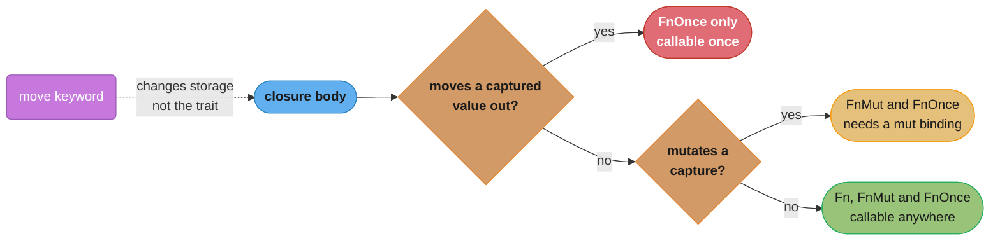
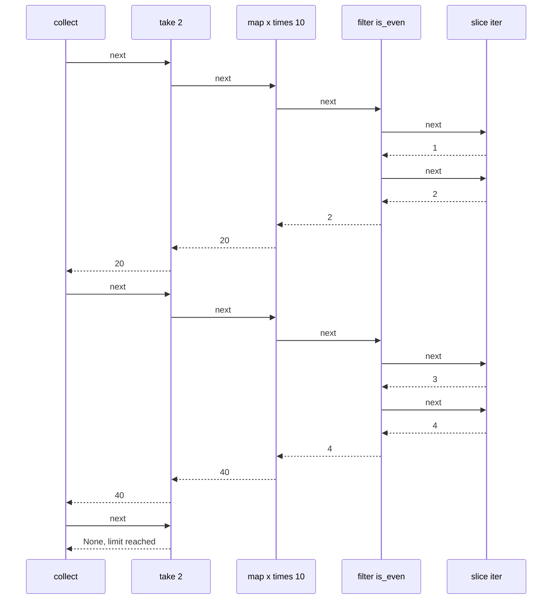

# Closures and Iterators

> **Version anchor (2026-11-06).** Rust 1.99.1 (2026-10-15) on edition 2024. Release-gated items on this page: `thread::scope` `[1.63]`, async closures and the `AsyncFn*` traits `[1.85]`, `Peekable::next_if_map` and `<[T]>::array_windows` `[1.94]`. `IntoIterator` for `Box<[T]>` is `[ed2024]`. `gen` blocks are not stable in 1.99.1; `gen` is only a reserved keyword in edition 2024. Crate: rayon 1.12.0.

## 1. Concept Overview

A **closure** in Rust is an anonymous struct that holds the variables it captures, plus an
implementation of one or more of the traits `Fn`, `FnMut` and `FnOnce`. The compiler writes
both for you. Because each closure is its own struct, each closure has its own type, which
nobody can name. That is why closures are passed as generics (`F: Fn(u32) -> u32`), returned
as `impl Fn(u32) -> u32`, or boxed as `Box<dyn Fn(u32) -> u32>` when different closures must
share one type.

An **iterator** is any type with a `next(&mut self) -> Option<Item>` method. Adapters such as
`map`, `filter` and `take` wrap one iterator in another and do nothing until a consumer
(`collect`, `sum`, `for`, `fold`) pulls values through. The whole chain is a nest of small
structs that the optimizer usually inlines into one loop, with no allocation between stages
and often fewer bounds checks than a hand-written index loop.

Closures and iterators are where Rust's zero-cost abstraction claim is most visible, and where
ownership rules show up in unfamiliar places: a closure that borrows a local cannot outlive
it, a closure that mutates a capture is `FnMut` and needs a mutable binding, and an iterator
over `&v` borrows `v` for the whole loop.

This page covers closure capture and the `Fn*` traits, storing and returning closures, async
closures, the `Iterator` and `IntoIterator` traits, adapters and consumers, short-circuiting
with `Result`, writing your own iterator, and what the generated code looks like. The cost of
generic vs `dyn` dispatch is analyzed in
[Monomorphization, vtables and dispatch cost](../traits_generics_and_trait_objects/monomorphization_vtables_and_dispatch_cost.md).

---

## 2. Intuition

> **One-line analogy**: a closure is a function with a backpack. What goes into the backpack
> (a reference, a mutable reference, or the value itself) decides where the function can go
> and how many times it can run.

**Mental model for closures**: the compiler looks at the closure body and packs the least it
needs. If the body only reads `x`, the backpack holds `&x`. If it changes `x`, it holds
`&mut x`. If it gives `x` away, it holds `x` itself and can run only once. The `move` keyword
says "put the values themselves in the backpack", which is what you need when the closure
outlives the current stack frame.

**Mental model for iterators**: a conveyor belt that runs backwards. The consumer at the end
asks for one item. Each adapter asks the stage before it for one item, does its work, and
passes the result on. Nothing moves until someone at the end pulls, and nothing is buffered
between stages.

**Why it matters**: closure errors are some of the first borrow-checker errors people meet
("closure may outlive the current function", "cannot borrow as mutable"), and they are easy to
fix once you see the backpack. Iterator chains are where Rust code gets both shorter and faster,
but laziness also produces a classic bug: a `map` whose side effect never runs because nothing
consumed it.

**Key insight**: the trait a closure implements (`Fn`, `FnMut`, `FnOnce`) is decided by what the
body *does* with each capture. `move` decides *how* the capture is stored. They are independent:
a `move` closure that only reads its captures is still `Fn`.

---

## 3. Core Principles

1. **A closure is a struct plus a trait impl.** Captured variables are its fields. Its size is the
   size of its captures. A closure that captures nothing is zero bytes and coerces to a plain
   `fn` pointer.

2. **The body chooses the trait.** Moving a capture out makes it `FnOnce` only. Mutating one makes
   it `FnMut`. Only reading makes it `Fn`. Every `Fn` is also `FnMut` and `FnOnce`.

3. **`move` chooses the storage, not the trait.** Without `move`, captures are borrowed where
   possible. With `move`, they are moved or copied into the closure. Threads and returned
   closures usually need `move`.

4. **Captures are precise (edition 2021 and later).** A closure that uses `self.count` captures
   only that field, not all of `self`, so other fields stay usable.

5. **Iterators are lazy.** An adapter returns a new iterator and does no work. A chain with no
   consumer does nothing, and the compiler warns: "iterators are lazy and do nothing unless
   consumed".

6. **Ownership decides the item type.** `iter()` yields `&T`, `iter_mut()` yields `&mut T`,
   `into_iter()` on an owned collection yields `T`. A `for` loop calls `into_iter()` on whatever
   you give it, so `for x in &v` borrows and `for x in v` consumes.

7. **Short-circuiting is built in.** `collect::<Result<Vec<_>, _>>()`, `try_fold`, `any`, `all`,
   `find` and `position` stop at the first decisive item.

---

## 4. Types / Architectures / Strategies

### 4.1 The closure traits

| Trait | Call signature | Can call | Body may | Example body |
|---|---|---|---|---|
| `FnOnce` | `call_once(self)` | once | move captures out | drops or returns a captured buffer |
| `FnMut` | `call_mut(&mut self)` | many times, not concurrently | mutate captures | increments a captured counter |
| `Fn` | `call(&self)` | many times, also from several threads if `Sync` | read captures | adds a captured offset to its argument |
| `AsyncFnOnce`, `AsyncFnMut`, `AsyncFn` | return a future | as above | as above, inside an `async` body | awaits a fetch for its argument |

`Fn: FnMut: FnOnce`. A function that accepts `FnOnce` accepts every closure. A function that
requires `Fn` accepts the fewest. Ask for the weakest bound you need: `FnOnce` if you call it
once, `FnMut` if you call it repeatedly from one place.

### 4.2 Ways to hold a closure

| Form | Size | Dispatch | Can hold different closures | Use for |
|---|---|---|---|---|
| generic `F: Fn(..)` | the closure's size | static, inlinable | no, one type per instantiation | parameters, hot paths |
| `impl Fn(..)` in argument position | same as generic | static | no | the same, shorter syntax |
| `impl Fn(..)` as return type | the closure's size | static | no, one concrete closure per function | factories such as `make_adder` |
| `Box<dyn Fn(..)>` | 16 bytes on 64-bit targets plus a heap block | vtable | yes | handler registries, callbacks stored in structs |
| `&dyn Fn(..)` | 16 bytes on 64-bit targets | vtable | yes | short-lived callbacks without allocation |
| `fn(..) -> ..` pointer | 8 bytes on 64-bit targets | indirect call | yes, only non-capturing closures and functions | tables of plain functions, FFI callbacks |

### 4.3 Iterator sources

| Call | Item type | Collection after the loop |
|---|---|---|
| `v.iter()` or `for x in &v` | `&T` | unchanged, borrowed during the loop |
| `v.iter_mut()` or `for x in &mut v` | `&mut T` | changed in place |
| `v.into_iter()` or `for x in v` | `T` | moved, gone |
| `v.drain(..)` | `T` | emptied, capacity kept |
| `map.keys()`, `values()`, `values_mut()` | `&K`, `&V`, `&mut V` | as above |
| `(0..n)`, `iter::repeat`, `iter::from_fn`, `iter::successors` | generated | none |

### 4.4 Adapters and consumers

| Kind | Methods | Notes |
|---|---|---|
| transform | `map`, `filter`, `filter_map`, `flat_map`, `flatten`, `inspect`, `scan` | lazy |
| limit | `take`, `skip`, `take_while`, `skip_while`, `step_by`, `fuse` | `take_while` consumes the first failing item |
| combine | `zip`, `chain`, `enumerate`, `peekable`, `rev` | `zip` stops at the shorter side; `rev` needs `DoubleEndedIterator` |
| consume | `collect`, `sum`, `product`, `count`, `fold`, `for_each`, `last`, `max_by_key` | drive the whole chain |
| short-circuit | `any`, `all`, `find`, `position`, `try_fold`, `try_for_each`, collect into `Result` or `Option` | stop early |

---

## 5. Architecture Diagrams

### 5.1 Which closure trait the compiler picks



The dotted edge is the part people get wrong. `move` copies or moves captures into the closure
so it can outlive the frame. The trait still comes from the body.

### 5.2 A lazy chain pulls one item at a time



For `[1, 2, 3, 4, 5, 6].iter().filter(..).map(..).take(2).collect()`, the source yields only four
items. Elements 5 and 6 are never read, and no intermediate `Vec` exists. After inlining, the
optimizer turns this into one loop with an early exit.

### 5.3 What a closure looks like in memory

```
  let offset = 7_u64;  let name = String::from("svc");  let big = [0_u8; 32];

  || 42                        struct C0;                              0 bytes
  |x| x + offset               struct C1 { offset: &u64 }              8 bytes
  move |x| x + offset          struct C2 { offset: u64 }               8 bytes
  || name.len()                struct C3 { name: &String }             8 bytes
  move || name                 struct C4 { name: String }              24 bytes
  move || big[0]               struct C5 { big: [u8; 32] }             32 bytes

  sizes on 64-bit targets; each line is a distinct, unnameable type
```

A boxed closure (`Box<dyn Fn>`) adds a 16-byte fat pointer and moves the struct to the heap. A
generic `F` keeps the struct inline, which is why passing closures by generic is free.

---

## 6. How It Works - Detailed Mechanics

### 6.1 Capture modes and the `Fn` traits

```rust
fn call_fn(f: impl Fn() -> usize) -> usize {
    f() + f()
}

fn call_fn_mut(mut f: impl FnMut()) {
    f();
    f();
}

fn call_once(f: impl FnOnce() -> String) -> String {
    f()
}

fn main() {
    let name = String::from("orders");

    // Reads `name`: captures &String, implements Fn.
    let len = || name.len();
    assert_eq!(call_fn(len), 12);

    // Mutates `hits`: captures &mut usize, implements FnMut. The binding must be `mut`.
    let mut hits = 0;
    let mut bump = || hits += 1;
    bump();
    call_fn_mut(&mut bump);
    assert_eq!(hits, 3);

    // Moves `name` out of the closure: FnOnce only.
    let take = move || name;
    assert_eq!(call_once(take), "orders");

    // A non-capturing closure coerces to a fn pointer.
    let double: fn(u32) -> u32 = |x| x * 2;
    assert_eq!(double(21), 42);
}
```

`call_fn_mut(&mut bump)` works because `&mut F` implements `FnMut` when `F: FnMut`. Passing a
reference lets you keep using the closure afterwards.

### 6.2 Precise captures

Since edition 2021, a closure captures the exact place it uses (`self.count`), not the whole
variable (`self`). This removes a whole class of borrow conflicts.

```rust
struct Stats {
    seen: u64,
    names: Vec<String>,
}

impl Stats {
    fn record_all(&mut self, items: &[&str]) {
        // The closure captures only `self.seen` (by mutable reference).
        let mut count = |_: &str| self.seen += 1;
        for item in items {
            // `self.names` is a different place, so using it while `count` lives is allowed.
            self.names.push(item.to_string());
            count(item);
        }
    }
}

fn main() {
    let mut s = Stats { seen: 0, names: Vec::new() };
    s.record_all(&["a", "b"]);
    assert_eq!(s.seen, 2);
    assert_eq!(s.names.len(), 2);
}
```

One side effect: a closure that captures two fields by reference stores two references, so it
can be larger than a closure that captured the whole struct. That difference rarely matters.

### 6.3 Returning and storing closures

```rust
use std::collections::HashMap;

// One concrete closure type per function: impl Fn works.
fn make_adder(n: u32) -> impl Fn(u32) -> u32 {
    move |x| x + n
}

// Different closures in one collection: they need a shared type, so box them.
type Handler = Box<dyn Fn(&str) -> String + Send + Sync>;

fn routes() -> HashMap<&'static str, Handler> {
    let mut r: HashMap<&'static str, Handler> = HashMap::new();
    let prefix = String::from("hello ");
    r.insert("greet", Box::new(move |who: &str| format!("{prefix}{who}")));
    r.insert("shout", Box::new(|who: &str| who.to_uppercase()));
    r
}

// A branch that returns two different closures also needs a box (or an enum).
fn pick(loud: bool) -> Box<dyn Fn(&str) -> String> {
    if loud {
        Box::new(|s: &str| s.to_uppercase())
    } else {
        Box::new(|s: &str| s.to_string())
    }
}

fn main() {
    let add5 = make_adder(5);
    assert_eq!(add5(1), 6);
    let r = routes();
    assert_eq!(r["greet"]("ana"), "hello ana");
    assert_eq!(pick(true)("hi"), "HI");
}
```

`impl Fn` in return position means "one specific type that I am not naming". Two `if` branches
returning two closures are two types, so they cannot share one `impl Fn` return. The fix is a
`Box<dyn Fn>`, an enum of the cases, or a single closure that branches inside.

### 6.4 Closures and threads

`thread::spawn` requires `F: FnOnce() -> T + Send + 'static`. A closure that borrows a local is
not `'static`, so spawned closures use `move`. Scoped threads `[1.63]` lift the `'static`
requirement, because the scope joins every thread before the borrowed data can go away.

```rust
use std::thread;

fn main() {
    let data = vec![1_u64, 2, 3, 4, 5, 6];

    // 'static: move a clone (or an Arc) into the thread.
    let owned = data.clone();
    let total = thread::spawn(move || owned.iter().sum::<u64>())
        .join()
        .expect("summing thread should not panic");
    assert_eq!(total, 21);

    // Scoped: borrow `data` directly, the scope joins both threads before returning.
    let (left, right) = data.split_at(3);
    let (a, b) = thread::scope(|s| {
        let ha = s.spawn(|| left.iter().sum::<u64>());
        let hb = s.spawn(|| right.iter().sum::<u64>());
        (ha.join(), hb.join())
    });
    assert_eq!(a.ok(), Some(6));
    assert_eq!(b.ok(), Some(15));
}
```

The thread-safety rules themselves (`Send`, `Sync`) are covered in
[Threads, Send, Sync and locks](../threads_send_sync_and_locks/threads_send_sync_and_locks.md).

### 6.5 Async closures

Before 1.85, an "async closure" was a closure returning an `async` block, and the future could
not borrow from the closure's own captures. Async closures `[1.85]` (`async |x| ...`) and the
`AsyncFn`, `AsyncFnMut` and `AsyncFnOnce` traits fix that: the returned future may borrow the
closure's state.

```rust
use std::ops::AsyncFn;

async fn retry<T, E>(attempts: u32, op: impl AsyncFn() -> Result<T, E>) -> Result<T, E> {
    let mut last = op().await;
    for _ in 1..attempts {
        if last.is_ok() {
            break;
        }
        last = op().await;
    }
    last
}

async fn caller() -> Result<usize, String> {
    let endpoint = String::from("http://inventory/stock");
    // The future borrows `endpoint` through the closure, no clone per call.
    retry(3, async || {
        if endpoint.is_empty() {
            Err("empty endpoint".to_string())
        } else {
            Ok(endpoint.len())
        }
    })
    .await
}
```

`AsyncFn*` traits are not dyn compatible in 1.99.1, so `Box<dyn AsyncFn()>` does not exist. To
store async callbacks of different types, box the futures instead (a closure returning
`Pin<Box<dyn Future<Output = T> + Send>>`). The async model behind this is in
[Async, futures and pinning](../async_futures_and_pinning/async_futures_and_pinning.md).

### 6.6 The `Iterator` and `IntoIterator` traits

A `for` loop is sugar over `IntoIterator`:

```rust
fn main() {
    let v = vec![10, 20, 30];

    // What `for x in &v { total += x; }` expands to.
    let mut total = 0;
    let mut it = IntoIterator::into_iter(&v);
    loop {
        match it.next() {
            Some(x) => total += x,
            None => break,
        }
    }
    assert_eq!(total, 60);

    // Arrays iterate by value (edition 2021 and later); Box<[T]> too in edition 2024.
    let names: Box<[String]> = vec!["a".to_string(), "b".to_string()].into_boxed_slice();
    let owned: Vec<String> = names.into_iter().collect();
    assert_eq!(owned.len(), 2);
}
```

`Iterator` has one required method, `next`, and dozens of provided ones. `IntoIterator` is
implemented three times for most collections: for `C` (yields `T`), for `&C` (yields `&T`) and
for `&mut C` (yields `&mut T`). Accept `impl IntoIterator<Item = T>` in APIs to take a `Vec`, an
array, a `HashSet` or a chain without forcing the caller to collect first.

### 6.7 Collecting, and short-circuiting on errors

```rust
use std::collections::HashMap;
use std::num::ParseIntError;

fn main() {
    let raw = ["8080", "443", "x9", "22"];

    // Collect into Result: stops at the first Err, returns it.
    let ports: Result<Vec<u16>, ParseIntError> = raw.iter().map(|s| s.parse::<u16>()).collect();
    assert!(ports.is_err());

    // Keep the good ones and count the bad ones in one pass.
    let (ok, bad): (Vec<_>, Vec<_>) = raw.iter().map(|s| s.parse::<u16>()).partition(Result::is_ok);
    assert_eq!((ok.len(), bad.len()), (3, 1));

    // try_fold: a running total with an early exit on overflow.
    let sizes = [u32::MAX - 1, 1, 1];
    let sum = sizes.iter().try_fold(0_u32, |acc, &x| acc.checked_add(x));
    assert_eq!(sum, None);

    // Collect into other shapes.
    let index: HashMap<&str, usize> = raw.iter().enumerate().map(|(i, s)| (*s, i)).collect();
    assert_eq!(index["443"], 1);
    let csv: String = raw.iter().copied().collect::<Vec<_>>().join(",");
    assert_eq!(csv, "8080,443,x9,22");
}
```

The target type of `collect` drives what happens, through `FromIterator`. `Vec<T>`, `String`,
`HashMap<K, V>`, `BTreeSet<T>`, `Result<C, E>` and `Option<C>` all implement it. `Vec`'s
implementation reserves from the iterator's `size_hint` lower bound, so a chain from a slice
through `map` allocates once.

### 6.8 Writing an iterator

```rust
use std::iter::FusedIterator;

/// Yields the offsets of each line start in a byte buffer.
struct LineStarts<'a> {
    buf: &'a [u8],
    pos: Option<usize>,
}

impl<'a> LineStarts<'a> {
    fn new(buf: &'a [u8]) -> Self {
        LineStarts { buf, pos: if buf.is_empty() { None } else { Some(0) } }
    }
}

impl Iterator for LineStarts<'_> {
    type Item = usize;

    fn next(&mut self) -> Option<usize> {
        let start = self.pos?;
        self.pos = self.buf[start..]
            .iter()
            .position(|&b| b == b'\n')
            .map(|i| start + i + 1)
            .filter(|&next| next < self.buf.len());
        Some(start)
    }

    fn size_hint(&self) -> (usize, Option<usize>) {
        match self.pos {
            Some(p) => (1, Some(self.buf.len() - p)),
            None => (0, Some(0)),
        }
    }
}

// Once next returns None, it keeps returning None.
impl FusedIterator for LineStarts<'_> {}

fn main() {
    let starts: Vec<usize> = LineStarts::new(b"ab\ncd\n\nef").collect();
    assert_eq!(starts, [0, 3, 6, 7]);

    // For one-off iterators, from_fn avoids the struct.
    let mut n = 0_u32;
    let evens: Vec<u32> = std::iter::from_fn(|| {
        n += 2;
        (n <= 6).then_some(n)
    })
    .collect();
    assert_eq!(evens, [2, 4, 6]);

    // successors: each item computed from the previous one.
    let backoff: Vec<u64> = std::iter::successors(Some(100_u64), |&ms| (ms < 1_600).then(|| ms * 2)).collect();
    assert_eq!(backoff, [100, 200, 400, 800, 1_600]);
}
```

| Marker trait | Promise | Unlocks |
|---|---|---|
| `ExactSizeIterator` | `size_hint` is exact | `len()`, exact preallocation |
| `DoubleEndedIterator` | `next_back` works | `rev()`, `rfind`, `last` from the back |
| `FusedIterator` | `None` stays `None` | `fuse()` becomes free |

A correct `size_hint` matters: `collect` uses it to preallocate. A wrong lower bound is not
unsafe, but a lower bound that is too high wastes memory.

### 6.9 Peeking and windows

```rust
fn main() {
    // next_if_map [1.94]: take a leading run that maps to a value, leave the rest.
    let mut chars = "125 GOTO 10".chars().peekable();
    let mut line = 0_u32;
    while let Some(d) = chars.next_if_map(|c| c.to_digit(10).ok_or(c)) {
        line = line * 10 + d;
    }
    assert_eq!(line, 125);
    assert_eq!(chars.collect::<String>(), " GOTO 10");

    // next_if_eq: the same idea for an equality test (next_if takes a predicate).
    let mut it = [1, 1, 2, 3].into_iter().peekable();
    let mut ones = 0;
    while it.next_if_eq(&1).is_some() {
        ones += 1;
    }
    assert_eq!((ones, it.next()), (2, Some(2)));

    // array_windows [1.94]: compare neighbors without indexing.
    let ts = [100_u64, 105, 180, 181];
    let max_gap = ts.array_windows::<2>().map(|[a, b]| b - a).max();
    assert_eq!(max_gap, Some(75));
}
```

`take_while` is the trap these APIs fix: it consumes and drops the first item that fails the
predicate. `peekable` plus `next_if` leaves that item in place.

### 6.10 What the compiler makes of a chain

```rust
pub fn sum_indexed(v: &[u64], w: &[u64]) -> u64 {
    let mut s = 0;
    for i in 0..v.len() {
        // A bounds check on w[i] stays unless the optimizer proves w.len() >= v.len().
        s += v[i] * w[i];
    }
    s
}

pub fn sum_zipped(v: &[u64], w: &[u64]) -> u64 {
    // zip stops at the shorter slice, so no element access can go out of bounds.
    v.iter().zip(w).map(|(a, b)| a * b).sum()
}
```

The two functions are not equivalent: `sum_indexed` panics if `w` is shorter, `sum_zipped`
silently stops. That difference is also why the zipped version needs no bounds checks. In
release builds an iterator chain over slices usually compiles to the same loop as a careful index
loop, often with vectorization. Check with `cargo asm` or Compiler Explorer, and measure as in
[Profiling and benchmarking](../profiling_and_benchmarking/profiling_and_benchmarking.md),
rather than assuming either way. Parallelism is one method away with rayon: `v.par_iter()` in
place of `v.iter()`.

---

## 7. Real-World Examples

- **Python generators** produce values lazily like Rust iterators, but each `yield` suspends a
  heap-allocated frame. A Rust iterator is a plain struct whose state lives inline, and stable
  Rust has no `yield` (`gen` blocks are not stable in 1.99.1). See
  [Python iterators and generators](../../python/iterators_and_generators/iterators_and_generators.md).
- **Java streams** are lazy pipelines too, but each stage is an object called through an
  interface, and parallel streams share a fork-join pool. Rust chains are monomorphized and
  usually inlined, and parallelism is a separate crate (rayon). See
  [Java streams](../../java/java_streams/java_streams.md) and
  [Java functional programming](../../java/functional_programming/functional_programming.md).
- **Web frameworks** store routes and middleware as boxed closures or trait objects: axum handlers
  are generic functions converted into boxed services at the router. See
  [Web services with axum, tower and hyper](../web_services_axum_tower_and_hyper/web_services_axum_tower_and_hyper.md).
- **rayon** keeps the iterator vocabulary (`map`, `filter`, `sum`, `collect`) and splits the work
  across a thread pool. The closures must be `Send + Sync`, which the compiler checks.
- **Parsers and tokenizers** use `Peekable` and `next_if` for one-token lookahead, the same
  pattern as §6.9.

---

## 8. Tradeoffs

### 8.1 Generic closure vs boxed closure vs fn pointer

| Factor | `F: Fn(..)` | `Box<dyn Fn(..)>` | `fn(..)` |
|---|---|---|---|
| Call cost | direct, usually inlined | indirect through a vtable, not inlined | indirect |
| Allocation | none | one per closure | none |
| Code size | one copy per closure type | one copy | one copy |
| Holds captured state | yes | yes | no |
| Different closures in one `Vec` | no | yes | yes, if none capture |
| Best for | hot paths, combinators | registries, plugin hooks, config-driven behavior | dispatch tables, FFI callbacks |

The numbers behind "indirect" and "code size" are in
[Monomorphization, vtables and dispatch cost](../traits_generics_and_trait_objects/monomorphization_vtables_and_dispatch_cost.md).

### 8.2 Iterator chain vs `for` loop

| Factor | Iterator chain | `for` loop with mutation |
|---|---|---|
| Bounds checks | removed by construction for slices | removed only when the optimizer proves them |
| Early exit with errors | `collect::<Result<..>>`, `try_fold`, `?` inside `try_for_each` | `?` and `break` directly |
| Readability | high for map, filter, collect | high for complex state and multiple outputs |
| Debugging | harder to step through | easy |
| Several results from one pass | `fold` into a tuple, awkward | natural |

Use chains for transform and filter pipelines, and loops when the body updates several
accumulators or needs `break` with values, `continue` and `?` mixed together.

### 8.3 Collecting vs staying lazy

| | Collect to `Vec` | Return `impl Iterator` |
|---|---|---|
| Memory | all items at once | one item at a time |
| Caller can iterate twice | yes | no, unless the iterator is `Clone` |
| Borrowing | none after return | the iterator may borrow the source |
| Use when | results are reused or sorted | results are streamed once |

---

## 9. When to Use / When NOT to Use

**Use closures when:**
- a function needs caller-supplied behavior: sort keys, retry policies, filters, callbacks;
- you need a small piece of logic with captured context, used once or locally.

**Use `Box<dyn Fn>` when:**
- a struct stores callbacks chosen at runtime, or a collection holds different closures.

**Use iterator chains when:**
- data flows through transform, filter, aggregate steps;
- you want short-circuiting on `Result` or `Option` without manual bookkeeping.

**Do NOT:**
- use `map` for side effects; use `for` or `for_each`, so nothing is silently dropped;
- collect into a `Vec` only to iterate it again on the next line;
- use `take_while` when the first failing element must be kept; use `peekable` with `next_if`;
- write `impl Fn` for a function that returns different closures from different branches;
- capture a large value by `move` into many closures when an `Arc` would share it.

---

## 10. Common Pitfalls

### 10.1 Returning a closure that borrows a local

```rust
// BROKEN: the closure borrows `n`, which dies when make_adder returns.
// error[E0373]: closure may outlive the current function, but it borrows `n`, which is owned by the current function
fn make_adder(n: u32) -> impl Fn(u32) -> u32 {
    |x| x + n
}
```

```rust
// FIX: move the captured value into the closure.
fn make_adder(n: u32) -> impl Fn(u32) -> u32 {
    move |x| x + n
}
```

### 10.2 A mutating closure passed where `Fn` is required

```rust
// BROKEN: the closure mutates `log`, so it is FnMut, but call_twice asks for Fn.
// error[E0596]: cannot borrow `log` as mutable, as it is a captured variable in a `Fn` closure
fn call_twice<F: Fn()>(f: F) {
    f();
    f();
}

fn main() {
    let mut log = Vec::new();
    call_twice(|| log.push("tick"));
    println!("{}", log.len());
}
```

```rust
// FIX: ask for the weakest bound the function needs.
fn call_twice<F: FnMut()>(mut f: F) {
    f();
    f();
}

fn main() {
    let mut log = Vec::new();
    call_twice(|| log.push("tick"));
    println!("{}", log.len());
}
```

### 10.3 A closure that holds a mutable borrow too long

```rust
// BROKEN: `inc` holds `&mut count` from its creation until its last use.
// error[E0502]: cannot borrow `count` as immutable because it is also borrowed as mutable
fn main() {
    let mut count = 0;
    let mut inc = || count += 1;
    inc();
    println!("{count}");
    inc();
}
```

```rust
// FIX: finish using the closure before reading the variable.
fn main() {
    let mut count = 0;
    let mut inc = || count += 1;
    inc();
    inc();
    println!("{count}");
}
```

### 10.4 `collect` without a target type

```rust
// BROKEN: collect can build many types, and nothing says which.
// error[E0282]: type annotations needed
fn main() {
    let lens = ["a", "bb"].iter().map(|s| s.len()).collect();
    println!("{}", lens.len());
}
```

```rust
// FIX: name the target, on the binding or with the turbofish.
fn main() {
    let lens: Vec<usize> = ["a", "bb"].iter().map(|s| s.len()).collect();
    let total = ["a", "bb"].iter().map(|s| s.len()).collect::<Vec<_>>().iter().sum::<usize>();
    println!("{} {total}", lens.len());
}
```

### 10.5 Production war stories

The cases below are illustrative. Their numbers show scale and do not come from a real incident.

- **The `map` that never ran.** A migration script wrote
  `records.iter().map(|r| db.insert(r));` to insert rows. It compiled with a warning that nobody
  read, and inserted nothing. Turn on `#![deny(unused_must_use)]` or `-D warnings` in CI
  (`CARGO_BUILD_WARNINGS=deny` since 1.97), and use `for` for side effects.
- **`take_while` ate the header.** A log parser read lines while they started with `#`, then
  parsed the body. `take_while` consumed and dropped the first body line, so every file lost one
  record. `by_ref().take_while(..)` does not help, because the failing item is still consumed.
  `peekable` with `next_if` fixed it.
- **`zip` hid a length bug.** A job zipped request ids with responses. A retry path produced one
  fewer response, `zip` stopped early, and the last request was marked as never answered. Assert
  equal lengths before zipping when they must match.
- **A big capture per task.** A server spawned a task per request with `move` closures that each
  captured a clone of a 2 MB lookup table. At 5,000 concurrent requests that was 10 GB. Wrapping
  the table in `Arc` made each capture 8 bytes.
- **Boxed closures on the hot path.** A pricing engine stored every rule as a `Box<dyn Fn>` and
  called 40 of them per quote. Converting the fixed set of rules to an enum with a `match` let the
  compiler inline them. See the dispatch-cost sub-file for when that trade is worth it.

---

## 11. Technologies & Tools

| Tool | Version | Role |
|---|---|---|
| `std::iter` | std | `Iterator`, `IntoIterator`, `from_fn`, `successors`, `zip`, `Peekable` |
| `std::ops` | std | `Fn`, `FnMut`, `FnOnce`, `AsyncFn`, `AsyncFnMut`, `AsyncFnOnce` |
| `std::thread::scope` | std, 1.63 | scoped threads that borrow closures' captures safely |
| rayon | 1.12.0 | parallel iterators with the same adapter names |
| Clippy | ships with 1.99.1 | `needless_collect`, `manual_filter_map`, `redundant_closure` |
| cargo-show-asm (`cargo asm`) or Compiler Explorer | external | inspect the code a chain compiles to |

---

## 12. Interview Questions with Answers

**Q: What decides whether a closure is `Fn`, `FnMut` or `FnOnce`?**
**Short:** The closure body does: moving a captured value out makes it FnOnce, mutating a capture makes it FnMut, and only reading captures makes it Fn.

The compiler inspects each use of each captured variable and picks the most capable trait the
body allows. Every `Fn` closure also implements `FnMut` and `FnOnce`, so it can be passed where
those are required. The `move` keyword does not change the trait. It changes whether captures are
stored as references or as values.

**Q: What does the `move` keyword change about a closure?**
**Short:** It makes the closure take ownership of the captured variables, copying Copy types and moving others, instead of borrowing them.

Without `move`, the closure stores references where it can, which ties it to the current stack
frame. With `move`, it can outlive the frame, which `thread::spawn`, `tokio::spawn` and returned
closures need. A `move` closure that only reads its captures is still `Fn` and can still be called
many times. To keep using a value after moving a copy into a closure, clone it into a new binding
first, or share it through an `Arc`.

**Q: Why does returning `|x| x + n` from a function fail to compile?**
**Short:** Without move the closure captures n by reference, and n is dropped when the function returns, so the closure would hold a dangling reference.

The error is E0373, "closure may outlive the current function". Adding `move` copies `n` into the
closure's own state. The same error appears when a closure that borrows a local is passed to
`thread::spawn`. For threads, the alternative is `thread::scope`, which joins the threads before
the borrowed locals go away.

**Q: Why does a closure that pushes to a captured `Vec` fail when passed to a function bounded by `F: Fn()`?**
**Short:** Pushing mutates the capture, which needs FnMut; inside an Fn closure the capture is only a shared borrow, so the compiler reports it cannot borrow it as mutable.

The error is E0596, "cannot borrow `log` as mutable, as it is a captured variable in a `Fn`
closure". The compiler infers the closure trait from the expected bound when one is given, so the
message points at the push rather than at the call. The right fix is usually the function's bound:
`F: FnMut()` with `mut f`. Keep `Fn` only if the function really calls the closure concurrently
or through a shared reference, and then move the state into an atomic or a `Mutex`.

**Q: Why can't two `if` branches return two closures from one `impl Fn` function?**
**Short:** Every closure has its own unnameable type, and impl Fn in return position stands for one single concrete type, so two closures are two different types.

Box them (`Box<dyn Fn(..)>`), return an enum whose variants you match on, or write one closure
whose body branches on a captured flag. The box costs one allocation and a vtable call. The
single-closure version keeps static dispatch, and is often the cleanest when the branches share
captures.

**Q: When should a function take `impl Fn` and when `Box<dyn Fn>`?**
**Short:** Take a generic or impl Fn for parameters used during the call; store a Box dyn Fn when a struct or collection must hold closures of different types.

A generic parameter is monomorphized, so each closure gets its own inlined copy of the function
and calls cost nothing extra. A struct field cannot hold "some closure" without either a type
parameter on the struct or a trait object. Registries, route tables and plugin hooks pick the box.
Add `+ Send + Sync` to the trait object if the struct crosses threads.

**Q: What does edition 2021's precise capture change?**
**Short:** A closure now captures only the exact field paths it uses, such as self.count, instead of the whole variable, so other fields stay borrowable.

Under edition 2018, `|| self.count += 1` captured all of `self` mutably, so using `self.names` in
the same scope was a borrow error. Since 2021 the closure captures `self.count` alone. One visible
difference is drop order: a `move` closure that captures one field moves only that field, so the
rest of the struct can drop at a different time than before. `cargo fix --edition` inserts
`let _ = &x;` lines where the change could alter behavior.

**Q: Why does an iterator chain with no consumer do nothing?**
**Short:** Adapters only build a nested iterator struct; values move only when a consumer such as collect, sum, for or for_each calls next.

`v.iter().map(|x| send(x));` creates a `Map` value and drops it. The compiler warns because
`Map` is `#[must_use]` with the note "iterators are lazy and do nothing unless consumed". Use a
`for` loop for side effects, and turn warnings into errors in CI so this cannot ship.

**Q: How do you stop processing at the first error while mapping over items?**
**Short:** Collect into Result of Vec, use try_fold or try_for_each, or use ? inside a for loop; each stops at the first Err and returns it.

`items.iter().map(parse).collect::<Result<Vec<_>, _>>()` returns `Ok(vec)` if every item parsed,
or the first `Err` and nothing else. Items after the error are never read. `Option` works the same
way. To collect every error instead, use `partition(Result::is_ok)` or fold into two vectors.

**Q: What are the three iterators a `Vec` gives you, and how does a `for` loop pick one?**
**Short:** iter yields shared references, iter_mut yields mutable references, and into_iter yields owned values; a for loop calls into_iter on whatever expression it gets.

`for x in &v` calls `(&v).into_iter()`, which is `v.iter()`. `for x in &mut v` gives `&mut T`.
`for x in v` consumes `v`, and `v` cannot be used after the loop. Arrays iterate by value since
edition 2021, and `Box<[T]>` does in edition 2024. Accept `impl IntoIterator<Item = T>` in APIs to
take any of these.

**Q: Why can `take_while` lose data, and what replaces it?**
**Short:** take_while must read the first item that fails the predicate to know when to stop, and it drops that item; peekable with next_if leaves it in place.

The dropped item is gone from the underlying iterator, so a parser that reads a header with
`take_while` and then the body loses the first body line. `by_ref()` does not help, because the
item is consumed either way. `let mut it = lines.peekable(); while let Some(l) =
it.next_if(is_header) { .. }` keeps the boundary item for the next stage. `next_if_map` (1.94)
does the same while transforming.

**Q: How do async closures differ from a closure that returns an `async` block?**
**Short:** An async closure's future may borrow the closure's own captures, and it is bounded with the AsyncFn traits, which the closure-returning-a-future form cannot express.

With `|| async { use(&state) }`, the future cannot borrow `state` from the closure, so code clones
captures into every call. Since 1.85, `async || { use(&state) }` lets the future borrow, and
functions take `impl AsyncFn() -> T` instead of `F: Fn() -> Fut, Fut: Future`. `AsyncFn*` traits
are not dyn compatible in 1.99.1, so storing different async closures still means boxing their
futures.

**Q: When does a closure coerce to a `fn` pointer?**
**Short:** Only when it captures nothing; a non-capturing closure has no state, so it can become a plain fn pointer usable in tables and C callbacks.

`let f: fn(u32) -> u32 = |x| x * 2;` compiles. Add one capture and it fails, because a `fn`
pointer has nowhere to keep the state. For FFI, a C callback API usually takes a `void*` user-data
argument next to the function pointer: pass a non-capturing `extern "C" fn` and put the state
behind that pointer.

**Q: What does `size_hint` do, and why does it matter for performance?**
**Short:** It reports a lower and optional upper bound on remaining items, and collect uses the lower bound to preallocate, so an accurate hint avoids reallocations.

`Vec`'s `FromIterator` reserves the lower bound before the loop. A chain over a slice through
`map` reports an exact size and allocates once. `filter` drops the lower bound to zero, because any
number of items could fail, so the `Vec` grows by doubling. If you implement `Iterator`, override
`size_hint` when you know better, and implement `ExactSizeIterator` only when the hint is exact.

**Q: Are iterator chains slower than index loops in Rust?**
**Short:** Usually not: in release builds a slice iterator chain is inlined into one loop and often avoids bounds checks that an index loop keeps.

`for i in 0..v.len() { v[i] .. w[i] }` keeps a check on `w[i]` unless the optimizer proves the
lengths match. `v.iter().zip(w)` has no index at all. Debug builds are a different story: without
inlining, every adapter is a real call. Measure the release build, and read the assembly when
the difference matters.

**Q: How do you share a large read-only value with many `move` closures?**
**Short:** Put it in an Arc and move a clone of the Arc into each closure, so each capture costs a pointer and a reference count increment instead of a full copy.

`let table = Arc::new(table); let t = Arc::clone(&table); spawn(move || lookup(&t))`. Cloning the
`Arc` is one atomic increment. Moving `table.clone()` into each closure copies the whole value,
which for a 2 MB table across thousands of tasks becomes gigabytes. For scoped threads, a plain
reference is enough.

**Q: What is a `FusedIterator`, and why does `fuse()` exist?**
**Short:** A FusedIterator promises that after next returns None it keeps returning None; fuse adds that promise to any iterator, at no cost if it is already fused.

The `Iterator` contract allows an iterator to return `Some` again after `None`, for example one that
reads from a source that receives more data. Code that calls `next` past the end (custom `zip`
logic, merging streams) should not rely on that. `fuse()` wraps the iterator so it stays done.
Implement `FusedIterator` on your own iterators when they already behave that way.

**Q: How do you write an iterator without defining a struct?**
**Short:** Use iter::from_fn with a closure that returns Option, or iter::successors when each item comes from the previous one.

`from_fn(move || { .. Some(x) or None })` turns any stateful closure into an iterator. The closure's
captures are the state. `successors(Some(100), |&ms| (ms < 1_600).then(|| ms * 2))` builds a
backoff schedule. Both are fine for local use. Write a named struct when the iterator is part of a
public API, needs `size_hint`, or must implement `DoubleEndedIterator`.

**Q: Why does `collect()` sometimes need a type annotation?**
**Short:** collect is generic over its output through FromIterator, so the compiler needs the target type from a binding, a turbofish or the surrounding function signature.

`let v = it.collect();` fails with "type annotations needed" when nothing else fixes the type.
Write `let v: Vec<_> = ..`, `.collect::<Vec<_>>()`, or return it from a function whose return
type says `Vec<String>`. The underscore lets the compiler infer the element type, which keeps the
annotation short.

**Q: How do iterators interact with borrowing the collection?**
**Short:** An iterator from iter or iter_mut borrows the collection for as long as it lives, so you cannot change the collection inside the loop that walks it.

Pushing to a `Vec` or removing from a `HashMap` while iterating it is E0502, for the same reason
holding `&v[0]` across a push is. Use `retain`, `extract_if` or `drain` for removal, collect the
changes into a separate `Vec` and apply them after the loop, or iterate over indices when the
mutation must happen in place. See
[Collections and strings](../collections_and_strings/collections_and_strings.md).

---

## 13. Best Practices

1. Ask for the weakest closure bound you need: `FnOnce`, then `FnMut`, then `Fn`.
2. Use `move` for closures that cross threads or outlive the frame; share large captures with `Arc`.
3. Take closures as generics on hot paths; box them only to store different closures together.
4. Add `Send + Sync` to boxed closures that a struct shares across threads.
5. Use `async` closures and `AsyncFn` bounds instead of closures returning futures.
6. Never use `map` for side effects. Deny warnings in CI so lazy chains cannot ship unconsumed.
7. Collect into `Result` or use `try_fold` to stop at the first error.
8. Prefer `zip`, `windows`, `array_windows` and `chunks_exact` to index arithmetic, and assert
   lengths when they must match.
9. Use `peekable` with `next_if` or `next_if_map` instead of `take_while` when the boundary item
   matters.
10. Accept `impl IntoIterator<Item = T>` in APIs, and implement `size_hint` on your own iterators.
11. Return `impl Iterator` for single-pass streaming results, `Vec` for results that are reused.

---

## 14. Case Study

### An event-hook registry for a multi-threaded ingest service

**Context (illustrative numbers).** An ingest service handles about 50,000 events per second on 8 worker threads. Product
teams register hooks: small pieces of logic that inspect each event and may reject it (a size
limit, a tenant block list, a schema check). About 40 hooks exist, loaded from configuration at
startup. Hooks are closures because each one captures its own configuration.

**First design.** A `Registry` held `Vec<Box<dyn Fn(&Event) -> Result<(), String>>>`, built on
the main thread and shared with the workers. It did not compile:

```rust
// BROKEN: the boxed closures are not Send or Sync, so the registry cannot be shared with threads.
// error[E0277]: `(dyn for<'a> Fn(&'a Event) -> Result<(), String> + 'static)` cannot be sent between threads safely
// (and a second E0277: the same type cannot be shared between threads safely)
use std::sync::Arc;
use std::thread;

struct Event {
    tenant: u32,
    bytes: usize,
}

struct Registry {
    hooks: Vec<Box<dyn Fn(&Event) -> Result<(), String>>>,
}

fn main() {
    let max = 64 * 1024;
    let registry = Arc::new(Registry {
        hooks: vec![Box::new(move |e: &Event| {
            if e.bytes > max { Err(format!("event is {} bytes", e.bytes)) } else { Ok(()) }
        })],
    });
    let r = Arc::clone(&registry);
    let worker = thread::spawn(move || r.hooks.len());
    let _ = worker.join();
}
```

The trait object says nothing about thread safety, so the compiler must assume a hook could
capture an `Rc` or a `RefCell`. The fix states the requirement in the type, which also rejects
any hook that captures non-thread-safe state at registration time instead of at runtime.

```rust
// FIX: Send + Sync in the hook type, a typed rejection, and dispatch written as an iterator chain.
use std::collections::HashSet;
use std::sync::Arc;
use std::thread;

struct Event {
    tenant: u32,
    bytes: usize,
}

#[derive(Debug, PartialEq)]
struct Rejected {
    hook: &'static str,
    reason: String,
}

type Hook = Box<dyn Fn(&Event) -> Result<(), String> + Send + Sync>;

struct Registry {
    hooks: Vec<(&'static str, Hook)>,
}

impl Registry {
    /// First rejection wins: stops calling hooks as soon as one fails.
    fn check(&self, e: &Event) -> Result<(), Rejected> {
        self.hooks.iter().try_for_each(|(name, hook)| {
            hook(e).map_err(|reason| Rejected { hook: *name, reason })
        })
    }

    /// Audit mode: run every hook and report all rejections.
    fn audit(&self, e: &Event) -> Vec<Rejected> {
        self.hooks
            .iter()
            .filter_map(|(name, hook)| hook(e).err().map(|reason| Rejected { hook: *name, reason }))
            .collect()
    }
}

fn build_registry(max_bytes: usize, blocked: HashSet<u32>) -> Registry {
    let size: Hook = Box::new(move |e: &Event| {
        if e.bytes > max_bytes {
            Err(format!("{} bytes exceeds {max_bytes}", e.bytes))
        } else {
            Ok(())
        }
    });
    let tenant: Hook = Box::new(move |e: &Event| {
        if blocked.contains(&e.tenant) {
            Err(format!("tenant {} is blocked", e.tenant))
        } else {
            Ok(())
        }
    });
    Registry { hooks: vec![("size", size), ("tenant", tenant)] }
}

fn main() {
    let registry = Arc::new(build_registry(64 * 1024, HashSet::from([7])));

    let workers: Vec<_> = (0..2_u32)
        .map(|i| {
            let r = Arc::clone(&registry);
            thread::spawn(move || {
                let e = Event { tenant: 7 + i, bytes: 100 };
                r.check(&e).is_ok()
            })
        })
        .collect();

    let accepted: Vec<bool> = workers
        .into_iter()
        .map(|h| h.join().expect("worker thread should not panic"))
        .collect();
    assert_eq!(accepted, [false, true]);

    let big = Event { tenant: 7, bytes: 1 << 20 };
    assert_eq!(registry.audit(&big).len(), 2);
    assert_eq!(registry.check(&big).map_err(|r| r.hook), Err("size"));
}
```

**Why each choice.**

- `Box<dyn Fn .. + Send + Sync>`: hooks differ in type and come from configuration, so a trait
  object is the natural fit. `Fn` (not `FnMut`) lets 8 workers call the same hook at once without a
  lock. A hook that needs a counter must use an atomic, which the bounds force into the open.
- `try_for_each` in `check` stops at the first rejection, so a rejected event costs the hooks up to
  the failing one, not all 40. Ordering cheap hooks first (size before schema) lowers the average.
- `filter_map` plus `collect` in `audit` runs every hook and gathers all reasons, for the debug
  endpoint that explains rejections.
- `&'static str` names avoid an allocation per rejection label.
- The tenant list is captured by `move` once per registry. With 8 workers sharing it through the
  `Arc<Registry>`, it exists in memory once.

**Numbers.**

| Measure | Value |
|---|---|
| Hooks per event, accepted path | 40 vtable calls |
| Hooks per event, rejected by the first hook | 1 call |
| Hook calls per second at 50,000 events/s, all accepted | 2 million |
| Size of each hook handle | 16 bytes on 64-bit targets, plus its captures on the heap |
| Registry copies across 8 workers | one, shared by `Arc` |

**What would change at higher load.** At 2 million indirect calls per second, the vtable cost is
small next to the event parsing around it. If profiling showed otherwise, the fixed set of
built-in hooks could become an enum with a `match` (static dispatch, inlinable) while
tenant-specific custom hooks stay boxed. The analysis for that trade is in
[Monomorphization, vtables and dispatch cost](../traits_generics_and_trait_objects/monomorphization_vtables_and_dispatch_cost.md),
and the error type for rejections follows
[Error handling and panics](../error_handling_and_panics/error_handling_and_panics.md).
