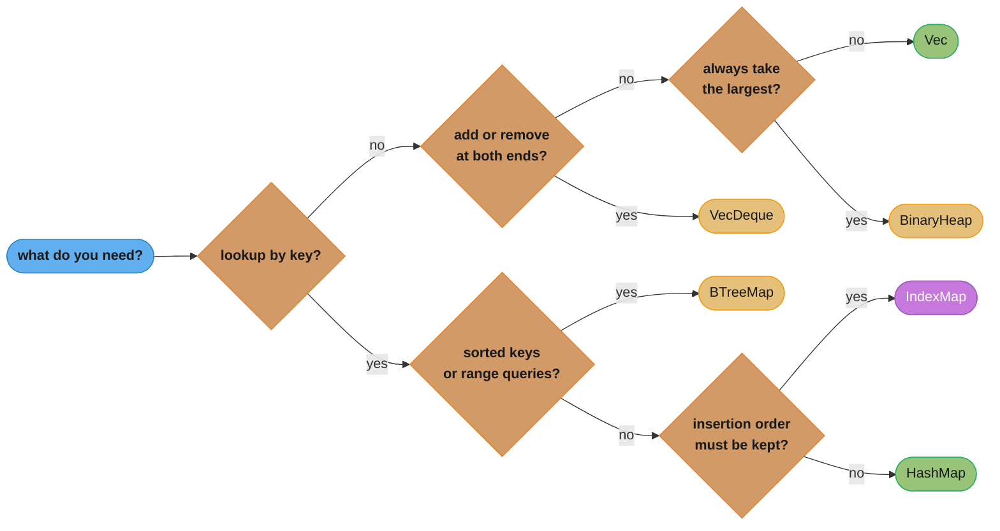

# Collections and Strings

> **Version anchor (2026-11-06).** Rust 1.99.1 (2026-10-15) on edition 2024. Release-gated items on this page: `HashMap` and slice `get_disjoint_mut` `[1.86]`, `Vec::into_raw_parts` `[1.93]`, `<[T]>::array_windows` `[1.94]`, `Vec::push_mut` `[1.95]`, `<int>::format_into` with `fmt::NumBuffer` and `str::substr_range` `[1.98]`, `Vec::into_parts`/`from_parts` `[1.99]`. Crates: hashbrown 0.17.1, indexmap 2.14.2, smallvec 1.16.4, ahash 0.8.12, foldhash 0.2.0, rustc-hash 2.1.3, bumpalo 3.20.3.

## 1. Concept Overview

Rust's standard collections are few and plain: `Vec`, `VecDeque`, `HashMap`, `HashSet`,
`BTreeMap`, `BTreeSet`, `BinaryHeap` and `LinkedList`. Strings are two types that matter
(`String` and `&str`) and a family of owned variants (`Box<str>`, `Arc<str>`, `Cow<str>`) plus
the platform types (`OsString`, `PathBuf`). Almost every production data structure is built
from `Vec` and `HashMap`.

What makes Rust collections different from Java or Python is not the algorithms. It is that
**ownership and borrowing apply to the elements**. A `Vec<String>` owns its strings. A
reference into a `Vec` freezes the `Vec` for as long as the reference lives, because a `push`
might reallocate and leave the reference dangling. That one rule explains most of the compile
errors people hit with collections, and the API is shaped around it: the entry API,
`retain`, `drain`, `get_disjoint_mut`, `split_at_mut`, `push_mut`.

Strings follow the same rules plus one more: **a `str` is always valid UTF-8**. Indexing by
integer is not allowed, because a byte offset might land in the middle of a character and a
character offset would cost O(n). Slicing by byte range is allowed and panics if either end is
not on a character boundary.

This page covers the Rust APIs, their costs, and the choices between them. Hash-table probing,
SwissTable internals and load factors are taught in
[Arrays, strings and hashing](../../cs_fundamentals/arrays_strings_and_hashing/arrays_strings_and_hashing.md).
UTF-8, normalization and grapheme theory are in
[Character encoding deep dive](../../cs_fundamentals/character_encoding_deep_dive/character_encoding_deep_dive.md).
Sorting algorithms, including the 1.81 change, are in
[Sorting and searching](../../cs_fundamentals/sorting_and_searching/sorting_and_searching.md).

---

## 2. Intuition

> **One-line analogy**: a `Vec` is a row of numbered lockers that you can only extend by
> moving everyone to a bigger row. Handing someone a locker number is safe. Handing them a
> pointer to a locker is only safe while nobody moves the row.

**Mental model**: every owning collection is a small header on the stack (pointer, capacity,
length, maybe a hasher) and a heap block that it alone frees. Borrowing an element borrows the
whole collection, because the collection might move the heap block on the next mutation.
`String` is a `Vec<u8>` with the promise that its bytes are UTF-8. `&str` is a pointer and a
length into someone else's UTF-8 bytes.

**Why it matters**: three cost bugs dominate Rust services that are otherwise fast. A hot
path allocates a `String` per lookup because the code wrote `map.entry(key.to_string())`. A
buffer that once held a burst keeps its peak capacity forever, so RSS never comes down. And a
`HashMap` keyed by attacker-chosen strings is switched to a fast unseeded hasher for a
benchmark win, which turns a flood of crafted keys into O(n) probes per insert.

**Key insight**: in Rust you pick a collection by two questions, not one. What operations do I
need (order, lookup, priority)? And who owns the elements while I hold a reference into them?
The second question often decides the API you can use.

---

## 3. Core Principles

1. **`Vec` is the default.** It is contiguous, cache friendly, and amortized O(1) to push.
   Reach for anything else only when you need an operation `Vec` does badly.

2. **Growth is amortized, not promised.** The docs promise amortized O(1) `push` and do not
   promise a growth factor. The implementation in 1.99 doubles capacity. `with_capacity(n)` and
   `reserve(n)` remove the guesswork when you know the size.

3. **A collection never shrinks on its own.** `clear()`, `truncate()` and `drain()` keep the
   capacity. Call `shrink_to_fit()` or `shrink_to(n)` when memory matters more than reuse.

4. **References into a collection freeze it.** You cannot `push` while you hold `&v[0]`. Use
   indices, finish the borrow first, or use an API built for the pattern (entry, retain,
   `get_disjoint_mut`).

5. **`HashMap` trades speed for DoS resistance by default.** It hashes with
   SipHash-1-3 under random keys. Swap the hasher only for keys an attacker cannot choose.

6. **`str` is UTF-8 bytes, and length means bytes.** `s.len()` is a byte count. `s.chars()` walks
   code points. User-perceived characters (graphemes) need a crate.

7. **Pick the string type by ownership.** Borrow with `&str`. Own and grow with `String`. Own and
   freeze with `Box<str>`. Share with `Arc<str>`. Maybe-borrow with `Cow<str>`.

---

## 4. Types / Architectures / Strategies

### 4.1 Sequence and map types

| Type | Layout | Push or insert | Lookup | Ordered iteration | Use for |
|---|---|---|---|---|---|
| `Vec<T>` | contiguous heap block | O(1) amortized at the end | O(1) by index | insertion order | almost everything |
| `VecDeque<T>` | ring buffer | O(1) amortized at both ends | O(1) by index | front to back | queues, sliding windows |
| `HashMap<K, V>` | SwissTable, open addressing | O(1) average | O(1) average | none, random per process | lookup by key |
| `BTreeMap<K, V>` | B-tree, sorted keys | O(log n) | O(log n) | sorted by key | ranges, ordered output, small maps |
| `BinaryHeap<T>` | max-heap in a `Vec` | O(log n) | O(1) peek at max | none | priority queues, top-k |
| `HashSet<T>` / `BTreeSet<T>` | the map with `()` values | as the map | as the map | as the map | membership |
| `LinkedList<T>` | doubly linked nodes | O(1) at ends | O(n) | front to back | almost never; splicing whole lists |

### 4.2 Crates that fill gaps

| Crate | Version | Adds | Pick it when |
|---|---|---|---|
| indexmap | 2.14.2 | hash map with insertion order and index access | output order must be stable, or you need both key and position |
| smallvec | 1.16.4 | `SmallVec<[T; N]>`: first N items inline, heap after | most instances hold a few items and allocation shows in profiles |
| hashbrown | 0.17.1 | the SwissTable behind std, with extra APIs | you need APIs std does not expose |
| rustc-hash | 2.1.3 | `FxHashMap`, a fast unseeded hasher | integer or internal keys an attacker cannot choose |
| ahash, foldhash | 0.8.12, 0.2.0 | fast seeded hashers | faster hashing where full SipHash resistance is not required |
| bumpalo | 3.20.3 | bump arena with arena-backed `Vec` and `String` | many short-lived allocations freed together |

### 4.3 String types

| Type | Size on 64-bit targets | Owns? | Growable? | Clone cost | Use for |
|---|---|---|---|---|---|
| `&str` | 16 bytes (ptr, len) | no | no | copy 16 bytes | parameters, slices of other strings |
| `String` | 24 bytes (ptr, cap, len) | yes | yes | allocate and copy | building and editing text |
| `Box<str>` | 16 bytes | yes | no | allocate and copy | many long-lived strings that never change |
| `Arc<str>` | 16 bytes | shared | no | atomic increment | strings shared across threads or many owners |
| `Cow<'a, str>` | 24 bytes | maybe | through `to_mut()` | depends on variant | "borrow unless I had to change it" |
| `OsString` / `PathBuf` | 24 bytes | yes | yes | allocate and copy | file names, env vars, OS strings |
| `&'static str` | 16 bytes | no, lives forever | no | copy | literals, leaked config |

Sizes are implementation facts on 64-bit targets, asserted in §6.6.

---

## 5. Architecture Diagrams

### 5.1 Picking a collection



Green is the default answer in each branch. Gold is std with a specific job. Purple is a crate.
Under about 16 small elements, a `Vec` with a linear scan often beats every map in this
picture, so measure before reaching for one.

### 5.2 One string, four owners

```
  stack                                     heap
  -----                                     ----
  String     [ ptr | cap=8 | len=5 ]  --->  [ h e l l o _ _ _ ]   owned, 3 spare bytes
  &str       [ ptr | len=5 ]          --->  points into someone else's bytes
  Box<str>   [ ptr | len=5 ]          --->  [ h e l l o ]         owned, exact size
  Arc<str>   [ ptr | len=5 ]          --->  [ strong | weak | h e l l o ]
                                            16-byte count header, then the bytes
```

`String` pays 8 bytes for `cap` and may carry spare capacity. `Box<str>` drops both, which is
why `into_boxed_str()` is a cheap win for millions of frozen strings. `Arc<str>` stores its
reference counts in the same allocation as the bytes, so cloning it is one atomic increment and
no copy.

### 5.3 Why `s[1]` does not compile

```
  s = "héllo"

  byte index   0     1     2     3     4     5
  bytes        68    C3    A9    6C    6C    6F
  chars        h     é-----é     l     l     o
  char index   0     1           2     3     4

  s.len()           = 6   (bytes)
  s.chars().count() = 5   (code points, O(n) walk)
  &s[0..3]          = "hé"
  &s[0..2]          panics: byte 2 is inside 'é'
```

Byte 1 is the first half of a two-byte character, so "the byte at 1" is not a character and
"the character at 1" needs a walk from the start. Rust refuses to pick one meaning for `s[1]`.

---

## 6. How It Works - Detailed Mechanics

### 6.1 `Vec`: capacity, growth and reuse

```rust
fn main() {
    let mut v: Vec<u64> = Vec::new();
    assert_eq!(v.capacity(), 0); // no allocation yet

    let mut reallocations = 0;
    let mut last_cap = v.capacity();
    for i in 0..1_000_000_u64 {
        v.push(i);
        if v.capacity() != last_cap {
            reallocations += 1;
            last_cap = v.capacity();
        }
    }
    // About 19 allocations for a million pushes in the 1.99 implementation (doubling from 4).
    assert!(reallocations < 30);

    let mut sized: Vec<u64> = Vec::with_capacity(1_000_000);
    let cap_before = sized.capacity();
    sized.extend(0..1_000_000_u64);
    assert_eq!(sized.capacity(), cap_before); // one allocation, no growth

    sized.clear();
    assert!(sized.capacity() >= 1_000_000); // clear keeps the memory
    sized.shrink_to(1024);
    assert!(sized.capacity() >= 1024 && sized.capacity() < 1_000_000);
}
```

The docs state the promises that matter: `push` reallocates only when `len == capacity`,
`with_capacity(n)` requests exactly `n` elements, `Vec` never shrinks by itself, and a
zero-sized type never allocates. The growth factor is not promised, so do not size buffers
around it.

| Method | Effect on length | Effect on capacity |
|---|---|---|
| `with_capacity(n)` | 0 | at least `n`, one allocation |
| `reserve(n)` | none | room for at least `n` more |
| `reserve_exact(n)` | none | room for `n` more, no extra headroom requested |
| `clear()` / `truncate(k)` / `drain(..)` | lowered | unchanged |
| `shrink_to_fit()` / `shrink_to(n)` | none | lowered toward length or `n` |
| `extend(iter)` | raised | reserves from the iterator's `size_hint` lower bound first |

### 6.2 Editing a `Vec` without fighting the borrow checker

```rust
fn main() {
    let mut jobs = vec![3_u32, 8, 1, 9, 4];

    // retain: remove in place, keep order, one pass.
    jobs.retain(|&j| j != 1);
    assert_eq!(jobs, [3, 8, 9, 4]);

    // push_mut [1.95]: push and keep a reference to the new element.
    let last = jobs.push_mut(0);
    *last += 7;
    assert_eq!(jobs.last(), Some(&7));

    // get_disjoint_mut [1.86]: two mutable references to distinct indices.
    if let Ok([a, b]) = jobs.get_disjoint_mut([0, 2]) {
        std::mem::swap(a, b);
    }
    assert_eq!(jobs[0], 9);

    // drain: take a range out, keep the capacity for reuse.
    let first_two: Vec<u32> = jobs.drain(..2).collect();
    assert_eq!(first_two, [9, 8]);

    // array_windows [1.94]: fixed-size windows as arrays, no bounds checks inside the loop.
    let deltas: Vec<i64> = [10_i64, 13, 19, 20]
        .array_windows::<2>()
        .map(|[a, b]| b - a)
        .collect();
    assert_eq!(deltas, [3, 6, 1]);
}
```

`swap_remove(i)` removes in O(1) by moving the last element into the hole, and changes order.
`remove(i)` keeps order and costs O(n). Pick by whether order matters.

### 6.3 `Vec` and raw parts

`Vec::into_parts` `[1.99]` splits a `Vec` into `(NonNull<T>, length, capacity)`, and the
`unsafe fn from_parts` rebuilds it. `into_raw_parts` `[1.93]` does the same with a `*mut T`.
They exist for FFI and custom containers: hand the buffer to C, get it back, free it with the
same allocator.

```rust
fn main() {
    let v = vec![1_u32, 2, 3];
    let (ptr, len, cap) = v.into_parts();
    // SAFETY: ptr, len and cap come from into_parts on a Vec<u32> with the global allocator,
    // and nothing else owns the buffer.
    let back = unsafe { Vec::from_parts(ptr, len, cap) };
    assert_eq!(back, [1, 2, 3]);
}
```

After `into_parts` the memory leaks unless something calls `from_parts`. That is the contract.

### 6.4 `HashMap`: hashing, entry API, borrowed lookups

```rust
use std::collections::HashMap;

fn main() {
    let words = ["get", "put", "get", "del", "get"];

    // Entry API: one hash, one probe, insert or update.
    let mut counts: HashMap<&str, u32> = HashMap::with_capacity(words.len());
    for w in words {
        *counts.entry(w).or_insert(0) += 1;
    }
    assert_eq!(counts["get"], 3);

    // String keys, &str lookups: no allocation thanks to Borrow<str>.
    let mut owned: HashMap<String, u32> = HashMap::new();
    owned.insert("alice".to_string(), 1);
    assert_eq!(owned.get("alice"), Some(&1));

    // Allocate the key only on a miss.
    let name = "bob";
    match owned.get_mut(name) {
        Some(v) => *v += 1,
        None => {
            owned.insert(name.to_string(), 1);
        }
    }

    // get_disjoint_mut [1.86]: two mutable values at once. Panics if the keys overlap.
    owned.insert("carol".to_string(), 10);
    let [a, c] = owned.get_disjoint_mut(["alice", "carol"]);
    if let (Some(a), Some(c)) = (a, c) {
        std::mem::swap(a, c);
    }
    assert_eq!(owned["alice"], 10);
}
```

Facts to keep straight:

- `RandomState` seeds SipHash-1-3 with random keys, so iteration order differs between runs.
  Never let a test, a snapshot or an output file depend on `HashMap` order.
- `entry(key)` takes the key by value. For `HashMap<String, V>` that means
  `entry(k.to_string())` allocates even when the key is present. On a hot path with mostly hits,
  use `get_mut` first and allocate on the miss.
- `HashMap::with_capacity(n)` holds `n` entries without rehashing. Rehashing moves every entry.
- A `HashMap<K, V>` with N entries costs about `N * (size_of::<(K, V)>() + 1)` bytes divided by
  the load factor, plus whatever the keys and values own on the heap. Control-byte and load-factor
  details are in [Arrays, strings and hashing](../../cs_fundamentals/arrays_strings_and_hashing/arrays_strings_and_hashing.md).

### 6.5 Choosing a hasher

| Hasher | Seeded | HashDoS resistance | Relative speed | Use for |
|---|---|---|---|---|
| std `RandomState` (SipHash-1-3) | random per map | designed for it | baseline | any key an outside party can choose |
| foldhash, ahash | random seed by default | not a cryptographic PRF | faster | internal keys, caches keyed by your own ids |
| rustc-hash (`FxHashMap`) | no | none | very fast on small integer keys | compiler-style workloads, interned ids |
| identity hashing | no | none | free | keys that are already uniformly random (UUIDs, hashes) |

```rust
use std::collections::HashMap;
use std::hash::{BuildHasherDefault, DefaultHasher};

// A map whose hasher is chosen by type. Swap DefaultHasher for FxHasher or foldhash's
// builder in a crate that depends on them.
type FixedMap<K, V> = HashMap<K, V, BuildHasherDefault<DefaultHasher>>;

fn main() {
    let mut m: FixedMap<u32, &str> = FixedMap::default();
    m.insert(7, "seven");
    assert_eq!(m.get(&7), Some(&"seven"));
}
```

`BuildHasherDefault<DefaultHasher>` uses SipHash with *fixed* keys, so it is deterministic across
runs and not DoS-resistant. It is shown here only because it is std-only. The point is that the
hasher is a type parameter: a map's DoS resistance is visible in its type.

### 6.6 String types and their sizes

```rust
use std::borrow::Cow;
use std::ffi::OsString;
use std::mem::size_of;
use std::path::PathBuf;
use std::rc::Rc;
use std::sync::Arc;

#[cfg(target_pointer_width = "64")]
const _: () = {
    assert!(size_of::<String>() == 24);
    assert!(size_of::<&str>() == 16);
    assert!(size_of::<Box<str>>() == 16);
    assert!(size_of::<Arc<str>>() == 16);
    assert!(size_of::<Rc<str>>() == 16);
    assert!(size_of::<Cow<'static, str>>() == 24);
    assert!(size_of::<Option<String>>() == 24);
    assert!(size_of::<OsString>() == 24);
    assert!(size_of::<PathBuf>() == 24);
    assert!(size_of::<char>() == 4);
};
```

`Option<String>` and `Cow<str>` stay at 24 bytes because a `String`'s capacity can never exceed
`isize::MAX`, which leaves spare bit patterns (a niche) for the extra variant. Like the other
layout numbers, that is an implementation fact, so the block asserts it.

Converting between them:

| From | To | Cost |
|---|---|---|
| `&str` | `String` | allocate, copy (`to_string`, `to_owned`, `String::from`) |
| `String` | `&str` | free (`&s`, `as_str`, deref) |
| `String` | `Box<str>` | free if `len == cap`, else one shrinking realloc (`into_boxed_str`) |
| `String` | `Arc<str>` | allocate, copy (the counts must live in the same block) |
| `&str` | `Cow<str>` | free (`Cow::Borrowed`) |
| `Cow<str>` | `String` | free if `Owned`, copy if `Borrowed` (`into_owned`) |

### 6.7 UTF-8 rules in code

```rust
fn main() {
    let s = String::from("héllo");
    assert_eq!(s.len(), 6);
    assert_eq!(s.chars().count(), 5);
    assert!(!s.is_char_boundary(2));

    // Safe slicing: get returns None instead of panicking.
    assert_eq!(s.get(0..2), None);
    assert_eq!(s.get(0..3), Some("hé"));

    // Position-aware iteration.
    let positions: Vec<(usize, char)> = s.char_indices().take(3).collect();
    assert_eq!(positions, [(0, 'h'), (1, 'é'), (3, 'l')]);

    // Validation at the boundary: from_utf8 checks, from_utf8_lossy repairs.
    let raw = vec![0x68, 0xFF, 0x69];
    assert!(String::from_utf8(raw.clone()).is_err());
    assert_eq!(String::from_utf8_lossy(&raw), "h\u{FFFD}i");

    // substr_range [1.98]: where a subslice sits inside its parent.
    // It returns the core::range::Range type [1.96], not std::ops::Range.
    let line = "GET /health HTTP/1.1";
    let path = line.split(' ').nth(1).unwrap_or("");
    let r = line.substr_range(path).map(|r| r.start..r.end);
    assert_eq!(r, Some(4..11));
}
```

`chars()` yields Unicode scalar values, not user-perceived characters. "e" followed by a
combining accent is two `char`s and one grapheme, and a family emoji is several `char`s. For
cursor movement, truncation for display, or "first N characters" in a UI, use a grapheme
segmentation crate such as `unicode-segmentation`.

### 6.8 OS strings and paths

`OsString`, `OsStr`, `PathBuf` and `Path` hold what the OS gives you, which is not always UTF-8.
On Unix they are arbitrary bytes. On Windows they store potentially ill-formed UTF-16 in an
internal 8-bit encoding (WTF-8).

```rust
use std::path::{Path, PathBuf};

fn main() {
    let mut p = PathBuf::from("/var/log");
    p.push("app.log");
    assert_eq!(p.extension().and_then(|e| e.to_str()), Some("log"));

    // to_str returns None for non-UTF-8 names. to_string_lossy never fails.
    let name: Option<&str> = p.file_name().and_then(|n| n.to_str());
    assert_eq!(name, Some("app.log"));
    let shown = p.to_string_lossy();
    assert_eq!(shown, "/var/log/app.log");

    // display() is for humans, never for round-tripping a path.
    let _ = format!("{}", Path::new("/tmp").display());
}
```

Keep paths as `Path`/`PathBuf` end to end. Converting to `String` and back loses non-UTF-8 file
names, which is a real bug on Linux systems with legacy encodings.

### 6.9 Formatting without allocating

`format!` allocates a new `String` every call. In a loop, reuse one buffer with `write!`, and for
integers use `format_into` `[1.98]`, which writes into a stack buffer.

```rust
use core::fmt::NumBuffer;
use std::fmt::Write;

fn main() {
    let mut line = String::with_capacity(64);
    for id in [17_u32, 42] {
        line.clear();
        write!(line, "user={id} status=ok").expect("writing to a String does not fail");
        assert!(line.starts_with("user="));
    }

    let mut buf = NumBuffer::new();
    let n = 1972_u32;
    assert_eq!(n.format_into(&mut buf), "1972");
}
```

`write!` into a `String` returns `fmt::Result` only because the `fmt::Write` trait requires it.
For `String` it cannot fail, so `expect` with a reason is acceptable there.

### 6.10 `BTreeMap`, `BinaryHeap`, `VecDeque`

```rust
use std::cmp::Reverse;
use std::collections::{BTreeMap, BinaryHeap, VecDeque};

fn main() {
    // BTreeMap: sorted keys and range queries.
    let mut by_ts: BTreeMap<u64, &str> = BTreeMap::new();
    by_ts.insert(1_000, "start");
    by_ts.insert(1_500, "tick");
    by_ts.insert(2_200, "stop");
    let window: Vec<&str> = by_ts.range(1_000..2_000).map(|(_, v)| *v).collect();
    assert_eq!(window, ["start", "tick"]);

    // BinaryHeap is a max-heap. Reverse makes it a min-heap (earliest deadline first).
    let mut deadlines = BinaryHeap::new();
    for d in [30_u64, 10, 20] {
        deadlines.push(Reverse(d));
    }
    assert_eq!(deadlines.pop(), Some(Reverse(10)));

    // VecDeque: O(1) at both ends, a bounded sliding window.
    let mut last3: VecDeque<u32> = VecDeque::with_capacity(3);
    for x in 1..=5 {
        if last3.len() == 3 {
            last3.pop_front();
        }
        last3.push_back(x);
    }
    assert_eq!(last3.make_contiguous(), &[3, 4, 5]);
}
```

`BTreeMap` stores up to 11 keys per node in the 1.99 implementation, so a lookup touches a few
nodes with several keys each. That makes it competitive with `HashMap` for small maps, and it
gives deterministic iteration order for free.

---

## 7. Real-World Examples

- **rustc** uses `FxHashMap` (rustc-hash) throughout: its keys are interned symbols and indices
  produced by the compiler itself, so HashDoS is not a threat and hashing speed is.
- **Hash tables in other languages**: std's `HashMap` is a port of Google's SwissTable, the same
  design as Abseil's `flat_hash_map` and Go's `map` since Go 1.24. See
  [Arrays, strings and hashing](../../cs_fundamentals/arrays_strings_and_hashing/arrays_strings_and_hashing.md).
- **Java and Go contrast**: Java's `HashMap` chains entries in buckets and stores every key and value as an object reference
  ([Java collections internals](../../java/collections_internals/collections_internals.md)). Go's
  slices have the same pointer, length, capacity header as `Vec`
  ([Go data structures and memory layout](../../go/data_structures_and_memory_layout/data_structures_and_memory_layout.md)),
  but a Go slice can alias another slice's backing array after `append`, which Rust's borrow
  rules forbid.
- **Interning in developer tools**: Rust linters and compilers store each identifier once and pass
  around a `u32` symbol, which turns string comparison into integer comparison and cuts memory.
  §14 shows the pattern.
- **Arenas**: parsers allocate AST nodes in a `bumpalo` arena and free the whole tree at once. See
  [Smart pointers and interior mutability](../smart_pointers_and_interior_mutability/smart_pointers_and_interior_mutability.md)
  for the ownership side.

---

## 8. Tradeoffs

### 8.1 `HashMap` vs `BTreeMap` vs `IndexMap` vs `Vec`

| Factor | `HashMap` | `BTreeMap` | `IndexMap` | sorted `Vec` plus binary search |
|---|---|---|---|---|
| Lookup | O(1) average | O(log n) | O(1) average | O(log n) |
| Insert | O(1) amortized | O(log n) | O(1) amortized | O(n) |
| Iteration order | random | sorted | insertion | sorted |
| Range query | no | yes | no | yes |
| Memory per entry | low | medium (node overhead) | higher (entries plus index table) | lowest |
| Deterministic output | no | yes | yes | yes |
| Best for | general lookup | ordered data, small maps | stable JSON output, LRU-like order | build once, read many |

### 8.2 String type choice

| Need | Type | Why |
|---|---|---|
| Function parameter that only reads | `&str` | accepts `String`, literals and slices without a copy |
| Build or edit text | `String` | growable |
| Millions of fixed strings in memory | `Box<str>` | 8 bytes smaller per string and no spare capacity |
| Same string shared by many owners or threads | `Arc<str>` | clone is a counter increment |
| Return input unchanged in the common case | `Cow<'a, str>` | allocate only when you change it |
| File names, env vars | `OsString`, `PathBuf` | the OS does not promise UTF-8 |
| Short strings, mostly under 23 bytes | a small-string crate | inline storage avoids the heap; measure first |

### 8.3 `SmallVec` vs `Vec`

| | `Vec<T>` | `SmallVec<[T; N]>` |
|---|---|---|
| Size of the handle | 24 bytes | about `N * size_of::<T>()` plus a few words |
| Allocation for up to N items | one | none |
| Moving the handle | copy 24 bytes | copy the inline buffer |
| Every access | pointer plus index | a branch on inline vs heap, then index |
| Wins when | sizes vary widely | most instances hold at most N items and allocation is measurable |

---

## 9. When to Use / When NOT to Use

**Use `Vec` when:** you need a list, a stack, a buffer, or a small map searched linearly.

**Use `VecDeque` when:** you pop from the front: queues, BFS frontiers, sliding windows.

**Use `HashMap` when:** you look up by key and do not care about order. Keep the default hasher
for any key that comes from outside the process.

**Use `BTreeMap` when:** you need sorted iteration, range queries, deterministic output, or the
map is small.

**Use `BinaryHeap` when:** you repeatedly take the largest (or with `Reverse`, the smallest)
item: schedulers, top-k, Dijkstra.

**Do NOT:**
- use `LinkedList` for a queue; `VecDeque` is faster and uses less memory;
- index a `str` by integer or slice it with offsets from `chars().count()`;
- convert paths to `String` to manipulate them;
- switch to `FxHashMap` for keys that come from requests, headers or user input;
- keep a peak-sized buffer alive in a long-lived struct without a cap on its capacity;
- let output order depend on `HashMap` iteration.

---

## 10. Common Pitfalls

### 10.1 A reference into a `Vec`, then a push

```rust
// BROKEN: `first` borrows `v`, and push may reallocate and move every element.
// error[E0502]: cannot borrow `v` as mutable because it is also borrowed as immutable
fn main() {
    let mut v = vec![1, 2, 3];
    let first = &v[0];
    v.push(4);
    println!("{first}");
}
```

```rust
// FIX: copy the value out (or keep the index) before mutating.
fn main() {
    let mut v = vec![1, 2, 3];
    let first = v[0];
    v.push(4);
    println!("{first}");
}
```

In C++ this is the classic iterator-invalidation bug, and it compiles. Rust rejects it.

### 10.2 Removing from a map while iterating it

```rust
// BROKEN: the loop borrows `sessions`, and remove needs a mutable borrow.
// error[E0502]: cannot borrow `*sessions` as mutable because it is also borrowed as immutable
use std::collections::HashMap;

fn expire(sessions: &mut HashMap<u64, u64>, now: u64) {
    for (id, expires_at) in sessions.iter() {
        if *expires_at < now {
            sessions.remove(id);
        }
    }
}
```

```rust
// FIX: retain removes in place in one pass.
use std::collections::HashMap;

fn expire(sessions: &mut HashMap<u64, u64>, now: u64) {
    sessions.retain(|_, expires_at| *expires_at >= now);
}

// extract_if removes the same entries and hands them to you, for logging or metrics.
fn expire_and_count(sessions: &mut HashMap<u64, u64>, now: u64) -> usize {
    sessions.extract_if(|_, expires_at| *expires_at < now).count()
}

fn drop_negative(v: &mut Vec<i64>) -> Vec<i64> {
    v.extract_if(.., |x| *x < 0).collect()
}
```

### 10.3 Indexing a string by position

```rust
// BROKEN: str has no integer index, because a byte offset may split a character.
// error[E0277]: the type `str` cannot be indexed by `{integer}`
fn first_char(s: &str) -> char {
    s[0]
}
```

```rust
// FIX: say which "first" you mean.
fn first_char(s: &str) -> Option<char> {
    s.chars().next()
}

fn first_byte(s: &str) -> Option<u8> {
    s.as_bytes().first().copied()
}
```

### 10.4 Production war stories

The cases below are illustrative. Their numbers show scale and do not come from a real incident.

- **The allocation per hit.** A metrics aggregator counted events with
  `*map.entry(key.to_string()).or_insert(0) += 1`. More than 99% of events hit an existing key,
  yet each one allocated and freed a `String`. At 400,000 events per second that was 400,000
  allocations per second for nothing. `get_mut` first, insert on the miss, removed them.
- **The buffer that never shrank.** Each connection kept a reusable `Vec<u8>` read buffer. One
  client sent a 64 MiB request, the buffer grew to 64 MiB, and `clear()` kept it. Across 2,000
  connections a few dozen such clients pushed RSS to several GB. The fix was `shrink_to(64 * 1024)`
  after any request that grew the buffer beyond a cap.
- **Flaky snapshots.** A test serialized a `HashMap` to JSON and compared it with a golden file.
  It passed locally and failed in CI about half the time, because iteration order is random per
  process. Use `BTreeMap` or `IndexMap` for anything serialized and compared.
- **The fast hasher on public keys.** A team moved a header-keyed cache to `FxHashMap` after a
  benchmark. FxHash has no seed, so colliding keys are easy to compute offline. A burst of
  crafted header values made every insert probe a long run of slots. Moving back to the default
  hasher, or a seeded one, closed it.
- **Byte-slicing user names.** A UI truncated display names with `&name[..20]`. The first user
  with a multi-byte character across byte 20 crashed the request with "end byte index 20 is not
  a char boundary". Use `char_indices` or a grapheme crate, or `get(..20)` with a fallback.
- **Lossy paths.** A backup tool converted every path with `to_string_lossy()` and later reopened
  the converted string. Files with non-UTF-8 names were replaced with U+FFFD and silently skipped.

---

## 11. Technologies & Tools

| Tool | Version | Role |
|---|---|---|
| `std::collections` | std | `Vec`, `VecDeque`, `HashMap`, `BTreeMap`, `BinaryHeap`, sets |
| hashbrown | 0.17.1 | the SwissTable implementation behind std's `HashMap`, usable directly |
| indexmap | 2.14.2 | insertion-ordered hash map and set |
| smallvec | 1.16.4 | inline small vectors |
| rustc-hash | 2.1.3 | `FxHashMap`, unseeded fast hashing |
| foldhash | 0.2.0 | fast seeded hasher |
| ahash | 0.8.12 | fast seeded hasher |
| bumpalo | 3.20.3 | bump arena allocation |
| dhat | 0.3.3 | heap profiling to count allocations per call site |

Count allocations before and after a collection change with `dhat` or a profiler; see
[Profiling and benchmarking](../profiling_and_benchmarking/profiling_and_benchmarking.md).

---

## 12. Interview Questions with Answers

**Q: Why can't you push to a `Vec` while holding a reference to one of its elements?**
**Short:** Push may reallocate and move every element, which would leave the reference dangling, so the borrow checker forbids mutation while the shared borrow lives.

The reference borrows the whole `Vec`, not one slot, because the `Vec` owns one heap block that
any growth can replace. This is iterator invalidation from C++ turned into a compile error
(E0502). Keep an index instead, copy the value out, finish the borrow before mutating, or use
`push_mut` when you want a reference to the element you just pushed.

**Q: What growth strategy does `Vec` promise?**
**Short:** It promises amortized O(1) push and no specific factor; the 1.99 implementation doubles capacity, but code must not depend on that.

The docs say `Vec` does not promise a growth strategy and that a non-constant factor may be
used later. What they do promise: `push` reallocates only when length equals capacity,
`with_capacity(n)` requests exactly `n`, and a `Vec` never shrinks by itself. When you know the
size, `with_capacity` or `reserve` replaces about 19 doubling steps for a million `u64`s with
one allocation.

**Q: Why does `s[0]` fail to compile for a `String`?**
**Short:** A str is UTF-8, so a byte offset may land inside a character and a character offset would cost a linear walk; Rust refuses to pick a meaning.

The error is E0277, "the type `str` cannot be indexed by `{integer}`". Say which unit you mean:
`s.as_bytes()[0]` for a byte, `s.chars().next()` for a code point, a grapheme crate for a
user-visible character. Range slicing (`&s[0..3]`) is allowed because it is in bytes and checks
both ends, panicking if either is not a character boundary. Use `s.get(0..3)` for an `Option`
instead of a panic.

**Q: What hasher does the standard `HashMap` use, and why?**
**Short:** SipHash-1-3 with random per-map keys, chosen to resist HashDoS: an attacker cannot precompute keys that all collide.

A hash table under attack degrades to linear probing over one long run, so each insert costs
O(n). Random keys make collisions unpredictable to an outsider. The cost is speed: SipHash is
slower than FxHash or foldhash on short keys. The docs call it the current algorithm and allow it
to change. Swap the hasher only when no outside party controls the keys.

**Q: When is it safe to use `FxHashMap` from rustc-hash?**
**Short:** When the keys come from your own process, such as interned ids, small integers or compiler symbols, because FxHash has no seed and its collisions are predictable.

rustc uses it because every key is something the compiler created. A web service that keys a map
by request headers, user names or URL paths must not, because an attacker can compute colliding
inputs offline. Seeded fast hashers (foldhash, ahash) sit between the two: faster than SipHash,
randomized, but not designed as cryptographic PRFs. Write the hasher into the type alias so
reviewers see the choice.

**Q: Why does `map.entry(key.to_string())` hurt on a hot path?**
**Short:** entry takes the key by value, so a String key is allocated on every call, even when the key already exists and the allocation is thrown away.

For `HashMap<String, V>` with mostly hits, use `get_mut(&str)` first and insert an owned key only
on a miss. `get` and `get_mut` accept `&str` through the `Borrow<str>` impl on `String`, so the
lookup itself allocates nothing. If the key type is cheap (`u64`, `&'static str`), the entry API
is the right tool, because it hashes and probes once for both cases.

**Q: Why doesn't `clear()` free a `Vec`'s memory?**
**Short:** clear only sets the length to zero and drops the elements; capacity stays so the buffer can be reused without reallocating.

That is the right default for loops that refill a buffer. It is the wrong default for a
long-lived buffer that once handled a burst: it holds peak memory forever. Call `shrink_to(cap)`
after a burst, or replace the buffer with a fresh one when its capacity exceeds a limit. The same
holds for `String`, `HashMap` and `VecDeque`.

**Q: How do `String`, `Box<str>` and `Arc<str>` differ in memory and cost?**
**Short:** On 64-bit targets String is 24 bytes and growable, Box str is 16 bytes and fixed, and Arc str is 16 bytes with counts stored next to the bytes for cheap sharing.

`String` carries a capacity and may hold spare bytes. `into_boxed_str()` trims both, which saves
8 bytes per handle plus the slack for millions of stored strings. `Arc<str>` puts the strong and
weak counts in front of the bytes in one allocation, so `clone` is one atomic increment.
Converting a `String` to `Arc<str>` copies once, because the counts must share the allocation.

**Q: When does `Cow<str>` pay off?**
**Short:** When a function usually returns its input unchanged and only sometimes modifies it, Cow lets the common path borrow and allocate only on the rare change.

An escaping or normalizing function is the typical case: most inputs need no change, so returning
`Cow::Borrowed(input)` costs nothing, and `Cow::Owned(fixed)` is built only when needed. Callers
that need ownership call `into_owned()`, which is free for the owned variant. If almost every call
modifies the input, return `String` and skip the extra type.

**Q: What does `s.len()` return for a string, and how do you count characters?**
**Short:** len returns the number of UTF-8 bytes; chars().count() walks the string to count code points, and graphemes need a segmentation crate.

"héllo" has length 6 and 5 `char`s. Neither number is what a user sees for text with combining
marks or emoji sequences, where one visible character is several code points. Use byte length for
buffers, protocols and limits; code points for Unicode algorithms; graphemes for anything shown to
a person, such as truncation or cursor movement.

**Q: Why should file paths stay `PathBuf` instead of `String`?**
**Short:** OS paths are not promised to be UTF-8, so converting to String either fails or replaces bytes, and the converted path may no longer name the same file.

On Unix a file name is any byte sequence without `/` or NUL. `to_str()` returns `None` for
non-UTF-8 names and `to_string_lossy()` swaps bad bytes for U+FFFD, so a round trip can open a
different file or none. Keep `Path` and `PathBuf` end to end, join with `push` and `join`, and use
`display()` only for output to humans.

**Q: How do you get two mutable references into one collection?**
**Short:** Use split_at_mut or get_disjoint_mut, which check that the positions differ, instead of indexing twice, which the borrow checker rejects.

`let a = &mut v[0]; let b = &mut v[1];` is E0499, because the compiler cannot prove the indices
differ. `v.split_at_mut(1)` gives two non-overlapping slices. `get_disjoint_mut([i, j])` (slices
and `HashMap`, 1.86) returns several references after a runtime check. The slice version returns
an error for overlapping or out-of-range indices, and the `HashMap` version panics if two keys are
equal. `mem::swap` and `slice::swap` cover the most common reason to want two at once.

**Q: When is `BTreeMap` a better choice than `HashMap`?**
**Short:** When you need sorted iteration, range queries or deterministic output, and often for small maps where its compact nodes are competitive.

`BTreeMap::range(a..b)` answers "all events between t1 and t2" without a scan. Iteration order is
the key order, so serialized output is stable across runs. Each node holds up to 11 keys in the
1.99 implementation, which keeps lookups to a few cache-friendly nodes. For large maps with only
point lookups, `HashMap` is faster.

**Q: How do you build a min-heap with `BinaryHeap`?**
**Short:** BinaryHeap is a max-heap, so wrap items in std::cmp::Reverse, or implement Ord with the comparison flipped.

`heap.push(Reverse(deadline))` makes `pop()` return the smallest deadline. For structs, derive or
implement `Ord` on the priority field and flip it, or store `Reverse((priority, id))` tuples so
ties break on `id`. `peek()` is O(1), `push` and `pop` are O(log n), and `into_sorted_vec()` sorts
in O(n log n).

**Q: Why is `VecDeque` almost always a better queue than `LinkedList`?**
**Short:** VecDeque keeps elements in one ring buffer, so pushes and pops at both ends are O(1) with no per-node allocation and good cache locality.

`LinkedList` allocates one node per element, with two pointers of overhead each, and every
traversal chases pointers across the heap. `VecDeque` stores items contiguously in a ring that
wraps around, grows like a `Vec`, and supports indexing. `LinkedList` wins only for splicing
whole lists in O(1) with `append`, which few programs need. For a bounded queue
between threads, use a channel instead (see
[Channels, atomics and shared state](../channels_atomics_and_shared_state/channels_atomics_and_shared_state.md)).

**Q: When does `IndexMap` beat `HashMap`?**
**Short:** When insertion order must survive, as in serialized output, config files and LRU-like scans, or when you need to address entries by position.

`IndexMap` stores entries in a dense `Vec` and keeps a hash index into it, so iteration follows
insertion order and `get_index(i)` works. Removal has two forms: `swap_remove` is O(1) and moves
the last entry into the hole, `shift_remove` keeps order and costs O(n). It uses more memory than
`HashMap` and is usually a little slower on lookups.

**Q: When does `SmallVec` help, and when does it hurt?**
**Short:** It helps when most instances hold at most N items and heap allocation is measurable; it hurts when sizes vary or the inline buffer makes the handle large to move.

`SmallVec<[T; 4]>` stores four items inline and spills to the heap after that. A parser with
millions of nodes that each have one to three children saves one allocation per node. The cost is
a branch on every access and a larger value to move: a `SmallVec<[u64; 8]>` is over 64 bytes,
against 24 for a `Vec`. Profile allocation counts with `dhat` before and after.

**Q: How do you format numbers into text in a hot loop without allocating?**
**Short:** Reuse one String with clear plus write!, and for integers use format_into with a stack NumBuffer, instead of calling format! each time.

`format!` allocates a new `String` per call. `write!(buf, ...)` appends to an existing buffer
through `fmt::Write`, and `buf.clear()` keeps its capacity between iterations. Since 1.98,
`n.format_into(&mut NumBuffer::new())` returns a `&str` that lives in a stack buffer, with no heap
use at all. Size the reused buffer with `with_capacity` for the longest expected line.

**Q: Why does `Option<String>` take no more space than `String`?**
**Short:** The capacity field can never use its top bit, so the compiler uses one of those spare patterns for None; on 64-bit targets both are 24 bytes.

This is niche optimization. `String`'s capacity is bounded by `isize::MAX`, which leaves bit
patterns no valid `String` uses, and `Option` stores `None` there. `Cow<'_, str>` gets the same
treatment. The niches the docs promise are the null pointer for references, `Box` and
`NonNull`, and zero for the `NonZero` integers, so treat the `String` case as an implementation
fact and assert it if your code depends on it.

**Q: What does `Vec::into_parts` do, and what must the caller promise to undo it?**
**Short:** It splits a Vec into its NonNull pointer, length and capacity without freeing; rebuilding needs unsafe from_parts with the same values and allocator.

`into_parts` (1.99) and the older `into_raw_parts` (1.93) are for handing buffers to C or building
custom containers. Until `from_parts` runs, the memory is leaked. The `unsafe` contract: the
pointer came from the global allocator for the same element type, `capacity` is the original
capacity, and the first `length` elements are initialized. Write a `// SAFETY:` comment that
names each one.

---

## 13. Best Practices

1. Default to `Vec`. Use `with_capacity` whenever the size is known.
2. Cap long-lived buffers: after a burst, `shrink_to` a sane limit.
3. Take `&str` and `&[T]` as parameters; return owned types only when the caller needs them.
4. Look up `HashMap<String, V>` by `&str`, and allocate a key only on a miss.
5. Keep the default hasher for any key from outside the process. Put a non-default hasher in a
   named type alias so the choice is reviewable.
6. Never depend on `HashMap` iteration order; use `BTreeMap` or `IndexMap` for output.
7. Use `retain`, `drain`, `extract_if`, `split_at_mut` and `get_disjoint_mut` instead of index
   juggling.
8. Slice strings with `get(range)` or `char_indices`, never with offsets computed from
   `chars().count()`.
9. Keep paths in `Path`/`PathBuf`. Use `display()` only for humans.
10. Freeze long-lived strings with `into_boxed_str()`, share them with `Arc<str>`, or intern them.
11. Reuse formatting buffers in loops with `clear()` and `write!`.

---

## 14. Case Study

### Counting 400,000 events per second by key

**Context (illustrative numbers).** An aggregation service receives about 400,000 events per second. Each event carries
a service name and an endpoint, and the service keeps a count per (service, endpoint) pair for a
one-minute window. There are about 2 million distinct pairs per window, with an average combined
key length of 40 bytes. The first version used `HashMap<String, u64>` and
`entry(format!("{service}:{endpoint}")).or_insert(0)`.

**Profile.** At least one allocation per event: `format!` builds a new `String`, and may grow it
while it writes, then `entry` takes that `String` by value and drops it when the key already
exists. Allocation and `free` took a large share of CPU, and each of the 2 million stored keys carried 24 bytes of `String`
header plus slack capacity.

**Step one: stop allocating on a hit.** Format into one reused buffer, look up by `&str`, and
allocate only on a miss. That removed every allocation for more than 99% of events.

**Step two: intern the strings.** Service and endpoint names repeat across millions of pairs, so
each distinct name is stored once and the map key becomes a pair of `u32` symbols. The first
interner design returned `&str` borrowed from the interner and did not compile:

```rust
// BROKEN: intern takes &mut self and returns a &str tied to that borrow,
// so the first result keeps the interner mutably borrowed.
// error[E0499]: cannot borrow `interner` as mutable more than once at a time
use std::collections::HashMap;

struct Interner {
    map: HashMap<String, usize>,
    names: Vec<String>,
}

impl Interner {
    fn intern(&mut self, s: &str) -> &str {
        let idx = match self.map.get(s) {
            Some(&i) => i,
            None => {
                self.names.push(s.to_string());
                self.map.insert(s.to_string(), self.names.len() - 1);
                self.names.len() - 1
            }
        };
        &self.names[idx]
    }
}

fn main() {
    let mut interner = Interner { map: HashMap::new(), names: Vec::new() };
    let svc = interner.intern("checkout");
    let ep = interner.intern("/pay");
    println!("{svc} {ep}");
}
```

The compiler is right: a later `intern` could push into `names` and reallocate, which would leave
`svc` dangling. Returning an index instead removes the borrow entirely.

```rust
// FIX: return a Copy symbol. The interner owns each name once, as Arc<str> shared by map and list.
use std::collections::HashMap;
use std::sync::Arc;

#[derive(Debug, Clone, Copy, PartialEq, Eq, Hash)]
struct Sym(u32);

#[derive(Default)]
struct Interner {
    ids: HashMap<Arc<str>, Sym>,
    names: Vec<Arc<str>>,
}

impl Interner {
    fn intern(&mut self, s: &str) -> Sym {
        if let Some(&sym) = self.ids.get(s) {
            return sym;
        }
        let name: Arc<str> = Arc::from(s);
        let sym = Sym(u32::try_from(self.names.len()).expect("fewer than 4 billion names"));
        self.names.push(Arc::clone(&name));
        self.ids.insert(name, sym);
        sym
    }

    fn resolve(&self, sym: Sym) -> &str {
        &self.names[sym.0 as usize]
    }
}

fn main() {
    let mut interner = Interner::default();
    let mut counts: HashMap<(Sym, Sym), u64> = HashMap::with_capacity(1 << 16);

    for (svc, ep) in [("checkout", "/pay"), ("checkout", "/pay"), ("search", "/q")] {
        let key = (interner.intern(svc), interner.intern(ep));
        *counts.entry(key).or_insert(0) += 1;
    }

    let pay = (interner.intern("checkout"), interner.intern("/pay"));
    assert_eq!(counts[&pay], 2);
    assert_eq!(interner.resolve(pay.1), "/pay");
    assert_eq!(std::mem::size_of::<(Sym, Sym)>(), 8);
}
```

The entry API is now the right tool: the key is an 8-byte `Copy` pair, so passing it by value
costs nothing. Both `ids` and `names` point at the same `Arc<str>` allocation, so each name is
stored once. `ids.get(s)` looks up by `&str` because `Arc<str>` implements `Borrow<str>`.

**Results for one window.**

| Measure | `HashMap<String, u64>` | interned `HashMap<(Sym, Sym), u64>` |
|---|---|---|
| Allocations per event on a hit | 1 or more | 0 |
| Key size inside the table | 24 bytes plus a heap string of about 40 bytes | 8 bytes |
| Distinct strings stored | 2 million keys | about 30,000 names (services plus endpoints) |
| Key bytes held for 2 million pairs | about 128 MB (header plus heap, before slack) | about 16 MB of keys plus about 1 MB of names |
| Window export order | random | sorted by resolving symbols into a `BTreeMap` at export |

**Decisions worth defending.**

- The default hasher stays. Service names are internal, but endpoints come from request paths,
  and an attacker can choose those. With 8-byte keys, SipHash's cost was small next to the
  removed allocations.
- `u32` symbols cap the interner at about 4 billion names. The `expect` states that limit as an
  invariant; a window resets the interner long before it matters.
- `Arc<str>` instead of `Box<str>` lets the map and the list share one allocation per name. If the
  interner never needs `resolve` by symbol, a `HashMap<Box<str>, Sym>` alone is enough.
- Export converts to a `BTreeMap` so downstream files are deterministic. See
  [Closures and iterators](../closures_and_iterators/closures_and_iterators.md) for the
  `collect` patterns used there.
