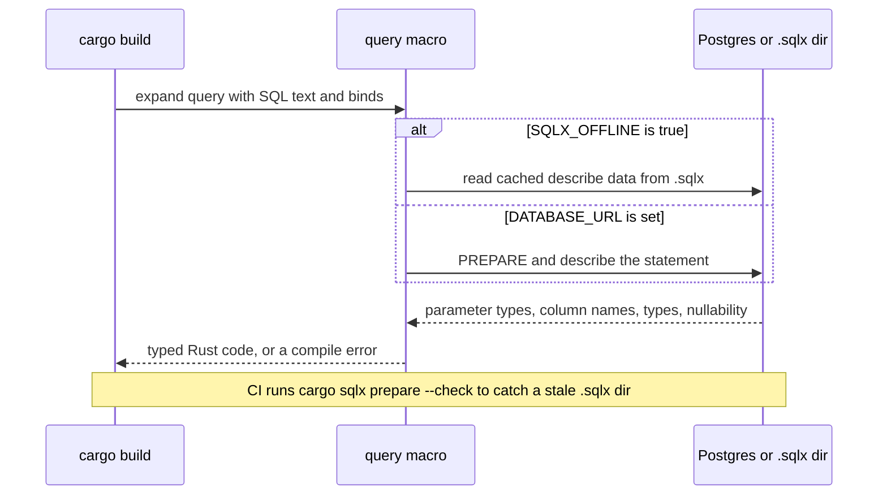
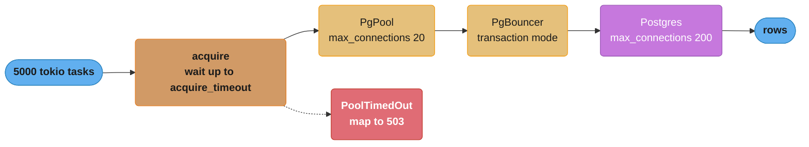
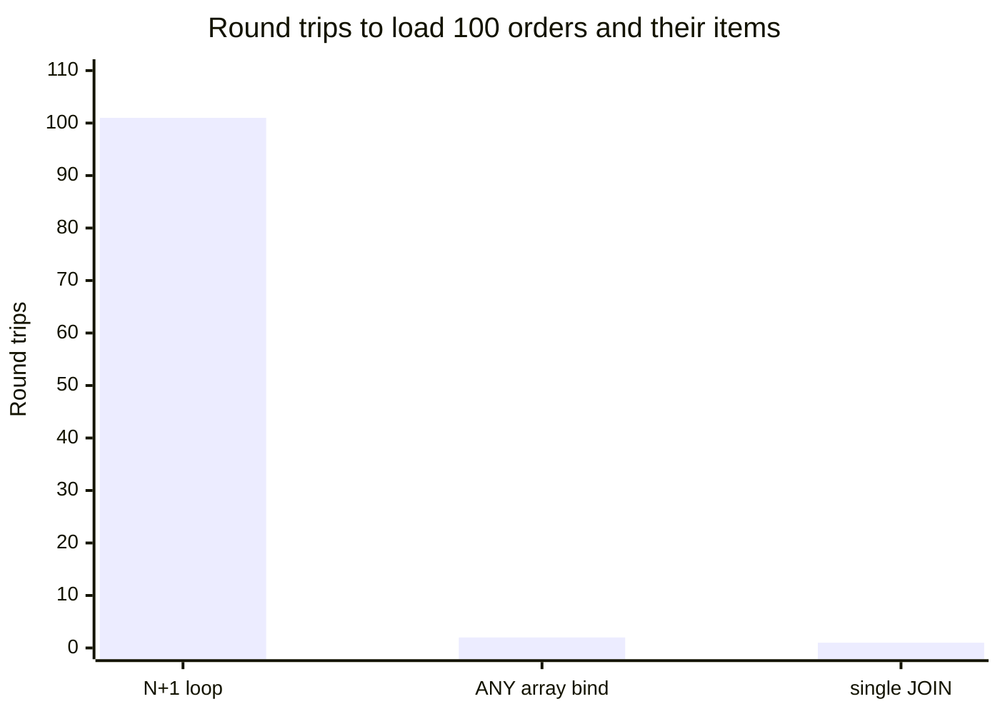

# Databases with sqlx and diesel

> **Version anchor (2026-11-06).** Rust 1.99.1 (2026-10-15) on edition 2024. sqlx and sqlx-cli 0.9.0 (2026-05-21, MSRV 1.94), diesel 2.3.14 (2026-10-07, MSRV 1.86), diesel-async 0.9.2 (2026-06-19, MSRV 1.84), sea-orm 2.0.4 (2026-09-27, MSRV 1.94), tokio-postgres 0.7.18 (2026-06-12, MSRV 1.85), deadpool-postgres 0.14.2 (2026-08-26, MSRV 1.85) and tokio 1.54.1 (2026-10-21). sqlx 0.9.0 is the section's example of a minor release that raises MSRV: it needs Rust 1.94.

---

## 1. Concept Overview

Rust has four serious ways to talk to Postgres, and they sit at different points between "you
write SQL" and "the library writes SQL":

- **sqlx** runs SQL you write. Its `query!` macros connect to a database (or read cached
  metadata) at compile time and check the SQL text, the bind parameter types and the result
  column types against the real schema. It is async, has its own pool, and is not an ORM.
- **diesel** builds SQL from a typed Rust DSL generated from your schema. Queries are checked by
  the Rust type checker with no database at build time. diesel itself is synchronous;
  **diesel-async** adds async connections and pools.
- **sea-orm** is an async ORM with entities, relations and an active-record style API. It runs on
  sqlx 0.9, so it inherits sqlx's MSRV of 1.94.
- **tokio-postgres** is a low-level async driver with no macros and no ORM, usually paired with
  **deadpool-postgres** for pooling. diesel-async uses it underneath for Postgres.

The interesting engineering is the same in all four. Compile-time checks must work in CI with
no database. Pool settings must fit under the database's connection limit when multiplied by
the number of replicas. Transactions must roll back when a task is cancelled. Prepared
statements must survive PgBouncer in transaction mode. And loops that issue one query per item
(N+1) must become one query per batch.

Pool sizing theory, PgBouncer modes and the cost of a Postgres connection are owned by
[Connection Pool Management](../../database/connection_pool_management/connection_pool_management.md)
and [Connection Pooling Deep Dive](../../backend/connection_pooling_deep_dive/connection_pooling_deep_dive.md);
this page owns the sqlx pool and the Rust driver behavior on top of that theory.

---

## 2. Intuition

> **One-line analogy**: sqlx is a spell checker for SQL you type yourself. diesel is a
> phrasebook: you cannot say anything it does not have a phrase for, but every phrase is
> grammatical. tokio-postgres is a pen.

**Mental model**: a Rust service has thousands of cheap tokio tasks and a pool of maybe 10 to 50
expensive database connections. The pool is a narrow door. Every design question on this page
is about that door: how long a task waits at it (`acquire_timeout`), how long a task keeps a
connection once inside (transactions, external calls while holding it), how many trips each
request makes through it (N+1), and what happens to a connection when the task holding it is
dropped (rollback on drop).

**Why it matters**: the failure modes are quiet. A pool that is too large exhausts Postgres's
`max_connections` only when the deploy scales to 20 replicas. An acquire timeout of 30 s, the
sqlx default, is longer than the HTTP timeout, so requests that already failed for the client
keep waiting for a connection. A `query!` macro that needs `DATABASE_URL` breaks the build on a
CI runner that has no database.

**Key insight**: in Rust, the connection and the transaction are values with owners, and the
type system carries their rules. A transaction borrows its connection, rolls back when dropped,
and is passed to queries as `&mut *tx`. A pool is an `Arc`, so it is cloned into tasks, never
borrowed across them. Most sqlx compile errors are these ownership rules showing up.

---

## 3. Core Principles

- **Check SQL at build time, without a database in CI.** `cargo sqlx prepare` writes query
  metadata to `.sqlx/`; with `SQLX_OFFLINE=true` the macros read that instead of connecting.
- **Size the pool from the database down.** `max_connections` per process times replicas, plus
  migrations, admin tools and other services, must stay under the server limit.
- **Fail fast at the pool.** `acquire_timeout` should be shorter than the request deadline, so a
  saturated pool returns an error the client can still use.
- **Hold connections briefly.** Never keep a connection or a transaction open across a call to
  another service.
- **Transactions are values.** They roll back on drop, commit only on `commit().await`, and are
  passed as `&mut *tx`.
- **Bind, never format.** sqlx 0.9 accepts only `&'static str` as query text unless you wrap it
  in `AssertSqlSafe`, so string-built SQL is visible in review.
- **One round trip per batch.** Replace per-row queries with array binds (`= ANY($1)`), joins,
  or `UNNEST` inserts.
- **Migrations are part of the release.** Embed them in the binary or run them as a separate
  step, and make every migration safe for the old and the new code at once.

---

## 4. Types / Architectures / Strategies

### 4.1 Data access choice (decision model)

| Option | SQL written by | Checked at | Async | Pool | Pick it when |
|---|---|---|---|---|---|
| sqlx 0.9.0 | You | Build time against a live DB or `.sqlx/` metadata | Yes | Built in (`PgPool`) | Default for async services where the team knows SQL |
| diesel 2.3.14 | DSL generates it | Build time by the type checker, from `schema.rs` | No (blocking) | r2d2 | Sync services, CLIs, batch jobs; strongest typing of composed queries |
| diesel-async 0.9.2 | DSL generates it | Same as diesel | Yes | bb8, deadpool or mobc | You want diesel's DSL on tokio |
| sea-orm 2.0.4 | ORM generates it | Runtime, mostly | Yes (on sqlx 0.9) | sqlx pool | CRUD-heavy apps with relations, admin panels |
| tokio-postgres 0.7.18 plus deadpool-postgres 0.14.2 | You | Runtime only | Yes | deadpool | Drivers, proxies, pipelining, `COPY`, full protocol control |

How to read it. sqlx checks the exact SQL you ship, including Postgres-specific syntax, and
costs a database (or a prepare step) for builds. diesel checks composition: a filter on a column
that does not exist, or a join without a relation, is a type error, and dynamic filters are
easier to build safely. sea-orm trades static checks for speed of writing CRUD.
tokio-postgres is what you use when you need the protocol itself.

The MSRV column matters for libraries: sqlx 0.9.0 and sea-orm 2.0.4 need Rust 1.94, so a crate
that depends on them cannot keep an older MSRV. See
[Editions, Toolchains and MSRV](../modules_crates_and_cargo/editions_toolchains_and_msrv.md).

### 4.2 Query styles inside sqlx

| API | Checked at build | Returns | Use for |
|---|---|---|---|
| `query!` / `query_as!` / `query_scalar!` | Yes | Anonymous record or your struct | Static SQL, which is most queries |
| `query` / `query_as` with `.bind()` | No | `PgRow` or `FromRow` struct | SQL known only at runtime but still static text |
| `QueryBuilder` | No | Same | Dynamic `WHERE` clauses, bulk `VALUES` lists |
| `raw_sql` | No | Rows of every statement | Multi-statement scripts, no binds |

### 4.3 Running migrations

| Strategy | How | Risk |
|---|---|---|
| Embedded, at startup | `sqlx::migrate!()` then `.run(&pool)` | Every replica tries at once; sqlx takes a Postgres advisory lock by default, but a slow migration delays every pod's readiness |
| Separate job before rollout | `sqlx migrate run` or a one-shot binary in the pipeline | Needs ordering in the deploy tool |
| diesel | `embed_migrations!` plus `run_pending_migrations`, or the diesel CLI | Same tradeoffs |

Both work. The job form keeps a long migration from holding up pod startup. Zero-downtime rules
for the SQL itself are in [Database Migrations with Zero Downtime](../../database/database_migrations_zero_downtime/database_migrations_zero_downtime.md).

---

## 5. Architecture Diagrams

### 5.1 How `query!` checks SQL at build time



The macro talks to Postgres through the same describe path the driver uses at runtime. The
`.sqlx/` files are that answer written to disk, one JSON file per query, committed to the repo.

### 5.2 The pool as the narrow door



Ten replicas with `max_connections` 20 each already reach 200 server connections without
PgBouncer. The pool limit is a per-process number, and the database limit is a fleet number.

### 5.3 N+1 round trips



At 0.5 ms round-trip time inside one availability zone, 101 round trips cost about 50 ms of
pure network wait before Postgres does any work, against 1 ms for the batched form.

---

## 6. How It Works - Detailed Mechanics

### 6.1 Cargo setup for sqlx 0.9

sqlx 0.9 removed the combined runtime-plus-TLS features. Pick a runtime and a TLS backend
separately:

```toml
[dependencies]
sqlx = { version = "0.9", default-features = false, features = [
    "runtime-tokio", "tls-rustls-aws-lc-rs", "postgres",
    "macros", "migrate", "uuid", "time", "json",
] }
```

The `macros` feature turns on offline support. The `sqlx-toml` feature (off by default in the
library, on in `sqlx-cli`) reads a per-crate `sqlx.toml`, which can rename `DATABASE_URL` for
workspaces with several databases and move the `_sqlx_migrations` table.

### 6.2 Pool configuration

```rust
// fragment: sqlx 0.9
use std::time::Duration;
use sqlx::postgres::{PgPool, PgPoolOptions};

async fn connect(url: &str) -> Result<PgPool, sqlx::Error> {
    PgPoolOptions::new()
        .max_connections(20)
        .min_connections(2)
        .acquire_timeout(Duration::from_secs(2))
        .idle_timeout(Duration::from_secs(300))
        .max_lifetime(Duration::from_secs(1800))
        .connect(url)
        .await
}
```

Defaults in 0.9.0, read from `PoolOptions::new`:

| Setting | Default | Production note |
|---|---|---|
| `max_connections` | 10 | Size from the fleet: server limit divided by replicas, minus headroom |
| `min_connections` | 0 | 1 or 2 avoids a cold connect on the first request after idle |
| `acquire_timeout` | 30 s | Set below the request deadline, usually 1 to 3 s |
| `idle_timeout` | 10 min | Keep below any idle cutoff in PgBouncer or a cloud proxy |
| `max_lifetime` | 30 min | Rotates connections so failovers and DNS changes take effect |
| `test_before_acquire` | true | A ping per acquire of an idle connection; costs a round trip, catches dead sockets |
| slow-acquire warning | logged at WARN after 2 s | An early signal that the pool is too small or connections are held too long |

`PgPool` is an `Arc` around the pool state. Clone it into every task and handler. Postgres
connection options carry `statement_cache_capacity`, which defaults to 100 prepared statements
per connection.

### 6.3 Checked queries and nullability

```rust
// fragment: sqlx 0.9, query! needs DATABASE_URL or SQLX_OFFLINE=true at build time
#[derive(Debug)]
struct Order {
    id: i64,
    customer_id: i64,
    total_cents: i64,
    note: Option<String>,
}

async fn order_by_id(pool: &sqlx::PgPool, id: i64) -> Result<Option<Order>, sqlx::Error> {
    sqlx::query_as!(
        Order,
        r#"SELECT id, customer_id, total_cents, note FROM orders WHERE id = $1"#,
        id
    )
    .fetch_optional(pool)
    .await
}

async fn order_count(pool: &sqlx::PgPool, customer: i64) -> Result<i64, sqlx::Error> {
    // count(*) is inferred as nullable; "n!" asserts NOT NULL so the type is i64, not Option<i64>.
    sqlx::query_scalar!(r#"SELECT count(*) AS "n!" FROM orders WHERE customer_id = $1"#, customer)
        .fetch_one(pool)
        .await
}
```

The macros infer nullability from the schema and from Postgres's plan. 0.9 forces a generic plan
during inference, which improves the answers and can change the inferred types of some queries
after an upgrade. Column-name suffixes override inference: `"n!"` for not null, `"n?"` for
nullable, and `"n: Type"` for a custom Rust type.

For CI:

1. Run `cargo sqlx prepare --workspace` locally against a migrated database and commit `.sqlx/`.
2. Set `SQLX_OFFLINE=true` in CI so the macros never try to connect.
3. Run `cargo sqlx prepare --check --workspace` against a test database in one CI job, so a
   changed query with a stale `.sqlx/` file fails the build.

### 6.4 Dynamic SQL and `SqlSafeStr`

In sqlx 0.9 every `query*()` function takes `impl SqlSafeStr`. Only `&'static str` and the
`AssertSqlSafe` wrapper implement it.

```rust
// fragment: sqlx 0.9
use sqlx::{AssertSqlSafe, Postgres, QueryBuilder};

async fn search(pool: &sqlx::PgPool, status: Option<&str>, min_total: Option<i64>)
    -> Result<Vec<(i64,)>, sqlx::Error>
{
    let mut qb: QueryBuilder<Postgres> = QueryBuilder::new("SELECT id FROM orders WHERE true");
    if let Some(s) = status {
        qb.push(" AND status = ").push_bind(s);
    }
    if let Some(m) = min_total {
        qb.push(" AND total_cents >= ").push_bind(m);
    }
    qb.build_query_as().fetch_all(pool).await
}

async fn analyze_table(pool: &sqlx::PgPool, table: &str) -> Result<(), sqlx::Error> {
    // Identifiers cannot be bound. Check against a fixed list before asserting safety.
    const ALLOWED: [&str; 2] = ["orders", "order_items"];
    if !ALLOWED.contains(&table) {
        return Err(sqlx::Error::Protocol(format!("table {table} not allowed")));
    }
    sqlx::query(AssertSqlSafe(format!("ANALYZE {table}"))).execute(pool).await?;
    Ok(())
}
```

`QueryBuilder` keeps values as binds. `AssertSqlSafe` is meant to be rare and easy to grep in
review, in the same way as `std::panic::AssertUnwindSafe`.

### 6.5 Transactions

```rust
// fragment: sqlx 0.9
async fn transfer(pool: &sqlx::PgPool, from: i64, to: i64, cents: i64) -> Result<(), sqlx::Error> {
    let mut tx = pool.begin().await?;

    sqlx::query!("UPDATE accounts SET balance = balance - $1 WHERE id = $2", cents, from)
        .execute(&mut *tx)
        .await?;
    sqlx::query!("UPDATE accounts SET balance = balance + $1 WHERE id = $2", cents, to)
        .execute(&mut *tx)
        .await?;

    tx.commit().await
}
```

- `&mut *tx` dereferences the transaction to `&mut PgConnection`, which is what implements
  `Executor`. `&mut tx` does not compile (§10.1).
- An early `?` return or a cancelled task drops `tx` without commit. `Drop` cannot run async
  code, so sqlx queues a `ROLLBACK` that runs on the next use of the connection, including when
  it goes back to the pool.
- Calling `pool.begin()` inside a function that already has a transaction opens a second
  connection, which deadlocks against the first if both touch the same rows. Pass
  `&mut PgConnection` down instead; `tx.begin()` on a transaction creates a savepoint.

### 6.6 Batching instead of N+1

Fetch the parent rows, then all children in one query with an array bind:

```rust
// fragment: sqlx 0.9
async fn items_for(pool: &sqlx::PgPool, order_ids: &[i64]) -> Result<Vec<Item>, sqlx::Error> {
    sqlx::query_as!(
        Item,
        "SELECT order_id, sku, qty FROM order_items WHERE order_id = ANY($1)",
        order_ids
    )
    .fetch_all(pool)
    .await
}
```

Then group in memory. This part is plain std:

```rust
use std::collections::HashMap;

#[derive(Debug)]
struct Item {
    order_id: i64,
    sku: String,
    qty: i32,
}

fn group_by_order(items: Vec<Item>) -> HashMap<i64, Vec<Item>> {
    let mut map: HashMap<i64, Vec<Item>> = HashMap::new();
    for item in items {
        map.entry(item.order_id).or_default().push(item);
    }
    map
}

fn main() {
    let rows = vec![
        Item { order_id: 1, sku: "A".into(), qty: 2 },
        Item { order_id: 2, sku: "B".into(), qty: 1 },
        Item { order_id: 1, sku: "C".into(), qty: 5 },
    ];
    let grouped = group_by_order(rows);
    assert_eq!(grouped[&1].len(), 2);
    assert_eq!(grouped[&2][0].sku, "B");
    assert_eq!(grouped[&1].iter().map(|i| i.qty).sum::<i32>(), 7);
}
```

For bulk inserts, bind one array per column and use `UNNEST`:
`INSERT INTO order_items (order_id, sku, qty) SELECT * FROM UNNEST($1::bigint[], $2::text[], $3::int[])`.
That is 3 binds for any row count. A `VALUES` list built with `QueryBuilder::push_values` uses 3
binds per row and hits the Postgres protocol limit of 65,535 bind parameters at 21,845 rows.

### 6.7 Streaming large results

`fetch` returns a `Stream` of rows, so a 10-million-row export does not load into memory.

```rust
// fragment: sqlx 0.9, futures 0.3
use futures::TryStreamExt;

async fn export(pool: &sqlx::PgPool, out: &mut (impl std::io::Write + Send)) -> anyhow::Result<()> {
    let mut rows = sqlx::query_as::<_, (i64, String)>("SELECT id, email FROM users ORDER BY id")
        .fetch(pool);
    while let Some((id, email)) = rows.try_next().await? {
        writeln!(out, "{id},{email}")?;
    }
    Ok(())
}
```

The stream holds a pool connection until it ends. An export that writes to a slow client holds
that connection for minutes, so run large exports on a separate small pool or a replica.

### 6.8 PgBouncer and prepared statements

sqlx prepares every query as a named, protocol-level statement and caches it per connection (100
by default). In PgBouncer transaction mode the next transaction can land on another server
connection. PgBouncer 1.21 and later track protocol-level prepared statements when
`max_prepared_statements` is above 0 (the default is 200 since 1.24), so sqlx works unchanged.
On older PgBouncer, or with tracking off, queries fail with "prepared statement ... does not
exist". Options, best first:

1. Upgrade PgBouncer and keep `max_prepared_statements` above 0.
2. Call `.persistent(false)` on affected queries. In 0.9 that uses the unnamed statement, which
   lives only inside one round trip.
3. Use session mode for that workload.

The PgBouncer side is explained in
[Connection Pool Management](../../database/connection_pool_management/connection_pool_management.md).

### 6.9 diesel and diesel-async

```rust
// fragment: diesel 2.3, diesel-async 0.9 with the deadpool feature
use diesel::prelude::*;
use diesel_async::RunQueryDsl;
use diesel_async::pooled_connection::{AsyncDieselConnectionManager, deadpool::Pool};
use diesel_async::AsyncPgConnection;

diesel::table! {
    orders (id) {
        id -> Int8,
        customer_id -> Int8,
        total_cents -> Int8,
    }
}

#[derive(Queryable, Selectable)]
#[diesel(table_name = orders)]
#[diesel(check_for_backend(diesel::pg::Pg))]
struct OrderRow {
    id: i64,
    customer_id: i64,
    total_cents: i64,
}

async fn big_orders(pool: &Pool<AsyncPgConnection>, min: i64)
    -> Result<Vec<OrderRow>, Box<dyn std::error::Error + Send + Sync>>
{
    let mut conn = pool.get().await?;
    let rows = orders::table
        .filter(orders::total_cents.ge(min))
        .order(orders::id.desc())
        .limit(100)
        .select(OrderRow::as_select())
        .load(&mut conn)
        .await?;
    Ok(rows)
}

fn make_pool(url: &str) -> Result<Pool<AsyncPgConnection>, Box<dyn std::error::Error>> {
    let mgr = AsyncDieselConnectionManager::<AsyncPgConnection>::new(url);
    Ok(Pool::builder(mgr).max_size(20).build()?)
}
```

The `table!` block normally comes from `diesel print-schema`, which the diesel CLI runs after
each migration. `check_for_backend` makes field-type mismatches a compile error at the struct
instead of a long error at the query. With sync diesel inside a tokio service, wrap each
database call in `spawn_blocking`, or the blocking call stalls a runtime worker; see
[Async Runtimes and Executors](../async_runtimes_and_executors/async_runtimes_and_executors.md).

### 6.10 tokio-postgres directly

`tokio_postgres::connect` returns a `Client` and a `Connection`. The `Connection` is a future that
does the socket I/O, and nothing happens until you spawn it. Requests from concurrent futures on
one `Client` are pipelined on the single connection, which can beat a pool for many small
independent reads. deadpool-postgres adds pooling and statement caching per connection.

---

## 7. Real-World Examples

- **sea-orm 2.0.4** depends on sqlx 0.9, which is why its MSRV is 1.94 too. A library that
  depends on sea-orm inherits that floor.
- **diesel-async 0.9.2** depends on tokio-postgres for Postgres and on bb8, deadpool or mobc for
  pooling, selected by features.
- **PgDog and PgCat** are Postgres poolers written in Rust; see
  [Connection Pool Management](../../database/connection_pool_management/connection_pool_management.md).
- **Other languages.** Go's `database/sql` pool and `SetMaxOpenConns` are in
  [database/sql and Data Access](../../go/database_sql_and_data_access/database_sql_and_data_access.md).
  SQLAlchemy's async engine and session scope are in
  [Async Database with SQLAlchemy](../../fastapi/async_database_sqlalchemy/async_database_sqlalchemy.md).
  JPA's lazy-loading N+1 is in [Spring Data JPA](../../spring/spring_data_jpa/spring_data_jpa.md).
  The contrast: sqlx and diesel have no lazy loading, so N+1 comes only from loops you write,
  and it is visible in the code.
- **Query tuning** (indexes, `EXPLAIN ANALYZE`, plan shapes) is in
  [Query Optimization](../../backend/query_optimization/query_optimization.md).

---

## 8. Tradeoffs

| Choice | Gain | Cost |
|---|---|---|
| sqlx `query!` over runtime `query` | SQL, binds and column types checked at build | Needs `.sqlx/` or a database for every build; compile time grows with query count |
| diesel over sqlx | Composed queries type-checked, no database at build | DSL learning curve, long type errors, Postgres features outside the DSL need `sql_query` |
| diesel-async over diesel plus `spawn_blocking` | No blocking-pool hops, native async | Second crate to keep in step with diesel |
| sea-orm over sqlx | Faster CRUD, relations, generated entities | Runtime errors for mistakes the macros would catch; MSRV 1.94 |
| tokio-postgres over sqlx | Pipelining, `COPY`, protocol control | Every row mapping written by hand, no compile-time checks |
| Embedded migrations | One artifact, cannot forget to migrate | Slow migrations delay startup on every replica |
| Larger pool | Fewer acquire waits | More server connections, more memory per backend, worse tail latency past the CPU-bound point |
| Short `acquire_timeout` | Fast 503 under saturation | More visible errors during spikes |
| `test_before_acquire` on | Catches dead connections before use | One extra round trip per acquire of an idle connection |

---

## 9. When to Use / When NOT to Use

**Use sqlx when:**

- The team writes SQL well and wants it checked against the real schema.
- Queries use Postgres-specific features (CTEs, `jsonb` operators, `ON CONFLICT`, arrays).
- The service is async on tokio.

**Use diesel or diesel-async when:**

- Many queries are composed from optional filters and joins, and you want those compositions
  type-checked.
- Builds must never depend on a database or on cached query files.

**Use sea-orm when:** the app is mostly CRUD over related tables and delivery speed matters more
than checking every query at build time.

**Use tokio-postgres when:** you need pipelining, `COPY`, logical replication messages, or you are
building a driver, proxy or pooler.

**Do not:**

- Put an ORM in a hot path you have not measured. Map rows by hand there.
- Use sync diesel directly on tokio worker threads.
- Pick sqlx 0.9 or sea-orm 2.0 for a library whose MSRV must stay below 1.94.

---

## 10. Common Pitfalls

The incidents in this section are composite examples. Their numbers are illustrative and do not
come from one real system.

### 10.1 `&mut tx` instead of `&mut *tx`

The commonest sqlx compile error. `Executor` is implemented for `&mut PgConnection`, not for
`&mut Transaction`. A generic parameter does not trigger deref coercion, so `&mut tx` fails with
a trait-bound error. The std model below has the same shape as sqlx's types.

```rust
// BROKEN
// error[E0277]: the trait bound `&mut Transaction<'_>: Executor` is not satisfied
use std::ops::{Deref, DerefMut};

struct PgConnection {
    log: Vec<&'static str>,
}

trait Executor {
    fn execute(self, sql: &'static str);
}

impl Executor for &mut PgConnection {
    fn execute(self, sql: &'static str) {
        self.log.push(sql);
    }
}

struct Transaction<'c> {
    conn: &'c mut PgConnection,
}

impl Deref for Transaction<'_> {
    type Target = PgConnection;
    fn deref(&self) -> &PgConnection {
        self.conn
    }
}

impl DerefMut for Transaction<'_> {
    fn deref_mut(&mut self) -> &mut PgConnection {
        self.conn
    }
}

fn run<E: Executor>(e: E, sql: &'static str) {
    e.execute(sql);
}

fn main() {
    let mut conn = PgConnection { log: Vec::new() };
    let mut tx = Transaction { conn: &mut conn };
    run(&mut tx, "UPDATE accounts SET balance = balance - 10 WHERE id = 1");
}
```

```rust
// FIX: reborrow the connection inside the transaction
use std::ops::{Deref, DerefMut};

struct PgConnection {
    log: Vec<&'static str>,
}

trait Executor {
    fn execute(self, sql: &'static str);
}

impl Executor for &mut PgConnection {
    fn execute(self, sql: &'static str) {
        self.log.push(sql);
    }
}

struct Transaction<'c> {
    conn: &'c mut PgConnection,
}

impl Deref for Transaction<'_> {
    type Target = PgConnection;
    fn deref(&self) -> &PgConnection {
        self.conn
    }
}

impl DerefMut for Transaction<'_> {
    fn deref_mut(&mut self) -> &mut PgConnection {
        self.conn
    }
}

fn run<E: Executor>(e: E, sql: &'static str) {
    e.execute(sql);
}

fn main() {
    let mut conn = PgConnection { log: Vec::new() };
    let mut tx = Transaction { conn: &mut conn };
    run(&mut *tx, "UPDATE accounts SET balance = balance - 10 WHERE id = 1");
    run(&mut *tx, "UPDATE accounts SET balance = balance + 10 WHERE id = 2");
    assert_eq!(tx.log.len(), 2);
}
```

Each `&mut *tx` is a fresh short reborrow, so the transaction stays usable for the next query.

### 10.2 CI breaks because `query!` cannot reach a database

A team added the first `query!` call and every CI job failed with "set `DATABASE_URL` to use
query macros online". The fix is `.sqlx/` committed plus `SQLX_OFFLINE=true`, and one CI job with
a database that runs `cargo sqlx prepare --check`. Without the check job, a stale `.sqlx/` file
lets a query that no longer matches the schema compile and fail at runtime.

### 10.3 The 30-second acquire default under a 10-second HTTP timeout

During a traffic spike, handlers waited up to 30 s for a connection, long after the load balancer
had returned 504 to the client. Work kept piling onto a saturated pool for requests nobody was
waiting for. Setting `acquire_timeout` to 2 s turned the spike into fast 503s and let the pool
recover in seconds.

### 10.4 Pool size times replicas

A service set `max_connections(50)` and was autoscaled from 4 to 14 pods during a sale. 700
connections hit a Postgres with `max_connections = 500`, and new connections failed with "too
many clients already" for every service on that database, not only this one. Size from the
database down, or put PgBouncer in front.

### 10.5 A transaction held across an HTTP call

An order handler opened a transaction, locked the order row with `SELECT ... FOR UPDATE`, then
called a payment API that took 3 s on a bad day. Twenty concurrent checkouts held twenty
connections and twenty row locks for 3 s each. Do the external call before the transaction, or
record intent, commit, call, and update in a second short transaction.

### 10.6 Sync diesel on the async runtime

A diesel query inside an axum handler, without `spawn_blocking`, blocked a tokio worker for the
whole query. With 4 workers, 4 slow reports froze every other request on the pod. Use
diesel-async, or `spawn_blocking` around each database call.

### 10.7 sqlx 0.9 upgrade breaks `format!` queries

After the upgrade, every `sqlx::query(&format!(...))` stopped compiling with "dynamic SQL strings
should be audited for possible injections". That is the intended speed bump. Convert each one to
binds or `QueryBuilder`, and use `AssertSqlSafe` only for identifiers checked against an allow
list. The same upgrade raised the MSRV to 1.94.

---

## 11. Technologies & Tools

| Tool | What it is for |
|---|---|
| sqlx | Async SQL toolkit with build-time checked `query!` macros and a built-in pool |
| sqlx-cli | `cargo sqlx prepare`, `sqlx migrate run`, `sqlx database create` |
| diesel | Type-checked query builder and ORM, synchronous |
| diesel_cli | Migrations and `print-schema` for diesel |
| diesel-async | Async connections and pools for diesel on tokio |
| sea-orm | Async ORM built on sqlx |
| tokio-postgres | Low-level async Postgres driver with pipelining |
| deadpool-postgres | Pool for tokio-postgres connections |
| PgBouncer | Connection pooler in front of Postgres |
| testcontainers | Starts a throwaway Postgres in a container for integration tests |

---

## 12. Interview Questions with Answers

**Q: Why does `query.execute(&mut tx)` fail to compile in sqlx while `&mut *tx` works?**
**Short:** `Executor` is implemented for `&mut PgConnection`, not `&mut Transaction`, and generics do not apply deref coercion, so you reborrow the inner connection with `&mut *tx`.

`Transaction` implements `DerefMut<Target = PgConnection>`. A function with a concrete
`&mut PgConnection` parameter would coerce `&mut tx` for you, but `execute` takes a generic
`E: Executor`, and trait resolution does not look through `Deref`. `&mut *tx` makes the
reborrow explicit. Each one is short-lived, so you can run many queries on the same transaction.

**Q: How do you build a project that uses `sqlx::query!` in CI without a database?**
**Short:** Run `cargo sqlx prepare` to write query metadata into `.sqlx/`, commit it, and build with `SQLX_OFFLINE=true` so the macros read the files instead of connecting.

The macros normally connect to `DATABASE_URL` and ask Postgres to describe each statement.
`cargo sqlx prepare --workspace` stores those answers as JSON files. With `SQLX_OFFLINE=true` the
macros use only the files. Add one CI job with a migrated database that runs
`cargo sqlx prepare --check`, or a stale file lets a broken query compile.

**Q: What are the sqlx 0.9 pool defaults, and which one causes trouble first?**
**Short:** 10 connections, 0 minimum, a 30 s acquire timeout, 10 min idle timeout and 30 min lifetime; the 30 s acquire timeout outlasts most request deadlines.

Under saturation a task waits up to 30 s for a connection. The HTTP client or load balancer has
usually given up long before, so the service keeps doing work for requests nobody waits for. Set
`acquire_timeout` to 1 to 3 s, below the request deadline, and map `PoolTimedOut` to 503. The 10
connection default is a test value; size it from the database's limit and the replica count.

**Q: What happens to an sqlx transaction if the task is cancelled before `commit`?**
**Short:** The dropped transaction queues a `ROLLBACK` that runs on the connection's next use, including its return to the pool, so partial writes are not committed.

`Drop` cannot run async code, so sqlx marks the connection and sends the rollback the next time
the connection is used. That makes a transaction cancel-safe in the sense that matters: either
`commit().await` completed, or nothing in it is visible. Code outside a transaction has no such
protection, so a timeout that cancels a handler between two separate writes leaves the first one
in place.

**Q: Why does sqlx 0.9 reject `sqlx::query(&format!(...))`?**
**Short:** In 0.9 every `query*()` function takes `impl SqlSafeStr`, which only `&'static str` and `AssertSqlSafe` implement, so string-built SQL needs an explicit, greppable wrapper.

The change is a speed bump against SQL injection through `format!`. Values belong in binds or
`QueryBuilder::push_bind`. Identifiers (table and column names) cannot be bound, so check them
against a fixed allow list and then wrap the string in `AssertSqlSafe`. The trait is modelled on
`UnwindSafe` and `AssertUnwindSafe`.

**Q: How do you size a sqlx pool for a service with many replicas?**
**Short:** Divide what Postgres can serve by the replica count at maximum scale, leaving room for other clients, because each process's `max_connections` multiplies across the fleet.

A pool limit is per process. Ten replicas at 50 connections need 500 server connections, and
autoscaling raises that during the spike when you can least afford it. Postgres also gets slower
past a CPU-bound number of active connections. Keep per-process pools small (often 10 to 30),
put PgBouncer in front when the fleet is large, and watch acquire wait time, not only pool size.
Pool theory is in [Connection Pool Management](../../database/connection_pool_management/connection_pool_management.md).

**Q: Why do sqlx queries fail behind PgBouncer in transaction mode, and how do you fix it?**
**Short:** sqlx caches named prepared statements per connection, and PgBouncer below 1.21 or with `max_prepared_statements = 0` can route a later execute to a server that never prepared it.

In transaction mode each transaction may get a different server connection. PgBouncer 1.21+
tracks protocol-level prepared statements when `max_prepared_statements` is above 0 (default 200
since 1.24), and then sqlx works as is. Otherwise, mark the queries `.persistent(false)`, which in
0.9 uses an unnamed statement, or use session mode.

**Q: How do you avoid N+1 queries with sqlx?**
**Short:** Load the parents, then load all children in one query with `WHERE parent_id = ANY($1)` bound to an array, and group them in a `HashMap`.

sqlx has no lazy loading, so N+1 only appears as a loop that awaits a query per item. One array
bind replaces 100 round trips with 1. A `JOIN` is fine when the parent rows are not duplicated
too much by the join. At 0.5 ms per round trip, 101 queries spend about 50 ms in network wait
alone.

**Q: How do you bulk insert thousands of rows efficiently with sqlx?**
**Short:** Bind one array per column and insert from `UNNEST`, which uses a fixed number of bind parameters for any row count and one round trip.

`INSERT ... SELECT * FROM UNNEST($1::bigint[], $2::text[])` sends two parameters. A `VALUES` list
from `QueryBuilder::push_values` uses one parameter per column per row and stops at the 65,535
parameter limit of the Postgres protocol. For millions of rows, `COPY` through tokio-postgres or
sqlx's copy API is faster still.

**Q: How do sqlx and diesel differ in what they check at compile time?**
**Short:** sqlx checks the exact SQL text against a live or cached schema, while diesel type-checks queries built from a DSL against a generated `schema.rs` with no database needed.

sqlx's macros catch a typo in SQL, a wrong bind type or a nullable column read as non-null, for
any SQL Postgres accepts. diesel catches a filter on a missing column, a comparison of the wrong
types, or a select that does not match the struct, and it does so for queries composed at runtime
from optional parts. sqlx needs `.sqlx/` or a database to build; diesel needs `schema.rs` kept in
sync with migrations.

**Q: Why is calling sync diesel from an async handler a problem, and what are the fixes?**
**Short:** A blocking diesel call occupies a tokio worker thread for the whole query, so a few slow queries stall every task on that worker.

tokio has a small number of workers, often one per core. Blocking one stops the tasks queued on
it. Wrap each database call in `spawn_blocking`, which moves it to the blocking pool (up to 512
threads by default), or use diesel-async, which gives diesel's DSL a native async connection on
top of tokio-postgres.

**Q: What does `query!` infer about nullability, and how do you override it?**
**Short:** It infers each column's nullability from the schema and the query plan, and you override it with column aliases such as `"col!"` for not null and `"col?"` for nullable.

Expressions like `count(*)` or columns from an outer join are often inferred as nullable, which
gives `Option<T>` where you know a value exists. `AS "n!"` forces `T`. `AS "n?"` forces `Option<T>`,
and `AS "n: MyType"` picks a Rust type. sqlx 0.9 forces a generic plan during inference, so
some inferred types change on upgrade.

**Q: How does a `PgPool` get shared between tasks?**
**Short:** `PgPool` is a cheap handle around an `Arc`, so you clone it into each task or handler instead of passing a reference across task boundaries.

`tokio::spawn` needs `'static` futures, so a task cannot borrow a pool owned by `main`. Cloning
increments a reference count and shares one set of connections. Put the pool in axum `State`;
axum clones it per request.

**Q: Why should you not hold a pool connection or transaction across a call to another service?**
**Short:** The connection, and any row locks the transaction holds, stay occupied for the whole remote call, so a slow dependency exhausts the pool and blocks other writers.

A 3 s payment call inside a transaction with `FOR UPDATE` holds a connection and a lock for 3 s.
Under load that empties the pool and queues every other request behind it. Call out first and
then write, or commit an intent row, call, and finish in a second short transaction.

**Q: When would you pick tokio-postgres over sqlx?**
**Short:** When you need protocol-level control such as pipelining many queries on one connection, `COPY`, or replication streams, and can write row mapping by hand.

tokio-postgres pipelines requests from concurrent futures on one `Client`, which suits many small
independent reads. It exposes `COPY IN` and `COPY OUT` as streams. It has no macros and no
compile-time checks, and you spawn its `Connection` future yourself. Pair it with
deadpool-postgres for pooling.

**Q: Why does upgrading to sqlx 0.9 matter for a library's MSRV?**
**Short:** sqlx 0.9.0 requires Rust 1.94, so any crate that depends on it, sea-orm 2.0.4 included, cannot support an older compiler.

A minor version bump of a dependency can raise your effective MSRV. Applications usually do not
care. Libraries with a stated MSRV must either hold back the dependency or raise their own floor
and say so in release notes. Cargo's MSRV-aware resolver (default with resolver 3 in edition 2024)
picks versions that match your `rust-version` when it can.

**Q: How do you run migrations safely when many replicas start at once?**
**Short:** Run them as a separate job before the rollout, or rely on sqlx's advisory lock so only one replica migrates while the others wait.

`sqlx::migrate!()` embeds the `migrations/` directory in the binary, and `Migrator::run` takes a
Postgres advisory lock by default. That avoids two replicas applying the same migration, but a
long migration delays readiness on every pod. A pre-deploy job keeps startup fast and fails the
deploy before new code runs. Either way, each migration must work with the old and the new code.

**Q: How do you stream a large result set with sqlx without loading it into memory?**
**Short:** Use `fetch`, which returns a `Stream` of rows, and process each row as it arrives instead of calling `fetch_all`.

`fetch_all` collects every row into a `Vec`. `fetch` yields rows one at a time with `try_next`.
The stream holds its connection until it finishes, so a slow consumer pins a pool slot for the
whole export. Use a small dedicated pool or a replica for exports.

**Q: What does `test_before_acquire` do, and when would you turn it off?**
**Short:** It pings an idle connection before handing it out so dead sockets are replaced, at the cost of one round trip per acquire of an idle connection.

The default is on. It hides failovers and idle cutoffs from application code. Turn it off only
when the round trip shows up in latency budgets and `max_lifetime` plus `idle_timeout` already
rotate connections faster than anything in the path can kill them.

**Q: What is sea-orm built on, and what does that imply?**
**Short:** sea-orm 2.0.4 runs on sqlx 0.9 and the sea-query builder, so it shares sqlx's pool and runtime behavior and inherits its MSRV of 1.94.

Pool settings, TLS features and PgBouncer behavior are sqlx's. sea-orm adds entities, relations
and an active-model API, and its queries are mostly checked at runtime. It suits CRUD-heavy apps.
For hot paths, drop down to sqlx queries on the same pool.

---

## 13. Best Practices

- Commit `.sqlx/`, build with `SQLX_OFFLINE=true`, and run `cargo sqlx prepare --check` in one CI
  job with a database.
- Set `acquire_timeout` below the request deadline and map pool timeouts to 503.
- Size pools from the database's connection limit divided by maximum replicas.
- Keep transactions short. Never await another service inside one.
- Pass `&mut *tx` to queries, and `&mut PgConnection` to helpers so they work inside or outside a
  transaction.
- Replace loops of queries with `= ANY($1)` and `UNNEST`.
- Use `QueryBuilder` for dynamic filters; reserve `AssertSqlSafe` for allow-listed identifiers.
- Wrap sync diesel in `spawn_blocking`, or use diesel-async.
- Run migrations as a pre-deploy step for anything slower than a few seconds.
- Test against a real Postgres with `#[sqlx::test]` or a container; mocks hide the SQL errors you
  care about ([Testing, Fuzzing and Miri](../testing_fuzzing_and_miri/testing_fuzzing_and_miri.md)).

---

## 14. Case Study

### Moving a reporting worker from per-row queries to batched sqlx

This is an illustrative scenario. Its numbers are examples, not measurements from a real system.

**Context.** A nightly worker builds invoices for 400,000 customers. Each customer needs its
orders and each order its line items. The first version, written in a week, used one query per
customer and one per order: about 4.4 million queries per run, 6 hours wall time, on a pool of
10 connections. The worker ran 8 OS threads to parallelize, and each thread used a shared pool.

**First problem: sharing the pool across threads.** The first parallel version borrowed the
pool from `main` inside spawned threads, and did not compile.

```rust
// BROKEN
// error[E0373]: closure may outlive the current function, but it borrows `pool.size`,
// which is owned by the current function
use std::thread;

struct Pool {
    size: u32,
}

fn main() {
    let pool = Pool { size: 10 };
    let worker = thread::spawn(|| pool.size + 1);
    let _ = worker.join();
}
```

```rust
// FIX: share ownership with Arc and move a clone into each worker (PgPool already is one)
use std::sync::Arc;
use std::thread;

struct Pool {
    size: u32,
}

fn main() {
    let pool = Arc::new(Pool { size: 10 });
    let workers: Vec<_> = (0..8)
        .map(|i| {
            let pool = Arc::clone(&pool);
            thread::spawn(move || pool.size + i)
        })
        .collect();
    let total: u32 = workers.into_iter().filter_map(|w| w.join().ok()).sum();
    assert_eq!(total, 10 * 8 + (0..8).sum::<u32>());
}
```

`PgPool` is an `Arc` inside, so in the real worker the fix is `let pool = pool.clone();` before
`tokio::spawn(async move { ... })`. The same rule applies to tasks and threads: move a clone,
never borrow.

**Second problem: N+1 at scale.** The team rewrote the worker as an async pipeline over pages of
1,000 customers:

1. One query fetches the page of customer ids with keyset pagination (`WHERE id > $1 ORDER BY id
   LIMIT 1000`).
2. One query fetches every order for those ids with `customer_id = ANY($1)`.
3. One query fetches every line item for those orders with `order_id = ANY($1)`.
4. Grouping happens in `HashMap`s in memory.
5. Invoices are written back with one `UNNEST` insert per page.

That is 4 round trips per 1,000 customers, about 1,600 queries per run instead of 4.4 million.

**Third problem: the pool was the wrong size for the new shape.** With 8 concurrent pages and
the default pool of 10, acquire waits appeared in the slow-acquire WARN logs at 2 s. Raising the
pool to 16 cleared them. The DBA capped the worker at 16, because the API fleet already used 300
of the database's 400 connections.

**Fourth problem: a partial run.** A deploy cancelled the worker mid-page. Because each page's
invoice insert and its "billed through" marker update ran in one transaction, the dropped
transaction rolled back, and the next run resumed from the last committed page with no duplicate
invoices.

**Result.** Run time fell from 6 hours to 11 minutes, database CPU during the run fell from 85
percent to 30 percent, and the worker's queries became 6 `query!` calls checked in CI against the
real schema. One review rule came out of it: any `.await` on a query inside a `for` loop needs a
comment explaining why it cannot be batched.
