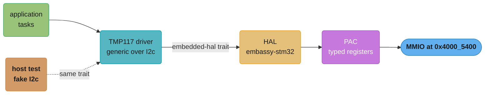
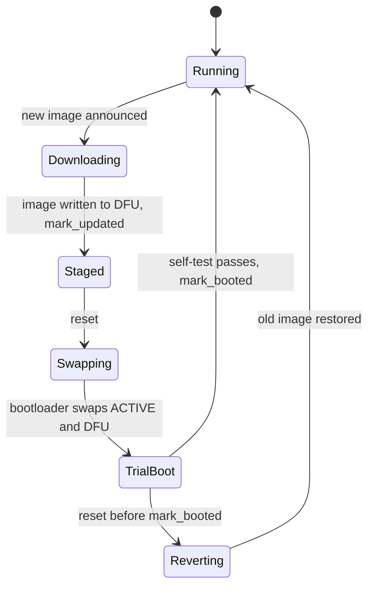

# Embedded Rust and Bare Metal

> **Version anchor (2026-11-06).** Rust 1.99.1 (2026-10-15) on edition 2024. embedded-hal
> 1.0.0 (MSRV 1.60), critical-section 1.2.0 (1.3.0 is yanked), heapless 0.9.3 (MSRV 1.87),
> embassy-executor 0.10.0, embassy-boot 0.7.0, rtic 2.4.0, rtic-monotonics 3.0.0, probe-rs
> 0.32.0 (MSRV 1.89), defmt 1.2.0, defmt-rtt 1.3.1, flip-link 0.1.12. Status: the Linux kernel
> concluded its Rust experiment (patch posted 2025-12-13), and the Rust Project adopted the FLS
> (announced 2025-03-26).

## 1. Concept Overview

Embedded Rust is Rust with no operating system under it. The program runs on a
microcontroller with, for example, 512 KB of flash and 128 KB of RAM (an STM32F411), owns every
peripheral, and handles its own interrupts. Two crate attributes define the setting:
`#![no_std]` removes the standard library and leaves `core` (plus `alloc` if you install an
allocator), and `#![no_main]` removes the normal entry point so a runtime crate such as
`cortex-m-rt` can provide the reset handler and call your `#[entry]` function.

What remains is the same language with the same ownership rules, used against hardware. A
peripheral is a singleton you take once. A register is memory you touch with volatile reads and
writes. State shared with an interrupt handler must be `Sync`, which means an atomic or a
critical-section mutex, because an interrupt is the bare-metal version of a second thread.
And the edition 2024 rule that denies references to `static mut` removes the most common
unsound pattern from C-style firmware.

The ecosystem has four layers. A **PAC** (peripheral access crate) is generated from the
vendor's SVD file and gives typed register access. A **HAL** (hardware abstraction layer)
builds drivers for one chip family on top of it: `embassy-stm32`, `embassy-nrf`, `embassy-rp`.
**`embedded-hal` 1.0** defines the traits (`OutputPin`, `I2c`, `SpiDevice`, `DelayNs`) that
let one sensor driver run on any HAL. A **BSP** maps a specific board's pins. On top sits a
concurrency model: a bare loop with interrupts, RTIC 2, Embassy's async executor, or an RTOS.
This page holds the section's decision model for that choice.

"Edge" in this page means a microcontroller. Running ML models on phones and gateways is a
different topic, covered in
[edge and on-device deployment](../../mlops/edge_and_on_device_deployment/edge_and_on_device_deployment.md).
Caches, memory hierarchy and alignment in general are in
[computer architecture and the memory hierarchy](../../cs_fundamentals/computer_architecture_and_memory_hierarchy/computer_architecture_and_memory_hierarchy.md).

---

## 2. Intuition

> **One-line analogy**: writing firmware is running a small workshop alone. There is no
> landlord (OS) to fix the plumbing, no manager (scheduler) to hand out tasks, and the doorbell
> (an interrupt) can ring in the middle of any job. Rust's contribution is a set of locks that
> make it impossible to leave a tool half-used when the doorbell rings.

**Mental model**: picture the chip as one CPU, a flat address space, and a list of interrupt
lines. `main` runs forever. An interrupt stops `main` at any instruction, runs a handler, and
returns. Any variable both of them touch is shared between two "threads" with no OS to help.
In C that variable is a `volatile int` and a comment. In Rust it is a `static` that must be
`Sync`, and the compiler rejects the C version.

**Why it matters**: firmware bugs ship in devices that cannot be patched by restarting a pod.
A race between an interrupt and the main loop corrupts a reading once a week. A stack overflow
writes into `.bss` and changes a calibration constant with no fault. An over-the-air update
that bricks the device costs a truck roll per unit. Rust moves the first class of bug to
compile time, `flip-link` turns the second into a clean fault, and an A/B bootloader with a
trial boot handles the third.

**Key insight**: Rust's ownership model maps onto hardware almost directly. "One owner of a
peripheral" is `Peripherals::take()` returning `Some` once. "Shared with an interrupt" is a
`Sync` bound. "This buffer is handed to the DMA engine until the transfer ends" is a
`&'static mut` borrow. The embedded crates are mostly ways to say these facts in types.

---

## 3. Core Principles

1. **You supply what the OS used to.** A runtime crate gives the vector table and reset handler.
   `memory.x` gives the memory layout. A `#[panic_handler]` decides what a panic does. There
   is exactly one of each per binary.
2. **`core` always, `alloc` by choice.** Most firmware uses no heap. Fixed-capacity collections
   from `heapless` replace `Vec` and `String`, and their size is visible at link time.
3. **Peripherals are owned values.** A HAL's `init` or a PAC's `take()` hands out each
   peripheral once. Passing a pin into a driver moves it, so two drivers cannot drive the same
   pin.
4. **A `static` shared with an interrupt must be `Sync`.** Use atomics for single words and a
   `critical_section::Mutex` for anything larger. Edition 2024 denies references to
   `static mut` by default.
5. **Critical sections are short.** On a single core, `critical_section::with` masks
   interrupts. Every microsecond inside it is added latency for every interrupt.
6. **Registers are volatile.** MMIO reads and writes go through `read_volatile` and
   `write_volatile`, which PACs wrap for you. A plain write can be merged or removed.
7. **The stack has no guard page.** On Cortex-M the default layout puts the stack at the top of
   RAM growing down toward `.bss` and `.data`. `flip-link` reverses that so an overflow faults.
8. **Async on a microcontroller is static.** Embassy sizes every task at compile time, and the
   executor sleeps the core with `WFE` or `WFI` when no task is ready.

---

## 4. Types / Architectures / Strategies

### The crate layers

| Layer | Example crates | What it gives you | Who writes it |
|---|---|---|---|
| PAC | `stm32f4`, `nrf52840-pac`, `rp2040-pac` | typed register access from the SVD file | generated by `svd2rust` |
| HAL | `embassy-stm32` 0.6.0, `embassy-nrf` 0.11.0, `embassy-rp` 0.10.0 | GPIO, UART, SPI, I2C, DMA, timers for one family | HAL maintainers |
| Traits | `embedded-hal` 1.0.0, `embedded-hal-async` 1.0.0 | `OutputPin`, `I2c`, `SpiDevice`, `DelayNs` and async forms | the Rust Embedded working group |
| Drivers | one crate per sensor or radio | device logic written against the traits | anyone |
| BSP | one crate per board | pin names and board setup | board vendors or users |

HAL versions above are from crates.io, read 2026-11-06. Embassy HALs version independently, so
pin each one to the release that matches your `embassy-executor` and `embassy-time`.

### Targets

| Target | Cores | Notes |
|---|---|---|
| `thumbv6m-none-eabi` | Cortex-M0, M0+ (RP2040) | no atomic read-modify-write: `fetch_add` and `compare_exchange` do not exist |
| `thumbv7m-none-eabi` | Cortex-M3 | full 32-bit atomics |
| `thumbv7em-none-eabihf` | Cortex-M4F, M7F (STM32F4, nRF52840) | hardware float, full atomics |
| `thumbv8m.main-none-eabihf` | Cortex-M33 (nRF5340, STM32U5) | TrustZone-M capable |
| `riscv32imac-unknown-none-elf` | RISC-V MCUs with atomics | `imc` variants have atomic load and store but no read-modify-write |

The atomic row is checked: `rustc --print cfg --target thumbv6m-none-eabi` on 1.99.1 prints
no `target_has_atomic="N"` line, while `thumbv7em-none-eabihf` prints `target_has_atomic="32"`.

### Concurrency model: the decision model

| Model | How work runs | Shared state | RAM overhead | Timing analysis | Pick when |
|---|---|---|---|---|---|
| Bare loop plus interrupts | `loop {}` in `main`, handlers on interrupt lines | atomics, `critical_section::Mutex` | none | by hand | under about 5 concurrent concerns, tiny parts |
| RTIC 2 | hardware tasks bound to interrupts plus async software tasks, priorities set per task | resources with compile-time priority-ceiling locks | a few bytes per task | strong: preemption and lock ceilings are static | hard deadlines, motor control, a fixed task set |
| Embassy | async tasks on a cooperative executor, one executor per priority level | `embassy-sync` mutexes and channels, atomics | each task's future, sized at link time | weaker inside one executor: a task that does not yield blocks others | I/O-heavy firmware: radios, USB, networking, many waits |
| RTOS (Zephyr, FreeRTOS) through FFI | preemptive threads with stacks | RTOS mutexes and queues | a stack per thread | the RTOS's own model | certified RTOS required, or a large C codebase already exists |

RTIC and Embassy combine. A common shape runs Embassy for I/O at low priority and an RTIC or
interrupt-executor task for the one control loop with a hard deadline. The general runtime
question (do you need async at all) is decided once for the section in
[async runtimes and executors](../async_runtimes_and_executors/async_runtimes_and_executors.md).

---

## 5. Architecture Diagrams

### From application to register



The driver depends only on the trait. The dotted edge is why that matters: the same driver
code runs in `cargo test` on a laptop against a fake bus.

### RAM layout, default and with flip-link

```
 default cortex-m-rt layout                 with flip-link
 (128 KB RAM at 0x2000_0000)                (same RAM)

 0x2002_0000 +--------------------+         0x2002_0000 +--------------------+
             | stack, grows down  |                     | .bss / .data       |
             |         |          |                     | (moved to the top) |
             |         v          |                     +--------------------+
             |                    |                     | free               |
             |   overflow writes  |                     +--------------------+
             |   into .bss  ---+  |                     | stack, grows down  |
             +-----------------|--+                     |         |          |
             | .bss / .data  <-+  |                     |         v          |
 0x2000_0000 +--------------------+         0x2000_0000 +--------------------+
                                                          overflow hits the end
             silent corruption                            of RAM: HardFault
```

With the default layout, an overflow writes over static variables and the program keeps
running with wrong data. flip-link places the statics above the stack, so the same overflow
runs off the bottom of RAM and raises a fault you can see in `probe-rs`.

### embassy-boot A/B update with trial boot



The device commits to a new image only when the new image itself calls `mark_booted`. A crash,
a watchdog reset or a power cut during the trial boot sends it back to the old image.

---

## 6. How It Works - Detailed Mechanics

### 6.1 A project from nothing

```toml
# .cargo/config.toml
[build]
target = "thumbv7em-none-eabihf"

[target.thumbv7em-none-eabihf]
runner = "probe-rs run --chip STM32F411CEUx"
linker = "flip-link"
rustflags = ["-C", "link-arg=-Tlink.x", "-C", "link-arg=-Tdefmt.x"]
```

```
/* memory.x for an STM32F411CE: 512 KB flash, 128 KB RAM */
MEMORY
{
  FLASH : ORIGIN = 0x08000000, LENGTH = 512K
  RAM   : ORIGIN = 0x20000000, LENGTH = 128K
}
```

`link.x` comes from `cortex-m-rt` and includes `memory.x`. `defmt.x` comes from `defmt` and
keeps its format strings in a section that never reaches flash. `cargo run` builds, flashes
through the probe, and streams `defmt` logs back over RTT. Install the target with
`rustup target add thumbv7em-none-eabihf`. Thumb targets are tier 2, so rustup ships a
precompiled `core`.

```rust
#![no_std]
#![no_main]

use cortex_m_rt::entry;
use defmt_rtt as _;
use panic_probe as _;

#[entry]
fn main() -> ! {
    defmt::info!("boot");
    loop {
        cortex_m::asm::wfi(); // sleep until the next interrupt
    }
}
```

`#[entry]` checks that `main` returns `!`. There is nothing to return to.

### 6.2 The panic handler

```rust
#![no_std]
#![no_main]

use core::panic::PanicInfo;
use core::sync::atomic::{AtomicU32, Ordering};

static PANICS: AtomicU32 = AtomicU32::new(0);

#[panic_handler]
fn panic(_info: &PanicInfo) -> ! {
    PANICS.fetch_add(1, Ordering::Relaxed);
    loop {
        core::hint::spin_loop();
    }
}
```

A `no_std` binary needs exactly one `#[panic_handler]`. Crates such as `panic-probe` (1.0.0)
provide one that prints through `defmt` and stops the probe session. Production firmware
usually logs the panic location to a retained RAM region or flash, then resets through the
watchdog. Bare-metal Thumb and RISC-V targets already default to `panic = "abort"`
(`rustc --print cfg` shows `panic="abort"`), because there is no unwinder on bare metal.

### 6.3 Registers by hand

```rust
#![no_std]

use core::ptr;

/// GPIOC bit set/reset register on an STM32F4 (port base 0x4002_0800, offset 0x18).
const GPIOC_BSRR: *mut u32 = 0x4002_0818 as *mut u32;

/// Drives PC13 high or low.
///
/// # Safety
/// Run only on an STM32F4 with the GPIOC clock enabled and PC13 configured as an output.
pub unsafe fn set_pc13(high: bool) {
    let bit = if high { 1 << 13 } else { 1 << (13 + 16) };
    // SAFETY: the caller promises the address is the BSRR of a clocked GPIOC. BSRR is
    // write-only and each write sets or clears only the bits that are 1, so no interrupt can
    // lose an update the way a read-modify-write of ODR can.
    unsafe { ptr::write_volatile(GPIOC_BSRR, bit) };
}
```

The register choice is the lesson. A read-modify-write on the output data register (`ODR`)
can be interrupted between the read and the write, and the handler's change to another pin is
lost. The set/reset register makes each write atomic in hardware. PACs and HALs make this the
normal path; hand-written MMIO belongs in one module with a `# Safety` contract.

### 6.4 A driver that runs on the host

The real driver uses `embedded_hal::i2c::I2c`. Its method
`write_read(&mut self, address: u8, write: &[u8], read: &mut [u8])` writes a register pointer and reads the reply. The logic below
uses a local trait with the same method so it compiles with `core` only:

```rust
#![cfg_attr(not(test), no_std)]

pub trait I2c {
    type Error;
    fn write_read(&mut self, addr: u8, write: &[u8], read: &mut [u8]) -> Result<(), Self::Error>;
}

const TMP117_ADDR: u8 = 0x48;
const TEMP_RESULT: u8 = 0x00;

pub struct Tmp117<B> {
    bus: B,
}

impl<B: I2c> Tmp117<B> {
    pub fn new(bus: B) -> Self {
        Self { bus }
    }

    /// Temperature in millidegrees Celsius. One LSB is 7.8125 m°C.
    pub fn read_milli_c(&mut self) -> Result<i32, B::Error> {
        let mut raw = [0u8; 2];
        self.bus.write_read(TMP117_ADDR, &[TEMP_RESULT], &mut raw)?;
        Ok(milli_c(i16::from_be_bytes(raw)))
    }

    pub fn release(self) -> B {
        self.bus
    }
}

pub fn milli_c(raw: i16) -> i32 {
    i32::from(raw) * 78_125 / 10_000
}

#[cfg(test)]
mod tests {
    use super::*;

    struct FakeBus([u8; 2]);

    impl I2c for FakeBus {
        type Error = ();
        fn write_read(&mut self, _: u8, _: &[u8], read: &mut [u8]) -> Result<(), ()> {
            read.copy_from_slice(&self.0);
            Ok(())
        }
    }

    #[test]
    fn reads_25_c() {
        let mut t = Tmp117::new(FakeBus([0x0C, 0x80]));
        assert_eq!(t.read_milli_c(), Ok(25_000));
        assert_eq!(milli_c(-1), -7); // -7.8125 truncates toward zero
    }
}
```

`0x0C80` is 3,200 counts, and 3,200 x 7.8125 is 25,000 m°C. Integer math keeps the driver free
of floating point, which matters on a Cortex-M0+ with no FPU. The `release` method returns the
bus, so a board with two sensors can hand the bus back and share it.

### 6.5 Sharing state with an interrupt

```rust
// fragment: Reading is a small Copy struct defined in the firmware
use core::cell::RefCell;
use core::sync::atomic::{AtomicU32, Ordering};
use critical_section::Mutex;

static TICKS: AtomicU32 = AtomicU32::new(0);
static LATEST: Mutex<RefCell<Option<Reading>>> = Mutex::new(RefCell::new(None));

fn on_timer_irq() {
    TICKS.fetch_add(1, Ordering::Relaxed);
}

fn on_adc_irq(r: Reading) {
    critical_section::with(|cs| {
        LATEST.borrow_ref_mut(cs).replace(r);
    });
}

fn take_latest() -> Option<Reading> {
    critical_section::with(|cs| LATEST.borrow_ref_mut(cs).take())
}
```

`critical_section::Mutex` is `Sync` and gives access only with a `CriticalSection` token, which
exists only inside `with`. On a single-core Cortex-M the implementation masks interrupts. The
crate is an interface: the HAL or `cortex-m` (with its `critical-section-single-core` feature)
provides the implementation, and a multi-core chip such as the RP2040 needs one that also takes
a hardware spinlock. On `thumbv6m`, `TICKS.fetch_add` does not exist. Use `load` and `store`
inside a critical section, or the `portable-atomic` crate (1.15.0) with its critical-section
fallback.

### 6.6 Fixed-capacity collections

```rust
// fragment: inside a task that owns the sample buffer
use heapless::Vec;

let mut samples: Vec<i32, 64> = Vec::new();
let mut overflow = 0u32;
for raw in adc_batch {
    if samples.push(raw).is_err() {
        overflow += 1; // full: count it, never panic
    }
}
```

In heapless 0.9.3, `Vec::push` returns `Result<(), T>` and hands the item back when full. The
64-element capacity is part of the type, so the buffer's size is in the `.bss` total that the
linker checks against `memory.x`. `heapless::spsc::Queue<T, N>` is a lock-free queue between one
producer and one consumer, such as an interrupt and `main`, with a capacity of `N - 1`.

### 6.7 RTIC 2

```rust
// fragment: device PAC and pin types depend on the board
#![no_std]
#![no_main]

use panic_probe as _;

#[rtic::app(device = stm32f4::stm32f411, dispatchers = [EXTI1])]
mod app {
    #[shared]
    struct Shared {
        setpoint: i32,
    }

    #[local]
    struct Local {
        motor: Motor,
    }

    #[init]
    fn init(cx: init::Context) -> (Shared, Local) {
        let motor = Motor::new(cx.device.TIM2);
        (Shared { setpoint: 0 }, Local { motor })
    }

    #[task(binds = TIM2, priority = 3, shared = [setpoint], local = [motor])]
    fn control(mut cx: control::Context) {
        let target = cx.shared.setpoint.lock(|s| *s);
        cx.local.motor.step_towards(target);
    }

    #[task(priority = 1, shared = [setpoint])]
    async fn update_setpoint(mut cx: update_setpoint::Context, value: i32) {
        cx.shared.setpoint.lock(|s| *s = value);
    }
}
```

RTIC computes lock ceilings from the task list at compile time. `lock` in the priority-1 task
raises the running priority to the highest priority of any task sharing `setpoint` (3), so
`control` cannot preempt it inside the lock, while interrupts above priority 3 still run. Locks are deadlock-free by construction. The cost is that the task set is fixed in the
`app` module.

### 6.8 Embassy

```rust
#![no_std]
#![no_main]

use embassy_executor::Spawner;
use embassy_stm32::gpio::{Level, Output, Speed};
use embassy_time::Timer;
use {defmt_rtt as _, panic_probe as _};

#[embassy_executor::task]
async fn blink(mut led: Output<'static>) {
    loop {
        led.toggle();
        Timer::after_millis(500).await;
    }
}

#[embassy_executor::main]
async fn main(spawner: Spawner) {
    let p = embassy_stm32::init(Default::default());
    let led = Output::new(p.PC13, Level::High, Speed::Low);
    match blink(led) {
        Ok(token) => spawner.spawn(token),
        Err(_) => defmt::error!("blink task pool is full"),
    }
    loop {
        Timer::after_secs(60).await;
        defmt::info!("alive");
    }
}
```

In embassy-executor 0.10.0 the task function returns `Result<SpawnToken, SpawnError>` (the
changelog: "return error when creating the `SpawnToken`, not when spawning"). Each
`#[task]` gets its own `static`, sized at compile time, and `pool_size = N` reserves room for N
copies. The README states that if tasks do not fit in RAM, the linker reports it. There is no
heap and no runtime out-of-memory.

### 6.9 Logging with defmt

`defmt::info!("temp {=i32} mC", t)` does not format on the device. The format string is stored
in the ELF file, and the device sends an index plus the raw argument bytes over RTT. `probe-rs`
reads the ELF and prints the full line on the host. A log call costs a few bytes on the wire
and no format code in flash. The constraint is that the host must have the exact ELF that was
flashed, so CI keeps the ELF next to every released image.

### 6.10 Over-the-air updates with embassy-boot

embassy-boot 0.7.0 splits flash into four partitions: BOOTLOADER (about 8 KB), ACTIVE (the
running image), DFU (the incoming image, at least one page larger than ACTIVE) and a STATE
partition. The application writes the new image to DFU and calls `mark_updated`. On reset the
bootloader swaps ACTIVE and DFU page by page, recording progress in STATE so a power cut
resumes the swap. The new image runs a self-test and calls `mark_booted`. If it resets before
that call, the bootloader swaps back. Sign images and verify the signature before
`mark_updated`, because the bootloader trusts what the application staged.

### 6.11 Ferrocene, the FLS and Rust for Linux

Ferrocene is Ferrous Systems' qualified Rust toolchain, used where a safety standard requires a
qualified compiler. Its language specification, formerly the Ferrocene Language Specification,
was adopted by the Rust Project as the FLS (announced 2025-03-26). In the Linux kernel, Miguel
Ojeda posted "rust: conclude the Rust experiment" on 2025-12-13, after the 2025 Maintainers
Summit. The same patch notes that not every kernel configuration, architecture and toolchain
works yet, and that mixed GCC and LLVM builds remain experimental.

---

## 7. Real-World Examples

- **Embassy HAL coverage.** Embassy publishes HALs for three major MCU families on crates.io:
  `embassy-stm32` 0.6.0, `embassy-nrf` 0.11.0 and `embassy-rp` 0.10.0 (read 2026-11-06). The
  embassy-executor 0.10.0 README lists `esp-rtos` as the ESP32 integration.
- **Bootloader per family.** The embassy-boot 0.7.0 README lists `embassy-boot-nrf`,
  `embassy-boot-rp` and `embassy-boot-stm32`, so the same A/B update logic runs on all three.
- **The Linux kernel.** Rust drivers are no longer an experiment in mainline Linux, per the
  conclusion patch of 2025-12-13. Kernel Rust is `no_std` code with the kernel's own `alloc`
  and its own rules, close in spirit to the material on this page.
- **Sensor-node firmware.** The section's
  [sensor node firmware case study](../case_studies/design_a_sensor_node_firmware.md) builds a
  battery device on Embassy with embassy-boot, defmt and hardware-in-the-loop CI.

---

## 8. Tradeoffs

### RTIC 2 or Embassy

| Factor | RTIC 2 | Embassy |
|---|---|---|
| Scheduling | preemptive by hardware priority | cooperative within an executor, preemptive between executors |
| Shared state | resources with static priority ceilings | `embassy-sync` mutexes, channels, signals |
| Worst-case latency | bounded and analyzable | depends on the longest poll in the same executor |
| I/O drivers | bring your own or use a HAL | async HALs with DMA built in |
| Task set | fixed at compile time | fixed at compile time, spawned at runtime from static pools |
| Learning curve | the `app` macro and its rules | async Rust and executor priorities |

### Heap or no heap

| Choice | Good | Cost |
|---|---|---|
| No `alloc`, `heapless` everywhere | memory use known at link time, no fragmentation | capacities chosen up front, overflow handled by hand |
| `alloc` with a small global allocator | `Vec`, `Box`, libraries that need them | runtime out-of-memory, fragmentation over months of uptime |

### Logging

| Tool | Flash cost | Needs | Good for |
|---|---|---|---|
| `defmt` over RTT | small, strings stay in the ELF | a probe and the matching ELF | development, CI on hardware |
| `defmt` over UART | small | the ELF on the receiving side | field units with a debug port |
| `core::fmt` over UART | large, the formatting code is in flash | nothing on the host | devices without tooling access |

---

## 9. When to Use / When NOT to Use

**Use embedded Rust when:**

- The firmware is new, or a module can be rewritten behind a C ABI.
- The hardware is supported by a maintained HAL (STM32, nRF, RP2040, ESP32 and others).
- Concurrency between interrupts and tasks is where past bugs came from.
- The team will test drivers on the host against `embedded-hal` traits.

**Do not, or not yet, when:**

- The product must be certified to a standard and your qualified toolchain or RTOS does not
  cover Rust. Check what Ferrocene's qualification covers for your standard before you commit.
- The vendor ships only a C SDK for a radio or a secure element, and binding it is most of the
  work. See [FFI and language interop](../ffi_and_language_interop/ffi_and_language_interop.md).
- The part has 16 KB of flash and the binary must fit with no room for generic code. Measure
  first with `cargo size` and `opt-level = "z"`.

---

## 10. Common Pitfalls

The incidents below are composites. Their numbers are illustrative, not measurements from a
named product.

### The C pattern that no longer compiles

A team ported an interrupt counter from C as a `static` with `RefCell` for interior
mutability. A `static` must be `Sync` because an interrupt can touch it at any time, and
`RefCell` is not.

```rust
// BROKEN: RefCell is not Sync, so it cannot be a shared static
use std::cell::RefCell;

static TICKS: RefCell<u32> = RefCell::new(0);
// error[E0277]: `RefCell<u32>` cannot be shared between threads safely

pub fn on_timer_irq() {
    *TICKS.borrow_mut() += 1;
}
```

```rust
// FIX: one word of shared state is an atomic
use std::sync::atomic::{AtomicU32, Ordering};

static TICKS: AtomicU32 = AtomicU32::new(0);

pub fn on_timer_irq() {
    TICKS.fetch_add(1, Ordering::Relaxed);
}

pub fn ticks() -> u32 {
    TICKS.load(Ordering::Relaxed)
}
```

These two compile on the host with `std`. On the device the same types come from `core`. For a
multi-word struct the fix is `critical_section::Mutex<RefCell<T>>` (6.5). The usual "fix" in
ported code was `static mut`, and edition 2024 rejects a reference to it:

```rust
// BROKEN: edition 2024 denies references to static mut (lint static_mut_refs)
static mut TICKS: u32 = 0;

pub fn ticks() -> &'static u32 {
    // SAFETY: claimed single-core and no interrupt writes TICKS while the reference lives
    unsafe { &TICKS }
}
// error: creating a shared reference to mutable static
```

The lint fires because any interrupt that writes `TICKS` while the reference is alive makes the
program undefined behavior, and the comment cannot prove it does not.

### `fetch_add` missing on an RP2040 build

A counter module compiled for an STM32F4 failed on an RP2040 board with "no method named
`fetch_add` found". The RP2040's Cortex-M0+ (`thumbv6m-none-eabi`) has no atomic
read-modify-write instructions, so `core` does not provide those methods there. The team moved
the counter into a critical section and later switched to `portable-atomic`, which supplies the
methods through a critical-section fallback.

### A calibration constant that changed by itself

Field units drifted after a firmware update that added a 6 KB buffer on the stack in a deep
call path. There was no fault. The stack grew into `.bss` and overwrote a calibration table.
After switching the linker to `flip-link`, the same build raised a HardFault on the first deep
call, and the fix took an hour. Add flip-link to every Cortex-M project on day one and move
large buffers into `static` storage with a known size.

### 200 µs of jitter from one log line

A motor loop at 20 kHz missed deadlines after someone added `defmt::info!` inside a
`critical_section::with` block. With RTT in blocking mode the call waited for the host to drain
the buffer, and interrupts stayed masked the whole time. Keep critical sections to a few
instructions. Move logging out of them, and out of the highest-priority task.

### The update that bricked 3% of units

An OTA flow wrote the image and rebooted into it with no trial state. Units that lost power
during the copy, or whose new image crashed before connecting, had no way back. Moving to
embassy-boot's swap with `mark_booted` after a self-test (6.10) let those units revert on the
next reset.

---

## 11. Technologies & Tools

| Tool | Version (crates.io, 2026-11-06) | Role |
|---|---|---|
| embedded-hal | 1.0.0 | blocking traits for GPIO, I2C, SPI, delays |
| embedded-hal-async | 1.0.0 | async versions of the same traits |
| critical-section | 1.2.0 | portable critical sections and a `Sync` mutex |
| heapless | 0.9.3 | fixed-capacity `Vec`, `String`, maps and SPSC queues |
| cortex-m-rt | 0.7.7 | reset handler, vector table, `#[entry]` |
| cortex-m | 0.7.10 | core peripherals, `asm::wfi`, single-core critical section |
| embassy-executor | 0.10.0 | async executor with static tasks |
| embassy-boot | 0.7.0 | A/B bootloader with trial boot and rollback |
| rtic | 2.4.0 | priority-based concurrency framework |
| rtic-monotonics | 3.0.0 | timers for RTIC async tasks |
| probe-rs | 0.32.0 | flashing, debugging and RTT through a debug probe |
| defmt | 1.2.0 | deferred-formatting logging |
| defmt-rtt | 1.3.1 | RTT transport for defmt |
| panic-probe | 1.0.0 | panic handler that reports through the probe |
| flip-link | 0.1.12 | linker wrapper that puts the stack below static data |
| portable-atomic | 1.15.0 | atomic methods on targets without native support |

---

## 12. Interview Questions with Answers

**Q: Why does a static RefCell shared with an interrupt handler fail to compile?**
**Short:** A static must be Sync because an interrupt can access it at any time, and RefCell is not Sync, so the compiler reports E0277.

An interrupt preempts `main` at any instruction, which makes it a second thread as far as the
type system cares. `RefCell`'s borrow flag is not protected against that, so `RefCell<T>` does
not implement `Sync`. Use an atomic for a single word, or `critical_section::Mutex<RefCell<T>>`,
which is `Sync` and hands out access only inside `critical_section::with`. This is the bug
class C firmware handles with `volatile` and a comment.

**Q: What does edition 2024 change for static mut in firmware?**
**Short:** References to a static mut are denied by default through the static_mut_refs lint, so ported C patterns stop compiling.

Taking `&TICKS` or `&mut TICKS` on a `static mut` is an error in edition 2024 because any
concurrent write, including from an interrupt, makes the reference undefined behavior. The
compiler suggests `&raw const` or `&raw mut`, which give raw pointers without asserting
exclusivity. Most firmware should not take that route either: replace the `static mut` with an
atomic, a `critical_section::Mutex`, or a resource owned by RTIC or an Embassy task.

**Q: Why does fetch_add not exist when you build for an RP2040?**
**Short:** The RP2040's Cortex-M0+ has no atomic read-modify-write instructions, so core offers only load and store on thumbv6m.

On `thumbv6m-none-eabi`, rustc 1.99.1 reports no `target_has_atomic` cfg, and `core` hides
`fetch_add`, `swap` and `compare_exchange` for that target. Code that compiled for a Cortex-M4
breaks. Do the update inside a critical section with `load` and `store`, or use
`portable-atomic`, which provides the full API through a critical-section implementation. The
RP2040 also has hardware spinlocks, which its HAL uses for multi-core critical sections.

**Q: What does flip-link do, and why should every Cortex-M project use it?**
**Short:** It places the stack below .bss and .data so a stack overflow faults at the end of RAM instead of silently overwriting static variables.

The default `cortex-m-rt` layout starts the stack at the top of RAM, growing down toward the
static data, and there is no MMU guard page on most microcontrollers. An overflow writes over
statics and the program continues with corrupted state. flip-link links the program once to
measure `.bss` and `.data`, then links again with those sections moved to the top of RAM, so an overflow runs past
address `0x2000_0000` and raises a HardFault. It is a linker setting in `.cargo/config.toml`,
with no code change.

**Q: How do RTIC and Embassy differ in how they run concurrent work?**
**Short:** RTIC preempts by hardware interrupt priority with compile-time lock ceilings; Embassy polls async tasks cooperatively inside each executor.

RTIC binds tasks to interrupt priorities and computes, at compile time, how high to raise the
priority when a task locks a shared resource. The result is bounded latency and locks that
cannot deadlock. Embassy runs `async` tasks on an executor that polls ready tasks and sleeps
the core otherwise, which suits waiting on radios, USB and timers. Within one Embassy executor,
a task that never awaits blocks every other task. For a hard deadline, run that work at a
higher priority, in an RTIC task or a separate interrupt executor.

**Q: Why are Embassy tasks declared with a macro instead of spawned like tokio tasks?**
**Short:** Each task gets a static slot sized at compile time, so memory for every task is checked by the linker and no heap is needed.

`#[embassy_executor::task]` turns the async function into a function that returns a spawn token
backed by a `static` big enough for its future. `pool_size = N` reserves N slots. The README
states that if tasks do not fit in RAM, the linker reports it, so a running device cannot fail
to spawn for lack of memory. In 0.10.0 the task function returns
`Result<SpawnToken, SpawnError>`, and the error appears when every slot in the pool is already in use.

**Q: How do you test an I2C sensor driver without hardware?**
**Short:** Write the driver generic over the embedded-hal I2c trait, then implement that trait on a fake bus in a host-side unit test.

Because the driver depends only on `embedded_hal::i2c::I2c`, `cargo test` on a laptop can pass
a struct that returns canned bytes and records writes. That tests register addresses, byte
order and conversions, such as `0x0C80` becoming 25,000 m°C on a TMP117. Keep the driver crate
`#![no_std]` with `std` only in tests. Hardware-in-the-loop CI with `probe-rs` covers timing and
the real bus.

**Q: What does a no_std binary have to provide that std gave it for free?**
**Short:** An entry point from a runtime crate, a memory layout in memory.x, and exactly one panic handler function, plus an allocator if it uses alloc.

`#![no_main]` drops the normal `main` shim, so `cortex-m-rt` supplies the reset handler and
calls your `#[entry]` function. The linker script `link.x` includes your `memory.x` to place
flash and RAM. The panic handler is a `fn(&PanicInfo) -> !` and usually comes from a crate such
as `panic-probe`. `Vec` and `Box` need `extern crate alloc` and a `#[global_allocator]`; most
firmware uses `heapless` instead.

**Q: Why do HALs make peripherals singletons?**
**Short:** Ownership then models hardware access: a pin or UART is a value taken once, so two drivers cannot both control it.

`embassy_stm32::init` or a PAC's `Peripherals::take()` returns each peripheral exactly once
(`take` returns `None` on a second call). Moving `p.PC13` into an `Output` means no other code
can configure that pin. Typestate goes further: a pin in input mode has a different type from
one in output mode, so calling `set_high` on an input is a compile error. The same rules that
stop aliasing of memory stop aliasing of hardware.

**Q: Why write MMIO with write_volatile instead of a plain pointer write?**
**Short:** A plain write lets the compiler merge, reorder or remove it, while a volatile write is always emitted because the address has side effects.

The optimizer assumes memory has no side effects, so two writes to the same address can become
one and a write never read back can vanish. Peripheral registers are not memory: a write
starts a transfer, a read clears a flag. `ptr::write_volatile` and `read_volatile` tell the
compiler each access must happen, in order with other volatile accesses. PACs generate these
calls for you. Volatile does not make an access atomic or ordered against normal memory; that
needs barriers.

**Q: How long may a critical section be?**
**Short:** As short as possible, a few instructions, because on a single core it masks interrupts and adds its length to every interrupt's latency.

`critical_section::with` on a single-core Cortex-M disables interrupts for the closure's
duration. A 200 µs section in a system with a 50 µs deadline breaks that deadline no matter
how fast the handler is. Copy data in or out inside the section and do the work outside. Never
log, wait on a bus, or allocate inside one. RTIC's priority-ceiling locks avoid masking
unrelated interrupts entirely.

**Q: What is defmt and why is it smaller than core::fmt?**
**Short:** defmt stores format strings in the ELF file and sends only an index and raw argument bytes, so the device carries no formatting code.

`core::fmt` pulls formatting machinery into flash and runs it on the device. defmt interns each
format string at compile time into a section kept out of flash, and at runtime writes a small
binary frame to RTT or UART. The host decodes frames using the same ELF. The cost is that you
must keep the exact ELF for each released image, or the logs cannot be read.

**Q: How does an A/B bootloader make over-the-air updates safe?**
**Short:** The new image is staged and swapped in for a trial boot, and the bootloader reverts unless the new image confirms itself after a self-test.

In embassy-boot 0.7.0 the application writes to the DFU partition and calls `mark_updated`. On
reset the bootloader swaps ACTIVE and DFU, tracking progress in a STATE partition so a power
cut resumes the swap. The new image must call `mark_booted`. A crash, watchdog reset or power
loss before that call makes the next boot swap back. Verify the image signature before staging
it, because the bootloader does not decide whether the image is trusted.

**Q: How do you hand a buffer to a DMA transfer safely?**
**Short:** If the transfer can outlive the call that starts it, give it a &'static mut buffer, so the hardware never writes into a reused stack frame.

DMA writes memory without the CPU, possibly after the function that started it returns. If the
buffer lived on the stack, the hardware would write into another function's frame. A DMA API
that returns while the transfer still runs therefore requires `&'static mut [u8]`, and passing
a local array fails with E0597. Embassy's async drivers take a plain borrow instead, because
the transfer runs inside a future that stops the DMA when it is dropped. Get a `'static`
buffer from `static_cell::StaticCell` or `cortex_m::singleton!`, which hand out a mutable
reference to a static exactly once.

**Q: When is an RTOS through FFI a better choice than RTIC or Embassy?**
**Short:** When a certification or a large existing C codebase requires a specific RTOS, so Rust is added as components inside it.

Zephyr and FreeRTOS bring threads, a network stack and drivers that some products already depend
on, and some safety cases name a certified RTOS. Rust then lives as libraries called from RTOS
threads through a C ABI, with `bindgen` for the RTOS headers. Rust's compile-time checks
stop at that boundary, and each thread needs its own stack. For new firmware on a
supported chip, Embassy or RTIC usually gives the same features with less RAM.

**Q: What does the Rust Project's adoption of the FLS mean for safety-critical firmware?**
**Short:** The Rust Project took over the Ferrocene Language Specification as the FLS in 2025, giving qualified toolchains a project-owned specification.

Ferrocene is Ferrous Systems' qualified Rust toolchain, and certification work needs a written
specification of the language that the toolchain is checked against. The Rust Project announced
the adoption on 2025-03-26. The adoption gives no certification by itself. Teams still need a
qualified toolchain for their standard and must check what that qualification covers.

**Q: What is the status of Rust in the Linux kernel?**
**Short:** The kernel concluded its Rust experiment in a patch posted on 2025-12-13, while some configurations and mixed GCC and LLVM builds remain experimental.

Miguel Ojeda posted "rust: conclude the Rust experiment" after the 2025 Maintainers Summit. The
same patch says not every kernel configuration, architecture and toolchain combination works,
and mixed GCC and LLVM builds are still experimental. Kernel Rust is `no_std` with the kernel's
own allocation APIs, so the habits on this page carry over.

**Q: Why does heapless::spsc::Queue with N = 8 hold only 7 items?**
**Short:** heapless 0.9.3 implements the queue as a ring buffer that keeps one slot empty to tell full from empty without a lock, so capacity is N minus 1.

The single-producer, single-consumer queue uses a head and a tail index that each side updates
alone, which is what makes it lock-free between an interrupt and `main`. With all N slots used,
head equals tail in both the full and the empty state, so one slot stays unused. Size it as
the maximum burst plus one, and handle `enqueue` returning `Err` when the consumer falls behind.

---

## 13. Best Practices

- Start every Cortex-M project with `flip-link`, `probe-rs`, `defmt` and `panic-probe`.
- Keep drivers `#![no_std]` and generic over `embedded-hal` 1.0 traits, and test them on the
  host with a fake bus.
- Never use `static mut`. Use atomics, `critical_section::Mutex`, or task-owned resources.
- Keep critical sections to a few instructions. No logging, bus access or waiting inside.
- Prefer `heapless` collections and decide every capacity on purpose. Handle `push` errors.
- Put large buffers in `static` storage so their size is in the link map, not hidden on the
  stack.
- Check atomics support for each target before sharing code between Cortex-M0+ and M4 boards.
- Use an A/B bootloader with a trial boot and image signatures for any field update.
- Archive the ELF of every released image so defmt logs and crash addresses can be decoded.
- Set `opt-level = "s"` or `"z"` in the release profile, then measure size with `cargo size`.
  Bare-metal targets already default to `panic = "abort"`.

---

## 14. Case Study

### A DMA audio capture that corrupted its own stack

The device, the team and the numbers in this case are illustrative.

**Context.** A wearable records 16 kHz audio from a PDM microphone on an nRF52840 (256 KB RAM)
and streams 32 ms frames over BLE. The firmware runs on Embassy. Each frame is 512 samples, or
1,024 bytes. The first prototype lost about one frame in 200 and sometimes rebooted with a
HardFault in unrelated code.

**Symptoms.** Corrupted frames clustered right after a BLE connection event. The HardFaults had
return addresses that pointed into code that never called the audio path.

**Diagnosis.** A developer had wrapped a DMA call in a helper that used an `unsafe` cast to
turn a local array into the `'static` buffer the call needs, because the safe version did not
compile.
When the helper returned, the DMA engine kept writing into a stack frame that the BLE task then
reused. The compiler had pointed at the problem:

```rust
// BROKEN: a DMA transfer needs a buffer that outlives the call
pub struct Transfer {
    len: usize,
}

pub fn start_dma(buf: &'static mut [u8; 1024]) -> Transfer {
    buf[0] = 0;
    Transfer { len: buf.len() }
}

pub fn capture() -> Transfer {
    let mut frame = [0u8; 1024];
    // error[E0597]: `frame` does not live long enough
    start_dma(&mut frame)
}
```

The fix gives the transfer a buffer from static storage that can be taken once:

```rust
// FIX: a static buffer handed out exactly once
use static_cell::StaticCell;

pub struct Transfer {
    len: usize,
}

pub fn start_dma(buf: &'static mut [u8; 1024]) -> Transfer {
    buf[0] = 0;
    Transfer { len: buf.len() }
}

static FRAME_A: StaticCell<[u8; 1024]> = StaticCell::new();

pub fn capture() -> Transfer {
    let frame: &'static mut [u8; 1024] = FRAME_A.init([0u8; 1024]);
    start_dma(frame)
}
```

`StaticCell::init` (static_cell 2.1.1) panics on a second call, so the "exactly once" rule is
enforced at runtime, and the real firmware called it once in `main` and moved the reference into
the audio task.

**Fix.** The team made three changes.

| Change | Mechanism | Result |
|---|---|---|
| Double buffering from static storage | two `StaticCell` frames, swapped by the audio task after each DMA completion | zero corrupted frames in a 72-hour soak test |
| Stack overflow made visible | `flip-link` in `.cargo/config.toml` | two other deep call paths faulted in CI and were fixed before shipping |
| Unsafe review rule | every `unsafe` block needs a `// SAFETY:` comment and a second reviewer; `clippy::undocumented_unsafe_blocks` set to deny | the original cast would not have passed review |

**Result.** Audio frames went from 1 in 200 lost to none in the soak test, and the HardFaults
stopped. RAM use rose by 2 KB for the second buffer, out of 256 KB. The broader policy for
`unsafe` is in [unsafe Rust and undefined behavior](../unsafe_rust_and_undefined_behavior/unsafe_rust_and_undefined_behavior.md),
and the full device design is in the
[sensor node firmware case study](../case_studies/design_a_sensor_node_firmware.md).
