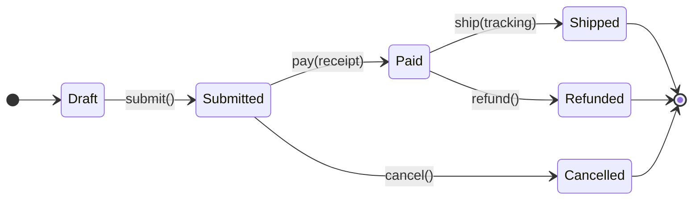
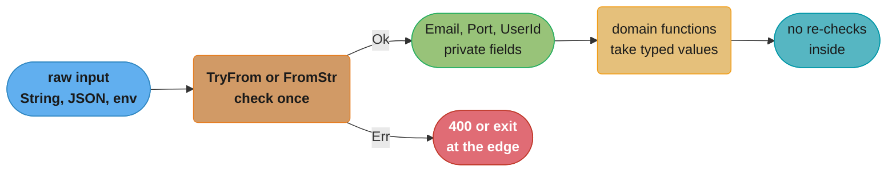

# Enums, Pattern Matching and Type-Driven Design

> **Version anchor (2026-11-06).** Rust 1.99.1 (2026-10-15), edition 2024. Release-gated
> features on this page: `let else` `[1.65]`, exclusive ranges in patterns `[1.80]`, let
> chains `[1.88]` (edition 2024 only), never-type lints deny by default `[1.92]`, `if let`
> guards in match arms `[1.95]`, `assert_matches!` and `debug_assert_matches!` `[1.96]`.
> Edition 2024 reserves some match-ergonomics patterns and changes never-type fallback
> `[ed2024]`.

---

## 1. Concept Overview

A Rust `enum` is a sum type: a value is exactly one of several variants, and each variant
can carry its own data. `Option<T>`, `Result<T, E>` and `std::cmp::Ordering` are ordinary
enums from the standard library. Together with structs (product types), enums give Rust
algebraic data types, the same idea as Haskell's `data`, OCaml's variants, Swift's enums
with associated values and TypeScript's discriminated unions.

Pattern matching is how you read an enum. `match` must be exhaustive: the compiler rejects
a `match` that misses a variant (E0004). That one rule changes how you design. When you add
a variant, every `match` that forgot it fails to compile, and the compiler gives you the
to-do list.

Type-driven design builds on this. You encode the rules of the domain in types so that
invalid states cannot be written:

- **Enums for alternatives.** A connection is `Connecting`, `Open { session }` or
  `Closed { reason }`, not a struct with three optional fields.
- **Newtypes for meaning.** `UserId(u64)` and `OrderId(u64)` cannot be swapped by mistake.
- **Parse, don't validate.** Convert untrusted input once into a type that can only hold
  valid values, then pass that type around.
- **Typestate.** Encode a protocol's states as type parameters, so calling `send` on an
  unauthenticated connection is a compile error.

Enums, newtypes and typestate add no runtime cost beyond the checks you write yourself.
Layout optimizations such as the null-pointer niche make `Option<&T>` the same size as `&T`.

TypeScript reaches the same goals with structural unions and runtime schemas; see
[Unions, Narrowing and Exhaustiveness](../../typescript/unions_narrowing_and_exhaustiveness/unions_narrowing_and_exhaustiveness.md)
and [Runtime Validation and Parse, Don't Validate](../../typescript/runtime_validation_and_parse_dont_validate/runtime_validation_and_parse_dont_validate.md)
for that side.

---

## 2. Intuition

**One-line analogy.** A struct is a form where you fill in every field. An enum is a
multiple-choice question where you tick exactly one box, and each box has its own short form.

**Mental model.** Think of the type as the set of values it allows. A struct with
`is_paid: bool` and `paid_at: Option<Time>` allows four combinations, and two of them are
nonsense. An enum `Unpaid | Paid { at }` allows exactly the two that make sense. Count the
combinations a type allows and compare with the combinations the domain allows. Every extra
one is a bug that a test has to catch.

**Why it matters.** Most production bugs in business logic are invalid combinations of
state: a refund on an unpaid order, a retry on a cancelled job, a token used after logout.
An exhaustive `match` over a precise enum moves those bugs from runtime to compile time.

**Key insight.** Exhaustiveness is a refactoring tool. A `match` with a `_ =>` arm opts out
of it. The habit that pays most is to list variants explicitly in business logic, so the
compiler finds every place a new variant needs handling.

---

## 3. Core Principles

1. **Make invalid states unrepresentable.** If two fields must change together, they belong
   in one enum variant.
2. **Match exhaustively.** Prefer listing variants to `_` when the enum is yours and the
   logic is business logic.
3. **Parse at the boundary.** Untrusted input becomes a validated type once, through
   `TryFrom` or `FromStr`. Inner code takes the validated type and does not check again.
4. **Newtype every identifier and unit that can be confused.** `Meters(f64)` and
   `Feet(f64)` cost nothing and make `climb(Feet(3.0))` a compile error when it expects
   `Meters`.
5. **Mark public enums `#[non_exhaustive]` when you will add variants.** Downstream crates
   must then write a wildcard arm, and adding a variant is not a breaking change.
6. **Use typestate for protocols with a fixed order, an enum for state known only at run
   time.**
7. **Layout is an implementation detail except where documented.** The null-pointer niche
   for `Option<&T>`, `Option<Box<T>>`, `Option<NonNull<T>>` and the `NonZero` types is
   documented. Other enum sizes are what rustc 1.99.1 emits on 64-bit targets.

---

## 4. Types / Architectures / Strategies

### Kinds of enum

| Kind | Example | Notes |
|---|---|---|
| C-like (fieldless) | `enum Level { Debug, Info, Warn }` | Casts to an integer with `as`; add `#[repr(u8)]` to fix the size |
| Data-carrying | `enum Shape { Circle { r: f64 }, Rect { w: f64, h: f64 } }` | Size is the largest variant plus a tag |
| Recursive | `enum Expr { Num(i64), Add(Box<Expr>, Box<Expr>) }` | Needs a `Box` or other pointer (E0072 without it) |
| Uninhabited | `enum Never {}`, `std::convert::Infallible` | No values; marks a path that cannot happen |
| `#[non_exhaustive]` | `pub enum Error { .. }` | Downstream `match` needs a wildcard |

### Pattern forms

| Pattern | Example | Matches |
|---|---|---|
| Literal | `0`, `"GET"`, `true` | that value |
| Range | `1..=9`, `0..10` `[1.80]` | inclusive or exclusive range of integers or chars |
| Variant | `Some(x)`, `Shape::Rect { w, .. }` | one variant, binding fields |
| Binding with `@` | `n @ 1..=9` | binds the whole value and tests a sub-pattern |
| Or-pattern | `Some(1 \| 2)` | any of the alternatives |
| Slice | `[first, .., last]`, `[]` | slices and arrays by shape |
| Wildcard | `_`, `..` | anything; `..` skips remaining fields or elements |
| Reference | `&(a, b)` | through a reference |

### Control-flow forms

| Form | Use for | Gate |
|---|---|---|
| `match` | several variants, exhaustive | always |
| `if let` | one variant, ignore the rest | always |
| `let else` | bind one variant or return early | `[1.65]` |
| let chains `if let A = x && cond && let B = y` | several conditions with bindings | `[1.88]` and `[ed2024]` |
| `if let` guard in a match arm | arm that needs a second pattern | `[1.95]` |
| `matches!(x, Pat)` | `bool` test | always |
| `assert_matches!(x, Pat)` | test assertion that prints the value | `[1.96]`, import with `use std::assert_matches;` |

### Type-driven design tools

| Tool | What it encodes | Runtime cost |
|---|---|---|
| Enum | exactly one of several states | tag plus largest variant |
| Newtype `struct Email(String)` | meaning, units, a checked invariant | zero |
| Private fields plus a constructor | "only valid values exist" | the check, once |
| Typestate `Conn<Authed>` | protocol order | zero (`PhantomData` is zero-sized) |
| `NonZeroU64`, `NonNull` | "never zero or null" plus a niche | zero |
| Builder | required fields set before `build()` | zero to small |

---

## 5. Architecture Diagrams

### Enum layout and the niche (64-bit target, measured with `size_of`)

```
 Option<&u8>           8 bytes    [ pointer (0 means None)            ]   niche: null
 Option<Box<u8>>       8 bytes    [ pointer (0 means None)            ]   niche: null
 Option<NonZeroU32>    4 bytes    [ u32 (0 means None)    ]               niche: zero
 Option<char>          4 bytes    [ u32 (0xFFFFFFFF means None) ]          niche: invalid char
 Option<bool>          1 byte     [ u8 (2 means None) ]                   niche: invalid bool

 Option<u32>           8 bytes    [ tag | pad | u32 value             ]   no niche in u32
 Option<u64>          16 bytes    [ tag | pad ............ | u64 value ]   no niche in u64
 Option<String>       24 bytes    [ cap | ptr | len ]                     niche in String
 Result<u64, String>  24 bytes    [ cap | ptr | len ]                     u64 in String's niche
```

An enum needs room for its largest variant plus a way to tell variants apart. When a
variant's payload has bit patterns that can never occur (a null reference, a zero in
`NonZeroU32`, a `char` above U+10FFFF), rustc stores the other variant there and needs no
separate tag. Only the null-pointer and `NonZero` cases are documented. The rest are what
rustc 1.99.1 emits.

### Typestate: the protocol in the type



Each box is a type (`Order<Draft>`, `Order<Paid>`), and each arrow is a method that takes
`self` by value and returns the next type. `ship` exists only on `Order<Paid>`, so shipping an
unpaid order does not compile. When the state comes from a database row at run time, the same
diagram becomes an enum and a `match` instead.

### Parse, don't validate



The check runs once, at the boundary. Inside, a function that takes `Email` cannot receive an
unchecked string, because the only way to build an `Email` is through the parser.

---

## 6. How It Works - Detailed Mechanics

### Enums with data and an exhaustive `match`

```rust
#[derive(Debug)]
pub enum Shape {
    Circle { r: f64 },
    Rect { w: f64, h: f64 },
    Tri { a: f64, b: f64, c: f64 },
}

impl Shape {
    pub fn area(&self) -> f64 {
        match self {
            Shape::Circle { r } => std::f64::consts::PI * r * r,
            Shape::Rect { w, h } => w * h,
            Shape::Tri { a, b, c } => {
                let s = (a + b + c) / 2.0;
                (s * (s - a) * (s - b) * (s - c)).sqrt()
            }
        }
    }
}

fn main() {
    let shapes = [Shape::Circle { r: 1.0 }, Shape::Rect { w: 2.0, h: 3.0 }];
    for s in &shapes {
        println!("{s:?} {:.2}", s.area());
    }
}
```

`match self` on a `&Shape` binds `r`, `w` and `h` as references through match ergonomics.
Add a `Hexagon` variant and `area` stops compiling with E0004 until you handle it.

### Layout and the niche

```rust
use std::mem::size_of;
use std::num::NonZeroU32;

pub enum Event {
    Tick,
    Key(u64),
    Text(String),
}

fn main() {
    assert_eq!(size_of::<Option<&u8>>(), size_of::<&u8>());
    assert_eq!(size_of::<Option<Box<u8>>>(), size_of::<Box<u8>>());
    assert_eq!(size_of::<Option<NonZeroU32>>(), size_of::<u32>());

    #[cfg(target_pointer_width = "64")]
    {
        assert_eq!(size_of::<Option<u64>>(), 16);
        assert_eq!(size_of::<Option<String>>(), 24);
        assert_eq!(size_of::<Event>(), 24);
    }
    println!("ok");
}
```

The first three asserts follow from layouts the standard library documents. The 64-bit
block is what rustc emits; it can change between compiler versions, so keep such asserts in
tests rather than in code that depends on them.

A large variant makes every value large. `size_of::<Event>()` is set by `String` (24 bytes
on 64-bit targets). A variant holding `[u8; 512]` would make every `Event` over 512 bytes.
Box the large payload. Clippy's `large_enum_variant` lint fires when variants differ by more
than 200 bytes, its default `enum-variant-size-threshold`.

### `let else`, let chains and `if let` guards

```rust
use std::collections::HashMap;

pub fn port(cfg: &HashMap<String, String>) -> Result<u16, String> {
    let Some(raw) = cfg.get("port") else {
        return Err("port missing".to_owned());
    };
    let Ok(p) = raw.parse::<u16>() else {
        return Err(format!("bad port {raw}"));
    };
    Ok(p)
}

pub fn admin_name(user: Option<&(String, bool)>) -> Option<&str> {
    if let Some((name, is_admin)) = user
        && *is_admin
        && !name.is_empty()
    {
        return Some(name);
    }
    None
}

pub fn classify(input: Option<&str>) -> &'static str {
    match input {
        Some(s) if let Ok(n) = s.parse::<i64>() => {
            if n < 0 { "negative number" } else { "number" }
        }
        Some(_) => "text",
        None => "empty",
    }
}
```

`let else` binds in the enclosing scope, and its `else` block must diverge (`return`,
`break`, `continue` or `panic!`), or the compiler reports E0308. Let chains `[1.88]` need
edition 2024 `[ed2024]`. The `if let` guard `[1.95]` lets an arm test a second pattern and
use its bindings, and falls through to the next arm when that pattern does not match.

### `matches!` and `assert_matches!`

```rust
use std::assert_matches;

#[derive(Debug)]
pub enum Status {
    Ok(u16),
    Retry { after_ms: u64 },
    Failed,
}

pub fn is_retryable(s: &Status) -> bool {
    matches!(s, Status::Retry { after_ms } if *after_ms < 5_000)
}

fn main() {
    let s = Status::Retry { after_ms: 300 };
    assert!(is_retryable(&s));
    assert_matches!(s, Status::Retry { after_ms: 0..1_000 });
    println!("ok");
}
```

`assert_matches!` `[1.96]` is not in the prelude. Import it with `use std::assert_matches;`
or call it as `std::assert_matches!`. On failure it prints the value with `Debug`, which `assert!`
with `matches!` cannot do.

### Match ergonomics and the edition 2024 reservations

When you match a reference against a non-reference pattern, the compiler dereferences for you
and switches the default binding mode to `ref` (or `ref mut`). That is why
`match &opt { Some(x) => .. }` gives `x: &T`. Edition 2024 `[ed2024]` rejects patterns that
write `mut`, `ref`, `ref mut` or `&` explicitly while the default mode is already a reference,
because those patterns read one way and behaved another. The fix is to write the full
pattern with an explicit `&` at the top, or to drop the redundant modifier. Section 10 shows
the error.

### Ranges, bindings and slices

```rust
pub fn bucket(code: u16) -> &'static str {
    match code {
        100..200 => "info",
        200..300 => "ok",
        300..400 => "redirect",
        c @ 400..500 if c == 429 => "rate limited",
        400..500 => "client error",
        500..600 => "server error",
        _ => "invalid",
    }
}

pub fn ends(v: &[i32]) -> Option<(i32, i32)> {
    match v {
        [] => None,
        [one] => Some((*one, *one)),
        [first, .., last] => Some((*first, *last)),
    }
}
```

Exclusive ranges in patterns are `[1.80]`. The compiler checks integer ranges for
exhaustiveness: `match x { 0..10 => .., 11..=255 => .. }` on a `u8` fails with E0004 and
names `10_u8` as the missing value. It also warns when two ranges overlap.

### Never type, `Infallible` and fallback

```rust
use std::convert::Infallible;
use std::str::FromStr;

pub struct Name(String);

impl FromStr for Name {
    type Err = Infallible;

    fn from_str(s: &str) -> Result<Self, Self::Err> {
        Ok(Name(s.trim().to_owned()))
    }
}

fn main() {
    let Ok(n) = "  ada ".parse::<Name>();
    println!("{}", n.0);
}
```

`Infallible` is an enum with no variants, so `Result<T, Infallible>` can only be `Ok`, and
on rustc 1.99.1 `let Ok(n) = ...` is accepted as irrefutable. The `!` type itself is
usable on stable only as a function return type (`fn fail() -> !`); `let x: !` is rejected
with E0658.

Never-type fallback decides what type a diverging expression gets when nothing else
constrains it. Edition 2024 `[ed2024]` changed that fallback. Rust 1.92 made the lints that
detect code depending on the old behavior, `never_type_fallback_flowing_into_unsafe` and
`dependency_on_unit_never_type_fallback`, deny by default. They fire when you build the
affected crate directly, not when it is a dependency.

### Newtypes and parse, don't validate

```rust
use std::fmt;

#[derive(Debug, Clone, PartialEq, Eq, Hash)]
pub struct Email(String);

#[derive(Debug)]
pub struct EmailError(String);

impl TryFrom<&str> for Email {
    type Error = EmailError;

    fn try_from(s: &str) -> Result<Self, Self::Error> {
        let s = s.trim();
        match s.split_once('@') {
            Some((user, domain)) if !user.is_empty() && domain.contains('.') => {
                Ok(Email(s.to_ascii_lowercase()))
            }
            _ => Err(EmailError(format!("not an email: {s}"))),
        }
    }
}

impl Email {
    pub fn as_str(&self) -> &str {
        &self.0
    }
}

impl fmt::Display for Email {
    fn fmt(&self, f: &mut fmt::Formatter<'_>) -> fmt::Result {
        f.write_str(&self.0)
    }
}

pub fn send_welcome(to: &Email) -> String {
    format!("sending to {to}")
}
```

The field is private, so code outside the module can get an `Email` only from `try_from`.
`send_welcome` cannot receive an unchecked string, and it does not check again. With serde,
`#[serde(try_from = "String")]` runs the same constructor during deserialization; see
[Serde and Serialization](../serde_and_serialization/serde_and_serialization.md).

### Typestate

```rust
use std::marker::PhantomData;

pub struct Draft;
pub struct Paid;
pub struct Shipped;

pub struct Order<S> {
    pub id: u64,
    pub total_cents: u64,
    receipt: Option<String>,
    _state: PhantomData<S>,
}

impl Order<Draft> {
    pub fn new(id: u64, total_cents: u64) -> Self {
        Order { id, total_cents, receipt: None, _state: PhantomData }
    }

    pub fn pay(self, receipt: String) -> Order<Paid> {
        Order { id: self.id, total_cents: self.total_cents, receipt: Some(receipt), _state: PhantomData }
    }
}

impl Order<Paid> {
    pub fn receipt(&self) -> &str {
        self.receipt.as_deref().unwrap_or_default()
    }

    pub fn ship(self) -> Order<Shipped> {
        Order { id: self.id, total_cents: self.total_cents, receipt: self.receipt, _state: PhantomData }
    }
}

fn main() {
    let o = Order::new(7, 4_999).pay("r-123".to_owned());
    println!("{}", o.receipt());
    let shipped = o.ship();
    println!("shipped {}", shipped.id);
}
```

`PhantomData<S>` is zero-sized, so `Order<Draft>` and `Order<Paid>` have the same layout.
`pay` and `ship` take `self` by value, so the old state is moved and cannot be used again
(E0382). `Order::new(1, 10).ship()` fails with E0599, because `ship` exists only on
`Order<Paid>`. Ownership rules behind the move are in
[Ownership, Borrowing and RAII](../ownership_borrowing_and_raii/ownership_borrowing_and_raii.md).

### Integers to enums

`Level::Warn as u8` is allowed for a fieldless enum. The reverse, `3u8 as Level`, is E0605:
an arbitrary integer may not name a variant. Write `impl TryFrom<u8> for Level` with a
`match`. Add `#[repr(u8)]` when the integer values are part of a wire format or FFI, so the
size and the discriminants are fixed.

---

## 7. Real-World Examples

- **`Option` and `Result`.** The standard library replaces null and exceptions with two
  enums. `?` is pattern matching on `Result` with an early return; see
  [Error Handling and Panics](../error_handling_and_panics/error_handling_and_panics.md).
- **`std::io::ErrorKind`.** A `#[non_exhaustive]` enum, so std can add kinds in a minor
  release and your `match` must have a wildcard arm.
- **`serde_json::Value`.** An enum of `Null`, `Bool`, `Number`, `String`, `Array` and
  `Object` that represents any JSON document.
- **HTTP routing and protocol parsers.** Request methods, frame types and states of a
  connection are enums; parsers return `Result<Frame, ParseError>`.
- **Builders with typestate.** Some HTTP and SDK client builders track required fields in
  type parameters, so `build()` exists only after all of them are set. The API-design side
  is in [Library API Design and Semver](../library_api_design_and_semver/library_api_design_and_semver.md).
- **Other languages.** Java added sealed interfaces and pattern matching for `switch` to reach
  similar exhaustiveness
  ([Java 9 to 21 features](../../java/java9_to_21_features/java9_to_21_features.md)). The
  classic object-oriented answer, the State pattern, is in
  [the State pattern](../../lld/behavioral/state/state.md). In Rust, an enum plus `match` or
  typestate usually replaces it.

---

## 8. Tradeoffs

### Enum vs trait object for a set of types

| | Enum | `Box<dyn Trait>` |
|---|---|---|
| Add a new type | edit the enum and every `match` | add an impl anywhere |
| Add a new operation | add one function with a `match` | add a trait method to every impl |
| Exhaustiveness check | yes | no |
| Storage | inline, size of the largest variant | heap box plus 16-byte pointer |
| Who can extend | only the owning crate | any crate |

The performance side of this choice, with measured numbers, is in
[Monomorphization, Vtables and Dispatch Cost](../traits_generics_and_trait_objects/monomorphization_vtables_and_dispatch_cost.md).

### Typestate vs runtime state enum

| | Typestate `Order<Paid>` | `enum OrderState` |
|---|---|---|
| Wrong transition | compile error | runtime error you must handle |
| State known at | compile time | run time (database, network) |
| Store mixed states in one `Vec` | no, without an enum wrapper | yes |
| API surface | one `impl` block per state | one `match` per operation |
| Fits | builders, connection setup, short protocols | persisted workflows, UI state |

### Wildcard arm vs explicit variants

| | `_ =>` | Every variant listed |
|---|---|---|
| New variant | silently goes to the wildcard | compile error at every `match` |
| Code length | short | longer |
| Use for | foreign `#[non_exhaustive]` enums, catch-all logging | your own business-logic enums |

---

## 9. When to Use / When NOT to Use

**Use an enum when**
- a value is one of a closed set of alternatives, each with its own data;
- you want the compiler to find every site that must handle a new case;
- you would otherwise write a struct of `Option` fields that must agree.

**Use a newtype when**
- two values share a primitive type but must not be mixed (IDs, units, money);
- a value has an invariant (non-empty, lowercase, in range) that a constructor can check.

**Use typestate when**
- the order of calls is fixed and known at compile time (builders, handshakes);
- misuse is expensive and the number of states is small.

**Do not**
- use typestate for state loaded from a database; the compiler cannot see it;
- create one type parameter per independent flag; four flags give 16 types;
- put `_ =>` in a `match` over your own domain enum just to save lines;
- mark an enum `#[non_exhaustive]` inside one crate for its own use; it has no effect there;
- convert integers to enums with `transmute`; write `TryFrom`.

---

## 10. Common Pitfalls

### A new variant hidden by a wildcard

A billing service matched on `PaymentMethod` with `_ => charge_card(..)`. A `BankTransfer`
variant was added for one enterprise customer. It compiled, went to the wildcard, and the
service tried to charge a card that did not exist for every bank-transfer invoice. Listing the
variants would have made the compiler stop the release. Clippy's `wildcard_enum_match_arm`
lint, in the restriction group, flags this when you turn it on.

### Moving out of a borrowed enum

```rust
// BROKEN
// error[E0507]: cannot move out of `m` as enum variant `Text` which is behind a shared reference
pub enum Msg {
    Text(String),
    Ping,
}

pub fn body(m: &Msg) -> String {
    match *m {
        Msg::Text(s) => s,
        Msg::Ping => String::new(),
    }
}
```

```rust
// FIX: match on the reference and clone, or take the enum by value.
pub enum Msg {
    Text(String),
    Ping,
}

pub fn body(m: &Msg) -> String {
    match m {
        Msg::Text(s) => s.clone(),
        Msg::Ping => String::new(),
    }
}

pub fn into_body(m: Msg) -> String {
    match m {
        Msg::Text(s) => s,
        Msg::Ping => String::new(),
    }
}
```

### A recursive enum without indirection

```rust
// BROKEN
// error[E0072]: recursive type `Expr` has infinite size
pub enum Expr {
    Num(i64),
    Add(Expr, Expr),
}
```

```rust
// FIX: a Box gives the recursive field a fixed size.
pub enum Expr {
    Num(i64),
    Add(Box<Expr>, Box<Expr>),
}

pub fn eval(e: &Expr) -> i64 {
    match e {
        Expr::Num(n) => *n,
        Expr::Add(a, b) => eval(a) + eval(b),
    }
}
```

### `let else` that does not leave

```rust
// BROKEN
// error[E0308]: `else` clause of `let...else` does not diverge
pub fn first_char(s: &str) -> char {
    let Some(c) = s.chars().next() else {
        eprintln!("empty input");
    };
    c
}
```

```rust
// FIX: the else block must return, break, continue or panic.
pub fn first_char(s: &str) -> Option<char> {
    let Some(c) = s.chars().next() else {
        eprintln!("empty input");
        return None;
    };
    Some(c)
}
```

### Edition 2024 match-ergonomics reservation

```rust
// BROKEN
// error: cannot mutably bind by value within an implicitly-borrowing pattern
pub fn swap_count(pair: &(u32, u32)) -> u32 {
    let (a, mut b) = pair;
    b += 1;
    a + b
}
```

```rust
// FIX: write the reference pattern explicitly, so `mut b` binds a copied u32.
pub fn swap_count(pair: &(u32, u32)) -> u32 {
    let &(a, mut b) = pair;
    b += 1;
    a + b
}
```

`cargo fix --edition` rewrites these patterns when it migrates a crate to edition 2024.

### A 4 KB variant in a hot queue

An illustrative case: a message enum had small control variants and one `Snapshot([u8; 4096])` variant. Every
message in a 100,000-slot channel took 4 KB, so a full queue held about 400 MB. Boxing the
snapshot (`Snapshot(Box<[u8; 4096]>)`) brought each slot down to the size of the largest small
variant.

---

## 11. Technologies & Tools

| Tool | What it does for enums and type-driven design |
|---|---|
| rustc | Exhaustiveness checking (E0004, E0005), niche layout, edition 2024 pattern rules |
| Clippy | `large_enum_variant`, `wildcard_enum_match_arm`, `match_wildcard_for_single_variants`, `match_same_arms` |
| Cargo | `cargo fix --edition` migrates match-ergonomics patterns and other edition 2024 changes |
| serde | 1.0.229: `try_from` and `tag` attributes for validated newtypes and tagged enums |
| enum_dispatch | 0.3.13: enum-based dispatch generated from a trait |
| cargo-semver-checks | 0.51.0: flags a new variant in a public exhaustive enum as a breaking change |

---

## 12. Interview Questions with Answers

**Q: Why is `Option<&T>` 8 bytes while `Option<u64>` is 16 on a 64-bit target?**
**Short:** A reference can never be null, so None is stored as the null pointer and no tag is needed; every u64 bit pattern is valid, so its Option needs a separate tag plus padding.

This is the niche optimization. The standard library documents it for `Option<&T>`,
`Option<Box<T>>`, `Option<NonNull<T>>` and the `NonZero` integers, which is why
`Option<NonZeroU32>` is 4 bytes. rustc applies the same idea to other invalid bit patterns,
so `Option<char>` is 4 bytes and `Option<String>` is 24, but those sizes are compiler
behavior, not promises. Use `NonZeroU64` for database IDs that are never zero and an
`Option` of them is free.

**Q: Why does adding a variant to a public enum break downstream crates, and what does `#[non_exhaustive]` change?**
**Short:** Downstream exhaustive matches stop compiling with E0004; non_exhaustive forces outside crates to include a wildcard arm, so a later variant is not a breaking change.

Without the attribute, every downstream `match` that lists all variants fails when you add
one, so the change needs a major version. With `#[non_exhaustive]`, crates outside yours must
write `_ =>`, and inside your crate nothing changes. On a struct, the attribute stops outside
crates from building it with a struct literal (E0639). Use it for error kinds and
configuration enums you expect to grow, and leave it off enums whose set is closed by
definition, such as `Ordering`.

**Q: What is wrong with a `_ =>` arm in a `match` over your own domain enum?**
**Short:** It turns off the exhaustiveness check, so a new variant silently takes the wildcard path instead of failing the build at every place that must decide what to do with it.

The compiler cannot tell "I thought about the rest" from "I forgot". List the variants, even
when several share an arm (`A | B => ..`). Keep `_` for foreign `#[non_exhaustive]` enums,
for integer and string matches, and for catch-all logging. Clippy's restriction lint
`wildcard_enum_match_arm` enforces this in crates that opt in.

**Q: What must the `else` block of a `let else` do?**
**Short:** It must diverge, by return, break, continue or panic, because the code after it relies on the binding; a block that falls through is error E0308.

`let Some(x) = opt else { return Err(..) };` binds `x` in the enclosing scope, unlike
`if let`, which binds only inside its block. That makes it the clean early-return form for
parsing and validation. `let else` is `[1.65]`. The `else` block cannot see the bindings,
because they do not exist when it runs.

**Q: What do let chains require, and what problem do they solve?**
**Short:** They need Rust 1.88 and edition 2024, and they join several if let patterns and boolean conditions with and, binding variables without nested if blocks.

`if let Some(u) = user && u.active && let Some(e) = &u.email { .. }` replaces three levels of
nesting. Bindings from earlier conditions are visible to later ones. They also work in
`while`. Crates on edition 2021 cannot use them even on a new compiler, because let chains
depend on the edition 2024 `if let` temporary-scope rule for a consistent drop order.

**Q: What does an `if let` guard in a match arm add over a normal guard?**
**Short:** Since Rust 1.95 an arm guard can itself be an if let pattern, and the arm body can use the guard's bindings; if that pattern fails, matching continues with the next arm.

`Some(s) if let Ok(n) = s.parse::<i64>() => use(n)` parses inside the guard and keeps `n`. A
plain `if` guard can only return `bool`, so you would parse twice or nest another `match`.
Like any guard, it does not count toward exhaustiveness, so the remaining arms must still
cover the value.

**Q: What are match ergonomics, and what did edition 2024 change about them?**
**Short:** Matching a reference with a non-reference pattern auto-dereferences and binds by reference; edition 2024 rejects explicit mut, ref and ref mut or reference patterns inside that implicit mode.

`match &opt { Some(x) => .. }` makes `x` a `&T`. Before 2024, writing `mut x` there silently
switched `x` back to a by-value binding, so the same pattern meant different things depending
on what was matched. Edition 2024 reserves those forms; the error reads "cannot mutably bind
by value within an implicitly-borrowing pattern". Write the outer `&` explicitly when you
want by-value bindings. `cargo fix --edition` rewrites the old forms.

**Q: Why is `assert_matches!` better than `assert!(matches!(..))` in tests?**
**Short:** When it fails, assert_matches prints the actual value with Debug, while assert of matches only reports that a boolean was false.

`assert_matches!(resp, Status::Retry { after_ms: 0..1_000 })` tells you which variant and
which fields arrived. It is stable since `[1.96]` with `debug_assert_matches!`, and it is not
in the prelude: write `use std::assert_matches;` or call `std::assert_matches!`.
The value must implement `Debug`. Use `matches!` in production code, where you want a `bool`.

**Q: How large is an enum, and when should you box a variant?**
**Short:** An enum is as large as its largest variant plus a tag, unless a niche removes the tag, so one large variant makes every value large; box that payload.

A `Vec<Event>` with one 4 KB variant uses 4 KB per element even if 99% of events are small.
`Box` the big payload so the variant holds an 8-byte pointer. Clippy's `large_enum_variant`
lint fires above a 200-byte difference by default. Measure with `size_of::<Event>()` in a
test, and keep hot enums small enough that several fit in a cache line.

**Q: Why does a recursive enum need a `Box`?**
**Short:** A type that contains itself directly would have infinite size, error E0072; a Box, Rc or Vec stores the recursive part behind a pointer of fixed size.

`enum Expr { Add(Expr, Expr) }` cannot have a finite layout. `Add(Box<Expr>, Box<Expr>)` holds
two 8-byte pointers on 64-bit targets, and rustc 1.99.1 makes the whole `Expr` 16 bytes by
storing the tag in a pointer niche. For large trees, an arena with indices
(`Add(ExprId, ExprId)` into a `Vec<Expr>`) avoids one allocation per node and makes the tree
easy to share. The arena approach is covered in
[Smart Pointers and Interior Mutability](../smart_pointers_and_interior_mutability/smart_pointers_and_interior_mutability.md).

**Q: What is typestate, and what does it cost at run time?**
**Short:** Typestate encodes a protocol's current state as a type parameter so wrong transitions do not compile; with a zero-sized PhantomData marker it costs nothing at run time.

`Order<Draft>::pay(self) -> Order<Paid>` consumes the old value, so it cannot be reused, and
`ship` exists only on `Order<Paid>`. The marker types have no fields and `PhantomData` is
zero-sized, so every state has the same layout. The cost is in the API: one `impl` block per
state and generic code that must name the state. Use it for builders and handshakes, not for
state that comes from storage.

**Q: When is typestate the wrong tool?**
**Short:** When the state is known only at run time, such as a row loaded from a database, or when independent flags would multiply into too many type combinations.

A handler that loads an order cannot know its state at compile time, so it gets an enum and a
`match` anyway. Typestate cannot put orders in different states into one `Vec` without a
wrapping enum. Four independent boolean flags as type parameters give 16 types and an API
nobody can read. The usual design is typestate at construction (a builder) and an enum for
the persisted lifecycle.

**Q: What does "parse, don't validate" mean in Rust?**
**Short:** Turn untrusted input into a type that can only hold valid values, through TryFrom or FromStr with private fields, so inner code receives proof of validity instead of re-checking strings.

A `validate(&str) -> bool` check leaves the value as a `String`, and nothing stops the next
function from receiving an unchecked one. `Email::try_from(&str) -> Result<Email, _>` with a
private field makes the only path to an `Email` go through the check. Do this at the edge
(HTTP handler, config loader, CLI parser), and return the error there. Serde can call the same
constructor with `#[serde(try_from = "String")]`.

**Q: What does a newtype cost, and what does it buy?**
**Short:** A one-field tuple struct has the same size as its field and no runtime cost; it buys type distinctness, a place for invariants, and a local type for the orphan rule.

`struct UserId(u64)` and `struct OrderId(u64)` make swapped arguments a compile error (E0308).
`#[repr(transparent)]` fixes the layout to the inner type when FFI or transmutes need it. The
cost is boilerplate: you implement or derive the traits you need, and you add accessors.
Avoid `Deref` to the inner type, which gives back the confusion the newtype removed.

**Q: How do you convert an integer to a C-like enum safely?**
**Short:** Implement TryFrom of the integer with a match that returns an error for unknown values; casting with as works only from enum to integer, and the reverse is error E0605.

`Level::Warn as u8` is allowed. `3u8 as Level` is not, because 3 might not be a variant. A
`TryFrom<u8>` impl lists the valid values and returns `Err` for the rest, which also handles
values written by a newer version of the program. Use `#[repr(u8)]` so the discriminants and
size are fixed for wire formats. Never use `transmute`: an invalid discriminant is undefined
behavior.

**Q: What are `!` and `Infallible`, and where do you use them?**
**Short:** Both describe a value that cannot exist; stable code uses never as a function return type and Infallible as an error type for conversions that cannot fail.

`fn fail() -> !` diverges. `impl FromStr for Name { type Err = Infallible; }` says parsing
cannot fail, and on rustc 1.99.1 `let Ok(n) = "x".parse::<Name>();` is accepted with no
`else`. Using `!` as an ordinary type (`let x: !`) is still unstable, E0658. Generic code
often takes `E` as an error parameter, and `Infallible` fills it when there is no error.

**Q: What changed with never-type fallback in edition 2024 and Rust 1.92?**
**Short:** Edition 2024 makes unconstrained diverging expressions fall back to the never type instead of unit, and Rust 1.92 made the two lints that find code relying on the old fallback deny by default.

The lints are `never_type_fallback_flowing_into_unsafe` and
`dependency_on_unit_never_type_fallback`. Typical triggers are calls whose type parameter is
inferred only from a diverging branch, such as a generic `T: Default` call or an unsafe
function such as `mem::zeroed`. Fix them by annotating the type explicitly. The lints fire
when the affected crate itself is built, not when it is compiled as a dependency.

**Q: How do you compare two enum values by variant while ignoring their data?**
**Short:** Use std mem discriminant on both values and compare the results, or a matches pattern when you only care about one variant.

`mem::discriminant(&a) == mem::discriminant(&b)` is true for `Event::Key(1)` and
`Event::Key(2)`. The `Discriminant` value is opaque and implements `Eq` and `Hash`, so it
works as a map key for grouping. Do not cast it to an integer or persist it; for stored
values, write an explicit `kind()` method that returns your own fieldless enum.

**Q: When should you choose an enum over a trait object for a set of types?**
**Short:** Choose an enum when the set is closed and you own it, because you get exhaustive matches and inline storage; choose a trait object when other crates must add types.

This is the expression problem: enums make new operations cheap (one function with a `match`)
and new types expensive (edit every `match`); traits are the reverse. Enums also store values
inline without a box per element. The measured dispatch cost of each choice is in
[Monomorphization, Vtables and Dispatch Cost](../traits_generics_and_trait_objects/monomorphization_vtables_and_dispatch_cost.md),
and the trait side is in
[Traits, Generics and Trait Objects](../traits_generics_and_trait_objects/traits_generics_and_trait_objects.md).

**Q: How does the compiler check exhaustiveness for integers and slices?**
**Short:** It treats integer ranges and slice lengths as sets and reports the first missing value or shape, so gaps between ranges are compile errors, not runtime surprises.

`match x { 0..10 => .., 11..=255 => .. }` on a `u8` fails with E0004 naming `10_u8`. For
slices, `[]`, `[x]` and `[first, .., last]` together cover every length. A guard never
counts toward coverage, so `n if n > 0` plus `n if n <= 0` still needs a final arm. Exclusive
range patterns such as `0..10` are `[1.80]`.

---

## 13. Best Practices

- Model alternatives as enum variants, not as structs of `Option` fields and flags.
- List variants explicitly in business logic; use `_` only for foreign or open enums.
- Add `#[non_exhaustive]` to public enums you expect to grow, before 1.0.
- Use `let else` for early returns and let chains for compound conditions on edition 2024.
- Use `assert_matches!` in tests for clear failure output.
- Box large variant payloads; keep `size_of` of hot enums in a test.
- Newtype IDs, units and money. Use `NonZero` types for IDs that are never zero.
- Parse untrusted input once into validated types with private fields.
- Use typestate for builders and fixed protocols; use enums for persisted state.
- Convert integers to enums with `TryFrom`, never `transmute`.

---

## 14. Case Study

**Scenario.** A payments service stores orders in PostgreSQL and moves them through `Draft`,
`Submitted`, `Paid`, `Shipped` and `Cancelled`. Version 1 used a struct with
`status: String`, `paid_at: Option<i64>`, `tracking: Option<String>` and
`refund_id: Option<String>`. Support tickets showed orders with a `tracking` number but no
`paid_at`, and refunds issued on orders that had never been paid. Each was a combination the
struct allowed and the business did not.

**Redesign.** The status and its data become one enum, so each state carries exactly the
fields it has. Database rows are parsed into the enum once, at the repository boundary.

**Change request.** Product adds `Refunded { refund_id }`. The team adds the variant and
compiles:

```rust
// BROKEN
// error[E0004]: non-exhaustive patterns: `&OrderState::Refunded { .. }` not covered
pub enum OrderState {
    Draft,
    Submitted,
    Paid { at: i64 },
    Shipped { at: i64, tracking: String },
    Cancelled { reason: String },
    Refunded { refund_id: String },
}

pub fn customer_label(s: &OrderState) -> &'static str {
    match s {
        OrderState::Draft | OrderState::Submitted => "pending",
        OrderState::Paid { .. } => "paid",
        OrderState::Shipped { .. } => "on the way",
        OrderState::Cancelled { .. } => "cancelled",
    }
}
```

The compiler lists every `match` that needs a decision: the customer label, the email
template, the analytics export and the refund eligibility check. That list was the work.

```rust
// FIX: handle the new variant explicitly, and keep transitions in one place.
#[derive(Debug, Clone, PartialEq)]
pub enum OrderState {
    Draft,
    Submitted,
    Paid { at: i64 },
    Shipped { at: i64, tracking: String },
    Cancelled { reason: String },
    Refunded { refund_id: String },
}

#[derive(Debug, PartialEq)]
pub enum TransitionError {
    NotAllowed { from: &'static str, action: &'static str },
}

impl OrderState {
    pub fn name(&self) -> &'static str {
        match self {
            OrderState::Draft => "draft",
            OrderState::Submitted => "submitted",
            OrderState::Paid { .. } => "paid",
            OrderState::Shipped { .. } => "shipped",
            OrderState::Cancelled { .. } => "cancelled",
            OrderState::Refunded { .. } => "refunded",
        }
    }

    pub fn refund(self, refund_id: String) -> Result<OrderState, TransitionError> {
        match self {
            OrderState::Paid { .. } | OrderState::Shipped { .. } => {
                Ok(OrderState::Refunded { refund_id })
            }
            other => Err(TransitionError::NotAllowed { from: other.name(), action: "refund" }),
        }
    }
}

pub fn customer_label(s: &OrderState) -> &'static str {
    match s {
        OrderState::Draft | OrderState::Submitted => "pending",
        OrderState::Paid { .. } => "paid",
        OrderState::Shipped { .. } => "on the way",
        OrderState::Cancelled { .. } => "cancelled",
        OrderState::Refunded { .. } => "refunded",
    }
}

fn main() {
    let paid = OrderState::Paid { at: 1_762_400_000 };
    let refunded = paid.refund("rf-9".to_owned());
    println!("{refunded:?}");
    let draft_refund = OrderState::Draft.refund("rf-10".to_owned());
    assert_eq!(
        draft_refund,
        Err(TransitionError::NotAllowed { from: "draft", action: "refund" })
    );
}
```

**Why it works.** "Refund an unpaid order" is now a `TransitionError` returned from one
function, not a row in a bad state. `Shipped` cannot exist without `tracking`, because the
variant requires it. The `other =>` arm in `refund` is a deliberate catch-all over states
that cannot be refunded; the label and template functions list every variant, so the next
new state will fail the build there too.

**Where typestate fits.** The order builder used at checkout (`OrderBuilder<NoItems>` to
`OrderBuilder<Ready>`) is typestate, because its steps happen in one request in a fixed order.
The persisted lifecycle stays an enum, because a loaded row's state is known only at run time.

**What to say in the interview.** Count the combinations the old struct allowed against the
ones the business allows, show the enum that closes the gap, and point out that the compiler
produced the list of places to change when the new variant arrived.
