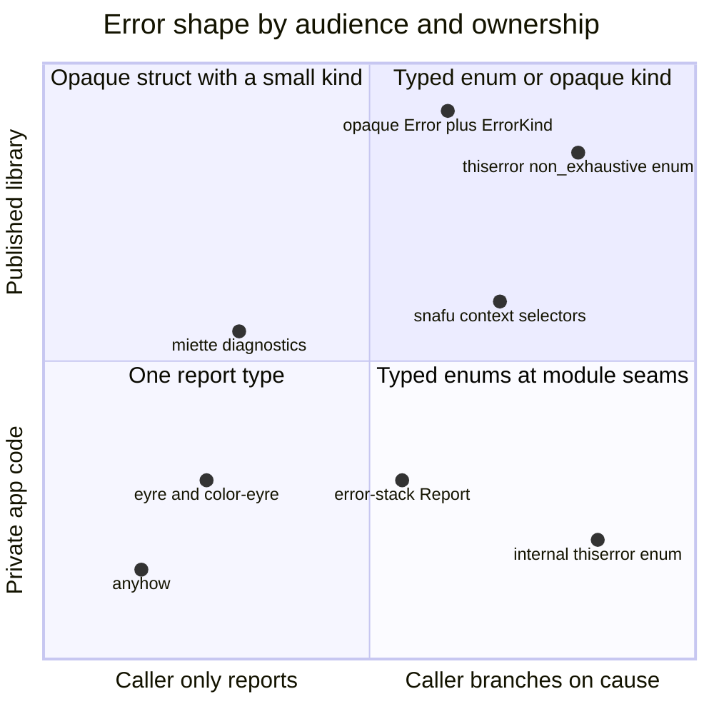
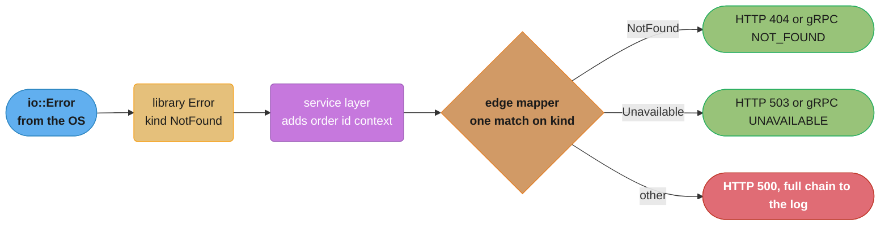

# Error Design for Libraries and Applications

> **Version anchor (2026-11-06).** Rust 1.99.1 (2026-10-15) on edition 2024. Crates on this page, from the section pin table: thiserror 2.0.21, anyhow 1.0.104, snafu 0.9.2, eyre 0.6.14, color-eyre 0.6.5, miette 7.6.0, error-stack 0.8.0, axum 0.8.9, tonic 0.14.9, cargo-semver-checks 0.51.0.

## 1. Concept Overview

The parent page, [Error handling and panics](error_handling_and_panics.md), covers the
mechanics: `?`, `From`, the `Error` trait, `source()`, panics. This page covers the design
decision that comes after: **what shape should an error type have, and which crate should
build it?**

The answer depends on two questions, and almost every argument about error crates is two
people answering different ones.

1. **Who reads the error?** A program that branches on the cause (retry on "unavailable",
   return 404 on "not found") needs a typed error it can match. A human who reads a log line
   or a terminal needs a readable chain of context and does not care about types.
2. **Who owns the type?** A published library's public error type is part of its semver
   contract. An application's error type is private and can change in any commit.

From those two answers follow the usual defaults: **libraries define concrete error types**
(often with `thiserror`), **applications use one opaque report type** (often `anyhow` or
`eyre`), and the boundary between them, the request handler or `main`, maps the typed error
to an HTTP status, a gRPC code, or an exit code. The rest of this page is where those defaults
are wrong, and what each crate adds.

This page holds the section's decision model for error crate and error shape (§8). Library API
evolution in general lives in
[Library API design and semver](../library_api_design_and_semver/library_api_design_and_semver.md).

---

## 2. Intuition

> **One-line analogy**: a library error is a form with checkboxes, so the next office can
> process it without reading. An application error is a handwritten incident report, so a
> person can understand what happened.

**Mental model**: errors travel up the call stack and change audience on the way. Near the
bottom, the audience is code: a retry loop, a cache fallback, a status mapper. Code needs a
small, stable set of cases. Near the top, the audience is a person: an on-call engineer, a CLI
user. A person needs context: which file, which record id, which step. A good design gives code
its checkboxes at the bottom and adds handwriting on the way up, without erasing the
checkboxes.

**Why it matters**: the two classic failures are opposite. A library that returns
`anyhow::Error` leaves callers to parse strings to tell "not found" from "timeout", and a
wording change in a patch release breaks them. An application that defines a 40-variant enum
for every function spends review time on boilerplate that no caller ever matches on.

**Key insight**: the cost of an error type is paid by its *callers*. Design it from the call
sites that will handle it, not from the list of things that can go wrong inside.

---

## 3. Core Principles

1. **Match the type to the reader.** If a caller branches on the cause, give it a type it can
   match. If only a person reads it, give it context and a chain.

2. **A public error type is API.** Its variants, its `source()` types and its `Display` text
   are things callers depend on. Adding a variant to an exhaustive public enum is a breaking
   change.

3. **Expose a small, stable classification.** Callers need "is this retryable", "is this not
   found", "is this the caller's fault". They rarely need 30 variants. An opaque struct with a
   `kind()` method gives them that and keeps the details private.

4. **Add context, keep the cause.** Every layer may say what it was doing. No layer may
   replace the cause with a string. `map_err(|e| e.to_string())` deletes the type information
   that the caller might need.

5. **Map to transport codes at the edge only.** A storage error does not know it will become a
   503. The HTTP handler or the gRPC service decides, in one place.

6. **`Display` is for humans, and it is short.** Lowercase, no trailing period, one layer of
   meaning (the Rust API guidelines say the same). The chain printer adds the rest.

7. **Errors must be `'static + Send + Sync` to travel.** An error that borrows its input cannot
   be boxed, sent to another thread, or wrapped by `anyhow`.

---

## 4. Types / Architectures / Strategies

### 4.1 Error shapes

| Shape | Sketch | Callers can | Adding a case later | Fits |
|---|---|---|---|---|
| Exhaustive enum | `pub enum Error { NotFound, Io(io::Error) }` | match every variant | breaking | internal modules, private crates |
| `#[non_exhaustive]` enum | same plus the attribute | match known variants, need `_` | minor release | public libraries with a small, meaningful set |
| Opaque struct plus kind | `pub struct Error { kind, source }` and `fn kind()` | match on `ErrorKind` | minor (kind is `#[non_exhaustive]`) | large libraries, `std::io` |
| Boxed trait object | `Box<dyn Error + Send + Sync>` | downcast only | not a question | small binaries, tests |
| Report type | `anyhow::Error`, `eyre::Report`, `error_stack::Report<C>` | downcast, read chain | not a question | applications |

### 4.2 The crates

| Crate | Version | What it gives you | Best fit |
|---|---|---|---|
| thiserror | 2.0.21 | `#[derive(Error)]`: `Display` from `#[error("...")]`, `source()` from `#[source]`, `From` from `#[from]`, `#[error(transparent)]` | library and module error enums; generates code you could write by hand |
| anyhow | 1.0.104 | `anyhow::Error` (one word wide), `Context` trait, `bail!`, `ensure!`, `anyhow!`, backtrace capture | application code that reports errors |
| snafu | 0.9.2 | derive with *context selectors*: `.context(ReadConfigSnafu { path })` builds a variant with fields and the source; `Whatever` for app-style errors | libraries and apps that want context fields on every variant |
| eyre | 0.6.14 | a fork of anyhow's design with pluggable report handlers (`eyre::Report`, `WrapErr`) | applications that want custom report output |
| color-eyre | 0.6.5 | an eyre handler with colored chains, span traces and suggestions | CLIs and dev tools |
| miette | 7.6.0 | `Diagnostic` derive: error codes, help text, labeled source spans, graphical reports | compilers, linters, config validators, anything that points at user input |
| error-stack | 0.8.0 | `Report<C>` with a typed current context, `change_context`, and attachments | large applications that want typed context at each layer |

### 4.3 Granularity

| Choice | Upside | Downside |
|---|---|---|
| One error type per crate | one import, one `From` set | every function appears to return every variant |
| One error type per module or per operation | each function's failure set is honest | more types, more `From` impls at the seams |
| One `ErrorKind` shared, many structs | stable classification, private details | more code than an enum |

A useful rule: one public error type per crate surface that callers see, and narrower private
enums inside, converted at module seams.

---

## 5. Architecture Diagrams

### 5.1 Decision quadrant



The vertical axis is about semver: everything above the middle line is a public contract. The
horizontal axis is about callers: everything right of the middle line needs a type to match.
miette sits left of center because its main reader is a person looking at a source span.

### 5.2 Where an error changes audience



The classification (kind) is set once, near the cause. Context is added on the way up. The
transport code is chosen once, at the edge. The response body carries a safe message, and the
full chain goes only to the log.

---

## 6. How It Works - Detailed Mechanics

### 6.1 A library error enum with thiserror

```rust
use thiserror::Error;

#[derive(Debug, Error)]
#[non_exhaustive]
pub enum StoreError {
    #[error("record {id} not found")]
    NotFound { id: u64 },

    #[error("reading segment {path}")]
    Read {
        path: String,
        #[source]
        source: std::io::Error,
    },

    #[error("store is read-only")]
    ReadOnly,
}
```

What the derive generates, and what it does not:

- `Display` from each `#[error("...")]`, with fields interpolated by name.
- `Error::source()` returning the field marked `#[source]` (a field named `source` is picked up
  without the attribute).
- `From<io::Error>` only if a field is marked `#[from]`. Here it is not, on purpose: `Read`
  needs a `path`, which an `io::Error` does not carry, so the call site uses `map_err`.
- `#[error(transparent)]` forwards both `Display` and `source()` to the inner error, for a
  variant that adds no context of its own.
- No backtrace unless a field has type `std::backtrace::Backtrace`.

The generated code is plain std. `thiserror` adds no type to your public API, so swapping it for
a handwritten impl later is not a breaking change.

### 6.2 The opaque struct with a kind

This is the shape of `std::io::Error`. The struct is opaque, so its fields can change. The
kind is a small `#[non_exhaustive]` enum, so callers can branch and the library can add kinds in
a minor release.

```rust
use std::error::Error as StdError;
use std::fmt;

#[derive(Debug, Clone, Copy, PartialEq, Eq)]
#[non_exhaustive]
pub enum ErrorKind {
    NotFound,
    Conflict,
    Unavailable,
    InvalidInput,
}

#[derive(Debug)]
pub struct Error {
    kind: ErrorKind,
    context: String,
    source: Option<Box<dyn StdError + Send + Sync + 'static>>,
}

impl Error {
    pub fn kind(&self) -> ErrorKind {
        self.kind
    }

    pub fn is_retryable(&self) -> bool {
        matches!(self.kind, ErrorKind::Unavailable | ErrorKind::Conflict)
    }

    pub(crate) fn new(kind: ErrorKind, context: impl Into<String>) -> Self {
        Error { kind, context: context.into(), source: None }
    }

    pub(crate) fn with_source(
        mut self,
        source: impl StdError + Send + Sync + 'static,
    ) -> Self {
        self.source = Some(Box::new(source));
        self
    }
}

impl fmt::Display for Error {
    fn fmt(&self, f: &mut fmt::Formatter<'_>) -> fmt::Result {
        f.write_str(&self.context)
    }
}

impl StdError for Error {
    fn source(&self) -> Option<&(dyn StdError + 'static)> {
        self.source.as_deref().map(|e| e as &(dyn StdError + 'static))
    }
}

fn main() {
    let io = std::io::Error::new(std::io::ErrorKind::ConnectionRefused, "refused");
    let e = Error::new(ErrorKind::Unavailable, "connecting to shard 3").with_source(io);
    assert!(e.is_retryable());
    assert_eq!(e.kind(), ErrorKind::Unavailable);
    assert_eq!(e.to_string(), "connecting to shard 3");
    assert!(e.source().is_some());
}
```

The constructors are `pub(crate)`. Callers can inspect errors but cannot forge them, which keeps
the set of reachable states under the library's control. A predicate such as `is_retryable()`
is often more useful to callers than the kind itself, because it encodes policy the library
author knows.

### 6.3 Application code with anyhow

```rust
// fragment
use anyhow::{Context, Result, bail, ensure};

fn load_order(id: u64) -> Result<Order> {
    ensure!(id != 0, "order id must be non-zero");
    let raw = std::fs::read_to_string(format!("/data/orders/{id}.json"))
        .with_context(|| format!("reading order {id}"))?;
    let order: Order = serde_json::from_str(&raw)
        .with_context(|| format!("parsing order {id}"))?;
    if order.lines.is_empty() {
        bail!("order {id} has no lines");
    }
    Ok(order)
}
```

| Format | Prints |
|---|---|
| `{}` | the outermost message: `reading order 42` |
| `{:#}` | the chain on one line: `reading order 42: No such file or directory (os error 2)` |
| `{:?}` | the chain on several lines, plus the backtrace if one was captured |

`anyhow::Error` requires the wrapped error to be `Send + Sync + 'static`. It does not implement
`std::error::Error` itself (that would conflict with its blanket `From<E: Error>`), so it cannot
be the `#[source]` of another error without conversion. That is one more reason it stays out of
library APIs. `err.downcast_ref::<StoreError>()` recovers a typed layer when the application must
branch, for example to map `StoreError::NotFound` to a 404.

### 6.4 Context selectors with snafu

```rust
// fragment
use snafu::{ResultExt, Snafu};

#[derive(Debug, Snafu)]
pub enum ConfigError {
    #[snafu(display("reading config {path}"))]
    Read { path: String, source: std::io::Error },

    #[snafu(display("key {key} is missing"))]
    MissingKey { key: String },
}

pub fn load(path: &str) -> Result<String, ConfigError> {
    std::fs::read_to_string(path).context(ReadSnafu { path })
}
```

The derive generates one *selector* struct per variant (`ReadSnafu`, `MissingKeySnafu`) holding
the non-source fields. `.context(selector)` fills in the source. The effect is that adding context
is the same amount of code as not adding it, so every variant carries its fields. That is the
main difference from thiserror, where `map_err` with a closure is the usual path.

### 6.5 Diagnostics with miette

```rust
// fragment
use miette::{Diagnostic, NamedSource, SourceSpan};
use thiserror::Error;

#[derive(Debug, Error, Diagnostic)]
#[error("unknown key in config")]
#[diagnostic(code(cfg::unknown_key), help("valid keys are listen, workers, log_level"))]
pub struct UnknownKey {
    #[source_code]
    src: NamedSource<String>,
    #[label("this key")]
    at: SourceSpan,
}
```

miette's report handler renders the file name, the line, an underline at `at`, the code and the
help text. It is the right tool when the error is about *the user's input* and the user must find
the spot. For a service log line it is more than you need.

### 6.6 Typed layers with error-stack

`error_stack::Report<C>` carries a current context type `C` that implements `Error`. Each layer
calls `change_context(NewContext)` to move the report into its own vocabulary, and the old
contexts stay in the report as a stack. Attachments add data (ids, paths, suggestions) without
creating new types. The function signature then says which context a caller gets
(`Result<T, Report<ParseConfigError>>`), which anyhow's single type cannot.

### 6.7 Mapping to HTTP and gRPC at the edge

| Library kind | HTTP status | gRPC code | Retry by client |
|---|---|---|---|
| `InvalidInput` | 400 | `INVALID_ARGUMENT` | no |
| unauthenticated | 401 | `UNAUTHENTICATED` | after re-auth |
| permission denied | 403 | `PERMISSION_DENIED` | no |
| `NotFound` | 404 | `NOT_FOUND` | no |
| `Conflict` | 409 | `ABORTED` or `ALREADY_EXISTS` | yes, for `ABORTED` |
| `Unavailable` | 503 | `UNAVAILABLE` | yes, with backoff |
| timeout | 504 | `DEADLINE_EXCEEDED` | depends on idempotency |
| anything else | 500 | `INTERNAL` | no |

```rust
// fragment
use axum::http::StatusCode;
use axum::response::{IntoResponse, Response};

pub struct ApiError(store::Error);

impl IntoResponse for ApiError {
    fn into_response(self) -> Response {
        let status = match self.0.kind() {
            store::ErrorKind::NotFound => StatusCode::NOT_FOUND,
            store::ErrorKind::InvalidInput => StatusCode::BAD_REQUEST,
            store::ErrorKind::Conflict => StatusCode::CONFLICT,
            store::ErrorKind::Unavailable => StatusCode::SERVICE_UNAVAILABLE,
            _ => StatusCode::INTERNAL_SERVER_ERROR,
        };
        if status.is_server_error() {
            tracing::error!(error = ?self.0, "request failed");
        }
        (status, status.canonical_reason().unwrap_or("error")).into_response()
    }
}
```

The `_` arm is required because `ErrorKind` is `#[non_exhaustive]`. It is also correct: an
unknown kind is a server problem until someone maps it. The tonic version builds a
`tonic::Status` with the matching code in the same single match. The protocol semantics behind the
table are in [REST API design](../../backend/rest_api_design/rest_api_design.md) and
[gRPC and protobuf](../../backend/grpc_and_protobuf/grpc_and_protobuf.md).

### 6.8 Semver rules for public error types

| Change | Semver impact |
|---|---|
| Add a variant to an exhaustive `pub enum` | major |
| Add a variant to a `#[non_exhaustive]` enum | minor |
| Add `#[non_exhaustive]` to an existing enum | major |
| Change the type of a public field or a `#[from]` source | major |
| Expose a dependency's error type (`Io(reqwest::Error)`) | that dependency's major bumps become yours |
| Change `Display` text | not a compile break, but breaks anyone who matched on strings |
| Switch the implementation from thiserror to a handwritten impl | none |

`cargo-semver-checks` 0.51.0 detects the compile-level rows (for example a new variant in an
exhaustive enum) by comparing the public API against the last published version. The full
treatment of API evolution is in
[Library API design and semver](../library_api_design_and_semver/library_api_design_and_semver.md),
and contract governance for services is in
[API contracts and schema governance](../../backend/api_contracts_and_schema_governance/api_contracts_and_schema_governance.md).

---

## 7. Real-World Examples

- **`std::io::Error`** is the reference design for the opaque shape: `kind()` returns a
  `#[non_exhaustive]` `ErrorKind`, `raw_os_error()` exposes the errno, and `get_ref()` and
  `into_inner()` expose a custom payload. Std has added `ErrorKind` variants over the years
  without breaking callers that match on it.
- **thiserror and anyhow** come from the same author (David Tolnay) and are designed as a pair:
  thiserror for types callers match on, anyhow for the application that reports them.
- **miette** is used by tools that report on source text and want compiler-style output with
  labeled spans and error codes.
- **Go's `errors.Is` and `errors.As`** solve the same "branch on the cause through wrapping"
  problem with runtime chain walking. Rust's `kind()` and `downcast_ref` are the two
  equivalents. Compare [Go errors and panics](../../go/errors_and_panics/errors_and_panics.md).

---

## 8. Tradeoffs

### 8.1 Decision model: error crate and error shape

| Situation | Shape | Crate | Why |
|---|---|---|---|
| Public library, few meaningful cases | `#[non_exhaustive]` enum | thiserror | callers match, you can add cases in a minor |
| Public library, many internal causes | opaque struct plus `ErrorKind` and predicates | thiserror or handwritten | details stay private, classification stays stable |
| Internal module or private crate | exhaustive enum | thiserror or snafu | exhaustive match catches every new case at compile time |
| Every variant needs context fields | enum | snafu | context selectors make context free to add |
| Application, errors are only reported | report type | anyhow, or eyre plus color-eyre for CLIs | one type, context on every `?`, chain printing |
| Application with layered typed contexts | `Report<C>` | error-stack | signatures name the context type at each layer |
| Errors point at user input (config, code) | diagnostic struct | miette (with thiserror) | spans, codes, help text |
| Tests, scripts, build.rs | `Box<dyn Error + Send + Sync>` | none | no definitions needed |

Read the table top-down and stop at the first row that matches. A service usually lands on two
rows at once: thiserror types inside its domain crates, anyhow in its binary crate, and one
mapping function at the edge.

### 8.2 Enum vs opaque struct

| Factor | `#[non_exhaustive]` enum | Opaque struct plus kind |
|---|---|---|
| Caller code | `match err { StoreError::NotFound { id } => .. }` | `match err.kind() { ErrorKind::NotFound => .. }` |
| Variant data visible to callers | yes, and it is API | no, only through accessors |
| Changing what a case carries | breaking | private |
| Boilerplate | low with thiserror | medium |
| Best when | the cases are few and their data is useful to callers | the cases are many, or their data is an implementation detail |

### 8.3 thiserror vs snafu vs handwritten

| | thiserror | snafu | handwritten |
|---|---|---|---|
| Context at call site | a `map_err` closure | `.context(Selector { .. })` | a `map_err` closure |
| Public API footprint | none (generated std impls) | selector structs are generated in your module | none |
| Compile time | one proc macro | one proc macro | none |
| Learning cost | low | medium (selectors) | low, verbose |

---

## 9. When to Use / When NOT to Use

**Use a typed library error when:**
- any caller will branch on the cause: retry, fallback, a status code, a user message;
- the crate is published or shared across teams;
- you want the compiler to flag every call site when a new failure appears (exhaustive, private).

**Use a report type (anyhow, eyre) when:**
- the code is a binary, and errors end in a log line or a terminal;
- the only handling is "report and stop" or "report and skip this item".

**Do NOT:**
- put `anyhow::Error` or `eyre::Report` in a published library's public signatures;
- replace a cause with its string (`map_err(|e| e.to_string())`), which deletes `source()` and
  makes downcasting impossible;
- expose a dependency's error type in a public variant unless you accept its major version as
  part of your contract;
- give every function in a crate the same 40-variant enum, which tells callers nothing about which
  variants a given function can return;
- borrow the input inside an error type that must leave the function.

---

## 10. Common Pitfalls

### 10.1 Two variants want the same `From` source

```rust
// BROKEN: two From<io::Error> impls for one type. The compiler cannot pick which variant `?` builds.
// error[E0119]: conflicting implementations of trait `From<std::io::Error>` for type `SyncError`
use std::io;

#[derive(Debug)]
enum SyncError {
    ReadSource(io::Error),
    WriteTarget(io::Error),
}

impl From<io::Error> for SyncError {
    fn from(e: io::Error) -> Self {
        SyncError::ReadSource(e)
    }
}

impl From<io::Error> for SyncError {
    fn from(e: io::Error) -> Self {
        SyncError::WriteTarget(e)
    }
}
```

```rust
// FIX: no From at all. Name the step at each call site with map_err, and keep the cause.
use std::fs;
use std::io;

#[derive(Debug)]
enum SyncError {
    ReadSource { path: String, source: io::Error },
    WriteTarget { path: String, source: io::Error },
}

fn sync(src: &str, dst: &str) -> Result<(), SyncError> {
    let data = fs::read(src)
        .map_err(|source| SyncError::ReadSource { path: src.to_string(), source })?;
    fs::write(dst, data)
        .map_err(|source| SyncError::WriteTarget { path: dst.to_string(), source })?;
    Ok(())
}
```

The same happens with thiserror if two variants carry `#[from] io::Error`. An `io::Error` alone
does not say which step failed, so a blanket `From` is the wrong tool whenever the step matters.

### 10.2 Exhaustive match on a `#[non_exhaustive]` kind

```rust
// BROKEN: io::ErrorKind is #[non_exhaustive], so a match on it from outside std needs a wildcard.
// error[E0004]: non-exhaustive patterns: `_` not covered
use std::io::ErrorKind;

fn http_status(kind: ErrorKind) -> u16 {
    match kind {
        ErrorKind::NotFound => 404,
        ErrorKind::PermissionDenied => 403,
        ErrorKind::InvalidInput => 400,
    }
}
```

```rust
// FIX: an explicit fallback arm. New kinds in future releases land in 500 until mapped.
use std::io::ErrorKind;

fn http_status(kind: ErrorKind) -> u16 {
    match kind {
        ErrorKind::NotFound => 404,
        ErrorKind::PermissionDenied => 403,
        ErrorKind::InvalidInput => 400,
        ErrorKind::TimedOut => 504,
        _ => 500,
    }
}
```

This is the attribute working as designed: it forces downstream code to handle cases the
library adds later. Inside the defining crate the attribute has no effect, which is why a
library's own tests do not catch the downstream break.

### 10.3 Production war stories

The cases below are illustrative. Their numbers show scale and do not come from a real incident.

- **String matching on errors.** A client library returned `anyhow::Error`. A downstream team
  retried when `err.to_string().contains("timed out")`. A patch release reworded the message to
  "deadline exceeded", and retries stopped across the fleet. A typed `is_retryable()` would have
  made the dependency visible to the compiler.
- **The public `reqwest::Error`.** A library exposed `Http(#[from] reqwest::Error)` in its public
  enum. When the library moved to the next `reqwest` major version, every downstream crate that
  matched on the inner error broke, so a dependency bump became a major release. Wrap foreign
  errors in your own type, or keep them behind `source()`.
- **`map_err(|e| e.to_string())`.** A storage layer converted every error to `String` to "keep it
  simple". The service could no longer tell `NotFound` from a disk failure, and returned 500 for
  missing records. Keep the source, add a kind.
- **The mega-enum.** A crate had one `Error` enum with 43 variants returned by every function. A
  reviewer could not tell which variants `get_user` could produce, so callers wrote `_ => 500`
  everywhere and the typing bought nothing. Split per operation, convert at the seam.
- **Leaking internals in responses.** An axum handler returned `err.to_string()` in the 500 body,
  and the chain included a SQL statement and a host name. Send a safe message to the client and
  the chain to the log.

---

## 11. Technologies & Tools

| Tool | Version | Role |
|---|---|---|
| thiserror | 2.0.21 | derive `Error`, `Display`, `From` for typed errors |
| anyhow | 1.0.104 | opaque application error with context |
| snafu | 0.9.2 | derive with context selectors |
| eyre | 0.6.14 | report type with pluggable handlers |
| color-eyre | 0.6.5 | colored, span-aware report handler for eyre |
| miette | 7.6.0 | diagnostics with codes, help and labeled spans |
| error-stack | 0.8.0 | typed context stack with attachments |
| axum | 0.8.9 | `IntoResponse` for the HTTP edge mapping |
| tonic | 0.14.9 | `Status` for the gRPC edge mapping |
| cargo-semver-checks | 0.51.0 | catch breaking changes to public error types before publish |

---

## 12. Interview Questions with Answers

**Q: Why should a published library not return `anyhow::Error`?**
**Short:** Callers cannot match on its cause without downcasting to private types, and the dependency on anyhow and on message wording becomes part of the API.

A library's callers need to branch: retry on unavailable, 404 on not found. With
`anyhow::Error` the only tools are `downcast_ref` to a type they hope is inside, or string
matching on the message, and both break silently when the library changes. It also forces
anyhow into every caller's dependency graph, and `anyhow::Error` does not implement
`std::error::Error`, so it composes poorly as a `source`. Return a concrete type and let the
application wrap it in anyhow.

**Q: When is thiserror the right choice, and when is anyhow?**
**Short:** thiserror builds typed errors that callers match on, usually in libraries; anyhow is one opaque type for applications that only report errors.

The split is by reader, not by crate type. A binary crate's internal module whose errors are
matched by a retry loop still wants a thiserror enum. A library's examples and tests can use
anyhow. Most services use both: thiserror in domain crates, anyhow in the binary, and one
mapping function at the edge. thiserror generates plain std impls, so it adds nothing to your
public API.

**Q: What does `#[non_exhaustive]` on a public error enum buy you, and what does it cost callers?**
**Short:** It lets the library add variants in a minor release, and in exchange every downstream match on the enum must include a wildcard arm.

Without it, adding a variant breaks every exhaustive match downstream, which is a semver major
change. With it, downstream code must write `_ => ...`, so new cases fall into a default branch
instead of failing to compile. Inside the defining crate the attribute does nothing. Adding the
attribute to an enum that did not have it is itself a breaking change, so decide before 1.0.

**Q: Why is an opaque error struct with a `kind()` method often better than a public enum?**
**Short:** The struct hides fields so the library can change what each case carries, while a small kind enum still gives callers something stable to match.

A public enum's variant fields are API: changing `NotFound { id: u64 }` to carry a key string is
breaking. With an opaque struct, the data lives in private fields and accessors, and only
`ErrorKind` is public. `std::io::Error` uses this shape. Add predicates such as `is_retryable()`
so callers get policy, not just classification.

**Q: How do you add context to an error without losing its cause?**
**Short:** Wrap it in a new error whose source() returns the original, using map_err, anyhow's with_context, or snafu's context selectors.

The wrong way is `map_err(|e| format!("reading {path}: {e}"))`, which turns the cause into text
and deletes `source()`. The right way keeps the original as a field: `map_err(|source|
Error::Read { path, source })`, or `.with_context(|| format!("reading {path}"))` in anyhow.
Callers and chain printers can then still reach and downcast the cause.

**Q: Why does a blanket `#[from] io::Error` often hurt more than it helps?**
**Short:** An io::Error does not record which file or step failed, so automatic conversion through ? produces errors without the context needed to act on them.

`?` with a `From<io::Error>` impl is convenient, but the resulting error says "No such file or
directory" without a path. Two variants cannot both take `#[from] io::Error` either, which is
E0119. Use `#[from]` only for a cause that is self-describing, and `map_err` with a context field
everywhere else.

**Q: Where should a domain error be mapped to an HTTP status or gRPC code?**
**Short:** At the edge, in one function or IntoResponse impl that matches on the error kind, so domain code never knows about transports.

A storage error does not know whether it will become a 503, a retry, or a CLI exit code. Mapping
in one place keeps the table reviewable and testable, and lets one domain type serve HTTP, gRPC
and batch jobs. The mapper also decides what is safe to show: a short message to the client and
the full chain to the log for 5xx cases.

**Q: What are the conventions for an error's `Display` text in Rust?**
**Short:** Lowercase, no trailing punctuation, and only this layer's meaning, because chain printers join messages with colons.

The Rust API guidelines ask for concise, lowercase messages without a trailing period. Chain
printers such as anyhow's `{:#}` produce `reading order 42: parsing JSON: expected value at line
1`. A capitalized, punctuated message, or one that repeats its cause's text, reads badly in that
join. Put detail in fields and in `source()`, not in a long sentence.

**Q: How can a dependency's error type leak into your semver contract?**
**Short:** If a public variant or #[from] field holds the dependency's error type, a major bump of that dependency changes your public API and forces your own major release.

`Http(reqwest::Error)` in a public enum makes `reqwest::Error` part of your API. Callers can
match on it, so when you upgrade to the next `reqwest` major version their code breaks. Wrap the
foreign error in your own type, expose it only through `source()` as `dyn Error`, or document
the dependency as public and accept the coupling.

**Q: How many error types should a crate have?**
**Short:** Enough that each public function's possible failures are honest: one public type per surface, with narrower private enums converted at module seams.

One enum for the whole crate is easy to write and tells callers nothing, because every function
seems to return every variant. One type per function is honest and heavy. The common middle is
one public error type per API surface, often an opaque struct with a kind, and internal enums per
module that convert into it. Exhaustive private enums also make the compiler point at every
handler when a new failure is added.

**Q: What does snafu do differently from thiserror?**
**Short:** snafu generates a context selector struct per variant, so attaching fields and the source is a single .context call instead of a map_err closure.

With thiserror, adding a path to an I/O error means `map_err(|source| Error::Read { path, source
})`. With snafu, it is `.context(ReadSnafu { path })`, and the derive fills in the source.
Because context is as cheap as no context, teams tend to attach it everywhere. The cost is
generated selector types in your module and one more concept to learn.

**Q: When does miette fit better than anyhow or eyre?**
**Short:** When the error is about the user's own input and the report must point at a file, line and span with an error code and help text.

Compilers, linters, schema validators and config loaders need to say "line 14, column 3, this
key is unknown, valid keys are ...". miette's `Diagnostic` derive adds codes, help text and
labeled spans, and its handler renders them graphically. For a service log line, that output
format adds nothing over anyhow.

**Q: What problem does error-stack's `Report<C>` solve that anyhow does not?**
**Short:** It keeps a typed current context in the signature, so each layer states which error vocabulary it returns while the report keeps earlier contexts.

anyhow erases every type into one `anyhow::Error`, so a function signature does not say what
failed. error-stack's `Result<T, Report<ParseConfigError>>` names it, and `change_context` moves
the report into the next layer's type. Earlier contexts and attachments stay inside. It suits
large applications that want typed layers without the boilerplate of wrapping enums at every
seam.

**Q: Why can an error type that borrows its input be a problem?**
**Short:** It is not 'static, so it cannot be boxed into dyn Error, wrapped by anyhow, sent to another thread, or returned past the input's lifetime.

`ParseError<'a> { rest: &'a str }` is cheap to build but ties the error to the input buffer. The
moment a caller wants `?` into `Box<dyn Error + Send + Sync>` or `anyhow::Error`, the borrow
cannot escape. Store an owned copy of the relevant part, or a byte offset and length into the
input, and let the caller render it. Changing this after 1.0 is a breaking change, so decide early.

**Q: How should a library expose whether an error is retryable?**
**Short:** Give the error a predicate method such as is_retryable, decided by the library, so callers do not each rebuild the policy from kinds.

The library knows that a connection refusal is transient and a schema mismatch is not. Callers
do not. A predicate encodes that once, and the library can refine it in a minor release without
breaking anyone. Pair it with a `kind()` for callers that need finer control, and document which
kinds are retryable so behavior changes are visible in release notes.

**Q: Does replacing thiserror with a handwritten implementation break callers?**
**Short:** No, because thiserror generates ordinary std trait impls and adds no type of its own to the public API.

The derive writes `impl Display`, `impl Error` and optional `impl From` blocks. Callers see only
the enum and those std impls, so a handwritten version with the same behavior is invisible to
them. The same is not true of anyhow or snafu's `Whatever`, which put their own types into
signatures.

---

## 13. Best Practices

1. Decide the error shape from the call sites that will handle it.
2. Libraries: a `#[non_exhaustive]` enum for a small set of cases, an opaque struct plus `kind()`
   for a large or volatile one. Add `is_retryable()`-style predicates.
3. Applications: anyhow or eyre in the binary, `with_context` on every `?` that crosses an I/O or
   parsing step.
4. Keep causes in `source()`. Never convert an error to `String` in a library.
5. Use `#[from]` only for self-describing causes. Use `map_err` with context fields otherwise.
6. Map to HTTP or gRPC codes in one function at the edge. Log the chain for 5xx, return a safe
   message.
7. `Display`: lowercase, no trailing period, this layer only.
8. Make every public error `Send + Sync + 'static`.
9. Do not expose a dependency's error type in a public variant unless you accept its version
   coupling.
10. Run `cargo-semver-checks` in CI on every library release.

---

## 14. Case Study

### Making a parser library's error usable by applications

**Context (illustrative numbers).** A team publishes `logline`, a crate that parses a custom log format, 0.4.x on the
company registry. Fifteen internal services depend on it. The parser is zero-copy, and the first
error type was zero-copy too: it borrowed the unparsed remainder of the input.

**The problem.** Services want to propagate parse failures with `?` into `anyhow::Error` or a
boxed error, and to report them from a worker thread. None of that compiles:

```rust
// BROKEN: ParseError borrows the input, so it is not 'static and cannot become a boxed error.
// error: lifetime may not live long enough (the boxed error needs 'static, ParseError<'_> borrows line)
use std::error::Error;
use std::fmt;

#[derive(Debug)]
pub struct ParseError<'a> {
    rest: &'a str,
}

impl fmt::Display for ParseError<'_> {
    fn fmt(&self, f: &mut fmt::Formatter<'_>) -> fmt::Result {
        write!(f, "unexpected input at {:?}", self.rest)
    }
}

impl Error for ParseError<'_> {}

pub fn parse_level(input: &str) -> Result<u8, ParseError<'_>> {
    match input.get(..4) {
        Some("WARN") => Ok(2),
        Some("INFO") => Ok(1),
        _ => Err(ParseError { rest: input }),
    }
}

pub fn handle(line: &str) -> Result<u8, Box<dyn Error + Send + Sync>> {
    let level = parse_level(line)?;
    Ok(level)
}
```

Each service had worked around it with `map_err(|e| e.to_string())`, which lost the position
and any chance to branch on the failure kind.

**The redesign.** The 0.5.0 release (a breaking release, which 0.x allows) replaced the borrowed
error with an owned, opaque one. It records a byte offset and a short owned excerpt, and exposes a
`#[non_exhaustive]` kind.

```rust
// FIX: an owned, 'static error with an offset, a short excerpt and a stable kind.
use std::error::Error;
use std::fmt;

#[derive(Debug, Clone, Copy, PartialEq, Eq)]
#[non_exhaustive]
pub enum ParseErrorKind {
    UnknownLevel,
    Truncated,
}

#[derive(Debug)]
pub struct ParseError {
    kind: ParseErrorKind,
    offset: usize,
    excerpt: String,
}

impl ParseError {
    pub fn kind(&self) -> ParseErrorKind {
        self.kind
    }

    pub fn offset(&self) -> usize {
        self.offset
    }
}

impl fmt::Display for ParseError {
    fn fmt(&self, f: &mut fmt::Formatter<'_>) -> fmt::Result {
        match self.kind {
            ParseErrorKind::UnknownLevel => {
                write!(f, "unknown level at byte {} near {:?}", self.offset, self.excerpt)
            }
            ParseErrorKind::Truncated => write!(f, "line ends at byte {}", self.offset),
        }
    }
}

impl Error for ParseError {}

#[cfg(target_pointer_width = "64")]
const _: () = assert!(std::mem::size_of::<ParseError>() == 40);

const EXCERPT_CHARS: usize = 16;

pub fn parse_level(input: &str) -> Result<u8, ParseError> {
    let Some(word) = input.get(..4) else {
        return Err(ParseError {
            kind: ParseErrorKind::Truncated,
            offset: input.len(),
            excerpt: String::new(),
        });
    };
    match word {
        "WARN" => Ok(2),
        "INFO" => Ok(1),
        _ => Err(ParseError {
            kind: ParseErrorKind::UnknownLevel,
            offset: 0,
            excerpt: input.chars().take(EXCERPT_CHARS).collect(),
        }),
    }
}

pub fn handle(line: &str) -> Result<u8, Box<dyn Error + Send + Sync>> {
    let level = parse_level(line)?;
    Ok(level)
}

fn main() {
    assert_eq!(handle("INFO started").ok(), Some(1));
    let err = parse_level("DBUG x").unwrap_err();
    assert_eq!(err.kind(), ParseErrorKind::UnknownLevel);
    assert!(handle("IN").is_err());
}
```

**Numbers and outcomes.**

| Measure | 0.4 (borrowed error) | 0.5 (owned error) |
|---|---|---|
| Cost on the success path | none | none; the error is built only on failure |
| Cost per failure | none beyond the 16-byte reference | a heap `String` of at most 16 chars; the struct is 40 bytes on 64-bit targets |
| Services using `map_err(to_string)` | 15 of 15 | 0 |
| Services branching on failure kind | 0 | 6 (skip `Truncated` lines, alert on `UnknownLevel`) |

**Decisions worth defending.**

- The excerpt is capped at 16 characters, so an error built from a 1 MB line does not copy the
  line. The offset lets a caller that still holds the input render more.
- The kind enum is `#[non_exhaustive]` from day one, so a later 0.5.x release, which Cargo
  treats as compatible, can add `BadTimestamp`. The struct is opaque, so the excerpt policy can change without a release note.
- The change landed in a 0.x minor bump, which Cargo treats as breaking. `cargo-semver-checks`
  in CI confirmed that no other public item changed in the same release.
- thiserror was not needed. Two impls were shorter to read than the attributes, and the public
  API is the same either way.
