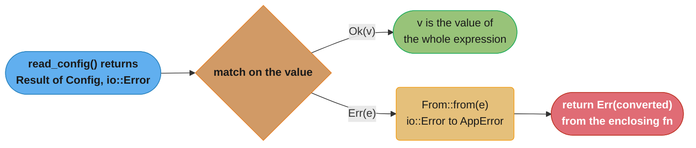
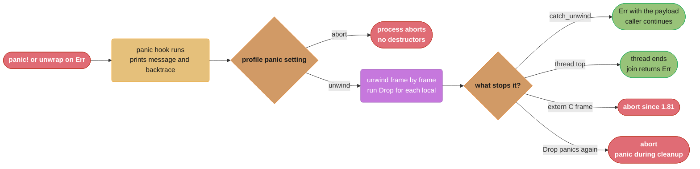

# Error Handling and Panics

> **Version anchor (2026-11-06).** Rust 1.99.1 (2026-10-15) on edition 2024. `extern "C-unwind"` is `[1.71]`. `core::error::Error` is `[1.81]`, and since 1.81 a panic that reaches an `extern "C"` function aborts the process. Crates named on this page: thiserror 2.0.21, anyhow 1.0.104, parking_lot 0.13.0, tokio 1.54.1. Every other fact is true on every supported release.

## 1. Concept Overview

Rust splits failure into two channels and makes you pick one at every call site.

- **Recoverable errors** are values. A function that can fail returns `Result<T, E>`, or
  `Option<T>` when "nothing" is the only failure. The caller must do something with the
  value: match it, propagate it with `?`, or convert it. `Result` is `#[must_use]`, so
  dropping one on the floor is a compiler warning.
- **Bugs** are panics. `panic!`, a failed `assert!`, an out-of-bounds index, an
  `unwrap()` on `None`, or an integer overflow in a debug build stops the current thread.
  By default the panic unwinds the stack and runs every destructor on the way. With
  `panic = "abort"` in the Cargo profile, the process ends at once.

There are no exceptions and no hidden control flow. Every place a function can return
early with an error is visible in the source as a `?` or an explicit `return Err(..)`.
The type checker knows which error type each function returns, so a new failure mode is a
compile error at every call site that does not handle it.

This page owns the mechanics: how `?` desugars, the `Error` trait and its `source()` chain,
`Box<dyn Error + Send + Sync>`, backtraces, unwinding vs abort, `catch_unwind`, panics at
FFI boundaries, mutex poisoning, and what `main` returns. The choice of error crate and the
shape of a public error type live in the sub-file
[Error design for libraries and applications](error_design_for_libraries_and_applications.md).
The ABI rules behind `extern "C"` and `extern "C-unwind"` live in
[ABIs, linking and Wasm](../../cs_fundamentals/how_code_runs_compilers_and_interpreters/abis_linking_and_wasm.md).

---

## 2. Intuition

> **One-line analogy**: a `Result` is a parcel with a "fragile" sticker that the post office
> will not let you leave on the doorstep. A panic is the fire alarm: the building empties,
> and nobody is expected to finish the form they were filling in.

**Mental model**: think of two exits from every function. The front door is the return
type. A `Result` makes the error path part of the front door, so the caller sees it and the
compiler checks it. The fire exit is the panic. It skips the normal return, and either
walks back up the stack locking every door behind it (unwind, running `Drop`), or cuts the
power to the building (abort). Code can never be surprised by the front door. Code is
always allowed to be surprised by the fire exit, because a panic means the program's
assumptions are already broken.

**Why it matters**: the most common Rust production incident in this area is a panic in
code that treated untrusted input as a bug. An `unwrap()` on a parse, an index into a slice
whose length came off the network, or an `expect()` on a config file that "always" has a
field. One malformed input then takes down a worker thread or the whole process. In
Cloudflare's outage of 2025-11-18, its FL2 proxy panicked with exactly this message: "called
`Result::unwrap()` on an `Err` value", after a feature file exceeded a limit of 200 entries
([Cloudflare post-mortem](https://blog.cloudflare.com/18-november-2025-outage/)).

**Key insight**: the line between `Result` and panic is not "how bad is the failure". It is
"can the caller do anything about it". Bad input, a missing file, a refused connection and
a timeout are all expected and go in a `Result`. A broken invariant inside your own code is a
bug and panics. Code must check untrusted data before it can break an invariant, so bad
data gives an `Err`, never a panic.

---

## 3. Core Principles

1. **Errors are values with types.** `Result<T, E>` is an ordinary enum. Every combinator on
   it is a normal function, and `?` is sugar for a `match` plus an early return.

2. **`?` converts through `From`.** `expr?` on an `Err(e)` returns `Err(From::from(e))`. The
   conversion is the extension point: implement `From<io::Error> for MyError` once and every
   `?` on an `io::Result` in your crate converts for free.

3. **An error is a chain.** The `Error` trait has `Display` for the message, `Debug` for the
   developer, and `source()` for the cause. A good error adds one layer of context and keeps
   the cause, so the report reads top-down from "what we tried" to "what the OS said".

4. **Panics are for bugs, not for input.** Panic when your own invariant is broken. Return
   `Err` when the world misbehaves. Library code that panics on bad input forces every caller
   to validate first, which defeats the point of a typed error.

5. **Unwinding is a cleanup mechanism, not a recovery mechanism.** It runs destructors so locks,
   files and buffers are released. `catch_unwind` exists for isolation at boundaries (a thread
   pool, an FFI edge, a test harness), not for control flow.

6. **A panic must never cross an ABI that does not expect it.** Since 1.81 a Rust panic that
   reaches an `extern "C"` function aborts the process. Use `extern "C-unwind"` when unwinding
   must cross, and `catch_unwind` at the edge when it must not.

7. **Every `unwrap()` is a claim.** It says "this cannot fail, and if it does, my program is
   wrong". Write the claim down with `expect("...should...")` or remove it.

---

## 4. Types / Architectures / Strategies

### 4.1 The failure channels

| Channel | Type or mechanism | Who decides what happens | Use for |
|---|---|---|---|
| Absence | `Option<T>` | caller | "not found" with no further detail |
| Recoverable error | `Result<T, E>` | caller | I/O, parsing, validation, timeouts, remote failures |
| Bug, unwinding | `panic!` with `panic = "unwind"` | nearest `catch_unwind` or thread boundary | broken invariants, unreachable states |
| Bug, aborting | `panic!` with `panic = "abort"`, or `process::abort()` | nobody, the process ends | services that restart on crash, size-sensitive binaries |
| Process exit | `main` returning `Result` or `ExitCode`, `process::exit(n)` | the OS and the supervisor | CLI exit status |

### 4.2 Error type shapes

| Shape | Example | Caller can match on cause? | Typical home |
|---|---|---|---|
| Concrete enum | `enum ConfigError { Io(io::Error), Parse { line: usize } }` | yes | libraries, internal modules |
| Opaque struct with `kind()` | `io::Error` and `io::ErrorKind` | yes, through `kind()` | libraries that must add variants without a semver break |
| Boxed trait object | `Box<dyn Error + Send + Sync>` | only by downcast | small binaries, tests, prototypes |
| Report type | `anyhow::Error`, `eyre::Report` | only by downcast | application code |

The crate choice and the full decision model are in
[Error design for libraries and applications](error_design_for_libraries_and_applications.md).

### 4.3 Panic strategies

| Setting | Behavior on panic | Destructors run? | `catch_unwind` works? | Binary |
|---|---|---|---|---|
| `panic = "unwind"` (default) | unwind the panicking thread | yes | yes | unwind tables and landing pads included |
| `panic = "abort"` | call the panic hook, then abort | no | no, the process is gone | smaller, no landing pads |

Since 1.92 the compiler emits unwind tables on Linux even with `panic = "abort"`, so a
backtrace from an aborting binary still has frames.

### 4.4 Where a panic goes

| Panic happens in | Result |
|---|---|
| `main` thread | message on stderr, process exits with status 101 |
| a `std::thread::spawn` thread | that thread ends, `JoinHandle::join()` returns `Err(Box<dyn Any + Send>)` |
| a Tokio task | the task ends, its `JoinHandle` resolves to a `JoinError` with `is_panic()` true, other tasks keep running |
| a destructor that runs during unwinding | the process aborts |
| a function called through `extern "C"` | the process aborts (since 1.81) |
| a function called through `extern "C-unwind"` | the panic unwinds into the foreign frames |

---

## 5. Architecture Diagrams

### 5.1 What `?` does on each arm



The `Err` arm is the only place a conversion happens. If no `From<io::Error>` impl exists
for the enclosing function's error type, the `?` fails to compile with E0277.

### 5.2 The life of a panic



The hook always runs first, even with `panic = "abort"`. That is why a custom hook (for
example one that sends the message to the log pipeline) works in both modes.

### 5.3 An error chain, top to bottom

```
  AppError::LoadConfig { path }        Display: "loading config /etc/svc/app.toml"
      |
      | source()
      v
  ConfigError::Parse { line: 14 }      Display: "invalid value on line 14"
      |
      | source()
      v
  std::num::ParseIntError              Display: "invalid digit found in string"
      |
      | source()
      v
  None
```

Each layer says what it was doing, and only that. The reporter walks `source()` and joins
the messages: `loading config /etc/svc/app.toml: invalid value on line 14: invalid digit
found in string`. A layer that also copies its cause's text into its own message prints
that text twice.

---

## 6. How It Works - Detailed Mechanics

### 6.1 How `?` desugars

For a `Result`, `expr?` behaves like this `match`. (The real desugaring goes through the
unstable `Try` and `FromResidual` traits, but for `Result` and `Option` it is equivalent.)

```rust
use std::fs;
use std::io;

#[derive(Debug)]
enum AppError {
    Io(io::Error),
}

impl From<io::Error> for AppError {
    fn from(e: io::Error) -> Self {
        AppError::Io(e)
    }
}

fn read_with_question_mark(path: &str) -> Result<String, AppError> {
    let text = fs::read_to_string(path)?;
    Ok(text)
}

fn read_desugared(path: &str) -> Result<String, AppError> {
    let text = match fs::read_to_string(path) {
        Ok(v) => v,
        Err(e) => return Err(From::from(e)),
    };
    Ok(text)
}
```

Three consequences follow directly:

- `?` only works inside a function (or closure, or `async` block) whose return type can hold
  the residual. `?` in a function that returns `()` is E0277.
- `?` on an `Option` returns `None` early, and only inside a function returning `Option`.
  To mix the two, convert explicitly with `ok_or` or `ok_or_else`.
- The conversion is chosen by the *enclosing* function's error type. Two functions can apply
  `?` to the same `io::Error` and produce two different wrapper types.

### 6.2 Combinators you use every day

| Method | On | Does | Typical use |
|---|---|---|---|
| `map(f)` | `Option`, `Result` | transform the success value | `parse().map(Port)` |
| `map_err(f)` | `Result` | transform the error | add a variant with context |
| `and_then(f)` | both | chain a fallible step | parse then validate |
| `ok_or(e)` / `ok_or_else(f)` | `Option` | `None` becomes `Err(e)` | `map.get(k).ok_or(Missing(k))?` |
| `ok()` | `Result` | drop the error, keep `Option` | best-effort lookups |
| `unwrap_or(v)` / `unwrap_or_else(f)` / `unwrap_or_default()` | both | fall back to a value | defaults for optional config |
| `inspect_err(f)` | `Result` | look at the error without consuming it | a debug log before `?` |
| `transpose()` | `Option<Result>` and back | swap the layers | `opt.map(parse).transpose()?` |
| `?` | both | early return | everywhere |

Use `ok_or_else` and `unwrap_or_else` when the fallback allocates or formats. `ok_or(format!(..))`
builds the string on every call, success or not.

```rust
use std::collections::HashMap;

#[derive(Debug, PartialEq)]
enum LookupError {
    Missing(String),
    BadNumber(String),
}

fn port_from(env: &HashMap<String, String>) -> Result<u16, LookupError> {
    let raw = env
        .get("PORT")
        .ok_or_else(|| LookupError::Missing("PORT".to_string()))?;
    raw.parse::<u16>()
        .map_err(|e| LookupError::BadNumber(format!("PORT={raw}: {e}")))
}

fn optional_timeout(env: &HashMap<String, String>) -> Result<Option<u64>, std::num::ParseIntError> {
    env.get("TIMEOUT_MS").map(|s| s.parse::<u64>()).transpose()
}

fn main() {
    let mut env = HashMap::new();
    env.insert("PORT".to_string(), "8080".to_string());
    assert_eq!(port_from(&env), Ok(8080));
    assert_eq!(optional_timeout(&env), Ok(None));
}
```

### 6.3 The `Error` trait and `source()`

`std::error::Error` (re-exported from `core::error::Error` since 1.81, so `no_std` crates can
use it) requires `Debug + Display` and has one method you override, `source()`.

```rust
use std::error::Error;
use std::fmt;
use std::num::ParseIntError;

#[derive(Debug)]
pub enum ConfigError {
    Parse { line: usize, source: ParseIntError },
}

impl fmt::Display for ConfigError {
    fn fmt(&self, f: &mut fmt::Formatter<'_>) -> fmt::Result {
        match self {
            // The message describes this layer only. The cause is reached through source().
            ConfigError::Parse { line, .. } => write!(f, "invalid value on line {line}"),
        }
    }
}

impl Error for ConfigError {
    fn source(&self) -> Option<&(dyn Error + 'static)> {
        match self {
            ConfigError::Parse { source, .. } => Some(source),
        }
    }
}

pub fn report(err: &dyn Error) -> String {
    let mut out = err.to_string();
    let mut cur = err.source();
    while let Some(cause) = cur {
        out.push_str(": ");
        out.push_str(&cause.to_string());
        cur = cause.source();
    }
    out
}

fn main() {
    let cause = "4x".parse::<u32>().unwrap_err();
    let err = ConfigError::Parse { line: 14, source: cause };
    assert_eq!(report(&err), "invalid value on line 14: invalid digit found in string");
}
```

`thiserror` generates exactly this code from attributes (`#[error("...")]`, `#[source]`,
`#[from]`). Writing it once by hand is the best way to read what the macro produces.

### 6.4 `Box<dyn Error + Send + Sync>` and downcasting

`Box<dyn Error + Send + Sync + 'static>` is the "any error" type of the standard library.
`?` converts any `E: Error + Send + Sync + 'static` into it through a blanket `From` impl,
and `&str` and `String` convert too, so `Err("bad header".into())` works.

The `Send + Sync` bounds matter. A plain `Box<dyn Error>` is not `Send`, so it cannot be
returned from a `thread::spawn` closure, held across an `.await` in a Tokio task, or shared
through an `Arc` with another thread. Write the bounds once in a type alias and use it everywhere.

```rust
use std::error::Error;
use std::io;

pub type BoxError = Box<dyn Error + Send + Sync + 'static>;

fn parse_header(line: &str) -> Result<(String, String), BoxError> {
    let (k, v) = line.split_once(':').ok_or("missing ':' in header")?;
    if k.is_empty() {
        return Err(io::Error::new(io::ErrorKind::InvalidData, "empty header name").into());
    }
    Ok((k.trim().to_string(), v.trim().to_string()))
}

fn main() {
    let err = parse_header(":x").unwrap_err();
    // Recover the concrete type when the caller must branch on it.
    let kind = err.downcast_ref::<io::Error>().map(|e| e.kind());
    assert_eq!(kind, Some(io::ErrorKind::InvalidData));
    assert!(parse_header("no colon").is_err());
}
```

Downcasting is a runtime check against one concrete type. It is the price of erasing the
type, and it is why libraries return concrete error types instead.

### 6.5 Backtraces

`std::backtrace::Backtrace::capture()` records the stack only when `RUST_BACKTRACE` or
`RUST_LIB_BACKTRACE` is set and enabled. Otherwise it is a no-op that returns a disabled
backtrace. `Backtrace::force_capture()` ignores both variables. Capturing walks the stack
and can be expensive, so capture at the point the error is created, once, and never on a
hot success path.

| Variable | Affects |
|---|---|
| `RUST_BACKTRACE=1` | panic messages print a short backtrace, and `Backtrace::capture()` records |
| `RUST_BACKTRACE=full` | panic backtraces include every frame, including std internals |
| `RUST_LIB_BACKTRACE=1` | `Backtrace::capture()` records, independent of the panic setting |
| `RUST_LIB_BACKTRACE=0` | `capture()` stays off while panics still print backtraces |

`anyhow` and `eyre` capture a backtrace when their error is built and honor the same variables.

### 6.6 Panics: hook, unwind, abort

A panic runs in a fixed order.

1. The panic hook runs. On rustc 1.99.1 the default hook prints
   `thread 'NAME' (ID) panicked at FILE:LINE:COL:`, the message, and a backtrace note. `std::panic::set_hook` replaces it.
2. With `panic = "abort"`, the process aborts here (status 134 in a POSIX shell, SIGABRT).
3. With `panic = "unwind"`, the runtime unwinds the stack. Each frame's locals drop in reverse
   declaration order, so `MutexGuard`s unlock and `BufWriter`s flush.
4. Unwinding stops at a `catch_unwind`, or at the top of the thread. A panic on the main thread
   exits the process with status 101.

`#[track_caller]` on a function makes a panic inside it report the caller's location. That is
how `unwrap()` and `expect()` point at your line, not at a line inside `core`.

```rust
use std::panic;

#[track_caller]
fn checked_div(a: u32, b: u32) -> u32 {
    if b == 0 {
        panic!("divide by zero");
    }
    a / b
}

fn main() {
    let r = panic::catch_unwind(|| checked_div(10, 0));
    // The payload of panic!("literal") is a &'static str.
    let msg = r.unwrap_err().downcast_ref::<&str>().copied();
    assert_eq!(msg, Some("divide by zero"));
}
```

### 6.7 `catch_unwind` and `UnwindSafe`

`catch_unwind` takes a closure that must be `UnwindSafe`. The marker trait is a lint more than
a safety rule: a closure that captures `&mut T` or a `&RefCell<T>` is not `UnwindSafe`, because a
panic halfway through an update can leave that data in a broken state that the caller then
reads. `AssertUnwindSafe(closure)` is the explicit "I checked" wrapper.

`catch_unwind` does not catch:

- any panic when the binary is built with `panic = "abort"`;
- an abort from a panic inside a destructor during unwinding;
- `process::abort()`, a stack overflow, or a signal such as SIGSEGV.

### 6.8 Panics and foreign code

| Boundary | A Rust panic reaching it | A foreign exception unwinding into Rust |
|---|---|---|
| `extern "C" fn` defined in Rust | aborts the process (since 1.81) | undefined behavior |
| `extern "C-unwind" fn` defined in Rust | unwinds into the caller's frames | allowed, Rust runs destructors |

A Rust function exported to C usually wants neither unwinding nor an abort. It catches the
panic at the edge and turns it into an error code:

```rust
use std::panic::{self, AssertUnwindSafe};

fn parse_count(input: &[u8]) -> i32 {
    let s = std::str::from_utf8(input).unwrap_or("");
    s.trim().parse().unwrap_or(-2)
}

#[unsafe(no_mangle)]
pub extern "C" fn lib_parse_count(ptr: *const u8, len: usize) -> i32 {
    if ptr.is_null() {
        return -1;
    }
    // SAFETY: the caller promises ptr is valid for len bytes for the duration of this call.
    let input = unsafe { std::slice::from_raw_parts(ptr, len) };
    match panic::catch_unwind(AssertUnwindSafe(|| parse_count(input))) {
        Ok(n) => n,
        Err(_) => -3,
    }
}
```

The full FFI surface (ownership across the boundary, `bindgen`, `cxx`) is in
[FFI and language interop](../ffi_and_language_interop/ffi_and_language_interop.md).

### 6.9 Mutex poisoning

If a thread panics while it holds a `std::sync::Mutex` guard, the guard's destructor marks the
mutex *poisoned*. Every later `lock()` returns `Err(PoisonError)`. The data is still there:
`PoisonError::into_inner()` gives you the guard, and `Mutex::clear_poison()` resets the flag.

```rust
use std::sync::{Arc, Mutex};
use std::thread;

fn main() {
    let counter = Arc::new(Mutex::new(0_u64));
    let c = Arc::clone(&counter);
    let _ = thread::spawn(move || {
        let mut g = c.lock().expect("lock should not be poisoned before first panic");
        *g += 1;
        panic!("worker bug while holding the lock");
    })
    .join();

    // Recover the guard and decide whether the data is still valid.
    let value = match counter.lock() {
        Ok(g) => *g,
        Err(poisoned) => {
            let g = poisoned.into_inner();
            *g
        }
    };
    assert_eq!(value, 1);
    counter.clear_poison();
    assert!(counter.lock().is_ok());
}
```

`parking_lot::Mutex` and `tokio::sync::Mutex` do not poison. With them, a panic while holding
the lock leaves the data in whatever state the panic interrupted, and nobody is told. The
policy question is the same in both cases: after a panic in a critical section, is the
protected data still consistent? Locks themselves are covered in
[Threads, Send, Sync and locks](../threads_send_sync_and_locks/threads_send_sync_and_locks.md).

### 6.10 What `main` returns

| Signature | On failure |
|---|---|
| `fn main()` | a panic exits with status 101 |
| `fn main() -> Result<(), E>` where `E: Debug` | prints `Error: {e:?}` to stderr, exits with `EXIT_FAILURE` (1 on POSIX) |
| `fn main() -> ExitCode` | exits with the code you return, after destructors run |
| `std::process::exit(n)` anywhere | exits at once, **without** running destructors on any stack |

The `Result` form prints `Debug`, not `Display`, which is why `Error: Os { code: 2, kind:
NotFound, message: "No such file or directory" }` appears in so many CLI outputs. A real CLI
returns `ExitCode` and prints the chain itself:

```rust
use std::error::Error;
use std::process::ExitCode;

fn run() -> Result<(), Box<dyn Error + Send + Sync>> {
    let n: u32 = "12".parse()?;
    if n > 10 {
        return Err(format!("limit {n} is above 10").into());
    }
    Ok(())
}

fn main() -> ExitCode {
    match run() {
        Ok(()) => ExitCode::SUCCESS,
        Err(e) => {
            eprintln!("error: {e}");
            let mut cur = e.source();
            while let Some(cause) = cur {
                eprintln!("  caused by: {cause}");
                cur = cause.source();
            }
            ExitCode::from(2)
        }
    }
}
```

### 6.11 The size of an error

`Result<T, E>` is at least as large as its largest variant, so a large `E` makes every return
of every function in the chain larger, success or not. On 64-bit targets the common error
types are small. These sizes are implementation facts, not documented promises, so the
example asserts them at compile time:

```rust
use std::error::Error;
use std::io;
use std::mem::size_of;

#[cfg(target_pointer_width = "64")]
const _: () = {
    assert!(size_of::<io::Error>() == 8);
    assert!(size_of::<Result<(), io::Error>>() == 8);
    assert!(size_of::<Result<u64, io::Error>>() == 16);
    assert!(size_of::<Box<dyn Error + Send + Sync>>() == 16);
    assert!(size_of::<Option<Box<dyn Error + Send + Sync>>>() == 16);
};
```

`io::Error` packs its representation into one pointer, so `Result<(), io::Error>` is 8 bytes.
An error enum that carries a `[u8; 256]` buffer inline makes every `Result` over it about 264
bytes. Box the large payload. Clippy's `result_large_err` lint warns about this case.

---

## 7. Real-World Examples

- **The standard library's `io::Error`**: an opaque struct with a `kind()` method returning a
  `#[non_exhaustive]` enum. Code matches on `ErrorKind::NotFound` without caring whether the
  error came from the OS, a custom payload, or a static message. This shape lets std add
  `ErrorKind` variants without breaking callers.
- **Cloudflare FL2, 2025-11-18**: a database permissions change doubled a bot-management feature
  file. The proxy had a limit of 200 features, the file exceeded it, and an `unwrap()` on the
  result panicked worker threads with "called `Result::unwrap()` on an `Err` value". Main impact
  lasted from 11:28 to 14:30 UTC
  ([post-mortem](https://blog.cloudflare.com/18-november-2025-outage/)). The input was
  internally generated, so the team treated it as trusted. The lesson: "internal" does not mean
  "validated".
- **Tokio**: a panic in a spawned task does not take down the runtime. The `JoinHandle` resolves
  to a `JoinError`, and `JoinError::is_panic()` lets the supervisor decide whether to restart.
  See [Async runtimes and executors](../async_runtimes_and_executors/async_runtimes_and_executors.md).
- **Web frameworks**: axum does not catch handler panics by default. `tower_http::catch_panic`
  turns one into a 500 response, so one bad request does not drop the connection task. See
  [Web services with axum, tower and hyper](../web_services_axum_tower_and_hyper/web_services_axum_tower_and_hyper.md).
- **Contrast with other languages**: Go has the same two-channel split with `error` values and
  `panic`/`recover` ([Go errors and panics](../../go/errors_and_panics/errors_and_panics.md)).
  Java puts both channels into exceptions and uses checked exceptions for the recoverable one
  ([Java exceptions and I/O](../../java/exceptions_and_io/exceptions_and_io.md)). Python uses
  exceptions for both and relies on `with` for cleanup
  ([Python context managers and exceptions](../../python/context_managers_and_exceptions/context_managers_and_exceptions.md)).

---

## 8. Tradeoffs

### 8.1 `Result` vs panic

| Question | `Result` | Panic |
|---|---|---|
| Who handles it | the caller, by type | the nearest `catch_unwind` or the supervisor |
| Visible in the signature | yes | no |
| Cost on the success path | the size of `Result`, a branch | none until it fires |
| Cost when it fires | a return | unwind or abort; unwinding walks tables, much slower than a return |
| Right for | anything the caller can act on | broken invariants and unreachable code |

### 8.2 `panic = "unwind"` vs `panic = "abort"`

| Factor | unwind | abort |
|---|---|---|
| Destructors run on panic | yes | no |
| A thread pool survives a panicking job | yes | no |
| `catch_unwind` at FFI and plugin edges | works | no-op |
| Binary size | larger (landing pads) | smaller |
| Tests | the test harness catches panics per test | Cargo ignores the setting for tests, because the harness needs unwind |
| Typical choice | libraries, servers with in-process isolation | embedded, size-sensitive CLIs, services that restart on crash |

A library cannot choose. The final binary's profile decides, so library code must be correct
under both.

### 8.3 Poisoning `std::sync::Mutex` vs non-poisoning locks

| | `std::sync::Mutex` | `parking_lot::Mutex`, `tokio::sync::Mutex` |
|---|---|---|
| After a panic in the critical section | every `lock()` returns `Err` until cleared | `lock()` succeeds |
| What it forces | an explicit decision at each lock site | nothing, the bug can stay silent |
| Common handling | `.lock().unwrap_or_else(PoisonError::into_inner)` or propagate the panic | none |

---

## 9. When to Use / When NOT to Use

**Return `Result` when:**
- the failure depends on input, the file system, the network, the clock, or another process;
- the caller could retry, fall back, report, or ignore;
- you write a library. Libraries almost never panic on input.

**Return `Option` when:**
- absence is the only failure and carries no explanation (`HashMap::get`, `str::find`).

**Panic when:**
- an internal invariant is broken and continuing would corrupt data (`unreachable!()` in a match
  arm that the type system cannot rule out);
- a precondition documented in the API is violated by the caller, as `slice[i]` does for an
  out-of-range index. Offer a non-panicking twin (`get(i)`) next to it;
- in tests, prototypes and build scripts, where a panic is the report.

**Do NOT:**
- panic on untrusted or external data, including "internal" generated files and config;
- use `catch_unwind` as `try`/`catch` for ordinary control flow;
- call `process::exit` from deep inside a program that has buffered writers or temp files to
  clean up;
- return `Box<dyn Error>` (without `Send + Sync`) from anything that might cross a thread.

---

## 10. Common Pitfalls

### 10.1 `?` without a `From` impl

A new failure path is added to a function, and its error type cannot absorb it.

```rust
// BROKEN: `?` needs From<ParseIntError> for ConfigError, and none exists.
// error[E0277]: `?` couldn't convert the error to `ConfigError`
use std::io;

#[derive(Debug)]
enum ConfigError {
    Io(io::Error),
}

impl From<io::Error> for ConfigError {
    fn from(e: io::Error) -> Self {
        ConfigError::Io(e)
    }
}

fn workers(path: &str) -> Result<u32, ConfigError> {
    let text = std::fs::read_to_string(path)?;
    let n = text.trim().parse::<u32>()?;
    Ok(n)
}
```

```rust
// FIX: add a variant that keeps the cause and the context, and convert explicitly.
use std::io;
use std::num::ParseIntError;

#[derive(Debug)]
enum ConfigError {
    Io(io::Error),
    Parse { path: String, source: ParseIntError },
}

impl From<io::Error> for ConfigError {
    fn from(e: io::Error) -> Self {
        ConfigError::Io(e)
    }
}

fn workers(path: &str) -> Result<u32, ConfigError> {
    let text = std::fs::read_to_string(path)?;
    let n = text
        .trim()
        .parse::<u32>()
        .map_err(|source| ConfigError::Parse { path: path.to_string(), source })?;
    Ok(n)
}
```

A blanket `From<ParseIntError>` would also compile, but it would drop the path. Use `map_err`
when the conversion needs context the error does not carry.

### 10.2 A non-`Send` error that cannot leave its thread

```rust
// BROKEN: Box<dyn Error> is not Send, so the thread's return type is not Send.
// error[E0277]: `(dyn std::error::Error + 'static)` cannot be sent between threads safely
use std::error::Error;
use std::thread;

fn spawn_job() -> thread::JoinHandle<Result<u32, Box<dyn Error>>> {
    thread::spawn(|| {
        let n: u32 = "42".parse()?;
        Ok(n)
    })
}
```

```rust
// FIX: carry Send + Sync in the alias used across the code base.
use std::error::Error;
use std::thread;

type BoxError = Box<dyn Error + Send + Sync + 'static>;

fn spawn_job() -> thread::JoinHandle<Result<u32, BoxError>> {
    thread::spawn(|| {
        let n: u32 = "42".parse()?;
        Ok(n)
    })
}
```

The same error shows up as "future cannot be sent between threads safely" when a `Box<dyn
Error>` lives across an `.await` in a Tokio task.

### 10.3 `?` on an `Option` in a `Result` function

```rust
// BROKEN: the function returns Result, and `?` on Option cannot produce an Err.
// error[E0277]: the `?` operator can only be used on `Result`s, not `Option`s, in a function that returns `Result`
use std::collections::HashMap;

fn region(cfg: &HashMap<String, String>) -> Result<String, String> {
    let r = cfg.get("region")?;
    Ok(r.clone())
}
```

```rust
// FIX: name the missing key in the error.
use std::collections::HashMap;

fn region(cfg: &HashMap<String, String>) -> Result<String, String> {
    let r = cfg.get("region").ok_or_else(|| "missing key 'region'".to_string())?;
    Ok(r.clone())
}
```

### 10.4 `catch_unwind` over borrowed mutable state

```rust
// BROKEN: the closure captures &mut Vec, which is not UnwindSafe.
// error[E0277]: the type `&mut Vec<u32>` may not be safely transferred across an unwind boundary
use std::panic;

fn run_job(buf: &mut Vec<u32>) -> bool {
    panic::catch_unwind(|| {
        buf.push(1);
    })
    .is_ok()
}
```

```rust
// FIX: assert unwind safety only after deciding what a half-done push means for the caller.
use std::panic::{self, AssertUnwindSafe};

fn run_job(buf: &mut Vec<u32>) -> bool {
    let before = buf.len();
    let ok = panic::catch_unwind(AssertUnwindSafe(|| {
        buf.push(1);
    }))
    .is_ok();
    if !ok {
        buf.truncate(before);
    }
    ok
}
```

### 10.5 Production war stories

- **The "trusted" generated file.** A service loads a feature list built by another team's
  pipeline and calls `.unwrap()` on the parse, because "we produce that file". One bad upstream
  change ships a file over the size limit, and every worker panics on reload. Treat any data
  that crosses a process boundary as untrusted. Validate, keep the last good copy, and alert.
- **`process::exit` ate the last batch.** A CLI writes results through a `BufWriter` and calls
  `std::process::exit(1)` on a late error. Destructors do not run, so the buffer never flushes and
  the output file is truncated. Return an `ExitCode` from `main` instead, so every destructor runs.
- **Log and return, three times.** Each layer of a request handler logs the error and then
  returns it with `?`. One failed database call writes three log lines with three partial
  messages, and the alert counts three failures. Log once, at the edge that handles the error.
- **The poisoned cache.** A request panics while holding a `std::sync::Mutex` around a shared
  cache. Every later request calls `.lock().unwrap()` and panics too, so one bad request becomes a
  full outage until restart. Decide the policy: either rebuild the cache with
  `PoisonError::into_inner`, or use a non-poisoning lock and keep the critical section free of
  code that can panic.
- **Panic inside `Drop`.** A connection pool's guard flushes on drop and calls `.expect()` on the
  flush. During an unrelated panic, the flush fails too, and the second panic aborts the process
  with "panic in a destructor during cleanup". Destructors must not panic. Log and swallow.
- **A Rust callback into C++.** A C++ host calls a Rust callback declared `extern "C"`. Before
  1.81 a panic there was undefined behavior. Since 1.81 it aborts the host. Wrap the body in
  `catch_unwind` and return an error code, or declare `extern "C-unwind"` if the C++ side is
  built to receive the unwind.

---

## 11. Technologies & Tools

| Tool | Version | Role |
|---|---|---|
| `std::error::Error` | std; also `core::error::Error` since 1.81 | the trait every error implements |
| `std::backtrace::Backtrace` | std | capture a stack at error creation |
| `std::panic` (`catch_unwind`, `set_hook`, `AssertUnwindSafe`) | std | panic isolation and reporting |
| `std::process::ExitCode` | std | exit status from `main` without skipping destructors |
| thiserror | 2.0.21 | derive `Error`, `Display` and `From` for library error enums |
| anyhow | 1.0.104 | one opaque error type with context for applications |
| parking_lot | 0.13.0 | non-poisoning `Mutex` and `RwLock` |
| tokio | 1.54.1 | `JoinError::is_panic()` for task supervision |
| Clippy | ships with 1.99.1 | `unwrap_used`, `expect_used`, `panic`, `result_large_err` lints |

Clippy's `unwrap_used` and `expect_used` are in the `restriction` group, so they are off by
default. Turn them on per crate with `[lints.clippy]` in `Cargo.toml` to make every `unwrap()`
in production code a review item.

---

## 12. Interview Questions with Answers

**Q: What exactly does the `?` operator do with an error value?**
**Short:** On Err(e) it returns early from the enclosing function with Err(From::from(e)), so the enclosing function's error type picks the conversion.

On `Ok(v)` it evaluates to `v`. On `Err(e)` it calls `From::from(e)` to convert to the
enclosing function's error type and returns early. That is the whole trick behind ergonomic
error handling: implement `From<io::Error> for MyError` once and every `?` on an `io::Result`
converts for free. If no conversion exists you get E0277 "`?` couldn't convert the error". Use
`map_err` instead of a blanket `From` when the conversion needs context, such as a path.

**Q: When should Rust code panic instead of returning an error?**
**Short:** Panic only when the program's own invariant is broken; anything that depends on input, I/O or another process belongs in a Result.

The test is whether the caller can do anything about it. A missing file, a bad header, a
refused connection and a timeout are expected and go in a `Result`. An index that your own
logic computed going out of range, or a match arm that cannot be reached, is a bug, and a
panic is the honest report. Libraries should almost never panic on input, because that forces
every caller to validate first. Where a panicking API is convenient (`slice[i]`), offer a
non-panicking twin (`get(i)`).

**Q: Why is a bare `unwrap()` on parsed data a production risk even when the data is "internal"?**
**Short:** Internal data still crosses a process boundary, so one bad upstream change turns the unwrap into a crash on every worker that loads it.

Generated config, feature files and messages from a sibling service are all input. The code
that produced them can change without your code changing. Cloudflare's 2025-11-18 outage was
an `unwrap()` on a feature file that exceeded a 200-entry limit after a database permissions
change upstream. Validate, return a `Result`, keep the last good version, and alert on the
error. Reserve `unwrap()` for values whose validity your own code proves.

**Q: What is the difference between `unwrap()` and `expect()`, and how should an `expect` message read?**
**Short:** Both panic on failure, but expect carries a message, which should state why the value was supposed to be present, not restate that it failed.

The std docs recommend the "should" style: `.expect("PORT should be set by the deploy
manifest")`. When it fires, the panic message then explains which assumption broke, and a
reviewer can judge the claim. A message such as `"failed to read port"` repeats what the panic
already says. Both carry `#[track_caller]`, so the reported location is your call site.

**Q: Why does a `Box<dyn Error>` returned from a spawned thread fail to compile?**
**Short:** A plain dyn Error trait object is not Send, so the thread's return type is not Send; add Send + Sync to the boxed error type.

`thread::spawn` requires its closure's output to be `Send`, and `dyn Error` says nothing about
thread safety. The fix is `Box<dyn Error + Send + Sync + 'static>`, usually behind one type
alias. The same root cause shows up in async code as "future cannot be sent between threads
safely" when a `Box<dyn Error>` lives across an `.await`. `anyhow::Error` already requires
`Send + Sync`.

**Q: What happens when a Rust panic reaches an `extern "C"` function?**
**Short:** Since Rust 1.81 the process aborts; use catch_unwind to turn the panic into an error code, or extern C-unwind if the caller can unwind.

Unwinding through C frames that were not compiled for it would skip their cleanup and corrupt
state, so since 1.81 the compiler inserts an abort at that boundary. The reverse direction, a
C++ exception unwinding into Rust through a plain `extern "C"` function, is undefined behavior.
`extern "C-unwind"` (stable since 1.71) is the explicit opt-in for both directions. For a C
library API, catch at the edge and return an error code.

**Q: What does `catch_unwind` not catch?**
**Short:** It cannot stop an abort: panic = abort builds, a second panic in a destructor, process::abort, stack overflow and signals all end the process.

`catch_unwind` only intercepts an unwinding panic. If the final binary uses `panic = "abort"`,
the process ends at the panic, before any `catch_unwind` runs. A panic inside a destructor that
runs during unwinding aborts. Stack overflow is detected by a guard page and aborts. A segfault
is a signal, not a panic. So `catch_unwind` is a containment tool for bugs in code you call,
not a crash shield.

**Q: What is `UnwindSafe`, and why does capturing `&mut T` break it?**
**Short:** UnwindSafe marks closures whose captured state cannot be observed half-updated after a panic; a captured mutable reference could be.

If a panic interrupts code that is in the middle of updating data through `&mut T`, the caller
still holds that data after `catch_unwind` returns and may read a broken invariant. The marker
trait makes you think about that. It is not a soundness rule, since `AssertUnwindSafe` opts out
in safe code. Use it after you decide what a partial update means, for example by truncating a
buffer back to its length before the call.

**Q: What does a poisoned `Mutex` mean, and how do you recover from one?**
**Short:** A thread panicked while holding the guard, so later lock calls return Err; into_inner on the PoisonError still yields the guard and the data.

Poisoning is a warning that the protected data might be half-updated. `lock()` returns
`Err(PoisonError)`, `PoisonError::into_inner()` returns the guard anyway, and
`Mutex::clear_poison()` resets the flag. The common anti-pattern is `.lock().unwrap()`
everywhere, which turns one panic into a panic on every later request. Pick a policy: rebuild
or validate the data and continue, or let the panic spread and restart the process.
`parking_lot` and Tokio mutexes do not poison at all.

**Q: Why should a library not log an error and also return it?**
**Short:** The caller decides what to do with the error, so logging inside the library duplicates the report and cannot know if the failure even matters.

When every layer logs and returns, one failure produces several log lines with partial
context, and alert counts multiply. The caller might retry and succeed, in which case the log
line is noise. Add context and return. Log once, at the boundary that handles the error: the
request handler, the job supervisor, or `main`.

**Q: How do `panic = "unwind"` and `panic = "abort"` differ in production?**
**Short:** Unwind runs destructors and lets threads or tasks contain a panic; abort ends the whole process at once and gives a smaller binary.

With unwind, a panic in one request handler or pool job is contained: the thread or task
ends, locks are released, and the server keeps serving. With abort, any panic kills the
process, which is acceptable when a supervisor restarts it fast and in-process state is
disposable. Abort removes landing pads, so binaries are smaller. The test harness needs unwind
to report each failing test. Libraries do not choose, the binary does.

**Q: What does `main` print when it returns `Err`, and why do CLIs avoid that form?**
**Short:** It prints Error: followed by the error's Debug output and exits with status 1, which shows struct internals instead of a readable message chain.

`fn main() -> Result<(), E>` requires `E: Debug` and prints `Error: {e:?}`. For `io::Error`
that is `Os { code: 2, kind: NotFound, message: ... }`. A user-facing CLI returns
`ExitCode`, prints `Display` and each `source()` itself, and picks its own exit codes. Unlike
`process::exit`, returning from `main` runs every destructor, so buffered output is flushed.

**Q: Why is `std::process::exit` dangerous in the middle of a program?**
**Short:** It ends the process without running destructors on any stack, so buffered writers do not flush and guards do not release.

`exit` calls the C exit path directly. Rust destructors on the current stack and on every
other thread never run. A `BufWriter` loses its buffered tail, a temp-file guard leaves its
file behind, and a lock file stays locked. Return an `ExitCode` from `main`, or propagate an
error up to `main`, so the stack unwinds normally.

**Q: How does the `Error::source()` chain differ from putting the cause into the message?**
**Short:** source() exposes the cause as a separate typed error a reporter can walk, while text in the message is flat and gets printed twice by chain-aware reporters.

Each layer's `Display` should describe only that layer ("loading config /etc/app.toml"). The
reporter walks `source()` and joins the messages. If a layer also formats its cause into its
own message, anyhow's `{:#}` or any chain printer shows the cause twice. Keeping the cause in
`source()` also lets callers downcast a specific layer, for example to check for
`io::ErrorKind::NotFound`.

**Q: How do you get a backtrace for an error, not just for a panic?**
**Short:** Capture std::backtrace::Backtrace when the error is created; it records only if RUST_BACKTRACE or RUST_LIB_BACKTRACE is enabled.

`Backtrace::capture()` is a no-op unless one of the two variables is set, so it is cheap to
leave in. `force_capture()` ignores them. Store it in the error struct at the construction
point. `anyhow` and `eyre` do this for you. Set `RUST_LIB_BACKTRACE=0` and `RUST_BACKTRACE=1`
to keep panic backtraces but skip the cost on every error.

**Q: Why does a panic inside `Drop` sometimes abort the whole process?**
**Short:** If a destructor panics while the thread is already unwinding from another panic, Rust cannot run two unwinds, so it aborts.

During unwinding the runtime drops each local. A second panic at that point has nowhere to go,
and the process aborts with "panic in a destructor during cleanup". The first panic's message
may be the only clue in the logs. Destructors must not panic: make flush and close on drop
best-effort, log failures, and offer an explicit `close()` that returns a `Result` for callers
who care.

**Q: What does `#[track_caller]` do for panics?**
**Short:** It makes the panic location inside the function report the caller's file and line, which is how unwrap and expect point at your code.

The attribute adds a hidden location argument. `panic!` and `Location::caller()` inside the
function then see the call site. Put it on small helpers that panic on misuse (`checked_div`,
`expect_header`), so the panic message names the line that broke the precondition instead of
the helper itself.

**Q: How large is `Result<u64, io::Error>`, and why does error size matter?**
**Short:** On 64-bit targets it is 16 bytes because io::Error packs into one pointer; a large error type inflates every Result return on the hot path.

`Result` is as large as its largest variant plus any tag. `io::Error` is 8 bytes on 64-bit
targets, so `Result<(), io::Error>` fits in 8 bytes through the niche. An error enum holding a
large inline buffer makes every return of every function in the call chain copy that many
bytes, even on success. Box large payloads. Clippy's `result_large_err` flags the case. These
sizes are implementation facts, so assert them with `size_of` rather than relying on memory.

**Q: How do a panic in a Tokio task and a panic in a `std::thread` differ for the rest of the program?**
**Short:** Both end only their own unit of work: thread join returns Err with the payload, and a Tokio JoinHandle yields a JoinError whose is_panic is true.

Neither panic stops other threads or tasks, as long as `panic = "unwind"`. The difference is
in how you observe it. A `std::thread` hands the panic payload (`Box<dyn Any + Send>`) to
`join()`. Tokio catches it per task, and the runtime keeps scheduling other tasks. A task you
never join leaves its panic silent except for the hook's stderr line, so supervise long-lived
tasks or join them through a `JoinSet`.

**Q: When is `Box<dyn Error + Send + Sync>` a fine error type, and when is it not?**
**Short:** It suits binaries, tests and quick tools; it is a poor public library error because callers can only inspect it by downcasting to a guessed type.

The boxed type accepts any error through `?` and needs no definitions, which is right for a
small program that only reports errors. In a library API it hides every failure mode, so a
caller that needs to handle "not found" differently must downcast and hope the inner type
never changes. Libraries return a concrete enum or an opaque struct with `kind()`. The full
decision lives in [Error design for libraries and applications](error_design_for_libraries_and_applications.md).

**Q: Why do Option and Result combinators such as `ok_or_else` take closures?**
**Short:** The closure runs only on the failure path, so allocation or formatting for the error happens only when it is needed.

`opt.ok_or(format!("missing {key}"))` builds the string on every call, including the common
success case. `opt.ok_or_else(|| format!("missing {key}"))` builds it only on `None`. The same
rule holds for `unwrap_or` vs `unwrap_or_else` and `map_or` vs `map_or_else`. Clippy's
`or_fun_call` lint catches the eager form.

---

## 13. Best Practices

1. Return `Result` for every failure that depends on input or the outside world. Keep panics for
   broken invariants.
2. Give each error layer one job: its `Display` says what this layer was doing, and its
   `source()` returns the cause.
3. Use `map_err` to add context such as a path or an id. Use a blanket `From` only when the
   conversion needs no context.
4. Write `Box<dyn Error + Send + Sync + 'static>` behind one alias whenever you box errors.
5. Replace `unwrap()` with `expect("... should ...")` where the value is proven, and with `?`
   everywhere else. Enable Clippy's `unwrap_used` in production crates if the team needs the
   rule enforced.
6. Log an error once, at the boundary that handles it. Never log and return.
7. Catch panics at every FFI export and at every plugin or job boundary that must survive a bug.
8. Never panic in `Drop`. Offer an explicit `close() -> Result` next to a best-effort drop.
9. Pick a poisoning policy per lock: recover with `into_inner` after validating, or restart.
10. Return `ExitCode` from `main` in CLIs. Do not call `process::exit` below `main`.
11. Keep error types small on hot paths. Box large payloads and assert sizes where it matters.

---

## 14. Case Study

### A feature-file loader that took down a fleet

**Context (an illustrative scenario modeled on the outage in section 7).** A Rust edge service filters traffic using a model whose input features come from
a file generated every few minutes by a separate pipeline. Each of 3,000 hosts reloads the file
on change. The loader has a hard limit of 200 features, sized for preallocated buffers. The
first version treated the file as trusted, because the same company produced it.

**The failure.** An upstream schema change made the generator emit every feature twice. The file
now had more than 200 entries. On every host the reload ran, the loader returned an error for
the size check, the caller called `unwrap()`, and the worker thread panicked. Because each worker
reloaded independently, the panics arrived across the fleet within minutes.

The loader itself compiled cleanly. The first attempt to make it stricter did not:

```rust
// BROKEN: the caller still returns `()`, so the new `?` has nowhere to send the error.
// error[E0277]: the `?` operator can only be used in a function that returns `Result` or `Option`
const MAX_FEATURES: usize = 200;

#[derive(Debug)]
enum LoadError {
    TooMany { got: usize, max: usize },
}

fn parse_features(text: &str) -> Result<Vec<String>, LoadError> {
    let names: Vec<String> = text.lines().map(str::to_string).collect();
    if names.len() > MAX_FEATURES {
        return Err(LoadError::TooMany { got: names.len(), max: MAX_FEATURES });
    }
    Ok(names)
}

fn on_reload(text: &str, active: &mut Vec<String>) {
    let next = parse_features(text)?;
    *active = next;
}
```

The compiler pointed at the real design gap: the reload path had no answer for "the new file is
bad". The fix made that answer explicit. Keep serving with the last good feature set, count the
rejection, and report it with its cause.

```rust
// FIX: a bad reload is an expected error. Keep the last good set and surface the rejection.
use std::error::Error;
use std::fmt;

const MAX_FEATURES: usize = 200;

#[derive(Debug)]
enum LoadError {
    TooMany { got: usize, max: usize },
    Duplicate(String),
}

impl fmt::Display for LoadError {
    fn fmt(&self, f: &mut fmt::Formatter<'_>) -> fmt::Result {
        match self {
            LoadError::TooMany { got, max } => write!(f, "{got} features, limit is {max}"),
            LoadError::Duplicate(name) => write!(f, "feature {name} appears twice"),
        }
    }
}

impl Error for LoadError {}

fn parse_features(text: &str) -> Result<Vec<String>, LoadError> {
    let mut names: Vec<String> = Vec::with_capacity(MAX_FEATURES);
    for line in text.lines().map(str::trim).filter(|l| !l.is_empty()) {
        if names.iter().any(|n| n == line) {
            return Err(LoadError::Duplicate(line.to_string()));
        }
        if names.len() == MAX_FEATURES {
            return Err(LoadError::TooMany { got: text.lines().count(), max: MAX_FEATURES });
        }
        names.push(line.to_string());
    }
    Ok(names)
}

struct Loader {
    active: Vec<String>,
    rejected_reloads: u64,
}

impl Loader {
    fn on_reload(&mut self, text: &str) -> Result<(), LoadError> {
        match parse_features(text) {
            Ok(next) => {
                self.active = next;
                Ok(())
            }
            Err(e) => {
                self.rejected_reloads += 1;
                Err(e)
            }
        }
    }
}

fn main() {
    let mut loader = Loader { active: vec!["ua".into(), "ja4".into()], rejected_reloads: 0 };
    let doubled = "ua\nja4\nua\nja4\n";
    match loader.on_reload(doubled) {
        Ok(()) => {}
        Err(e) => eprintln!("feature reload rejected, keeping last good set: {e}"),
    }
    assert_eq!(loader.active.len(), 2);
    assert_eq!(loader.rejected_reloads, 1);
}
```

**What changed in operations.**

| Signal | Before | After |
|---|---|---|
| Bad file reaches a host | worker panic, 5xx for that worker's traffic | reload rejected, last good set keeps serving |
| Time to detect | first customer error reports | `rejected_reloads` counter alert within one reload interval |
| Blast radius | every host that reloaded | none; hosts serve stale features |
| Fix to roll out | code deploy | regenerate the file |

**Decisions worth defending in an interview.**

- The size limit stays. It protects preallocated buffers. What changed is that breaking it is an
  `Err`, not a panic.
- The duplicate check is cheap at 200 entries (at most about 20,000 string comparisons on reload,
  not per request). A `HashSet` would also work and scales better if the limit grows. See
  [Collections and strings](../collections_and_strings/collections_and_strings.md).
- The error is logged once, by the reload supervisor, with the cause in `Display`. The loader
  does not log.
- `panic = "abort"` was considered for the binary. It was rejected because a contained panic
  in one worker (unwind) is a smaller failure than a process restart under load, and the remaining
  `expect` calls are on proven invariants only.

For how this error type would look as a public library API, with `thiserror`, `#[non_exhaustive]`
and HTTP mapping at the edge, see
[Error design for libraries and applications](error_design_for_libraries_and_applications.md).
