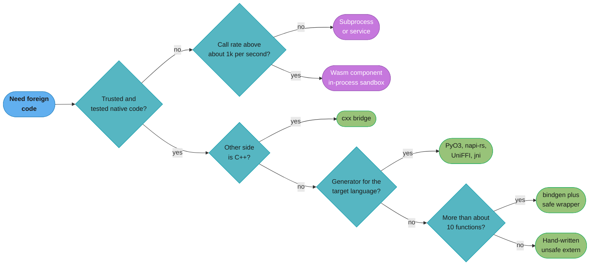
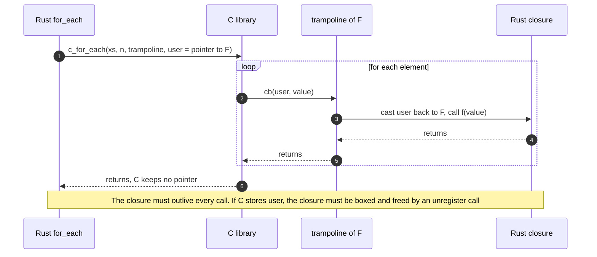

# FFI and Language Interop

> **Version anchor (2026-11-06).** Rust 1.99.1 (2026-10-15) on edition 2024. `extern "C-unwind"` is `[1.71]`. C-string literals `c"..."` are `[1.77]`. Since 1.81 a panic that reaches an `extern "C"` function aborts the process. `unsafe extern` blocks and `#[unsafe(no_mangle)]` are `[1.82]`, and edition 2024 makes both required `[ed2024]`. 1.99 stabilizes C-variadic function definitions and `core::ffi::VaList`. 1.99.1 fixes the zero-extension of an FFI `bool` return value on x86_64. Crates: bindgen 0.73.2, cbindgen 0.29.4, cxx 1.0.205, pyo3 0.30.1, maturin 1.16.0, napi 3.16.1, jni 0.22.4, uniffi 0.32.2.

---

## 1. Concept Overview

Rust has no stable ABI of its own. The layout of a `struct`, the order of its fields, the
calling convention of a plain `fn` and the representation of a trait object can all change
between compiler versions. So every boundary between Rust and another language goes through
the C ABI: `extern "C"` functions, `#[repr(C)]` types, raw pointers and integers. C is the
common language that Python, Node.js, the JVM, Swift, Go and C++ all speak.

Two directions exist. **Rust calls foreign code** through declarations in an
`unsafe extern "C"` block, usually generated by bindgen from a C header. **Foreign code calls
Rust** through `#[unsafe(no_mangle)] pub extern "C" fn` items, compiled into a `cdylib` or
`staticlib` and described to C by a header that cbindgen writes. Everything above that, such
as PyO3, napi-rs, the jni crate, cxx and UniFFI, is a generator that writes the C-ABI glue
for you and adds the target language's object model on top.

The hard part of FFI is not the call. A call through `extern "C"` costs about as much as any
other non-inlined function call. The hard part is the contract that the compiler cannot see:
who allocates and who frees, how long a pointer stays valid, which thread may touch an
object, what happens to a panic or an exception, and whether a value the other side returns
is valid for the Rust type you declared. Most FFI bugs in production are a broken contract of
that kind.

This module covers the Rust API surface for both directions, strings and ownership,
callbacks, unwinding, variadics, the binding generators, the Rust-specific parts of PyO3,
napi-rs, jni and UniFFI, and a decision model for in-process FFI against a subprocess or a
service. ABI theory (calling conventions, linking, sonames) lives in
[ABIs, Linking and Wasm](../../cs_fundamentals/how_code_runs_compilers_and_interpreters/abis_linking_and_wasm.md).
A PyO3 extension end to end (the Rust code, `py.detach`, free threading, maturin and wheels)
lives in §6.1 and §14 of
[C Extensions and Native Interop](../../python/c_extensions_and_native_interop/c_extensions_and_native_interop.md).
The unsafe rules that every FFI call depends on live in
[Unsafe Rust and Undefined Behavior](../unsafe_rust_and_undefined_behavior/unsafe_rust_and_undefined_behavior.md).

---

## 2. Intuition

> **One-line analogy**: FFI is a shipping container. Both ports agree on the container's
> outside dimensions (the C ABI). Neither port can see inside, so the paperwork (the
> contract on ownership, lifetime and threads) is the only thing that stops a crate of
> glass from being packed under a crate of bricks.

**Mental model**: draw a line down the middle of the process. On the Rust side the compiler
checks ownership, lifetimes and `Send`. On the other side, it checks nothing. Every value
that crosses the line must be converted into something both sides understand (integers,
raw pointers, `#[repr(C)]` structs), and every promise the Rust side relied on must be
written down and re-checked on the way back in. A safe wrapper is a customs desk on the
Rust side of the line: it validates what arrives and puts it back into types the compiler
can check.

**Why it matters**: FFI code is where safe Rust programs most often get undefined
behavior. A `bool` returned by C with the value 2, a pointer freed by `free()` after Rust
allocated it, a callback that C calls after the closure was dropped, or a C++ exception
that unwinds into a Rust frame: each one compiles, each one passes most tests, and each one
corrupts memory under load.

**Key insight**: write the raw bindings once, keep them private, and put a safe, idiomatic
Rust API on top in the same crate. The rest of the program then never sees a raw pointer,
and the review effort concentrates on one module.

---

## 3. Core Principles

1. **Only C-ABI types cross.** Integers, floats, raw pointers, `#[repr(C)]` structs and
   enums, `Option<&T>` and `Option<NonNull<T>>` (null-pointer niche), and function pointers
   with an `extern "C"` ABI. Never `&str`, `String`, `Vec`, `Box<dyn Trait>`, or a
   `repr(Rust)` struct.
2. **The allocator that allocates is the allocator that frees.** Memory from `Box`,
   `CString` or `Vec` goes back to Rust through a `_free` function you export. Memory from
   C's `malloc` goes back through C's `free`.
3. **A foreign value is untrusted until checked.** Take a C `int` for a C enum or a C
   `bool`, then convert with `TryFrom`. A Rust `bool` or enum with an invalid bit pattern
   is UB the moment it exists.
4. **Panics do not cross `extern "C"`.** Since 1.81 a panic that reaches an `extern "C"`
   function aborts the process. Catch it with `catch_unwind` and return an error code, or
   use `extern "C-unwind"` when both sides really need unwinding to cross.
5. **Raw bindings are private and wrapped once.** Declare the foreign functions in a
   `sys` module or a `-sys` crate. The public API uses `Result`, slices, `&str`, RAII types
   with `Drop`, and correct `Send` and `Sync`.
6. **Thread rules come from the foreign library's documentation.** A raw-pointer wrapper
   is neither `Send` nor `Sync` by default. Add `unsafe impl Send` only when the C
   library's docs say a handle may move between threads.
7. **Measure the crossing count before the crossing cost.** A chatty boundary (one call per
   element) costs more in lost inlining and conversions than the call itself. Design the
   C API around batches.

---

## 4. Types / Architectures / Strategies

### 4.1 Binding approaches

| Approach | Direction | What it generates | Use when |
|---|---|---|---|
| Hand-written `unsafe extern "C"` block | Rust calls C | Nothing. You write the declarations | Fewer than about 10 functions, stable C API |
| bindgen | Rust calls C | Rust declarations from C headers, usually in `build.rs` | A large or changing C API |
| cbindgen | C calls Rust | A C or C++ header from your `extern "C"` items | You ship a Rust library with a C API |
| cxx | Both, with C++ | A bridge module with checked C++ types (`UniquePtr`, `CxxString`, `CxxVector`) | Two-way C++ interop where both sides change |
| autocxx | Rust calls C++ | cxx bridges from C++ headers | Calling a large existing C++ API |
| PyO3 + maturin | Python calls Rust | A CPython extension module | Python extension, see the python page |
| napi-rs | Node.js calls Rust | A Node-API addon and its `.d.ts` | A Node.js native addon |
| jni crate | JVM calls Rust, Rust calls JVM | Nothing generated. Typed wrappers over JNI | Android or JVM native code |
| UniFFI | Kotlin, Swift, Python call Rust | Foreign-language bindings from Rust definitions | One Rust core for several mobile platforms |

### 4.2 Decision model: binding style and boundary shape

Pick the boundary shape first, then the binding style.

| Boundary shape | Cost per call | Failure isolation | Choose when |
|---|---|---|---|
| In-process FFI | A function call plus argument conversion | None. A crash or UB in either side kills the process | High call rate, large shared buffers, a library you trust or can test hard |
| Subprocess (stdin and stdout, or a pipe) | Process start once, then pipe I/O per message | Full. The child crashes alone | Untrusted or crash-prone native code, low call rate, a CLI that already exists |
| Local service (Unix socket, gRPC) | A loopback round trip per call | Full, plus independent deploys and scaling | Several callers, a different release cadence, a team boundary |
| Wasm component in-process | A call into the sandbox plus copying into linear memory | Memory isolation, traps are recoverable | Untrusted plugins. See [WebAssembly and WASI](../webassembly_and_wasi/webassembly_and_wasi.md) |

| Binding style | Safety of generated code | Effort | Pick when |
|---|---|---|---|
| Hand-written declarations | As good as your review | Low for small APIs, high to keep in sync | A handful of stable functions |
| bindgen | Exact signatures, all `unsafe` | Low. The header is the source of truth | A C library with a large or versioned header |
| cxx | Safe shared types, checked at build time on both sides | Medium. You describe the bridge | C++ on both sides, with strings, vectors and smart pointers |
| A language generator (PyO3, napi-rs, UniFFI) | Safe, idiomatic API on both sides | Low per function | The target language has one, and you control the Rust side |

### 4.3 Ownership strategies across the boundary

| Strategy | Rust API | Who frees | Use for |
|---|---|---|---|
| Borrow for one call | `as_ptr()`, `as_mut_ptr()`, `CStr::as_ptr` | The owner, after the call returns | Buffers passed to `read`/`write`-shaped C functions |
| Rust-owned handle | `Box::into_raw`, then `Box::from_raw` in `thing_free` | Rust, through your exported free function | Opaque objects exported to C |
| Rust-owned string | `CString::into_raw`, then `CString::from_raw` in `string_free` | Rust | Strings returned to C |
| C-owned memory | A wrapper type whose `Drop` calls the C `free` function | C | Objects a C library allocates |
| Caller-provided buffer | C passes `buf` and `cap`, Rust writes and returns the length | The caller | Avoiding allocation across the boundary entirely |

---

## 5. Architecture Diagrams

### Choosing a boundary and a binding



Isolation comes first because it decides the failure mode. The binding style only decides
how much glue you write by hand.

### `#[repr(C)]` against the default layout

```
#[repr(C)] struct PointC { tag: u8, x: u32, flag: u8 }      size 12, align 4

offset  0     1     2     3     4     5     6     7     8     9     10    11
       +-----+-----+-----+-----+-----+-----+-----+-----+-----+-----+-----+-----+
       | tag | pad | pad | pad |          x            |flag | pad | pad | pad |
       +-----+-----+-----+-----+-----+-----+-----+-----+-----+-----+-----+-----+

struct PointRust { tag: u8, x: u32, flag: u8 }              size 8 on rustc 1.99.1

offset  0     1     2     3     4     5     6     7
       +-----+-----+-----+-----+-----+-----+-----+-----+
       |          x            | tag |flag | pad | pad |
       +-----+-----+-----+-----+-----+-----+-----+-----+
```

`#[repr(C)]` keeps declaration order and C's padding, so C sees the same offsets. The
default representation reordered the fields to save 4 bytes, and rustc may choose a
different order in another release. That is why a `repr(Rust)` type never crosses FFI.

### A C callback that calls a Rust closure



C sees a plain function pointer and a `void*`. The generic trampoline restores the closure
type on the Rust side, so each closure type gets its own monomorphized trampoline.

---

## 6. How It Works - Detailed Mechanics

### 6.1 Calling C from Rust

Declarations live in an `unsafe extern "C"` block `[ed2024]`. The `unsafe` states that you
promise the signatures match the real symbols. A function whose signature alone makes it
safe to call can be marked `safe fn`, and callers then need no `unsafe` block.

```rust
use std::ffi::{c_char, c_int};

unsafe extern "C" {
    pub safe fn abs(x: c_int) -> c_int;
    pub fn strlen(s: *const c_char) -> usize;
}

fn main() {
    assert_eq!(abs(-4), 4);
    // SAFETY: a `c"..."` literal is NUL-terminated and has a 'static lifetime.
    let n = unsafe { strlen(c"hello".as_ptr()) };
    assert_eq!(n, 5);
}
```

`strlen` stays unsafe because a non-terminated pointer makes it read out of bounds. Use the
`std::ffi` aliases (`c_int`, `c_long`, `c_char`) instead of `i32` or `i64`, because
`c_long` is 32 bits on 64-bit Windows and 64 bits on 64-bit Linux. `c_char` is signed on
x86-64 and unsigned on most ARM Linux targets.

### 6.2 Layout: `#[repr(C)]`, `#[repr(transparent)]` and enums

```rust
use std::mem::size_of;

#[repr(C)]
pub struct PointC {
    pub tag: u8,
    pub x: u32,
    pub flag: u8,
}

pub struct PointRust {
    pub tag: u8,
    pub x: u32,
    pub flag: u8,
}

#[repr(transparent)]
pub struct Fd(pub std::ffi::c_int);

fn main() {
    assert_eq!(size_of::<PointC>(), 12);
    // Not promised by the language. Rustc 1.99.1 reorders fields to 8 bytes.
    assert_eq!(size_of::<PointRust>(), 8);
    assert_eq!(size_of::<Fd>(), size_of::<std::ffi::c_int>());
}
```

`#[repr(transparent)]` gives a newtype the same layout and ABI as its single field, so
`Fd` can appear in an `extern "C"` signature where C expects an `int`. A fieldless
`#[repr(C)]` enum matches a C enum's size, but a C enum can hold any integer, so a C
function that returns an enum must be declared to return `c_int` and converted with a
checked `TryFrom`.

### 6.3 Exporting Rust to C: the opaque handle

The standard shape is an opaque pointer with a constructor, methods and a destructor. C
never sees the struct's fields, so you can change them freely.

```rust
use std::ffi::{c_char, CStr};

pub struct Counter {
    hits: u64,
    name: String,
}

#[unsafe(no_mangle)]
pub extern "C" fn counter_new(name: *const c_char) -> *mut Counter {
    if name.is_null() {
        return std::ptr::null_mut();
    }
    // SAFETY: the header documents `name` as a NUL-terminated string that stays
    // valid for the duration of this call.
    let name = unsafe { CStr::from_ptr(name) }.to_string_lossy().into_owned();
    Box::into_raw(Box::new(Counter { hits: 0, name }))
}

/// # Safety
///
/// `c` is null or a pointer from `counter_new` that was not passed to `counter_free`.
#[unsafe(no_mangle)]
pub unsafe extern "C" fn counter_hit(c: *mut Counter) -> u64 {
    // SAFETY: per the contract, `c` is null or valid and not aliased during the call.
    match unsafe { c.as_mut() } {
        Some(c) => {
            c.hits += 1;
            c.hits
        }
        None => 0,
    }
}

/// # Safety
///
/// `c` is null or a pointer from `counter_new`, and it is not used after this call.
#[unsafe(no_mangle)]
pub unsafe extern "C" fn counter_free(c: *mut Counter) {
    if !c.is_null() {
        // SAFETY: per the contract, `c` came from `Box::into_raw` and is freed once.
        drop(unsafe { Box::from_raw(c) });
    }
}
```

Build it with `crate-type = ["cdylib"]` for a shared library or `["staticlib"]` for a `.a`
archive, and run `cbindgen --lang c --output counter.h` to write the header. Prefix every
exported name with the library name, because the C symbol namespace is global.

### 6.4 Strings: `CStr`, `CString` and `c"..."` literals

| Type | Owns? | Invariant | Typical use |
|---|---|---|---|
| `&CStr` | No | NUL-terminated, no interior NUL | A string C passes in, or a `c"..."` literal `[1.77]` |
| `CString` | Yes | Same, allocated by Rust | A string Rust builds and passes to C |
| `*const c_char` | No | Nothing | The raw form in signatures |

`CString::new` fails if the input has an interior NUL byte, so it returns a `Result`.
`CStr::to_str` fails on non-UTF-8 bytes. `to_string_lossy` replaces them. A string returned
to C must come back to Rust to be freed:

```rust
use std::ffi::{c_char, CString};

#[unsafe(no_mangle)]
pub extern "C" fn counter_version() -> *mut c_char {
    match CString::new(format!("counter {}.{}", 3, 1)) {
        Ok(s) => s.into_raw(),
        Err(_) => std::ptr::null_mut(),
    }
}

/// # Safety
///
/// `s` is null or a pointer from `counter_version`, and it is freed once.
#[unsafe(no_mangle)]
pub unsafe extern "C" fn counter_string_free(s: *mut c_char) {
    if !s.is_null() {
        // SAFETY: per the contract, `s` came from `CString::into_raw`.
        drop(unsafe { CString::from_raw(s) });
    }
}
```

Byte data that is not text crosses as a pointer and a length (`*const u8`, `usize`), and
the Rust side rebuilds a slice with `slice::from_raw_parts` after checking for null.

### 6.5 Callbacks with user data

Most C callback APIs take a function pointer and a `void*` that they pass back unchanged.
A generic `extern "C"` trampoline turns that pair into a Rust closure call.

```rust
use std::ffi::{c_int, c_void};

pub type Callback = unsafe extern "C" fn(user: *mut c_void, value: c_int);

/// Stands in for a C function `void c_for_each(const int*, size_t, cb, void*)`.
///
/// # Safety
///
/// `xs` points to `n` readable ints and `cb` accepts `user`.
pub unsafe extern "C" fn c_for_each(xs: *const c_int, n: usize, cb: Callback, user: *mut c_void) {
    for i in 0..n {
        // SAFETY: the caller guarantees `n` readable ints at `xs` and a matching `cb`.
        unsafe { cb(user, *xs.add(i)) };
    }
}

unsafe extern "C" fn trampoline<F: FnMut(c_int)>(user: *mut c_void, value: c_int) {
    // SAFETY: `user` is the `&mut F` that `for_each` passed in, live for the whole call.
    let f = unsafe { &mut *user.cast::<F>() };
    f(value);
}

pub fn for_each<F: FnMut(c_int)>(xs: &[c_int], mut f: F) {
    let user = (&raw mut f).cast::<c_void>();
    // SAFETY: `xs` gives `len` readable ints, `trampoline::<F>` matches the type
    // behind `user`, and `f` outlives the call because C keeps no copy of `user`.
    unsafe { c_for_each(xs.as_ptr(), xs.len(), trampoline::<F>, user) };
}

fn main() {
    let mut sum = 0;
    for_each(&[1, 2, 3], |x| sum += x);
    assert_eq!(sum, 6);
}
```

If C stores the callback and calls it later, the borrowed `&mut F` is wrong. Box the
closure (`Box<Box<dyn FnMut(c_int) + Send>>`), pass `Box::into_raw`, require `'static`, and
free it in the unregister function. §14 shows that version.

### 6.6 Panics, exceptions and `extern "C-unwind"`

A panic inside the closure above unwinds into `trampoline`, which is `extern "C"`. Since
1.81 that aborts the process. Before 1.81 it was UB. For a library that C calls, catch the
panic at every exported function and turn it into an error code:

```rust
use std::ffi::c_int;
use std::panic::catch_unwind;

pub const OK: c_int = 0;
pub const ERR_PANIC: c_int = -1;
pub const ERR_NULL: c_int = -2;

/// # Safety
///
/// `out` is null or points to a writable `i32`.
#[unsafe(no_mangle)]
pub unsafe extern "C" fn mylib_div(a: i32, b: i32, out: *mut i32) -> c_int {
    if out.is_null() {
        return ERR_NULL;
    }
    match catch_unwind(|| a / b) {
        Ok(v) => {
            // SAFETY: `out` is non-null and, per the contract, writable.
            unsafe { out.write(v) };
            OK
        }
        Err(_) => ERR_PANIC,
    }
}
```

`a / b` panics on `b == 0` and on `i32::MIN / -1`. `catch_unwind` does not catch a panic
when the crate is built with `panic = "abort"`, so a library that C calls should document
which panic strategy it needs. Use `extern "C-unwind"` `[1.71]` only when the design needs
unwinding to cross, for example a C++ exception thrown through Rust frames back to a C++
`catch`. A foreign exception that unwinds through a plain `extern "C"` frame is UB.

### 6.7 C-variadic functions `[1.99]`

Rust has always been able to call a variadic C function such as `printf`. Since 1.99 it can
also define one with the `"C"` or `"C-unwind"` ABI. The `...` parameter has type `VaList`,
and `next_arg` reads one argument of a type that implements `VaArgSafe`.

```rust
use std::ffi::{c_char, c_int};

unsafe extern "C" {
    fn printf(fmt: *const c_char, ...) -> c_int;
}

/// # Safety
///
/// The caller passes exactly `count` extra arguments of C type `int`.
#[unsafe(no_mangle)]
pub unsafe extern "C" fn mylib_sum(count: usize, mut args: ...) -> c_int {
    let mut total = 0;
    for _ in 0..count {
        // SAFETY: the caller promises `count` arguments of type `int`.
        total += unsafe { args.next_arg::<c_int>() };
    }
    total
}

fn main() {
    // SAFETY: each call matches its contract: three ints for `mylib_sum`, and one
    // int for the single `%d` in the format string.
    unsafe {
        let s = mylib_sum(3, 1 as c_int, 2 as c_int, 3 as c_int);
        printf(c"sum=%d\n".as_ptr(), s);
    }
}
```

C's default argument promotions apply: a `float` arrives as a `double` and a `char` as an
`int`, so `VaArgSafe` is not implemented for `f32` or `u8`. Nothing checks the count or
the types at run time. A variadic API is a contract with no compiler on either side, so
offer an array-taking function next to it.

### 6.8 Generating bindings: bindgen, the `cc` crate and cbindgen

A `-sys` crate compiles or links the C library and exposes raw bindings. The build script
does the work:

```rust
// fragment: build.rs of a hypothetical zstd-sys crate
fn main() {
    println!("cargo:rustc-link-lib=zstd");
    println!("cargo:rerun-if-changed=wrapper.h");
    let bindings = bindgen::Builder::default()
        .header("wrapper.h")
        .allowlist_function("ZSTD_.*")
        .parse_callbacks(Box::new(bindgen::CargoCallbacks::new()))
        .generate()
        .expect("bindgen could not parse wrapper.h");
    let out = std::path::PathBuf::from(std::env::var("OUT_DIR").expect("cargo sets OUT_DIR"));
    bindings
        .write_to_file(out.join("bindings.rs"))
        .expect("could not write bindings.rs");
}
```

The crate then has `include!(concat!(env!("OUT_DIR"), "/bindings.rs"));` in its `lib.rs`.
Set `links = "zstd"` in `Cargo.toml` so Cargo refuses two crates that link the same native
library. The `cc` crate compiles vendored C sources from the same build script. bindgen
needs libclang at build time, which is a real cost in CI images. Some `-sys` crates commit
the generated file for each supported target to avoid that.

The reverse direction runs cbindgen over the crate's `extern "C"` items and writes a header.
Put the cbindgen run in CI and fail the build if the committed header differs, so the
header and the library cannot drift.

### 6.9 C++ with cxx

cxx describes both sides in one bridge module. It checks at build time that the C++
declarations match, and it gives safe types for strings, vectors and owned pointers.

```rust
// fragment: a cxx bridge
#[cxx::bridge]
mod ffi {
    struct Chunk {
        offset: u64,
        len: u32,
    }

    extern "Rust" {
        fn checksum(data: &[u8]) -> u32;
    }

    unsafe extern "C++" {
        include!("store/include/blobstore.h");
        type BlobstoreClient;
        fn new_blobstore_client() -> UniquePtr<BlobstoreClient>;
        fn put(self: Pin<&mut BlobstoreClient>, data: &[u8]) -> u64;
        fn chunks(&self, id: u64) -> Vec<Chunk>;
    }
}

fn checksum(data: &[u8]) -> u32 {
    data.iter().fold(0u32, |a, &b| a.rotate_left(5) ^ u32::from(b))
}
```

Inside a cxx bridge, `Pin<&mut T>` is how C++ methods that are not `const` receive `this`,
because a C++ object may hold pointers to itself and must not move. autocxx generates cxx
bridges from existing C++ headers, which suits a large C++ API that you call but do not
change.

### 6.10 Python with PyO3: the Rust-specific rules

PyO3 0.30.1 builds a CPython extension from `#[pymodule]` and `#[pyfunction]` items, uses
`Bound<'py, T>` for Python objects tied to an attached thread, and releases the GIL with
`py.detach`. The full extension, free-threading support, maturin 1.16.0 and the wheel
matrix are in §6.1 to §6.3 and §14 of
[C Extensions and Native Interop](../../python/c_extensions_and_native_interop/c_extensions_and_native_interop.md),
and pydantic-core is worked through in
[pydantic-core and Performance](../../fastapi/pydantic_v2_deep_dive/pydantic_core_and_performance.md).
This section covers two things those pages do not.

**`#[pyclass]` requires `Send` and `Sync`.** Python decides which thread drops an object,
and several threads can read the same object at once, especially on a free-threaded
interpreter. So PyO3 requires every `#[pyclass]` type to be `Send` and `Sync`. A field such
as `Rc<T>` or `RefCell<T>` fails to compile. Replace it with `Arc<T>`, a `Mutex<T>`, or an
atomic. `#[pyclass(unsendable)]` removes the requirement, and concurrent access to the Rust
data then becomes a runtime error. Use it only for objects that never leave one thread.

```rust
// fragment: pyo3 0.30
use pyo3::prelude::*;
use std::sync::Mutex;

#[pyclass]
struct Tokenizer {
    vocab: std::sync::Arc<Vec<String>>,
    stats: Mutex<u64>,
}
```

**Error mapping.** A `#[pyfunction]` can return `Result<T, E>` when `E` converts into
`PyErr`. Write `impl From<MyError> for PyErr` and pick the Python exception class there.
The orphan rule blocks that impl for an error type from another crate, so wrap it in a
newtype first. A library-specific exception class comes from `create_exception!`.

```rust
// fragment: pyo3 0.30
use pyo3::create_exception;
use pyo3::exceptions::{PyException, PyValueError};
use pyo3::prelude::*;

create_exception!(fasttok, TokenizeError, PyException, "Tokenizer failure.");

enum MyError {
    BadInput(String),
    Internal(String),
}

impl From<MyError> for PyErr {
    fn from(e: MyError) -> PyErr {
        match e {
            MyError::BadInput(m) => PyValueError::new_err(m),
            MyError::Internal(m) => TokenizeError::new_err(m),
        }
    }
}

#[pyfunction]
fn encode(text: &str) -> Result<Vec<u32>, MyError> {
    if text.is_empty() {
        return Err(MyError::BadInput("empty input".to_string()));
    }
    Ok(text.bytes().map(u32::from).collect())
}
```

A Rust panic inside a `#[pyfunction]` becomes a `PanicException` in Python.
`PanicException` derives from `BaseException`, not `Exception`, so a Python
`except Exception:` does not catch it. That is by design: a panic means a bug, not bad
input. Map every expected failure to a `Result`.

### 6.11 Node.js, the JVM and mobile

**napi-rs** (napi 3.16.1) exports functions, structs and classes to Node.js through
Node-API with a `#[napi]` attribute. It also writes the TypeScript `.d.ts` file, and it
renames `snake_case` Rust names to `camelCase` JavaScript names. A `#[napi]` function that
returns `napi::Result<T>` throws a JavaScript error on `Err`.

```rust
// fragment: napi-rs 3
use napi_derive::napi;

#[napi]
pub fn sum(a: u32, b: u32) -> u32 {
    a + b
}
```

**jni** (jni 0.22.4) implements a Java `native` method. The first argument is an
`EnvUnowned`, and `with_env` upgrades it to an `Env` for the body. `resolve` turns an error
or a panic into a thrown Java exception and returns a default value.

```rust
// fragment: jni 0.22
use jni::objects::{JClass, JString};
use jni::EnvUnowned;

#[unsafe(no_mangle)]
pub extern "system" fn Java_com_example_Native_greet<'caller>(
    mut unowned_env: EnvUnowned<'caller>,
    _class: JClass<'caller>,
    input: JString<'caller>,
) -> JString<'caller> {
    let outcome = unowned_env.with_env(|env| -> Result<_, jni::errors::Error> {
        let name: String = input.to_string();
        JString::from_str(env, format!("Hello, {name}!"))
    });
    outcome.resolve::<jni::errors::ThrowRuntimeExAndDefault>()
}
```

The `extern "system"` ABI matters: it is `stdcall` on 32-bit Windows and `C` elsewhere,
which is what the JVM expects. The `native_method` and `bind_java_type` macros register
methods and write the mangled names for you.

**UniFFI** (uniffi 0.32.2) generates Kotlin, Swift and Python bindings from Rust items
marked `#[uniffi::export]`, `#[derive(uniffi::Record)]` and similar. It is the tool for one
Rust core shared by an Android app and an iOS app. Strings, records and lists cross as a
serialized buffer, so UniFFI suits coarse calls, not per-pixel work.

```rust
// fragment: uniffi 0.32
uniffi::setup_scaffolding!();

#[derive(uniffi::Record)]
pub struct Quote {
    pub symbol: String,
    pub price_cents: i64,
}

#[uniffi::export]
pub fn best_quote(quotes: Vec<Quote>) -> Option<Quote> {
    quotes.into_iter().max_by_key(|q| q.price_cents)
}
```

---

## 7. Real-World Examples

- **pydantic-core.** The validation core of pydantic v2 is Rust exposed through PyO3. See
  [pydantic-core and Performance](../../fastapi/pydantic_v2_deep_dive/pydantic_core_and_performance.md).
- **Hugging Face tokenizers and Polars.** Both ship a Rust core to Python through PyO3
  wheels. The Python packaging side is in
  [C Extensions and Native Interop](../../python/c_extensions_and_native_interop/c_extensions_and_native_interop.md).
- **Envoy dynamic modules.** Envoy loads a shared object built with an official Rust SDK
  into the proxy process, which is the in-process FFI shape with no sandbox. A bug crashes
  the proxy. See [Envoy Proxy](../../technologies/envoy_proxy/envoy_proxy.md).
- **Rust for Linux.** Kernel Rust wraps C kernel APIs in safe abstractions, the pattern of
  §3 principle 5 at operating-system scale. The kernel's Rust experiment concluded on
  2025-12-13.
- **UniFFI at Mozilla.** Mozilla built UniFFI to share Rust components between its Android
  and iOS applications.
- **The other languages' side of the same boundary.** Go's cgo and Java's FFM API solve the
  same problem with different costs. See [cgo and FFI](../../go/cgo_and_ffi/cgo_and_ffi.md)
  and [Java FFM API](../../java/foreign_function_and_memory_api/foreign_function_and_memory_api.md).

---

## 8. Tradeoffs

### 8.1 Binding tools

| Tool | Direction | Safe API generated? | Build-time cost | Main limit |
|---|---|---|---|---|
| Hand-written | Rust calls C | No | None | Drift from the header |
| bindgen | Rust calls C | No, raw `unsafe` declarations | libclang in CI, header parsing | Macros and inline functions need wrappers |
| cbindgen | C calls Rust | Header only | Small | Only C-ABI items appear |
| cxx | Both, C++ | Yes, for the bridge types | A C++ compiler and the generated glue | Only the types cxx supports cross directly |
| PyO3 | Python calls Rust | Yes | maturin and a wheel matrix | `Send` and `Sync` on every `#[pyclass]` |
| napi-rs | Node.js calls Rust | Yes, with `.d.ts` | One native build per platform | Prebuilt binaries per OS and CPU |
| jni | JVM and Rust | Partly, through typed wrappers | Small | Local reference limits, `extern "system"` |
| UniFFI | Kotlin, Swift, Python call Rust | Yes | Binding generation step | Serialized arguments, coarse calls only |

### 8.2 Error and panic strategy at the boundary

| Strategy | C side sees | Cost | Use when |
|---|---|---|---|
| Return code plus out-parameter | `int` status, value written through a pointer | Small, explicit | A C API |
| Thread-local last-error string | `-1`, then `lib_last_error()` | A thread-local per call | A C API with rich messages |
| `catch_unwind` at every export | An error code instead of an abort | One landing pad per export | Any library that C calls |
| `extern "C-unwind"` | The unwind crosses | Both sides must allow unwinding | C++ callers that catch exceptions |
| Abort | Process exit | None | Panics are bugs, and a supervisor restarts the process |

---

## 9. When to Use / When NOT to Use

### Use in-process FFI when

- A mature C or C++ library has no Rust equivalent and the call rate is high: codecs,
  compression, cryptography that must stay certified, a database engine.
- You ship a Rust core to Python, Node.js, the JVM or mobile, and the host language's users
  expect an import, not a service.
- Large buffers must be shared without copying.

### Do NOT use in-process FFI when

- The native code is untrusted, crash-prone or parses hostile input, and a crash must not
  take down the host. Use a subprocess, a service, or a Wasm component.
- A pure-Rust crate does the job. Each C dependency adds a C toolchain to every build and
  cross-compile, and every CVE in it becomes your release.
- The interface is chatty (one call per element) and you cannot redesign it into batches.
- The team cannot review `unsafe` code. The wrapper module needs an owner who can.

---

## 10. Common Pitfalls

### 10.1 A plain `extern` block after the edition 2024 migration

A crate moved to edition 2024 and its hand-written declarations stopped compiling. The
error is the language asking you to state the promise that was always there.

```rust
// BROKEN
use std::ffi::c_int;

extern "C" {
    // error: extern blocks must be unsafe
    fn abs(x: c_int) -> c_int;
}
```

```rust
// FIX
use std::ffi::c_int;

unsafe extern "C" {
    pub safe fn abs(x: c_int) -> c_int;
}

pub fn distance(a: c_int, b: c_int) -> c_int {
    abs(a - b)
}
```

While migrating, read each declaration against the current header. The migration found a
`long` declared as `i64` that was wrong on 64-bit Windows.

### 10.2 `#[no_mangle]` without `unsafe`

```rust
// BROKEN
#[no_mangle] // error: unsafe attribute used without unsafe
pub extern "C" fn mylib_init() -> i32 {
    0
}
```

```rust
// FIX
#[unsafe(no_mangle)]
pub extern "C" fn mylib_init() -> i32 {
    0
}
```

The attribute is unsafe because an unmangled `init` or `malloc` can replace a symbol of the
same name elsewhere in the process. Prefix every export with the library name.

### 10.3 A Rust type in an `extern "C"` signature

An export took `&str` because "it is just a pointer and a length". It is a fat pointer whose
layout C does not know, and rustc warns with `improper_ctypes_definitions`. A team that
denies the lint sees an error.

```rust
// BROKEN
#![deny(improper_ctypes_definitions)]

#[unsafe(no_mangle)]
pub extern "C" fn mylib_name_len(s: &str) -> usize {
    // error: `extern` fn uses type `str`, which is not FFI-safe
    s.len()
}
```

```rust
// FIX: take a pointer and a length, and check the bytes on the Rust side.
#![deny(improper_ctypes_definitions)]

/// # Safety
///
/// `ptr` is null or points to `len` readable bytes.
#[unsafe(no_mangle)]
pub unsafe extern "C" fn mylib_name_len(ptr: *const u8, len: usize) -> isize {
    if ptr.is_null() {
        return -1;
    }
    // SAFETY: per the contract, `ptr` points to `len` readable bytes.
    let bytes = unsafe { std::slice::from_raw_parts(ptr, len) };
    match std::str::from_utf8(bytes) {
        Ok(s) => s.chars().count() as isize,
        Err(_) => -2,
    }
}
```

Deny `improper_ctypes` and `improper_ctypes_definitions` in every FFI crate. Both are only
warnings by default.

### 10.4 A pointer to a temporary `CString`

`let p = CString::new(path)?.as_ptr();` drops the `CString` at the end of the statement,
so `p` dangles before the C call reads it. rustc's `dangling_pointers_from_temporaries`
lint warns about this pattern. Keep the `CString` in a named variable that lives until the
C call returns, then call `as_ptr()` on it.

### 10.5 Freeing with the wrong allocator

A C caller freed a string from `counter_version` with `free()`. On Linux with glibc it
worked for months, because Rust's default allocator is the system `malloc`. Then the
service switched its global allocator to mimalloc for throughput, and every `free()` of a
Rust allocation corrupted the heap. Export a matching free function for every allocation
that crosses, and never document "call free() on the result".

### 10.6 Trusting a `bool` or an enum from C

A C library returned a status `enum` declared on the Rust side as a fieldless
`#[repr(C)]` enum with 4 variants. A new library version added a fifth status. The Rust
code received a discriminant it did not declare, which is UB, and a `match` jumped through
a table to an address outside the function. Declare foreign enum returns as `c_int`,
convert with `TryFrom`, and map unknown values to an error. The same applies to `bool`:
C's `_Bool` is only promised to be 0 or 1 if the C code is correct. 1.99.1 fixed a rustc bug
in the zero-extension of FFI `bool` return values on x86_64, which shows how fragile this
corner is.

### 10.7 Calling `setenv` while C code reads the environment

A service called `std::env::set_var` at runtime to change a C library's configuration while
another thread inside the C library called `getenv`. glibc's environment is not
thread-safe, and the process crashed in `getenv`. In edition 2024, `set_var` and
`remove_var` are `unsafe` `[ed2024]` for this reason. Set the environment before any
thread starts, or pass configuration to the library through its API.

---

## 11. Technologies & Tools

| Tool | Purpose |
|---|---|
| bindgen | Generates Rust FFI declarations from C and some C++ headers |
| cbindgen | Generates C and C++ headers from a Rust crate's `extern "C"` items |
| cc | Compiles vendored C and C++ sources from `build.rs` |
| cxx | Safe two-way Rust and C++ bridge with shared types |
| autocxx | Generates cxx bridges from existing C++ headers |
| PyO3 | Rust bindings to CPython for extension modules and embedding |
| maturin | Builds and publishes PyO3 extensions as wheels |
| napi-rs | Node-API addons in Rust, with generated TypeScript definitions (crate `napi`) |
| jni | Rust bindings to the Java Native Interface |
| UniFFI | Generates Kotlin, Swift and Python bindings from Rust definitions |
| Miri | Checks the Rust side of the wrapper for UB, but cannot run most real FFI calls |
| AddressSanitizer | Finds out-of-bounds access and use-after-free across Rust and C in one process |

---

## 12. Interview Questions with Answers

**Q: What happens when a Rust panic reaches an `extern "C"` function?**
**Short:** Since Rust 1.81 the process aborts. Before 1.81 it was undefined behavior. Catch the panic at the boundary or use `extern "C-unwind"`.

The C ABI has no unwinding contract, so Rust cannot let the panic run through C frames. The
abort is defined and safe, but a library that C calls should not kill its host on a bug in
one request. Wrap the body of each export in `catch_unwind` and return an error code.
`catch_unwind` does nothing under `panic = "abort"`, so state in the docs which strategy
the library needs.

**Q: Which side must free memory that crosses the boundary?**
**Short:** The side that allocated it. Rust memory goes back to Rust through an exported free function, and C memory goes back through C's free.

Rust's `Box`, `Vec` and `CString` use the Rust global allocator, which may be the system
`malloc` today and mimalloc or jemalloc after a config change. Calling C's `free()` on a
Rust allocation works by accident with the system allocator and corrupts the heap with any
other one. Export `thing_free` and `string_free` next to every constructor, and wrap
C-allocated objects in a Rust type whose `Drop` calls the C library's free function.

**Q: Why can't you pass a `&str`, `String` or `Vec` to C?**
**Short:** Their layout is a Rust implementation detail and C has no matching type. Pass a pointer and a length, or a NUL-terminated C string.

`&str` is a fat pointer, and `String` and `Vec` are three-word structs whose field order is
not promised. rustc warns with `improper_ctypes` and `improper_ctypes_definitions`. Pass
`(ptr, len)` for bytes, `*const c_char` from a `CStr` or `CString` for text, and rebuild the
slice on the Rust side with `slice::from_raw_parts` after a null check. Deny both lints in
FFI crates.

**Q: Why must a `bool` or enum returned by C be validated before Rust uses it?**
**Short:** A Rust `bool` or enum with an undeclared bit pattern is UB at once. Declare the return as `c_int` and convert with a checked `TryFrom`.

C lets an `enum` hold any integer, and a newer C library can add variants. The optimizer
uses the Rust enum's declared range, for example to build a jump table with no bounds
check, so an unknown value can jump to garbage. `bool` is the same: only 0 and 1 are valid.
Treat every value from C as untrusted input and check it at the boundary.

**Q: What is the difference between `CStr`, `CString` and a `c"..."` literal?**
**Short:** `CStr` borrows a NUL-terminated string, `CString` owns one allocated by Rust, and `c"..."` is a compile-time `&'static CStr` literal since 1.77.

`CString::new` returns an error if the input has an interior NUL byte. `CStr::from_ptr` is
unsafe because it scans for the terminator and trusts the pointer. `to_str` checks UTF-8,
and `to_string_lossy` replaces bad bytes. A `CString` passed to C as a return value must
come back through `CString::from_raw`. Use `c"..."` for constant strings such as format
strings and paths.

**Q: How do you pass a Rust closure to a C API that takes a function pointer and a `void*`?**
**Short:** Pass a generic `extern "C"` trampoline as the function pointer and a pointer to the closure as the `void*`. The trampoline casts back and calls it.

Each closure type gets its own monomorphized `trampoline::<F>`, which knows the concrete
type behind the `void*`. If C calls the callback only during the registering call, a
pointer to a stack closure is enough. If C stores it, box the closure, require `Send` and
`'static`, pass `Box::into_raw`, and free it in the unregister call. Catch panics inside
the trampoline, because it is an `extern "C"` frame.

**Q: When do you use `extern "C-unwind"` instead of `extern "C"`?**
**Short:** When unwinding must cross the boundary on purpose, such as a C++ exception thrown through Rust frames to a C++ catch, or a Rust panic to a Rust caller through C.

With plain `extern "C"`, a Rust panic aborts at the boundary and a foreign exception that
unwinds into Rust is UB. `"C-unwind"` `[1.71]` makes both directions defined: the unwind
runs Rust destructors on the way through. Every frame on the path must allow unwinding,
including C code compiled with `-fexceptions` where needed. Most libraries do not need it.
An error code is simpler to reason about.

**Q: What does `#[repr(C)]` give you, and what does it not give you?**
**Short:** It fixes field order, padding and alignment to match C. It does not make the field types FFI-safe or validate values that C writes.

A `#[repr(C)]` struct with a `String` field still has a Rust-only field inside it. A
`#[repr(C)]` fieldless enum has C's size, but a value outside the declared variants is
still UB. `#[repr(transparent)]` is the other FFI layout tool: a single-field newtype gets
the same layout and ABI as its field, so `struct Fd(c_int)` can stand in a signature where
C has an `int`.

**Q: How do you choose between bindgen, cbindgen and cxx?**
**Short:** bindgen reads C headers to call C from Rust, cbindgen writes C headers so C can call Rust, and cxx is for two-way C++ interop with safe shared types.

bindgen's output is a list of raw `unsafe` declarations, so a safe wrapper is still your
job. It needs libclang at build time. cbindgen keeps a published C header in step with the
Rust exports. cxx checks both sides of a bridge at build time and gives `UniquePtr`,
`CxxString` and `CxxVector`, which saves most hand-written conversion code when the other
side is C++. For a handful of stable C functions, hand-written declarations are fine.

**Q: How do you wrap a C library's opaque handle in a safe Rust type?**
**Short:** Hold the pointer in a `NonNull` field of a private struct, free it in `Drop`, return `Result` from the constructor, and leave `Send`/`Sync` off unless the C docs allow them.

The constructor checks for null and turns error codes into a Rust error. Methods take
`&self` or `&mut self` according to whether the C function mutates. A borrowed view (a
pointer into the handle's memory) becomes a Rust type with a lifetime tied to `&self`, so
the borrow checker stops the view from outliving the handle. The raw pointer field makes the
wrapper `!Send` and `!Sync` automatically, which is the correct default.

**Q: When is `unsafe impl Send` correct for an FFI wrapper?**
**Short:** Only when the C library's documentation says a handle may be used from another thread. Sync needs the stronger promise of concurrent calls on one handle.

`Send` means moving the handle and calling its methods from the new thread is safe. Many C
libraries allow that. `Sync` means two threads may call methods through `&self` at the same
time, which needs internal locking in the C library. SQLite's thread modes and OpenSSL's
per-object rules are examples where the answer depends on build flags. Put the
`unsafe impl` on a wrapper that holds only the pointer, with a comment that quotes the C
docs.

**Q: How do C-variadic function definitions work since Rust 1.99?**
**Short:** An `unsafe extern "C" fn f(n: usize, mut args: ...)` receives a `VaList` and reads each argument with `next_arg::<T>()` for types that implement `VaArgSafe`.

The definition is useful for implementing a C API whose header is already variadic, such
as a logging callback. C's default argument promotions mean a `float` arrives as `double`
and a `char` as `int`, so `VaArgSafe` excludes `f32` and small integers. Nothing checks the
argument count or types. The function is unsafe to call, and its `# Safety` section must
state the expected arguments.

**Q: When should foreign code run in a subprocess or service instead of in-process?**
**Short:** When a crash or memory corruption in the native code must not take down the host, or when the call rate is low enough that IPC cost does not matter.

In-process FFI shares the address space, so UB in C corrupts Rust memory and a segfault
kills every in-flight request. A subprocess isolates crashes at the cost of process start
and serialization. A service adds independent deploys and scaling. A Wasm component gives
memory isolation inside the process. Decide on isolation first, from the trust level of the
native code and the cost of a crash, and only then pick the binding tool.

**Q: Why does PyO3 require every `#[pyclass]` to be `Send` and `Sync`?**
**Short:** Python decides which thread drops an object and lets several threads read it at once, so the Rust data must be safe to move and share.

On a free-threaded interpreter the concurrent access is real parallelism, not GIL
interleaving. A field such as `Rc<T>` or `RefCell<T>` therefore fails to compile in a
`#[pyclass]`. Replace it with `Arc<T>`, `Mutex<T>` or an atomic. `#[pyclass(unsendable)]`
turns the compile error into a runtime error on access from another thread, and is only
for objects that never leave the thread that created them.

**Q: How should Rust errors and panics map to Python exceptions in a PyO3 module?**
**Short:** Implement `From<YourError> for PyErr` to choose exception classes, wrap foreign error types in a newtype, and treat panics as bugs that raise `PanicException`.

A `#[pyfunction]` returning `Result<T, E>` raises the mapped exception on `Err`.
`create_exception!` defines a library-specific class that users can catch by name. The
orphan rule stops you from writing `From<serde_json::Error> for PyErr`, so wrap the type
first. `PanicException` derives from `BaseException`, so `except Exception:` lets it pass.
Every expected failure must be a `Result`, not a panic.

**Q: What does napi-rs give you over a hand-written Node-API addon?**
**Short:** A `#[napi]` attribute that generates the Node-API glue, type conversions and a `.d.ts` file, and throws a JS error when a function returns `Err`.

Rust `snake_case` names become `camelCase` in JavaScript. Structs and classes map to
JavaScript objects and classes. The build produces one native binary per OS and CPU, so a
package ships prebuilt binaries for each platform. For browser or edge targets where native
addons cannot load, compile to Wasm instead.

**Q: What changed in the jni crate's API for native methods in 0.22?**
**Short:** A native method receives an `EnvUnowned`, upgrades it with `with_env` to an `Env`, and calls `resolve` to turn errors and panics into a thrown Java exception.

The closure passed to `with_env` returns a `Result`, and `resolve::<ThrowRuntimeExAndDefault>`
throws a Java `RuntimeException` and returns a default value on error. Native methods use
the `extern "system"` ABI, which is what the JVM expects on every platform. `JNIEnv` is a
deprecated alias for `EnvUnowned`, kept for older code. Loops that create many Java objects need a local
reference frame, because the JVM limits live local references per native call.

**Q: When is UniFFI a better choice than hand-written bindings?**
**Short:** When one Rust core serves Kotlin on Android and Swift on iOS, and the calls are coarse enough that serializing arguments does not matter.

UniFFI generates the foreign bindings, the C-ABI layer and the type conversions from
`#[uniffi::export]` and derive attributes, so adding a function is one Rust change.
Strings, records and lists cross through a serialized buffer, which is cheap for a call
per user action and too slow for a call per pixel or per audio sample. For a hot inner loop, design a batch API
or use the platform's own FFI.

**Q: Why did `std::env::set_var` become `unsafe` in edition 2024?**
**Short:** C code in the same process can read the environment with `getenv` at the same time, and the C environment is not thread-safe.

Rust's own environment access takes a lock, but C libraries call `getenv` directly and do
not take it. A concurrent `setenv` can free the string `getenv` is reading. Since nothing
in Rust can see what C code does, the call needs the caller's promise that no other thread
reads the environment. Set variables before spawning threads, or pass configuration
through the C library's API.

**Q: Which crate types do you build for a library that other languages load?**
**Short:** `cdylib` for a shared library loaded at run time, `staticlib` for an archive linked into a C or C++ binary. `rlib` is only for other Rust crates.

A `cdylib` exports only the `extern "C"` symbols you marked, which keeps the symbol table
small. A `staticlib` bundles the Rust standard library into the archive, so linking two
Rust `staticlib`s into one binary duplicates std and can produce duplicate symbol errors.
Python, Node.js and the JVM load `cdylib`s. For a mixed C++ build that links several Rust
components, build one Rust `staticlib` that re-exports them all.

---

## 13. Best Practices

- Put raw declarations in a private `sys` module or a `-sys` crate, and expose only a safe
  API built on `Result`, slices, `&str` and RAII types.
- Use `std::ffi` type aliases (`c_int`, `c_long`, `c_char`) in every signature.
- Declare foreign enums and `bool` returns as integers and convert with `TryFrom`.
- Export a free function for every allocation that crosses to C, and name the allocator
  rule in the header.
- Wrap every exported function in `catch_unwind` and return an error code.
- Deny `improper_ctypes` and `improper_ctypes_definitions`.
- Prefix every exported symbol with the library name.
- Generate headers with cbindgen in CI and fail on drift.
- Leave `Send` and `Sync` off FFI wrappers until the foreign docs allow them, and quote the
  docs in the `SAFETY` comment.
- Design the C API around batches. Count crossings in a profile before you tune one call.
- Run the wrapper's tests under AddressSanitizer, since Miri cannot run most foreign calls.

---

## 14. Case Study

### Wrapping a C telemetry SDK that stores callbacks

**Context (illustrative numbers).** A trading gateway in Rust must use a vendor's C telemetry SDK. The SDK has
`sdk_open`, `sdk_close`, `sdk_on_event(cb, user)` to register a callback that the SDK
calls from its own background thread, `sdk_off_event(id)`, and `sdk_last_error()`. The
gateway handles 40,000 orders per second, and the SDK raises about 200 events per second.

**First attempt: a borrowed closure.** The first wrapper took any `FnMut` and stored it.
The compiler stopped the design that would have been a use-after-free.

```rust
// BROKEN
pub struct Sdk {
    handlers: Vec<Box<dyn FnMut(i32)>>,
}

impl Sdk {
    pub fn on_event<F: FnMut(i32) + 'static>(&mut self, f: F) {
        self.handlers.push(Box::new(f));
    }
}

pub fn wire(sdk: &mut Sdk) {
    let mut dropped = 0;
    // error[E0373]: closure may outlive the current function, but it borrows `dropped`
    sdk.on_event(|code| dropped += code);
}
```

The `'static` bound is correct: the SDK keeps the callback after `wire` returns, so the
closure cannot borrow `dropped` from the stack. The real C version was worse. It passed a
pointer to the stack closure as `void*`, and since the raw pointer had no lifetime, it
compiled. The SDK thread called it 2 seconds after `wire` returned, and the gateway crashed
with a corrupted stack in staging.

**The fix: owned state, a boxed callback and an explicit unregister.**

```rust
// FIX
use std::sync::Arc;
use std::sync::atomic::{AtomicI64, Ordering};

type Handler = Box<dyn FnMut(i32) + Send + 'static>;

pub struct Sdk {
    handlers: Vec<Handler>,
}

impl Sdk {
    pub fn on_event<F: FnMut(i32) + Send + 'static>(&mut self, f: F) {
        self.handlers.push(Box::new(f));
    }
}

pub fn wire(sdk: &mut Sdk) -> Arc<AtomicI64> {
    let dropped = Arc::new(AtomicI64::new(0));
    let counter = Arc::clone(&dropped);
    sdk.on_event(move |code| {
        counter.fetch_add(i64::from(code), Ordering::Relaxed);
    });
    dropped
}
```

In the real wrapper, `on_event` boxes the closure twice (`Box<Box<dyn FnMut(i32) + Send>>`
gives a thin pointer for `void*`), passes `Box::into_raw` to `sdk_on_event`, and returns a
`Registration` guard. The guard's `Drop` calls `sdk_off_event` first and then frees the box
with `Box::from_raw`, in that order, so the SDK thread cannot call a freed closure. The
`Send` bound exists because the SDK calls the closure from its own thread.

**The trampoline catches panics.** A handler bug that panicked would otherwise unwind into
the SDK's `extern "C"` frame and abort the gateway. The trampoline wraps the call in
`catch_unwind`, counts the panic in a metric and returns normally.

**The other contracts.** The SDK's `sdk_status` enum was declared as `c_int` and converted
with `TryFrom`, so an unknown status from a newer SDK version became
`Error::UnknownStatus(7)` instead of UB. `sdk_last_error()` returns a pointer to a
thread-local buffer inside the SDK, so the wrapper copies it into a `String` with
`CStr::to_string_lossy` before any other SDK call. The `Sdk` handle was left `!Sync`,
because the vendor documentation allows calls from any thread but not concurrent calls on
one handle, and `unsafe impl Send` carries a comment that quotes that paragraph.

**Isolation decision.** The team scored a subprocess for the SDK: 200 events per second over
a Unix socket cost under 1% of one core, and it would isolate SDK crashes. They kept
in-process FFI because the vendor supported only that deployment, and added a supervisor
that restarts the gateway within 3 seconds on an abort.

**Results.** Over the next quarter the wrapper module stayed at 410 lines with 14 `unsafe`
blocks, all with `SAFETY` comments, and the rest of the gateway used only the safe API.
AddressSanitizer runs of the wrapper tests in nightly CI caught one off-by-one in a
buffer-length conversion before release. Two handler panics in production were counted and
logged, and neither one stopped the gateway.

**What they would tell another team.** Treat "C stores the callback" as the most dangerous
sentence in an SDK's documentation. Model it in the Rust signature with `Send + 'static`
and an owned registration guard, so the compiler enforces the lifetime that C cannot. Then
check every value that comes back, because a C library upgrade can change what it returns
without changing a single signature. See
[Smart Pointers and Interior Mutability](../smart_pointers_and_interior_mutability/smart_pointers_and_interior_mutability.md)
for the `Arc` patterns and
[Error Handling and Panics](../error_handling_and_panics/error_handling_and_panics.md) for
`catch_unwind`.
