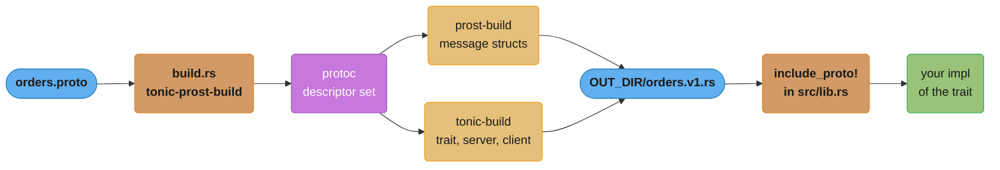
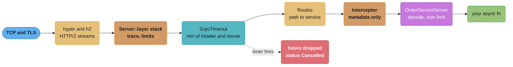
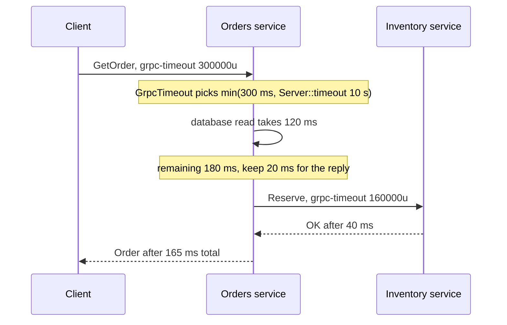

# gRPC with tonic

> **Version anchor (2026-11-06).** Rust 1.99.1 (2026-10-15) on edition 2024. tonic, tonic-build
> and tonic-prost-build 0.14.9 (2026-10-29, MSRV 1.88). prost and prost-build 0.14.4
> (2026-06-07). tokio 1.54.1, tower 0.5.3, hyper 1.12.0, hyper-util 0.1.21, rustls 0.23.46.
> Defaults and behavior quoted on this page come from the tonic 0.14.9 source on crates.io.

## 1. Concept Overview

tonic is a gRPC client and server library for Rust. It is three layers stacked on
crates you meet elsewhere in this section: HTTP/2 from `hyper` and `h2`, the request model
from `tower` (`Service`, `Layer`, `poll_ready`), and message code from `prost`. A tonic
server is a tower service. A tonic client is a tower service. Generated code is a router, a
codec and a trait you implement. Everything else (auth, timeouts, limits, metrics, retries)
is a layer you add.

The 0.14 line split the protobuf parts out of the runtime. `tonic` 0.14.9 has no dependency
on `prost`. The prost codec lives in `tonic-prost`, and code generation lives in
`tonic-prost-build`, which wraps the protobuf-neutral `tonic-build`. A service built from
`.proto` files therefore needs four crates: `tonic` and `tonic-prost` at runtime,
`tonic-prost-build` at build time, and `prost` for the message types. The split makes the
codec a choice. A team can use a different message format with tonic's transport, and the
runtime crate does not move each time prost does.

This page covers what tonic does with the protocol: the build pipeline, the four RPC shapes
as Rust signatures, `Status`, metadata, deadlines on the wire, streaming backpressure,
interceptors against tower layers, TLS, client-side balancing, health, reflection and
gRPC-Web. gRPC itself (the wire format, field numbering, the four modes as a protocol,
status-code meaning, deadline semantics, schema evolution) is taught in
[gRPC and Protocol Buffers](../../backend/grpc_and_protobuf/grpc_and_protobuf.md). The Go
and Java implementations of the same ideas are in
[gRPC and Protobuf in Go](../../go/grpc_and_protobuf_in_go/grpc_and_protobuf_in_go.md) and
[gRPC and Protobuf in Java](../../java/grpc_protobuf/grpc_protobuf.md).

---

## 2. Intuition

> **One-line analogy**: tonic is a postal sorting office built from standard parts. The
> trucks (hyper and h2) and the conveyor belts (tower layers) are the same ones the HTTP
> depot uses. Only the label printer (prost codegen) and the sorting rules (the generated
> router) are specific to gRPC.

**Mental model**: each RPC is a request that flows through an onion of tower layers into
one `async fn` on a trait you implement. The future that `async fn` returns must be `Send`
and `'static`, because tonic spawns each connection, and hyper each HTTP/2 stream, as a task
on a multi-thread tokio runtime, and the generated trait boxes every method future as `Send`. A deadline is a header
(`grpc-timeout`) on the way in and a timer that drops your future when it fires. A stream
is an `mpsc` channel plus HTTP/2 flow control.

**Why it matters**: the failures that reach production are rarely in the protobuf. They are
in the seams. A client sets a timeout that the server never sees. A server-side timeout
drops a handler halfway through a two-step write. A 5 MiB response passes in staging and
fails in production against the 4 MiB receive limit. Every client in a fleet pins itself to
one backend pod through one long-lived HTTP/2 connection. Each of these has a one-line fix
once you know where tonic draws the line.

**Key insight**: tonic does very little by itself, and that is the design. It does not
retry, does not propagate deadlines to your downstream calls, does not recover panics into
`Internal`, and does not turn on TLS unless you enable a feature. Each of those is a tower
layer or a line of code you own. Read the tonic part of a service as "which layers are in
the stack, and in which order".

---

## 3. Core Principles

1. **Code generation runs at build time.** `build.rs` calls `tonic_prost_build`, which runs
   `protoc` and writes Rust into `OUT_DIR`. `tonic::include_proto!("pkg")` pulls it in.
   `protoc` must be on `PATH` or named by the `PROTOC` environment variable.
2. **The service trait is `Send + Sync + 'static`.** The generated trait carries
   `#[async_trait]`, so each method returns a boxed `Send` future. A `!Send` value held
   across `.await` in a handler is a compile error, not a runtime surprise.
3. **`Status` is the only error type on the wire.** A handler returns
   `Result<Response<T>, Status>`. Map domain errors to a code at the edge, and keep internal
   text out of the message.
4. **A deadline is data, not magic.** The client sends `grpc-timeout` only when you call
   `Request::set_timeout`. The server takes the smaller of that header and
   `Server::timeout`, then drops the handler future when the timer fires. Nothing forwards
   the remaining budget to calls the handler makes.
5. **A `Channel` is one multiplexed connection behind a buffer.** Cloning is cheap and
   correct. Building a new `Channel` per request is the mistake.
6. **Limits are explicit.** Decoding stops at 4 MiB per message by default. Encoding has
   no limit by default. Both are per-service settings on the generated server and client.
7. **Backpressure is a bounded channel.** A server stream is a `Stream` of
   `Result<T, Status>`. Feed it from a bounded `mpsc`, and the producer waits when the
   client reads slowly.
8. **Transport security is opt-in.** TLS needs the `tls-ring` or `tls-aws-lc` feature. The
   default feature set (`router`, `transport`, `codegen`) has no TLS code in it.

---

## 4. Types / Architectures / Strategies

### The crate map

| Crate | Kind | What it does |
|---|---|---|
| `tonic` | runtime | Transport (server and `Channel`), `Request`, `Response`, `Status`, metadata, interceptors, `Streaming<T>` |
| `tonic-prost` | runtime | The prost codec that generated code calls. Version-locked to `tonic` |
| `prost` | runtime | Message structs, encoding and decoding |
| `tonic-build` | build | Protobuf-neutral generator for service traits, servers and clients |
| `tonic-prost-build` | build | Runs `protoc` through `prost-build`, then calls `tonic-build`. The crate a `build.rs` uses |
| `tonic-health` | runtime | The standard `grpc.health.v1.Health` service with a `HealthReporter` handle |
| `tonic-reflection` | runtime | The server reflection service, `v1` and `v1alpha` |
| `tonic-web` | runtime | A layer that translates gRPC-Web from browsers into gRPC |
| `tonic-types` | runtime | The `google.rpc` rich error model (`ErrorDetails`, `StatusExt`) |

All of the `tonic-*` companion crates above are at 0.14.9 on crates.io (read 2026-11-06),
released together with `tonic`. Keep them on the same minor version. A `tonic` 0.14 server
cannot take a `tonic-health` 0.13 service.

### The four RPC modes as tonic signatures

| Mode | Proto | Server method | Client call returns |
|---|---|---|---|
| Unary | `rpc Get(Req) returns (Resp)` | `async fn get(&self, Request<Req>) -> Result<Response<Resp>, Status>` | `Result<Response<Resp>, Status>` |
| Server streaming | `returns (stream Resp)` | associated `type GetStream: Stream<Item = Result<Resp, Status>> + Send + 'static`, method returns `Response<Self::GetStream>` | `Response<Streaming<Resp>>` |
| Client streaming | `rpc Put(stream Req)` | takes `Request<Streaming<Req>>` | `Result<Response<Resp>, Status>` |
| Bidirectional | both | takes `Request<Streaming<Req>>`, returns `Response<Self::ChatStream>` | `Response<Streaming<Resp>>` |

### Where cross-cutting code goes

| Mechanism | Sees | Async | Can change the response | Scope | Use for |
|---|---|---|---|---|---|
| `Interceptor` (`FnMut(Request<()>) -> Result<Request<()>, Status>`) | metadata and extensions only | no | no, only reject | one service (`with_interceptor`) or one client | token check, adding a header, a tenant id into extensions |
| tower `Layer` on `Server::builder().layer(..)` | full `http::Request` and response | yes | yes | every service on the server | timeouts, concurrency limits, load shedding, tracing, metrics |
| tower `Layer` on a `Channel` (`ServiceBuilder` around it) | full request and response | yes | yes | one client | retries, client metrics, auth refresh |
| Code in the handler | the decoded message | yes | yes | one method | business rules, per-method authorization |

### How to produce the generated code

| Approach | How | Good | Cost |
|---|---|---|---|
| `build.rs` with `tonic-prost-build` | generate into `OUT_DIR` on every build | no generated files in git, always in sync | every developer and CI image needs `protoc` |
| Generate once, check in | `configure().out_dir("src/pb")` from a small binary or script | builds need no `protoc`, diffs are reviewable | someone must regenerate on every `.proto` change |
| `buf` for lint and breaking-change checks | `buf lint`, `buf breaking --against` in CI | catches renumbered fields before merge | a second tool, separate from codegen |

---

## 5. Architecture Diagrams

### Code generation pipeline



`protoc` is the only external binary in the chain. If a CI image lacks it, the build fails in
`build.rs` before rustc sees your code.

### The server stack, outside in



A request crosses every box from left to right. The dotted edge is the one people forget:
when the timeout fires, tonic drops the handler future wherever it is parked.

### A deadline across two hops



The 160 ms on the second hop exists only because the handler computed it and called
`set_timeout`. Without that line the inventory call runs with no deadline at all.

---

## 6. How It Works - Detailed Mechanics

### 6.1 Dependencies and `build.rs`

```toml
[dependencies]
tonic = { version = "0.14.9", features = ["tls-aws-lc", "gzip"] }
tonic-prost = "0.14.9"
prost = "0.14.4"
tokio = { version = "1.54.1", features = ["rt-multi-thread", "macros", "sync"] }
tokio-stream = "0.1"
tonic-health = "0.14.9"
tonic-reflection = "0.14.9"

[build-dependencies]
tonic-prost-build = "0.14.9"
```

```rust
// build.rs
use std::{env, error::Error, path::PathBuf};
use tonic_prost_build::configure;

fn main() -> Result<(), Box<dyn Error>> {
    let out = PathBuf::from(env::var("OUT_DIR")?);
    configure()
        .build_client(true)
        .build_server(true)
        .file_descriptor_set_path(out.join("orders_descriptor.bin"))
        .compile_protos(&["proto/orders/v1/orders.proto"], &["proto"])?;
    Ok(())
}
```

`compile_protos(protos, includes)` takes the files to generate and the include roots for
imports. `file_descriptor_set_path` writes the binary descriptor that reflection needs
(6.10). By default the builder prints `cargo:rerun-if-changed` for each proto, so editing a
`.proto` triggers a rebuild and editing Rust code does not rerun `protoc`.

### 6.2 The contract

```proto
syntax = "proto3";
package orders.v1;

service OrderService {
  rpc GetOrder(GetOrderRequest) returns (Order);
  rpc WatchOrders(WatchOrdersRequest) returns (stream OrderEvent);
  rpc UploadLines(stream OrderLine) returns (UploadSummary);
}

message GetOrderRequest { string id = 1; }
message Order { string id = 1; string customer_id = 2; int64 total_cents = 3; }
message WatchOrdersRequest { string customer_id = 1; }
message OrderEvent { string order_id = 1; string state = 2; }
message OrderLine { string order_id = 1; string sku = 2; uint32 qty = 3; }
message UploadSummary { uint32 lines = 1; }
```

prost maps `string` to `String`, `int64` to `i64`, a message field to `Option<Msg>`,
`repeated` to `Vec`, and `oneof` to an `Option` of a generated enum. The package
`orders.v1` becomes the argument to `include_proto!("orders.v1")`.

### 6.3 The server

```rust
// fragment: Repo and to_status are defined elsewhere in the service
use tokio::sync::mpsc;
use tokio_stream::wrappers::ReceiverStream;
use tonic::{Request, Response, Status, Streaming};

pub mod pb {
    tonic::include_proto!("orders.v1");
}

use pb::order_service_server::OrderService;
use pb::{GetOrderRequest, Order, OrderEvent, OrderLine, UploadSummary, WatchOrdersRequest};

pub struct Orders {
    repo: Repo,
}

#[tonic::async_trait]
impl OrderService for Orders {
    async fn get_order(&self, req: Request<GetOrderRequest>) -> Result<Response<Order>, Status> {
        let id = req.into_inner().id;
        let order = self
            .repo
            .find(&id)
            .await
            .map_err(to_status)?
            .ok_or_else(|| Status::not_found("order not found"))?;
        Ok(Response::new(order))
    }

    type WatchOrdersStream = ReceiverStream<Result<OrderEvent, Status>>;

    async fn watch_orders(
        &self,
        req: Request<WatchOrdersRequest>,
    ) -> Result<Response<Self::WatchOrdersStream>, Status> {
        let customer = req.into_inner().customer_id;
        let mut events = self.repo.subscribe(&customer);
        let (tx, rx) = mpsc::channel(64);
        tokio::spawn(async move {
            while let Some(ev) = events.recv().await {
                if tx.send(Ok(ev)).await.is_err() {
                    break; // the client hung up, so stop the producer
                }
            }
        });
        Ok(Response::new(ReceiverStream::new(rx)))
    }

    async fn upload_lines(
        &self,
        req: Request<Streaming<OrderLine>>,
    ) -> Result<Response<UploadSummary>, Status> {
        let mut lines = req.into_inner();
        let mut count = 0;
        while let Some(line) = lines.message().await? {
            self.repo.insert_line(line).await.map_err(to_status)?;
            count += 1;
        }
        Ok(Response::new(UploadSummary { lines: count }))
    }
}
```

Three details carry most of the weight. `Streaming::message()` returns
`Result<Option<T>, Status>`: `Ok(None)` is a clean end of stream and `Err` is a transport or
decode failure. The `mpsc::channel(64)` bound is the backpressure: when the client stops
reading, HTTP/2 flow control stops the send side, `ReceiverStream` stops draining, and
`tx.send(..).await` waits. And `tx.send` returning `Err` is the only signal that the client
went away, so the producer must check it and stop.

### 6.4 Serving, limits and shutdown

```rust
// fragment: Orders::new and shutdown_signal are defined elsewhere
use std::time::Duration;
use pb::order_service_server::OrderServiceServer;
use tonic::codec::CompressionEncoding;
use tonic::transport::Server;

#[tokio::main]
async fn main() -> Result<(), Box<dyn std::error::Error>> {
    let (health, health_svc) = tonic_health::server::health_reporter();
    health.set_serving::<OrderServiceServer<Orders>>().await;

    let orders = OrderServiceServer::new(Orders::new().await?)
        .max_decoding_message_size(8 * 1024 * 1024)
        .accept_compressed(CompressionEncoding::Gzip)
        .send_compressed(CompressionEncoding::Gzip);

    Server::builder()
        .timeout(Duration::from_secs(10))
        .concurrency_limit_per_connection(256)
        .add_service(health_svc)
        .add_service(orders)
        .serve_with_shutdown("0.0.0.0:50051".parse()?, shutdown_signal(health))
        .await?;
    Ok(())
}
```

`Server::timeout` is the ceiling for every handler on this server. A client may ask for less
through `grpc-timeout`, never more. `concurrency_limit_per_connection` caps in-flight RPCs on
one HTTP/2 connection, which matters because a single client connection can carry thousands
of streams. `serve_with_shutdown` stops accepting new connections when the future resolves
and lets in-flight RPCs finish. The `shutdown_signal` here should first call
`health.set_not_serving::<OrderServiceServer<Orders>>()`, wait one probe period, and only
then resolve, so the load balancer drains the pod before connections close.

### 6.5 The `grpc-timeout` header, byte for byte

The gRPC spec allows at most 8 digits and one unit letter (`H`, `M`, `S`, `m`, `u`, `n`).
tonic picks the most precise unit that fits in 8 digits. `Request::set_timeout` with 30
seconds writes `30000000u`. The logic, compiled on 1.99.1:

```rust
use std::time::Duration;

fn grpc_timeout(d: Duration) -> String {
    const MAX: u128 = 99_999_999;
    let units: [(u128, char); 6] = [
        (1, 'n'),
        (1_000, 'u'),
        (1_000_000, 'm'),
        (1_000_000_000, 'S'),
        (60_000_000_000, 'M'),
        (3_600_000_000_000, 'H'),
    ];
    let nanos = d.as_nanos();
    for (scale, unit) in units {
        let value = nanos / scale;
        if value <= MAX {
            return format!("{value}{unit}");
        }
    }
    format!("{MAX}H")
}

fn main() {
    assert_eq!(grpc_timeout(Duration::from_millis(250)), "250000u");
    assert_eq!(grpc_timeout(Duration::from_secs(30)), "30000000u");
    assert_eq!(grpc_timeout(Duration::from_secs(3_600)), "3600000m");
}
```

Integer division truncates, so a precise unit is the honest one. 250 ms in nanoseconds is
250,000,000, nine digits, so the encoder moves up to microseconds: `250000u`.

### 6.6 Forwarding the remaining budget

tonic parses the inbound header for its own timer and does not expose a "deadline" type. The
handler reads the header, keeps a reserve for its reply, and sets the rest on the next call:

```rust
use std::time::{Duration, Instant};

/// Budget for a downstream call, or None when the caller's deadline is already too close.
fn child_timeout(deadline: Instant, now: Instant, reserve: Duration) -> Option<Duration> {
    let left = deadline.checked_duration_since(now)?;
    let budget = left.checked_sub(reserve)?;
    (budget >= Duration::from_millis(5)).then_some(budget)
}

fn main() {
    let start = Instant::now();
    let deadline = start + Duration::from_millis(300);
    let after_db = start + Duration::from_millis(120);
    let reserve = Duration::from_millis(20);

    assert_eq!(child_timeout(deadline, after_db, reserve), Some(Duration::from_millis(160)));
    let late = start + Duration::from_millis(290);
    assert_eq!(child_timeout(deadline, late, reserve), None);
}
```

In the handler, capture `Instant::now()` on entry, parse `grpc-timeout` from
`req.metadata()` into a `Duration`, and compute `deadline = entry + parsed`. When
`child_timeout` returns `None`, return `Status::deadline_exceeded` at once instead of
starting work the caller has already given up on.

### 6.7 The client

```rust
// fragment: pb is the generated module from 6.3
use std::time::Duration;
use pb::order_service_client::OrderServiceClient;
use pb::GetOrderRequest;
use tonic::metadata::MetadataValue;
use tonic::transport::{Channel, Endpoint};
use tonic::Request;

async fn connect() -> Result<OrderServiceClient<Channel>, tonic::transport::Error> {
    let channel = Endpoint::from_static("http://orders.internal:50051")
        .connect_timeout(Duration::from_secs(2))
        .http2_keep_alive_interval(Duration::from_secs(30))
        .keep_alive_while_idle(true)
        .connect()
        .await?;
    Ok(OrderServiceClient::new(channel).max_decoding_message_size(8 * 1024 * 1024))
}

async fn get(client: &mut OrderServiceClient<Channel>, id: &str) -> Result<pb::Order, tonic::Status> {
    let mut req = Request::new(GetOrderRequest { id: id.to_owned() });
    req.set_timeout(Duration::from_millis(300));
    req.metadata_mut().insert("x-tenant", MetadataValue::from_static("acme"));
    Ok(client.get_order(req).await?.into_inner())
}
```

Generated client methods take `&mut self` because a tower service needs `poll_ready` before
each call. That is why you clone the client per task instead of sharing one behind a
`Mutex`. The clone shares one `Channel`, which is a tower `Buffer` with a default capacity
of 1024 requests in front of one HTTP/2 connection.

`Endpoint::timeout` and `Request::set_timeout` look alike and are not. The endpoint timeout
is a local timer on the client only. The tonic source says it "does **not** set the timeout
metadata (`grpc-timeout` header)". Only `set_timeout` tells the server.

### 6.8 `Status`, codes and rich details

```rust
// fragment: OrderError comes from the domain crate
use tonic::{Code, Status};
use tonic_types::{ErrorDetails, StatusExt};

fn to_status(err: OrderError) -> Status {
    match err {
        OrderError::NotFound => Status::not_found("order not found"),
        OrderError::BadQty { field } => {
            let details = ErrorDetails::with_bad_request_violation(field, "qty must be 1 to 999");
            Status::with_error_details(Code::InvalidArgument, "invalid order line", details)
        }
        OrderError::Conflict => Status::aborted("order changed, retry"),
        OrderError::Db(e) => {
            tracing::error!(error = %e, "database failure");
            Status::internal("internal error")
        }
    }
}
```

The message string goes to the client verbatim. A `Status::internal(e.to_string())` on a
database error sends the driver message, which can name tables, hosts and credentials. Log
the cause, return a fixed string. The error-type design that feeds this function is in
[error design for libraries and applications](../error_handling_and_panics/error_design_for_libraries_and_applications.md).

### 6.9 Interceptors and layers

```rust
// fragment: Orders and pb come from 6.3
use tonic::{Request, Status};
use tonic::metadata::MetadataValue;

#[derive(Clone)]
struct TenantId(String);

fn auth(mut req: Request<()>) -> Result<Request<()>, Status> {
    let token = req
        .metadata()
        .get("authorization")
        .and_then(|v| v.to_str().ok())
        .ok_or_else(|| Status::unauthenticated("missing token"))?;
    let tenant = verify(token).map_err(|_| Status::unauthenticated("bad token"))?;
    req.extensions_mut().insert(TenantId(tenant));
    Ok(req)
}

let svc = pb::order_service_server::OrderServiceServer::with_interceptor(orders, auth);
```

The interceptor runs before the body is decoded and sees `Request<()>`. It is synchronous,
so it cannot call a token service. For that, write a tower `Layer` and add it with
`Server::builder().layer(..)`; it gets the full `http::Request`, can `.await`, and can wrap
the response. A handler reads what the interceptor stored with
`req.extensions().get::<TenantId>()`.

### 6.10 Reflection, health and gRPC-Web

```rust
// fragment: wiring inside main
const DESCRIPTOR: &[u8] = tonic::include_file_descriptor_set!("orders_descriptor");

let reflection = tonic_reflection::server::Builder::configure()
    .register_encoded_file_descriptor_set(DESCRIPTOR)
    .build_v1()?;

Server::builder()
    .accept_http1(true)
    .layer(tonic_web::GrpcWebLayer::new())
    .add_service(reflection)
    .add_service(health_svc)
    .add_service(orders)
    .serve(addr)
    .await?;
```

Reflection lets `grpcurl` list and call methods without the `.proto` file. It exposes your
whole schema, so serve it on an internal listener or behind auth. `tonic-web` translates
gRPC-Web from a browser. Without TLS it needs `accept_http1(true)`, because browsers send
gRPC-Web over HTTP/1.1. With TLS, ALPN negotiates HTTP/2 and the flag is not needed. CORS is
a separate tower layer you compose in front.

### 6.11 TLS and mTLS

```rust
// fragment: certificate bytes come from your secret store
use tonic::transport::{Certificate, ClientTlsConfig, Identity, ServerTlsConfig};

let server_tls = ServerTlsConfig::new()
    .identity(Identity::from_pem(cert_pem, key_pem))
    .client_ca_root(Certificate::from_pem(ca_pem));

let client_tls = ClientTlsConfig::new()
    .ca_certificate(Certificate::from_pem(ca_pem))
    .identity(Identity::from_pem(client_cert, client_key))
    .domain_name("orders.internal");
```

`client_ca_root` turns on client certificate checks, which is mTLS. These types exist only
with a TLS feature on: `tls-ring` or `tls-aws-lc` for the crypto provider, plus
`tls-native-roots` or `tls-webpki-roots` for public roots. In a mesh with a sidecar or
ztunnel doing mTLS, leave tonic on plain HTTP/2 and let the mesh own certificates (see
[ambient mesh and workload identity](../../backend/service_mesh_and_service_discovery/ambient_mesh_and_workload_identity.md)).

### 6.12 Client-side load balancing

```rust
// fragment: resolve() is your DNS or registry lookup
use tonic::transport::{Channel, Endpoint};
use tower::discover::Change;

let (channel, tx) = Channel::balance_channel::<std::net::SocketAddr>(1024);
tokio::spawn(async move {
    loop {
        for (addr, alive) in resolve("orders-headless.default.svc").await {
            let change = if alive {
                match Endpoint::from_shared(format!("http://{addr}")) {
                    Ok(ep) => Change::Insert(addr, ep),
                    Err(_) => continue,
                }
            } else {
                Change::Remove(addr)
            };
            if tx.send(change).await.is_err() {
                return;
            }
        }
        tokio::time::sleep(std::time::Duration::from_secs(15)).await;
    }
});
```

`Channel::balance_list` takes a fixed list. `balance_channel` returns a sender that accepts
`Change::Insert` and `Change::Remove`, so you feed it from DNS on a headless Service or from a
registry. Without this, a Kubernetes ClusterIP Service resolves to one virtual IP, the client
opens one HTTP/2 connection, and every RPC lands on whichever pod the kernel picked at
connect time. The other options are an L7 proxy (Envoy, a mesh) or a lookaside balancer;
[gRPC and Protocol Buffers](../../backend/grpc_and_protobuf/grpc_and_protobuf.md) compares
them.

---

## 7. Real-World Examples

- **OpenTelemetry for Rust.** `opentelemetry-otlp` 0.33.1 depends on `tonic` 0.14 for its
  `grpc-tonic` exporter, so a Rust service that exports OTLP over gRPC already compiles
  tonic. The tracing side is in
  [observability, tracing and OpenTelemetry](../observability_tracing_and_opentelemetry/observability_tracing_and_opentelemetry.md).
- **Linkerd.** The `linkerd2-proxy-api` crate (0.20.0) that defines the Linkerd proxy's
  control-plane API depends on `tonic` 0.14 and `prost` 0.14. The proxy itself is covered as
  a Rust example in
  [ambient mesh and workload identity](../../backend/service_mesh_and_service_discovery/ambient_mesh_and_workload_identity.md).
- **Qdrant.** The official `qdrant-client` crate (1.20.0) talks to the vector database over
  gRPC with `tonic` 0.14.
- **etcd and containerd clients.** `etcd-client` 0.21.1 and `containerd-client` 0.9.0 both
  generate their clients with tonic 0.14.

These dependency facts come from the crates.io API, read 2026-11-06. They show that the
same 0.14 line runs on both ends of very different systems, which is why keeping every
`tonic-*` crate on one minor version is a real constraint in a large workspace.

---

## 8. Tradeoffs

### tonic against the alternatives in Rust

| Option | Transport | Strength | Weakness | Pick when |
|---|---|---|---|---|
| tonic with prost | HTTP/2 via hyper | standard, every gRPC peer talks to it, tower layers | needs `protoc`, prost types are plain structs with no presence for proto3 scalars | default for service-to-service RPC |
| tonic with a custom codec | same | any message format on gRPC transport | you own the codec and its tests | an internal format already exists |
| axum with JSON | HTTP/1.1 and HTTP/2 | browsers, curl, any client | no schema-enforced contract, no streaming types | public or browser APIs (see [web services with axum, tower and hyper](../web_services_axum_tower_and_hyper/web_services_axum_tower_and_hyper.md)) |
| tonic-web | HTTP/1.1 or HTTP/2 | browser clients reuse the same service | no client streaming or bidi from browsers | an internal UI calls the same API |

### Interceptor or layer

| Need | Interceptor | Layer |
|---|---|---|
| Reject on a missing header | yes | yes |
| Call an auth service | no, not async | yes |
| Measure latency or status codes | no, never sees the response | yes |
| Apply to one service only | yes, `with_interceptor` | possible, but more code |
| Lines of code | about 10 | about 60 with the `Service` impl |

### Generated code in git or not

| Factor | `build.rs` only | Checked-in |
|---|---|---|
| Build needs `protoc` | yes | no |
| Drift between `.proto` and Rust | impossible | possible, catch with a CI diff check |
| Review shows API changes | only the `.proto` diff | `.proto` and Rust diff |
| Cross-compile friction | `protoc` must run on the host | none |

---

## 9. When to Use / When NOT to Use

**Use tonic when:**

- Two services you own talk to each other and want a typed, versioned contract with
  generated clients in several languages.
- A call needs streaming: a long-lived event feed, a bulk upload, a bidi session.
- The peer already speaks gRPC: an OTLP collector, etcd, containerd, a vector database.
- You already run tower middleware and want the same layers on RPC.

**Do not use tonic when:**

- The client is a browser and needs streaming both ways. gRPC-Web cannot do client streaming
  or bidi. Use WebSockets or a JSON API.
- The API is public and its users will reach for `curl`. JSON over HTTP has a lower entry
  cost. See [REST API design](../../backend/rest_api_design/rest_api_design.md).
- The call is in-process. A trait call is cheaper than serializing to protobuf and back.
- The team has no way to install `protoc` in every build environment and will not check in
  generated code.

---

## 10. Common Pitfalls

These incidents are illustrative. They show common failure patterns, not specific outages, and
their numbers show scale only.

### The handler would not compile after adding a cache

A team added an in-memory dedup set behind a `std::sync::Mutex` and called an audit RPC while
holding the guard. The generated trait boxes every method future as `Send`, and
`MutexGuard` is not `Send`.

```rust
// BROKEN: a std MutexGuard held across .await makes the handler future !Send
use std::sync::{Mutex, PoisonError};

static SEEN: Mutex<Vec<u64>> = Mutex::new(Vec::new());

async fn audit(_id: u64) {}

async fn handle(id: u64) -> usize {
    let mut seen = SEEN.lock().unwrap_or_else(PoisonError::into_inner);
    seen.push(id);
    audit(id).await; // the guard is still alive across this await
    seen.len()
}

fn require_send<F: Future + Send>(_: F) {}

fn main() {
    // error: future cannot be sent between threads safely
    // help: the trait `Send` is not implemented for `MutexGuard<'_, Vec<u64>>`
    require_send(handle(7));
}
```

```rust
// FIX: end the guard's scope before the await
use std::sync::{Mutex, PoisonError};

static SEEN: Mutex<Vec<u64>> = Mutex::new(Vec::new());

async fn audit(_id: u64) {}

async fn handle(id: u64) -> usize {
    let len = {
        let mut seen = SEEN.lock().unwrap_or_else(PoisonError::into_inner);
        seen.push(id);
        seen.len()
    };
    audit(id).await;
    len
}

fn require_send<F: Future + Send>(_: F) {}

fn main() {
    require_send(handle(7));
}
```

The compiler caught this one. If the lock must be held across the await, use
`tokio::sync::Mutex`, but first ask why I/O needs to run inside a critical section. The full
treatment of guards across awaits is in
[async cancellation and pitfalls](../async_cancellation_and_pitfalls/async_cancellation_and_pitfalls.md).

### The client timeout the server never saw

A checkout service set `Endpoint::timeout(Duration::from_millis(500))` and assumed the
inventory service would stop work at 500 ms. It did not. The server never received
`grpc-timeout`, so each abandoned call kept a database connection for up to 10 s, the
server's own ceiling. During a slow-database incident, clients gave up at 500 ms and retried,
and the server ran four copies of every query until the pool hit its limit. The fix was
`req.set_timeout(..)` on each request, which sends the header. Keep the endpoint timeout as a
local backstop.

### A two-step write cut in half by the server timeout

`Server::timeout` drops the handler future when it fires. A handler that inserted an order
row and then awaited a second call to publish an event stopped between the two. The client
saw status `Cancelled` (tonic 0.14.9 maps its own `TimeoutExpired` to `Cancelled`, not
`DeadlineExceeded`) and retried, and the retry created a second order. Any handler that does
more than one side effect must be cancel-safe: put both writes in one transaction, or use an
outbox row that a separate task publishes. Retries on `Cancelled` need an idempotency key.

### 4 MiB in staging, 5 MiB in production

A report endpoint returned a message that grew with customer size. Staging data stayed under
4 MiB. In production one large customer got status `OutOfRange` with "decoded message length
too large: found 5242880 bytes, the limit is: 4194304 bytes". Go returns `ResourceExhausted`
for the same condition, so a dashboard that alerted on that code saw nothing. Raise
`max_decoding_message_size` on the client deliberately, or better, page the result through a
server stream.

### Every client on one pod

Twenty order-service replicas sat behind a ClusterIP Service. Twelve clients each opened one
`Channel`. The kernel picked a pod for each TCP connection, so at most twelve pods had any
traffic, and after a rolling restart most clients reconnected to the first pods that came
up. Two pods ran at 90% CPU while the rest idled. The fix was a headless Service plus
`Channel::balance_channel` fed from DNS (6.12). A mesh or an L7 proxy fixes it the same way.

### TLS that silently was not there

An endpoint URL used `https://`, and the team assumed TLS. The crate had no TLS feature
enabled, so the build had no TLS types at all and the connection attempt failed with a
transport error that did not name the missing feature. Enable `tls-aws-lc` (or `tls-ring`)
and a roots feature explicitly, and test the TLS path in CI against a real certificate.

---

## 11. Technologies & Tools

| Tool | Version (crates.io, 2026-11-06) | Role |
|---|---|---|
| tonic | 0.14.9 | gRPC runtime: transport, `Request`, `Response`, `Status`, metadata, interceptors |
| tonic-prost | 0.14.9 | prost codec used by generated code |
| tonic-prost-build | 0.14.9 | `build.rs` code generator built on `prost-build` and `tonic-build` |
| prost | 0.14.4 | protobuf message types and encoding |
| tonic-health | 0.14.9 | `grpc.health.v1` service with a `HealthReporter` |
| tonic-reflection | 0.14.9 | server reflection for `grpcurl` and UIs |
| tonic-web | 0.14.9 | gRPC-Web translation layer for browsers |
| tonic-types | 0.14.9 | `google.rpc` rich error details |
| tower | 0.5.3 | layers for limits, timeouts, retries and load balancing |
| protoc | system package | the protobuf compiler `prost-build` calls |
| buf | system binary | lint and breaking-change detection on `.proto` files |
| grpcurl | system binary | command-line client that uses reflection |

---

## 12. Interview Questions with Answers

**Q: A client sets a 500 ms timeout but the tonic server keeps working for seconds after the client gives up. What is wrong?**
**Short:** The client used Endpoint::timeout, a local timer that never sends grpc-timeout, so the server has no deadline except its own ceiling.

tonic has two timeouts that look alike. `Endpoint::timeout` (and `Channel` built from it)
starts a timer on the client and cancels the local future, but the tonic source states it
does not set the `grpc-timeout` metadata. `Request::set_timeout` writes that header, and the
server's `GrpcTimeout` layer reads it. Set the deadline per request with `set_timeout`, and
keep the endpoint timeout only as a backstop. Then check the server: its effective timeout is
the smaller of the header and `Server::timeout`.

**Q: What status code does a tonic server return when its own timeout fires, and why does it matter?**
**Short:** Cancelled, because tonic 0.14.9 maps its TimeoutExpired error to Code::Cancelled rather than DeadlineExceeded.

`Status::from_error` checks for `TimeoutExpired` and returns `Status::cancelled`. Peers and
dashboards that expect `DeadlineExceeded` for a timeout will misclassify the event, and
retry policies that treat `Cancelled` as "the client gave up" may skip a retry or do one they
should not. Alert on both codes, and if your clients need `DeadlineExceeded`, add a layer
that maps the timeout yourself. Also remember the handler future was dropped, so any work
after its last completed await never ran.

**Q: Does tonic forward the caller's deadline when your handler calls another service?**
**Short:** No. tonic parses grpc-timeout for its own timer only, and each outgoing call has no deadline unless you set one.

Unlike some frameworks that keep a deadline in an ambient context, tonic leaves downstream
calls alone. The handler must read `grpc-timeout` from `req.metadata()`, record the entry
time, compute the remaining budget minus a reserve for the reply, and call
`set_timeout(budget)` on the outgoing request. If the budget is already gone, return
`Status::deadline_exceeded` without starting the call. Put this in one helper so every handler
does it the same way.

**Q: Why does a tonic handler stop compiling once it holds a std MutexGuard across an await?**
**Short:** The generated trait boxes each method future as Send, and a std MutexGuard held across an await makes that future not Send.

The service trait carries `#[async_trait]` and the bound `Send + Sync + 'static`, because
tonic runs connections on a multi-thread runtime and may resume a handler on another worker
thread. `std::sync::MutexGuard` is `!Send`, so if its scope crosses an `.await`, the future
captures it and loses `Send`. Close the guard's scope before the await, or use
`tokio::sync::Mutex` when the lock must span I/O. The error points at the `.await`, which
tells you exactly which guard to move.

**Q: A 5 MiB response works in staging and fails in production. What limit did it hit?**
**Short:** tonic's default 4 MiB decode limit per message, which the receiver enforces and reports as status OutOfRange.

`DEFAULT_MAX_RECV_MESSAGE_SIZE` is `4 * 1024 * 1024` in tonic 0.14.9, and the send side
defaults to `usize::MAX`. So the server sends happily and the client refuses. The error
reads "decoded message length too large" with code `OutOfRange`, where grpc-go uses
`ResourceExhausted`. Raise `max_decoding_message_size` on the generated client or server when
the size is bounded and known. When it grows with data, switch to server streaming and send
pages.

**Q: Why do all your tonic clients send traffic to one or two pods behind a Kubernetes Service?**
**Short:** Each Channel holds one long-lived HTTP/2 connection, and a ClusterIP Service balances only at TCP connect time.

HTTP/2 multiplexes every RPC on one connection, so L4 balancing happens once per connection,
not once per request. A client with one `Channel` stays on one pod until the connection
dies. Fix it with a headless Service and `Channel::balance_channel` fed by DNS or a
registry, or put an L7 proxy or mesh in the path. `max_connection_age` on the server also
forces periodic reconnects, which spreads load after a scale-out at the cost of a reconnect.

**Q: Your endpoint URL starts with https but no TLS handshake happens. Why?**
**Short:** tonic's default features include no TLS code, so a TLS feature such as tls-aws-lc or tls-ring must be enabled explicitly.

The default feature set in 0.14.9 is `router`, `transport` and `codegen`. `ServerTlsConfig`
and `ClientTlsConfig` exist only with `tls-ring` or `tls-aws-lc`, and public CA roots need
`tls-native-roots` or `tls-webpki-roots`. Enable them in `Cargo.toml`, configure the client
with `.tls_config(ClientTlsConfig::new()...)`, and add an integration test with a real
certificate so a feature change breaks CI instead of production.

**Q: Why is cloning a tonic client cheap, and why is that the right way to share it?**
**Short:** The client wraps a Channel, which is a tower Buffer handle over one connection, so a clone is a new sender to the same worker.

Generated client methods take `&mut self` because a tower `Service` must see `poll_ready`
before each `call`. Wrapping one client in a `Mutex` serializes every RPC behind a lock.
Cloning gives each task its own handle. The handles share a buffer of 1024 requests by
default and one multiplexed HTTP/2 connection. Create the `Channel` once at startup and
clone it into each task or request handler.

**Q: What changed in tonic 0.14 about prost, and what does your Cargo.toml need?**
**Short:** The prost codec and codegen moved out of tonic into tonic-prost and tonic-prost-build, so a proto-based service lists them explicitly.

In 0.14.9 the `tonic` crate has no `prost` dependency. Generated code calls the codec in
`tonic-prost`, and `build.rs` uses `tonic-prost-build`, which runs `protoc` through
`prost-build` and then the protobuf-neutral `tonic-build`. A migration from 0.13 swaps
`tonic-build` for `tonic-prost-build` in build dependencies and adds `tonic-prost` at runtime.
The split makes the codec replaceable and lets tonic and prost release on their own
schedules.

**Q: When do you use a tonic interceptor and when a tower layer?**
**Short:** An interceptor is a sync check on metadata before decoding; a layer is async, sees full requests and responses, and covers the server.

An interceptor has the signature `FnMut(Request<()>) -> Result<Request<()>, Status>`. It can
reject a call or add data to extensions, and it is about ten lines. It cannot await, cannot
see the message, and never sees the response, so it cannot record latency or status. A tower
layer added with `Server::builder().layer(..)` wraps every service, can await a token check,
and can measure the response. Use interceptors for static token checks and header injection,
and layers for anything that needs time or the result.

**Q: How do you implement server streaming without unbounded memory growth?**
**Short:** Feed the response stream from a bounded mpsc channel, so the producer waits on send when the client reads slowly.

Return a `ReceiverStream` over `mpsc::channel(n)` and run the producer in a spawned task. When
the client stops reading, HTTP/2 flow control stops the send path, the receiver stops
draining, and `tx.send(..).await` parks the producer once `n` items are queued. When the
client disconnects, `send` returns `Err`, and the producer must stop. An unbounded channel or
a `Vec` collected up front turns one slow client into an out-of-memory kill.

**Q: How do you read a client-streaming request in tonic?**
**Short:** Take a Request that wraps a Streaming of messages, then loop on message().await, where Ok(None) ends the stream and Err is a transport or decode error.

`Streaming::message()` returns `Result<Option<T>, Status>`. The idiomatic loop is
`while let Some(item) = stream.message().await? { .. }`, which propagates a broken stream as
the RPC's error. Validate each item as it arrives and return early with `InvalidArgument` on
the first bad one, so the client stops sending. Count items and bytes against a limit, because
the 4 MiB cap applies per message, not to the whole stream.

**Q: How should a tonic service map internal errors to Status?**
**Short:** Map each domain error variant to a specific code at the edge, log internal causes, and send only a fixed message for Internal.

The `Status` message goes to the client as written. `Status::internal(err.to_string())` on a
database error can leak table names, hostnames or a DSN. Match on your error enum: not found
to `NotFound`, validation to `InvalidArgument` with `tonic_types::ErrorDetails` for field
violations, optimistic-lock conflicts to `Aborted`, and everything unexpected to `Internal`
with a constant string and a log line carrying the cause.

**Q: What order of steps gives a tonic server a clean shutdown?**
**Short:** Mark the service NOT_SERVING in tonic-health, wait one probe interval, then resolve the serve_with_shutdown signal so in-flight RPCs finish.

`serve_with_shutdown` stops accepting connections when its future resolves and lets running
RPCs complete. If you resolve it first, the load balancer still routes new calls to a pod
that refuses them. Flip health with `set_not_serving`, sleep for the balancer's probe
period, then resolve. Long server streams need their own end signal, such as a
`CancellationToken` the producer checks, or shutdown waits on them forever.

**Q: How do you let grpcurl call a tonic server without the proto file?**
**Short:** Generate a file descriptor set in build.rs and serve it with tonic-reflection's build_v1 service.

Set `file_descriptor_set_path` in `tonic_prost_build::configure()`, load it with
`tonic::include_file_descriptor_set!`, pass it to
`tonic_reflection::server::Builder::configure().register_encoded_file_descriptor_set(..)`,
and add the result of `build_v1()` as a service. Reflection exposes the full schema, so bind
it to an internal port or require auth. `build_v1alpha()` exists for older tools.

**Q: Can a browser call a tonic service directly?**
**Short:** Yes for unary and server streaming through the tonic-web layer, but browsers cannot do client streaming or bidirectional gRPC-Web.

Add `tonic_web::GrpcWebLayer` with `Server::builder().layer(..)` and set
`accept_http1(true)` when there is no TLS, since browsers send gRPC-Web over HTTP/1.1. Add a
CORS layer for cross-origin pages. Client streaming and bidi are not in the gRPC-Web
protocol, so a browser feature that needs them uses WebSockets instead. The protocol-level
comparison with Connect is in
[Connect and browser RPC](../../backend/grpc_and_protobuf/connect_and_browser_rpc.md).

**Q: Should generated tonic code live in git?**
**Short:** Generate in build.rs by default; check it in only when builds cannot run protoc, and then add a CI check that regenerates and diffs.

`build.rs` generation keeps Rust and `.proto` in sync by construction and keeps generated
code out of review. Its cost is `protoc` on every developer machine, CI image and
cross-compile host. Checked-in code removes that cost and shows API changes in review, but
can drift. If you check it in, generate with `configure().out_dir(..)` and fail CI when a
fresh generation differs from the committed files.

**Q: How do you test a tonic service end to end without a fixed port?**
**Short:** Bind a TcpListener on port 0, serve with serve_with_incoming on its stream, and connect a client to the address the OS picked.

`Server::builder().add_service(..).serve_with_incoming(TcpListenerStream::new(listener))`
runs the real stack, layers and codec included, on an ephemeral port, so tests run in
parallel without port clashes. For pure business logic, call the trait method on your struct
directly with `Request::new(msg)`. That skips transport, so keep at least one test per
service that goes through the network path to catch layer and limit mistakes.

**Q: What does concurrency_limit_per_connection protect you from?**
**Short:** One client connection can carry thousands of HTTP/2 streams, and this caps how many RPCs from that connection run at once.

Without a cap, a single misbehaving client can open many streams on one connection and take
every worker. `concurrency_limit_per_connection(n)` adds a tower concurrency limit per
connection. Pair it with `max_concurrent_streams` for the HTTP/2 setting and `Server::load_shed(true)`, so the server rejects early instead of queueing past its deadline. Pick
`n` from measured handler latency and the CPU count, not from a round number.

---

## 13. Best Practices

- Pin `tonic`, `tonic-prost`, `tonic-prost-build`, `tonic-health`, `tonic-reflection`,
  `tonic-web` and `tonic-types` to the same minor version in one workspace table.
- Set a deadline on every outgoing request with `Request::set_timeout`, computed from the
  inbound budget, never a constant copied from another service.
- Set `Server::timeout` as a ceiling, and make every handler cancel-safe because that timer
  drops the future.
- Map errors to `Status` in one function per service. Never send `err.to_string()` for
  `Internal`.
- Feed every server stream from a bounded channel and stop the producer when `send` fails.
- Raise `max_decoding_message_size` only for a known bound. Prefer streaming for data that
  grows.
- Create one `Channel` per upstream at startup and clone the client into tasks.
- Use client-side balancing, a mesh or an L7 proxy for any service with more than one pod.
- Add `tonic-health` and flip it to NOT_SERVING before shutdown.
- Serve reflection only on internal listeners.
- Enable a TLS feature explicitly and test it, or let the mesh own mTLS.
- Run `buf lint` and `buf breaking` in CI on every `.proto` change.

---

## 14. Case Study

### An order-fanout gateway: one inbound RPC, three downstream calls

The gateway, the team and the numbers in this case are illustrative.

**Context.** A gateway receives `PlaceOrder` from mobile backends at 3,000 requests per second
at peak. Each call fans out to inventory, pricing and fraud services, all tonic, then writes
one row. The SLO is p99 under 250 ms. The first version had four problems that showed up in
one incident.

**Symptoms.** p99 hit 2.1 s during a pricing-service slowdown. The fraud service CPU stayed
flat while two of its eight pods ran hot. Pricing kept running queries for calls the gateway
had abandoned. Memory on the gateway grew by 1.4 GB in ten minutes.

**Diagnosis.**

1. The gateway used `Endpoint::timeout(200 ms)` on each channel. Pricing never saw a
   deadline, so its work continued after the gateway gave up.
2. Each upstream used one `Channel` to a ClusterIP Service, so fraud traffic stuck to the pods
   chosen at connect time.
3. The fanout spawned three tasks per request, each with its own `Channel::connect` call,
   because the first draft moved the client into the first task and the compiler rejected
   the second use.
4. Retries on `Cancelled` had no idempotency key, so a timed-out write sometimes ran twice.

The third problem started as a compile error that someone fixed the wrong way:

```rust
// BROKEN: the client is moved into the first task, then used again
use std::sync::Arc;
use std::thread;

#[derive(Clone)]
struct Client {
    conn: Arc<String>,
}

impl Client {
    fn call(&self, method: &str) -> String {
        format!("{method} via {}", self.conn)
    }
}

fn main() {
    let client = Client { conn: Arc::new("h2://pricing".to_owned()) };
    let mut handles = Vec::new();
    for method in ["inventory", "pricing", "fraud"] {
        // error[E0382]: use of moved value: `client`
        handles.push(thread::spawn(move || client.call(method)));
    }
    for h in handles {
        let _ = h.join();
    }
}
```

The quick fix in review was to build a new `Channel` inside each task. That compiled and
opened 9,000 TCP connections per second at peak. The right fix clones the handle, which in
tonic shares one connection:

```rust
// FIX: clone the cheap handle per task, keep one underlying connection
use std::sync::Arc;
use std::thread;

#[derive(Clone)]
struct Client {
    conn: Arc<String>,
}

impl Client {
    fn call(&self, method: &str) -> String {
        format!("{method} via {}", self.conn)
    }
}

fn main() {
    let client = Client { conn: Arc::new("h2://pricing".to_owned()) };
    let mut handles = Vec::new();
    for method in ["inventory", "pricing", "fraud"] {
        let client = client.clone();
        handles.push(thread::spawn(move || client.call(method)));
    }
    for h in handles {
        let _ = h.join();
    }
    assert_eq!(Arc::strong_count(&client.conn), 1);
}
```

**Fix.** The team made four changes.

| Change | Mechanism | Result |
|---|---|---|
| Per-request deadlines | `child_timeout` from 6.6, then `set_timeout` on each fanout call | pricing stopped work on abandoned calls; its DB pool use fell 60% in the next slowdown |
| One `Channel` per upstream, cloned | clients built at startup, cloned into tasks | connections fell from about 9,000 per second to 24 total |
| Client-side balancing | headless Services and `balance_channel` fed from DNS every 15 s | fraud pod CPU spread fell from 3x to 1.2x between hottest and coolest |
| Idempotent write | `order_key` in metadata, unique index on the row | duplicate orders on retry fell to zero |

**Result.** In the next pricing incident p99 stayed at 310 ms, gateway memory stayed flat, and
the error budget burn came from the real slowdown only. The lesson for tonic: the protocol
gives you the deadline field and the multiplexed connection, and the gateway code has to use
both on purpose.
