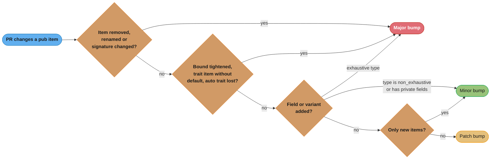
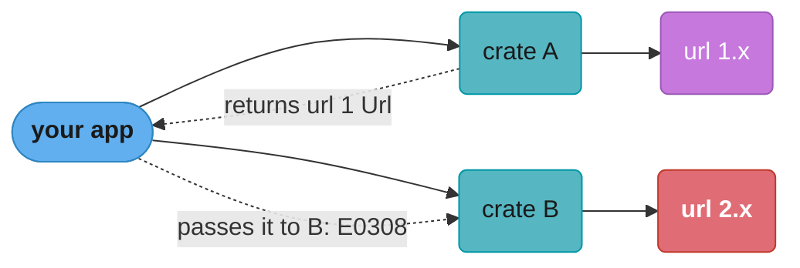

# Library API Design and Semver

> **Version anchor (2026-11-06).** Rust 1.99.1 (2026-10-15), edition 2024. cargo-semver-checks 0.51.0 (2026-10-03, MSRV 1.93), cargo-hack 0.6.46, cargo-msrv 0.19.6, trybuild 1.0.122, thiserror 2.0.21. Cargo resolves dependencies with MSRV awareness since 1.84, and resolver 3 is the edition 2024 default. Precise capturing `use<..>` is `[1.82]`, and edition 2024 changes the default capture rules for return-position `impl Trait`. tokio 1.54.0 raised its MSRV from 1.71 to 1.85 in a minor release.

## 1. Concept Overview

A Rust library has two contracts. The first is the API: the names, types, trait impls and
bounds that a downstream crate compiles against. The second is the version number: a promise,
written in Cargo's semver rules, about which changes to that API can arrive without a major
version bump. A library is well designed when its API is easy to call correctly and when the
author can change the internals for years without a `2.0`.

Rust makes the second contract harder than most languages. Cargo picks one version of a crate
per semver-compatible range for the whole build. A caller does not pin `1.4.2`. It writes
`"1.4"`, and Cargo is free to choose `1.9.0` the next time someone runs `cargo update`. A
breaking change shipped in a minor release does not break your CI. It breaks the build of every
crate downstream of you, at a time of their choosing, often in a crate that does not depend on
you directly.

The type system also leaks more than people expect. These are all breaking changes:

- a new public field on a struct that callers can build with a struct literal
- a new trait method with no default body
- a tighter bound on a generic parameter
- a private type change that makes a returned `impl Iterator` lose its `Send` impl

None of them change a function signature in the source. Each one makes some caller fail to
compile.

This module covers how to shape a public API (naming, inputs, outputs, builders, sealed traits,
`#[non_exhaustive]`) and how to evolve it under semver (what counts as major, how
`cargo-semver-checks` catches it, how to treat public dependencies, features and MSRV). Error
type design is in
[error design for libraries and applications](../error_handling_and_panics/error_design_for_libraries_and_applications.md).
MSRV policy as a decision is in
[editions, toolchains and MSRV](../modules_crates_and_cargo/editions_toolchains_and_msrv.md).
The Go view of the same problem is in
[idiomatic API and package design](../../go/idiomatic_api_and_package_design/idiomatic_api_and_package_design.md).

---

## 2. Intuition

> **One-line analogy**: A published crate is a socket in a wall. You can rewire the house
> behind it as much as you like. You cannot move the holes.

**Mental model**: every `pub` item is a promise with three parts.

1. The name and path exist.
2. The type and signature stay compatible.
3. The trait impls, including the auto traits `Send`, `Sync` and `Unpin`, stay in place.

The third part is the one people forget, because nobody writes it down. The compiler infers it
from the private fields of the type.

**Why it matters**: the cost of a breaking change scales with the number of downstream crates,
not with the size of the diff. A one-line change to a crate with 2,000 reverse dependencies
creates 2,000 upgrade tasks. A major bump also splits the ecosystem: `foo 1.x` and `foo 2.x`
are different crates to Cargo, so a build can contain both, and their types do not unify.

**Key insight**: design for the change you will want to make, not for the change you are making.
Private fields, `#[non_exhaustive]`, sealed traits and concrete return types are cheap on day
one. Each of them turns a future major release into a minor one.

---

## 3. Core Principles

- **Private by default.** Start every item and field private. `pub` is a one-way door. You can
  make a private item public in a minor release. You cannot make a public item private without a
  major release.
- **Take generic inputs, return concrete outputs.** `impl AsRef<Path>` or `impl Into<String>`
  on the way in makes the API pleasant to call. A named concrete type on the way out gives the
  caller something to store in a struct field, and gives you a type you control.
- **Follow the naming conventions.** The Rust API Guidelines list them as checklist items:
  `as_` is a free borrow-to-borrow conversion, `to_` is an expensive or owned conversion,
  `into_` consumes `self` (C-CONV). Getters have no `get_` prefix (C-GETTER). Collections use
  `iter`, `iter_mut` and `into_iter` (C-ITER).
- **Implement the common traits eagerly.** `Debug` on every public type (C-DEBUG). `Clone`,
  `PartialEq`, `Eq`, `Hash` and `Default` where they make sense (C-COMMON-TRAITS). A caller
  cannot add them later because of the orphan rule.
- **Make illegal states unrepresentable at the boundary.** A newtype (C-NEWTYPE) or a
  typestate builder moves a check from runtime to compile time.
- **Reserve room to grow.** `#[non_exhaustive]` on public structs and enums that will gain
  fields or variants. Sealed traits (C-SEALED) on traits that callers use but must not
  implement.
- **Treat auto traits as API.** If a type is `Send + Sync` today, assert it in a test so a
  private field change cannot silently remove it.
- **Machine-check every release.** Run `cargo-semver-checks` against the last published version
  in CI. Human review misses the auto-trait and bound changes.

---

## 4. Types / Architectures / Strategies

### Input shapes

| Signature | Caller writes | Cost |
|---|---|---|
| `fn open(path: &Path)` | `open(Path::new("a.txt"))` | One copy of the function. Noisy call site |
| `fn open(path: impl AsRef<Path>)` | `open("a.txt")`, `open(&path_buf)` | One copy per input type unless the body forwards to an inner function |
| `fn set_name(name: impl Into<String>)` | `set_name("x")` or `set_name(owned)` | Moves an owned `String` with no copy. Borrowed input allocates once |
| `fn set_name(name: &str)` | `set_name(&owned)` | Callee must allocate even when the caller already owns a `String` |
| `fn process<R: Read>(r: R)` | `process(file)`, `process(&mut file)` | C-RW-VALUE: `&mut R` is also `Read`, so by-value works for both |

### Output shapes

| Return type | Caller can store it in a field | Semver surface |
|---|---|---|
| Named struct (`Iter<'a, T>`) | Yes | You control every trait impl |
| `impl Iterator<Item = T>` | Only through generics or `Box<dyn ...>` | Auto traits leak from the hidden type |
| `Box<dyn Iterator<Item = T> + Send>` | Yes | Fixed set of traits, one allocation and dynamic dispatch |
| `Vec<T>` | Yes | Commits you to allocation and to that exact type |

### Construction patterns

| Pattern | Use when | Semver effect |
|---|---|---|
| Public fields, struct literal | Plain data with no invariants, such as a 2D point | Any new field is a major change |
| `new(...)` constructor plus private fields | One to three required inputs | New fields are minor |
| Builder (`Builder::new().a(..).b(..).build()`) | Many optional settings | New setters are minor |
| Typestate builder | A required step must happen before `build` | The compiler rejects a missing step |
| `#[non_exhaustive]` struct with public fields | Callers read fields, only you construct | New fields are minor. Callers cannot use a struct literal or exhaustive destructuring |

### Change classes in the Cargo semver reference

The Cargo book's SemVer Compatibility chapter sorts changes into three classes. Major changes
need a major bump. Minor changes need at least a minor bump. "Possibly-breaking" changes can
break some callers in theory, and the project decides how to classify them.

| Change | Class |
|---|---|
| Remove or rename a public item | Major |
| Add a public field to a struct that has no private fields | Major |
| Add a variant to an enum without `#[non_exhaustive]` | Major |
| Add a trait item with no default | Major |
| Tighten a generic bound | Major |
| Add `#[non_exhaustive]` to an existing enum, variant, or struct with no private fields | Major |
| Capture more generic parameters in return-position `impl Trait` | Major |
| Remove a Cargo feature | Major |
| Add a new public item | Minor |
| Add a private field to a struct that already has one | Minor |
| Loosen a generic bound | Minor |
| Add a trait item with a default | Possibly-breaking |
| Add an inherent method | Possibly-breaking |
| Raise the minimum Rust version | Possibly-breaking (the chapter recommends treating it as minor) |

---

## 5. Architecture Diagrams

### Classifying a change before release



The four questions run in this order because a later "minor" answer never cancels an earlier
"major" answer. `cargo-semver-checks` automates most of the first two questions. The auto-trait
part of the second question is the one reviewers miss by hand.

### What a public type promises

```
pub struct Client { inner: Arc<Inner> }       visible to callers?    part of the contract?
---------------------------------------------------------------------------------------------
name and path   crate::Client                  yes                    yes
fields          inner: Arc<Inner>              no (private)           no
inherent fns    Client::new, Client::get       yes                    yes
trait impls     Debug, Clone (written)         yes                    yes
auto traits     Send, Sync, Unpin (inferred)   yes, never written     YES  <- from private fields
size, layout    8 bytes today (64-bit)         via size_of            no (default repr)
```

The auto-trait row is the trap. Change `Arc<Inner>` to `Rc<Inner>` and `Client` stops being
`Send`. No public line in the diff changes, and every caller that moves a `Client` into
`tokio::spawn` or `std::thread::spawn` fails to compile.

### Dependency graph with two majors of one crate



Cargo builds both majors. The types `url1::Url` and `url2::Url` are distinct, so passing a
value from A to B fails with a type mismatch. This is why a public dependency's major version
is part of your own API.

---

## 6. How It Works - Detailed Mechanics

### 6.1 Conversion names

The prefix tells the caller the cost before they read the docs.

```rust
pub struct UserId(String);

impl UserId {
    pub fn new(raw: impl Into<String>) -> Self {
        UserId(raw.into())
    }

    // as_: borrow to borrow, no allocation.
    pub fn as_str(&self) -> &str {
        &self.0
    }

    // to_: builds an owned value, may allocate.
    pub fn to_lowercase(&self) -> UserId {
        UserId(self.0.to_lowercase())
    }

    // into_: consumes self, returns the inner value without a copy.
    pub fn into_inner(self) -> String {
        self.0
    }

    // Getter: no get_ prefix.
    pub fn len(&self) -> usize {
        self.0.len()
    }

    pub fn is_empty(&self) -> bool {
        self.0.is_empty()
    }
}

fn main() {
    let id = UserId::new("Alice");
    assert_eq!(id.as_str(), "Alice");
    assert_eq!(id.to_lowercase().into_inner(), "alice");
    assert_eq!(id.len(), 5);
}
```

`get` keeps one meaning in std: a lookup that can fail, such as `Vec::get` and `HashMap::get`.
Reuse that meaning and nothing else.

### 6.2 Generic inputs without code bloat

`impl AsRef<Path>` creates one copy of the function per caller type: `&str`, `String`,
`&Path`, `PathBuf`, `&PathBuf`. For a large body, forward to a non-generic inner function so
only the one-line shim is copied.

```rust
use std::fs;
use std::io;
use std::path::Path;

pub fn read_config(path: impl AsRef<Path>) -> io::Result<String> {
    fn inner(path: &Path) -> io::Result<String> {
        let text = fs::read_to_string(path)?;
        Ok(text.trim().to_owned())
    }
    inner(path.as_ref())
}
```

std uses this pattern in `std::fs`. The cost model for monomorphization is in
[monomorphization, vtables and dispatch cost](../traits_generics_and_trait_objects/monomorphization_vtables_and_dispatch_cost.md).

### 6.3 Builders and typestate builders

A plain builder collects optional settings. A typestate builder adds a type parameter that
records which required steps are done, so `build` only exists once they are.

```rust
use std::time::Duration;

pub struct NoUrl;
pub struct HasUrl(String);

#[must_use = "a builder does nothing until you call build()"]
pub struct ClientBuilder<U> {
    url: U,
    timeout: Duration,
    retries: u32,
}

#[derive(Debug)]
pub struct Client {
    url: String,
    timeout: Duration,
    retries: u32,
}

impl ClientBuilder<NoUrl> {
    pub fn new() -> Self {
        ClientBuilder {
            url: NoUrl,
            timeout: Duration::from_secs(30),
            retries: 3,
        }
    }

    pub fn url(self, url: impl Into<String>) -> ClientBuilder<HasUrl> {
        ClientBuilder {
            url: HasUrl(url.into()),
            timeout: self.timeout,
            retries: self.retries,
        }
    }
}

impl<U> ClientBuilder<U> {
    pub fn timeout(mut self, timeout: Duration) -> Self {
        self.timeout = timeout;
        self
    }

    pub fn retries(mut self, retries: u32) -> Self {
        self.retries = retries;
        self
    }
}

impl ClientBuilder<HasUrl> {
    pub fn build(self) -> Client {
        Client {
            url: self.url.0,
            timeout: self.timeout,
            retries: self.retries,
        }
    }
}

fn main() {
    let client = ClientBuilder::new()
        .timeout(Duration::from_secs(5))
        .url("https://example.com")
        .build();
    println!("{client:?}");
    // ClientBuilder::new().build(); // error[E0599]: no method named `build` for ClientBuilder<NoUrl>
}
```

Adding a new optional setter is a minor change. Adding a new required step changes the type
states and is a major change, so decide the required set before 1.0.

### 6.4 `#[non_exhaustive]` and private fields

`#[non_exhaustive]` on a struct stops other crates from using a struct literal or an exhaustive
pattern. On an enum it forces other crates to write a wildcard arm. Inside the defining crate
it has no effect.

```rust
#[derive(Debug, Clone, PartialEq, Eq)]
#[non_exhaustive]
pub struct RetryPolicy {
    pub max_attempts: u32,
    pub base_delay_ms: u64,
}

impl RetryPolicy {
    pub fn new(max_attempts: u32) -> Self {
        RetryPolicy {
            max_attempts,
            base_delay_ms: 100,
        }
    }

    pub fn with_base_delay_ms(mut self, ms: u64) -> Self {
        self.base_delay_ms = ms;
        self
    }
}

#[derive(Debug, Clone, Copy, PartialEq, Eq)]
#[non_exhaustive]
pub enum Compression {
    None,
    Gzip,
    Zstd,
}
```

A caller in another crate reads `policy.max_attempts` freely but builds the value through
`RetryPolicy::new(5)`. You can add `pub jitter: bool` in 1.3.0 and nobody breaks.

The cost: on an enum, callers lose exhaustiveness checking. When you add `Compression::Brotli`,
their `_` arm takes it silently. Use `#[non_exhaustive]` on enums that describe an open set
(error kinds, protocol options). Leave it off enums that are closed by nature, such as
`Ordering` or a two-state `Direction`.

### 6.5 Sealed traits

A sealed trait is public to use and impossible to implement outside the crate. The supertrait
lives in a private module, so other crates cannot name it.

```rust
mod private {
    pub trait Sealed {}
}

pub trait Encoding: private::Sealed {
    fn name(&self) -> &'static str;
    fn max_bytes_per_char(&self) -> usize;
}

pub struct Utf8;
pub struct Latin1;

impl private::Sealed for Utf8 {}
impl private::Sealed for Latin1 {}

impl Encoding for Utf8 {
    fn name(&self) -> &'static str {
        "utf-8"
    }
    fn max_bytes_per_char(&self) -> usize {
        4
    }
}

impl Encoding for Latin1 {
    fn name(&self) -> &'static str {
        "latin-1"
    }
    fn max_bytes_per_char(&self) -> usize {
        1
    }
}
```

Because no downstream impl can exist, adding a method to `Encoding`, even one with no default,
is a minor change.

### 6.6 Pinning auto traits with a compile-time assertion

The cheapest semver test in Rust is a constant that fails to compile when a type loses `Send`
or `Sync`.

```rust
use std::sync::Arc;

pub struct Client {
    inner: Arc<String>,
}

const _: () = {
    const fn assert_send_sync<T: Send + Sync>() {}
    assert_send_sync::<Client>();
};
```

Change `Arc` to `Rc` and this crate fails to build, so the library author sees the break
instead of the users.

### 6.7 `impl Trait` capture rules

In edition 2024, return-position `impl Trait` captures every generic parameter in scope,
lifetimes included. `use<..>` `[1.82]` narrows the set. Capturing more parameters later is a
major change, because callers that held the result past a borrow stop compiling. Decide the
capture set before 1.0 and write it out when it is narrower than the default.

```rust
pub struct Store {
    items: Vec<u32>,
}

impl Store {
    // Captures nothing: the iterator owns its data and outlives &self.
    pub fn snapshot(&self) -> impl Iterator<Item = u32> + use<> {
        self.items.clone().into_iter()
    }
}

fn main() {
    let mut store = Store { items: vec![1, 2, 3] };
    let snap = store.snapshot();
    store.items.push(4); // allowed: snap does not borrow store
    assert_eq!(snap.sum::<u32>(), 6);
}
```

### 6.8 Features, MSRV and docs.rs metadata

Features must be additive. Cargo unifies features per build over the packages in that build, so
if crate A turns on `foo/serde` and crate B does not, B still gets `serde` support. A feature
that removes an API or changes behavior breaks B. Removing a feature is a major change.

```toml
[package]
name = "acme-client"
version = "1.4.0"
edition = "2024"
rust-version = "1.85"

[features]
default = ["rustls"]
rustls = ["dep:rustls"]
serde = ["dep:serde"]

[dependencies]
rustls = { version = "0.23.46", optional = true }
serde = { version = "1.0.229", optional = true, features = ["derive"] }

[package.metadata.docs.rs]
all-features = true
rustdoc-args = ["--cfg", "docsrs"]
```

`rust-version` matters more since 1.84, because the MSRV-aware resolver reads it when it picks
dependency versions. A crate that sets `rust-version = "1.85"` and then uses a 1.94 API has
lied, and callers on 1.85 get a compile error from inside your crate. Test the declared MSRV in
CI with `cargo hack check --rust-version` or `cargo msrv verify`. The policy question (how far
back, and whether a bump is minor) is in
[editions, toolchains and MSRV](../modules_crates_and_cargo/editions_toolchains_and_msrv.md).

### 6.9 Deprecation path

A rename is three releases, not one:

```rust
pub fn connect_timeout_ms(ms: u64) -> u64 {
    ms
}

#[deprecated(since = "1.6.0", note = "use connect_timeout_ms; the unit is now explicit")]
pub fn connect_timeout(ms: u64) -> u64 {
    connect_timeout_ms(ms)
}
```

1.6.0 adds the new name and deprecates the old one (minor). Callers see a warning. 2.0.0
removes the old name (major). Never remove in a minor release, even after a long deprecation
period.

### 6.10 The release check

```bash
# Compare the working tree against the last version on crates.io.
cargo semver-checks check-release

# Compare against a git tag instead, for an unpublished crate.
cargo semver-checks check-release --baseline-rev v1.5.0

# Build every feature combination, and check the declared MSRV.
cargo hack check --feature-powerset --no-dev-deps
cargo hack check --rust-version
```

`cargo-semver-checks` builds rustdoc JSON for both versions and runs its lints as queries over
them. By default it checks all features except ones named `unstable`, `nightly`, `bench` or `no_std`,
and ones that start with `_`, `unstable-` or `unstable_`. Its
README lists what it cannot see: breaking changes in generics or lifetimes, changes in the type
of a field or parameter, and breaks that appear only with a subset of features. That is why the
`const` assertions from 6.6 and a `cargo hack --feature-powerset` run still matter.

---

## 7. Real-World Examples

- **serde 1.x.** serde is at 1.0.229 and has never taken a second major. The `Serializer` and `Deserializer`
  traits are large, and new behavior arrives through new trait methods with default bodies and
  new attributes, never through a changed signature.
- **tokio's LTS lines and MSRV.** tokio publishes LTS lines (`1.51.x` until March 2027,
  `1.53.x` until September 2027, both MSRV 1.71) and raised the MSRV to 1.85 in 1.54.0. A
  caller that must stay on Rust 1.71 pins `tokio = { version = "~1.53" }`. The MSRV bump in a
  minor release is a documented policy, not an accident.
- **bincode 3.0.0.** The last bincode release contains only a README and a `compile_error!`.
  It uses the major version number to stop new users without breaking anyone on 2.x, because a
  `"2"` requirement never resolves to 3.0.0.
- **std itself.** `Vec::get`, `HashMap::get`, `str::as_bytes`, `String::into_bytes` and
  `Path::to_path_buf` follow C-CONV and C-GETTER. std has no major version, so new
  behavior arrives as new methods (`Vec::push_mut` `[1.95]`) and new types (`core::range`
  types `[1.96]`) next to the old ones.
- **The `url` and `http` types.** Crates that expose `http::Request` in their public API
  (hyper, axum, reqwest) must move together when `http` takes a major bump. That is the public
  dependency problem from the second diagram in section 5, at ecosystem scale.

Go solves the same problem with semantic import versioning, where a `/v2` path is a new
module. See
[idiomatic API and package design](../../go/idiomatic_api_and_package_design/idiomatic_api_and_package_design.md).
TypeScript library authors face the same question for `.d.ts` files in
[declaration files and library authoring](../../typescript/declaration_files_and_library_authoring/declaration_files_and_library_authoring.md).

---

## 8. Tradeoffs

| Choice | Benefit | Cost |
|---|---|---|
| Public fields | Struct literals, pattern matching, no boilerplate | Every new field is major |
| Private fields plus accessors | Free to add fields and change representation | More code. Callers cannot destructure |
| `#[non_exhaustive]` struct | Readable fields, extensible | Callers in other crates need your constructor |
| `#[non_exhaustive]` enum | New variants are minor | Callers lose exhaustive match checking |
| Sealed trait | New methods are minor | Callers cannot plug in their own impl or mock it |
| `impl Trait` return | Hides the concrete type | Auto traits leak, caller cannot name the type |
| Named iterator type | Nameable, controllable impls | One more public type to document |
| `impl AsRef<Path>` input | Ergonomic call sites | One copy per input type unless you forward |
| `&str` input | One copy, no generics | Callee allocates even when the caller owns a `String` |
| Typestate builder | Missing required step is a compile error | Error messages mention type parameters. Hard to extend |
| Re-exporting a dependency's types | Callers use one import | That dependency's major bumps become yours |
| Low MSRV | More users can adopt you | You cannot use newer std APIs or dependency versions |

---

## 9. When to Use / When NOT to Use

**Use these patterns when:**

- The crate is published to crates.io or shared across teams. Each pattern pays off in
  proportion to the number of callers.
- A type will plausibly grow: configuration, options, error kinds, protocol messages.
- A trait exists so the crate can dispatch over its own implementations, not so callers can
  extend it. Seal it.
- The crate is at or near 1.0. Before 1.0, Cargo treats `0.x` to `0.(x+1)` as a breaking
  change, so you have room. After 1.0, every mistake costs a major bump.

**Do not use them when:**

- The code is an application or an internal crate in one workspace. All callers compile in the
  same `cargo build`, so a breaking change is a compile error you fix in the same PR. Public
  fields and plain structs are fine there.
- The type is a closed mathematical value, such as `Point { x, y }` or `Rgb(u8, u8, u8)`.
  `#[non_exhaustive]` on it only removes struct literals from callers.
- The trait is meant for callers to implement, such as a storage backend or a codec plugin.
  Sealing it defeats its purpose. Add methods with default bodies instead.
- A builder would wrap two required arguments. `new(a, b)` is clearer.

---

## 10. Common Pitfalls

### Returning `impl Trait` and losing `Send` in a minor release

A crate returned `impl Iterator<Item = u32>` backed by `Arc`. A refactor switched to `Rc` to
save an atomic increment. Every async caller that held the iterator across an `.await` inside
`tokio::spawn` failed to compile after `cargo update`.

```rust
// BROKEN
use std::rc::Rc;

pub fn ids() -> impl Iterator<Item = u32> {
    let shared = Rc::new(vec![1, 2, 3]);
    (0..3).map(move |i| shared[i])
}

fn require_send<T: Send>(_: T) {}

fn main() {
    // error[E0277]: `Rc<Vec<u32>>` cannot be sent between threads safely
    require_send(ids());
}
```

```rust
// FIX
use std::sync::Arc;

pub fn ids() -> impl Iterator<Item = u32> + Send {
    let shared = Arc::new(vec![1, 2, 3]);
    (0..3).map(move |i| shared[i])
}

fn require_send<T: Send>(_: T) {}

fn main() {
    require_send(ids());
}
```

Writing `+ Send` in the signature turns the promise into a checked part of the API. The library
fails to compile first, before any caller does.

### A new trait method with no default

```rust
// BROKEN
mod lib_v2 {
    pub trait Storage {
        fn get(&self, key: &str) -> Option<Vec<u8>>;
        fn put(&mut self, key: &str, value: Vec<u8>);
        fn delete(&mut self, key: &str); // added in "1.4.0"
    }
}

struct MemStore;

// error[E0046]: not all trait items implemented, missing: `delete`
impl lib_v2::Storage for MemStore {
    fn get(&self, _key: &str) -> Option<Vec<u8>> {
        None
    }
    fn put(&mut self, _key: &str, _value: Vec<u8>) {}
}
```

```rust
// FIX
mod lib_v2 {
    pub trait Storage {
        fn get(&self, key: &str) -> Option<Vec<u8>>;
        fn put(&mut self, key: &str, value: Vec<u8>);
        fn delete(&mut self, key: &str) {
            let _ = key;
            unimplemented!("delete is not supported by this backend")
        }
    }
}

struct MemStore;

impl lib_v2::Storage for MemStore {
    fn get(&self, _key: &str) -> Option<Vec<u8>> {
        None
    }
    fn put(&mut self, _key: &str, _value: Vec<u8>) {}
}
```

A default body makes the addition minor. A default that panics is honest only if the docs say
so. A better default often exists, such as `delete` writing an empty tombstone through `put`.

### Other incidents in the same family

- **A struct literal in a test of a downstream crate.** A library added `pub timeout: Duration`
  to `Options`. Every caller that wrote `Options { retries: 3 }` broke. The fix is
  `#[non_exhaustive]` plus `Options::new`, and it must land before 1.0.
- **A tighter bound.** `fn spawn<F: Future>(f: F)` became `fn spawn<F: Future + Send>(f: F)` in
  a patch release, to fix an internal bug. Every caller that spawned a non-`Send` future broke.
- **A public dependency major bump.** A crate re-exported `http::HeaderMap` and moved from
  `http 0.2` to `http 1` in a minor release. Callers that built a `HeaderMap` from their own
  `http` dependency got E0308 type mismatches between two types with the same name.
- **A non-additive feature.** A `no-tls` feature removed the `Client::https` method. A second
  crate in the same build turned the feature on, and a third crate that called `https` broke.
  Model it as an additive `tls` feature instead.
- **MSRV drift.** CI ran on stable only. A contributor used `Vec::push_mut` `[1.95]` while the
  crate declared `rust-version = "1.85"`. Users on 1.88 got a compile error inside the library.
  An MSRV job in CI catches it.

---

## 11. Technologies & Tools

| Tool | What it does | When you need it |
|---|---|---|
| cargo-semver-checks | Lints the rustdoc JSON of two versions for semver breaks | Every release of a published crate |
| cargo-hack | Feature powerset builds and `--rust-version` MSRV checks | Crates with features or a declared MSRV |
| cargo-msrv | Finds or verifies the minimum supported Rust version | Setting `rust-version` for the first time |
| trybuild | Compile-fail tests with expected error output | Proving a sealed trait or typestate rejects misuse |
| rustdoc | Generates API docs and the JSON that semver tools read | Every public crate |
| docs.rs | Builds and hosts docs for every crates.io release | Reads `[package.metadata.docs.rs]` |
| Clippy | Lints that include API naming and `must_use` hints | Every crate, in CI |
| thiserror | Derives `Error` and `Display` for library error enums | Library error types |

---

## 12. Interview Questions with Answers

**Q: Why is adding a public field to a public struct a breaking change in Rust?**
**Short:** Callers in other crates may build the struct with a literal or match it exhaustively, and both stop compiling once a field is missing from them.

A struct literal must name every field, and an exhaustive destructuring pattern must list every
field or end with `..`. Code written against version 1.3 does neither for a field that 1.4 adds,
so it fails with E0063 or E0027. Cargo treats `1.3` and `1.4` as compatible and upgrades callers
on `cargo update`, so they break without changing anything. The fix is to give the struct a
private field or mark it `#[non_exhaustive]`, and to offer a constructor. Do it before 1.0,
because adding `#[non_exhaustive]` later is itself a major change.

**Q: How can a change to a private field break downstream crates?**
**Short:** Auto traits such as Send and Sync are inferred from private fields, so swapping an Arc for an Rc silently removes Send from the public type.

The compiler implements `Send`, `Sync`, `Unpin`, `UnwindSafe` and `RefUnwindSafe` for a type
when all its fields have them. Nobody writes those impls, so nobody reviews them. A private
`Arc<Inner>` changed to `Rc<Inner>` removes `Send` from the public `Client`, and callers that
use `Client` in `std::thread::spawn` or `tokio::spawn` fail with E0277. The same leak happens
through return-position `impl Trait`. Pin the traits you promise with a `const` assertion or
write `+ Send` in the signature.

**Q: When is adding a variant to a public enum not a breaking change?**
**Short:** When the enum is marked non_exhaustive, because other crates are then forced to write a wildcard arm in every match on it.

Without the attribute, a caller can match every variant with no wildcard, and a new variant
gives them E0004, non-exhaustive patterns. With `#[non_exhaustive]`, the compiler requires a
`_` arm in other crates from the start, so the new variant falls into it. The cost is that
callers lose the compile error that would tell them to handle the new case. Use the attribute
on open sets such as error kinds and options. Leave it off closed sets.

**Q: What is a sealed trait and why would a library seal one?**
**Short:** A public trait with a supertrait in a private module, so other crates can use it but not implement it, which lets the author add methods freely.

Other crates cannot name `private::Sealed`, so they cannot write the supertrait impl and cannot
implement the public trait. Because no downstream impl can exist, adding a required method is a
minor change. The API Guidelines list it as C-SEALED. Seal traits that exist for internal
dispatch, such as an encoding or a backend selector. Do not seal a trait whose purpose is
caller extension, and remember that sealing also blocks callers from writing test doubles.

**Q: What do the as_, to_ and into_ prefixes tell a caller?**
**Short:** as_ is a cheap borrow-to-borrow view, to_ builds an owned value and may allocate, and into_ consumes self and returns its parts.

The convention is C-CONV in the Rust API Guidelines, and std follows it: `str::as_bytes`,
`str::to_owned`, `String::into_bytes`. A caller reads the cost from the name. `as_` never
allocates. `to_` may clone or compute. `into_` moves ownership, so the original binding is gone.
Breaking the convention, for example an `as_string` that allocates, misleads every reader of
the call site.

**Q: Why do Rust getters not use a get_ prefix?**
**Short:** The guidelines name a getter after the field, such as len or name, and keep get for fallible lookups like Vec::get that return an Option.

C-GETTER says a getter for field `name` is `fn name(&self) -> &str`, and a mutable one is
`name_mut`. `get` keeps a single meaning across std: index or key lookup that can fail. Using
`get_name` for a plain field reads as Java and blurs that meaning. The exception is when the
type exposes one obvious value, as `Cell::get` does.

**Q: Should a library function take &str, String or impl Into<String>?**
**Short:** Take &str when you only read the text, and take impl Into<String> when you store it, so callers with an owned String can move it in.

If the function only reads the input, `&str` is the cheapest and most general input. If it
keeps the value, a `&str` parameter forces an allocation inside the function even when the
caller already owns a `String`. `impl Into<String>` accepts both, moves the owned case with no
copy, and allocates once for the borrowed case. The cost is one copy of the function per input
type. That cost is small for a one-line setter and large for a big body, where you forward to a
non-generic inner function.

**Q: Why is it better to return a concrete type than impl Trait from a public API?**
**Short:** Callers can name a concrete type and store it in a field, and the author controls its trait impls instead of leaking them from a hidden type.

`impl Iterator<Item = T>` cannot appear in a caller's struct definition without generics or
boxing. It also exposes auto traits from whatever type sits behind it, so a refactor can remove
`Send` without any visible change. A named type such as `Iter<'a, T>` is a little more code and
gives you a stable, documented surface. Use `impl Trait` for closures and adapter chains whose
types cannot be named, and write the auto traits you promise in the signature.

**Q: What does cargo-semver-checks do, and what can it miss?**
**Short:** It compares rustdoc JSON of the old and new versions with lint queries, and it can miss generic, lifetime, type-change and feature-subset breaks.

The tool fetches the previous version from crates.io by default, or uses `--baseline-rev` for a
git tag. It builds rustdoc JSON for both and runs dozens of lints that look for removed items,
new required trait items, changed function arity, removed impls and similar structural changes.
Its README says it does not yet catch breaking changes in generics or lifetimes, changes to a
field or parameter type, or breaks that appear only with some features enabled. Run it in CI on
every release PR, and keep `const` assertions and `cargo hack` for what it cannot see.

**Q: Why is tightening a generic bound a major change?**
**Short:** Callers that passed a type meeting only the old bound stop compiling, even though the function name and parameters look the same.

`fn run<F: Future>(f: F)` becoming `fn run<F: Future + Send>(f: F)` rejects every non-`Send`
future that callers passed before. The reverse, loosening a bound, is minor. A bound added to a
struct definition is worse, because it spreads to every `impl` and function that mentions the
type. C-STRUCT-BOUNDS says not to put derived-trait bounds on data structure definitions at all.

**Q: What makes a public dependency different from a private one?**
**Short:** A dependency whose types appear in your API ties its major version to yours, because two majors of one crate are distinct types to the compiler.

If your function returns `http::HeaderMap`, callers combine it with their own `http`
dependency. When you move to a new `http` major, their `HeaderMap` and yours are different
types and they get E0308. So a public dependency's major bump is a major bump for you. A private
dependency can change major freely. Keep the public set small, re-export the crate (`pub use
http;`) so callers can match your version, and wrap types you do not want to commit to.
Cargo's public and private dependency marking is an unstable feature on 1.99.1, so track the
public set by review.

**Q: Why must Cargo features be additive?**
**Short:** Cargo turns on the union of features that every crate in the build requests, so a feature that removes or changes behavior breaks crates that did not ask for it.

If crate A enables `yourlib/foo` and crate B depends on `yourlib` without it, B still compiles
against `yourlib` with `foo` on. A feature that removes an API, changes a default, or switches
an algorithm then breaks B or changes its behavior. Write features that only add items and
code paths. Two mutually exclusive features, such as two TLS backends, need a defined
behavior when both are on. Removing a feature is a major change.

**Q: Is raising the MSRV a breaking change?**
**Short:** The Cargo semver guide calls it possibly breaking and recommends a minor bump, so most crates raise it in a minor release with a documented support window.

Users on an older toolchain cannot build the new version. The guide gives the reason for the minor bump: updating Rust is usually easy on a six-week train. Since 1.84, Cargo's MSRV-aware
resolver reads `rust-version` and prefers dependency versions that fit the user's toolchain,
which softens the impact for callers who set their own `rust-version`. tokio raised its MSRV
from 1.71 to 1.85 in 1.54.0 and kept LTS lines for users who cannot move. Write the policy in
the README and test the declared MSRV in CI. The policy options are compared in
[editions, toolchains and MSRV](../modules_crates_and_cargo/editions_toolchains_and_msrv.md).

**Q: How do you rename a public function without a major release?**
**Short:** Add the new name, keep the old one as a deprecated wrapper that calls it, and delete the old name only in the next major version.

`#[deprecated(since = "1.6.0", note = "use connect_timeout_ms")]` gives callers a warning with
the replacement, and their builds keep working. The removal waits for 2.0.0, because deleting
an item is a major change no matter how long it was deprecated. Batch removals so one major
release carries many of them.

**Q: When does a typestate builder pay off over a plain builder?**
**Short:** When a missing required step is a common bug, because the type parameter makes build unavailable until that step runs, so misuse fails at compile time.

The builder carries a marker type such as `NoUrl` or `HasUrl`, and only
`ClientBuilder<HasUrl>` has a `build` method. Calling `build` too early is E0599, no method
named `build`. The cost is noisier error messages and a type that is harder to extend: a new
required step changes the type states and is a major change. Use it for two or three required
steps. For one required input, a `new(url)` constructor does the same job with less code.

**Q: How do you stop a refactor from removing Send or Sync from a type?**
**Short:** Add a const block that calls a generic function bounded on Send and Sync with the type, so the library itself fails to compile when a trait is lost.

`const _: () = { const fn check<T: Send + Sync>() {} check::<Client>(); };` costs nothing at
runtime and needs no test run. It turns an invisible part of the contract into a compile error
in the crate that changed. For `impl Trait` returns, write the auto traits in the signature
instead, such as `impl Iterator<Item = u32> + Send`.

**Q: Why does the edition 2024 capture rule matter for API stability?**
**Short:** Return-position impl Trait captures all in-scope generics by default, and capturing more of them later is a major change, so the capture set is part of the API.

If a function returns an iterator that does not borrow `self`, but the opaque type captures the
lifetime of `&self`, callers cannot mutate the source while they hold the iterator. Tightening
that later is fine. Widening it breaks callers who relied on the narrower capture. Use
`use<..>` `[1.82]` to state the narrow set, such as `use<>` for an owning iterator, before 1.0.

**Q: How does a 0.x version change the semver rules?**
**Short:** Cargo treats a change in the leftmost non-zero component as breaking, so 0.4 to 0.5 is a major step and 0.4.1 to 0.4.2 is compatible.

A requirement of `"0.4"` matches `>=0.4.0, <0.5.0`. So a 0.x crate can break in every minor
bump, and callers expect it to. That freedom has a cost. Many popular crates stay at 0.x for
years, and every bump splits the ecosystem the same way a major bump does. Use 0.x while the
API moves, and move to 1.0 when you can commit to the design patterns in this module.

**Q: Why must every public type implement Debug?**
**Short:** Callers cannot add a Debug impl to your type because of the orphan rule, so a missing impl blocks them from deriving Debug on any struct that contains it.

C-DEBUG asks for `Debug` on all public types, and C-DEBUG-NONEMPTY asks that the output is
never empty. A user who stores your `Client` in their `AppState` and writes
`#[derive(Debug)]` gets E0277 if `Client` lacks it. The same logic covers `Clone`, `PartialEq`,
`Eq`, `Hash` and `Default`: derive them where they make sense, because adding them later is
cheap for you and impossible for callers. Hide secrets in a manual `Debug` impl instead of
leaving the impl out.

---

## 13. Best Practices

- Start every field and item private. Promote to `pub` only when a caller needs it.
- Put `#[non_exhaustive]` on public option structs, error enums and open-set enums before 1.0.
- Seal traits that exist for internal dispatch. Give new methods on open traits a default body.
- Return named types. When you return `impl Trait`, write the auto traits you promise.
- Add `const` assertions for `Send` and `Sync` on every public type that is shared across
  threads.
- Follow C-CONV, C-GETTER and C-ITER names. Keep `get` for fallible lookups.
- Derive `Debug` on every public type, plus the common traits that make sense.
- Keep the public dependency set small. Re-export the crates whose types you expose.
- Make every feature additive. Run `cargo hack check --feature-powerset` in CI.
- Declare `rust-version` and test it in CI. Write the MSRV policy in the README.
- Run `cargo semver-checks check-release` on every release PR, and block on its result.
- Deprecate first, remove in the next major, and batch removals.
- Use `#[must_use]` on builders and on functions whose only effect is the returned value.

---

## 14. Case Study

### Taking an internal HTTP client crate to 1.0

**Context.** This is an illustrative scenario. A platform team owns `acme-http`, a client
wrapper used by 140 services across the company through an internal registry. It stayed on 0.x
for two years and reached 0.9. Each breaking 0.x bump forced every service to upgrade together,
and 31 of the last 40 breaking bumps were caused by one of three
changes: a new field on `Options`, a new variant on `ErrorKind`, or a new method on the
`Middleware` trait. The team decided to ship 1.0 and then go one year without a major bump.

**Audit.** The team ran `cargo semver-checks` over the last 40 releases with
`--baseline-version`, and grouped every flagged break by cause.

| Cause | Releases affected | Change for 1.0 |
|---|---|---|
| New field on `Options` (struct literal in callers) | 14 | `#[non_exhaustive]`, `Options::new()`, setters |
| New variant on `ErrorKind` | 9 | `#[non_exhaustive]` |
| New method on `Middleware` | 8 | Default bodies, and a sealed `Transport` trait for internal backends |
| Other (renames, bounds) | 9 | Deprecation policy and review |

**The variant problem in code.** Services matched `ErrorKind` with no wildcard, so every new
variant broke them.

```rust
// BROKEN
mod acme_http {
    #[derive(Debug)]
    pub enum ErrorKind {
        Timeout,
        Connect,
        Status(u16),
        TooManyRedirects, // added in 0.9.0
    }
}

use self::acme_http::ErrorKind;

fn should_retry(kind: &ErrorKind) -> bool {
    // error[E0004]: non-exhaustive patterns: `&ErrorKind::TooManyRedirects` not covered
    match kind {
        ErrorKind::Timeout | ErrorKind::Connect => true,
        ErrorKind::Status(code) => *code >= 500,
    }
}
```

```rust
// FIX
mod acme_http {
    #[derive(Debug)]
    #[non_exhaustive]
    pub enum ErrorKind {
        Timeout,
        Connect,
        Status(u16),
        TooManyRedirects,
    }
}

use self::acme_http::ErrorKind;

fn should_retry(kind: &ErrorKind) -> bool {
    match kind {
        ErrorKind::Timeout | ErrorKind::Connect => true,
        ErrorKind::Status(code) => *code >= 500,
        _ => false,
    }
}
```

In the real crate the services live in other crates, so the attribute forces the `_` arm on
them from 1.0 onward. The team picked `false` as the safe default for unknown kinds and wrote
it into the docs.

**The release gate.** The CI job for every PR that touches `src/` runs three checks:

1. `cargo semver-checks check-release` against the last published 1.x.
2. `cargo hack check --feature-powerset --no-dev-deps` over the five features.
3. `cargo hack check --rust-version` against `rust-version = "1.85"`.

A `const` block asserts `Send + Sync` on `Client`, `Options` and `Error`. A trybuild test
proves that a service cannot implement the sealed `Transport` trait.

**Outcome after 12 months.** 1.0 shipped with 23 public types, down from 41, because the audit
made private every type that no service imported. The crate shipped 17 minor and 22 patch
releases and no major. The semver job blocked 6 PRs. Four were real breaks (two new required
trait methods, one removed `Clone`, one tightened bound) and were reworked into minor changes.
Two were intentional and were queued for 2.0. Service teams moved from a coordinated upgrade
every 3 weeks to `cargo update` on their own schedule.

**Lessons.**

- The first major release is the cheapest moment to add `#[non_exhaustive]` and private
  fields. After 1.0 each of those additions is itself a major change.
- A semver bot pays for itself the first time it blocks a `Send` regression that review missed.
- Shrinking the public surface was the largest single win. Every type removed from it is a type
  that cannot cause a break.
