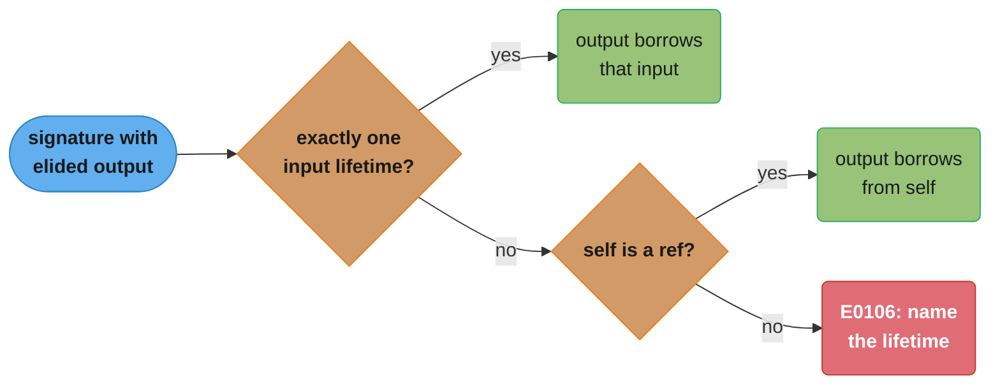

# Lifetimes and the Borrow Checker

> **Version anchor (2026-11-06):** Rust 1.99.1 (2026-10-15) on edition 2024 (stable since
> 1.85, 2025-02-20). Gated items on this page: precise capturing `use<..>` `[1.82]`, the edition
> 2024 return-position `impl Trait` capture rules `[ed2024]`, and the warn-by-default
> `mismatched_lifetime_syntaxes` lint `[1.89]`. NLL is the stable borrow checker. Polonius is
> not stable as of 1.99.1.

---

## 1. Concept Overview

A lifetime is a name for a region of the program during which a reference must stay valid.
The borrow checker computes those regions from the control-flow graph and rejects any program
in which a reference could be used after its referent is moved, mutated in a conflicting way
or dropped. Lifetimes exist only at compile time. The machine code has no lifetime data and
pays nothing for them.

Most lifetimes are inferred. You write them in three places: in function signatures where
the elision rules cannot decide which input an output borrows from, in structs and enums that
hold references, and in trait or generic bounds such as `T: 'static` or `for<'a> Fn(&'a str)`.
A lifetime annotation never changes how long a value lives. It describes a relationship the
compiler then checks.

This page covers the region model, the three elision rules, `'static` as a bound against
`'static` as a reference type, lifetimes in structs, variance, higher-ranked trait bounds,
reborrowing, the six error codes engineers meet most often (E0499, E0502, E0505, E0506, E0597
and E0716), the edition 2024 capture rules for `impl Trait`, and why a struct cannot borrow
from itself in safe Rust. Ownership, moves and drop order are in
[Ownership, Borrowing and RAII](../ownership_borrowing_and_raii/ownership_borrowing_and_raii.md).

The borrow checker is a sound but conservative static analysis: it rejects some programs that
would never misbehave. Why every such analysis must reject some correct programs is a result in
[Theory of Computation](../../cs_fundamentals/theory_of_computation/theory_of_computation.md).

---

## 2. Intuition

> **One-line analogy:** a lifetime is the validity period printed on a visitor badge. The badge
> says nothing about how long the building stands; it only promises the building stands at
> least that long, and the guard (the borrow checker) refuses any badge that would outlast it.

**Mental model.** Draw the program as a list of lines. Every reference is a vertical bar from
the line where it is created to the line of its last use. Every owner has its own bar from
creation to move or drop. The borrow checker's job is a set of interval checks: each
reference's bar must sit inside its owner's bar, no exclusive bar may overlap any other bar on
the same value, and no write or move of the owner may happen inside a shared bar.

**Why it matters.** Dangling pointers, iterator invalidation and use-after-free account for a
large share of the security bugs in C and C++ code. Rust catches all three at compile time
with no runtime check and no garbage collector. The price is that you must sometimes explain
to the compiler, through a signature, which input an output borrows from.

**Key insight.** Most lifetime errors are not about lifetimes. They are about a signature that
tells the compiler the wrong story. A method that returns `&str` from `&mut self` tells the
compiler the result borrows all of `self` mutably, even when it only points into an input
buffer. Fix the signature and the error at the call site goes away.

---

## 3. Core Principles

1. **Lifetimes are regions, not durations.** A lifetime is a set of program points where a
   borrow must be valid. NLL computes it from the last use, not from the closing brace.
2. **Annotations describe, they never extend.** `'a` cannot keep a value alive. If the owner
   dies, every reference to it dies with it, whatever the signature says.
3. **Outputs borrow from inputs.** A function can only return a reference derived from a
   parameter or from `'static` data. A reference to a local is always E0515.
4. **Elision is a fixed rule set, not inference.** Three rules fill in signature lifetimes.
   When they do not decide, the compiler asks you (E0106) instead of guessing.
5. **`'static` has two meanings.** `&'static T` is a reference valid for the whole program.
   `T: 'static` is a bound that says `T` holds no non-static borrows, which every owned type
   such as `String` satisfies.
6. **Variance decides what may be shortened.** A longer lifetime can stand in for a shorter
   one behind `&'a T`, but not behind `&'a mut T` for the pointee type, because writes through
   the mutable reference would break the substitution.
7. **The checker is conservative.** It accepts only programs it can prove safe. Some correct
   programs fail, and the fix is to restructure them so the proof is visible.

---

## 4. Types / Architectures / Strategies

### 4.1 The three lifetime elision rules

| Rule | Applies to | Effect | Example |
|---|---|---|---|
| 1 | Every elided input lifetime | Each one becomes its own fresh parameter | `fn f(a: &str, b: &str)` is `fn f<'a, 'b>(a: &'a str, b: &'b str)` |
| 2 | Exactly one input lifetime | It is given to every elided output lifetime | `fn first(s: &str) -> &str` ties the output to `s` |
| 3 | Several inputs, one is `&self` or `&mut self` | The `self` lifetime is given to every elided output | `fn name(&self, key: &str) -> &str` ties the output to `self` |
| none | Several inputs, no `self` | Error E0106: missing lifetime specifier | `fn longest(x: &str, y: &str) -> &str` |

### 4.2 Two meanings of `'static`

| Form | Meaning | Satisfied by | Typical use |
|---|---|---|---|
| `&'static T` | A reference valid until the process exits | String literals, `static` items, `Box::leak` results | Global configuration, string constants |
| `T: 'static` | `T` contains no borrow shorter than `'static` | `String`, `Vec<u8>`, `Arc<T>`, `i32`, `&'static str` | `thread::spawn`, `tokio::spawn`, `Box<dyn Any>` |

### 4.3 Variance of common types

| Type | Variance in `'a` | Variance in `T` |
|---|---|---|
| `&'a T` | covariant | covariant |
| `&'a mut T` | covariant | invariant |
| `Box<T>`, `Vec<T>`, `Option<T>` | n/a | covariant |
| `Cell<T>`, `RefCell<T>`, `UnsafeCell<T>` | n/a | invariant |
| `*const T` | n/a | covariant |
| `*mut T` | n/a | invariant |
| `fn(T) -> U` | n/a | contravariant in `T`, covariant in `U` |
| `PhantomData<T>` | n/a | covariant |

Covariant means a subtype may be used where the supertype is expected: `&'static str` may be
used as `&'a str`. Invariant means the type must match exactly.

### 4.4 Ways to hold borrowed data in a struct

| Strategy | Struct shape | Cost | Use when |
|---|---|---|---|
| Borrow | `struct View<'a> { s: &'a str }` | Zero copy; the struct cannot outlive the source | A short-lived view, parser or iterator |
| Own | `struct Rec { s: String }` | One allocation per field | The struct is stored, sent to another thread or cached |
| Offsets | `struct Rec { buf: String, name: Range<usize> }` | Zero copy, plus bounds math | Owning a buffer and many slices of it together |
| Shared owner | `struct Rec { buf: Arc<str>, name: Range<usize> }` | One count update per clone | Many records share one buffer |
| Self-referential crate | `self_cell` or `ouroboros` | Small runtime wrapper, audited unsafe | You need real references into an owned buffer |

### 4.5 Error codes you will meet

| Code | Message (rustc 1.99.1) | What happened |
|---|---|---|
| E0499 | cannot borrow `x` as mutable more than once at a time | Two `&mut` borrows overlap |
| E0502 | cannot borrow `x` as mutable because it is also borrowed as immutable | A `&mut` overlaps a live `&` (or the reverse) |
| E0505 | cannot move out of `x` because it is borrowed | A move happens while a borrow is live |
| E0506 | cannot assign to `x` because it is borrowed | An assignment happens while a borrow is live |
| E0597 | `x` does not live long enough | A named value dies while a borrow of it is live |
| E0716 | temporary value dropped while borrowed | An unnamed temporary dies at the end of its statement while borrowed |
| E0515 | cannot return value referencing local variable `x` | A function returns a borrow of its own local |
| E0106 | missing lifetime specifier | The elision rules cannot decide an output lifetime |

---

## 5. Architecture Diagrams

### 5.1 Borrow regions as intervals

```
  line  code                         s (owner)   r = &s     w = &mut s
  ----  ---------------------------  ---------   --------   ----------
   1    let mut s = String::new();   |
   2    let r = &s;                  |           |
   3    println!("{r}");             |           |  last use
   4    let w = &mut s;              |                      |
   5    w.push('x');                 |                      |  last use
   6    println!("{s}");             |  read again
   7    }                            |  dropped
```

The shared bar `r` ends on line 3 and the exclusive bar `w` starts on line 4, so they never
overlap and the code compiles. Move `println!("{r}")` to line 6 and the bar for `r` covers
lines 4 and 5, which overlap `w`: that is E0502.

### 5.2 How the compiler fills in an output lifetime



Rule 1 always runs first and gives each elided input its own lifetime. Rules 2 and 3 then
pick the output's lifetime or stop with E0106. Rule 3 is the source of the parser bug in
section 10.1: it ties the output to `self` even when the data comes from a field.

### 5.3 Why `&mut T` must be invariant in `T`


If `&mut &'static str` could be shortened to `&mut &'short str`, a function could store a
short-lived reference into a variable typed as `'static`. Invariance blocks the first step.
Section 6.5 shows the exact program and its E0597.

---

## 6. How It Works - Detailed Mechanics

### 6.1 Naming a lifetime when elision cannot

```rust
// Two inputs and no self: the output must say which one it borrows from.
fn longest<'a>(x: &'a str, y: &'a str) -> &'a str {
    if x.len() >= y.len() { x } else { y }
}

// The output only borrows from `haystack`, so `needle` gets its own lifetime.
fn find_after<'h>(haystack: &'h str, needle: &str) -> Option<&'h str> {
    haystack.find(needle).map(|i| &haystack[i + needle.len()..])
}

fn main() {
    let a = String::from("request-id");
    let tail;
    {
        let needle = String::from("-");
        tail = find_after(&a, &needle); // the result does not borrow `needle`
    } // needle dropped here, and that is fine
    println!("{tail:?} {}", longest("ab", "abc"));
}
```

`longest` with one shared `'a` asks the caller for two references that both live at least as
long as the result. When the result can only come from one input, give that input its own
lifetime, as `find_after` does. A single shared lifetime would make `tail` keep `needle`
borrowed, and the example would fail with E0597.

### 6.2 `'static` as a bound

```rust
use std::thread;

fn spawn_logger<T: std::fmt::Display + Send + 'static>(msg: T) -> thread::JoinHandle<()> {
    thread::spawn(move || println!("{msg}"))
}

fn main() {
    let owned = String::from("owned String is 'static");
    let h = spawn_logger(owned); // fine: String holds no borrow
    h.join().expect("logger thread panicked");

    let local = String::from("borrowed");
    // spawn_logger(&local); // error[E0597]: `local` does not live long enough
    thread::scope(|s| {
        s.spawn(|| println!("{local}")); // scoped threads may borrow
    });
}
```

`T: 'static` does not mean "lives forever". It means "may be kept forever", which every owned
value can. `thread::spawn` needs it because the new thread may outlive the caller.
`thread::scope` `[1.63]` joins every thread before it returns, so its closures may borrow
locals.

### 6.3 Lifetimes in structs

```rust
struct Parser<'a> {
    input: &'a str,
    pos: usize,
}

impl<'a> Parser<'a> {
    fn new(input: &'a str) -> Self {
        Parser { input, pos: 0 }
    }

    // The token borrows from the input buffer ('a), not from the parser (&mut self).
    fn next_token(&mut self) -> Option<&'a str> {
        let rest = self.input[self.pos..].trim_start();
        if rest.is_empty() {
            return None;
        }
        let start = self.input.len() - rest.len();
        let end = rest.find(' ').map_or(self.input.len(), |i| start + i);
        self.pos = end;
        Some(&self.input[start..end])
    }
}

fn main() {
    let line = String::from("GET /index HTTP/1.1");
    let mut p = Parser::new(&line);
    let method = p.next_token();
    let path = p.next_token(); // fine: `method` does not borrow `p`
    println!("{method:?} {path:?}");
}
```

A struct with a lifetime parameter is a view. It cannot outlive the data it borrows, and the
compiler tracks that for every instance. The key line is the return type `Option<&'a str>`.
With an elided `Option<&str>`, rule 3 ties each token to `&mut self` and the second call is
E0499 (section 10.1).

### 6.4 Reborrowing

```rust
fn append(v: &mut Vec<u32>, x: u32) {
    v.push(x);
}

fn consume<T>(_t: T) {}

fn main() {
    let mut data = Vec::new();
    let r = &mut data;
    append(r, 1); // implicit reborrow: the compiler passes `&mut *r`
    append(r, 2); // so `r` is still usable
    consume(&mut *r); // a generic `T` parameter does not reborrow: write it out
    r.push(3);
    println!("{data:?}");
}
```

`&mut T` is not `Copy`, so passing it would normally move it. When the parameter type is
known to be `&mut U`, the compiler inserts a reborrow `&mut *r` with a shorter lifetime and the
original stays usable after the call. A generic parameter `T` has no known reference type, so
`consume(r)` moves `r` and the next `r.push` is E0382. Write `&mut *r` by hand there.

### 6.5 Variance in practice

```rust
// Covariance: a longer lifetime may be used where a shorter one is expected.
fn shorten<'a>(s: &'static str) -> &'a str {
    s
}

// Invariance of &mut T in T: the classic program from the Rustonomicon.
fn assign<T>(input: &mut T, val: T) {
    *input = val;
}

fn main() {
    let mut hello: &'static str = "hello";
    let short = shorten(hello);
    {
        let world = String::from("world");
        // assign(&mut hello, &world); // error[E0597]: `world` does not live long enough
        let mut local: &str = &world;
        assign(&mut local, short); // fine: a 'static str may be stored in a shorter slot
        println!("{local}");
    }
    hello = "still static";
    println!("{hello}");
}
```

`assign(&mut hello, &world)` would need `T = &'static str` from the first argument and
`T = &'world str` from the second. Because `&mut T` is invariant in `T`, the compiler cannot
shrink the first to match, so it requires `world` to live for `'static` and reports E0597.
Without that rule, `hello` would point at freed memory after the block.

### 6.6 Higher-ranked trait bounds

```rust
// The closure must work for a borrow the caller never sees: one created inside `apply`.
fn apply<F>(f: F) -> usize
where
    F: for<'a> Fn(&'a str) -> &'a str,
{
    let local = String::from("hello world");
    f(&local).len()
}

fn first_word(s: &str) -> &str {
    s.split(' ').next().unwrap_or("")
}

fn main() {
    println!("{}", apply(first_word));
    println!("{}", apply(|s| s.trim()));
}
```

`for<'a>` reads "for every lifetime `'a`". A plain `<'a, F: Fn(&'a str) -> &'a str>` lets the
caller pick `'a`, and no caller-chosen lifetime can match a borrow of `local`, which only
exists inside `apply`. That version fails with E0597. You rarely write `for<'a>` by hand,
because `Fn(&str) -> &str` in a bound already means the higher-ranked form, and so does
`Box<dyn Fn(&[u8]) -> &[u8]>`. You need it when elision cannot state the bound: a closure with
two reference inputs whose output borrows from both (`for<'a> Fn(&'a str, &'a str) -> &'a str`,
which the sugar rejects with E0106), or a bound on a trait that is not an `Fn` trait, such as
`for<'de> T: Deserialize<'de>`.

### 6.7 `impl Trait` capture rules and `use<..>`

In edition 2024, a return-position `impl Trait` captures every generic parameter in scope,
lifetimes included `[ed2024]`. In edition 2021, a free function's `impl Trait` captured type
parameters but not lifetime parameters. The 2024 rule is easier to predict but can make a
returned iterator hold a borrow it does not use:

```rust
// Captures the lifetime of `slice` in edition 2024, although `0..len` holds no borrow.
fn indices_all<T>(slice: &[T]) -> impl Iterator<Item = usize> {
    0..slice.len()
}

// Precise capturing [1.82]: capture only `T`, not the anonymous lifetime of `slice`.
fn indices<T>(slice: &[T]) -> impl Iterator<Item = usize> + use<T> {
    0..slice.len()
}

fn main() {
    let mut data = vec![10, 20, 30];
    let mut it = indices(&data);
    data.push(40); // fine: `it` does not borrow `data`
    println!("{:?} {}", it.next(), indices_all(&data).count());
}
```

With `indices_all` in place of `indices`, the `push` is E0502 because the returned iterator
keeps `data` borrowed. `use<..>` lists exactly what the hidden type may capture. `[1.87]`
allows `use<..>` in `impl Trait` in trait definitions too.

### 6.8 The `mismatched_lifetime_syntaxes` lint `[1.89]`

```rust
// Before: warns "hiding a lifetime that's elided elsewhere is confusing".
// fn items(scores: &[u8]) -> std::slice::Iter<u8> { scores.iter() }

// After: `'_` shows that the iterator borrows `scores`.
fn items(scores: &[u8]) -> std::slice::Iter<'_, u8> {
    scores.iter()
}

fn main() {
    let v = [3u8, 5];
    println!("{}", items(&v).count());
}
```

The lint is on by default. It fires when elision connects an input lifetime to an output whose
type hides the lifetime. Adding `'_` changes nothing for the compiler and tells the reader that
the result borrows.

### 6.9 The conditional-return case NLL rejects

```rust
use std::collections::HashMap;

fn get_or_default(map: &mut HashMap<u32, String>, key: u32) -> &String {
    // The direct form `match map.get(&key) { Some(v) => v, None => { map.insert(..) } }`
    // is E0502 under NLL. The entry API does one lookup and satisfies the checker.
    map.entry(key).or_insert_with(|| String::from("default"))
}

fn main() {
    let mut m = HashMap::new();
    m.insert(1, String::from("one"));
    let one = get_or_default(&mut m, 1).len();
    let two = get_or_default(&mut m, 2).len();
    println!("{one} {two}");
}
```

When a function returns a borrow on one branch, NLL treats that borrow as live for the rest of
the function, including the branch that does not return it. The code is safe, but the
analysis cannot see it. This is the best-known case that the Polonius borrow checker accepts.
Polonius is not stable as of 1.99.1, so stable code uses the entry API, or a `contains_key`
check followed by a second lookup.

### 6.10 Default lifetimes of trait objects

| Written type | Means | Consequence |
|---|---|---|
| `Box<dyn Trait>` | `Box<dyn Trait + 'static>` | The boxed value may not hold any non-static borrow |
| `&'a dyn Trait` | `&'a (dyn Trait + 'a)` | The object may borrow for `'a` |
| `Box<dyn Trait + '_>` | Lifetime from the elision rules | A boxed value may borrow from an input |

`fn render(s: &str) -> Box<dyn Display> { Box::new(s) }` fails with "lifetime may not live
long enough" because the return type promises `'static`. Write `Box<dyn Display + '_>`, or
box an owned `String`.

---

## 7. Real-World Examples

- **`std::str::Split` and other borrowing iterators.** `"a,b".split(',')` returns
  `Split<'_, char>`, a view into the original string. The compiler stops you from dropping the
  string while the iterator is alive, with no runtime check.
- **serde zero-copy deserialization.** A struct with `&'de str` fields borrows from the input
  buffer, so parsing allocates nothing for those fields. The buffer must outlive the struct.
  See [Serde and Serialization](../serde_and_serialization/serde_and_serialization.md).
- **`std::thread::scope` and rayon.** Scoped threads (1.63) and rayon's parallel iterators let
  worker threads borrow the caller's data, because the API joins before it returns.
- **Storage engines.** An embedded key-value store can tie each borrowed read to the lifetime
  of its read transaction, so a read cannot outlive the snapshot it came from. The zero-copy
  storage engine case study builds on this.
- **Self-referential crates.** `self_cell` and `ouroboros` package one audited unsafe pattern:
  an owner and a dependent view of it stored together. Parsers that keep the source text and
  the parsed AST in one value use them.

---

## 8. Tradeoffs

### 8.1 Borrowed view or owned data

| Factor | `struct V<'a> { s: &'a str }` | `struct O { s: String }` |
|---|---|---|
| Allocation | None | One per field |
| Can be stored in a cache or sent to `tokio::spawn` | No, unless the source is `'static` | Yes |
| Signature noise | A lifetime parameter on the type and every impl | None |
| Refactoring cost | Adding a borrowed field adds a parameter to every user | Local |
| Best for | Parsers, iterators, short-lived views | Records, messages, anything that crosses an await or thread |

### 8.2 Ways out of a self-referential design

| Option | Safe code only | Runtime cost | Ergonomics |
|---|---|---|---|
| Indices or ranges into an owned buffer | Yes | Bounds check on access | Slices are rebuilt on access |
| Split into owner and view types | Yes | None | The caller keeps the owner alive |
| `Arc<str>` plus ranges | Yes | Count update per clone | Values become `'static` and sendable |
| `self_cell` / `ouroboros` | Yes for the user; unsafe inside the crate | Small | Closure-based access |
| Hand-written `Pin` plus raw pointers | No | None | Needs a soundness review |

---

## 9. When to Use / When NOT to Use

**Write explicit lifetimes when:**
- A function has two or more reference inputs and returns a reference.
- A method's result borrows from a field's referent, not from `self` (the parser case).
- A struct holds a reference.
- A bound must hold for every lifetime (`for<'a>`), or a trait object may borrow (`+ '_`).

**Prefer owned data when:**
- The value crosses a thread or task boundary, goes into a cache, or is returned from a
  long-lived service object.
- A lifetime parameter would spread through five or more types for a small saving.

**Do not:**
- Add `'static` to a bound to silence an error without asking whether the value can be owned.
- Use `unsafe` or `transmute` to extend a lifetime. That is undefined behavior the moment the
  owner dies.
- Build a self-referential struct with raw pointers before trying indices or a split design.

---

## 10. Common Pitfalls

### 10.1 A method that borrows all of `self` for its result

A team wrote a tokenizer for a log-ingest service. Every attempt to hold two tokens failed, so
the code converted each token to `String`: one heap allocation per token on the hottest path,
all because of an elided return lifetime.

```rust
// BROKEN
struct Parser<'a> {
    input: &'a str,
    pos: usize,
}

impl<'a> Parser<'a> {
    fn next_token(&mut self) -> Option<&str> { // elided: borrows from `&mut self`
        let rest = self.input[self.pos..].trim_start();
        let start = self.input.len() - rest.len();
        let end = rest.find(' ').map_or(self.input.len(), |i| start + i);
        self.pos = end;
        (start < end).then(|| &self.input[start..end])
    }
}

fn main() {
    let mut p = Parser { input: "GET /index HTTP/1.1", pos: 0 };
    let method = p.next_token();
    let path = p.next_token(); // error[E0499]: cannot borrow `p` as mutable more than once at a time
    println!("{method:?} {path:?}");
}
```

```rust
// FIX
struct Parser<'a> {
    input: &'a str,
    pos: usize,
}

impl<'a> Parser<'a> {
    fn next_token(&mut self) -> Option<&'a str> { // borrows from the input buffer
        let rest = self.input[self.pos..].trim_start();
        let start = self.input.len() - rest.len();
        let end = rest.find(' ').map_or(self.input.len(), |i| start + i);
        self.pos = end;
        (start < end).then(|| &self.input[start..end])
    }
}

fn main() {
    let mut p = Parser { input: "GET /index HTTP/1.1", pos: 0 };
    let method = p.next_token();
    let path = p.next_token();
    println!("{method:?} {path:?}");
}
```

### 10.2 Returning a reference to a local

```rust
// BROKEN
fn header_name(raw: &[u8]) -> &str {
    let s = String::from_utf8_lossy(raw).to_string();
    &s[..] // error[E0515]: cannot return value referencing local variable `s`
}
```

```rust
// FIX
fn header_name(raw: &[u8]) -> String {
    String::from_utf8_lossy(raw).into_owned()
}
```

No annotation can fix E0515, because the local dies when the function returns. Return an owned
value, or return `Cow<'_, str>` so valid UTF-8 input is returned without a copy.

### 10.3 A temporary dropped while borrowed

```rust
// BROKEN
fn main() {
    let name = String::from("svc-a").as_str(); // error[E0716]: temporary value dropped while borrowed
    println!("{name}");
}
```

```rust
// FIX
fn main() {
    let owned = String::from("svc-a");
    let name = owned.as_str();
    println!("{name}");
}
```

The `String` is a temporary that dies at the semicolon. Bind it to a name so it lives to the
end of the scope.

### 10.4 A struct that borrows from itself

```rust
// BROKEN
struct Doc<'a> {
    text: String,
    title: &'a str,
}

fn load() {
    let text = String::from("Title\nbody");
    let doc = Doc { title: &text[..5], text }; // error[E0505]: cannot move out of `text` because it is borrowed
    println!("{}", doc.title);
}
```

```rust
// FIX
use std::ops::Range;

struct Doc {
    text: String,
    title: Range<usize>,
}

impl Doc {
    fn title(&self) -> &str {
        &self.text[self.title.clone()]
    }
}

fn load() -> Doc {
    let text = String::from("Title\nbody");
    let end = text.find('\n').unwrap_or(text.len());
    Doc { title: 0..end, text }
}
```

Moving `text` into the struct would also move the buffer the borrow points into, as far as the
type system knows. Store ranges and rebuild the slice on access. `Pin` alone does not make the
borrowing version safe. See
[Async Futures and Pinning](../async_futures_and_pinning/async_futures_and_pinning.md).

### 10.5 `Box<dyn Trait>` that silently means `'static`

A metrics library returned `Box<dyn Iterator<Item = &str>>` from a method on a registry. The
compiler demanded `'static` data, and a contributor "fixed" it by leaking every label set with
`Box::leak`. Memory grew with every call until the process restarted. The right fix was one token:
`Box<dyn Iterator<Item = &str> + '_>`.

---

## 11. Technologies & Tools

| Tool | What it does for lifetime work |
|---|---|
| rustc | The NLL borrow checker; error explanations with `rustc --explain E0502`; the `mismatched_lifetime_syntaxes` lint |
| Clippy | `needless_lifetimes` and `extra_unused_lifetimes` remove annotations that elision already covers |
| rust-analyzer | Inlay hints for elided lifetimes in signatures |
| Miri | Detects use-after-free and aliasing violations in unsafe code that the borrow checker cannot see |
| self_cell | A small crate (1.3.0) for an owner plus a borrowing dependent stored together |
| ouroboros | A derive-based crate (0.18.5) for self-referential structs with several dependents |

---

## 12. Interview Questions with Answers

**Q: Does adding a lifetime annotation make a value live longer?**
**Short:** No, an annotation only describes how long references must be valid, and the compiler checks the program against it without changing when anything is dropped.

The drop point comes from ownership: scope end, a move or an explicit `drop`. Annotations
connect the regions of inputs and outputs so the checker can verify that no reference outlives
its owner. If the owner dies too early, the fix is to move the owner, not to annotate harder.

**Q: What does `T: 'static` mean, and does `String` satisfy it?**
**Short:** It means `T` contains no borrow shorter than the whole program, and every owned type such as `String` or `Vec<u8>` satisfies it even though the value itself is dropped normally.

The bound is about what the type may borrow, not about how long a particular value lives. A
`String` created and dropped inside one request still meets `T: 'static`. `&'a str` meets it only
when `'a` is `'static`. This is why `thread::spawn(move || ...)` accepts closures that own their
data and rejects closures that borrow locals.

**Q: Why does returning `Box<dyn Display>` from a function that borrows its input fail?**
**Short:** A `Box<dyn Trait>` with no lifetime defaults to `dyn Trait + 'static`, so the boxed value may not hold the input borrow, and `+ '_` in the return type fixes it.

The default object lifetime for `Box<dyn Trait>` is `'static`, while `&'a dyn Trait` defaults
to `'a`. The error text is "lifetime may not live long enough", with no error code. Write
`Box<dyn Display + '_>` to tie the object to the input, or box an owned value. Leaking data to
satisfy `'static` turns a type error into a memory leak.

**Q: Why does a tokenizer method returning `Option<&str>` from `&mut self` allow only one live token?**
**Short:** Elision rule 3 ties the returned reference to `&mut self`, so each token keeps the whole parser mutably borrowed and a second call is E0499.

The data comes from the input buffer the parser borrows for `'a`, but the signature does not
say so. Write `Option<&'a str>` and the tokens borrow the buffer instead of the parser. This is
the most common lifetime bug in real code, and the usual wrong fix is to return owned
`String`s and pay an allocation per token.

**Q: What are the three lifetime elision rules?**
**Short:** Each elided input gets its own lifetime, a single input lifetime flows to every elided output, and with several inputs the lifetime of `&self` or `&mut self` flows to the outputs.

When none of these decides an output lifetime, the compiler reports E0106 rather than guess.
`fn longest(x: &str, y: &str) -> &str` is the textbook E0106. The rules are a fixed syntax
transformation. They never look at the function body.

**Q: Why does returning a borrow from one branch of a `match` on `map.get()` fail even though the other branch does not use it?**
**Short:** NLL treats a borrow that is returned on one path as live until the function ends on every path, so the insert on the other branch conflicts with it.

The program is safe, and the Polonius borrow checker accepts it, but Polonius is not stable as
of 1.99.1. On stable, use the entry API (`map.entry(k).or_insert_with(..)`), which does one
lookup, or check `contains_key` first and do a second lookup. Restructuring so the borrow is
created after the mutation is the general technique.

**Q: How do E0499 and E0502 differ?**
**Short:** E0499 is two overlapping mutable borrows of one value, while E0502 is a mutable borrow that overlaps a live shared borrow.

Both are violations of shared-xor-mutable. E0499 typically comes from holding two `&mut` from
methods like `get_mut`. E0502 typically comes from pushing to a `Vec` while an iterator or a
`&v[0]` is still used later. For disjoint elements, `split_at_mut` or `get_disjoint_mut`
`[1.86]` give two mutable references the checker accepts.

**Q: How do E0505 and E0506 differ?**
**Short:** E0505 is moving a value while a borrow of it is still live, and E0506 is assigning a new value to it while a borrow is still live.

Both protect a reader from seeing the value change or vanish under it. E0505 appears when you
pass a borrowed value into a function by value, or move it into a struct. E0506 appears when you
overwrite a variable that an earlier `&x` still reads. End the borrow earlier, or clone the small
part you need before the move.

**Q: How do E0597 and E0716 differ?**
**Short:** E0597 means a named variable dies while still borrowed, and E0716 means an unnamed temporary dies at the end of its statement while still borrowed.

`let r; { let s = ..; r = &s; } use(r)` is E0597: `s` dies at its closing brace.
`let r = String::from("a").as_str();` is E0716: the `String` was never named, so it dies at the
semicolon. Fix E0597 by moving the owner to an outer scope. Fix E0716 by binding the temporary
to a variable.

**Q: Why is `&mut T` invariant in `T` while `&T` is covariant?**
**Short:** A mutable reference can write, so treating `&mut &'static str` as `&mut &'short str` would let code store a short-lived reference where a static one is expected.

Covariance is safe for shared references because nothing can be written through them. With
`&mut T`, writes go in as well as reads come out, and both directions must agree, so `T` must
match exactly. `Cell<T>` and `UnsafeCell<T>` are invariant in `T` for the same reason. The
outer lifetime of `&'a mut T` is still covariant, so a mutable borrow can always be shortened.

**Q: What is a higher-ranked trait bound and when must you write `for<'a>`?**
**Short:** `for<'a>` requires a bound to hold for every lifetime, which a function needs when it calls a closure with a borrow of its own local that the caller cannot name.

`F: Fn(&str) -> &str` already desugars to `for<'a> Fn(&'a str) -> &'a str`, so most code never
spells it out. You write it when the lifetime appears in a way the sugar cannot express, such
as a `where` clause on a non-`Fn` trait (`for<'a> T: Deserialize<'a>`) or an `Fn` bound with
two reference inputs whose output borrows from both.

**Q: Why does passing a `&mut` reference to a generic function move it, while passing it to a non-generic one does not?**
**Short:** The compiler inserts an implicit reborrow only when the parameter type is known to be a mutable reference, and a generic `T` is not known, so the reference is moved.

With `fn f(v: &mut Vec<u8>)`, the call `f(r)` becomes `f(&mut *r)`, a fresh shorter borrow,
and `r` stays usable. With `fn g<T>(t: T)`, `g(r)` moves `r` because `&mut` is not `Copy`, and
the next use is E0382. Write `g(&mut *r)` to reborrow by hand.

**Q: When should a struct carry a lifetime parameter instead of owning its data?**
**Short:** When it is a short-lived view over data someone else owns, such as a parser, iterator or zero-copy record that never crosses a thread, task or cache boundary.

A lifetime parameter spreads to every type that contains the struct and to every `impl`. That
is acceptable for a parser that lives inside one function. For a message that goes onto a
channel, into `tokio::spawn` or into a cache, own the data or share it through `Arc<str>`.

**Q: Why can a safe Rust struct not hold a `String` and a `&str` that points into it?**
**Short:** Moving the struct moves the `String`, and the type system has no way to say a field borrows a sibling field, so construction fails with E0505 or a missing lifetime.

The heap buffer would in fact stay put, but the compiler cannot know that for a general type.
Safe designs store ranges into the buffer, split the owner and the view into two values, or use
`self_cell` or `ouroboros`. `Pin` by itself does not solve it. The async state machine is the
one place the compiler builds such structs for you.

**Q: How did edition 2024 change what a returned `impl Trait` captures, and what is `use<..>` for?**
**Short:** In edition 2024 a return-position `impl Trait` captures all generic parameters in scope including lifetimes, and `use<..>` (1.82) lists exactly the parameters it may capture instead.

The new default is more predictable, but a function such as `fn ids<T>(s: &[T]) -> impl
Iterator<Item = usize>` now keeps `s` borrowed even when the iterator is `0..s.len()`. Writing
`+ use<T>` drops the lifetime from the hidden type, and the caller can mutate the slice again.
`cargo fix --edition` inserts `use<..>` where it preserves 2021 behavior.

**Q: What does the `mismatched_lifetime_syntaxes` lint warn about?**
**Short:** It warns, by default since 1.89, when elision links an input lifetime to an output whose type hides that lifetime, such as returning `Iter<u8>` instead of `Iter<'_, u8>`.

The code is correct either way. The lint exists because a reader of `fn items(s: &[u8]) ->
Iter<u8>` cannot see that the result borrows `s`. Add `'_` to make the borrow visible. The
lint replaced the older `elided_named_lifetimes` lint.

**Q: What does `'a: 'b` mean, and where do implied bounds come from?**
**Short:** `'a: 'b` reads "`'a` outlives `'b`", and the compiler also infers such bounds from the types in a signature, for example that `&'a T` implies `T: 'a`.

An explicit outlives bound lets a function return data with lifetime `'a` where `'b` is
expected. Implied bounds save you from writing the obvious ones: a parameter of type
`&'a &'b str` already implies `'b: 'a`. Explicit bounds appear mostly on structs with two
lifetime parameters.

**Q: Why does `thread::spawn` require `'static` while `thread::scope` lets threads borrow locals?**
**Short:** A spawned thread may outlive the function that started it, but a scope joins every thread it spawned before returning, so borrows of the caller's locals stay valid.

The `'static` bound on `thread::spawn` is the compiler's only way to prevent a dangling borrow
when it cannot see when the thread ends. `thread::scope` (1.63) moves the join into the API, so
its closures only need to outlive the scope. See
[Threads, Send, Sync and Locks](../threads_send_sync_and_locks/threads_send_sync_and_locks.md).

**Q: Why does the borrow checker reject some programs that are actually safe?**
**Short:** It is a sound static analysis, and any analysis that decides a non-trivial runtime property must sometimes reject correct programs to never accept a wrong one.

The checker reasons about control-flow paths, not values. It cannot see that two indices are
different or that a branch never runs. The workarounds make the fact visible to the analysis:
`split_at_mut` for disjoint slices, the entry API for conditional insertion, and scoping a
borrow so it ends before the conflicting use.

**Q: Do lifetimes cost anything at runtime or create extra copies of generic code?**
**Short:** No, lifetimes are erased before code generation, so they add no data, no checks and no extra monomorphized copies.

Two calls that differ only in lifetimes share one compiled function. All the cost of the
borrow checker is paid at compile time, and its output is only accept or reject. This is the
reason lifetimes cannot be inspected or used to change behavior at runtime.

**Q: What does the anonymous lifetime `'_` mean in a type?**
**Short:** `'_` asks the compiler to apply the elision rules at that position, and it makes visible that a type borrows without introducing a named parameter.

In `impl Display for Wrapper<'_>` it stands for a fresh lifetime. In a return type such as
`Iter<'_, u8>` or `Box<dyn Trait + '_>` it takes the lifetime chosen by elision. It is the
idiomatic way to satisfy the `mismatched_lifetime_syntaxes` lint.

**Q: How do you get a `&'static` value that is computed at runtime?**
**Short:** Build it once with `LazyLock` or `OnceLock` in a `static`, or leak an owned value with `Box::leak` when it must live for the rest of the process.

A `static CONFIG: LazyLock<Config>` (1.80) yields `&'static Config` on access and frees nothing
until exit. `Box::leak(Box::new(value))` returns `&'static mut T`, which suits configuration
parsed once at startup. Leaking inside a request loop is a memory leak with a type signature.

---

## 13. Best Practices

1. Read the signature first when you get a borrow error. Ask which input the output really
   borrows from.
2. Give each reference input its own lifetime unless the output can come from either one.
3. Write `'_` wherever a type hides a borrow, and keep the `mismatched_lifetime_syntaxes`
   lint on.
4. Use owned types for anything that crosses a thread, task, channel or cache boundary.
5. Treat `+ 'static` in a bound as a design decision, not an error silencer.
6. Prefer indices, ranges or a split owner and view over self-referential structs.
7. Reach for `split_at_mut`, `get_disjoint_mut` and the entry API before cloning to satisfy
   the checker.
8. Use `thread::scope` instead of `Arc` when threads only need to borrow for the duration of
   one call.
9. On edition 2024, add `use<..>` to returned iterators that should not keep their inputs
   borrowed.
10. Never extend a lifetime with `unsafe` or `transmute`.

---

## 14. Case Study

### A zero-copy access-log index

**Context (illustrative numbers).** A team indexes 2 GB of access logs per hour. Each line is parsed into a record
with a method, a path and a status. The first version allocated three `String`s per record,
about 30 million allocations per hour for 10 million lines, and spent more time in the
allocator than in parsing. The goal: one buffer per file and records that borrow from it.

**First attempt.** Keep the buffer and the borrowed records in one struct so callers get a
single value:

```rust
// BROKEN
struct Record<'a> {
    method: &'a str,
    path: &'a str,
    status: u16,
}

struct LogIndex<'a> {
    buf: String,
    records: Vec<Record<'a>>,
}

fn parse_line(line: &str) -> Option<Record<'_>> {
    let mut parts = line.split(' ');
    let method = parts.next()?;
    let path = parts.next()?;
    let status = parts.next()?.parse().ok()?;
    Some(Record { method, path, status })
}

fn load(buf: String) -> u16 {
    let records: Vec<Record<'_>> = buf.lines().filter_map(parse_line).collect();
    let idx = LogIndex { buf, records }; // error[E0505]: cannot move out of `buf` because it is borrowed
    idx.records.first().map_or(0, |r| r.status)
}
```

The struct is self-referential: `records` borrows `buf`, and moving `buf` into the struct
moves the value the borrows point into. No lifetime annotation can express "borrows a sibling
field".

**Fix.** Split the owner and the view. The caller owns the buffer for the life of the index,
and the index borrows it. The records hold no allocation of their own:

```rust
// FIX
struct Record<'a> {
    method: &'a str,
    path: &'a str,
    status: u16,
}

struct LogIndex<'a> {
    records: Vec<Record<'a>>,
}

fn parse_line(line: &str) -> Option<Record<'_>> {
    let mut parts = line.split(' ');
    let method = parts.next()?;
    let path = parts.next()?;
    let status = parts.next()?.parse().ok()?;
    Some(Record { method, path, status })
}

impl<'a> LogIndex<'a> {
    fn build(buf: &'a str) -> Self {
        LogIndex { records: buf.lines().filter_map(parse_line).collect() }
    }

    // Results borrow the buffer ('a), not the index, so they outlive a temporary index.
    fn errors(&self) -> impl Iterator<Item = &'a str> + use<'_, 'a> {
        self.records.iter().filter(|r| r.status >= 500).map(|r| r.path)
    }

    fn count(&self, method: &str) -> usize {
        self.records.iter().filter(|r| r.method == method).count()
    }
}

fn main() {
    let buf = String::from("GET /a 200\nPOST /b 503\nGET /c 500\n");
    let idx = LogIndex::build(&buf);
    let failing: Vec<&str> = idx.errors().collect();
    println!("{failing:?} gets={}", idx.count("GET"));
}
```

**When the index must be owned.** The next requirement moved index building onto a
`tokio::spawn` task and kept indexes in an LRU cache, which needs `'static` values. Borrowed
records cannot do that. The team chose ranges into a shared buffer, which keeps zero copies of
the line data and makes the value `'static`:

```rust
use std::ops::Range;
use std::sync::Arc;

struct Record {
    method: Range<usize>,
    path: Range<usize>,
    status: u16,
}

struct OwnedIndex {
    buf: Arc<str>,
    records: Vec<Record>,
}

impl OwnedIndex {
    fn build(buf: Arc<str>) -> Self {
        let base = buf.as_ptr() as usize;
        let mut records = Vec::new();
        for line in buf.lines() {
            let mut parts = line.split(' ');
            let (Some(m), Some(p), Some(s)) = (parts.next(), parts.next(), parts.next()) else {
                continue;
            };
            let Ok(status) = s.parse() else { continue };
            let off = |x: &str| {
                let start = x.as_ptr() as usize - base;
                start..start + x.len()
            };
            records.push(Record { method: off(m), path: off(p), status });
        }
        OwnedIndex { buf, records }
    }

    fn path(&self, i: usize) -> Option<&str> {
        self.records.get(i).map(|r| &self.buf[r.path.clone()])
    }

    fn method(&self, i: usize) -> Option<&str> {
        self.records.get(i).map(|r| &self.buf[r.method.clone()])
    }
}

fn main() {
    let buf: Arc<str> = Arc::from("GET /a 200\nPOST /b 503\n");
    let idx = OwnedIndex::build(Arc::clone(&buf));
    let handle = std::thread::spawn(move || idx.path(1).map(str::to_owned));
    println!("{:?}", handle.join().ok().flatten());
}
```

**Result.**

| Version | Allocations per 10M lines | Can go into a cache or another thread |
|---|---|---|
| Three `String`s per record | 30M plus the `Vec` growth | Yes |
| `LogIndex<'a>` borrowing the caller's buffer | The `Vec` growth only | No |
| `OwnedIndex` with `Arc<str>` and ranges | The `Vec` growth only | Yes |

The lesson: when a lifetime error says a struct borrows from itself, do not reach for
annotations or `unsafe`. Decide who owns the bytes, then make the view either a borrowing
type with an honest signature or an owned type that stores offsets.
