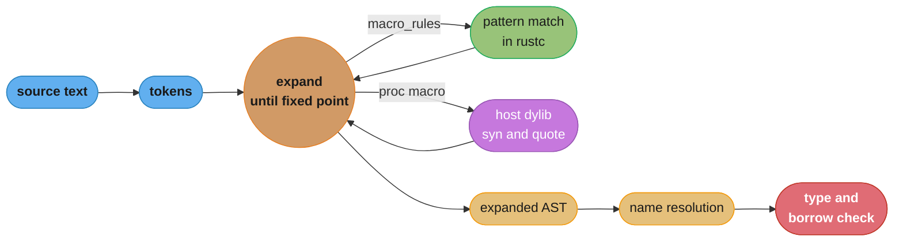
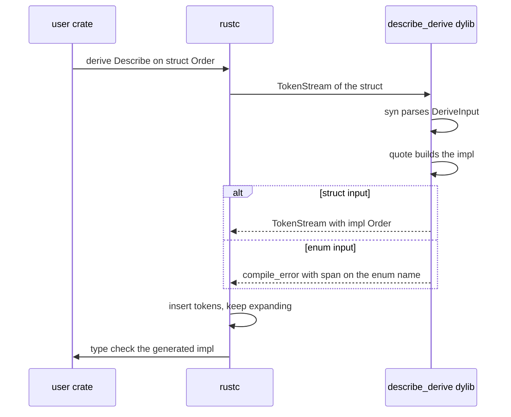

# Macros: Declarative and Procedural

> **Version anchor (2026-11-06).** Rust 1.99.1 (2026-10-15) on edition 2024. In edition
> 2024 the `expr` fragment also matches `const { .. }` and `_`, and `expr_2021` keeps the
> old behavior `[ed2024]`. A missing fragment specifier is a hard error. Invalid arguments
> to `#[macro_export]` are a deny-by-default lint that also fires in dependencies `[1.92]`.
> `cfg_select!` is `[1.95]` and `assert_matches!` is `[1.96]`. Crates: syn 3.0.9, quote
> 1.0.47, proc-macro2 1.0.107 (all MSRV 1.71), trybuild 1.0.122, cargo-expand 1.0.127.

## 1. Concept Overview

A Rust macro is code that writes code at compile time. The compiler runs macros early,
after parsing and before type checking, so a macro sees **tokens**, never types. Import and
macro-path resolution run during expansion. The rest of name resolution runs after it. Rust has two families:

- **Declarative macros** (`macro_rules!`): a list of pattern and template pairs. The
  compiler matches the invocation's tokens against each pattern in order and pastes the
  first matching template. They live in ordinary crates and cost little to compile.
  `vec!`, `println!`, `matches!` and `assert_eq!` are written this way or as compiler
  built-ins with the same interface.
- **Procedural macros**: Rust functions from `TokenStream` to `TokenStream`, compiled into
  a separate `proc-macro` crate that the compiler loads and runs. They come in three
  shapes: derive (`#[derive(Serialize)]`), attribute (`#[tokio::main]`) and function-like
  (`sqlx::query!(...)`). Most use `syn` to parse tokens into a syntax tree and `quote` to
  turn a template back into tokens.

Macros exist for the cases that functions, generics and traits cannot express: a variable
number of arguments of different types, new items such as trait impls generated per type,
code that depends on the shape of a struct, and checks that run at compile time. They are
also the most expensive abstraction in the language to read, debug and compile, so the
first question for every macro is whether a generic or a trait would do.

Java solves a similar problem with annotation processors, which generate new source files
in compiler rounds
([Java annotation processing](../../java/annotation_processing/annotation_processing.md)).
Python changes classes at runtime with metaclasses and decorators
([Python metaclasses and metaprogramming](../../python/metaclasses_and_metaprogramming/metaclasses_and_metaprogramming.md)).
Rust macros run only at compile time and leave no runtime trace.

---

## 2. Intuition

> **One-line analogy**: `macro_rules!` is a mail-merge template with typed blanks. A
> procedural macro is a small program the compiler hires to read your text and type new
> text into the document before anyone checks the grammar.

**Mental model**: picture the compiler's front end as a conveyor belt. Source text becomes
tokens. Every macro call on the belt is a box with a label. The expander opens each box,
runs the macro, and puts the output tokens back on the belt, repeating until no boxes are
left. Only then do type checking and borrow checking start. A macro can
therefore produce any code, but it cannot ask any question about types, because no types
exist yet.

**Why it matters**: three production costs come from that picture. Proc macros sit on the
build's critical path, because every crate that uses `#[derive(Serialize)]` must wait for
`serde_derive` and `syn` to compile. Errors in generated code point at code nobody wrote
unless the macro sets spans with care. And a declarative macro that refers to a helper by
a bare name breaks as soon as someone calls it from another module.

**Key insight**: a macro is a code generator with no type information and with users who
did not read it. Write it like a public API: name every external path absolutely, give
every error a span on the user's input, and test the failures as well as the successes.

---

## 3. Core Principles

- **Tokens in, tokens out.** A macro cannot see types, trait impls or other items. It sees
  exactly the tokens it was given.
- **Expansion happens before type checking.** Generated code is then checked like
  hand-written code, so type errors surface after expansion.
- **`macro_rules!` hygiene is mixed-site.** Local variables, labels and `$crate` resolve
  where the macro was defined. Every other name (functions, types, modules, other macros)
  resolves where the macro is called.
- **Absolute paths in templates.** Write `$crate::helper`, `::std::vec::Vec` and
  `::core::option::Option` so the expansion works in any caller's scope.
- **Proc macros are separate crates.** A `proc-macro = true` crate exports only macros,
  compiles for the host, and runs inside the compiler process.
- **Errors are output.** A proc macro reports problems by emitting `compile_error!` with a
  span on the user's tokens, not by panicking.
- **Prefer the weakest tool.** Function, then generic, then trait, then `macro_rules!`,
  then a proc macro.

---

## 4. Types / Architectures / Strategies

### 4.1 Macro kinds

| Kind | Declared with | Invoked as | Input | Typical use |
|---|---|---|---|---|
| Declarative | `macro_rules! name { .. }` | `name!(..)`, `name![..]`, `name! { .. }` | tokens matched by patterns | literals, repetitive impls, small DSLs |
| Derive | `#[proc_macro_derive(Name)]` | `#[derive(Name)]` on a struct, enum or union | the item | trait impls from a type's shape |
| Attribute | `#[proc_macro_attribute]` | `#[name]` or `#[name(args)]` on an item | args and the item | rewrite or wrap an item |
| Function-like | `#[proc_macro]` | `name!(..)` | any tokens | DSLs, compile-time checks |

A derive macro adds code next to the item and cannot change the item. An attribute macro
replaces the item with its output, so it can change or remove it.

### 4.2 Fragment specifiers

| Specifier | Matches | Edition notes |
|---|---|---|
| `expr` | an expression | 2024: also `_` and `const { .. }` at top level |
| `expr_2021` | an expression, except `_` and `const { .. }` at top level | keeps pre-2024 matching |
| `ident` | an identifier or keyword, not `_` | |
| `ty` | a type | |
| `path` | a type-style path | |
| `pat` | a pattern, including top-level `\|` | 2021 and later |
| `pat_param` | a pattern without top-level `\|` | |
| `stmt` | a statement without its trailing semicolon | |
| `block` | a `{ .. }` block | |
| `item` | an item | |
| `literal` | a literal, with an optional leading `-` | |
| `lifetime` | a lifetime | |
| `meta` | the inside of an attribute | |
| `vis` | a visibility, possibly empty | |
| `tt` | one token tree | |

### 4.3 Follow-set rules

Some fragments may be followed only by certain tokens, so the parser knows where the
fragment ends:

| Fragment | May be followed by |
|---|---|
| `expr`, `stmt` | `=>` `,` `;` |
| `pat` | `=>` `,` `=` `if` `in` |
| `pat_param` | `=>` `,` `=` `\|` `if` `in` |
| `path`, `ty` | `=>` `,` `=` `\|` `;` `:` `>` `>>` `[` `{` `as` `where`, or a `block` fragment |
| `vis` | `,`, a non-`priv` identifier, a type start, or an `ident`, `ty` or `path` fragment |
| all others | anything |

### 4.4 Proc macro crate layout

| Crate | Role |
|---|---|
| `foo` | the runtime library users depend on; re-exports the macro |
| `foo-derive` or `foo-macros` | `proc-macro = true`; depends on `syn`, `quote`, `proc-macro2` |
| `foo-internals` (optional) | shared logic that both may need |

Users add only `foo` with a `derive` feature. `serde` with `serde_derive` and `tokio` with
`tokio-macros` follow this layout.

---

## 5. Architecture Diagrams

### 5.1 Where expansion sits in the compiler



Expansion loops until no macro calls remain. Imports and macro paths resolve inside the loop,
and the remaining name resolution and all type checking run after it. The recursion limit,
128 by default, caps how deep this loop may nest.

### 5.2 One derive, end to end



The proc macro never sees types. It returns tokens, and `rustc` type-checks them as if the
user had written them. Errors travel back as `compile_error!` tokens with spans.

### 5.3 How repetition binds

```
macro_rules! hashmap { ($($k:expr => $v:expr),* $(,)?) => { .. } }

invocation:  hashmap! { "http" => 80, "https" => 443, }

repetition   $k          $v      separator
----------   ---------   -----   ---------
1            "http"      80      ,
2            "https"     443     ,   (trailing, eaten by $(,)?)

template:    $( m.insert($k, $v); )*
expansion:   m.insert("http", 80);  m.insert("https", 443);
```

Each `$(...)*` in the template repeats once per match of the matching `$(...)*` in the
pattern. Every metavariable inside one template repetition must have the same count.

---

## 6. How It Works - Detailed Mechanics

### 6.1 A declarative macro with repetition

```rust
macro_rules! hashmap {
    ($($k:expr => $v:expr),* $(,)?) => {{
        let mut m = ::std::collections::HashMap::new();
        $( m.insert($k, $v); )*
        m
    }};
}

fn main() {
    let ports = hashmap! { "http" => 80, "https" => 443, };
    assert_eq!(ports.get("https"), Some(&443));

    let empty: std::collections::HashMap<&str, u16> = hashmap! {};
    assert!(empty.is_empty());
}
```

- `$( ... ),*` means zero or more, separated by commas. `+` means one or more and `?` means
  zero or one.
- `$(,)?` accepts an optional trailing comma, which users expect.
- The double braces `{{ .. }}` make the expansion one block expression, so it works on the
  right side of `let`.
- `::std::collections::HashMap` starts with `::`, so a caller's own `HashMap` or `std`
  module cannot capture the name.

### 6.2 Hygiene

```rust
macro_rules! square_into {
    ($out:ident, $e:expr) => {
        let tmp = $e;
        let $out = tmp * tmp;
    };
}

fn main() {
    let tmp = 3;
    square_into!(sq, tmp + 1);
    assert_eq!(sq, 16);
    assert_eq!(tmp, 3);
}
```

The macro's own `tmp` and the caller's `tmp` are different variables, because local names
written in the template resolve at the definition site. `sq` is visible to the caller,
because the caller wrote that identifier and passed it in as `$out`. That is the rule for
exporting a binding from a macro: take the name as an `ident` argument.

Hygiene covers local variables, labels and `$crate`. It does not cover functions, types or
modules. A template that calls `helper()` looks for `helper` in the caller's scope.

### 6.3 `$crate` and macro scope

```rust
pub mod metrics {
    pub fn record(name: &str, v: u64) -> String {
        format!("{name}={v}")
    }

    #[macro_export]
    macro_rules! record {
        ($name:literal, $v:expr) => {
            $crate::metrics::record($name, $v)
        };
    }
}

fn main() {
    assert_eq!(record!("hits", 3), "hits=3");
}
```

- `$crate` expands to the defining crate, so `$crate::metrics::record` works from this
  crate, from another module and from a downstream crate. The item it names must still be
  visible to the caller, so it must be `pub` for use from other crates.
- `#[macro_export]` places the macro at the crate root with `pub` visibility, so other
  crates call it as `my_crate::record!`. Its only argument is `local_inner_macros`, and since
  `[1.92]` any other argument is rejected by a deny-by-default lint, in dependencies too.
- Without `#[macro_export]`, a macro has **textual scope**: it is usable after its
  definition, in source order, until the end of the enclosing module, and in child modules.
- `pub(crate) use name;` after the definition gives a macro **path-based scope** inside the
  crate, so other modules can call `crate::module::name!`.
- An unqualified `name!` looks in textual scope first, then path-based scope. A qualified
  `self::name!` or `crate::name!` uses path-based scope only.

### 6.4 The edition 2024 `expr` change

```rust
macro_rules! kind {
    ($e:expr) => {
        "expression"
    };
    (_) => {
        "underscore"
    };
}

macro_rules! kind_2021 {
    ($e:expr_2021) => {
        "expression"
    };
    (_) => {
        "underscore"
    };
}

fn main() {
    assert_eq!(kind!(1 + 1), "expression");
    assert_eq!(kind!(_), "expression");
    assert_eq!(kind_2021!(_), "underscore");
}
```

In edition 2024, `expr` matches `_`, so the first arm wins and the `_` arm becomes dead.
`expr_2021` keeps the old matching. `cargo fix --edition` rewrites `expr` to `expr_2021`
through the `edition_2024_expr_fragment_specifier` lint. The edition guide advises keeping
`expr` in most macros and using `expr_2021` only where a later arm must still see `_` or
`const { .. }`. The edition of the crate that defines the macro decides which matching
applies.

### 6.5 Recursion and counting

```rust
macro_rules! count {
    () => { 0usize };
    ($head:tt $($tail:tt)*) => { 1usize + count!($($tail)*) };
}

macro_rules! replace_with_unit {
    ($_t:tt) => {
        ()
    };
}

macro_rules! count_flat {
    ($($t:tt)*) => {
        <[()]>::len(&[$(replace_with_unit!($t)),*])
    };
}

const SMALL: usize = count!(a b c d);

fn main() {
    assert_eq!(SMALL, 4);
    assert_eq!(count_flat!(a b c d e f), 6);
}
```

`count!` is a "tt muncher": each step consumes one token and recurses. Each step is one
level of expansion depth, and the default `recursion_limit` is 128, so 200 tokens fail
with "recursion limit reached". `#![recursion_limit = "256"]` raises it, at a compile-time
cost that grows with the input. `count_flat!` expands in one step into a slice of units
whose length is a constant, which has no depth limit. Prefer the flat form for anything
users can feed with long input.

### 6.6 A derive macro

The proc-macro crate's manifest:

```toml
[package]
name = "describe-derive"
version = "0.1.0"
edition = "2024"

[lib]
proc-macro = true

[dependencies]
syn = "3.0.9"
quote = "1.0.47"
proc-macro2 = "1.0.107"
```

The macro generates `fn field_names() -> &'static [&'static str]` for a struct:

```rust
use proc_macro::TokenStream;
use quote::quote;
use syn::{Data, DeriveInput, parse_macro_input};

#[proc_macro_derive(Describe)]
pub fn derive_describe(input: TokenStream) -> TokenStream {
    let input = parse_macro_input!(input as DeriveInput);
    expand(&input)
        .unwrap_or_else(syn::Error::into_compile_error)
        .into()
}

fn expand(input: &DeriveInput) -> syn::Result<proc_macro2::TokenStream> {
    let Data::Struct(data) = &input.data else {
        return Err(syn::Error::new_spanned(
            &input.ident,
            "Describe supports structs only",
        ));
    };
    let names: Vec<String> = data
        .fields
        .members()
        .map(|m| quote!(#m).to_string())
        .collect();
    let ident = &input.ident;
    let (impl_generics, ty_generics, where_clause) = input.generics.split_for_impl();
    Ok(quote! {
        impl #impl_generics #ident #ty_generics #where_clause {
            pub fn field_names() -> &'static [&'static str] {
                &[#(#names),*]
            }
        }
    })
}
```

- `parse_macro_input!` turns a parse failure into a `compile_error!` and returns early.
- `expand` returns `syn::Result`, so later errors use `?` and one
  `unwrap_or_else(syn::Error::into_compile_error)` converts them at the boundary.
- `syn::Error::new_spanned` points the error at the user's tokens, here the enum name, so
  the message underlines user code, not the derive attribute.
- `split_for_impl` carries generics and `where` clauses into the impl, so the derive works
  on `Order<T>`.
- `Fields::members` yields field names for named structs and `0`, `1`, ... for tuple
  structs.
- Syntax-tree enums in syn 3 may be non-exhaustive, so a `let ... else` or a `_` arm keeps
  the macro compiling when syn adds variants.

### 6.7 An attribute macro

```rust
use proc_macro::TokenStream;
use quote::quote;
use syn::{ItemFn, parse_macro_input};

#[proc_macro_attribute]
pub fn timed(args: TokenStream, input: TokenStream) -> TokenStream {
    if !args.is_empty() {
        return syn::Error::new(proc_macro2::Span::call_site(), "timed takes no arguments")
            .into_compile_error()
            .into();
    }
    let mut item = parse_macro_input!(input as ItemFn);
    let name = item.sig.ident.to_string();
    let body = &item.block;
    let wrapped: syn::Block = syn::parse_quote! {{
        struct __TimedGuard(::std::time::Instant, &'static str);
        impl ::std::ops::Drop for __TimedGuard {
            fn drop(&mut self) {
                ::std::eprintln!("{} took {:?}", self.1, self.0.elapsed());
            }
        }
        let __timed = __TimedGuard(::std::time::Instant::now(), #name);
        #body
    }};
    *item.block = wrapped;
    quote!(#item).into()
}
```

- `ItemFn` needs syn's `full` feature: `syn = { version = "3.0.9", features = ["full"] }`.
  The `full` feature parses all of Rust and compiles more code than the default
  `derive` set, so enable it only in macros that parse whole items.
- The drop guard measures the body on every exit path, including early `return` and `?`.
- Every path is absolute (`::std::time::Instant`), so a user module with its own `Instant`
  cannot change the meaning.

### 6.8 Spans

| Span | Name resolution | Use |
|---|---|---|
| `Span::call_site()` | as if the caller wrote the tokens | identifiers the user must see, such as a generated method |
| `Span::mixed_site()` | locals at the macro definition, other names at the call site | private temporaries, the `macro_rules!` behavior |
| a span from the input | points diagnostics at that input token | errors, and `quote_spanned!` for generated code tied to a field |

`quote::quote_spanned!(field.span() => ...)` attaches a field's span to generated code. If
the generated `impl` then fails a trait bound for that field, the error underlines the
field instead of the `#[derive]` line.

### 6.9 Testing and debugging

- `cargo expand` prints the crate after expansion. It wraps
  `cargo rustc --profile=check -- -Zunpretty=expanded`.
- trybuild compiles small test programs and checks that they pass or that they fail with an
  exact error output stored in a `.stderr` file:

```rust
use trybuild::TestCases;

#[test]
fn ui() {
    let t = TestCases::new();
    t.pass("tests/ui/describe_struct.rs");
    t.compile_fail("tests/ui/describe_enum.rs");
}
```

  Run with `TRYBUILD=overwrite` once to write the `.stderr` snapshots, then review and
  commit them.
- `proc_macro::TokenStream` works only inside a running proc macro. Put the logic in
  functions over `proc_macro2::TokenStream` so ordinary unit tests can call them and compare
  output.

### 6.10 Compile-time cost

A proc macro crate is compiled for the host before any crate that uses it can start, so
`syn`, `quote`, `proc-macro2` and the macro crate sit on the critical path of
`cargo build --timings`. With Cargo resolver 2 and 3, a proc macro's dependencies get their
own feature set, separate from the same crates used at runtime. Each derive also runs on
every compile of the crate that uses it, and its output is then type-checked and
monomorphized in that crate. A crate with 300 derived types pays for 300 expansions on each
rebuild. Levers:

- Use the default `syn` features (`derive`, `parsing`, `printing`, `proc-macro`,
  `clone-impls`) unless you need `full`.
- Keep a derive behind a feature (`serde = { features = ["derive"] }`) so crates that do
  not need it skip it.
- Prefer `macro_rules!` for repetitive impls that do not depend on a type's fields.

---

## 7. Real-World Examples

- **serde**: `#[derive(Serialize, Deserialize)]` lives in `serde_derive`, behind serde's
  `derive` feature. Helper attributes such as `#[serde(rename = "id")]` are declared with
  `#[proc_macro_derive(Serialize, attributes(serde))]`. serde and its formats are covered in
  [Serde and Serialization](../serde_and_serialization/serde_and_serialization.md).
- **tokio**: `#[tokio::main]` is an attribute macro from `tokio-macros` that rewrites
  `async fn main` into a sync `main` that builds a runtime and blocks on the body.
- **tracing**: `#[instrument]` wraps a function in a span and records its arguments. See
  [Observability with tracing and OpenTelemetry](../observability_tracing_and_opentelemetry/observability_tracing_and_opentelemetry.md).
- **thiserror**: `#[derive(Error)]` generates `Display` and `Error` impls from
  `#[error("...")]` attributes. Error design is in
  [Error Handling and Panics](../error_handling_and_panics/error_handling_and_panics.md).
- **sqlx**: `sqlx::query!` is a function-like macro that checks SQL against a database
  schema at compile time and generates a typed record. Without a live database it reads
  query metadata saved by `cargo sqlx prepare`. See
  [Databases with sqlx and Diesel](../databases_sqlx_and_diesel/databases_sqlx_and_diesel.md).
- **std**: `println!` and `format!` check format strings at compile time; `cfg_select!`
  `[1.95]` picks code by `cfg`; `assert_matches!` `[1.96]` asserts a pattern match.

---

## 8. Tradeoffs

### 8.1 Function, generic, trait or macro

| Need | Use | Why not a macro |
|---|---|---|
| Same logic for many types with a shared interface | a generic function with a trait bound | type checked once, readable, good errors |
| Per-type behavior chosen by the type | a trait with impls | dispatch is a language feature |
| Many near-identical trait impls for a list of types | `macro_rules!` | a generic cannot write an impl per type |
| Variable number of arguments of different types | `macro_rules!` | functions have fixed arity |
| Code that depends on a struct's fields | a derive macro | only a proc macro can read the fields |
| Rewrite or wrap a function body | an attribute macro | only it can change the item |
| A check that must run at compile time on a DSL | a function-like proc macro | `const fn` cannot parse arbitrary syntax |

### 8.2 `macro_rules!` against proc macros

| Factor | `macro_rules!` | Proc macro |
|---|---|---|
| Lives in | any crate | its own `proc-macro` crate |
| Compile cost | low | the macro crate plus `syn` on the critical path |
| Can read struct fields | only if the user repeats them in the call | yes |
| Error messages | generic "no rules expected the token" | custom, with spans |
| Hygiene | mixed-site, automatic | chosen per span |
| Debugging | `cargo expand` | `cargo expand`, unit tests on `proc_macro2` |
| Supply-chain risk | none at build time | runs arbitrary code in the compiler |

### 8.3 syn feature sets

| Features | Parses | Use |
|---|---|---|
| default (`derive`, `parsing`, `printing`, `proc-macro`, `clone-impls`) | derive input: structs, enums, unions | derive macros |
| plus `full` | every Rust syntax node | attribute macros on functions or modules |
| plus `visit`, `visit-mut`, `fold` | tree traversal helpers | macros that rewrite nested expressions |
| plus `extra-traits` | `Debug`, `Eq`, `Hash` on nodes | tests and debugging only |

---

## 9. When to Use / When NOT to Use

**Use `macro_rules!` when**
- you write the same impl for ten integer types;
- a call needs a variable number of mixed-type arguments (`hashmap!`, a test-table macro);
- a small syntax makes a repeated pattern clearer and stays under a screen of rules.

**Use a proc macro when**
- the generated code depends on a type's fields or variants (derive);
- a function needs wrapping that callers should not repeat (attribute);
- a compile-time check on an embedded language saves runtime failures (`sqlx::query!`).

**Do not use a macro when**
- a generic function or a trait does the job;
- the only gain is a few saved keystrokes at each call site;
- the macro would hide control flow (`return`, `?`, `break`) inside a call that looks like
  a function;
- the team cannot review proc-macro code with the same care as runtime code.

---

## 10. Common Pitfalls

### 10.1 A binding created inside a macro

```rust
// BROKEN
macro_rules! make_total {
    ($a:expr, $b:expr) => {
        let total = $a + $b;
    };
}

fn main() {
    make_total!(2, 3);
    // error[E0425]: cannot find value `total` in this scope
    println!("{total}");
}
```

`total` was written in the macro, so hygiene keeps it private to the expansion.

```rust
// FIX
macro_rules! make_total {
    ($name:ident = $a:expr, $b:expr) => {
        let $name = $a + $b;
    };
}

fn main() {
    make_total!(total = 2, 3);
    println!("{total}");
}
```

The caller names the binding, so the caller can see it.

### 10.2 A helper called by bare name

A team kept a logging macro in `mod audit` that called `stamp(...)`. It worked inside
`audit`. The first call from `mod billing` failed with "cannot find function `stamp`",
because function names in a template resolve at the call site. §14 shows the fix with
`$crate`.

### 10.3 `expr` arms that went dead after the edition bump

A query-builder macro had `($e:expr) => ...` followed by `(_) => wildcard()`. After a
manual move to edition 2024, `_` matched the `expr` arm and produced `_` as an expression,
which failed with "in expressions, `_` can only be used on the left-hand side of an
assignment". Running `cargo fix --edition` would have rewritten the matcher to
`expr_2021`. Reorder arms so the specific `_` arm comes first, or keep `expr_2021`.

### 10.4 A panicking proc macro

A derive used `.unwrap()` on an attribute parse. Users who mistyped
`#[describe(skip)]` saw "proc-macro derive panicked" with no location. Return
`syn::Error` with a span on the attribute instead, and collect several errors with
`Error::combine` so the user sees all of them in one build.

### 10.5 `syn` with `full` everywhere

A workspace had five internal derive crates, each with `syn` features
`["full", "extra-traits", "visit-mut"]` copied from a template. Only one needed `full`.
`cargo build --timings` showed `syn` compiled with the union of those features before any
service crate could start. Trimming features to what each macro used shortened the critical
path.

### 10.6 Generated code that breaks under a user's names

A macro template wrote `Result<T, Error>` and `Option<T>`. A user crate with its own
`Result` alias and an `Option` enum got type errors inside the expansion. Templates must
spell `::core::result::Result`, `::core::option::Option` and `$crate::Error`.

---

## 11. Technologies & Tools

| Tool | What it is for |
|---|---|
| syn | Parses a `TokenStream` into a Rust syntax tree; 3.0.9 |
| quote | Turns a template with `#var` interpolation back into tokens; 1.0.47 |
| proc-macro2 | A `TokenStream` type usable outside the compiler, for unit tests; 1.0.107 |
| trybuild | Compile-pass and compile-fail tests with `.stderr` snapshots; 1.0.122 |
| cargo-expand | Prints the crate after macro expansion; 1.0.127 |
| rust-analyzer | Expands macros in the editor and shows the result on request |
| Clippy | Lints generated code like hand-written code |

---

## 12. Interview Questions with Answers

**Q: Why can't code after a macro call use a variable the macro declared with `let`?**
**Short:** macro_rules hygiene resolves local variables at the definition site, so a name written in the template is private to that expansion.

Declarative macros use mixed-site hygiene. A local variable, label or loop label written in
the template gets its own syntax context, so it neither sees nor leaks into the caller's
locals. That is what stops a macro's `tmp` from shadowing the caller's `tmp`. To create a
binding the caller can use, take the name as an `$name:ident` argument, because then the
caller wrote the identifier. Functions, types and modules are not hygienic and resolve at
the call site, which is the opposite trap.

**Q: What problem does `$crate` solve that `crate::` does not?**
**Short:** $crate expands to the crate that defined the macro, while crate:: in a template would mean the caller's crate.

A template is pasted into the caller's code, so `crate::metrics::record` would look in the
caller's crate root and fail. `$crate::metrics::record` always points at the defining
crate, whether the call is in that crate, another module or a downstream crate. The target
item still needs enough visibility for the caller to name it, usually `pub` with
`#[doc(hidden)]` for helpers. Write every helper path in an exported macro with `$crate`.

**Q: What changed about the `expr` fragment in edition 2024?**
**Short:** In 2024 expr also matches _ and const blocks at top level; expr_2021 keeps the old matching, and the macro's own crate edition decides.

Before 2024, `$e:expr` rejected the underscore expression and `const { .. }` at the top
level, so a later `(_)` arm could catch `_`. In 2024 the `expr` arm takes it first and the
`_` arm goes dead. `cargo fix --edition` rewrites matchers to `expr_2021` through
`edition_2024_expr_fragment_specifier` to keep behavior. Review the rewrites: most macros
are fine with the new `expr`, and only those with a later `_` or `const` arm need
`expr_2021`.

**Q: When do you need a procedural macro instead of `macro_rules!`?**
**Short:** When the output depends on an item's structure, such as struct fields, or when you must rewrite an item or emit custom errors with spans.

`macro_rules!` matches token patterns and cannot walk an arbitrary struct definition to
generate one line per field unless the user repeats the fields in the call. A derive macro
receives the whole item and can read fields, generics and attributes. An attribute macro
can replace the item it is placed on. Proc macros also produce targeted error messages. The
price is a separate `proc-macro` crate, `syn` on the build's critical path and more code
to review.

**Q: Why do procedural macros make builds slower?**
**Short:** The macro crate and syn must compile for the host before any user crate starts, and the macro reruns on every compile of each user crate.

Cargo cannot start compiling a crate that uses `#[derive(Serialize)]` until `serde_derive`,
`syn`, `quote` and `proc-macro2` are built, so they form a serial chain at the front of
the build. `syn` with `full` parses all of Rust and is larger to compile. The expansion
itself runs inside each user crate's compile, and the generated code is then type-checked
and monomorphized there. Use the smallest `syn` feature set, keep derives behind features,
and read `cargo build --timings` to see the chain.

**Q: How should a proc macro report an error?**
**Short:** Return a syn::Error with a span on the user's tokens and convert it with into_compile_error, instead of panicking.

`syn::Error::new_spanned(tokens, msg)` builds an error that underlines the offending input,
and `into_compile_error` turns it into a `compile_error!` invocation the compiler reports at
that span. `parse_macro_input!` does this for parse failures. `Error::combine` merges
several errors so the user sees all of them in one build. A panic gives "proc-macro derive
panicked" with no useful location. Put the logic in a function that returns `syn::Result`
and convert once at the entry point.

**Q: Can a derive macro check whether a field's type implements a trait?**
**Short:** No; it runs before type checking and sees only tokens, so it emits code with bounds and lets the compiler check them.

At expansion time there are no types or trait impls to query. A derive can only look at the
spelling of a field type, which fails for aliases and generics. The standard answer is to
generate code that requires the bound, for example a call that needs `T: Display`, and let
type checking report the error. Wrap that generated code in `quote_spanned!` with the
field's span so the error underlines the field and not the derive attribute.

**Q: When should you use a generic or a trait instead of a macro?**
**Short:** Whenever one function or trait signature can express the abstraction, because it is type checked once, readable and gives normal errors.

A generic function with trait bounds handles "same logic for many types". A trait handles
"different behavior per type". Both work with the IDE, docs and error messages. Reach for
`macro_rules!` only for what generics cannot do: variable arity, writing many impls at
once, or new syntax. Reach for a proc macro only for code that depends on a type's shape.
A macro that wraps a single generic call adds a layer of indirection and nothing else.

**Q: How do `#[macro_export]`, textual scope and `pub(crate) use` control where a `macro_rules!` macro is visible?**
**Short:** By default a macro is visible after its definition in source order; pub(crate) use adds a crate path, and macro_export makes it public at the crate root.

Textual scope works like `let`: the macro exists from its definition to the end of the
enclosing module and in child modules declared after it. `pub(crate) use name;` gives it a
path such as `crate::audit::name!` so any module in the crate can call it. `#[macro_export]`
puts it at the crate root with `pub` visibility for other crates, whatever module defined
it. Since `[1.92]` any argument other than `local_inner_macros` is rejected by a
deny-by-default lint, including in dependencies.

**Q: Why does `$e:expr [` fail to compile as a matcher?**
**Short:** An expr fragment may be followed only by =>, comma or semicolon, so the parser can always tell where the expression ends.

The follow-set rules exist for forward compatibility. If `[` could follow an `expr`, the
parser could not tell whether `a[0]` is one indexing expression or an expression followed
by a bracket. The compiler rejects the matcher with "`$e:expr` is followed by `[`, which is
not allowed for `expr` fragments". `ty` and `path` allow more followers, and `tt` and
`ident` allow anything. Put a `,` or `;` after an `expr` fragment, or match `tt` tokens
instead.

**Q: How do you test a procedural macro?**
**Short:** Unit-test the expansion logic over proc_macro2 tokens, and use trybuild for compile-pass and compile-fail cases with snapshot error output.

`proc_macro::TokenStream` exists only while the compiler runs the macro, so logic written
against it cannot run in `cargo test`. Write the core as a function from
`proc_macro2::TokenStream` to `proc_macro2::TokenStream` and assert on its output. trybuild
compiles small programs in `tests/ui/`, checks that `pass` cases build, and compares
`compile_fail` output with committed `.stderr` files, so a worse error message shows up in
review. Regenerate snapshots with `TRYBUILD=overwrite` and read the diff.

**Q: Why does `proc-macro2` exist next to the compiler's `proc_macro` crate?**
**Short:** proc_macro works only inside a running macro, while proc-macro2 has the same API and also works in tests, build scripts and ordinary code.

The compiler provides `proc_macro` to proc-macro crates only, and its types panic or are
unavailable outside an expansion. `proc-macro2` wraps those types when running inside the
compiler and falls back to its own implementation elsewhere. `syn` and `quote` are written
against `proc-macro2`, so the same parsing and generation code runs in unit tests. Convert
at the entry point with `.into()` and keep everything else on `proc_macro2`.

**Q: How do you see the code a macro generated?**
**Short:** Run cargo expand, which prints the crate after expansion; rust-analyzer can also expand one macro call in the editor.

`cargo expand` wraps `cargo rustc --profile=check -- -Zunpretty=expanded` and prints the
fully expanded crate, or one module with a path argument. It shows exactly what the type
checker sees, which explains errors that point at generated code. For a single call site,
rust-analyzer's "expand macro recursively" action is faster. Read the expansion before you
debug a confusing error inside a derive.

**Q: What is a tt muncher and what limit does it hit?**
**Short:** A macro that consumes a few tokens per step and recurses on the rest; each step adds expansion depth, capped by the recursion limit of 128.

Tt munchers let `macro_rules!` parse complex input one piece at a time, for example a small
DSL. Every recursive call nests one level deeper, so input longer than the limit fails with
"recursion limit reached while expanding". `#![recursion_limit = "256"]` raises the cap, but
compile time grows quickly with long input. Where possible, use one flat repetition such as
`$($t:tt)*` that expands in a single step.

**Q: What are derive helper attributes?**
**Short:** Attributes a derive declares, such as serde's #[serde(rename)], that are legal on the item and its fields only because that derive is present.

`#[proc_macro_derive(Serialize, attributes(serde))]` registers `serde` as an inert helper
attribute. The compiler accepts `#[serde(...)]` on the struct and its fields and leaves
them in the input the derive receives, where the macro parses them. Without the derive,
the same attribute is an error. Parse helper attributes strictly and return a spanned error
on unknown keys, so a typo such as `renme` fails the build instead of being ignored.

**Q: What is the difference between `Span::call_site()` and `Span::mixed_site()`?**
**Short:** call_site resolves generated names as if the caller wrote them; mixed_site makes locals private to the macro like macro_rules, other names at the call site.

Every token a proc macro emits carries a span that decides name resolution and where errors
point. `call_site` is right for names the user must use, such as a generated method or
type. `mixed_site` is right for temporaries, so a generated `let tmp` cannot clash with a
user's `tmp`. Spans copied from the input point diagnostics at that input. Choose the span
per token, and use the input's spans for anything that can fail a type check.

**Q: Why should an exported macro write `::core::option::Option` instead of `Option`?**
**Short:** Names in a template resolve at the call site, so a caller's own Option, Result or std module would silently change what the expansion means.

Only locals and labels are hygienic in `macro_rules!`. A type or function name in the
template is looked up in the caller's scope, so a crate with `type Result<T> = ...` or a
local `enum Option` changes the expansion or breaks it. Leading `::` paths through `core`,
`alloc` or `std`, and `$crate::` for your own items, make the expansion mean the same thing
everywhere. Proc macros need the same discipline in their `quote!` templates.

**Q: How does `sqlx::query!` check SQL at compile time, and what does CI need for it?**
**Short:** The macro asks a database or saved metadata for the query's parameter and column types and generates a typed record, so CI needs either a database or prepared data.

At expansion time the macro reads `DATABASE_URL`, connects and has the database describe
the query, then emits code with the right parameter and result types. A schema mismatch
becomes a compile error. Builds without a database use the query metadata that
`cargo sqlx prepare` saves into the repository, and that data must be updated whenever a
query or the schema changes. It is a strong example of a function-like macro doing work no
function could, and of a macro that adds a build input outside Rust.

---

## 13. Best Practices

- Try a function, a generic or a trait first. Write a macro only for what they cannot do.
- In `macro_rules!` templates, use `$crate::` for your items and `::core::`, `::alloc::` or
  `::std::` for everything else.
- Accept a trailing comma with `$(,)?`.
- Take binding names from the caller as `ident` arguments.
- Prefer flat repetition to recursive tt munchers.
- Put proc macros in a `-derive` or `-macros` crate behind a feature of the runtime crate.
- Enable only the `syn` features the macro uses.
- Return `syn::Error` with spans, combine errors, never panic.
- Use `quote_spanned!` with field spans for generated code that can fail type checks.
- Keep logic on `proc_macro2` and unit-test it. Use trybuild for compile-fail cases and
  review `.stderr` diffs.
- Read `cargo expand` output before you debug an error in generated code.
- Review proc-macro dependencies as build-time code execution; see
  [Rust Build, Deployment and Supply Chain](../build_deployment_and_supply_chain/build_deployment_and_supply_chain.md).

---

## 14. Case Study

**Scenario.** A payments service has an internal audit macro. Every money-moving function
must emit an audit line with a fixed prefix and a request id. The macro started as a
`macro_rules!` in `mod audit`. Later the team considered a `#[audited]` attribute macro.

**Step 1: the macro breaks outside its module.** The first version called the helper by
bare name:

```rust
// BROKEN
mod audit {
    pub(crate) fn stamp(event: &str) -> String {
        format!("[audit] {event}")
    }

    macro_rules! log_event {
        ($e:expr) => {
            stamp($e)
        };
    }

    pub(crate) use log_event;
}

pub mod billing {
    use crate::audit::log_event;

    pub fn charge() -> String {
        // error[E0425]: cannot find function `stamp` in this scope
        log_event!("charge")
    }
}
```

Function names in a template resolve where the macro is called, and `billing` has no
`stamp`. Tests inside `audit` passed, so the bug appeared only when the second module
adopted the macro.

```rust
// FIX
mod audit {
    pub(crate) fn stamp(event: &str) -> String {
        format!("[audit] {event}")
    }

    macro_rules! log_event {
        ($e:expr) => {
            $crate::audit::stamp($e)
        };
    }

    pub(crate) use log_event;
}

pub mod billing {
    use crate::audit::log_event;

    pub fn charge() -> String {
        log_event!("charge")
    }
}
```

`$crate::audit::stamp` names the helper absolutely, so the macro works from any module.

**Step 2: macro or attribute?** The team wanted every function in `billing` audited
without one line per function. Options:

| Option | Cost | Benefit |
|---|---|---|
| Keep `log_event!` calls | one line per function, easy to forget | no new crate, no build cost |
| `#[audited]` attribute macro | a new proc-macro crate, `syn` with `full` on the critical path | cannot forget the line once the attribute is on the function |
| A wrapper function `audited(name, \|\| body)` | closures around each body | no macro at all, type checked |

They chose the attribute macro for one reason: a CI check could require
`#[audited]` on every `pub fn` in `billing`, which is easy to enforce, while a missing
`log_event!` line inside a body is not. The macro followed the §6.7 shape: a drop guard
built with absolute paths, a spanned error for arguments it did not expect, and trybuild
cases for a sync function, an async function, a function with early `return`, and one
compile-fail case for a misspelled argument.

**Step 3: build cost.** `cargo build --timings` showed the new macro crate and `syn` with
`full` running before `billing` could compile. The team moved the attribute crate's `syn`
to exactly `["full"]`, removed `extra-traits` from two other internal derives, and the
critical path returned to roughly its previous length.

**Lessons.**

- A `macro_rules!` template that names an item without `$crate` works only where it was
  written. Test macros from a second module.
- Choose a proc macro for an enforcement property, not to save keystrokes.
- Every proc macro is a build-time dependency on the critical path. Measure it.
