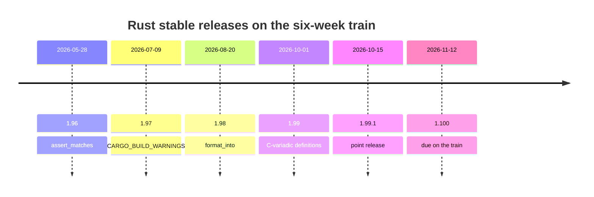
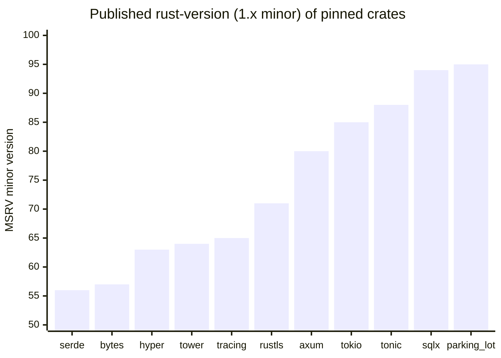
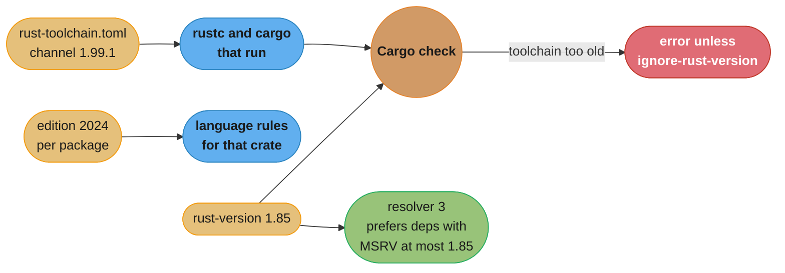

# Editions, Toolchains and MSRV

> **Version anchor (2026-11-06).** Rust 1.99.1 (2026-10-15) is the target. Rust 1.99.0
> shipped 2026-10-01 and 1.100.0 is due 2026-11-12 on the six-week train. Edition 2024
> stabilized in 1.85 (2025-02-20). MSRV-aware dependency resolution is `[1.84]`, let chains
> are `[1.88]` plus `[ed2024]`, and `cfg_select!` is `[1.95]`. Tool versions: cargo-msrv
> 0.19.6, cargo-hack 0.6.46. Crate MSRVs on this page come from the section pin table.

## 1. Concept Overview

Three version numbers decide whether a Rust crate builds, and teams mix them up:

- The **toolchain**: the `rustc` and `cargo` release that runs the build, such as 1.99.1. A
  new stable release ships every six weeks.
- The **edition**: a per-crate language mode set by `edition = "2024"` in `Cargo.toml`.
  Editions (2015, 2018, 2021, 2024) let the language make changes that would otherwise break
  old code, such as new keywords or new drop rules. Crates on different editions link and
  call each other freely.
- The **MSRV** (minimum supported Rust version): the oldest toolchain a crate promises to
  build on, declared in `package.rust-version`. Cargo refuses to build a package on an older
  toolchain, and resolver 3 prefers dependency versions that fit it.

This page covers how the release train works, how to pin a toolchain with
`rust-toolchain.toml`, what edition 2024 changes and how to migrate a workspace to it, and
how to choose and enforce an MSRV policy. It holds the section's MSRV decision model.

The manifest mechanics (workspaces, features, profiles, the resolver setting) are in
[Modules, Crates and Cargo](modules_crates_and_cargo.md). Semver rules for a public API
are in
[Library API Design and Semver](../library_api_design_and_semver/library_api_design_and_semver.md).
Go solves the same problem with the `go` and `toolchain` directives in `go.mod`; see
[Go packages, modules and tooling](../../go/packages_modules_and_tooling/packages_modules_and_tooling.md).

---

## 2. Intuition

> **One-line analogy**: the toolchain is the printing press, the edition is the spelling
> rulebook a given book was written under, and the MSRV is the oldest press the publisher
> promises the book will still print on.

**Mental model**: a new press arrives every six weeks and can print every book ever
written, under every rulebook. A book only needs a new rulebook when it wants a word the
old rules reserved for something else. The publisher of a popular book must decide how old
a press its readers may own. Promise very old presses and the book cannot use new
features. Promise only the newest and readers on slower update cycles cannot print it.

**Why it matters**: MSRV and edition decisions fail late and far away. Your CI on the
latest stable passes. A user on a Debian-packaged toolchain, a regulated build image or an
LTS dependency line gets an error in your crate, or in a dependency that you let float.
An edition migration that compiles can still change when a lock guard drops.

**Key insight**: an MSRV is a promise, and an untested promise is false. Pick a policy you
can enforce in CI with a real old toolchain, write it in the README, and treat a raise as a
release-note event.

---

## 3. Core Principles

- **Stable is backward compatible.** Code that compiles on stable 1.N compiles on 1.N+1,
  apart from soundness fixes and rare documented exceptions. That promise is why a fast
  train is safe.
- **Editions are per crate and opt-in.** A new toolchain never changes the edition of
  existing code. The edition changes only when someone edits `Cargo.toml`.
- **Editions interoperate.** A 2015 crate can depend on a 2024 crate and the reverse. Macro
  input keeps the edition of the crate it came from.
- **New features land in every edition** unless they need syntax an old edition does not
  reserve. Let chains are edition 2024 only. Most standard-library additions are available
  everywhere.
- **MSRV is part of your public contract.** The Cargo book lists raising `rust-version` as
  possibly breaking and recommends a minor release. Your policy decides whether that is a
  minor or a major release for you.
- **An MSRV you do not test does not exist.** One CI job must build on the declared
  version.

---

## 4. Types / Architectures / Strategies

### 4.1 Release channels

| Channel | Cadence | Who uses it |
|---|---|---|
| Nightly | every day | compiler work, unstable features, Miri, `-Z` flags |
| Beta | every six weeks, the next stable | crater runs, ecosystem pre-release testing |
| Stable | every six weeks | production builds |

A change that merges to nightly reaches stable in six to twelve weeks, depending on where
in the cycle it lands.

### 4.2 Ways to pin a toolchain

| Mechanism | Scope | Use |
|---|---|---|
| `cargo +1.99.1 build` | one command | ad hoc checks |
| `RUSTUP_TOOLCHAIN` | one shell or CI job | CI matrix entries |
| `rustup override set` | one directory, one machine | local experiments |
| `rust-toolchain.toml` | the repository | every application and service |
| `rustup default` | the machine | fallback only |

### 4.3 MSRV policies

| Policy | Meaning on 2026-11-06 | Typical owner |
|---|---|---|
| Latest stable | 1.99 | applications, internal crates |
| N-2 | 1.97 | most published libraries |
| Track a key dependency | 1.85 if you require tokio 1.54 | ecosystem crates built on one runtime |
| Very conservative | 1.56 to 1.65 | foundational crates (serde 1.56, bytes 1.57, tracing 1.65) |
| Pinned qualified toolchain | whatever the certified release is | safety-critical builds, for example on Ferrocene |

---

## 5. Architecture Diagrams

### 5.1 The release train



Each stable is six weeks after the last. An N-2 policy on 2026-11-06 means 1.97. After
1.100 ships on 2026-11-12, N-2 means 1.98.

### 5.2 Published MSRVs of common crates



Your effective MSRV is at least the highest MSRV among the dependency versions you
require. A service that needs `sqlx` 0.9.0 cannot promise anything older than 1.94, no
matter what its own code uses.

### 5.3 What decides the build



The toolchain file picks the compiler. The edition picks the language rules per crate.
`rust-version` is checked against the compiler and steers dependency selection.

---

## 6. How It Works - Detailed Mechanics

### 6.1 `rust-toolchain.toml`

```toml
[toolchain]
channel = "1.99.1"
components = ["rustfmt", "clippy"]
targets = ["x86_64-unknown-linux-musl", "aarch64-unknown-linux-gnu"]
profile = "minimal"
```

rustup picks a toolchain in this order, first match wins:

1. `cargo +toolchain` on the command line.
2. The `RUSTUP_TOOLCHAIN` environment variable.
3. A directory override from `rustup override set`.
4. The nearest `rust-toolchain.toml`, found by walking up from the current directory.
5. The default toolchain.

Pin an exact version (`1.99.1`), not `stable`. With `stable`, two developers and CI can run
different compilers on the same commit, and a new clippy lint can fail CI on a Thursday
with no code change. Bump the file in its own PR.

For nightly, pin a date: `channel = "nightly-2026-11-01"`. A floating nightly breaks
without warning.

### 6.2 `rust-version` and the resolver

```toml
[package]
name = "ledger-client"
version = "2.3.0"
edition = "2024"
rust-version = "1.85"
```

- On a toolchain older than 1.85, Cargo fails with a clear error for every target in the
  package. `--ignore-rust-version` overrides it.
- `edition = "2024"` already needs 1.85, so a lower `rust-version` promises something the
  crate cannot keep.
- Resolver 3, the edition 2024 default, sets `incompatible-rust-versions = "fallback"`: it
  prefers dependency versions whose `rust-version` is at or below yours. If no version in
  the requirement fits, it picks one anyway and does not fail.
- `cargo add` picks the newest version compatible with your `rust-version` and tells you
  when a newer one exists.
- Clippy's `incompatible_msrv` lint reads `rust-version` and flags calls to std APIs that
  are newer than it.

Resolver 3 only steers fresh resolution. A committed `Cargo.lock` that already holds a
newer dependency stays as it is until you run `cargo update`.

### 6.3 Edition 2024 change list

Every item below is `[ed2024]` and stabilized in 1.85. The migration lint is the one
`cargo fix --edition` runs.

| Change | Migration lint | Automatic | Can change runtime behavior |
|---|---|---|---|
| RPIT captures all in-scope lifetimes | `impl_trait_overcaptures` | mostly (adds `use<..>`) | no, compile errors only |
| `if let` scrutinee temporaries drop before `else` | `if_let_rescope` | yes, review it | yes, drop order |
| Tail-expression temporaries drop before locals | `tail_expr_drop_order` (allow by default) | no | yes, drop order |
| Let chains in `if` and `while` | none, new syntax | n/a | no |
| `extern` blocks need `unsafe` | `missing_unsafe_on_extern` | yes | no |
| `no_mangle`, `export_name`, `link_section` need `unsafe(...)` | `unsafe_attr_outside_unsafe` | yes | no |
| `unsafe_op_in_unsafe_fn` warns | `unsafe_op_in_unsafe_fn` | yes | no |
| References to `static mut` denied | `static_mut_refs` | no | no |
| Never-type fallback changes | `never_type_fallback_flowing_into_unsafe` | no | yes, inferred type |
| `expr` fragment matches `const` and `_` | `edition_2024_expr_fragment_specifier` | yes (rewrites to `expr_2021`) | macro arm choice |
| Missing fragment specifier is an error | none | no | no |
| `gen` is a reserved keyword | `keyword_idents_2024` | yes (renames to `r#gen`) | no |
| Reserved `#"..."#` and guarded string syntax | `rust_2024_guarded_string_incompatible_syntax` | suggests inserted spaces | no |
| Match ergonomics reservations | `rust_2024_incompatible_pat` | yes | no |
| `Future` and `IntoFuture` in the prelude | `rust_2024_prelude_collisions` | yes | no |
| `IntoIterator` for `Box<[T]>` | `boxed_slice_into_iter` | yes | method resolution |
| `set_var`, `remove_var`, `before_exec` are `unsafe` | `deprecated_safe_2024` | yes (wraps in `unsafe`) | no |
| Resolver 3 is the default | none | n/a | dependency choice |
| Cargo table and key name consistency | none | yes (`cargo fix` rewrites the names) | no |
| Unused inherited `default-features` rejected | none | yes (Cargo removes the setting) | no |
| Combined doctests; nested `include!` change | none | n/a | doctest isolation |
| rustfmt style edition 2024 | none | `cargo fmt` | no |

Three rows matter most in review: the two drop-order changes and the never-type fallback.
They can compile cleanly and still behave differently.

### 6.4 The `if let` rescope, shown

```rust
use std::cell::RefCell;

fn main() {
    let slot: RefCell<Option<u32>> = RefCell::new(None);

    if let Some(v) = *slot.borrow() {
        println!("cached {v}");
    } else {
        *slot.borrow_mut() = Some(7);
    }

    assert_eq!(*slot.borrow(), Some(7));
}
```

On edition 2024 the `Ref` from `slot.borrow()` drops before the `else` block runs, so
`borrow_mut` succeeds. On edition 2021 the same code compiles and then panics with
"RefCell already borrowed" at runtime, because the temporary lives until the end of the whole
`if let`. The same rule applies to a `Mutex` or `RwLock` guard, where edition 2021 can
deadlock instead of panic.

### 6.5 Let chains

```rust
fn port_of(entry: Option<&str>) -> Option<u16> {
    if let Some(e) = entry
        && let Some(rest) = e.strip_prefix("port=")
        && let Ok(p) = rest.parse::<u16>()
        && p != 0
    {
        return Some(p);
    }
    None
}

fn main() {
    assert_eq!(port_of(Some("port=8080")), Some(8080));
    assert_eq!(port_of(Some("port=0")), None);
    assert_eq!(port_of(None), None);
}
```

Let chains need both a 1.88 or later compiler and `edition = "2024"`. So a crate that uses
them has an MSRV of at least 1.88, three releases above the edition's own 1.85.

### 6.6 `unsafe extern` and `safe` items

```rust
unsafe extern "C" {
    pub safe fn abs(x: i32) -> i32;
    pub fn strlen(s: *const std::ffi::c_char) -> usize;
}

fn main() {
    assert_eq!(abs(-3), 3);
    let s = c"hello";
    // SAFETY: `s` is a valid NUL-terminated C string that lives for the whole call.
    let n = unsafe { strlen(s.as_ptr()) };
    assert_eq!(n, 5);
}
```

The `unsafe` on the block says "I checked these declarations match the C signatures".
An item marked `safe` can then be called without an `unsafe` block. Unmarked items stay
unsafe to call. FFI policy as a whole is in
[FFI and Language Interop](../ffi_and_language_interop/ffi_and_language_interop.md).

### 6.7 `cfg_select!`

`cfg_select!` `[1.95]` picks the first arm whose `cfg` predicate is true, with an optional
`_` fallback. With no matching arm and no fallback, it emits a compile error. It works in
item and expression position.

```rust
cfg_select! {
    unix => {
        fn config_dir() -> &'static str {
            "/etc/app"
        }
    }
    windows => {
        fn config_dir() -> &'static str {
            "C:\\ProgramData\\app"
        }
    }
    _ => {
        fn config_dir() -> &'static str {
            "."
        }
    }
}

fn main() {
    let width = cfg_select! {
        target_pointer_width = "64" => 64,
        _ => 32,
    };
    println!("{} on a {width}-bit target", config_dir());
}
```

It replaces the `cfg-if` crate for new code. Using it sets your MSRV to 1.95, so a library
on an N-2 policy should wait until 1.95 is two releases old (the 1.97 release did that).

### 6.8 Migrating a workspace to edition 2024

The edition guide's procedure, applied one package at a time:

1. Run `cargo update` so dependencies are on versions that support the new edition.
2. Run `cargo fix --edition -p PACKAGE --all-features`. `cargo fix` only fixes code that
   compiles in the current configuration, so add `--target TRIPLE` runs for
   platform-specific code. With no target flags it covers all targets (`--all-targets`).
3. Set `edition = "2024"` in that package's `Cargo.toml`. `cargo fix` does not change it.
4. Run `cargo build` and `cargo test`. Fix what the lints could not.
5. Run `cargo fmt` and commit the formatting change separately.

`PACKAGE` is the package name from `[package] name`. `TRIPLE` is a target such as
`x86_64-pc-windows-msvc`.

What the tool does not do:

- It does not update doctests.
- It cannot rewrite `tail_expr_drop_order`, `static_mut_refs` or never-type fallback cases.
- It does not migrate code generated by build scripts or proc macros.
- It does not touch code behind features or `cfg` that the run did not enable.

Editions interoperate, so you can migrate leaf crates first, one PR each, and keep the
workspace building throughout. A virtual workspace must also set `resolver = "3"` in the
root; see [Modules, Crates and Cargo](modules_crates_and_cargo.md).

### 6.9 Enforcing an MSRV in CI

```yaml
msrv:
  runs-on: ubuntu-latest
  steps:
    - uses: actions/checkout@v4
    - run: rustup toolchain install 1.85 --profile minimal
    - run: cargo install cargo-hack --locked
    - run: cargo hack check --rust-version --workspace --each-feature --locked
```

- `cargo hack --rust-version` runs the command on the toolchain named in each package's
  `rust-version`. `--each-feature` checks each feature alone, plus default and
  `--no-default-features`.
- `cargo msrv find` searches for the oldest toolchain that builds the crate, using a binary
  search over releases. `cargo msrv verify` checks the declared value with one build.
  `cargo msrv list` shows the MSRVs your dependencies declare.
- `--locked` makes the job fail if `Cargo.lock` would change, so the job tests the versions
  you committed.
- Use `check`, not `test`, on the MSRV job unless dev-dependencies share the same MSRV.
  Test tools often need a newer compiler than the library itself.

### 6.10 Nightly features

A `#![feature(...)]` attribute compiles only on nightly. A production crate that needs one
ties every user to a nightly toolchain and to a feature that can change or disappear.
Policy for a service team:

- No `#![feature]` in production crates.
- Nightly is allowed for tools that need it: Miri, `cargo fuzz`, `-Zbuild-std`,
  `cargo expand`'s use of `-Zunpretty=expanded`. Pin the nightly date.
- `RUSTC_BOOTSTRAP=1` makes a stable compiler accept feature gates. It exists to build the
  compiler itself. Using it in a product build gives you nightly instability with a stable
  label.

---

## 7. Real-World Examples

- **tokio** raised its MSRV from 1.71 (1.53.x) to 1.85 (1.54.0) in a minor release. Users
  who must stay on 1.71 pin the LTS line with `tokio = { version = "~1.53" }`, supported
  until September 2027. The `1.51.x` LTS runs until March 2027. Both have MSRV 1.71.
- **sqlx** 0.9.0 declares MSRV 1.94, the second example in this section of a release that
  moved its floor sharply.
- **serde** 1.0.229 still declares 1.56, `bytes` 1.12.1 declares 1.57 and `hyper` 1.12.0
  declares 1.63. Foundational crates keep a low floor because the whole ecosystem builds
  on them.
- **parking_lot** 0.13.0 declares 1.95, which shows that "low-level" does not mean
  "conservative" for every crate.
- **Rust for Linux**: the kernel concluded its "Rust experiment" with Miguel Ojeda's patch
  of 2025-12-13. The same patch says not every configuration, architecture and toolchain
  works, and mixed GCC and LLVM builds stay experimental. Kernel builds pin a minimum
  toolchain, the same discipline as an MSRV.
- **Ferrocene** is Ferrous Systems' qualified Rust toolchain for safety-critical work. The
  Rust Project adopted the FLS, formerly the Ferrocene Language Specification, announced
  2025-03-26. Teams on a qualified toolchain set their MSRV to that toolchain's version.

---

## 8. Tradeoffs

### 8.1 MSRV policy decision model

| Crate role | Policy | `rust-version` | Raise when | Release for a raise | CI gate |
|---|---|---|---|---|---|
| Deployed service or CLI | latest stable, exact pin | the pinned toolchain | each toolchain bump PR | none, internal | build on the pinned toolchain only |
| Internal library in a monorepo | the monorepo toolchain | the monorepo pin | with the monorepo | none | same as the service |
| Published library, general use | N-2 | 1.97 on 2026-11-06 | a feature you need is two releases old | minor, with a changelog line | `cargo hack --rust-version` |
| Library on one runtime or framework | match the key dependency | 1.85 for tokio 1.54, 1.94 for sqlx 0.9 | the dependency raises | minor | `cargo hack --rust-version` |
| Foundational crate | very conservative | 1.56 to 1.65 range | rarely, with notice | minor or major, per your policy | `cargo hack --rust-version` plus a fixed old toolchain |
| Safety-critical build | pinned qualified toolchain | the qualified release | on re-qualification | per the qualification process | build on the qualified toolchain |

How to read it: find your crate's role, then check the "Raise when" column before you add
a dependency or a std API. If that dependency or API forces a higher floor than the policy
allows, it waits.

### 8.2 Old MSRV against new MSRV

| Factor | Low MSRV | High MSRV |
|---|---|---|
| Users who can build | more, including distro and LTS toolchains | fewer |
| Language and std features | old ones only, workarounds | let chains, `cfg_select!`, `LazyLock` |
| Dependency choice | must pick old versions or fork | latest versions |
| CI cost | an extra toolchain job | same job |
| Maintainer time | backports and shims | lower |

### 8.3 `rust-toolchain.toml` with `stable` or an exact version

| Factor | `channel = "stable"` | `channel = "1.99.1"` |
|---|---|---|
| Reproducible builds | no, depends on the day | yes |
| New lints break CI | yes, on release day | only in the bump PR |
| Effort | none | one PR every six weeks |

---

## 9. When to Use / When NOT to Use

**Pin an exact toolchain** in every application and service repository. Bump it in a
dedicated PR within a release or two of each stable.

**Declare `rust-version`** in every published crate and every crate other teams consume.
Test it in CI.

**Use N-2** as the default for a published library. It gives users three months to update
and gives you features that are three months old.

**Do not declare an MSRV you do not test.** A stale `rust-version` is worse than none,
because resolver 3 and `cargo add` trust it.

**Do not raise MSRV in a patch release.** Users who pinned `~1.4` to stay on an old
toolchain get a build failure from a `cargo update`.

**Migrate to edition 2024** as soon as your MSRV is 1.85 or later. Do not migrate a crate
whose MSRV must stay below 1.85.

**Do not use nightly features** in a production crate.

---

## 10. Common Pitfalls

### 10.1 `set_var` in a 2024 crate

```rust
// BROKEN
fn main() {
    // error[E0133]: call to unsafe function `set_var` is unsafe and requires
    // unsafe function or block
    std::env::set_var("RUST_LOG", "info");
    println!("{:?}", std::env::var("RUST_LOG"));
}
```

On POSIX platforms the process environment is shared global state. Another thread, or a C
library calling `getenv`, can read it while `set_var` writes, and that is undefined
behavior. Edition 2024 makes the call `unsafe` so the caller states why no other thread
reads the environment.

```rust
// FIX
fn main() {
    // SAFETY: called first thing in `main`, before any thread or C library starts,
    // so nothing else reads the environment during the write.
    unsafe { std::env::set_var("RUST_LOG", "info") };
    println!("{:?}", std::env::var("RUST_LOG"));
}
```

Better still, pass configuration explicitly instead of through the environment.

### 10.2 CI green on stable, users red on MSRV

A library declared `rust-version = "1.80"`, ran CI only on stable, and started using
`Vec::push_mut`, which is `[1.95]`. Users on 1.85 got "no method named `push_mut`" errors
after a minor release. The fix was an MSRV CI job with
`cargo hack check --rust-version` and the clippy `incompatible_msrv` lint.

### 10.3 Dependency floats past the MSRV

A crate declared `rust-version = "1.75"` with `tokio = "1"`. Its own code was fine, but
fresh resolution picked tokio 1.54.1 with MSRV 1.85. Resolver 3 would have preferred an
older tokio, but the crate's users ran resolver 2 workspaces. The README now tells users on
old toolchains to pin `tokio = "~1.53"` and run `cargo update`, and the MSRV job resolves
with `incompatible-rust-versions = "fallback"`.

### 10.4 The edition bump that changed a lock's lifetime

A service moved to edition 2024 without reading the `if_let_rescope` warnings. A code
path that read a `RwLock` in an `if let` scrutinee and took the write lock in the `else`
used to deadlock under one rare branch, and after the migration it stopped deadlocking. A
different path relied on the guard living through `else` to keep a cache entry stable, and
it started to see a concurrent writer. Review every `if_let_rescope` site by hand.

### 10.5 `stable` in `rust-toolchain.toml`

A repository used `channel = "stable"`. On a release day, a new default clippy lint failed
`cargo clippy -- -D warnings` on every open PR at once. Pin the exact version and take new
lints in the bump PR.

---

## 11. Technologies & Tools

| Tool | What it is for |
|---|---|
| rustup | Installs toolchains, components and targets; applies `rust-toolchain.toml` |
| cargo-msrv | Finds and verifies the oldest toolchain a crate builds on; 0.19.6, MSRV 1.94.1 |
| cargo-hack | Runs Cargo on the `rust-version` toolchain and across feature sets; 0.6.46 |
| Clippy | The `incompatible_msrv` lint flags std APIs newer than `rust-version` |
| rustfmt | Applies the style edition; `style_edition` decouples it from the language edition |
| crater | Rust Project tool that builds the ecosystem against a beta or PR compiler |
| Ferrocene | Ferrous Systems' qualified Rust toolchain |

---

## 12. Interview Questions with Answers

**Q: Is raising `rust-version` a breaking change?**
**Short:** The Cargo book calls it possibly breaking and recommends a minor release, so most libraries raise it in a minor release with notice and never in a patch release.

The Cargo book's semver chapter lists a new `rust-version` as possibly breaking and
recommends treating it as a minor change, so semver alone does not force a major bump. Users on old toolchains still break, so the
answer depends on your published policy. tokio raised its MSRV from 1.71 to 1.85 in 1.54.0
and offers LTS lines (`~1.53`) for users who cannot follow. A patch release must never
raise it, because users pin tilde ranges precisely to avoid that. Write the policy in the
README and put every raise in the changelog.

**Q: Code that compiled on edition 2021 fails with E0502 after the switch to 2024, with no code change. Why?**
**Short:** Edition 2024 RPIT captures every in-scope lifetime, so an impl Trait return now holds a borrow that edition 2021 did not capture.

In edition 2021, `fn indices(v: &[i32]) -> impl Iterator<Item = usize>` did not capture
the lifetime of `v` unless the type named it. In 2024 return-position `impl Trait` captures
all in-scope generic parameters, including that lifetime. The caller's iterator now borrows
`v`, so a later `v.push(4)` conflicts. `cargo fix --edition` adds `+ use<>` through the
`impl_trait_overcaptures` lint to keep the old behavior. If you bump the edition by hand,
add `use<>` (a `[1.82]` feature) yourself where the borrow is not needed.

**Q: Which edition 2024 changes can alter runtime behavior without a compile error?**
**Short:** The if let temporary rescope and the tail-expression temporary scope change drop order, and the never-type fallback can change an inferred type.

`if let` scrutinee temporaries now drop before the `else` block, so a `RefCell` borrow or a
lock guard ends earlier. Code that panicked or deadlocked in 2021 may now work, and code
that relied on the guard staying alive may now race. Tail-expression temporaries can drop
before the block's locals. `cargo fix` rewrites the `if_let_rescope` cases but cannot fix
`tail_expr_drop_order`. Review each flagged site by hand, and run the full test suite on the
migrated crate, not only `cargo check`.

**Q: How does resolver 3 pick dependency versions, and what happens when no version fits your MSRV?**
**Short:** It prefers versions whose rust-version is at or below yours and, if none match the requirement, picks one anyway instead of failing.

Resolver 3 sets `incompatible-rust-versions = "fallback"`. Among versions that match a
requirement, it prefers ones whose declared `rust-version` fits the package's own. If every
matching version needs a newer compiler, it still picks one, and the build then fails on
your MSRV toolchain with the dependency's MSRV error. It changes fresh resolution only and
leaves an existing `Cargo.lock` alone. It can still pick a version that does not fit, so keep
the MSRV CI job.

**Q: Your CI passes on stable, yet users on your declared MSRV cannot build. What is missing?**
**Short:** A CI job that builds on the declared rust-version toolchain; stable CI cannot see newer std APIs or dependencies that need a newer compiler.

The stable compiler accepts every API up to 1.99, so a call to a 1.95 method compiles
there. Dependencies resolved on the developer machine may also have floated to versions
with a higher MSRV. Add a job that installs the MSRV toolchain and runs
`cargo hack check --rust-version --each-feature --locked`. Turn on Clippy's
`incompatible_msrv` lint to catch std API use in review. Use `check` rather than `test` if
dev-dependencies need a newer compiler.

**Q: Can crates on different editions depend on each other, and how do macros behave across them?**
**Short:** Yes; the edition is per crate, all editions link together, and macro tokens keep the edition of the crate they were written in.

Each crate compiles under its own edition rules, and the results link into one binary with
no restriction. A 2015 crate can use a 2024 crate's API. Macros follow edition hygiene:
the edition of each token comes from the crate that wrote it. A `macro_rules!` matcher
with `$e:expr` defined in a 2021 crate keeps 2021 matching when a 2024 crate calls it. This
is why the ecosystem can move one crate at a time.

**Q: What belongs in `rust-toolchain.toml`, and what overrides it?**
**Short:** An exact channel, components and targets; a +toolchain argument, RUSTUP_TOOLCHAIN or a directory override take precedence over it.

Write `channel = "1.99.1"`, `components = ["rustfmt", "clippy"]`, the cross targets you
build and `profile = "minimal"`. rustup walks up from the current directory and uses the
nearest file. A `cargo +1.85` argument, the `RUSTUP_TOOLCHAIN` variable or a
`rustup override` win over the file, which is how an MSRV CI job runs an older compiler in
the same repo. Pin exact versions in applications, and bump them in a dedicated PR.

**Q: Why are `std::env::set_var` and `remove_var` unsafe in edition 2024?**
**Short:** On many platforms the process environment is unsynchronized global state, so a write can race a getenv in another thread or a C library.

Rust can lock its own environment access, but it cannot stop a C library or another
language runtime in the process from calling `getenv` at the same time, and that race is
undefined behavior. Edition 2024 marks the functions `unsafe`, and `cargo fix` wraps
existing calls in `unsafe` blocks through `deprecated_safe_2024`. A wrapped call is not a
fixed call. Each site needs a `// SAFETY:` comment that explains why no other thread reads
the environment, or a redesign that passes configuration explicitly.

**Q: What does `cargo fix --edition` not migrate in a large workspace?**
**Short:** Code in features or cfg branches it did not compile, doctests, generated code, and the drop-order, static mut and never-type cases.

`cargo fix` works from compiler diagnostics, so it sees only the code that compiles in that
run. Pass `--all-features` and rerun with each `--target` you ship. It does not update
doctests or code produced by build scripts and proc macros. It has no automatic fix for
`tail_expr_drop_order`, `static_mut_refs` or never-type fallback. It also leaves
`edition` in `Cargo.toml` alone, so you set that yourself after the fix pass. Migrate one
package per PR and keep formatting changes in a separate commit.

**Q: What is the six-week release train and how should a team plan around it?**
**Short:** Nightly becomes beta and beta becomes stable every six weeks, so a merged change reaches stable in six to twelve weeks and policies count in releases.

Rust 1.97 shipped 2026-07-09, 1.98 on 2026-08-20, 1.99 on 2026-10-01, and 1.100 is due on
2026-11-12. Point releases such as 1.99.1 fix regressions between trains. Because releases
are frequent and backward compatible, a toolchain bump is a small, routine PR. Plan bumps
as a recurring task, express MSRV policies in releases (N-2), and run a beta job in CI if
you want warning of regressions before release day.

**Q: How do you choose an MSRV policy for a published library compared with a service?**
**Short:** A service pins the latest stable exactly; a published library usually declares N-2, or the floor of a key dependency, and tests it in CI.

A service controls its own build image, so it gains nothing from an old compiler and pins
`rust-toolchain.toml` to the newest release. A library's users control their compilers, so
it needs a floor they can meet. N-2 is the common default (1.97 on 2026-11-06). If the
library requires tokio 1.54 or sqlx 0.9, its real floor is 1.85 or 1.94 anyway. Foundational
crates such as serde (1.56) stay far lower because everyone builds on them.

**Q: What is the difference between `cargo msrv find` and `cargo hack --rust-version`?**
**Short:** cargo msrv find searches for the oldest toolchain that builds the crate; cargo hack --rust-version runs a command on the declared one.

`cargo msrv find` runs builds across Rust releases with a binary search and reports the
oldest one that works, which is how you set an initial value. `cargo msrv verify` checks
the declared value with one build. `cargo hack --rust-version` reads `rust-version` from
each package and runs the given command, such as `check --each-feature`, on that toolchain.
Use `cargo msrv` when you choose the value and `cargo hack` in CI to hold it.

**Q: Should a production crate depend on nightly features?**
**Short:** No; a feature gate ties every user to nightly and to an API that can change, so keep nightly to tools like Miri and cargo fuzz.

`#![feature(...)]` compiles only on nightly, and unstable features change or disappear
without a deprecation cycle. Every consumer of the crate must then run nightly too.
`RUSTC_BOOTSTRAP=1` makes stable accept feature gates, but it exists to build the compiler
and gives no stability promise. Use nightly only for tools that need it, pin its date in
the job, and keep production crates on stable APIs.

**Q: When should you replace `cfg-if` with `cfg_select!`?**
**Short:** When your MSRV is 1.95 or later; cfg_select! is in std from 1.95, picks the first true arm, and errors at compile time if none matches without a fallback.

`cfg_select!` covers the `cfg-if` use cases in item and expression position, with an
optional `_` arm. Without that arm, a target that matches nothing gets a compile error,
which is better than silently compiling no code. It costs an MSRV of 1.95. A library on an
N-2 policy can adopt it now that 1.97 is the floor. A library with an older floor keeps
`cfg-if`.

**Q: What compiler and edition do let chains need?**
**Short:** A 1.88 or newer compiler and edition 2024 in that crate, so using them sets the crate's MSRV to 1.88.

Let chains depend on the edition 2024 `if let` temporary scope rule, so they are not
available in older editions on any compiler. They were stabilized in 1.88, three releases
after edition 2024 itself. A crate on edition 2024 with `rust-version = "1.85"` cannot use
them. Raise `rust-version` to 1.88 first.

**Q: What do `unsafe extern` blocks and `safe` items change?**
**Short:** Edition 2024 requires unsafe on extern blocks, and items inside may be marked safe so callers need no unsafe block for them.

The `unsafe` keyword on the block puts the obligation where the risk is: whoever writes the
declarations asserts they match the foreign signatures. A function marked `safe`, such as
C's `abs`, is then callable from safe code. Unmarked items stay unsafe to call.
`cargo fix` adds `unsafe` to existing blocks through `missing_unsafe_on_extern`. Mark an
item `safe` only when no argument value can cause undefined behavior.

**Q: What replaces a `&STATIC_MUT` reference now that edition 2024 denies it?**
**Short:** An atomic, a Mutex or RwLock, OnceLock or LazyLock, or a raw pointer from &raw const or &raw mut when unsafe access is required.

A reference to a `static mut` lets two threads hold aliasing `&mut` and `&` at once, which
is undefined behavior even if they never write. Edition 2024 makes the `static_mut_refs`
lint deny by default, and `cargo fix` has no automatic rewrite. For counters use
`AtomicUsize`. For set-once data use `OnceLock` or `LazyLock` (`[1.80]`). For shared mutable
state use a `Mutex`. When FFI needs a raw address, take `&raw mut STATE` (`[1.82]`) and
document the access rules.

---

## 13. Best Practices

- Pin an exact toolchain in `rust-toolchain.toml` for every application. Bump it in its own
  PR every one or two releases.
- Declare `rust-version` in every crate other people build, and test it with
  `cargo hack check --rust-version --each-feature --locked`.
- Publish the MSRV policy in the README, using the decision model in §8.1.
- Never raise MSRV in a patch release.
- Turn on Clippy's `incompatible_msrv` lint.
- Migrate editions one package per PR: `cargo update`, `cargo fix --edition --all-features`,
  set the edition, test, then format in a separate commit.
- Review every `if_let_rescope` and `tail_expr_drop_order` site by hand.
- Wrap each migrated `set_var` call with a real `// SAFETY:` reason, or remove it.
- Keep nightly out of production crates. Pin nightly dates in tool jobs.
- Add a beta toolchain job if a regression on release day would cost you.

---

## 14. Case Study

**Scenario (illustrative numbers).** A platform team owns `ledger-client`, an internal crate that 30 services
use, plus a public crate `ledger-proto` on crates.io. The services run the toolchain pinned
in each repository, from 1.86 to 1.99. The team wants edition 2024 and let chains in both
crates.

**Decisions.**

| Crate | Role in §8.1 | Policy | `rust-version` |
|---|---|---|---|
| `ledger-client` | library on one runtime (tokio 1.54) | match the key dependency, then let chains | 1.88 |
| `ledger-proto` | published library, general use | N-2 | 1.97 |

Services on 1.86 and 1.87 had to bump their toolchain pin before they could take
`ledger-client` 3.0. The team announced the raise two releases ahead and bumped the minor
version with a changelog line.

**The migration bug.** An engineer changed `edition = "2021"` to `"2024"` by hand in
`ledger-client` and skipped `cargo fix`. One helper compiled, but a caller broke:

```rust
// BROKEN
fn shard_ids(shards: &[u64]) -> impl Iterator<Item = usize> {
    0..shards.len()
}

fn main() {
    let mut shards = vec![10, 20, 30];
    let ids = shard_ids(&shards);
    // error[E0502]: cannot borrow `shards` as mutable because it is also borrowed as immutable
    shards.push(40);
    for i in ids {
        println!("{i}");
    }
}
```

In edition 2024 the opaque return type captures the lifetime of `shards`, so `ids` keeps the
slice borrowed. Edition 2021 did not capture it. The iterator does not need the borrow, so
the fix states the capture list:

```rust
// FIX
fn shard_ids(shards: &[u64]) -> impl Iterator<Item = usize> + use<> {
    0..shards.len()
}

fn main() {
    let mut shards = vec![10, 20, 30];
    let ids = shard_ids(&shards);
    shards.push(40);
    for i in ids {
        println!("{i}");
    }
}
```

`use<>` says the return type captures no generic parameters, so the borrow ends at the
call. `cargo fix --edition` would have inserted it through `impl_trait_overcaptures`.

**CI after the change.**

```yaml
msrv:
  steps:
    - run: rustup toolchain install 1.88 --profile minimal
    - run: cargo hack check -p ledger-client --rust-version --each-feature --locked
    - run: rustup toolchain install 1.97 --profile minimal
    - run: cargo hack check -p ledger-proto --rust-version --each-feature --locked
```

**Result.** Both crates moved to edition 2024 in four PRs: one `cargo fix` pass per crate,
one manual review of eleven `if_let_rescope` sites, and one CI change. Two
`if_let_rescope` sites changed behavior. One fixed a latent `RefCell` panic in a retry
path, and one needed the guard moved into an explicit `let` to keep its old lifetime.

**Lessons.**

- Never bump `edition` without the `cargo fix --edition` pass that comes before it.
- An MSRV raise is a product decision with users, so announce it and make it a minor release.
- The drop-order changes are the part of an edition migration that tests, not the compiler,
  must check.
