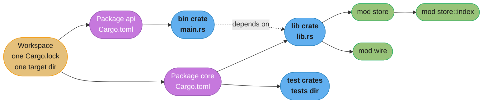
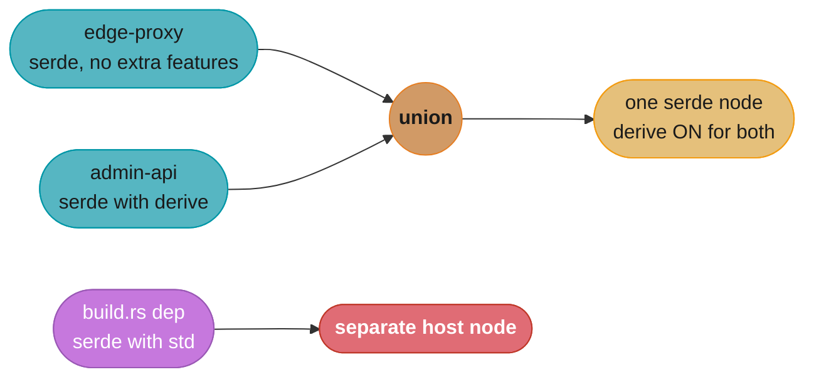

# Modules, Crates and Cargo

> **Version anchor (2026-11-06).** Rust 1.99.1 (2026-10-15) on edition 2024. Edition 2024
> makes resolver 3, the Rust-version-aware resolver, the default; the resolver itself needs
> Cargo 1.84 or later. Checked `cfg` names are `[1.80]`. Automatic Cargo cache cleaning is
> `[1.88]`. LLD is the default linker on `x86_64-unknown-linux-gnu` and
> `cargo publish --workspace` exists from `[1.90]`. Cargo config `include` and TOML 1.1
> manifests are `[1.94]`. `CARGO_BUILD_WARNINGS` is `[1.97]`. Crate versions on this page
> come from the section pin table.

## 1. Concept Overview

Rust code is organized in four nested units, and most build confusion comes from mixing
them up.

- A **module** is a namespace inside one crate. It is the unit of **privacy**. Every item
  is private to its module unless you write a visibility qualifier.
- A **crate** is one compilation unit: the tree of modules that `rustc` compiles in one
  invocation, rooted at `lib.rs` or `main.rs`. It is the unit of **compilation**,
  **parallelism** and **incremental caching**.
- A **package** is a directory with a `Cargo.toml`. It holds at most one library crate and
  any number of binary, example, test and bench crates. It is the unit of **versioning and
  publishing**.
- A **workspace** is a set of packages that share one `Cargo.lock`, one `target/`
  directory, one resolver setting and one set of profiles. It is the unit of
  **reproducibility**.

Cargo sits on top of all four. It resolves the dependency graph, picks one version per
semver-compatible range, decides which features are on for each package in this build,
runs build scripts, and calls `rustc` once per crate in dependency order, many in
parallel.

This page owns the module system, Cargo manifests, features, workspaces, profiles, build
scripts and the compile-time levers. Three neighbours own the rest:

- Editions, toolchains, release trains and MSRV policy:
  [Editions, Toolchains and MSRV](editions_toolchains_and_msrv.md).
- Public API shape and semver rules for a published crate:
  [Library API Design and Semver](../library_api_design_and_semver/library_api_design_and_semver.md).
- Dependency admission, `cargo-deny`, `cargo-vet`, containers and release builds:
  [Rust Build, Deployment and Supply Chain](../build_deployment_and_supply_chain/build_deployment_and_supply_chain.md).

The compiler pipeline in general (front end, IR, LLVM, linking) lives in
[How Code Runs](../../cs_fundamentals/how_code_runs_compilers_and_interpreters/how_code_runs_compilers_and_interpreters.md).
This page covers only the rustc specifics: codegen units, LTO and compile-time cost.

---

## 2. Intuition

> **One-line analogy**: a crate is one book that one printer prints in one run. Modules are
> its chapters. A package is the box the publisher ships, and a workspace is the warehouse
> that stocks every box from one inventory list (`Cargo.lock`).

**Mental model**: think of the build as a graph of `rustc` jobs. Each node is a crate. An
edge means "this crate needs the metadata of that crate before it starts". Cargo runs
nodes in parallel as soon as their inputs exist. Two facts follow from this picture:

1. A crate is compiled as a whole. A one-line change in a 40,000-line crate recompiles
   that crate and everything downstream of it. Incremental compilation shrinks the work
   inside the crate, but the crate is still the scheduling unit.
2. Features are switches on graph nodes, and a node exists once per build. If two
   packages in the same build ask for different features on `serde`, the build has one
   `serde` node with the union of both sets.

**Why it matters**: the module tree decides what your users can depend on, so a careless
`pub` becomes a semver promise. The crate graph decides how long CI takes. Feature
unification decides which code is compiled into a binary, sometimes code that no member
of that binary asked for.

**Key insight**: privacy is per module, compilation is per crate, versions are per
package, and the lockfile is per workspace. When a build surprises you, first ask which of
those four units the surprise belongs to.

---

## 3. Core Principles

- **Private by default.** An item is visible in its own module and in that module's
  descendants. Everything else needs `pub`, `pub(crate)`, `pub(super)` or
  `pub(in path)`.
- **Effective visibility is the narrowest link in the path.** A `pub fn` inside a private
  module is not reachable from outside the crate unless a public module re-exports it.
- **The crate is the compilation unit.** Parallelism across crates comes from Cargo.
  Parallelism inside a crate comes from codegen units.
- **Features are additive.** Turning a feature on may add API and dependencies. It must
  never remove API or change behavior that another dependent relies on, because Cargo
  unifies features across the packages in one build.
- **One lockfile, one resolver, one set of profiles per workspace.** These settings live
  in the root manifest. Cargo ignores them in member and dependency manifests.
- **`Cargo.toml` is the contract with consumers; `Cargo.lock` is the record of one
  successful build.** The lockfile never affects a crate's dependents.
- **Build scripts are code that runs on the build machine.** They run before the crate
  compiles, they rerun on rules you control, and they are part of your attack surface.

---

## 4. Types / Architectures / Strategies

### 4.1 Visibility levels

| Qualifier | Visible in | Typical use |
|---|---|---|
| (none) | the current module and its children | helpers, fields |
| `pub(self)` | same as none | rare, explicit in macro output |
| `pub(super)` | the parent module and its children | a child module that serves one parent |
| `pub(in crate::a::b)` | the named ancestor module and its children | a subsystem-private API |
| `pub(crate)` | the whole crate | internal API across modules |
| `pub` | anyone who can name the path | the public API, a semver promise if reachable |

### 4.2 Crate types

| `crate-type` | Output | Used for |
|---|---|---|
| `bin` | executable | services, CLIs |
| `lib` / `rlib` | Rust library with metadata | normal Rust dependencies |
| `proc-macro` | compiler plugin, built for the host | derive and attribute macros (see [Macros](../macros_declarative_and_procedural/macros_declarative_and_procedural.md)) |
| `cdylib` | C-ABI shared library | Python, Node and C hosts; Wasm modules |
| `staticlib` | C-ABI static archive | linking Rust into a C or C++ binary |
| `dylib` | Rust-ABI shared library | rare; Rust has no stable ABI |

### 4.3 Dependency kinds

| Table | Built for | Feature unification with normal deps (resolver 2 and 3) |
|---|---|---|
| `[dependencies]` | the target | yes |
| `[dev-dependencies]` | tests, examples, benches | only when those targets are built |
| `[build-dependencies]` | the host, for `build.rs` | no |
| `[target.'cfg(...)'.dependencies]` | matching targets only | features apply only when that target is built |
| `optional = true` | only when a feature enables it | yes, once enabled |

### 4.4 Workspace shapes

| Shape | Root manifest has | Fits |
|---|---|---|
| Single package | `[package]` only | one library or one binary |
| Root-package workspace | `[package]` and `[workspace]` | a main crate plus helper crates |
| Virtual workspace | `[workspace]` only | many peer crates, a monorepo service fleet |

A virtual workspace has no `[package]`, so it has no edition. It must set `resolver`
explicitly. See §10.3.

---

## 5. Architecture Diagrams

### 5.1 The four units



The workspace owns the lockfile and profiles. Each package owns a version. Each crate is
one `rustc` job. Each module is a privacy boundary inside one job.

### 5.2 Feature unification per build



`cargo build --workspace` builds both binaries in one invocation, so `edge-proxy` gets
`serde` with `derive` too. `cargo build -p edge-proxy` builds only that package and does not
unify with `admin-api`. Build dependencies stay on a separate node under resolver 2 and 3.

### 5.3 Who can see `store::index::rebuild`

```
item: fn rebuild() declared in crate::store::index

qualifier                 index  store  wire  crate root  other crates
------------------------  -----  -----  ----  ----------  ------------
(private)                   ✓      ✗     ✗        ✗            ✗
pub(super)                  ✓      ✓     ✗        ✗            ✗
pub(in crate::store)        ✓      ✓     ✗        ✗            ✗
pub(crate)                  ✓      ✓     ✓        ✓            ✗
pub, store is private       ✓      ✓     ✓        ✓            ✗
pub, path is all pub        ✓      ✓     ✓        ✓            ✓
```

The last two rows are the trap. `pub` on the item is not enough. Every module on the path
must also be public, or a public module must re-export the item with `pub use`.

---

## 6. How It Works - Detailed Mechanics

### 6.1 The module tree and the file layout

`mod name;` tells the compiler to load a child module from a file. For a module declared
in `src/lib.rs`, Cargo's convention finds `src/name.rs` or `src/name/mod.rs`. A child of
`name` lives in `src/name/child.rs` in both layouts. The non-`mod.rs` layout avoids a
directory full of tabs named `mod.rs`, and it is the common choice in new code.

```
src/
├── lib.rs          mod store; mod wire;
├── store.rs        mod index;
├── store/
│   └── index.rs
└── wire.rs
```

Inline modules show every visibility level in one file:

```rust
mod outer {
    pub mod inner {
        pub(in crate::outer) fn only_outer() -> u32 {
            1
        }
        pub(super) fn parent_only() -> u32 {
            2
        }
        pub(crate) fn crate_wide() -> u32 {
            3
        }
        pub fn public() -> u32 {
            4
        }
    }

    pub fn sum() -> u32 {
        inner::only_outer() + inner::parent_only() + inner::crate_wide() + inner::public()
    }
}

fn main() {
    assert_eq!(outer::sum(), 10);
    assert_eq!(outer::inner::crate_wide(), 3);
    assert_eq!(outer::inner::public(), 4);
}
```

`main` can call `crate_wide` and `public`. It cannot call `only_outer` or `parent_only`.

`use` brings a path into scope. `pub use` re-exports it, so the public path can differ from
the file layout. This is the facade pattern: keep modules private and choose the public
surface in `lib.rs`.

```rust
mod parse {
    pub struct Config {
        pub port: u16,
    }

    pub fn parse(src: &str) -> Option<Config> {
        let port = src.strip_prefix("port=")?.trim().parse().ok()?;
        Some(Config { port })
    }
}

pub use self::parse::{Config, parse};

fn main() {
    let cfg = parse("port=8080");
    assert_eq!(cfg.map(|c| c.port), Some(8080));
}
```

Paths start from one of four roots: `crate::` (this crate's root), `self::` (this module),
`super::` (the parent), or an external crate name. Edition 2018 and later resolve an
external crate name without `extern crate`.

### 6.2 A workspace manifest

The root manifest of a virtual workspace sets the resolver, shared package metadata,
shared dependency versions and shared lints:

```toml
[workspace]
members = ["crates/*"]
resolver = "3"

[workspace.package]
edition = "2024"
rust-version = "1.85"
license = "Apache-2.0"

[workspace.dependencies]
tokio = { version = "1.54.1", features = ["rt-multi-thread", "macros"] }
serde = { version = "1.0.229", default-features = false }
axum = "0.8.9"

[workspace.lints.rust]
unsafe_code = "forbid"
unreachable_pub = "warn"

[workspace.lints.clippy]
dbg_macro = "deny"
```

A member inherits each field with `.workspace = true` and may add features on top:

```toml
[package]
name = "edge-proxy"
version = "0.4.0"
edition.workspace = true
rust-version.workspace = true

[dependencies]
tokio.workspace = true
serde = { workspace = true, features = ["derive"] }

[lints]
workspace = true
```

Inheritance rules worth knowing:

- A member can add `features` to an inherited dependency. It cannot change the version.
- `default-features = false` must be set in `[workspace.dependencies]`. Edition 2024
  rejects `default-features = false` on a member when the workspace entry leaves defaults
  on, because before 2024 that member setting was silently ignored.
- `[lints] workspace = true` is opt-in per member. A crate without it gets no workspace
  lints.

### 6.3 Features

```toml
[features]
default = ["std"]
std = ["serde?/std"]
json = ["dep:serde_json", "serde"]
serde = ["dep:serde"]

[dependencies]
serde = { version = "1.0.229", optional = true, default-features = false }
serde_json = { version = "1.0.154", optional = true }
```

- `dep:serde_json` enables the optional dependency without creating an implicit feature
  named `serde_json`. Without any `dep:` reference, every optional dependency becomes a
  public feature of the same name, which is a semver surface you did not plan.
- `serde?/std` is a weak dependency feature. It turns on `serde/std` only if something
  else already enabled `serde`. Plain `serde/std` would also enable `serde`.
- Code gates on `cfg(feature = "...")`:

```rust
#[cfg(feature = "std")]
pub fn load(path: &str) -> std::io::Result<String> {
    std::fs::read_to_string(path)
}

pub fn checksum(bytes: &[u8]) -> u32 {
    bytes.iter().fold(0u32, |acc, b| acc.wrapping_mul(31).wrapping_add(u32::from(*b)))
}
```

Unification rules, from the Cargo resolver reference:

1. Cargo resolves the lockfile as if every feature of every workspace member were on.
2. A build compiles each dependency with the union of the features that the packages
   selected **in that build** ask for. `--workspace` selects all members, so their
   requests merge. `-p one -p two` merges those two only.
3. Resolver 2 and 3 do not merge features from build dependencies and proc macros into
   normal dependencies, do not merge dev-dependency features unless tests, examples or
   benches are being built, and ignore target-specific dependency features for targets
   not being built.

To see what a build actually enabled, run `cargo tree -e features -i serde`.

### 6.4 `Cargo.lock`

`cargo new` tracks `Cargo.lock` in version control by default, for libraries too. The
lockfile makes builds deterministic across machines and over time: `git bisect` works, CI
fails only for new commits, and an MSRV job tests the versions you chose. It does not
affect anyone who depends on your crate. Their resolver reads your `Cargo.toml` only, and
`cargo install` ignores your lockfile unless the user passes `--locked`.

So a library with a committed lockfile also needs one CI job that runs `cargo update`
first, to catch breakage that consumers will see on fresh resolution.

### 6.5 Build scripts

`build.rs` is a separate binary crate that Cargo compiles for the host and runs before
the package compiles. It talks to Cargo through lines on stdout:

```rust
use std::env;

fn main() {
    println!("cargo::rerun-if-changed=build.rs");
    println!("cargo::rerun-if-env-changed=APP_GIT_SHA");
    println!("cargo::rustc-check-cfg=cfg(has_sha)");
    if let Ok(sha) = env::var("APP_GIT_SHA") {
        println!("cargo::rustc-env=GIT_SHA={sha}");
        println!("cargo::rustc-cfg=has_sha");
    }
}
```

- With no `rerun-if-*` line, Cargo reruns the script when any file in the package
  changes. One `rerun-if-changed` line narrows that to the listed paths.
- `rustc-check-cfg` declares a custom `cfg` name. Since `[1.80]` the compiler checks
  `cfg` names and values and warns (`unexpected_cfgs`) on one that nobody declared, which
  catches typos such as `cfg(feature = "sdt")`.
- Common jobs: compile C code with the `cc` crate, generate code from `.proto` files with
  `tonic-prost-build`, probe the target, embed a version string.
- A build script runs arbitrary code on every developer laptop and CI runner. Admission of
  crates with build scripts is a supply-chain decision; see
  [Rust Build, Deployment and Supply Chain](../build_deployment_and_supply_chain/build_deployment_and_supply_chain.md).

### 6.6 Profiles

Default values from the Cargo profiles reference:

| Setting | `dev` | `release` |
|---|---|---|
| `opt-level` | 0 | 3 |
| `debug` | `true` (full) | `false` |
| `debug-assertions` | `true` | `false` |
| `overflow-checks` | `true` | `false` |
| `lto` | `false` (thin local) | `false` (thin local) |
| `panic` | `"unwind"` | `"unwind"` |
| `incremental` | `true` | `false` |
| `codegen-units` | 256 | 16 |
| `strip` | `"none"` | `"none"` |

`lto = false` is not "no LTO". It means thin LTO across the codegen units of the local
crate only. `lto = "off"` disables LTO. `"thin"` runs ThinLTO across the whole dependency
graph, and `true` or `"fat"` runs full LTO across it.

A custom profile for shipped binaries:

```toml
[profile.dist]
inherits = "release"
lto = "fat"
codegen-units = 1
panic = "abort"
strip = "symbols"

[profile.release]
debug = "line-tables-only"

[profile.dev.package."*"]
opt-level = 2
```

- `codegen-units = 1` lets LLVM see the whole crate at once. It removes intra-crate
  parallelism, so the build gets slower.
- `panic = "abort"` drops unwinding code and makes `catch_unwind` useless. Tests, build
  scripts and proc macros ignore this setting.
- `debug = "line-tables-only"` keeps file and line numbers for backtraces and profilers
  at a fraction of full debug info.
- `[profile.dev.package."*"]` optimizes every dependency in dev builds while your own
  crates stay at `opt-level = 0`. Dependencies rarely change, so you pay the cost once and
  keep fast rebuilds of your own code.
- Profiles are read only from the workspace root manifest.

### 6.7 `.cargo/config.toml`

Config files sit outside the manifest and can differ per machine. Cargo merges them from
the current directory up to the home directory.

```toml
include = [
    { path = "ci.toml", optional = true },
]

[build]
warnings = "deny"

[resolver]
incompatible-rust-versions = "fallback"

[target.x86_64-unknown-linux-gnu]
rustflags = ["-C", "force-frame-pointers=yes"]
```

- `include` `[1.94]` loads other config files. An entry marked `optional = true` may be
  missing.
- TOML 1.1 `[1.94]`: manifests and config files may use multi-line inline tables with
  trailing commas. Using TOML 1.1 syntax in `Cargo.toml` raises your development MSRV to
  1.94. `cargo publish` rewrites the manifest so consumers on older Cargo can still parse
  it.
- `build.warnings` `[1.97]` takes `allow`, `warn` (default) or `deny`. In CI,
  `CARGO_BUILD_WARNINGS=deny` fails the build on warnings without touching `RUSTFLAGS`.
- `incompatible-rust-versions` is the resolver 3 switch; see
  [Editions, Toolchains and MSRV](editions_toolchains_and_msrv.md).

### 6.8 Where compile time goes

| Lever | What it changes |
|---|---|
| `cargo check` | runs analysis and stops before codegen; the inner loop should use it |
| `cargo build --timings` | writes an HTML report of every crate's start, end and codegen share |
| Split a large crate | more crates run in parallel and a change rebuilds less |
| `codegen-units` | parallel codegen inside one crate at some runtime cost |
| `[profile.dev.package."*"]` | optimized dependencies with unoptimized own code |
| `debug = "line-tables-only"` | less debug info to generate and link |
| LLD `[1.90]` | the default linker on `x86_64-unknown-linux-gnu`; shorter link step |
| sccache | caches `rustc` outputs across machines and CI runs |
| `cargo tree -d` | lists crates present in two or more versions, each compiled separately |

Generic code is monomorphized in the crate that instantiates it, so a `serde` derive on
200 types costs time in your crate, not in `serde`. The per-instantiation cost and
`cargo llvm-lines` are covered in
[Monomorphization, Vtables and Dispatch Cost](../traits_generics_and_trait_objects/monomorphization_vtables_and_dispatch_cost.md).

Changing `RUSTFLAGS` changes every crate's fingerprint, so it rebuilds the whole graph.
Keep CI and local `RUSTFLAGS` the same, or set flags per target in `.cargo/config.toml`.

### 6.9 clippy and rustfmt

`cargo clippy --all-targets --all-features` runs the lints on tests and examples too.
`cargo fmt --check` fails CI on unformatted code. Lint levels belong in `[workspace.lints]`
and `[lints]`, not in a `#![deny(...)]` at the top of every crate, so one file holds the
policy.

---

## 7. Real-World Examples

- **tokio** is a workspace (`tokio`, `tokio-util`, `tokio-stream`, `tokio-macros` and
  others). Almost every capability sits behind a feature (`rt-multi-thread`, `net`,
  `time`, `macros`), so a crate that needs only channels compiles a small part of the
  runtime. The `macros` feature pulls in the `tokio-macros` proc-macro crate.
- **tokio LTS pins** use a tilde requirement: `tokio = { version = "~1.53" }` keeps a
  service on the 1.53.x LTS line, supported until September 2027 with MSRV 1.71, while
  plain `"1.53"` would accept 1.54.1, whose MSRV is 1.85.
- **rustls** 0.23.46 uses features to pick a crypto provider: aws-lc-rs by default,
  `ring` through the `ring` feature, and `default-features = false` drops aws-lc-rs. A
  workspace where one member forgets `default-features = false` gets aws-lc-rs in every
  binary built in the same Cargo invocation, because features unify.
- **serde** keeps the derive macro in a separate proc-macro crate (`serde_derive`) behind
  the `derive` feature. Crates that only implement the traits by hand never compile the
  macro or `syn`.
- **uv and ruff** are Rust workspaces split into many internal crates. The Python
  side of those tools is covered in
  [Python packaging and project tooling](../../python/packaging_and_project_tooling/packaging_and_project_tooling.md).
- **Go and Java contrast**: Go's module is the versioning unit and its package is the
  compile unit, with privacy by capitalization
  ([Go packages, modules and tooling](../../go/packages_modules_and_tooling/packages_modules_and_tooling.md)).
  Maven and Gradle resolve conflicts by nearest-wins or highest-wins and allow one version
  per artifact on the classpath
  ([Build tools: Maven and Gradle](../../java/build_tools_maven_gradle/build_tools_maven_gradle.md)).
  Cargo allows two semver-incompatible versions of one crate in the same binary.

---

## 8. Tradeoffs

### 8.1 One crate or many

| Factor | One large crate | Many small crates |
|---|---|---|
| Clean build time | one long serial job | parallel jobs, more total metadata work |
| Incremental rebuild | the whole crate is the unit | only the changed crate and its dependents |
| Privacy | `pub(crate)` covers internal API | internal API needs `pub`, visible to the workspace |
| Inlining | free inside the crate | needs `#[inline]` or LTO across crates |
| Refactoring | move code freely | moving code across crates changes paths and features |
| Cognitive load | one tree | a dependency graph to keep acyclic |

### 8.2 Feature flag or separate crate

| Factor | Feature flag | Separate crate |
|---|---|---|
| Discovery | one crate, one docs page | users must find the extra crate |
| Testing | combinations grow as 2^n | each crate tests alone |
| Unification risk | another package can turn it on | dependents opt in explicitly |
| Semver | adding or removing a feature is an API change | the crate has its own version |

`cargo hack --feature-powerset` tests feature combinations. With more than about five
features, use `--depth` to cap how many are on at once.

### 8.3 LTO settings

| `lto` | Scope | Build cost | Typical use |
|---|---|---|---|
| `"off"` | none | lowest | short release build loops |
| `false` (default) | local crate, across its codegen units | low | default release |
| `"thin"` | whole graph, ThinLTO | medium | most shipped services |
| `"fat"` / `true` | whole graph, full LTO | highest | size-critical or hot binaries |

---

## 9. When to Use / When NOT to Use

**Split a crate when**
- one crate dominates the `--timings` chart and blocks everything downstream;
- a part has a stable interface and changes rarely (protocol types, a parser);
- a part needs a different dependency set (a proc macro, a `no_std` core);
- you want a build-time privacy wall that `pub(crate)` cannot give.

**Do not split when**
- the split creates a cycle you must break with a third "common" crate that everything
  depends on, which serializes the build again;
- the new crate exists only to hold one type that both sides need;
- you would make internals `pub` only so the sibling crate can reach them.

**Use a feature when** the capability is optional for most users, adds a dependency, and
never removes or changes existing behavior.

**Do not use a feature for** a mutually exclusive choice (two TLS backends, two
allocators). Feature unification can turn both on. Use separate crates, a runtime
setting, or a `cfg` the final binary sets.

**Commit `Cargo.lock`** for every package. Add a CI job that tests with fresh resolution
for libraries.

---

## 10. Common Pitfalls

### 10.1 A `pub` item behind a private module

```rust
// BROKEN
mod billing {
    mod tax {
        pub fn rate() -> u32 {
            20
        }
    }

    pub fn total(net: u32) -> u32 {
        net + net * tax::rate() / 100
    }
}

fn main() {
    // error[E0603]: module `tax` is private
    let r = billing::tax::rate();
    println!("{r} {}", billing::total(100));
}
```

The item is `pub`, but its module is private, so the path stops at `tax`.

```rust
// FIX
mod billing {
    mod tax {
        pub fn rate() -> u32 {
            20
        }
    }

    pub use self::tax::rate as tax_rate;

    pub fn total(net: u32) -> u32 {
        net + net * tax::rate() / 100
    }
}

fn main() {
    let r = billing::tax_rate();
    assert_eq!(billing::total(100), 120);
    println!("{r}");
}
```

The re-export picks the public name. The module layout stays private and free to change.

### 10.2 A feature that removes API

A team added `minimal = []` to a logging crate and wrapped the JSON formatter in
`#[cfg(not(feature = "minimal"))]`. An embedded service turned on `minimal`. Weeks later a
second binary in the same workspace failed to compile in CI with "cannot find function
`json_formatter`", but only under `cargo build --workspace`, because unification turned on
`minimal` for every member in that build. Features must only add. The fix was a positive
feature, `json = []`, that the second binary enabled.

### 10.3 A virtual workspace on the old resolver

A team migrated every member to `edition = "2024"` and expected the Rust-version-aware
resolver. The workspace root had only `[workspace]`, so it had no edition. The resolver is
a workspace-wide setting read only from the root, and a virtual workspace without
`resolver` uses resolver 1. Feature unification across build dependencies came back and a
`std` feature leaked into a `no_std` firmware build. Fix: set `resolver = "3"` in
`[workspace]`.

### 10.4 A build script that reruns every build

A `build.rs` generated code from `schema/*.json` and printed no `rerun-if-changed`
lines. Every edit to any source file in the package reran the script and recompiled the
crate, so no incremental build was cheap. Fix: print
`cargo::rerun-if-changed=schema` and `cargo::rerun-if-changed=build.rs`.

### 10.5 Two versions of one crate

A service upgraded `hyper` and a middleware crate still depended on an older
`http` major. Code that passed a `http::Request` from one to the other failed with
"expected `Request`, found `Request`" (E0308) and a note that two versions of `http` are in
the graph. Types from different major versions are unrelated types. `cargo tree -d` shows
the duplicate and `cargo tree -i http@0.2` shows who pulls the old one. Fix: upgrade the
holdout, or convert at the boundary.

### 10.6 `RUSTFLAGS="-D warnings"` in CI

CI set `RUSTFLAGS="-D warnings"`. Every CI build then had a different fingerprint than the
cached build from the main branch job, which did not set it, and rebuilt every
dependency crate. `CARGO_BUILD_WARNINGS=deny` `[1.97]` fails on warnings without
changing `RUSTFLAGS`.

### 10.7 Profiles in a member manifest

A `[profile.release] lto = "fat"` in a member `Cargo.toml` did nothing. Cargo warns that it
ignores profiles outside the workspace root, and the warning scrolled past in CI. Fix:
move profiles to the root manifest.

---

## 11. Technologies & Tools

| Tool | What it is for |
|---|---|
| Cargo | Resolves dependencies, unifies features, runs build scripts and calls `rustc` per crate |
| rustup | Installs and selects toolchains; reads `rust-toolchain.toml` |
| Clippy | Lints beyond `rustc`; levels set in `[lints.clippy]` |
| rustfmt | Formats code; `cargo fmt --check` in CI |
| sccache | Shared compilation cache for `rustc` outputs across machines |
| cargo-hack | Feature powerset and per-feature checks; 0.6.46 |
| cargo-nextest | Test runner that runs each test in its own process; 0.9.151 |
| cargo-llvm-lines | Counts LLVM IR lines per generic function to find monomorphization bloat; 0.4.48 |
| cargo-bloat | Shows which functions and crates take space in a binary; 0.12.1 |
| cargo-semver-checks | Detects semver-breaking API changes before publish; 0.51.0 |
| cargo-deny | License, advisory, duplicate and source policy checks; 0.20.2 |
| cargo-chef | Caches the dependency layer of a Docker build; 0.1.78 |
| cargo-expand | Prints code after macro expansion; 1.0.127 |

---

## 12. Interview Questions with Answers

**Q: Are Cargo features unified across the whole workspace?**
**Short:** Only across the packages selected in one build; resolver 2 and 3 also keep build, proc-macro and inactive dev-dependency features apart.

Cargo merges the feature requests of every package that the current invocation builds.
`cargo build --workspace` selects all members, so their requests merge. `cargo build -p api`
selects one package and merges nothing from its siblings. The lockfile is the exception:
Cargo resolves it as if all features of all members were on, so versions are shared even
when features are not. Resolver 2 and 3 add three carve-outs: build dependencies and proc
macros get their own feature set, dev-dependency features apply only when tests,
examples or benches are built, and target-specific dependency features apply only for
that target. When a binary contains code nobody asked for, check what the build selected
with `cargo tree -e features -i <crate>` before blaming the crate.

**Q: Why must a Cargo feature be additive?**
**Short:** Unification can enable it on behalf of another package, so a feature that removes or changes API breaks a dependent that never asked for it.

A feature is a request that any package in the build can make, and the build compiles each
crate once with the union of requests. If `minimal` hides a function, then any crate that
enables `minimal` hides it from every other crate in the same build. The symptom is a
compile error that appears only under `--workspace` or only in a downstream project.
Mutually exclusive choices (two TLS backends, two allocators) are not features. Model
them as separate crates or as a runtime setting.

**Q: You set every member to edition 2024 but the workspace still resolves like resolver 1. Why?**
**Short:** A virtual workspace has no package edition, and the resolver is read only from the root, so it needs an explicit resolver = "3".

The resolver is a workspace-global setting. Cargo honors it only in the root manifest and
ignores it in members and dependencies. A package's `edition = "2024"` implies
`resolver = "3"` only when that package is the root. A virtual workspace (`[workspace]`
without `[package]`) has no edition to imply anything and falls back to resolver 1, which
unifies features across build dependencies and normal dependencies. Write
`resolver = "3"` in `[workspace]` the day you create the workspace.

**Q: Why does the compiler say "expected `Bytes`, found `Bytes`"?**
**Short:** Two semver-incompatible versions of the same crate are in the graph, and their types are distinct even though the names match.

Cargo picks one version per semver-compatible range, so `0.5` and `1.0` of a crate, or
`0.2` and `0.3`, can both be in one binary. Each copy is a separate crate with separate
types and separate trait impls, and the error note names the duplicate. `cargo tree -d`
lists every duplicated crate and `cargo tree -i bytes@0.5` shows which dependency pulls
the old one. Upgrade the holdout, or convert explicitly at the boundary. A public API that
exposes a dependency's type makes this problem your users' problem too.

**Q: Should a library commit `Cargo.lock`?**
**Short:** Yes; cargo new tracks it by default, it makes CI deterministic, and it never affects consumers because they resolve from Cargo.toml.

The lockfile records the versions of one successful build, so `git bisect` and CI rerun
the same graph and an MSRV job tests the versions you chose. Consumers never see it:
their resolver reads your `Cargo.toml`, and `cargo install` ignores the lockfile unless
the user passes `--locked`. The risk is false comfort, because a consumer resolving fresh
may get a newer dependency that breaks you. Add a CI job that runs `cargo update` and the
tests, so you see that breakage first.

**Q: What does `pub` on an item inside a private module actually expose?**
**Short:** Nothing outside the crate; effective visibility is the narrowest module on the path, unless a public module re-exports the item.

An item is reachable from outside the crate only if every module on its path is public or
a public path re-exports it with `pub use`. So `pub fn rate()` in a private `mod tax` is
crate-visible in practice. That is why the `unreachable_pub` lint exists: it flags `pub`
items that cannot be named from outside and suggests `pub(crate)`. Use `pub(crate)` for
internal API so the source says what the compiler enforces, and use `pub use` in `lib.rs`
to choose the public paths.

**Q: What is the difference between a crate, a package and a workspace?**
**Short:** A crate is one rustc compilation unit, a package is one Cargo.toml with up to one library, and a workspace shares one lockfile and target dir.

A crate is the tree of modules `rustc` compiles in one run, rooted at `lib.rs` or
`main.rs`. A package is the Cargo unit of versioning: one manifest, at most one library
crate, any number of binaries, tests, examples and benches. A workspace groups packages
so they share `Cargo.lock`, `target/`, the resolver and profiles, which keeps every member
on one version of each dependency and avoids rebuilding shared crates per member. Privacy
is per module, compilation per crate, versions per package, and reproducibility per
workspace.

**Q: What does the `dep:` prefix in a feature list do?**
**Short:** It enables an optional dependency without creating an implicit public feature with the dependency's name.

Without any `dep:` reference, each optional dependency becomes a feature of the same
name, so users can turn on `serde_json` directly and you have a public feature you never
designed. With `json = ["dep:serde_json"]`, the only public switch is `json`. The related
`serde?/std` form is a weak dependency feature: it turns on `std` in `serde` only if
something else already enabled `serde`. Together they let you design the feature surface
as API.

**Q: When does Cargo rerun a build script?**
**Short:** On any change in the package unless the script prints rerun-if-changed or rerun-if-env-changed lines, which narrow it to those inputs.

With no `rerun-if-*` directive, Cargo treats every file in the package as an input and
reruns `build.rs` after any edit, then recompiles the crate. Printing
`cargo::rerun-if-changed=PATH` makes only the listed files or directories inputs, and
`cargo::rerun-if-env-changed=VAR` adds an environment variable. Always print at least
`rerun-if-changed=build.rs`. Watch the opposite bug too: a script that reads a file it does
not list produces stale output after that file changes.

**Q: What does `lto = false` mean in a Cargo profile?**
**Short:** It means thin LTO across the local crate's codegen units only; "off" disables LTO and "thin" or "fat" span the whole graph.

The default for both `dev` and `release` is `false`, which Cargo documents as "thin local
LTO": ThinLTO among the codegen units of each crate, skipped when `codegen-units = 1` or
`opt-level = 0`. `"thin"` runs ThinLTO across all crates in the graph, and `"fat"` or `true`
runs full LTO across it, which allows cross-crate inlining at the highest build cost.
`"off"` turns it off entirely. Most shipped services use `"thin"`; size-critical or very
hot binaries use `"fat"` with `codegen-units = 1`.

**Q: How do you make debug builds of a heavy dependency graph usable without slowing your own rebuilds?**
**Short:** Optimize only dependencies with a profile.dev.package override, so they compile once at opt-level 2 while your crates stay at 0.

`[profile.dev.package."*"] opt-level = 2` applies to every package that is not a workspace
member. Dependencies rarely change, so the optimized build is cached and you pay it once.
Your own crates stay at `opt-level = 0` with incremental compilation and 256 codegen units,
so the edit and rebuild loop stays short. This matters for crates such as image codecs,
compression, crypto or parsers, which run much slower unoptimized. Use
`cargo check` for the inner loop anyway, because it skips codegen.

**Q: What changes when you set `panic = "abort"`?**
**Short:** A panic kills the process without unwinding, so catch_unwind stops working and binaries shrink; tests, build scripts and proc macros ignore it.

Unwinding needs landing pads and unwind tables, and `abort` removes the landing pads. The
process ends at the first panic, so `Drop` impls do not run and a panic in one request
handler takes down the whole server rather than one task. Tokio and other runtimes that
catch panics per task lose that isolation. Cargo ignores the setting for tests, build
scripts and proc macros. Choose it deliberately for small binaries or embedded targets,
and pair it with a supervisor that restarts the process.

**Q: How do you find why a crate is in your build twice?**
**Short:** Run cargo tree -d to list duplicates, then cargo tree -i with the old version to see which dependency path pulls it in.

`cargo tree -d` (short for `--duplicates`) prints every crate present in more than one
version, each with its reverse dependency tree. `cargo tree -i name@version` inverts the
tree for one version. `cargo tree -e features` adds which features each edge enables.
Each duplicate is compiled separately, so it costs build time and binary size, and its
types do not interoperate. `cargo-deny` can fail CI on new duplicates once you have
removed the existing ones.

**Q: What do `[workspace.dependencies]` and `[workspace.lints]` give you?**
**Short:** One place for dependency versions and lint levels; each member opts in with workspace = true and may add features but not change versions.

A member writes `tokio.workspace = true` to inherit the version and features from the root
and can add `features = [...]` on top. It cannot pick a different version. Edition 2024
rejects `default-features = false` on a member when the root leaves defaults on, because
that setting had no effect before. `[workspace.lints]` holds `rust`, `clippy` and `rustdoc`
lint levels, and each member must write `[lints] workspace = true` to receive them. A new
crate that forgets that line silently runs without the policy, so check for it in review.

**Q: How should CI fail on warnings?**
**Short:** Set CARGO_BUILD_WARNINGS=deny, available from Rust 1.97, so the build fails without changing RUSTFLAGS and invalidating every cached crate.

`RUSTFLAGS` is part of every crate's fingerprint. Setting `RUSTFLAGS="-D warnings"` in one
CI job and not in another, or not locally, rebuilds the whole dependency graph whenever
the value differs. `build.warnings = "deny"` in `.cargo/config.toml`, or the
`CARGO_BUILD_WARNINGS=deny` environment variable, makes Cargo fail the build on warnings
and leaves fingerprints alone. Keep lint levels in `[lints]` so the same policy applies
everywhere, and use `deny` only where a warning really must stop a merge.

**Q: Does splitting a crate always make builds faster?**
**Short:** No; it helps when the split runs in parallel or isolates frequent changes, and it hurts when it adds a serial chain or a shared "common" crate.

The crate is Cargo's unit of scheduling and caching, so a split lets two halves compile in
parallel and lets a change rebuild only one half and its dependents. A split that puts
the halves in a chain (`a` needs `b` needs `c`) gains no parallelism and adds metadata and
link work. Generic code still compiles in the crate that instantiates it, so moving
generic helpers into a new crate often moves no time at all. Read
`cargo build --timings` first and split the crate that sits on the critical path.

**Q: What are checked `cfg` names and why did a typo stop compiling silently before?**
**Short:** Since Rust 1.80 the compiler knows every valid cfg name and value and warns on unknown ones, so a misspelled feature no longer drops code silently.

Before checked `cfg`, `#[cfg(feature = "sdt")]` was just false, and the gated code
vanished without a message. From `[1.80]` Cargo passes the declared features and the
well-known names to `rustc`, and the `unexpected_cfgs` lint warns on anything else. A
build script declares a custom name with `cargo::rustc-check-cfg=cfg(has_sha)`, and a
manifest can declare names in `[lints.rust] unexpected_cfgs`. Treat an `unexpected_cfgs`
warning as a bug, since it means some code is not compiled.

**Q: How does Rust map modules to files?**
**Short:** A mod name declaration loads name.rs or name/mod.rs next to the parent, and children of name live under a name directory.

`mod store;` in `lib.rs` loads `src/store.rs` or `src/store/mod.rs`. A child declared in
`store` loads from `src/store/`. The file system never creates modules on its own: a file
that no `mod` declaration names is not compiled. `#[path = "..."]` overrides the location
but makes the tree hard to follow, so use it only for generated or platform files. The
`store.rs` plus `store/` layout is the common modern choice because it avoids many files
named `mod.rs`.

**Q: What do Cargo config `include` and TOML 1.1 support change in practice?**
**Short:** Since Rust 1.94 a config file can include others, and manifests can use multi-line inline tables, which raises the development MSRV.

`include` in `.cargo/config.toml` loads other config files, and `optional = true` allows a
file that may not exist, such as a developer's local overrides. TOML 1.1 adds multi-line
inline tables with trailing commas, `\e` and `\xHH` escapes and optional seconds in times.
Using that syntax in `Cargo.toml` means contributors need Cargo 1.94 or later, and other
tools that parse manifests may need updates. Cargo rewrites the manifest on publish, so
the crate's users can still build it on older Cargo.

**Q: Why does `pub use` matter for a library's design?**
**Short:** It separates the public path from the file layout, so you can move code between modules without breaking users.

Users name items by path, so every public path is part of your semver contract. If
`lib.rs` re-exports `pub use parse::Config;` and keeps `mod parse` private, you can later
split `parse` into three files without any user-visible change. Re-exports also build
preludes (`pub mod prelude { pub use crate::{Client, Config}; }`) and surface types from a
dependency, which ties your version to that dependency's version. API surface design is
covered in
[Library API Design and Semver](../library_api_design_and_semver/library_api_design_and_semver.md).

---

## 13. Best Practices

- Keep modules private and choose the public surface with `pub use` in `lib.rs`.
- Use `pub(crate)` for internal API and turn on `unreachable_pub`.
- Write `resolver = "3"` in every virtual workspace root.
- Keep versions in `[workspace.dependencies]` and lint levels in `[workspace.lints]`.
  Check that every member has `[lints] workspace = true`.
- Make every feature additive. Use `dep:` for optional dependencies.
- Test feature combinations with `cargo hack --each-feature` or `--feature-powerset`.
- Commit `Cargo.lock`. For libraries, add a job that runs `cargo update` and the tests.
- Print `rerun-if-changed` from every build script.
- Put profiles in the root manifest. Ship with `lto = "thin"` and
  `debug = "line-tables-only"` unless you measured a reason for more.
- Use `CARGO_BUILD_WARNINGS=deny` in CI and keep `RUSTFLAGS` the same everywhere.
- Read `cargo build --timings` before you split crates.
- Run `cargo tree -d` before every dependency upgrade PR merges.

---

## 14. Case Study

**Scenario (illustrative numbers).** A payments team runs a 48-crate virtual workspace: 6 service binaries, 1
firmware image for card readers, and shared libraries. CI on a pull request takes 22
minutes, and the team has two open bugs. The firmware build sometimes fails with `std`
symbols in a `no_std` target, and a refactor PR fails to compile only in the release
pipeline.

**Investigation.**

1. `cargo build --timings` showed one crate, `ledger-core`, on the critical path for 7
   minutes. It held protocol types, database code and 300 serde-derived types. Every
   service depended on it, so nothing else could start codegen until it finished.
2. The root manifest had `[workspace]` with no `resolver` line. The members were on edition
   2024, but the workspace ran resolver 1. The firmware's `heapless`-based code shared a
   build with a build script that enabled `serde/std`, and resolver 1 unified that into the
   firmware's normal `serde` dependency.
3. The release pipeline ran `cargo build --workspace --no-default-features --features
   prod`. Developers ran `cargo test -p ledger-api` with default features. A function was
   gated on the `std` feature, and one caller was not.

**The feature-gating bug.** The library code, reduced:

```rust
// BROKEN
#[cfg(feature = "std")]
pub fn load_rates(path: &str) -> std::io::Result<String> {
    std::fs::read_to_string(path)
}

pub fn startup() -> usize {
    // error[E0425]: cannot find function `load_rates` in this scope
    match load_rates("/etc/rates") {
        Ok(s) => s.len(),
        Err(_) => 0,
    }
}
```

Without the `std` feature the function does not exist, but `startup` calls it
unconditionally. Default-feature builds hid the error.

```rust
// FIX
#[cfg(feature = "std")]
pub fn load_rates(path: &str) -> std::io::Result<String> {
    std::fs::read_to_string(path)
}

#[cfg(feature = "std")]
pub fn startup() -> usize {
    match load_rates("/etc/rates") {
        Ok(s) => s.len(),
        Err(_) => 0,
    }
}

#[cfg(not(feature = "std"))]
pub fn startup() -> usize {
    0
}
```

Both configurations now compile. `cargo hack check --each-feature --no-dev-deps` in CI
catches the next one before merge.

**Fixes.**

| Change | Effect |
|---|---|
| `resolver = "3"` in `[workspace]` | build-dependency features stopped leaking; the firmware build stopped failing |
| Split `ledger-core` into `ledger-types`, `ledger-db`, `ledger-wire` | three crates compile in parallel; a DB change no longer rebuilds wire types |
| `[profile.dev.package."*"] opt-level = 2` | test runs on crypto-heavy code got faster without slowing own-crate rebuilds |
| `CARGO_BUILD_WARNINGS=deny` instead of `RUSTFLAGS="-D warnings"` | PR jobs reused the main-branch cache |
| `cargo hack check --each-feature` job | feature-gating errors caught on the PR |
| `cargo tree -d` gate in `cargo-deny` | two duplicate `http` majors removed and kept out |

**Result.** CI on a pull request dropped from 22 to 9 minutes. Most of the gain came from
the cache fix and the `ledger-core` split. The firmware and release-only failures stopped.

**Lessons.**

- The resolver is per workspace and lives only in the root. Check it before you debug a
  feature leak.
- A build that tests only default features is not testing the configurations you ship.
- Split crates on the critical path that `--timings` shows, not by guess.
