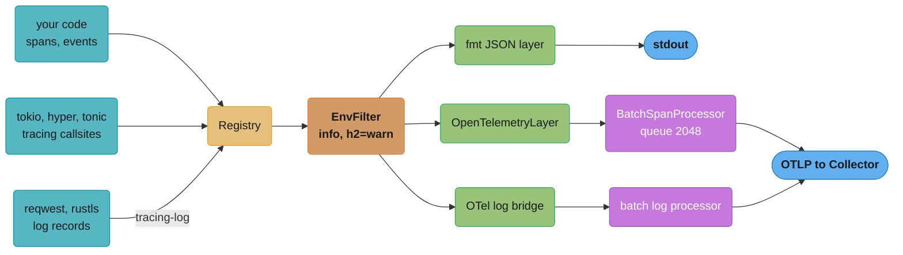
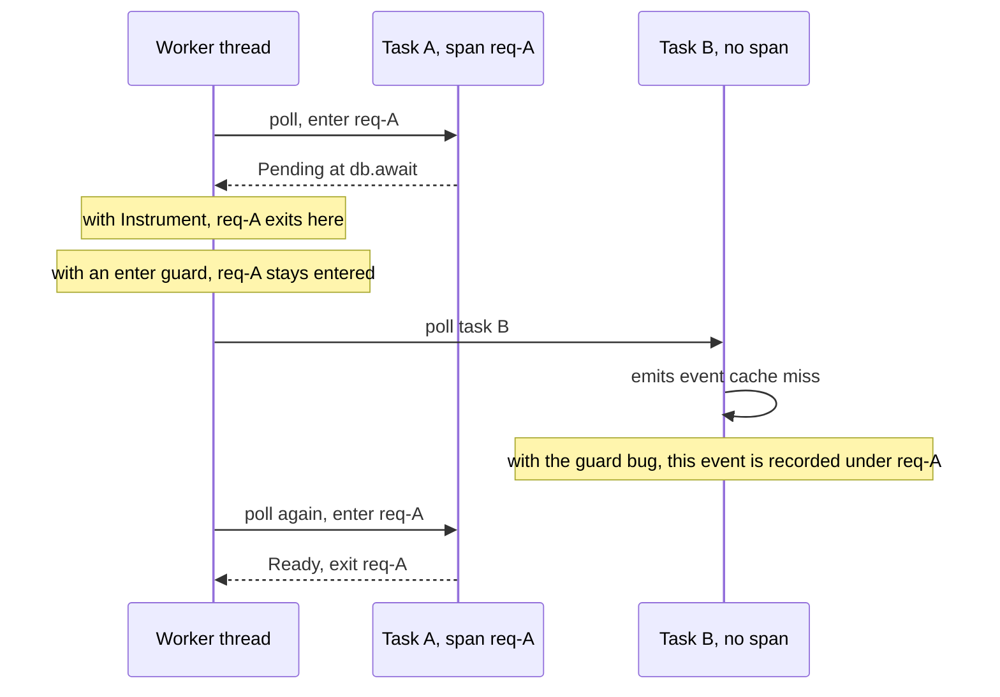
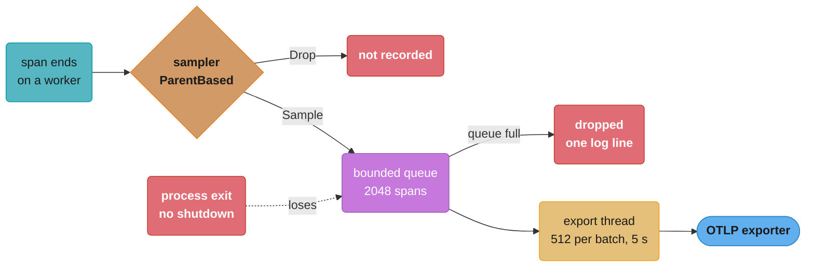

# Observability with tracing and OpenTelemetry

> **Version anchor (2026-11-06).** Rust 1.99.1 (2026-10-15) on edition 2024. tracing 0.1.44,
> tracing-subscriber 0.3.23, tracing-opentelemetry 0.34.0 (MSRV 1.75), opentelemetry,
> opentelemetry_sdk and opentelemetry-otlp 0.33.1 (2026-10-09), metrics 0.24.6,
> console-subscriber 0.5.0, tokio 1.54.1, tonic 0.14.9. OpenTelemetry Rust status from the
> project README: logs and metrics (API, SDK, OTLP exporter, tracing appender) are Stable;
> traces API, SDK and OTLP exporter, context and propagators are Beta.

## 1. Concept Overview

Rust services record telemetry through the `tracing` crate. `tracing` is an instrumentation
API: macros that create **spans** (a named period of time with typed fields) and **events**
(a point in time with fields, the structured replacement for a log line). It does not decide
where any of that goes. A **subscriber**, installed once by the binary, receives every span
and event and decides what to keep and where to send it. `tracing-subscriber` builds a
subscriber from composable **layers**: a filter, a formatter that prints JSON, a bridge that
turns spans into OpenTelemetry spans, a console for tokio tasks.

That split mirrors the OpenTelemetry API and SDK split, and it has the same rule: a library
depends on `tracing` only, and only the application installs a subscriber. tokio, hyper,
axum, tower-http and tonic all emit through `tracing` (optional in the first four,
mandatory in tonic, per their crates.io dependency lists), so a service that installs a
subscriber sees inside its own dependencies.

OpenTelemetry enters through two bridges. `tracing-opentelemetry` is a layer that converts
`tracing` spans into OTel spans for the OTel SDK, which batches them and exports them over
OTLP. `opentelemetry-appender-tracing` converts `tracing` events into OTel log records. Metrics
take a separate path: either the `metrics` facade crate with a Prometheus exporter, or the
OTel metrics API directly.

This page owns the Rust side: the `tracing` model, `#[instrument]`, futures and spans, the
subscriber stack, the OTel bridge and SDK wiring, propagation, sampling settings, export
batching and metrics in Rust. OpenTelemetry concepts (OTLP, the Collector, tail sampling,
semantic conventions, per-language status) are taught in the
[OpenTelemetry deep dive](../../devops/observability_tracing_and_otel/opentelemetry_deep_dive.md).
Fleet-level design (what to alert on, SLOs, backends) is in
[observability and monitoring](../../backend/observability_and_monitoring/observability_and_monitoring.md)
and [observability](../../hld/observability/observability.md). The Go equivalent of this page
is [observability and OpenTelemetry in Go](../../go/observability_and_opentelemetry/observability_and_opentelemetry.md).

---

## 2. Intuition

> **One-line analogy**: `tracing` is a flight recorder bus. Every component writes labelled
> readings to the bus. What gets stored, printed or sent to the ground station depends on
> which recorders the pilot plugged in, and the components never know.

**Mental model**: a span is a bracket around work. In synchronous code the bracket opens and
closes once. In async code a future is polled many times, and the span must be **entered on
every poll and exited when the poll returns**, or work from other tasks lands inside your
bracket. `Instrument::instrument(span)` does that. A guard from `span.enter()` held across an
`.await` does not.

**Why it matters**: the bugs here are silent. A trace looks complete and is wrong. A
`span.enter()` across an `.await` makes database queries from unrelated requests appear
under one request. A spawned task without `.in_current_span()` starts a new root trace, so the
slow part of a request is in a different trace. A `user_id` label on a metric creates a
million time series. A batch queue fills and drops spans with a single log line. A process
exits before the 5-second export timer fires and loses the last spans, which are the ones
around the crash.

**Key insight**: in Rust, observability is mostly about **context**: which span is current
on this thread at this poll, and how that context crosses tasks and processes. The crates
make recording cheap. Getting the context right is your code.

---

## 3. Core Principles

1. **Instrumentation is separate from output.** Libraries call `tracing` macros. The binary
   installs one global subscriber. A library that installs a subscriber takes that choice away
   from every application that uses it.
2. **Fields are structured.** `info!(order_id = %id, total_cents, "order placed")` records
   typed key-value pairs. `%` uses `Display`, `?` uses `Debug`, and a bare name uses the
   variable of that name.
3. **A span is entered per poll in async code.** Use `.instrument(span)` on a future and
   `#[instrument]` on an `async fn`. Never hold an `Entered` guard across `.await`.
4. **Context does not cross a spawn by itself.** `tokio::spawn` runs the future in no span.
   Attach one with `.in_current_span()` or `.instrument(span)`.
5. **Filtering is cheap when it happens early.** Each callsite caches whether any subscriber
   wants it. The `max_level_*` and `release_max_level_*` features remove levels at compile
   time.
6. **Export is batched and lossy.** The OTel batch processor queues 2,048 spans, exports up to
   512 every 5 seconds from a dedicated thread, and drops spans when the queue is full.
7. **Processes share context only through headers.** `tracing` has no wire format. A
   propagator writes and reads W3C `traceparent`.
8. **Shutdown is part of the pipeline.** Call `shutdown()` on the tracer provider before the
   process exits, or the last batch is lost.
9. **Metric labels are bounded.** The number of time series is the product of each label's
   distinct values.

---

## 4. Types / Architectures / Strategies

### Instrumentation APIs

| API | Records | Who calls it | Notes |
|---|---|---|---|
| `tracing` macros (`span!`, `info_span!`, `info!`, `error!`) | spans and events | libraries and applications | the default for all new Rust code |
| `#[tracing::instrument]` | one span per function call | applications, some libraries | records every argument with `Debug` unless told to skip |
| `log` facade (`log::info!`) | events only | older crates, `reqwest` 0.13.5, `rustls` 0.23.46 | reaches `tracing` through the `tracing-log` bridge |
| `metrics` facade (`counter!`, `histogram!`) | counters, gauges, histograms | applications and libraries | needs a recorder, such as `metrics-exporter-prometheus` |
| OTel API (`opentelemetry` crate) | spans, metrics, logs | code that wants OTel types directly | rarely needed when the tracing bridge is in place |

### The subscriber layer stack

| Layer | Crate | Purpose |
|---|---|---|
| `Registry` | tracing-subscriber | stores span data, assigns span ids, the base every layer sits on |
| `EnvFilter` | tracing-subscriber (`env-filter` feature) | `RUST_LOG`-style directives such as `info,orders=debug,h2=warn` |
| `fmt::Layer` | tracing-subscriber (`json` feature for JSON) | prints events to stdout or a writer |
| `OpenTelemetryLayer` | tracing-opentelemetry | turns spans into OTel spans for the SDK |
| `OpenTelemetryTracingBridge` | opentelemetry-appender-tracing | turns events into OTel log records |
| `ConsoleLayer` | console-subscriber | streams tokio task data to `tokio-console` |
| `NonBlocking` writer | tracing-appender | moves stdout or file writes to a background thread |

### Three telemetry pipelines

| Signal | Path | Export |
|---|---|---|
| Traces | `tracing` spans, then `tracing-opentelemetry`, then the SDK `BatchSpanProcessor` | OTLP over gRPC (tonic) or HTTP |
| Logs | `tracing` events, then `opentelemetry-appender-tracing`, then the SDK batch log processor | OTLP, plus stdout JSON for local reading |
| Metrics | `metrics` facade with a Prometheus recorder, or OTel meters with a periodic reader (60 s default) | Prometheus scrape, or OTLP push |

---

## 5. Architecture Diagrams

### One subscriber, many layers



The libraries on the left never see the layers on the right. Swapping stdout for OTLP is a
change to `main` only.

### Why `Instrument` and not `enter()` across an await



`Instrument` wraps the future so every `poll` enters the span and every return from `poll`
exits it. An `Entered` guard lives in the future's state across the `Pending`, so the span
stays current while the worker thread polls other tasks.

### Export path and where spans are lost



Three red boxes, three ways a span never reaches the backend. Only the sampler drop is a
choice you made on purpose.

---

## 6. How It Works - Detailed Mechanics

### 6.1 Dependencies

```toml
[dependencies]
tracing = "0.1.44"
tracing-subscriber = { version = "0.3.23", features = ["env-filter", "json"] }
tracing-opentelemetry = "0.34.0"
opentelemetry = "0.33.1"
opentelemetry_sdk = "0.33.1"
opentelemetry-otlp = { version = "0.33.1", default-features = false, features = ["trace", "logs", "grpc-tonic"] }
opentelemetry-appender-tracing = "0.33.1"
```

`tracing-opentelemetry` is numbered one minor version ahead of the OTel crates. Its README
says so: 0.34 pairs with `opentelemetry` 0.33. Two OTel versions in one build give two
incompatible `Tracer` traits, and the error names types that look identical. Bump
`tracing-opentelemetry` and the four `opentelemetry*` crates in the same commit.

`opentelemetry-otlp` defaults to HTTP (`http-proto` with `reqwest-blocking-client`) plus all
three signals. The example turns defaults off and picks gRPC through tonic, which adds tonic
0.14 to the build.

### 6.2 Spans, events and fields

```rust
use tracing::{field, info, info_span, warn, Instrument};

async fn place_order(order_id: u64, total_cents: i64, customer: &str) {
    let span = info_span!("place_order", order_id, customer, payment_ms = field::Empty);
    async {
        info!(total_cents, "validated");
        let started = std::time::Instant::now();
        charge(total_cents).await;
        tracing::Span::current().record("payment_ms", started.elapsed().as_millis() as u64);
        if total_cents > 1_000_000 {
            warn!(total_cents, "large order");
        }
    }
    .instrument(span)
    .await
}

async fn charge(_cents: i64) {}
```

`field::Empty` declares a field whose value arrives later through `Span::record`. A field not
declared at span creation cannot be recorded later. The set of field names is part of the
callsite's static metadata.

### 6.3 `#[instrument]`

```rust
// fragment: Db, Order and Error are defined in the service
use tracing::instrument;

#[instrument(
    name = "orders.get",
    skip_all,
    fields(order_id = %id, tenant = %tenant, rows = tracing::field::Empty),
    err
)]
async fn get_order(db: &Db, tenant: &str, id: u64, auth_token: &str) -> Result<Order, Error> {
    let rows = db.query_order(id).await?;
    tracing::Span::current().record("rows", rows.len());
    Order::from_rows(rows)
}
```

Without `skip_all`, the macro records every argument with `Debug`. That means `auth_token` is
written to every log line and every exported span, and a large `Db` struct is formatted on
every call. `skip_all` plus explicit `fields(..)` makes the recorded set a decision. `err`
emits an event when the function returns `Err`. `#[instrument]` on an `async fn` instruments
the returned future correctly, entering on each poll.

### 6.4 Spans across `spawn`

```rust
// fragment: inside an instrumented handler
use tracing::Instrument;

let span = tracing::info_span!("refresh_cache", key = %key);
tokio::spawn(refresh(key.clone()).instrument(span));

// or keep the caller's span as the parent
tokio::spawn(refresh(key).in_current_span());
```

`tokio::spawn` takes the future as written. If the future is not instrumented, the task runs
with no current span and its spans become new roots, each a separate trace in the backend.

### 6.5 Installing the subscriber

```rust
// fragment: provider construction is in 6.6
use tracing_subscriber::{EnvFilter, Layer, layer::SubscriberExt, util::SubscriberInitExt};

fn init_tracing(tracer: opentelemetry_sdk::trace::SdkTracer) {
    let console = tracing_subscriber::fmt::layer()
        .json()
        .with_filter(EnvFilter::from_default_env());

    let otel = tracing_opentelemetry::layer()
        .with_tracer(tracer)
        .with_filter(EnvFilter::new("info,h2=off,hyper=off,tonic=off,tower=off"));

    tracing_subscriber::registry().with(console).with(otel).init();
}
```

Each layer has its own filter. stdout follows `RUST_LOG`, while the OTel layer drops the HTTP/2
and gRPC internals so the exporter does not trace its own network calls. `init()` sets the
global default and, with the default `tracing-log` feature, installs `LogTracer`, so records
from `log`-based crates such as `reqwest` and `rustls` become `tracing` events. Call it once.
A second call returns an error from `try_init()` and panics from `init()`.

### 6.6 The OTel tracer provider

```rust
// fragment: error handling trimmed to `?`
use opentelemetry::{global, trace::TracerProvider as _};
use opentelemetry_otlp::{SpanExporter, WithExportConfig};
use opentelemetry_sdk::{Resource, propagation::TraceContextPropagator, trace::SdkTracerProvider};

fn init_otel() -> Result<SdkTracerProvider, Box<dyn std::error::Error>> {
    let exporter = SpanExporter::builder()
        .with_tonic()
        .with_endpoint("http://otel-collector:4317")
        .build()?;

    let provider = SdkTracerProvider::builder()
        .with_resource(Resource::builder().with_service_name("orders").build())
        .with_batch_exporter(exporter)
        .build();

    global::set_text_map_propagator(TraceContextPropagator::new());
    global::set_tracer_provider(provider.clone());
    Ok(provider)
}

#[tokio::main]
async fn main() -> Result<(), Box<dyn std::error::Error>> {
    let provider = init_otel()?;
    init_tracing(provider.tracer("orders"));

    let result = run().await;

    provider.shutdown()?; // flushes the queue; without it the last batch is lost
    result
}
```

Three settings matter. `service.name` comes from `with_service_name` or `OTEL_SERVICE_NAME`;
without either the SDK reports `unknown_service`, and every service merges into one entry in
the backend. The default sampler is `ParentBased(AlwaysOn)`, so a root span is always
sampled and a child follows its parent's decision. And the batch exporter runs on a
dedicated thread. The opentelemetry_sdk 0.33.1 docs state that with the `grpc-tonic`
exporter, the provider must be created inside a tokio runtime, and that async HTTP clients
(`reqwest-client`, `hyper-client`) do not work with this default processor. Use
`reqwest-blocking-client` for HTTP export.

### 6.7 Batch processor numbers

| Setting | Default in opentelemetry_sdk 0.33.1 | Environment variable |
|---|---|---|
| Max queue size | 2,048 spans | `OTEL_BSP_MAX_QUEUE_SIZE` |
| Scheduled delay | 5,000 ms | `OTEL_BSP_SCHEDULE_DELAY` |
| Max export batch | 512 spans | `OTEL_BSP_MAX_EXPORT_BATCH_SIZE` |
| Export timeout | 30,000 ms | `OTEL_BSP_EXPORT_TIMEOUT` |
| Attributes, events, links per span | 128 each | span limits on the provider |

At 2,000 sampled spans per second, the queue holds about one second of spans. If one export
stalls for longer, the queue fills and the processor drops spans. It logs the first drop,
then stays quiet until shutdown, where it logs the total. Size the queue from your span rate
times the longest export stall you will tolerate, and watch the shutdown log in load tests.

### 6.8 Propagation across a process boundary

```rust
// fragment: headers is an http::HeaderMap from axum or tonic metadata
use opentelemetry::{global, propagation::Extractor};
use tracing_opentelemetry::OpenTelemetrySpanExt;

struct Headers<'a>(&'a http::HeaderMap);

impl Extractor for Headers<'_> {
    fn get(&self, key: &str) -> Option<&str> {
        self.0.get(key).and_then(|v| v.to_str().ok())
    }
    fn keys(&self) -> Vec<&str> {
        self.0.keys().map(|k| k.as_str()).collect()
    }
}

fn server_span(headers: &http::HeaderMap) -> tracing::Span {
    let parent = global::get_text_map_propagator(|p| p.extract(&Headers(headers)));
    let span = tracing::info_span!("http.request", otel.kind = "server");
    if let Err(e) = span.set_parent(parent) {
        tracing::debug!(?e, "parent not set");
    }
    span
}
```

In tracing-opentelemetry 0.34, `set_parent` returns `Result<(), SetParentError>`. It fails
with `AlreadyStarted` when the span was already entered or its context already read, with
`SpanDisabled` when filters removed the span, and with `LayerNotFound` when the OTel layer
cannot be found (the crate names `tracing_subscriber::reload::Layer` as one cause). Set the
parent right after creating the span, before anything enters it. The outbound side is the
mirror: `global::get_text_map_propagator(|p| p.inject_context(&span.context(), &mut injector))`.

### 6.9 How the ratio sampler decides

`TraceIdRatioBased(p)` in opentelemetry_sdk 0.33.1 takes the low 8 bytes of the trace id,
shifts right by one, and samples when the result is below `p * 2^63`. A copy, compiled on
1.99.1:

```rust
fn sampled(trace_id: u128, ratio: f64) -> bool {
    if ratio >= 1.0 {
        return true;
    }
    let bound = (ratio.max(0.0) * (1u64 << 63) as f64) as u64;
    let low = trace_id as u64;
    (low >> 1) < bound
}

fn main() {
    let id = 0x4bf9_2f35_77b3_4da6_a3ce_929d_0e0e_4736_u128;
    assert!(sampled(id, 1.0));
    assert!(!sampled(id, 0.0));
    let kept = (0..10_000u128)
        .filter(|i| sampled(i.wrapping_mul(0x9e37_79b9_7f4a_7c15_f39c_c060_5ced_c835), 0.1))
        .count();
    assert!((800..1_200).contains(&kept), "kept {kept}");
}
```

The decision depends only on the trace id, so two services with the same ratio make the same
choice for the same trace. Wrap it in `ParentBased` so children follow the root's decision
instead of rolling again. Tail sampling, which keeps slow and failed traces, runs in the
Collector, not in the SDK.

### 6.10 Metrics and cardinality

```rust
// fragment: route is the matched route template, never the raw path
use metrics::{counter, histogram};

fn record(route: &'static str, status: u16, seconds: f64) {
    let class = match status {
        200..=299 => "2xx",
        400..=499 => "4xx",
        _ => "5xx",
    };
    counter!("http_requests_total", "route" => route, "class" => class).increment(1);
    histogram!("http_request_duration_seconds", "route" => route).record(seconds);
}
```

The number of series is the product of each label's distinct values. Status class instead of
status code, and route template instead of raw path, keep it bounded:

```rust
fn series(label_cardinalities: &[u64]) -> u64 {
    label_cardinalities.iter().product()
}

fn main() {
    // 40 routes x 3 status classes x 2 methods
    assert_eq!(series(&[40, 3, 2]), 240);
    // the same, plus a user_id label for 50,000 active users
    assert_eq!(series(&[40, 3, 2, 50_000]), 12_000_000);
}
```

A histogram multiplies again by its bucket count. Put the user id on the span, where it
costs one attribute per trace, not on the metric.

### 6.11 Overhead

A disabled callsite costs a check against a cached interest value. With a static filter such
as `info`, every `debug!` callsite is marked "never" after its first hit. An `EnvFilter` with
span-field directives (`[orders{tenant=acme}]=debug`) forces per-call checks, so keep those
for debugging sessions. To remove levels entirely, enable `tracing`'s
`release_max_level_info` feature, which compiles `debug!` and `trace!` out of release
builds. Field values are formatted only when some layer records them, so a costly `?big`
argument is free when the event is filtered out, and expensive when it is not.

---

## 7. Real-World Examples

- **The async stack instruments itself.** tokio 1.54.1, hyper 1.12.0, axum 0.8.9 and
  tower-http 0.7.1 declare `tracing` as an optional dependency. h2 0.4.12, tonic 0.14.9 and
  sqlx-core 0.9.0 depend on it unconditionally (crates.io dependency lists, read
  2026-11-06). Turning on `tower_http::trace::TraceLayer` plus the OTel layer gives an HTTP
  span per request with no code in handlers.
- **`log` is still in the tree.** reqwest 0.13.5 and rustls 0.23.46 log through `log`, not
  `tracing`. A service that installs a `tracing` subscriber without the `tracing-log` bridge
  loses every TLS handshake message and HTTP client warning.
- **OTLP over tonic.** `opentelemetry-otlp`'s `grpc-tonic` feature uses tonic 0.14, the same
  stack as [gRPC with tonic](../grpc_with_tonic/grpc_with_tonic.md). Its HTTP/2 internals emit
  `tracing` events, which is why the OTel layer filters `h2`, `hyper` and `tonic` to `off`.
- **tokio-console.** console-subscriber 0.5.0 serves task data on port 6669 by default. It
  needs tokio's `tracing` feature and the `tokio_unstable` cfg flag
  (`RUSTFLAGS="--cfg tokio_unstable"`), so most teams enable it in a debug build or a canary,
  not in the release image. The runtime side is in
  [async runtimes and executors](../async_runtimes_and_executors/async_runtimes_and_executors.md).

---

## 8. Tradeoffs

### Which path for each signal

| Signal | Option | Strength | Weakness |
|---|---|---|---|
| Traces | `tracing` plus `tracing-opentelemetry` | one instrumentation API, library spans for free | two version lines to keep paired; traces SDK is Beta |
| Traces | OTel API directly | no bridge layer | libraries do not use it, so their work is invisible |
| Logs | `fmt` JSON to stdout, shipped by the platform | simple, survives exporter outages | no automatic trace id unless you add it |
| Logs | `opentelemetry-appender-tracing` to OTLP | trace and log share ids, one pipeline | another batch queue to size and flush |
| Metrics | `metrics` facade plus Prometheus exporter | small API, pull model, mature dashboards | separate from OTel resources and exemplars |
| Metrics | OTel metrics API to OTLP | same resource and pipeline as traces | more setup, 60 s default push interval |

### Sampling choices

| Approach | Where | Keeps | Costs |
|---|---|---|---|
| `ParentBased(AlwaysOn)` (SDK default) | SDK | every trace | full export volume |
| `ParentBased(TraceIdRatioBased(0.05))` | SDK | 5% of traces, chosen by id | misses rare errors |
| Tail sampling | Collector | slow and failed traces, plus a sample | Collector memory and routing by trace id |

### stdout writer

| Writer | Blocking | Loss | When |
|---|---|---|---|
| `std::io::stdout` directly | yes, under a lock | none | low volume |
| `tracing-appender` `NonBlocking` (default lossy, 128,000 buffered lines) | no | drops at capacity | high volume, latency-sensitive |
| `NonBlocking` with lossy off | no, until full, then backpressure | none | audit logs |

---

## 9. When to Use / When NOT to Use

**Use `tracing` with the OTel bridge when:**

- The service makes calls to other services and you need to follow one request across them.
- Async code makes per-request context hard to see in plain logs.
- You want spans from tokio, hyper, tonic and sqlx without writing them.

**Use only `tracing` with JSON stdout when:**

- The program is a CLI, a batch job or a single service with no downstream calls.
- The platform already collects stdout and you do not run a Collector.

**Do not:**

- Install a subscriber or an OTel SDK inside a library crate.
- Put unbounded values (user id, request id, raw path) in metric labels.
- Rely on the traces SDK being API-stable across 0.x minor versions. Pin and upgrade the OTel
  crates as one unit.
- Run `tokio-console` instrumentation in the release image without measuring its cost.

---

## 10. Common Pitfalls

These incidents are illustrative. They show common failure patterns, not specific outages, and
their numbers show scale only.

### Database queries from other requests inside one trace

A team wrote `let _guard = span.enter();` at the top of an async handler. Traces showed
queries from unrelated requests nested under one slow request. The guard stayed alive across
each `.await`, so while the task was parked the worker thread polled other tasks inside that
span. It compiled because `Entered<'_>` holds only a `&Span`, and `Span` is `Send` and `Sync`.
The fix is `#[instrument]` or `.instrument(span)`.

Switching to `span.entered()` turns the bug into a compile error, because `EnteredSpan` is
deliberately `!Send` (it has a `PhantomNotSend` field, per the tracing source). The same
mechanism, modelled with std only:

```rust
// BROKEN: a !Send guard held across .await in a future that must be Send
use std::marker::PhantomData;

struct EnteredSpan {
    _not_send: PhantomData<*mut ()>,
}

impl Drop for EnteredSpan {
    fn drop(&mut self) {} // the real guard exits the span here
}

fn enter() -> EnteredSpan {
    EnteredSpan { _not_send: PhantomData }
}

async fn query() {}

async fn handler() {
    let _guard = enter();
    query().await; // the guard is part of the future's state here
}

fn spawn<F: Future + Send + 'static>(_: F) {}

fn main() {
    // error: future cannot be sent between threads safely
    // help: the trait `Send` is not implemented for `*mut ()`
    spawn(handler());
}
```

```rust
// FIX: scope the guard to synchronous work only, instrument the future instead
use std::marker::PhantomData;

struct EnteredSpan {
    _not_send: PhantomData<*mut ()>,
}

impl Drop for EnteredSpan {
    fn drop(&mut self) {} // the real guard exits the span here
}

fn enter() -> EnteredSpan {
    EnteredSpan { _not_send: PhantomData }
}

async fn query() {}

async fn handler() {
    {
        let _guard = enter();
        // synchronous work only
    }
    query().await;
}

fn spawn<F: Future + Send + 'static>(_: F) {}

fn main() {
    spawn(handler());
}
```

### The last 5 seconds before every crash were missing

A worker process exited on SIGTERM by returning from `main`. Traces for the final requests
never arrived. The batch processor exports every 5 seconds and the process ended between
exports. The fix was to call `provider.shutdown()` in the signal path, after the server
stopped accepting work, and to add the same call to the panic hook for crash paths.

### 18% of spans gone, one log line

Under a load test at 6,000 spans per second, the Collector paused for 2 seconds during a
config reload. The 2,048-span queue filled in a third of a second and the processor dropped
spans for the rest of the pause. The only signal was one log message on the first drop and a
total on shutdown. The team raised `OTEL_BSP_MAX_QUEUE_SIZE` to 16,384, set a 1-second
schedule delay, put a Collector agent on the node so export stalls became local, and added the
shutdown drop count to the load-test pass criteria.

### Every service called `unknown_service`

A new service had no `with_service_name` and no `OTEL_SERVICE_NAME`. Its spans appeared under
`unknown_service` in the backend, merged with two other services that made the same mistake.
Set the name in code and let the environment override it.

### The log file that stopped at startup

```rust
// fragment: the guard is dropped at the end of this statement
let (writer, _) = tracing_appender::non_blocking(std::io::stdout());
```

`non_blocking` returns a `WorkerGuard`. `let _ =` and a `_` pattern drop it immediately, which
stops the background writer, and later events are lost. Bind it to a named variable that lives
until the end of `main`: `let (writer, _guard) = ...`.

### Metrics backend at 12 million series

A `customer_id` label on a request counter took the Prometheus server from 240 series per
service to millions in a day, and scrapes timed out. The fix moved `customer_id` to span
attributes and kept route template, method and status class on the metric.

---

## 11. Technologies & Tools

| Tool | Version (crates.io, 2026-11-06) | Role |
|---|---|---|
| tracing | 0.1.44 | spans, events, `#[instrument]` |
| tracing-subscriber | 0.3.23 | `Registry`, `EnvFilter`, `fmt` layer, per-layer filters |
| tracing-opentelemetry | 0.34.0 | layer from `tracing` spans to OTel spans |
| opentelemetry | 0.33.1 | OTel API: context, propagation, tracer and meter traits |
| opentelemetry_sdk | 0.33.1 | providers, batch processors, samplers, resources |
| opentelemetry-otlp | 0.33.1 | OTLP exporter over gRPC (tonic) or HTTP |
| opentelemetry-appender-tracing | 0.33.1 | `tracing` events to OTel log records |
| metrics | 0.24.6 | counter, gauge and histogram facade |
| metrics-exporter-prometheus | 0.18.3 | Prometheus recorder and scrape endpoint for `metrics` |
| tracing-appender | 0.2.5 | non-blocking writer and rolling files |
| console-subscriber | 0.5.0 | tokio task instrumentation for `tokio-console` |
| tokio-console | 0.1.14 | terminal UI for live tokio tasks |

---

## 12. Interview Questions with Answers

**Q: Why is holding span.enter() across an .await wrong, and why does the compiler allow it?**
**Short:** The guard keeps the span entered while the task is parked, so other tasks on that thread record into it; it compiles because Entered is Send.

`Entered<'_>` holds only a `&Span`, and `Span` is `Send + Sync`, so a future holding the
guard is still `Send`. At each `Pending`, the worker thread moves on to other tasks while the
span stays current, and their events and child spans attach to the wrong request. When the
task resumes on another thread, the exit happens there. Use `#[instrument]` on the `async fn`
or `.instrument(span)` on the future, which enters on every poll and exits when the poll
returns.

**Q: Switching from enter() to entered() inside a spawned task broke the build with a Send error. Why?**
**Short:** EnteredSpan is deliberately not Send, so holding it across an await makes the future not Send, and tokio::spawn requires Send.

`span.entered()` consumes the span and returns an owned `EnteredSpan`, which carries a
`PhantomNotSend` marker. The tracing authors added it because the span must be exited on the
thread where it was entered. That turns the silent bug from the previous question into a
compile error, which is the better failure. The fix is the same: instrument the future
instead of holding a guard.

**Q: A spawned task's spans show up as separate root traces. What is missing?**
**Short:** tokio::spawn does not carry the current span into the task, so the future must be wrapped with in_current_span() or instrument(span).

A `tracing` span is current only while some code has it entered, and spawning creates a new
task with no span. Its first span has no parent and becomes a new trace. Write
`tokio::spawn(fut.in_current_span())` to keep the caller's span as parent, or
`.instrument(info_span!("job", ..))` for a named child. The same applies to
`spawn_blocking`: enter the span inside the closure with `span.in_scope(..)`.

**Q: The OTel layer will not compile and the error mentions two identical-looking Tracer traits. What happened?**
**Short:** tracing-opentelemetry and the opentelemetry crates are on mismatched versions; 0.34 pairs with opentelemetry 0.33.

`tracing-opentelemetry` numbers its releases one minor ahead of `opentelemetry`, as its
README states, and 0.34.0 depends on `opentelemetry ^0.33.0`. If the application also adds
`opentelemetry` 0.32, Cargo builds two copies, and a `Tracer` from one does not implement the
trait from the other. Check with `cargo tree -d -i opentelemetry`. Upgrade
`tracing-opentelemetry`, `opentelemetry`, `opentelemetry_sdk`, `opentelemetry-otlp` and the
appender together.

**Q: Why are the last spans before a process exits missing from the backend?**
**Short:** The batch processor exports every 5 seconds from a background thread, and exiting without provider.shutdown() discards the queue.

The SDK queues finished spans and exports in batches of up to 512 on a 5,000 ms timer. A
process that returns from `main`, calls `std::process::exit`, or is killed between exports
loses everything queued. Call `shutdown()` on the `SdkTracerProvider` (and the logger
provider) after the server drains, and call `force_flush()` in a panic hook. Keep the provider
owned by `main` so the call is not forgotten.

**Q: Spans disappear under load but nothing errors. Where do they go?**
**Short:** The batch queue holds 2,048 spans by default; when it is full new spans are dropped, with one log line and a total at shutdown.

`OTEL_BSP_MAX_QUEUE_SIZE` defaults to 2,048 in opentelemetry_sdk 0.33.1. A slow Collector or
a network stall fills it quickly at a few thousand spans per second, and the processor drops
instead of blocking your request path. It logs the first drop and a lifetime total at
shutdown. Size the queue as span rate times the longest tolerable stall, export to a local
Collector agent, and sample at the root if volume is the real problem.

**Q: Traces break at every service boundary. What is wrong in the Rust code?**
**Short:** No propagator is installed or used, so traceparent is never injected on outgoing calls or extracted on incoming ones.

`tracing` keeps context in-process only. Install `TraceContextPropagator` with
`global::set_text_map_propagator`, inject the current span's context into outgoing HTTP
headers or tonic metadata, and on the server extract it and call `set_parent` on the request
span before entering it. In tracing-opentelemetry 0.34 `set_parent` returns a `Result`; an
`AlreadyStarted` error means the span was entered or its context read first. Middleware such as
a tower layer is the right place for both sides, so handlers never do it by hand.

**Q: Why can the instrument attribute macro leak secrets, and how do you prevent it?**
**Short:** By default it records every argument with Debug, so tokens and passwords land in logs and spans; use skip_all and list fields explicitly.

The macro adds one field per argument. A `password: &str` or a request struct with an API key
inside is formatted into every event and exported span. Write
`#[instrument(skip_all, fields(user_id = %user.id))]` so the recorded set is a reviewed list.
This also removes the cost of formatting large arguments like a database pool. A newtype with a
redacting `Debug` impl protects the value everywhere, not only in this macro.

**Q: How do you add a field to a span after it was created?**
**Short:** Declare it at creation with field::Empty, then call Span::record with the value; undeclared fields cannot be added later.

Span field names are part of the callsite's static metadata, so the set is fixed when the span
macro runs. `info_span!("q", rows = field::Empty)` reserves the slot, and
`Span::current().record("rows", n)` fills it. Recording a name that was not declared does
nothing. This is how you attach results such as row counts or a payment latency to the span
that wrapped the work.

**Q: Why should a library never install a tracing subscriber?**
**Short:** There is one global default per process, and only the application knows where telemetry should go and at what level.

`set_global_default` succeeds once. A library that calls it either fails when the application
also does, or wins the race and forces its output format on every user. A library emits with
`tracing` macros and lets the application compose layers. The OTel API and SDK split exists
for the same reason, and a library depending on an SDK crate forces a vendor and a version on
every consumer.

**Q: How do log records from reqwest and rustls reach a tracing subscriber?**
**Short:** Through the tracing-log bridge: tracing-subscriber's default tracing-log feature makes init() install LogTracer, which converts log records into events.

reqwest 0.13.5 and rustls 0.23.46 use the `log` facade. `log` has its own global logger slot,
and without a bridge their records go nowhere once you replace `env_logger` with `tracing`.
`tracing_subscriber::fmt().init()` and `registry().init()` call `LogTracer::init()` when the
`tracing-log` feature is on, which it is by default. If you set default features off, call
`tracing_log::LogTracer::init()` yourself.

**Q: How do you send different levels to stdout and to the OTel exporter?**
**Short:** Give each layer its own filter with Layer::with_filter, for example RUST_LOG on stdout and info without HTTP/2 internals on OTel.

Per-layer filtering in tracing-subscriber lets one subscriber feed several sinks with
different rules. A typical setup reads `RUST_LOG` for the `fmt` layer and uses a fixed
`EnvFilter::new("info,h2=off,hyper=off,tonic=off")` for the OTel layer. The second filter stops
the OTLP exporter's own HTTP/2 traffic from being traced and exported, which would add volume
and noise to every trace.

**Q: What does a disabled tracing callsite cost, and how do you remove it entirely?**
**Short:** A check against the callsite's cached interest; the release_max_level features remove the call from release builds altogether.

Each callsite registers once and caches whether any subscriber wants it. Under a static filter,
a disabled `debug!` is a cheap check and its arguments are never formatted. Filters on span
field values make interest dynamic and force per-call evaluation. For hot loops, enable
`release_max_level_info` on `tracing` so `debug!` and `trace!` compile to nothing in release.
Measure with a benchmark before you claim a span is too expensive.

**Q: Why put user_id on a span but never on a metric label?**
**Short:** Each distinct label value creates a separate time series, so a 50,000-value label multiplies series count by 50,000; on a span it is one attribute.

Series count is the product of each label's cardinality. Forty routes times three status
classes times two methods is 240 series. Add `user_id` for 50,000 users and it is 12 million,
before histogram buckets multiply it again. The metrics backend pays for every series in memory
and index size. Spans are sampled events, so a high-cardinality attribute there costs storage
per trace, which is the right place to search for one user.

**Q: What does the OpenTelemetry Rust SDK sample by default, and how does the ratio sampler choose?**
**Short:** ParentBased(AlwaysOn) by default; TraceIdRatioBased compares the trace id's low 64 bits shifted right by one against ratio times 2^63.

With the default, every root span is sampled and children follow their parent. The ratio
sampler depends only on the trace id, so every service with the same ratio makes the same call
for a given trace. Always wrap it in `ParentBased` so a sampled root keeps all its children.
Keeping slow or failed traces needs tail sampling in the Collector, because the SDK decides at
span start, before it knows the outcome.

**Q: Your OTLP gRPC exporter panics or never exports when created in a plain fn main. Why?**
**Short:** With the grpc-tonic exporter, opentelemetry_sdk 0.33.1 requires the provider to be created inside a tokio runtime.

The default batch processor runs on its own thread, but the tonic client inside the exporter
needs a tokio runtime handle from where it was built. Build the provider inside
`#[tokio::main]` or a runtime's `block_on`. For HTTP export without tokio, use the
`reqwest-blocking-client` feature. The docs say async HTTP clients such as `reqwest-client`
are not supported by the default batch processor.

**Q: What are the special otel.* fields on a tracing span for?**
**Short:** tracing-opentelemetry reads otel.name, otel.kind, otel.status_code and otel.status_description to set the OTel span's name, kind and status.

Span names in `tracing` are static strings, so `otel.name = %format!("GET {route}")` gives the
exported span a dynamic name. `otel.kind = "server"` or `"client"` sets the span kind that
backends use to draw service maps. `otel.status_code = "ERROR"` marks the span failed even if no
error event fired. Declare them as fields at span creation, with `field::Empty` if the value
comes later.

**Q: Which OpenTelemetry Rust signals are stable?**
**Short:** Logs and metrics (API, SDK, OTLP exporter and tracing appender) are Stable; traces API, SDK and exporter, context and propagators are Beta.

That is the "Project Status" table in the opentelemetry-rust README, which also lists the
OTel Prometheus metrics exporter as Beta. Beta traces mean the API can change between 0.x
minor versions, which is why `tracing-opentelemetry` and the OTel crates move together and why
upgrades are planned work. Use the `tracing` bridge in application code, so a trace-API change
touches only the setup in `main`, not every instrumented function. The status across languages
is in the [OpenTelemetry deep dive](../../devops/observability_tracing_and_otel/opentelemetry_deep_dive.md).

**Q: The tracing-appender log stopped after startup. What is the usual cause?**
**Short:** The WorkerGuard returned by non_blocking was dropped at once with a wildcard pattern, which shuts down the writer thread.

`tracing_appender::non_blocking(writer)` returns the writer and a `WorkerGuard`. Dropping the
guard flushes and stops the background thread. `let (w, _) = ...` drops it at the end of the
statement. Bind it as `_guard` and keep it in `main`. Note the default mode is lossy with a
128,000-line buffer, so under a burst it drops lines instead of blocking. Turn lossy off for
logs that must not be lost and accept the backpressure.

**Q: What does tokio-console need, and why is it usually off in production?**
**Short:** console-subscriber plus tokio's tracing feature and the tokio_unstable cfg flag, which instruments every task and adds a gRPC server on port 6669.

tokio-console shows live tasks, their poll times and wakers, which finds a task that never
yields or a lock held too long. It needs `RUSTFLAGS="--cfg tokio_unstable"`, the `tracing`
feature on tokio, and `console_subscriber::init()` or `spawn()` as a layer. The extra task
instrumentation and the retained history cost CPU and memory, so most teams use it in
development, a canary or an on-demand debug build.

---

## 13. Best Practices

- Libraries depend on `tracing` only. The binary installs one subscriber in `main`.
- Use `#[instrument(skip_all, fields(..))]` and list fields deliberately.
- Instrument futures, never hold an `Entered` guard across `.await`, and attach a span to
  every `tokio::spawn`.
- Set `service.name` in code. Set a resource with version and environment.
- Pair `tracing-opentelemetry` 0.34 with `opentelemetry*` 0.33.1 and upgrade them together.
- Call `provider.shutdown()` after the server drains, and `force_flush()` in a panic hook.
- Size the batch queue from span rate and export stalls. Check the drop total in load tests.
- Filter `h2`, `hyper`, `tonic` and `tower` to `off` on the OTel layer.
- Keep metric labels bounded: route template, method, status class.
- Propagate context in middleware, not in handlers.
- Keep `tokio-console` out of the release image unless you measured its cost.

---

## 14. Case Study

### A payment service that lost its slow traces

The service, the team and the numbers in this case are illustrative.

**Context.** A payment service in Rust (axum, tonic clients, sqlx) handles 1,200 requests per
second at peak with a p99 SLO of 400 ms. It exports traces through `tracing-opentelemetry` to a
gateway Collector with tail sampling that keeps every trace over 500 ms and 2% of the rest.

**Symptoms.** p99 alerts fired, but the tail-sampled traces for slow requests showed only the
HTTP span with no children, or nothing at all. Separate short traces with names like
`fraud_check` and `ledger_write` appeared with no parent. During one incident the backend
received about 70% of the spans the service created.

**Diagnosis.**

1. The fraud and ledger calls ran in `tokio::spawn` tasks without `.in_current_span()`. Each
   became a root trace, so the Collector's latency rule judged them alone and they were fast.
2. The service built its OTel exporter from a background thread, while the shutdown code
   borrowed the provider instead of owning it. A refactor tried to move the shutdown into a
   watchdog thread and hit the compile error below, and the developer removed the shutdown
   call to make it build.
3. The batch queue was at the default 2,048. At 1,200 requests with about 9 spans each, the
   service produced about 10,800 spans per second, so a 200 ms export stall overflowed it.

The second problem, reduced to std:

```rust
// BROKEN: a spawned thread borrows a value owned by main
use std::thread;

struct Provider {
    name: String,
}

impl Provider {
    fn shutdown(&self) -> String {
        format!("{} flushed", self.name)
    }
}

fn main() {
    let provider = Provider { name: "payments".to_owned() };
    // error[E0373]: closure may outlive the current function, but it borrows `provider`
    let watchdog = thread::spawn(|| provider.shutdown());
    let _ = watchdog.join();
}
```

```rust
// FIX: share ownership with Arc so main and the watchdog both keep it alive
use std::sync::Arc;
use std::thread;

struct Provider {
    name: String,
}

impl Provider {
    fn shutdown(&self) -> String {
        format!("{} flushed", self.name)
    }
}

fn main() {
    let provider = Arc::new(Provider { name: "payments".to_owned() });
    let for_watchdog = Arc::clone(&provider);
    let watchdog = thread::spawn(move || for_watchdog.shutdown());
    let message = watchdog.join().unwrap_or_else(|_| "watchdog panicked".to_owned());
    assert_eq!(message, "payments flushed");
    assert_eq!(provider.shutdown(), "payments flushed");
}
```

`SdkTracerProvider` is cheap to clone (the example in 6.6 already clones it for the global
slot), so the real fix passed a clone to the watchdog and kept the original in `main`.

**Fix.**

| Change | Mechanism | Result |
|---|---|---|
| Parent spans on spawned work | `.in_current_span()` on every `tokio::spawn`, plus a clippy `disallowed_methods` rule pointing at a `spawn_traced` helper | fraud and ledger spans joined the request trace, and the tail sampler kept slow requests whole |
| Shutdown restored | provider clone for the watchdog, `shutdown()` in the SIGTERM path and `force_flush()` in the panic hook | spans from the last seconds before restarts arrived |
| Queue sized to load | `OTEL_BSP_MAX_QUEUE_SIZE=32768`, 1 s schedule delay, Collector agent on the node | drop total at shutdown in a 2x load test fell from 31% to 0 |
| Root sampling kept at AlwaysOn | tail sampling stays in the Collector, the SDK exports everything to the local agent | slow traces were never dropped by an SDK ratio decision |

**Result.** In the next incident the slow trace showed a 310 ms `ledger_write` child under the
payment request, with the `sqlx` query span inside it. The team found a missing index in 20
minutes. The cost was 40 MB more memory per pod for the larger queue and one more DaemonSet,
which the team judged cheap against an incident with no evidence.
