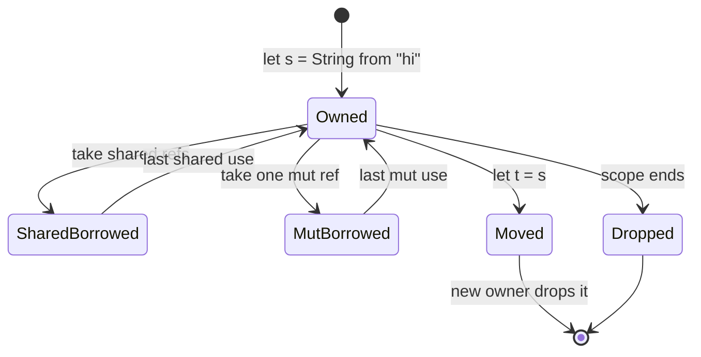

# Ownership, Borrowing and RAII

> **Version anchor (2026-11-06):** Rust 1.99.1 (2026-10-15) on edition 2024 (stable since
> 1.85, 2025-02-20). Edition-gated items on this page: the `if let` temporary scope and the
> tail-expression temporary scope `[ed2024]`. Everything else holds on every supported release.
> Layout numbers are for 64-bit targets.

---

## 1. Concept Overview

Rust manages memory and other resources with three rules that the compiler checks before the
program runs:

1. Each value has exactly one owner, a variable or a field.
2. When the owner goes out of scope, the value is dropped: its destructor runs and its memory
   is freed.
3. At any point you may hold either any number of shared references (`&T`) or exactly one
   mutable reference (`&mut T`) to a value, never both.

There is no garbage collector and no reference count unless you ask for one with `Rc` or
`Arc`. The compiler inserts the free calls itself, at the exact point where the owner dies.
The same mechanism closes files, unlocks mutexes, returns pooled connections and rolls back
transactions. That pattern is RAII (resource acquisition is initialization): a value owns a
resource, and dropping the value releases it.

Assignment and argument passing move ownership by default. A move copies the bytes of the
value (for a `String`, the 24-byte header, never the heap buffer) and marks the source as
unusable. Types that are cheap to copy and own no resource opt into `Copy`, and then
assignment duplicates them. Anything else is duplicated only by an explicit `.clone()`.

This page covers who owns a value, when it drops, what a borrow permits, and the tools for
moving values out of places the compiler guards (`mem::take`, `mem::replace`, `mem::swap`).
How long a borrow may live, and how to name that in a signature, is the subject of
[Lifetimes and the Borrow Checker](../lifetimes_and_the_borrow_checker/lifetimes_and_the_borrow_checker.md).
Shared ownership and mutation through `&T` are in
[Smart Pointers and Interior Mutability](../smart_pointers_and_interior_mutability/smart_pointers_and_interior_mutability.md).

Virtual memory, page tables and how `malloc` gets pages from the kernel are owned by
[Memory Management and Virtual Memory](../../cs_fundamentals/memory_management_and_virtual_memory/memory_management_and_virtual_memory.md);
this page starts at the point where Rust decides when to call the allocator.

---

## 2. Intuition

> **One-line analogy:** ownership is a deed to a house. One person holds the deed. You can
> sign it over (a move), let many people look around at once (shared borrows), or hand one
> person the keys to renovate (a mutable borrow), but never the keys and the visitors at the
> same time.

**Mental model.** Every value has one place in the program that is responsible for it. When
that place disappears (a scope ends, a struct is dropped, a `Vec` is cleared) the value's
cleanup runs, in an order you can read from the source. Borrows are permission slips with an
expiry date the compiler computes: a shared slip lets you read, an exclusive slip lets you
write, and the compiler refuses any program in which a slip outlives the value or two slips
conflict.

**Why it matters.** A garbage-collected runtime answers "when is this freed?" with "later,
when the collector runs". Rust answers with a line number. That gives you deterministic
latency (no collector pauses, see
[the Go runtime and garbage collector](../../go/the_runtime_and_garbage_collector/the_runtime_and_garbage_collector.md)
and [JVM internals](../../java/jvm_internals/jvm_internals.md) for the contrast), and it
extends to every resource, not only memory. A lock guard, a file handle and a database
transaction all release at the same predictable point.

**Key insight.** The shared-xor-mutable rule is not a memory rule. It is an aliasing rule,
and it removes a whole class of bugs that has nothing to do with `free`: iterator
invalidation, a callback that mutates the collection you are walking, and data races between
threads. The memory safety follows from the aliasing discipline, not the other way round.

---

## 3. Core Principles

1. **One owner, always.** Ownership forms a tree. A `Vec<String>` owns its buffer, and the
   buffer owns each `String`, which owns its bytes. Dropping the root drops the tree.
2. **Moves are bitwise and static.** A move is a `memcpy` of the value's inline bytes. The
   compiler then forbids use of the source (E0382). Nothing happens at runtime to "invalidate"
   it, and the optimizer usually removes the copy.
3. **`Copy` is a promise that a bitwise copy is a full copy.** Only types with no destructor
   can be `Copy` (E0184). `i32`, `bool`, `char`, `&T` and tuples or arrays of `Copy` types
   qualify. `String`, `Vec<T>`, `Box<T>` and `&mut T` do not.
4. **`Clone` is explicit and may be expensive.** `Vec::clone` allocates and copies every
   element. `Rc::clone` increments a counter. The call site looks the same, so read the type.
5. **Shared xor mutable.** Many `&T` or one `&mut T`. A `&mut T` means exclusive
   access, which is why the compiler can optimize through it and why it cannot be `Copy`.
6. **A borrow lasts until its last use.** Non-lexical lifetimes (NLL) end a borrow at the last
   point it is used, not at the closing brace.
7. **Drop order is defined.** Locals drop in reverse declaration order. Struct fields drop in
   declaration order. `Vec` and array elements drop front to back. Temporaries drop at the end
   of the enclosing statement, with the edition 2024 narrowing for `if let` and tail
   expressions.
8. **Destructors can be skipped.** `mem::forget`, `Box::leak`, an `Rc` cycle,
   `process::exit` and `panic = "abort"` all skip them. Leaking is safe Rust. Unsafe code must
   stay sound when a destructor never runs.

---

## 4. Types / Architectures / Strategies

### 4.1 Move, Copy and Clone

| Behavior | Trigger | What happens | Cost | Example types |
|---|---|---|---|---|
| Move | `let b = a;`, pass by value, return | Bitwise copy of the inline bytes; `a` is unusable | Size of the inline value, often optimized away | `String`, `Vec<T>`, `Box<T>`, `File` |
| Copy | Same syntax, type is `Copy` | Bitwise copy; `a` stays usable | Size of the value | `u64`, `f32`, `char`, `&T`, `(i32, i32)` |
| Clone | `a.clone()` | Runs user or derived code | Anything from one increment to a deep copy | `Vec<T>` (deep), `Rc<T>` (counter), `Arc<T>` (atomic counter) |

### 4.2 Ways to pass a value

| Parameter type | Caller keeps the value? | Callee can mutate? | Use when |
|---|---|---|---|
| `T` | No (moved) unless `T: Copy` | Yes, it owns it | Callee stores it, consumes it, or returns a transformed version |
| `&T` | Yes | No | Callee only reads |
| `&mut T` | Yes | Yes, in place | Callee updates the caller's value |
| `impl Into<String>` / `impl AsRef<str>` | Depends on the argument | Depends | Library API that accepts both owned and borrowed input |

### 4.3 Getting a value out of a guarded place

| Tool | Signature (simplified) | Leaves behind | Use when |
|---|---|---|---|
| `mem::take(&mut x)` | `fn take<T: Default>(&mut T) -> T` | `T::default()` | Moving a `Vec`, `String` or `Option` out of `&mut self` |
| `mem::replace(&mut x, v)` | `fn replace<T>(&mut T, T) -> T` | `v` | The type has no cheap `Default`, or you want a specific value |
| `mem::swap(&mut a, &mut b)` | `fn swap<T>(&mut T, &mut T)` | Each holds the other's value | Double buffering, state machine transitions |
| `Option::take()` | `fn take(&mut self) -> Option<T>` | `None` | An optional resource, a one-shot sender |

### 4.4 RAII guard shapes

| Shape | Drop does | Examples |
|---|---|---|
| Release | Gives the resource back | `MutexGuard` unlocks, a pooled connection returns to the pool |
| Close | Frees an OS handle, ignores errors | `File`, `TcpStream` |
| Undo unless committed | Rolls back partial work | sqlx `Transaction` rolls back if neither `commit` nor `rollback` ran |
| Detach | Lets the work continue unowned | `std::thread::JoinHandle`, tokio `JoinHandle` |
| Scope exit | Ends a context | `tracing::span::Entered` exits the span |

---

## 5. Architecture Diagrams

### 5.1 The life of an owned value



A value is always in exactly one of these states. Shared and exclusive borrows never overlap,
and once a value is moved its old name has no state at all. The compiler rejects any path
that reads a `Moved` name.

### 5.2 What a move copies

```
  stack (moved: 24 bytes)                heap (not touched by the move)
  +-----------------------------+
  | s:  ptr --------------------+------->  [ h | e | l | l | o | _ | _ | _ ]
  |     cap = 8                 |           len 5, capacity 8
  |     len = 5                 |
  +-----------------------------+
        let t = s;   copies the three words above into t, then s is dead
  +-----------------------------+
  | t:  ptr --------------------+------->  same buffer, same address
  |     cap = 8                 |
  |     len = 5                 |
  +-----------------------------+
```

On a 64-bit target a `String` is three words: pointer, capacity and length, 24 bytes. A move
copies those 24 bytes and never the 8-byte heap buffer, which is why moving a 1 GB `Vec` costs
the same as moving an empty one.

### 5.3 Where a borrow starts and ends under NLL

```
  line  code                               borrow `first` of v
  ----  ---------------------------------  --------------------
   1    let mut v = vec![1, 2, 3];
   2    let first = &v[0];                 |  starts
   3    println!("{first}");               |  last use, ends here
   4    v.push(4);                         .  free: no live shared borrow
   5    // first is not used again
```

Before NLL a borrow lasted to the end of the block, so line 4 was an error. NLL ends the
borrow at its last use on line 3. If line 5 read `first` again, the borrow would stretch over
line 4 and the push would fail with E0502.

### 5.4 Drop order in one function


Locals drop last-declared first. Inside each local, a struct drops its fields top to bottom and
a `Vec` drops its elements front to back. Section 6.4 prints this order from running code.

---

## 6. How It Works - Detailed Mechanics

### 6.1 Moves, use after move, and drop flags

```rust
fn consume(s: String) -> usize {
    s.len()
} // s dropped here: the heap buffer is freed

fn main() {
    let s = String::from("hello");
    let n = consume(s); // ownership moves into consume
    // println!("{s}"); // error[E0382]: borrow of moved value: `s`
    println!("{n}");

    let maybe = String::from("maybe");
    if n > 3 {
        drop(maybe); // moved on one path only
    }
    // The compiler keeps a hidden "drop flag" on the stack for `maybe`.
    // At scope end it drops `maybe` only if the flag says it was not moved.
}
```

A value moved on only some paths gets a drop flag: one byte on the stack that records whether
the destructor still has to run. The flag exists only for conditionally moved values, so the
common case costs nothing.

### 6.2 Copy, Clone and the destructor rule

```rust
#[derive(Clone, Copy, Debug)]
struct Point {
    x: i32,
    y: i32,
}

#[derive(Clone, Debug)]
struct Label {
    text: String, // owns heap memory, so Label cannot be Copy
}

fn main() {
    let a = Point { x: 1, y: 2 };
    let b = a; // copy: a stays valid
    println!("{a:?} {b:?}");

    let l1 = Label { text: "x".to_string() };
    let l2 = l1.clone(); // explicit deep copy: allocates
    println!("{l1:?} {l2:?}");
}
```

A type that implements `Drop` cannot be `Copy` (E0184). If it could, a bitwise copy would give
two owners of the same resource and the destructor would run twice.

### 6.3 Shared xor mutable, NLL and two-phase borrows

```rust
fn main() {
    let mut v = vec![1, 2, 3];

    let first = &v[0];
    println!("{first}"); // last use of `first`: the borrow ends here (NLL)
    v.push(4); // fine

    // Two-phase borrow: `v` is borrowed mutably for push, but the mutable
    // borrow is only "reserved" while the argument `v.len()` is evaluated.
    v.push(v.len());

    let total: usize = v.iter().sum();
    println!("{v:?} {total}");
}
```

`v.push(v.len())` looks like it needs `&mut v` and `&v` at once. The compiler handles method
calls with a two-phase borrow: it reserves the mutable borrow, evaluates the arguments with
shared access, and activates the mutable borrow only for the call itself. The same rule does
not help when the shared borrow must outlive the call, as in pushing while you iterate (see
section 10).

### 6.4 Drop order, measured

```rust
struct Noisy(&'static str);

impl Drop for Noisy {
    fn drop(&mut self) {
        println!("drop {}", self.0);
    }
}

struct Pair {
    a: Noisy,
    b: Noisy,
}

fn main() {
    let _x = Noisy("x");
    let _pair = Pair { a: Noisy("pair.a"), b: Noisy("pair.b") };
    let _v = vec![Noisy("v[0]"), Noisy("v[1]")];
    let _ = Noisy("underscore"); // `_` does not bind: dropped at end of this statement
    println!("end of main");
}
// Output on rustc 1.99.1:
// drop underscore
// end of main
// drop v[0]
// drop v[1]
// drop pair.a
// drop pair.b
// drop x
```

`let _ = expr;` does not create a binding, so a temporary value on the right drops at the end
of that statement. `let _name = expr;` creates a binding that lives to the end of the scope.
The two lines look almost identical and behave in opposite ways. Section 10.1 shows the
production bug this causes with lock guards.

### 6.5 Moving out of `&mut` with `mem::take`, `replace` and `swap`

```rust
use std::mem;

#[derive(Debug, Default)]
struct Batcher {
    buf: Vec<String>,
    flushed: usize,
}

impl Batcher {
    fn flush(&mut self) -> Vec<String> {
        // `self.buf` is behind `&mut self`: a plain move is E0507.
        // take() moves the Vec out and leaves an empty Vec (no allocation).
        let out = mem::take(&mut self.buf);
        self.flushed += out.len();
        out
    }
}

enum Conn {
    Idle(String),
    Busy(String),
    Closed,
}

fn start(c: &mut Conn) {
    // replace() is for types without a cheap Default.
    *c = match mem::replace(c, Conn::Closed) {
        Conn::Idle(addr) => Conn::Busy(addr), // moves the String, no clone
        other => other,
    };
}

fn main() {
    let mut b = Batcher::default();
    b.buf.push("e1".into());
    let out = b.flush();
    println!("{out:?} {}", b.buf.len());

    let mut c = Conn::Idle("10.0.0.1:5432".into());
    start(&mut c);
    if let Conn::Busy(addr) = &c {
        println!("busy {addr}");
    }

    let mut front = vec![1, 2];
    let mut back = vec![3];
    mem::swap(&mut front, &mut back);
    println!("{front:?} {back:?}");
}
```

`mem::take` on a `Vec` or `String` costs no allocation, because their `Default` is an empty
value with no buffer. The `replace` pattern in `start` is the standard way to move a field out
of an enum variant and build a new variant from it without a clone.

### 6.6 Partial moves

```rust
struct User {
    name: String,
    age: u32,
}

fn main() {
    let u = User { name: "ana".into(), age: 31 };
    let name = u.name; // moves only the `name` field
    println!("{name} is {}", u.age); // fine: `age` is still owned by `u`
    // let again = u; // error[E0382]: use of partially moved value: `u`
}
```

A struct with a moved field is still usable field by field, but not as a whole. A struct that
implements `Drop` forbids partial moves entirely (E0509), because its destructor expects every
field to be present.

### 6.7 Edition 2024 temporary scopes `[ed2024]`

Temporaries are values created during an expression and never bound to a name, such as the
guard returned by `lock.read()`. Edition 2024 shortened their lifetime in two places.

The `if let` scrutinee. In edition 2021, temporaries in the scrutinee lived until the end of
the whole `if let ... else` statement. A read guard therefore stayed alive inside the `else`
branch:

```rust
use std::sync::RwLock;

fn ensure(value: &RwLock<Option<bool>>) {
    if let Some(x) = *value.read().expect("poisoned") {
        println!("value is {x}");
    } else {
        // Edition 2021: the read guard is still alive here, so write() deadlocks.
        // Edition 2024: the read guard is dropped before the else branch runs.
        let mut v = value.write().expect("poisoned");
        *v = Some(true);
    }
}

fn main() {
    ensure(&RwLock::new(None));
}
```

This exact program hangs under `--edition 2021` and completes under `--edition 2024` on rustc
1.99.1. A `match` scrutinee did not change: its temporaries still live to the end of the
`match`, so the same code written as a `match` still deadlocks.

The tail expression. In edition 2021, temporaries in a block's final expression were dropped
after the block's locals. The edition guide's example failed with E0597 because the `Ref`
temporary outlived the `RefCell` it borrowed:

```rust
use std::cell::RefCell;

fn len() -> usize {
    let c = RefCell::new("..");
    c.borrow().len() // edition 2021: error[E0597]. Edition 2024: compiles.
}

fn main() {
    println!("{}", len());
}
```

The reverse case also exists. `let x = { &String::from("1234") }.len();` compiled in 2021 and
fails in 2024, because the `String` temporary now dies at the end of the block. The fix is to
bind the block result to a local first. `cargo fix --edition` does not rewrite tail
expressions. Its `tail_expr_drop_order` lint only warns where a temporary with a custom `Drop`
now drops earlier, so a case like this one shows up as a compile error, not a lint.

### 6.8 Layout facts

```rust
use std::mem::size_of;

#[cfg(target_pointer_width = "64")]
const _: () = {
    assert!(size_of::<String>() == 24); // ptr, capacity, length
    assert!(size_of::<Vec<u8>>() == 24);
    assert!(size_of::<&str>() == 16); // fat pointer: ptr, length
    assert!(size_of::<&[u64]>() == 16);
    assert!(size_of::<Box<u64>>() == 8);
    assert!(size_of::<Option<Box<u64>>>() == 8); // documented null-pointer niche
    assert!(size_of::<Option<&u64>>() == 8); // documented null-pointer niche
    assert!(size_of::<Option<String>>() == 24); // niche in the header, no extra tag
};
```

These asserts run at compile time, so a target where they fail stops the build. The sizes of
`String` and `Vec` are implementation facts that the docs do not promise. The `Option<Box<T>>`
and `Option<&T>` sizes are documented.

### 6.9 Leaking is safe

```rust
use std::mem;

fn main() {
    let config: &'static mut String = Box::leak(Box::new(String::from("cfg")));
    config.push_str("-v2");
    println!("{config}");

    let v = vec![1u8; 1024];
    mem::forget(v); // safe: 1 KiB never freed, no destructor runs
}
```

`mem::forget` is a safe function, and an `Rc` cycle leaks without any `unsafe` at all. So
unsafe code may never rely on a destructor running for soundness. This rule is the reason the
pre-1.0 `thread::scoped` API was removed: its guard joined the thread on drop, and
`mem::forget` on the guard let the thread outlive the data it borrowed. Rust 1.63 shipped the
replacement, `thread::scope`, which joins inside the function call instead of in a
destructor. See [Threads, Send, Sync and Locks](../threads_send_sync_and_locks/threads_send_sync_and_locks.md).

`Box::leak` is the normal way to create a `&'static` value at startup, for example a parsed
configuration that lives as long as the process.

### 6.10 When destructors run, and when they do not

| Event | Destructors run? |
|---|---|
| Normal scope exit, early `return`, `?`, `break` | Yes |
| Panic with `panic = "unwind"` (the default) | Yes, during unwinding |
| A second panic inside a destructor while unwinding | No: the process aborts |
| Panic with `panic = "abort"` | No |
| `std::process::exit(code)` | No, for any thread |
| `mem::forget`, `Box::leak`, `ManuallyDrop` | No, by design |
| Reference cycle of `Rc` or `Arc` | No |

The `process::exit` row is the one that bites services: a `BufWriter` that holds the last 8 KiB
of a log or an export file is never flushed.

---

## 7. Real-World Examples

- **`std::sync::MutexGuard`.** `lock()` returns a guard. Dropping it unlocks. There is no
  `unlock` method, so the type system makes it impossible to forget to unlock and impossible to
  touch the data after unlocking.
- **`std::fs::File` and `BufWriter`.** Dropping a `File` closes the descriptor and ignores any
  close error. The docs say to call `sync_all` when the error matters. `BufWriter` flushes on
  drop and also ignores errors, so a service that writes exports must call `flush()` and check
  the `Result`.
- **sqlx `Transaction`.** If the value drops without `commit` or `rollback`, sqlx rolls the
  transaction back. A `?` early return in the middle of a handler therefore cleans up the
  database state with no extra code. See
  [Databases with sqlx and diesel](../databases_sqlx_and_diesel/databases_sqlx_and_diesel.md).
- **`tracing` spans.** `span.enter()` returns an `Entered` guard and the span exits when the
  guard drops. Holding that guard across an `.await` produces wrong traces, which is why the
  `Instrument` combinator exists. See
  [Observability with tracing and OpenTelemetry](../observability_tracing_and_opentelemetry/observability_tracing_and_opentelemetry.md).
- **Thread and task handles.** Dropping a `std::thread::JoinHandle` or a tokio `JoinHandle`
  detaches the thread or task. It keeps running. Code that expects drop to cancel or join is
  wrong for both. See [Async Cancellation and Pitfalls](../async_cancellation_and_pitfalls/async_cancellation_and_pitfalls.md).
- **Python and Java contrast.** Python needs a `with` block and Java needs
  try-with-resources to scope a resource, see
  [Context Managers and Exceptions](../../python/context_managers_and_exceptions/context_managers_and_exceptions.md).
  In Rust the scope is the owner itself. Returning the guard from a function, storing it in a
  struct, or moving it into a thread moves the cleanup duty with it.

---

## 8. Tradeoffs

### 8.1 Rust ownership against other memory strategies

| Property | Rust ownership | Tracing GC (Go, Java) | Refcounting (CPython, Swift) | Manual (C) |
|---|---|---|---|---|
| When memory is freed | At a point the source shows | When the collector runs | When the count hits zero | When the programmer calls `free` |
| Pause or background cost | None | Collector CPU and pauses | Count updates on every copy | None |
| Non-memory resources | Same mechanism | Separate (`defer`, try-with-resources, finalizers) | Same, but cycles delay cleanup | Manual |
| Cycles | Need `Weak`, indices or arenas | Handled | Need a cycle collector or weak refs | Manual |
| Use after free | Compile error | Impossible | Impossible | Runtime UB |
| Cost to the author | Learning the borrow rules; some designs need restructuring | Low | Low | High and error-prone |

### 8.2 Borrow, clone or share

| Option | Runtime cost | Coupling | Pick when |
|---|---|---|---|
| Borrow `&T` | Zero | Caller must keep the value alive | The callee only reads during the call |
| Move `T` | Inline bytes, usually elided | None after the move | The callee keeps the value |
| `clone()` | Allocation and copy for owned data | None | The data is small, or cloning happens once outside a hot loop |
| `Rc<T>` / `Arc<T>` | One heap allocation, then a counter update per clone | Shared, read-only unless combined with a cell | Several owners with no clear single owner |

---

## 9. When to Use / When NOT to Use

**Take ownership (`T`) when:**
- The function stores the value in a struct, a collection or another thread.
- The function returns a transformed version (builders, `fn into_x(self)`).
- The value represents a one-time action, such as `commit(self)`, so the type system stops a
  second call.

**Borrow (`&T`, `&mut T`) when:**
- The function only reads or updates in place.
- The caller needs the value afterward.

**Do not:**
- Clone to silence the borrow checker inside a hot loop. Restructure the borrow, or clone once
  outside the loop.
- Take `&String` or `&Vec<T>` as a parameter. Take `&str` or `&[T]`, which accept more callers
  and save one pointer indirection.
- Put cleanup that must succeed (flush, commit, fsync) only in `Drop`. `Drop` cannot return an
  error. Provide an explicit method that returns `Result`, and keep `Drop` as the fallback.
- Rely on a destructor running for memory safety in unsafe code.

---

## 10. Common Pitfalls

### 10.1 `let _ =` drops the guard on the same line

An illustrative case: a payments service added a mutex to serialize ledger writes. The reviewer read
`let _ = LEDGER_LOCK.lock();` as "take the lock for this scope". It took and released the lock
on the same line, so two writers interleaved and the nightly reconciliation found doubled
entries. rustc denies the direct form for std lock guards with the `let_underscore_lock`
lint:

```rust
// BROKEN
use std::sync::Mutex;

static LEDGER_LOCK: Mutex<()> = Mutex::new(());

fn write_entry() {
    let _ = LEDGER_LOCK.lock().expect("poisoned"); // error: non-binding let on a synchronization lock
    // ... the write runs with no lock held ...
}
```

```rust
// FIX
use std::sync::Mutex;

static LEDGER_LOCK: Mutex<()> = Mutex::new(());

fn write_entry() {
    let _guard = LEDGER_LOCK.lock().expect("poisoned"); // lives to the end of the scope
    // ... the write runs under the lock ...
}
```

The lint knows only std's lock guards. Your own RAII type, or a guard from a crate, gets no
diagnostic for `let _ = make_guard();`. Name every guard `_guard` or `_span`, never `_`.

### 10.2 Moving a field out of `&mut self`

```rust
// BROKEN
struct Outbox {
    pending: Vec<String>,
}

impl Outbox {
    fn drain(&mut self) -> Vec<String> {
        self.pending // error[E0507]: cannot move out of `self.pending` which is behind a mutable reference
    }
}
```

```rust
// FIX
struct Outbox {
    pending: Vec<String>,
}

impl Outbox {
    fn drain(&mut self) -> Vec<String> {
        std::mem::take(&mut self.pending) // leaves an empty Vec, no allocation
    }
}
```

The common wrong fix is `self.pending.clone()` followed by `self.pending.clear()`. It copies
every string and keeps the old buffer's capacity alive.

### 10.3 Pushing while iterating

```rust
// BROKEN
fn expand(v: &mut Vec<u32>) {
    for x in v.iter() {
        if *x % 2 == 0 {
            v.push(*x + 1); // error[E0502]: cannot borrow `*v` as mutable because it is also borrowed as immutable
        }
    }
}
```

```rust
// FIX
fn expand(v: &mut Vec<u32>) {
    let extra: Vec<u32> = v.iter().filter(|x| **x % 2 == 0).map(|x| x + 1).collect();
    v.extend(extra);
}
```

In C++ this compiles and corrupts memory when `push` reallocates the buffer under the iterator.
In Rust it is a compile error. The fix collects first and mutates second.

### 10.4 `process::exit` skips every destructor

An illustrative case: a batch exporter wrote CSV through a `BufWriter<File>` and called `std::process::exit(0)` at the
end of `main`. The last buffer of rows never reached disk, and every export was short by up to
8 KiB, the default `BufWriter` capacity. The fix: return from `main` (or return
`ExitCode`) so locals drop, and call `writer.flush()?` explicitly so a full disk is reported.

### 10.5 Destructor errors disappear

`Drop::drop` returns `()`. `File` ignores close errors and `BufWriter` ignores flush errors on
drop. On NFS or a full disk, the data loss is silent. Provide `fn close(self) -> io::Result<()>`
on your own resource types, call it on the success path, and keep `Drop` as the best-effort
fallback for the error path.

### 10.6 A guard held across slow work

```rust
// fragment
let guard = cache.lock().expect("poisoned");
let value = guard.get(&key).cloned();
let body = fetch_from_origin(&key); // 200 ms network call with the lock held
```

Every other thread blocks on `cache` for the full network call. Scope the guard with a block
or call `drop(guard)` before the slow work. In async code the same mistake also makes the future
`!Send` with a std `MutexGuard`, see
[Async Cancellation and Pitfalls](../async_cancellation_and_pitfalls/async_cancellation_and_pitfalls.md).

---

## 11. Technologies & Tools

| Tool | What it does for ownership work |
|---|---|
| rustc | Borrow checking (E0382, E0499, E0502, E0505, E0507, E0509) and the deny-by-default `let_underscore_lock` lint |
| Clippy | `redundant_clone`, `needless_pass_by_value` and `ptr_arg` (flags `&String` and `&Vec<T>` parameters) |
| rust-analyzer | Inlay hints show inferred types and elided lifetimes, and inline diagnostics show borrow errors as you type |
| Miri | Runs tests in an interpreter and reports use after free, leaks at exit and aliasing violations in unsafe code |
| cargo-expand | Shows the code a derive produces, including derived `Clone` |

Version notes: the edition 2024 temporary-scope rules need `edition = "2024"` in `Cargo.toml`
and rustc 1.85 or later. `cargo fix --edition` flags affected tail expressions through the
`tail_expr_drop_order` lint and does not rewrite them.

---

## 12. Interview Questions with Answers

**Q: Why does `let _ = mutex.lock()` release the lock at once while `let _guard = mutex.lock()` holds it?**
**Short:** The `_` pattern binds nothing, so the guard is a temporary that drops at the end of the statement, while `_guard` is a real binding that lives to the end of the scope.

A binding beginning with an underscore is still a binding. It only silences the unused-variable
warning. The bare `_` pattern is different: it does not bind, so the value on the right is a
temporary and drops at the semicolon. rustc denies this for std lock guards with the
`let_underscore_lock` lint. Your own guards and crate guards get no diagnostic, so the habit to
build is naming every guard.

**Q: Does moving a large `Vec` copy its elements?**
**Short:** No, a move copies only the 24-byte header of pointer, capacity and length, and the heap buffer stays where it is.

The move is a bitwise copy of the inline part of the value, after which the compiler forbids use
of the source. For `Vec<T>` and `String` that inline part is three words on a 64-bit target.
Moving a 1 GB vector and an empty one cost the same, and the optimizer often removes even that
copy. Deep copies happen only through `clone()`.

**Q: Why can a type not implement both `Copy` and `Drop`?**
**Short:** A bitwise copy of a value with a destructor would create two owners of one resource, and the destructor would run twice.

`Copy` means a plain `memcpy` produces a complete, independent value, and the source stays
usable. If the type owned a heap buffer or a file descriptor, both copies would free it.
rustc rejects the combination with E0184. The derive rules also enforce it: `#[derive(Copy)]`
needs every field to be `Copy`.

**Q: How does `v.push(v.len())` compile when it needs `&mut v` and `&v` together?**
**Short:** Method calls use two-phase borrows, so the mutable borrow is only reserved while the arguments are evaluated and becomes active for the call itself.

The receiver's `&mut v` is created first in a reserved state that still allows shared reads.
`v.len()` runs with a shared borrow that ends before the call. Then the mutable borrow
activates and `push` runs. Two-phase borrows apply to autoref method calls and compound
assignment. They do not let a shared borrow survive into the call, which is why pushing while
an iterator is live still fails with E0502.

**Q: What did non-lexical lifetimes change about when a borrow ends?**
**Short:** A borrow now ends at its last use instead of at the end of the enclosing block, so code that stops using a reference may mutate the value afterward.

Before NLL the borrow checker tied a reference's region to its lexical scope. Taking `&v[0]`,
printing it and then pushing to `v` in the same block failed. NLL computes the region from the
control-flow graph and ends it after the last use. The rule did not get looser about overlap:
if the reference is used after the push, the error comes back.

**Q: Is leaking memory unsafe in Rust?**
**Short:** No, leaking is safe because `mem::forget`, `Box::leak` and `Rc` cycles all skip destructors without any `unsafe` code.

Memory safety in Rust means no use after free, no double free and no data race. A leak is none
of those. The consequence is a design rule: unsafe code must stay sound even if a value's
destructor never runs. The pre-1.0 `thread::scoped` API broke that rule, since forgetting its
guard let a thread outlive borrowed data, and it was removed. `thread::scope` (1.63) joins
inside the call instead.

**Q: In what order does Rust drop locals, struct fields and `Vec` elements?**
**Short:** Locals drop in reverse declaration order, struct fields in declaration order, and `Vec` or array elements from first to last.

Reverse order for locals lets a later value safely borrow an earlier one, because the borrower
dies first. Fields drop top to bottom after the struct's own `Drop::drop` runs, if it has one.
The order is documented in the Reference and stable, so you can depend on it. Reorder fields
when one must outlive another, for example a handle that must close before the runtime it
uses.

**Q: Why can a program lose buffered output when it calls `std::process::exit`?**
**Short:** `process::exit` ends the process without running destructors on any thread, so `BufWriter` never flushes its pending bytes.

The docs state that no destructors run on the current stack or any other thread. A `BufWriter`
holding up to its 8 KiB default buffer loses that data, and a temporary file guard does not
delete its file. Return from `main`, return an `ExitCode`, and flush writers explicitly with
`?` so you also see the error.

**Q: What happens to destructors when a thread panics?**
**Short:** With the default unwind strategy every live value on the panicking thread is dropped as the stack unwinds, but with `panic = "abort"` the process stops and nothing drops.

Unwinding runs each frame's drop glue, so locks unlock (and std mutexes become poisoned),
files close and transactions roll back. A panic inside a destructor that runs during unwinding
is a double panic, and the process aborts. Do not panic in `Drop`. See
[Error Handling and Panics](../error_handling_and_panics/error_handling_and_panics.md) for the
unwind and abort tradeoff.

**Q: How do you move a field out of a struct you only hold by `&mut`?**
**Short:** Swap something valid into its place with `mem::take`, `mem::replace` or `Option::take`, so the struct is never left with a hole.

A plain move is E0507 because the caller still owns the struct and would see a moved-out
field. `mem::take` leaves `Default::default()`, which for `Vec` and `String` is an empty value
with no allocation. `mem::replace` leaves a value you choose, and is the tool for enum state
transitions that move data from one variant into another.

**Q: Why can you not move a field out of a struct that implements `Drop`?**
**Short:** The destructor receives the whole struct and expects every field to be present, so rustc forbids moving any field out with error E0509.

`Drop::drop(&mut self)` runs before the fields drop and may read any of them. A partial move
would hand it a struct with a missing field. The fix is to wrap the field in `Option` and
`take()` it, or use `mem::take` on a field with a cheap default, and make `drop` handle the
emptied state. A consuming method such as `commit(self)` uses the same trick.

**Q: What is a partial move, and when does it stop compiling?**
**Short:** Moving one field out of a struct by value leaves the other fields usable, but any later use of the whole struct fails with E0382.

`let name = user.name;` moves only `name`. Reading `user.age` afterward is fine. Passing `user`
to a function, or printing it with `{:?}`, is a use of a partially moved value. Pattern
matching by value has the same effect. Borrow the field (`&user.name`) when you need the struct
again.

**Q: How did edition 2024 change temporary lifetimes in `if let`?**
**Short:** Temporaries in an `if let` scrutinee now drop before the `else` branch runs, which removes a classic lock-guard deadlock from edition 2021.

In edition 2021, `if let Some(x) = *lock.read()? { .. } else { lock.write() }` kept the read
guard alive through `else`, so the write blocked forever. Edition 2024 drops scrutinee
temporaries at the end of the `then` block and before `else`. `match` was not changed, so the
same code written as a `match` still holds the guard across every arm.

**Q: What changed in edition 2024 for temporaries in a block's tail expression?**
**Short:** They now drop at the end of the block, before the block's local variables, instead of living until the end of the enclosing statement.

The old rule broke `{ let c = RefCell::new(..); c.borrow().len() }` with E0597, because the
`Ref` temporary outlived `c`. Edition 2024 fixes that and breaks the opposite pattern:
`{ &String::from("x") }.len()` now fails because the `String` dies at the block's end. Bind the
value to a local to fix it. `cargo fix --edition` does not rewrite tail expressions. Its
`tail_expr_drop_order` lint only warns where a temporary with a custom `Drop` drops earlier.

**Q: When is `clone()` cheap and when is it expensive?**
**Short:** It depends entirely on the type, from one counter increment for `Rc` and `Arc` to a full allocation and element-by-element copy for `Vec` and `String`.

`Rc::clone` bumps a non-atomic count, and `Arc::clone` does an atomic increment that becomes
expensive when many cores share one count. `Vec<String>::clone` allocates a buffer and then
clones every string, which is one allocation per element. Write `Rc::clone(&x)` instead of
`x.clone()` when you want the cheap kind to be obvious to readers.

**Q: How large are `String`, `&str` and `Option<Box<T>>` on a 64-bit target?**
**Short:** `String` is 24 bytes, `&str` is a 16-byte fat pointer, and `Option<Box<T>>` stays 8 bytes because `None` uses the null value the pointer can never hold.

`String` holds pointer, capacity and length. `&str` holds pointer and length and has no
capacity because it cannot grow. The `Option` niche for `Box`, `&T` and `NonNull` is a
documented layout rule. The `String` and fat-pointer sizes are implementation facts. Pin them with
compile-time `size_of` asserts if your code depends on them.

**Q: Should a function parameter be `String`, `&str` or `impl Into<String>`?**
**Short:** Take `&str` when you only read, `String` when you store the value, and `impl Into<String>` only in a public API where the convenience is worth a generic parameter.

`&str` accepts string literals, `&String` and slices with no allocation. `String` makes the
caller decide whether to clone or give up its value, which keeps the allocation visible. The
generic form saves callers a `.to_string()` but monomorphizes once per argument type, which
grows compile time in large crates.

**Q: How does Rust RAII differ from Python's `with` or Go's `defer`?**
**Short:** The resource's scope is its owner, so cleanup follows the value through moves, returns and struct fields instead of being tied to one block in one function.

`with` and `defer` clean up at the end of a syntactic block. A Rust guard can be returned from
a constructor, stored in a struct or moved into another thread, and its cleanup runs wherever
the final owner drops it. Cleanup still runs on `?` early returns and during unwinding. See
[CPython's memory model](../../python/cpython_memory_model/cpython_memory_model.md) for the
refcounting contrast.

**Q: Does dropping a `std::thread::JoinHandle` stop or join the thread?**
**Short:** Neither, dropping the handle detaches the thread, which keeps running until it finishes or the process exits.

This surprises people who expect RAII to mean "clean up the work". To wait, call `join()`. To
stop a thread, send it a signal such as a channel message or an `AtomicBool` flag, because std
has no thread cancellation. When the threads only need to borrow local data, `thread::scope`
joins every spawned thread before it returns.

**Q: Can you call `Drop::drop` directly to release a resource early?**
**Short:** No, an explicit `x.drop()` call is error E0040, and the correct way to release early is `drop(x)`, which takes ownership and lets the value die.

`std::mem::drop` is an empty function that takes `T` by value. Moving the value into it ends
its life at that call, and the compiler then forbids any further use. A direct `Drop::drop`
call would leave the value alive and run the destructor a second time at scope end.

**Q: What are drop flags and when does the compiler use them?**
**Short:** A drop flag is a hidden stack byte that records whether a conditionally moved variable still needs its destructor at scope end.

If `s` is moved on one branch and not on another, the compiler cannot know statically whether
to drop it at the closing brace. It adds a flag, sets it on initialization, clears it on the
move and checks it at scope end. Variables that are always or never moved need no flag, so
straight-line code pays nothing.

**Q: Why can you still use an integer after moving it into a `move` closure?**
**Short:** `move` moves each captured value, and a move of a `Copy` type is a copy, so the original integer stays valid.

The closure gets its own copy of `n: u64`, and later changes to the outer `n` do not affect
it. With a `String`, the same closure takes ownership and the outer name is dead. Clone before
the closure when both sides need an owned copy. See
[Closures and Iterators](../closures_and_iterators/closures_and_iterators.md).

**Q: How do you report an error from cleanup if `Drop` returns nothing?**
**Short:** Add an explicit consuming method such as `close(self) -> Result` or `commit(self) -> Result`, call it on the success path, and keep `Drop` only as a silent fallback.

`BufWriter` and `File` follow this design: `flush` and `sync_all` return errors, while drop
does its best and ignores failures. Your own types should do the same. A consuming method also
prevents a second call at compile time, because the value is gone after it.

---

## 13. Best Practices

1. Name every guard binding (`_guard`, `_span`, `_permit`), never `_`.
2. Read before you clone: ask whether a borrow, a move or `mem::take` does the job.
3. Take `&str` and `&[T]` as parameters. Return owned values.
4. Make one-shot actions consume `self` (`commit(self)`, `send(self)`), so a second call is a
   compile error.
5. Pair every `Drop` that can fail with an explicit `close`, `flush` or `commit` method that
   returns `Result`.
6. Keep lock guards in the smallest block that needs them, and release them before slow work.
7. Order struct fields by required drop order, and add a short comment when the order matters.
8. Never call `process::exit` from code that holds buffered writers. Return an `ExitCode`.
9. Move a crate to edition 2024 with `cargo fix --edition`, then review every
   `tail_expr_drop_order` warning by hand.
10. In unsafe code, assume any destructor may never run.

---

## 14. Case Study

### A transaction guard for an in-memory store

**Context.** A team writes a small transactional key-value layer in front of a store. Writes
are staged in the transaction and applied on `commit`. Any path that does not commit (an early
`?`, a panic) must discard the staged writes. The design goals: rollback by default, commit
exactly once, and no clone of the staged data.

**First attempt.** `Txn` implements `Drop` to log a rollback, and `commit(self)` moves the
staged writes into the store:

```rust
// BROKEN
use std::collections::HashMap;

struct Store {
    data: HashMap<String, String>,
}

struct Txn<'a> {
    store: &'a mut Store,
    staged: Vec<(String, String)>,
}

impl Drop for Txn<'_> {
    fn drop(&mut self) {
        if !self.staged.is_empty() {
            eprintln!("rollback: {} staged writes discarded", self.staged.len());
        }
    }
}

impl Txn<'_> {
    fn commit(self) {
        for (k, v) in self.staged { // error[E0509]: cannot move out of type `Txn<'_>`, which implements the `Drop` trait
            self.store.data.insert(k, v);
        }
    }
}
```

The compiler is right. After `commit` returns, `Txn::drop` still runs and would read
`self.staged`, a field that was moved away. The tempting workaround, `self.staged.clone()`,
copies every key and value, and then `drop` logs a false rollback because `staged` is still
full.

**Fix.** Move the staged writes out with `mem::take`. The field is left as an empty `Vec`, the
destructor sees "nothing staged" and stays quiet, and no string is copied:

```rust
// FIX
use std::collections::HashMap;
use std::mem;

struct Store {
    data: HashMap<String, String>,
}

struct Txn<'a> {
    store: &'a mut Store,
    staged: Vec<(String, String)>,
}

impl Drop for Txn<'_> {
    fn drop(&mut self) {
        if !self.staged.is_empty() {
            eprintln!("rollback: {} staged writes discarded", self.staged.len());
        }
    }
}

impl Store {
    fn begin(&mut self) -> Txn<'_> {
        Txn { store: self, staged: Vec::new() }
    }
}

impl Txn<'_> {
    fn put(&mut self, k: &str, v: &str) {
        self.staged.push((k.to_owned(), v.to_owned()));
    }

    fn commit(mut self) -> usize {
        let staged = mem::take(&mut self.staged);
        let n = staged.len();
        for (k, v) in staged {
            self.store.data.insert(k, v);
        }
        n
    } // self drops here with an empty `staged`: no rollback message
}

fn transfer(store: &mut Store, fail: bool) -> Result<usize, String> {
    let mut tx = store.begin();
    tx.put("alice", "90");
    if fail {
        return Err("limit exceeded".into()); // tx drops: staged writes discarded
    }
    tx.put("bob", "110");
    Ok(tx.commit())
}

fn main() {
    let mut store = Store { data: HashMap::new() };
    match transfer(&mut store, true) {
        Ok(n) => println!("committed {n}"),
        Err(e) => println!("failed: {e}"),
    }
    match transfer(&mut store, false) {
        Ok(n) => println!("committed {n}"),
        Err(e) => println!("failed: {e}"),
    }
    println!("{} keys", store.data.len());
}
```

**What the type system now enforces.**

| Property | Mechanism |
|---|---|
| Rollback on every non-commit path, including `?` and panics | `Drop` on `Txn` |
| Commit at most once | `commit(self)` consumes the transaction; a second call is E0382 |
| No other access to the store while a transaction is open | `Txn` holds `&'a mut Store`, so any other borrow of `store` is E0499 or E0502 |
| No clone of staged data | `mem::take` moves the `Vec` out and leaves an empty one |

**Second bug the design catches.** A later change tried to log after committing:

```rust
// BROKEN
use std::collections::HashMap;

struct Store {
    data: HashMap<String, String>,
}

struct Txn<'a> {
    store: &'a mut Store,
    staged: Vec<(String, String)>,
}

impl Txn<'_> {
    fn commit(self) -> usize {
        let n = self.staged.len();
        for (k, v) in self.staged {
            self.store.data.insert(k, v);
        }
        n
    }
}

fn run(store: &mut Store) {
    let tx = Txn { store, staged: Vec::new() };
    let n = tx.commit();
    println!("{n} writes, {} still staged", tx.staged.len()); // error[E0382]: borrow of moved value: `tx`
}
```

The fix is to read what you need before the consuming call, or to have `commit` return it, as
the version above does with the write count. The production lesson matches the rest of this
page: model one-shot resources as owned values, release them in `Drop`, and expose the fallible
step as a consuming method that returns a value or a `Result`.
