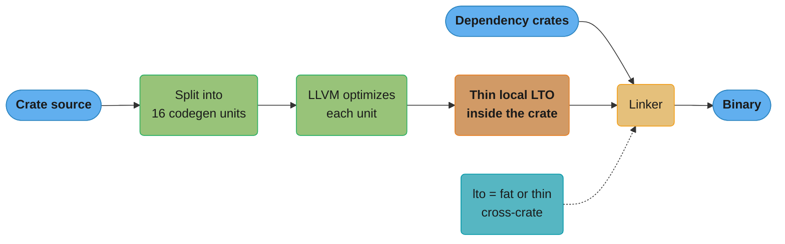

# Performance and Zero-Cost Abstractions

> **Version anchor (checked 2026-11-06):** Rust 1.99.1 (2026-10-15), edition 2024.
> `hint::black_box` [1.66], safe `#[target_feature]` functions [1.86], safe architecture
> intrinsics [1.87], `hint::cold_path` [1.95], `algebraic_*` float methods [1.98].
> Portable SIMD (`std::simd`) is not stable as of 1.99.1. Crates: mimalloc 0.1.52,
> tikv-jemallocator 0.7.0, bumpalo 3.20.3, smallvec 1.16.4, hashbrown 0.17.1,
> cargo-bloat 0.12.1, cargo-llvm-lines 0.4.48.

## 1. Concept Overview

"Zero-cost abstraction" is the C++ zero-overhead principle applied to Rust. It has two
halves. What you do not use, you do not pay for. What you do use, you could not write
better by hand. An iterator chain, a closure passed to a generic function, a newtype around
a `u64` and an `Option<&T>` all compile to the same machine code as the hand-written loop,
the direct call, the bare integer and the nullable pointer.

The promise is narrow, and most performance mistakes in Rust come from reading it too
widely. It is a promise about the optimized build of code that does the same work. It does
not say that debug builds are fast, that a `Vec` never allocates, that bounds checks
disappear, that generic code is small, or that the compiler picks a good algorithm. A
`clone()` in a loop is a real allocation. An `Arc::clone` is a real atomic increment on a
shared cache line. A `HashMap` with the default SipHash hasher pays for DoS resistance on
every lookup. None of these are abstraction overhead. They are work that you asked for.

This module covers the levers that a Rust engineer controls after the algorithm is right:

- What the optimizer removes (iterator fusion, bounds-check elimination, inlining).
- The build profile (`opt-level`, `codegen-units`, LTO, `panic`, PGO and BOLT,
  `target-cpu`).
- Allocation discipline (`with_capacity`, buffer reuse, `SmallVec`, arenas, the global
  allocator).
- Data layout (`size_of`, niches, large enum variants, field order).
- SIMD on stable through `std::arch`, plus `cold_path` and the `algebraic_*` float methods.
- Binary size.

Measurement lives in [Profiling and Benchmarking](../profiling_and_benchmarking/profiling_and_benchmarking.md).
The cost of generics against `dyn` and the dispatch decision live in
[Monomorphization, Vtables and Dispatch Cost](../traits_generics_and_trait_objects/monomorphization_vtables_and_dispatch_cost.md).
The order in which you investigate a slow service is in
[Performance Engineering Method](../../backend/performance_engineering_method/performance_engineering_method.md),
and cache lines, false sharing and the memory hierarchy are in
[Computer Architecture and Memory Hierarchy](../../cs_fundamentals/computer_architecture_and_memory_hierarchy/computer_architecture_and_memory_hierarchy.md).

---

## 2. Intuition

> **One-line analogy:** Rust abstractions are scaffolding that the optimizer takes down
> before the building opens. The scaffolding is free. The rooms you asked the builder to
> add are not.

**Mental model:** think of two cost ledgers. The first ledger holds abstraction cost: the
extra work that exists only because you wrote `iter().map().filter()` instead of a loop.
In an optimized Rust build this ledger is almost always empty. The second ledger holds
work cost: allocations, copies, atomic operations, hash computations, bounds checks the
compiler could not prove away, and cache misses from a bad layout. Every line on the second
ledger is real, and the type system makes most of them visible in the source (`clone`,
`Box::new`, `Arc`, `collect`). Performance work in Rust is almost entirely work on the
second ledger.

**Why it matters:** teams that adopt Rust for speed often get a first version that is
slower than the Go or Java service it replaced. The cause is rarely the language. It is a
`String` allocated per request field, a `Vec` that grows from zero on every call, an
`Arc<Mutex<HashMap>>` that 32 cores fight over, or a benchmark run from a debug build.
Each of these is visible in the code once you know where to look.

**Key insight:** the optimizer removes abstraction, not work. Your job is to make the work
visible, then delete it or move it out of the hot path. The build profile and the
allocator come last. Allocation, layout and contention come first, and they usually hold
the larger wins.

---

## 3. Core Principles

1. **Zero-cost applies to optimized builds only.** A debug build (`opt-level = 0`) keeps
   every iterator adapter as a real function call, every bounds check and every overflow
   check. Iterator-heavy code can run many times slower in debug. Never measure
   performance in debug.

2. **The optimizer can only remove what it can prove.** A bounds check disappears when
   LLVM can prove the index is in range. An allocation disappears almost never. Write code
   that makes the proof easy: iterate instead of index, slice once before a loop, assert a
   length up front.

3. **Allocation is the default hidden cost.** `String`, `Vec`, `Box`, `format!`,
   `to_string`, `collect` and `clone` on owned data each call the allocator. An allocator
   call costs far more than a write to the stack, and more again when threads contend.
   A hot path that allocates per item is usually the first fix.

4. **Layout is performance.** Size decides how many values fit in a cache line, how much
   a `memcpy` moves when a value is moved, and how big every `Vec<T>` and enum is. Measure
   with `size_of` and lock the budget with a compile-time assert.

5. **Shared mutable state costs even when it is safe.** An `Arc` clone or drop is an
   atomic read-modify-write on a shared counter. A `Mutex` is two atomics and possibly a
   futex syscall. Safe Rust prevents data races. It does not prevent cache-line contention.

6. **Build flags multiply the speed of good code. They do not fix bad code.** Fat LTO,
   `codegen-units = 1` and PGO give gains in percent. The rustc release notes report 10 to
   30 percent for PGO on the compiler itself. No flag fixes an O(n squared) loop or an
   allocation per request.

7. **Portability is part of the contract.** `-C target-cpu=native` and unchecked
   `#[target_feature]` code produce binaries that crash with `SIGILL` on an older CPU.
   Use runtime feature detection, or a known baseline such as `x86-64-v3`, chosen on
   purpose.

8. **Every optimization needs a benchmark that would show it failing.** Use `black_box`,
   a realistic input and a profile that matches production. See
   [Profiling and Benchmarking](../profiling_and_benchmarking/profiling_and_benchmarking.md).

---

## 4. Types / Architectures / Strategies

### 4.1 What compiles away and what does not

| Abstraction | Optimized cost | Why |
|---|---|---|
| Iterator chain (`map`, `filter`, `zip`, `sum`) | Same as a hand loop | Adapters are generic structs. Inlining fuses them into one loop |
| Closure passed to a generic `F: Fn` | Same as inline code | Each closure is its own type, so the call is static and inlinable |
| Newtype (`struct UserId(u64)`) | Zero | Same layout as `u64` |
| `Option<&T>`, `Option<Box<T>>`, `Option<NonNull<T>>` | Zero extra bytes | Documented null-pointer niche |
| `Result<T, E>` with `?` | A branch per `?` | The happy path is a compare and jump |
| `&dyn Trait` call | One indirect call, no inlining | Vtable lookup. See the dispatch sub-file |
| `Rc`/`Arc` clone | Counter increment (atomic for `Arc`) | Real work on shared memory |
| `Box::new`, `Vec::push` past capacity, `String::from` | An allocator call | Real work |
| Indexing `v[i]` | A compare and branch unless proven in range | Panics on out-of-bounds |
| Integer arithmetic | Wrapping in release, checked in debug | `overflow-checks = false` in release by default |

### 4.2 Build-profile levers

Defaults are from the Cargo reference for `[profile.release]`.

| Setting | Release default | Faster setting | What it costs |
|---|---|---|---|
| `opt-level` | `3` | `3` (or `"s"`/`"z"` for size) | Nothing at runtime |
| `codegen-units` | `16` (non-incremental) | `1` | Longer build. No parallel codegen inside the crate |
| `lto` | `false` (thin local LTO inside one crate) | `"thin"` or `"fat"` | Longer link. Fat LTO is single-threaded and slow |
| `panic` | `"unwind"` | `"abort"` | No `catch_unwind`. A panic kills the process |
| `debug` | `false` | Keep `false`, or `"line-tables-only"` for profiles | Larger binary on disk, no runtime cost |
| `incremental` | `false` | `false` | Not relevant to runtime |
| `-C target-cpu` | Generic baseline for the target | `x86-64-v3` or `native` | Binary may not run on older CPUs |
| PGO (`-Cprofile-generate`/`-Cprofile-use`) | Off | On | A two-stage build and a representative workload |

### 4.3 Allocation strategies

| Strategy | Tool | Use when | Watch for |
|---|---|---|---|
| Presize | `Vec::with_capacity`, `String::with_capacity`, `HashMap::with_capacity` | You know or can bound the final size | Over-allocation on a bad estimate |
| Reuse | `clear()` and keep the buffer | One buffer per loop iteration or per connection | Memory held at the high-water mark |
| Inline small | `SmallVec<[T; N]>` | Most collections have N items or fewer | A bigger value. Each move copies N slots |
| Arena | `bumpalo::Bump` | Many short-lived objects with one lifetime (a request, a parse) | No per-object `Drop` |
| Index handles | `slotmap`, plain `Vec` plus `usize` | Graphs and caches with churn | Stale-index bugs need generation counters |
| Borrow | `&str`, `&[u8]`, `Cow<str>` | Parsing and routing without copies | Lifetimes reach into the API |
| Swap allocator | `mimalloc`, `tikv-jemallocator` | Many threads allocating, or musl targets | RSS and fragmentation behavior change |

### 4.4 SIMD options on stable Rust 1.99.1

| Option | Status | Portable? | Effort |
|---|---|---|---|
| Autovectorization | Stable, automatic | Yes | Write simple loops over slices. Check the assembly |
| `std::arch` intrinsics | Stable. Safe to call inside a matching `#[target_feature]` function [1.87] | No, one ISA per module | High |
| `#[target_feature(enable = "...")]` plus runtime detection | Stable. Safe functions [1.86] | Yes, with dispatch | Medium |
| `std::simd` (portable SIMD) | Not stable as of 1.99.1 | Yes | Nightly only |
| Crates with SIMD inside (`memchr`, `simd-json`, `sonic-rs`) | Stable | Depends on the crate | Low |

---

## 5. Architecture Diagrams

### 5.1 Where performance comes from, in the order to try it


The left boxes usually give the largest wins. Build flags and SIMD come last because they
multiply the speed of code that is already right. The dotted edge is the loop back to
measurement after every change.

### 5.2 Layout map: a large enum variant and the boxed fix

Sizes are from `size_of` on a 64-bit target, checked on rustc 1.99.1.

```
enum Msg { Ping, Data([u8; 256]) }          size_of::<Msg>() == 257

 byte 0     1                                                       257
     +-----+--------------------------------------------------------+
Ping | tag | (256 unused bytes, still moved on every copy)          |
     +-----+--------------------------------------------------------+
Data | tag | payload [u8; 256]                                      |
     +-----+--------------------------------------------------------+

enum Small { Ping, Data(Box<[u8; 256]>) }  size_of::<Small>() == 8

 byte 0                    8
     +---------------------+
Ping | 0 (null niche)      |
Data | heap pointer  ------+-----> [u8; 256] on the heap
     +---------------------+
```

Every `Msg` costs 257 bytes, even a `Ping`. A `Vec<Msg>` of 1,000 pings holds 257,000
bytes, and every `send` on a channel moves 257 bytes. Boxing the payload drops the enum to
8 bytes, because the `Box` pointer is never null and `Ping` takes the null value. The cost
moves to one allocation per `Data` message.

### 5.3 What the release profile does to one crate graph



With the default `lto = false`, cross-crate inlining happens only for generic code, for
functions marked `#[inline]` and for small functions that rustc marks inlinable on its own.
`lto = "thin"` or `"fat"` lets LLVM optimize across every crate at link time.

---

## 6. How It Works - Detailed Mechanics

### 6.1 Iterator fusion

An iterator adapter is a struct that wraps the previous iterator. `iter().map(f).sum()` is
a `Sum` over `Map<Iter<'_, u32>, F>`. Each adapter's `next` is a small generic function.
In an optimized build LLVM inlines all of them into one loop, then applies loop
optimizations (unrolling, vectorization) to that loop.

```rust
pub fn sum_squares_loop(xs: &[u32]) -> u64 {
    let mut total = 0u64;
    let mut i = 0;
    while i < xs.len() {
        let x = u64::from(xs[i]);
        total += x * x;
        i += 1;
    }
    total
}

pub fn sum_squares_iter(xs: &[u32]) -> u64 {
    xs.iter().map(|&x| u64::from(x) * u64::from(x)).sum()
}
```

With `opt-level = 3` both functions compile to the same vectorized loop. With
`opt-level = 0` the iterator version makes several real calls per element. Two adapters
break fusion in practice: `chain` (its `next` checks which half it is in on every item,
so prefer `for_each` or `fold` on a chain) and `flat_map` over small inner iterators.
`fold`, `for_each` and `sum` use internal iteration, which gives LLVM a simpler loop than a
`for` loop over the same chain.

`collect()` into a `Vec` reads `size_hint` and allocates once when the source reports an
exact length, as a slice iterator with `map` does. A `filter` makes the length unknown, so
`collect` grows the vector as it goes. When you know an upper bound, `Vec::with_capacity`
plus `extend` does the same job with one allocation.

### 6.2 Bounds-check elimination

Indexing `v[i]` compiles to a compare, a branch to a panic and a load. The branch is cheap
when predicted, but it blocks vectorization, because the loop can exit early in the
middle of a vector lane. LLVM removes the check when it can prove `i < v.len()`.

```rust
// Bounds check on every b[i]: LLVM does not know b.len() >= a.len().
pub fn dot_indexed(a: &[f32], b: &[f32]) -> f32 {
    let mut s = 0.0;
    for i in 0..a.len() {
        s += a[i] * b[i];
    }
    s
}

// No checks: zip stops at the shorter slice.
pub fn dot_zip(a: &[f32], b: &[f32]) -> f32 {
    a.iter().zip(b).map(|(x, y)| x * y).sum()
}

// One check up front, then none in the loop.
pub fn dot_sliced(a: &[f32], b: &[f32]) -> f32 {
    let n = a.len();
    let b = &b[..n];
    let mut s = 0.0;
    for i in 0..n {
        s += a[i] * b[i];
    }
    s
}

// Fixed-width chunks: the compiler knows each chunk has 8 elements.
pub fn sum_chunks(xs: &[u32]) -> u32 {
    let mut lanes = [0u32; 8];
    let chunks = xs.chunks_exact(8);
    let tail: u32 = chunks.remainder().iter().sum();
    for c in chunks {
        for (l, x) in lanes.iter_mut().zip(c) {
            *l = l.wrapping_add(*x);
        }
    }
    lanes.iter().fold(tail, |acc, l| acc.wrapping_add(*l))
}
```

`dot_sliced` shows the general trick: a single `&b[..n]` or `assert!(b.len() >= n)` before
the loop gives LLVM the fact it needs. `get_unchecked` removes the check by force, but it
is `unsafe` and turns a wrong index into undefined behavior. Use it only after the safe
forms fail and a profile proves the check matters.

The float sums in `dot_zip` and `dot_sliced` still do not vectorize well, because float
addition is not associative and LLVM must keep the order. Section 6.9 covers that.

### 6.3 Inlining across crates

Inlining is the optimization that makes every other one possible. rustc compiles each
crate separately, so the question is whether the caller crate can see the callee's body.

| Function kind | Body visible to a downstream crate? |
|---|---|
| Generic function or method | Yes. It is instantiated in the caller crate |
| Function marked `#[inline]` | Yes. The body is shipped in the crate metadata |
| Small leaf function, not generic, not marked | Often. Since 1.75 rustc marks small functions cross-crate inlinable on its own |
| Any other non-generic function | No, unless `lto = "thin"` or `"fat"` |

`#[inline]` is a hint and a visibility switch. It does not force inlining.
`#[inline(always)]` is a stronger hint that LLVM still ignores in some cases (recursion,
some indirect calls). `#[inline(never)]` keeps a function out of line, which is useful for
cold error paths and for readable profiles.

```rust
pub struct Celsius(pub f64);

impl Celsius {
    #[inline]
    pub fn to_fahrenheit(&self) -> f64 {
        self.0 * 9.0 / 5.0 + 32.0
    }
}

#[inline(never)]
#[cold]
pub fn report_bad_reading(raw: i64) -> String {
    format!("sensor returned {raw}, outside the valid range")
}
```

Put `#[inline]` on small public non-generic functions in a library that callers use in
hot loops: accessors, conversions, short arithmetic. Do not put it on everything. Each
`#[inline]` function is compiled again in every crate that calls it, which costs compile
time and code size.

### 6.4 The release profile

```toml
[profile.release]
codegen-units = 1      # one LLVM module per crate: better optimization, slower build
lto = "fat"            # whole-program optimization at link time
panic = "abort"        # no unwinding tables or landing pads on the panic path

[profile.profiling]
inherits = "release"
debug = "line-tables-only"   # file and line in profiles and backtraces
```

**`codegen-units`.** rustc splits each crate into codegen units and lets LLVM optimize them
in parallel. Code in different units cannot be inlined into each other without LTO. The
release default of 16 is a compile-time tradeoff. `codegen-units = 1` often gives a few
percent on CPU-bound code and makes the release build of a large crate several times
slower.

**`lto`.** The default `false` is "thin local LTO": thin LTO across the codegen units of
one crate. `"thin"` extends it across all crates with parallel, summary-based analysis.
`"fat"` merges everything into one module, which is the most thorough and the slowest. On
most services thin LTO gets most of the gain of fat LTO. Measure both before you pay for
fat.

**`panic = "abort"`.** Unwinding needs landing pads in every function that owns a value
with `Drop`. Abort removes them, which shrinks the binary and gives LLVM simpler control
flow. The runtime gain on the happy path is usually small. The cost is real: no
`catch_unwind`, so a panic in one request kills the process, and a test harness or a
thread pool cannot recover from a panic. Tokio catches a panic in a spawned task only
under `unwind`.

### 6.5 PGO and BOLT

Profile-guided optimization compiles twice. The first build adds counters. You run it on a
representative workload. The second build uses the counts to decide inlining, block
layout and branch weights.

```bash
# Stage 1: instrumented build
RUSTFLAGS="-Cprofile-generate=/tmp/pgo-data" cargo build --release
./target/release/server --replay traffic-sample.log

# Merge the raw profiles (llvm-profdata ships in the llvm-tools rustup component)
llvm-profdata merge -o /tmp/pgo-data/merged.profdata /tmp/pgo-data

# Stage 2: optimized build
RUSTFLAGS="-Cprofile-use=/tmp/pgo-data/merged.profdata" cargo build --release
```

The Rust compiler itself is built this way. The release notes record PGO for the Windows
x64 compiler in 1.64 with a 10 to 20 percent compiler speedup, BOLT on
`librustc_driver.so` in 1.75, and ThinLTO plus PGO for the AArch64 Linux compiler in 1.86,
described as up to 30 percent faster. BOLT is a post-link optimizer that reorders machine
code by the profile. The `cargo-pgo` tool wraps both stages and the BOLT step.

The workload is the risk. A profile from a synthetic benchmark teaches the compiler the
wrong hot paths. Use replayed production traffic, rebuild the profile when the code
changes much, and keep a non-PGO build in CI to compare.

### 6.6 `target-cpu` and runtime feature detection

The default x86_64 target assumes the x86-64 baseline, where SSE2 is the widest SIMD.
`-C target-cpu=native` lets LLVM use every
instruction the build machine has, including AVX2 and AVX-512. The binary then crashes
with `SIGILL` on a production host with an older CPU. A CI runner is often newer than the
oldest node in the fleet.

Two safe patterns exist. Pick a documented baseline and enforce it in the fleet.
`-C target-cpu=x86-64-v3` is the x86-64-v2 set plus AVX, AVX2, BMI1, BMI2, F16C, FMA, LZCNT,
MOVBE and XSAVE. Or compile one hot function for several feature
sets and choose at runtime:

```rust
pub fn sum(xs: &[f32]) -> f32 {
    #[cfg(target_arch = "x86_64")]
    {
        if std::arch::is_x86_feature_detected!("avx2") {
            // SAFETY: the runtime check above proves this CPU supports AVX2.
            return unsafe { sum_avx2(xs) };
        }
    }
    sum_scalar(xs)
}

#[cfg(target_arch = "x86_64")]
#[target_feature(enable = "avx2")]
fn sum_avx2(xs: &[f32]) -> f32 {
    sum_scalar(xs)
}

fn sum_scalar(xs: &[f32]) -> f32 {
    xs.iter().copied().fold(0.0, f32::algebraic_add)
}
```

Since 1.86 a `#[target_feature]` function can be a safe `fn`. Calling it from a function
that does not enable the same feature still needs `unsafe`, because the caller must prove
the CPU has the feature. `sum_avx2` gets the AVX2 code because LLVM inlines `sum_scalar`
into it and compiles that copy with AVX2 enabled.

### 6.7 Allocation discipline

```rust
use std::fmt::Write;

pub struct Encoder {
    buf: String,
}

impl Encoder {
    pub fn new() -> Self {
        Self {
            buf: String::with_capacity(4096),
        }
    }

    // One allocation for the life of the encoder, not one per call.
    pub fn encode(&mut self, id: u64, name: &str) -> &str {
        self.buf.clear();
        let _ = write!(self.buf, "{{\"id\":{id},\"name\":\"{name}\"}}");
        &self.buf
    }
}

impl Default for Encoder {
    fn default() -> Self {
        Self::new()
    }
}

pub fn lengths(words: &[&str]) -> Vec<usize> {
    let mut out = Vec::with_capacity(words.len());
    out.extend(words.iter().map(|w| w.len()));
    out
}
```

`Vec::push` is amortized O(1), which the docs promise. The growth factor is not promised.
The current implementation doubles capacity, so a `Vec<u64>` that grows to 1,000,000
elements from empty reallocates about 18 times and copies about 1,000,000 elements in total
(fewer when `realloc` grows the block in place). `with_capacity` makes that one allocation
and no copies.

`SmallVec<[T; N]>` stores up to N items inline and spills to the heap after that. It wins
when nearly every instance stays small (a list of 1 to 4 tags, the arguments of a call) and
loses when instances often spill, because then you pay the inline space and the heap.
`bumpalo::Bump` gives each request or parse its own arena: allocation is a pointer bump and
the whole arena frees at once. Objects in a bump arena do not run `Drop`, so keep
`Drop`-dependent types such as file handles out of it.

**The global allocator.** The default on Linux glibc targets is the system `malloc`. Two
common replacements:

```rust
// fragment
use mimalloc::MiMalloc;

#[global_allocator]
static GLOBAL: MiMalloc = MiMalloc;
```

`tikv-jemallocator` has the same shape. Swap allocators for measured reasons: many threads
that allocate at once, a musl static build where a benchmark shows musl's built-in
allocator losing under your thread count, or a need for jemalloc's heap profiler. The change also moves RSS and
fragmentation, which [Memory Budgets Without a GC](../case_studies/cross_cutting/memory_budgets_without_a_gc.md)
covers.

### 6.8 Layout, niches and enum size

Rust's default `repr(Rust)` lets the compiler reorder struct fields to cut padding. It also
uses invalid bit patterns (niches) to store an enum tag for free. `#[repr(C)]` turns both
off and keeps declaration order, which you need for FFI and lose for size.

```rust
use std::mem::size_of;

pub struct Mixed {
    pub a: u8,
    pub b: u64,
    pub c: u8,
}

#[repr(C)]
pub struct MixedC {
    pub a: u8,
    pub b: u64,
    pub c: u8,
}

pub enum Big {
    Ping,
    Data([u8; 256]),
}

pub enum Boxed {
    Ping,
    Data(Box<[u8; 256]>),
}

#[cfg(target_pointer_width = "64")]
const _: () = {
    assert!(size_of::<Mixed>() == 16); // fields reordered: b, a, c, padding
    assert!(size_of::<MixedC>() == 24); // 1 + 7 padding + 8 + 1 + 7 padding
    assert!(size_of::<String>() == 24);
    assert!(size_of::<&str>() == 16);
    assert!(size_of::<Option<Box<u8>>>() == 8); // documented null-pointer niche
    assert!(size_of::<Option<String>>() == 24); // niche inside String
    assert!(size_of::<Option<u64>>() == 16); // no niche in u64
    assert!(size_of::<Big>() == 257);
    assert!(size_of::<Boxed>() == 8);
};
```

The sizes for `String`, `&str` and `Option<String>` are implementation facts on 64-bit
targets. Only the null-pointer niche for `Option<&T>`, `Option<Box<T>>` and
`Option<NonNull<T>>` is documented. That is why the asserts sit behind a pointer-width
`cfg` and run at compile time.

Clippy's `large_enum_variant` lint fires when the largest variant is more than 200 bytes
larger than the second largest (the `enum-variant-size-threshold` setting, default 200).
Fix it by boxing the large payload, as section 5.2 shows.

For data shared across threads, `#[repr(align(64))]` (or `crossbeam_utils::CachePadded`)
puts each hot counter on its own cache line. The theory of false sharing is in
[Computer Architecture and Memory Hierarchy](../../cs_fundamentals/computer_architecture_and_memory_hierarchy/computer_architecture_and_memory_hierarchy.md).

### 6.9 `cold_path` and the `algebraic_*` float methods

`std::hint::cold_path()` [1.95] marks the branch that calls it as unlikely. LLVM moves that
code out of the hot instruction stream and lays out the likely branch as the fall-through.

```rust
use std::hint::cold_path;

pub fn parse_port(s: &str) -> Option<u16> {
    match s.parse::<u16>() {
        Ok(p) if p != 0 => Some(p),
        _ => {
            cold_path();
            None
        }
    }
}

pub fn sum_strict(xs: &[f32]) -> f32 {
    xs.iter().sum()
}

pub fn sum_relaxed(xs: &[f32]) -> f32 {
    xs.iter().copied().fold(0.0, f32::algebraic_add)
}
```

`sum_strict` must add in order, because `(a + b) + c` and `a + (b + c)` can round
differently. That ordering forbids LLVM from splitting the sum into SIMD lanes.
`algebraic_add` [1.98] (and `algebraic_sub`, `algebraic_mul`, `algebraic_div`,
`algebraic_rem`) tells the compiler it may reassociate, so `sum_relaxed` can vectorize.
The result can differ in the last bits and can differ between builds. Use these methods for
statistics and ML kernels, not for money or for results that must be bit-for-bit
reproducible.

### 6.10 `Arc` contention

`Arc::clone` is an atomic increment and `drop` is an atomic decrement on the same counter.
On one core this costs a few nanoseconds. When 32 threads clone the same `Arc` per request,
the cache line that holds the counter moves between cores on every operation, and the cost
per operation rises sharply, because each one waits for the line to arrive from another
core.

Ways out, from cheapest:

- Pass `&T` or `&Arc<T>` down the call stack instead of cloning.
- Clone once per task or per connection, not per request.
- Hold a thread-local or per-worker copy (`arc-swap` for config that changes rarely).
- Shard the shared state so that threads touch different cache lines.

The decision between `Mutex`, `RwLock`, sharding, channels and atomics is in
[Channels, Atomics and Shared State](../channels_atomics_and_shared_state/channels_atomics_and_shared_state.md).

### 6.11 Binary size

```toml
[profile.release-small]
inherits = "release"
opt-level = "z"     # optimize for size, may be slower
lto = "fat"
codegen-units = 1
panic = "abort"
strip = true        # same as strip = "symbols"
```

Size comes from four places: monomorphized generics (each `Vec<T>` method once per `T`),
`std` formatting machinery pulled in by `format!` and `{:?}`, unwinding tables and debug
symbols. `cargo bloat --release --crates` shows which crate owns the bytes.
`cargo llvm-lines` shows which generic functions expand the most LLVM IR, which is the
usual source of both size and compile time. The fix for a hot generic is the "inner
non-generic function" pattern, covered in the
[dispatch sub-file](../traits_generics_and_trait_objects/monomorphization_vtables_and_dispatch_cost.md).

---

## 7. Real-World Examples

**The Rust compiler.** rustc is a large Rust program and its release pipeline uses most of
this module. The release notes record PGO for the Windows x64 compiler in 1.64 (10 to 20
percent faster compiles), BOLT for `librustc_driver.so` in 1.75 and ThinLTO plus PGO for
the AArch64 Linux compiler in 1.86 (up to 30 percent faster). The workload for the profile
is a fixed set of real crates, which is the "representative workload" rule in practice.

**`std::collections::HashMap`.** The standard map is a port of the SwissTable design
through the `hashbrown` crate. It probes groups of control bytes with SIMD on supported
targets. The default hasher is SipHash 1-3, chosen for resistance to hash-flooding attacks.
Programs that hash trusted keys (a compiler's symbol table, a parser's interner) swap in
`rustc-hash` or `foldhash` and keep the table.

**`memchr` and ripgrep.** The `memchr` crate has SIMD search routines for x86_64, aarch64
and wasm32. On x86_64 it uses SSE2, and with the `std` feature it detects AVX2 at runtime,
the dispatch pattern in section 6.6. Tools built on it ship one portable binary and still use
AVX2 where the CPU has it.

**Rust-built Python and JavaScript tooling.** uv, ruff, Rolldown, Oxc and Biome are Rust
programs whose speed comes mostly from parallel walks, arena-allocated syntax trees and
string interning, not from build flags. See
[Python packaging and tooling](../../python/packaging_and_project_tooling/packaging_and_project_tooling.md)
and [Modules, Bundling and the Build Pipeline](../../frontend_platform/modules_bundling_and_the_build_pipeline/modules_bundling_and_the_build_pipeline.md).

**Comparison with other runtimes.** Go's escape analysis decides heap or stack for you
([Escape Analysis and Performance](../../go/escape_analysis_and_performance/escape_analysis_and_performance.md)).
The JVM's JIT inlines and devirtualizes at runtime from live profiles
([Java Performance and Tuning](../../java/performance_and_tuning/performance_and_tuning.md)).
Rust makes both decisions ahead of time: the programmer chooses stack or heap in the type,
and PGO is the only way to give the compiler a runtime profile.

---

## 8. Tradeoffs

### 8.1 Build settings

| Setting | Runtime gain | Build-time cost | Other cost |
|---|---|---|---|
| `codegen-units = 1` | Small to moderate | High on large crates | None |
| `lto = "thin"` | Moderate | Moderate, parallel | None |
| `lto = "fat"` | Moderate, sometimes a little more than thin | High, mostly serial | None |
| `panic = "abort"` | Small | None | No recovery from a panic |
| PGO | Moderate on branchy code | Two builds plus a workload run | A stale profile can mislead |
| `target-cpu=x86-64-v3` | Large on SIMD-friendly loops | None | Excludes CPUs without AVX2 |
| `opt-level = "z"` | Negative | None | Smaller binary |

### 8.2 Allocation choices

| Choice | Allocations | Memory held | Code complexity |
|---|---|---|---|
| Fresh `Vec` per call | One or more per call | Low between calls | Lowest |
| `with_capacity` per call | One per call | Low | Low |
| Reused buffer | Amortized zero | High-water mark | Low, but needs `&mut self` |
| `SmallVec` | Zero when small | Inline space in every value | Low |
| Arena per request | One block per request | Whole request | Medium. Lifetimes tie values to the arena |
| Object pool | Amortized zero | Pool size | Medium. Reset bugs leak state |

### 8.3 Speed against safety

| Technique | Speed | Risk |
|---|---|---|
| Iterators and slicing | Same as a hand-written loop | None |
| `get_unchecked` | Removes a branch | Undefined behavior on a wrong index |
| `std::arch` intrinsics with runtime detection | Large on the right loops | One ISA per code path. More tests |
| `algebraic_*` floats | Enables vectorized reductions | Results differ in the last bits |
| `target-cpu=native` | Largest | `SIGILL` on other CPUs |

---

## 9. When to Use / When NOT to Use

**Use these techniques when:**

- A profile from a release build shows the code in question is hot.
- A benchmark with `black_box` and realistic input shows the change matters.
- The service is CPU-bound and adding machines is more expensive than engineering time.
- Allocations show up in a heap profile at a rate of thousands per request.

**Do not use them when:**

- The service waits on a database or the network, and CPU is low. Look at
  [Off-CPU and eBPF Analysis](../../backend/off_cpu_and_ebpf_analysis/off_cpu_and_ebpf_analysis.md)
  first.
- The only evidence is a debug-build timing.
- The change adds `unsafe` for a gain smaller than the benchmark noise.
- `target-cpu=native` is proposed for a binary that ships to machines you do not control.
- `panic = "abort"` is proposed for a server that relies on per-task panic isolation.

---

## 10. Common Pitfalls

The incidents below are composite examples. Their numbers are illustrative.

**Benchmarking a debug build.** A team compared a Rust prototype with the Go service it
would replace by running `cargo run` against a load generator. Rust lost by a factor of 8.
`cargo run --release` reversed the result. Debug builds keep every iterator call and every
overflow check. Every performance number comes from `--release` or a profile that inherits
from it.

**`target-cpu=native` in CI.** A team added `-C target-cpu=native` to `.cargo/config.toml`.
CI ran on new cloud instances with AVX-512. The canary deploy went to older hosts and every
process died with `SIGILL` (illegal instruction) at startup. Fix: a named baseline such as
`x86-64-v3` that matches the oldest host, or runtime dispatch.

**One allocation per field.** A log parser returned `struct Event { host: String, path:
String, agent: String, ... }` with 12 owned strings per line. At 400,000 lines per second
that is 4.8 million `malloc` calls per second, and the allocator was the top frame in the
profile. Fix: `Event<'a>` that borrows `&'a str` slices from the input line, and an owned
copy only for the few events that outlive the buffer.

**Cloning an `Arc` per request.** A router cloned an `Arc<Config>` into every request
handler. At 32 cores the atomic increment on the shared counter became the hottest
instruction in the profile. Fix: pass `&Config` through the handler chain and clone once
per connection.

**Swapping `Arc` for `Rc` to save the atomics.** The same router team tried to remove the
atomic cost by switching to `Rc`. The compiler rejected it, and it was right to:

```rust
// BROKEN
use std::rc::Rc;
use std::thread;

pub fn spawn_workers(config: Rc<String>) {
    for _ in 0..4 {
        let c = Rc::clone(&config);
        // error[E0277]: `Rc<String>` cannot be sent between threads safely
        thread::spawn(move || c.len());
    }
}
```

`Rc` uses a non-atomic counter, so two threads that clone it at once would corrupt the
count. The real fix keeps `Arc` and moves the clone out of the hot path:

```rust
// FIX
use std::sync::Arc;
use std::thread;

pub fn spawn_workers(config: Arc<String>) -> usize {
    let handles: Vec<_> = (0..4)
        .map(|_| {
            let c = Arc::clone(&config); // one clone per worker, not per request
            thread::spawn(move || {
                let mut total = 0;
                for _ in 0..1_000 {
                    total += c.len(); // borrows through the Arc, no counter traffic
                }
                total
            })
        })
        .collect();
    handles.into_iter().map(|h| h.join().unwrap_or(0)).sum()
}
```

**`panic = "abort"` with a task-isolation design.** A team set `panic = "abort"` to shrink
the binary. A bug that panicked in one Tokio task for one malformed request had always
been caught by the runtime and logged. After the change it killed the whole process and
every in-flight request with it. Abort and per-task isolation do not mix.

**Float sums that differ between builds.** A team switched a metrics reducer to
`algebraic_add` for speed. A unit test that compared a sum with an exact expected value
began to fail on one CI target and pass on another. Algebraic float operations allow the
compiler to reorder, so compare with a tolerance or keep strict addition.

---

## 11. Technologies & Tools

| Tool | What it is for |
|---|---|
| cargo-bloat | Shows which crates and functions take space in the binary |
| cargo-llvm-lines | Counts LLVM IR lines per generic function, the main cause of code bloat and slow builds |
| cargo-pgo | Wraps the PGO and BOLT build stages |
| llvm-profdata | Merges raw PGO profiles. Ships in the `llvm-tools` rustup component |
| mimalloc | Microsoft's allocator as a Rust global allocator |
| tikv-jemallocator | jemalloc as a Rust global allocator, with an optional heap profiler |
| bumpalo | Bump arena for many short-lived allocations |
| smallvec | Vector that stores the first N items inline |
| hashbrown | The SwissTable map that backs `std::collections::HashMap` |
| rustc-hash | Fast non-DoS-resistant hasher for trusted keys |
| foldhash | Fast hasher with some DoS resistance |
| Compiler Explorer | Shows the assembly rustc emits for a snippet, to check vectorization and bounds checks |
| cargo-show-asm | Prints the assembly or LLVM IR for one function in your crate |
| Clippy | `large_enum_variant`, `box_collection`, `redundant_clone` and other performance lints |

---

## 12. Interview Questions with Answers

**Q: Does "zero-cost abstraction" mean Rust code is fast in a debug build?**
**Short:** No. The promise holds only after optimization. A debug build keeps every iterator adapter call, bounds check and overflow check, so it can run many times slower.

The zero-overhead principle says an abstraction costs nothing more than the hand-written
equivalent once the optimizer has run. With `opt-level = 0` nothing is inlined, so
`iter().map().sum()` makes several real function calls per element, and integer overflow
checks are on. Teams that compare a `cargo run` build with a production Go or Java service
reach the wrong conclusion. Benchmark only `--release` or a custom profile that inherits
from it. If debug speed matters for development, set `opt-level = 1` for the dev profile
or `opt-level = 3` for dependencies only with `[profile.dev.package."*"]`.

**Q: Why can `for i in 0..v.len() { total += v[i] }` be slower than `v.iter().sum()`?**
**Short:** Each `v[i]` keeps a bounds check unless LLVM can prove the index is in range, and the check blocks vectorization. The iterator form has no index, so it has no check.

Indexing compiles to a compare, a branch to a panic and a load. In a simple loop over
`0..v.len()` LLVM usually proves the range and removes the check. It fails when two slices
are indexed by the same `i`, when the length is read from another value, or when the loop
body is complex. A remaining check stops vectorization, because the loop may exit in the
middle of a SIMD lane. Fix it with `zip`, `chunks_exact`, or a single reslice such as
`let b = &b[..a.len()];` before the loop. Use `get_unchecked` only as a last step, with a
`// SAFETY:` comment and a benchmark that proves the gain.

**Q: Does `#[inline]` force the compiler to inline a function?**
**Short:** No. It is a hint plus a visibility switch: it ships the body in the crate metadata so other crates can inline it. LLVM still decides whether to inline.

Without LTO, rustc compiles each crate separately. A downstream crate can inline a
function only if it sees the body. Generic functions are always visible because they are
instantiated in the caller crate. Non-generic functions are visible when marked
`#[inline]`, and since 1.75 rustc also marks small leaf functions inlinable across crates
on its own. `#[inline(always)]` is a stronger hint, `#[inline(never)]` keeps a function
out of line. Put `#[inline]` on small public non-generic functions that callers use in hot
loops. Do not put it everywhere, because each marked function is compiled again in every
crate that calls it.

**Q: Should a team set `-C target-cpu=native` for release builds?**
**Short:** Only if the binary runs on the exact CPU type that built it. Otherwise it can use instructions such as AVX-512 that the production host lacks, and the process dies with SIGILL.

`native` tells LLVM to use every instruction the build machine supports. CI runners are
often newer than the oldest production hosts, so the binary passes CI and crashes at
startup on the fleet. Pick a named baseline instead, such as `-C target-cpu=x86-64-v3`
(AVX, AVX2, BMI1, BMI2, FMA and others on top of v2), and make sure every host meets it. For a library or a binary that ships
to unknown machines, keep the default target and dispatch the hot function at runtime with
`is_x86_feature_detected!` and a `#[target_feature]` function.

**Q: Why can cloning an `Arc` in a hot path be slow on a many-core machine?**
**Short:** Each clone and drop is an atomic operation on one shared counter, so the counter's cache line moves between cores on every call and the cost grows with the number of cores.

On one core an `Arc::clone` costs a few nanoseconds. When 32 threads clone the same `Arc`
per request, each atomic read-modify-write needs exclusive ownership of the cache line,
so the line moves from core to core. The cost per operation rises by one or two orders of
magnitude and shows up as the hottest instruction in a profile. Pass `&T` or `&Arc<T>`
down the stack, clone once per connection or per task, or keep a per-worker copy. Safe
Rust stops data races. It does not stop this kind of contention.

**Q: What is the difference between `lto = false`, `"thin"` and `"fat"` in Cargo?**
**Short:** `false` is thin LTO across one crate's codegen units only. `"thin"` runs a parallel summary-based LTO across all crates. `"fat"` merges everything into one module for the most thorough and slowest pass.

The release default `lto = false` gives "thin local LTO", which helps inside one crate but
does not inline a non-generic function from a dependency. `lto = "thin"` builds a summary
of every module and imports the functions worth inlining, in parallel. `lto = "fat"` (or
`true`) merges all LLVM modules and optimizes them as one, mostly on one thread. `"off"`
disables LTO completely. On most services thin LTO gets most of the gain at a fraction of
the link time. Measure both on a benchmark before you accept a much slower release build.

**Q: Why does `codegen-units = 1` often make code faster and the build slower?**
**Short:** rustc splits a crate into codegen units that LLVM optimizes in parallel, and code in one unit cannot be inlined into another. One unit gives full visibility and no parallel codegen.

The release default is 16 units for non-incremental builds, and the dev default is 256.
Splitting lets LLVM use many cores, but each unit is optimized on its own, so a hot call
between units stays a call. With one unit, LLVM sees the whole crate. The gain is usually a
few percent on CPU-bound code, and the release build of a large crate can take several
times longer. Use it for the final production artifact, not for every CI build.

**Q: What is profile-guided optimization and how do you apply it to a Rust binary?**
**Short:** PGO builds an instrumented binary, runs it on a real workload, then rebuilds with the recorded counts so LLVM can tune inlining, block layout and branch weights.

Stage one sets `-Cprofile-generate=/dir` and runs the binary on replayed traffic or a
representative job. `llvm-profdata merge` from the `llvm-tools` component combines the raw
files. Stage two sets `-Cprofile-use=/dir/merged.profdata`. BOLT can then reorder the
linked machine code by the profile. The Rust compiler uses this pipeline itself: the
release notes describe ThinLTO plus PGO for the AArch64 Linux compiler in 1.86 as up to 30
percent faster. The main risk is a workload that does not match production, which trains
the compiler on the wrong hot paths.

**Q: Does `panic = "abort"` make a Rust service faster, and what does it cost?**
**Short:** It removes unwinding landing pads, which shrinks the binary and simplifies control flow, but the runtime gain is usually small and a panic then kills the whole process.

With `unwind`, every function that owns a value with `Drop` needs a landing pad to run
destructors during a panic. Abort removes them and the unwinding tables. The happy path
rarely gets much faster, because landing pads sit off the hot path. The cost is behavioral:
`catch_unwind` stops working, a Tokio task panic no longer stays inside the task, and a
thread pool cannot recover a worker. Use abort for small CLIs, embedded targets and
processes that a supervisor restarts. Keep unwind for servers that rely on per-request
isolation.

**Q: Why is `Vec::with_capacity` a performance tool, and what growth factor does `Vec` promise?**
**Short:** It replaces repeated reallocate-and-copy steps with one allocation. `Vec` promises amortized O(1) push but not a growth factor. The current implementation doubles.

A `Vec<u64>` that grows from empty to 1,000,000 elements reallocates about 18 times with
doubling and copies about 1,000,000 elements in total. With `with_capacity(1_000_000)` it
allocates once and copies nothing. The documentation promises only amortized constant
time for `push`, so do not write code that depends on the exact capacity after a push. For
a collection that is filled and emptied in a loop, call `clear()` and keep the buffer
instead of making a new one.

**Q: When does `SmallVec` help, and when does it hurt?**
**Short:** It helps when almost every instance holds N items or fewer, because those never touch the heap. It hurts when many instances spill, because each value then carries unused inline space too.

`SmallVec<[T; N]>` stores up to N items inside the value and moves to a heap buffer after
that. A list of 1 to 4 tags per event or the arguments to a call fit well. The tradeoffs
are a larger value (every move copies the inline slots), an extra branch on access to check
inline or heap, and no gain at all when the typical size exceeds N. Size N from a histogram
of real data, not a guess, and compare with plain `Vec::with_capacity` in a benchmark.

**Q: Should a Rust service replace the default global allocator?**
**Short:** Only when a profile shows allocator time or contention, which musl static builds often show under many threads. mimalloc and jemalloc change speed, RSS and fragmentation together.

The default on glibc is the system `malloc`, which is adequate for many services.
Replacements are one `#[global_allocator]` static: `mimalloc::MiMalloc` or
`tikv_jemallocator::Jemalloc`. They often help programs where many threads allocate at
once, and static musl builds, where teams often measure musl's built-in allocator as the
bottleneck. They also
change memory behavior: arena counts, how fast memory returns to the OS, and RSS. Measure
throughput and RSS together on a production-like load before you switch.

**Q: Why is a large enum variant a performance problem, and what does Clippy check?**
**Short:** An enum is as big as its largest variant, so every small variant also costs that many bytes on each move and in each collection. Clippy flags a gap over 200 bytes by default.

`enum Msg { Ping, Data([u8; 256]) }` is 257 bytes, so a `Ping` moved through a channel
copies 257 bytes and a `Vec<Msg>` stores 257 bytes per ping. Clippy's `large_enum_variant`
compares the largest and second-largest variants against the
`enum-variant-size-threshold` setting, which defaults to 200 bytes. The fix is to box the
large payload. `Data(Box<[u8; 256]>)` makes the enum 8 bytes on a 64-bit target, because
`Ping` uses the null niche of the box pointer. The large case then costs one allocation.

**Q: Does Rust reorder struct fields, and when do you stop it?**
**Short:** Yes. The default repr lets the compiler reorder fields to reduce padding. `#[repr(C)]` keeps declaration order, which FFI needs, and often makes the struct larger.

`struct Mixed { a: u8, b: u64, c: u8 }` is 16 bytes on a 64-bit target because the
compiler places `b` first. The same struct with `#[repr(C)]` is 24 bytes: 1 byte, 7 bytes
of padding, 8 bytes, 1 byte and 7 more bytes of padding. Use `repr(C)` for types that cross
an FFI boundary or that are read from bytes. Use `repr(transparent)` for a newtype that must
have the same ABI as its field. Leave everything else on the default and check sizes with
`size_of` asserts.

**Q: How do you use SIMD on stable Rust 1.99.1?**
**Short:** Write simple loops for autovectorization, call `std::arch` intrinsics inside `#[target_feature]` functions with runtime detection, or use a crate that does this. Portable `std::simd` is still nightly.

Autovectorization covers many loops over slices if bounds checks are gone and float order
does not block it. For explicit SIMD, `std::arch::x86_64` and `std::arch::aarch64` expose
the vendor intrinsics. Since 1.87 many of them are safe to call inside a function that
enables the matching feature, and since 1.86 such a function can itself be safe. A caller
without the feature still needs an `unsafe` block, justified by `is_x86_feature_detected!`.
`std::simd` is not stable as of 1.99.1, so production code on stable uses `std::arch` or
crates such as `memchr` and `simd-json`.

**Q: What does `std::hint::cold_path` do?**
**Short:** Called inside a branch, it tells the compiler that the branch is unlikely, so LLVM moves that code out of the hot path and lays out the likely branch as the fall-through.

It was stabilized in 1.95 and replaces the old trick of calling a `#[cold]` function just
to mark a branch. Put it at the start of an error branch, a cache miss path or a slow
fallback. It does not change behavior, only code layout and branch weights. Use it on paths
a profile shows are rare. Marking a branch cold that is actually common makes the code
slower.

**Q: Why doesn't LLVM vectorize a plain float sum, and what do the `algebraic_*` methods change?**
**Short:** Float addition is not associative, so LLVM must keep the source order, which forbids splitting the sum into SIMD lanes. `algebraic_add` and its siblings allow reordering.

`xs.iter().sum::<f32>()` must compute `((x0 + x1) + x2) + ...` exactly, because a
different order can round to a different result. The `algebraic_*` methods stabilized in
1.98 (`algebraic_add`, `algebraic_sub`, `algebraic_mul`, `algebraic_div`,
`algebraic_rem`) permit reassociation and similar transforms, so
`fold(0.0, f32::algebraic_add)` can use several accumulators in parallel. The result may
differ in the last bits and may differ between compiler versions or targets. Use them for
statistics and ML kernels and keep strict arithmetic where results must be reproducible.

**Q: How do you make a Rust binary smaller?**
**Short:** Use `opt-level = "z"`, fat LTO, one codegen unit, `panic = "abort"` and `strip = true`, then find the remaining bytes with cargo-bloat and the generic bloat with cargo-llvm-lines.

The default release profile keeps symbols. Since 1.77 Cargo strips only debuginfo from a
profile that requests none. Stripping symbols often removes a large share of the file. `panic = "abort"` drops unwinding tables. `opt-level =
"z"` prefers smaller code over faster code, so measure speed after the change. The remaining
bytes are usually monomorphized generics and formatting code. `cargo bloat --crates`
shows which dependency to question, and `cargo llvm-lines` shows which generic function to
split into a thin generic wrapper and a non-generic inner function.

**Q: Why do generics make binaries bigger, and when does `dyn` cost less overall?**
**Short:** Each concrete type creates its own copy of a generic function. `dyn` keeps one copy and pays an indirect call per use, which is cheaper in size and build time when the call is not hot.

Monomorphization gives static dispatch and full inlining, which is why iterator chains
are free. The cost is one instantiation per type set, so a generic function used with 30
types exists 30 times in the binary and is optimized 30 times during the build. `dyn
Trait` has one body and a vtable call that blocks inlining. Use generics on hot inner loops
and `dyn` at coarse boundaries such as plugin calls or per-request handlers. The full
decision with code-size and call-cost numbers is in the
[dispatch sub-file](../traits_generics_and_trait_objects/monomorphization_vtables_and_dispatch_cost.md).

**Q: What does `Option<&T>` cost compared with a raw nullable pointer?**
**Short:** Nothing extra. A reference can never be null, so the compiler stores `None` as the null value and `Option<&T>` has the same size as `&T`, 8 bytes on a 64-bit target.

This "null-pointer niche" is documented for `Option<&T>`, `Option<&mut T>`,
`Option<Box<T>>` and `Option<NonNull<T>>`, which is why FFI code can use them where C uses a
nullable pointer. The compiler applies the same idea to other invalid bit patterns as an
implementation detail: `Option<String>` is 24 bytes, like `String`, while `Option<u64>` is
16 bytes because every `u64` bit pattern is valid. Check such sizes with `size_of`, and
use a documented niche when the layout is part of an interface.

---

## 13. Best Practices

1. Profile first, in a release build with line tables. Fix the top frame, not the one you
   suspect.
2. Keep a `[profile.profiling]` that inherits from release and adds
   `debug = "line-tables-only"`.
3. Remove per-item allocations before you touch build flags: borrow input, presize with
   `with_capacity`, reuse buffers with `clear()`.
4. Prefer iterators, `zip` and `chunks_exact` over index loops. Reslice once before a loop
   that indexes.
5. Put compile-time `size_of` asserts on types that sit in hot collections or channels.
   Box large enum payloads.
6. Pass `&T` instead of cloning `Arc<T>` in hot paths. Clone once per task or connection.
7. Use `lto = "thin"` by default for production artifacts. Move to `"fat"` and
   `codegen-units = 1` only with a benchmark that shows the gain.
8. Never ship `target-cpu=native`. Choose a named baseline or dispatch at runtime.
9. Keep `panic = "unwind"` in servers that isolate failures per task.
10. Mark small public non-generic library functions `#[inline]`. Leave the rest to the
    compiler.
11. Use `algebraic_*` float methods only where the last bits do not matter, and test with a
    tolerance.
12. Run `cargo bloat` and `cargo llvm-lines` in CI for binaries with a size or build-time
    budget.

---

## 14. Case Study

**Scenario (illustrative).** A market-data gateway decodes exchange messages and sends them to 16 worker
threads through bounded channels at 2 million messages per second. 98 percent of messages
are small `Quote` updates. 2 percent are `Snapshot` messages with a 512-byte order book
fragment. A profile shows 30 percent of CPU in `memcpy`, called from channel send and
receive.

**Diagnosis.** The message enum carries the snapshot payload inline:

```rust
// BROKEN
use std::mem::size_of;

pub struct Quote {
    pub instrument: u32,
    pub bid: i64,
    pub ask: i64,
}

pub enum Event {
    Quote(Quote),
    Snapshot([u8; 512]),
}

// error[E0080]: evaluation panicked: Event exceeds the 64-byte channel budget
const _: () = assert!(size_of::<Event>() <= 64, "Event exceeds the 64-byte channel budget");
```

Every `Event`, including each `Quote`, is 520 bytes on a 64-bit target. Each channel hop copies the
whole value twice (into the slot and out of it), so 2 million messages per second move more
than 2 GB per second through `memcpy`. The team adds the compile-time budget assert shown
above, and the build fails at once with the size in the error.

**Fix.** Box the rare large payload. The quote path stays allocation-free, and the assert
keeps the budget from regressing:

```rust
// FIX
use std::mem::size_of;

pub struct Quote {
    pub instrument: u32,
    pub bid: i64,
    pub ask: i64,
}

pub enum Event {
    Quote(Quote),
    Snapshot(Box<[u8; 512]>),
}

#[cfg(target_pointer_width = "64")]
const _: () = assert!(size_of::<Event>() <= 64, "Event exceeds the 64-byte channel budget");

pub fn decode_snapshot(raw: &[u8; 512]) -> Event {
    Event::Snapshot(Box::new(*raw))
}
```

**Result.** `Event` falls from 520 bytes to 32 bytes on a 64-bit target. The
snapshot path pays one allocation per message, which is 40,000 allocations per second at 2
percent of traffic. The `memcpy` share of the profile drops below the noise floor, and the
assert fails any future change that grows the enum past one cache line. The team then
measured `lto = "thin"` against the default and kept it for a further small gain, in that
order: layout first, build flags second.

**Lessons.**

- Measure the size of every type that moves through a channel or sits in a large
  collection.
- A compile-time assert turns a layout budget into a build failure with a clear message.
- Box the rare large variant. Do not box the common small one.
- Build flags come after layout and allocation, not before.

Related: [Profiling and Benchmarking](../profiling_and_benchmarking/profiling_and_benchmarking.md)
for how the `memcpy` hotspot was found, and
[Collections and Strings](../collections_and_strings/collections_and_strings.md) for
`Vec` and `String` capacity behavior.
