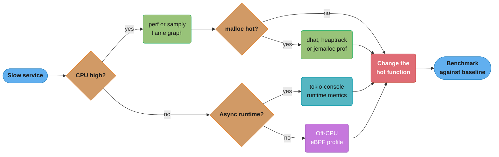
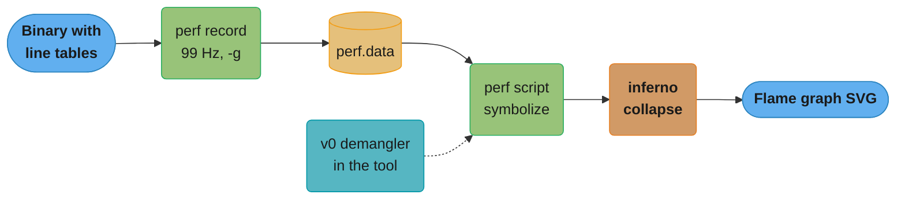

# Profiling and Benchmarking

> **Version anchor (checked 2026-11-06):** Rust 1.99.1 (2026-10-15), edition 2024.
> `hint::black_box` [1.66], unwind tables emitted on Linux even with `panic=abort` [1.92],
> v0 symbol mangling by default [1.97]. Crates and tools: criterion 0.8.2, divan 0.1.21,
> gungraun 0.20.0 (renamed from iai-callgrind), samply 0.13.1, flamegraph
> (cargo-flamegraph) 0.6.15, inferno 0.12.8, dhat 0.3.3, tikv-jemallocator 0.7.0,
> console-subscriber 0.5.0, tokio-console 0.1.14, tokio 1.54.1, cargo-bloat 0.12.1,
> cargo-llvm-lines 0.4.48.

## 1. Concept Overview

Profiling and benchmarking answer two different questions. A profiler answers "where does
the time go in this program, under this load?" A benchmark answers "how long does this
piece of code take, and did a change make it faster or slower?" You need both. A profile
without a benchmark gives you a target and no proof that you hit it. A benchmark without a
profile gives you a precise number for code that may not matter.

Rust adds its own problems to both jobs, and they are the subject of this module:

- **The default release build is hard to profile.** `[profile.release]` has `debug =
  false`, so a profiler shows addresses or function names with no file and line. Inlining
  merges small functions into their callers, so whole layers of the call tree vanish.
- **Stack walking needs help.** Without frame pointers or DWARF unwind data, `perf` cuts
  call stacks short or gets them wrong.
- **Symbol names changed format.** Since 1.97 rustc uses v0 mangling by default. An old
  `perf`, `gdb` or `addr2line` prints raw `_R...` names.
- **The optimizer deletes benchmark work.** A benchmark whose result is never used can
  compile to nothing. `std::hint::black_box` exists for this.
- **Stable Rust has no built-in benchmark harness.** `#[bench]` needs nightly. Stable
  projects use criterion, divan or gungraun with `harness = false`.
- **Async time is invisible to a CPU profiler.** A task that waits shows no frames at all.

The statistics of a benchmark (noise floor, confidence intervals, A/A tests) live in
[Benchmarking Methodology](../../backend/benchmarking_methodology/benchmarking_methodology.md),
and catching regressions across many CI runs lives in
[Performance Regression Detection](../../backend/performance_regression_detection/performance_regression_detection.md).
Flame-graph reading and profiling method are in
[Performance Profiling](../../backend/performance_profiling/performance_profiling.md) and
[Off-CPU and eBPF Analysis](../../backend/off_cpu_and_ebpf_analysis/off_cpu_and_ebpf_analysis.md).
This page owns the Rust side: debuginfo, frame pointers, mangling, the harnesses and the
Rust heap and async profilers.

---

## 2. Intuition

> **One-line analogy:** a release Rust binary is a building with the floor plans shredded.
> The profiler can count footsteps in every room, but without debuginfo it cannot tell you
> which room it is, and without frame pointers it cannot tell you which corridor led there.

**Mental model:** three things must be true before a Rust profile is useful. The binary
must be optimized like production, or you profile the wrong code. It must carry line
tables, or you cannot map an address to source. And the profiler must be able to walk the
stack, either through frame pointers or through DWARF unwind tables. A benchmark adds a
fourth condition: the work you time must survive the optimizer, which means its inputs and
outputs pass through `black_box`.

**Why it matters:** the two most common wrong conclusions in Rust performance work both
come from skipping these conditions. One is "this function takes 0.3 ns", from a benchmark
whose body the optimizer deleted. The other is "nothing is hot", from a flame graph of
broken stacks where the hot code is spread across a hundred `[unknown]` frames.

**Key insight:** debuginfo and frame pointers do not change the machine code that matters.
Line tables live in separate sections that the CPU never executes. Frame pointers cost one
register and a few instructions per call, usually well under the noise of a benchmark. So
keep a dedicated profiling profile that is the release profile plus symbols, and profile
that. Do not profile a debug build, and do not profile a stripped binary.

---

## 3. Core Principles

1. **Profile the production configuration.** Same `opt-level`, LTO, `codegen-units`,
   allocator and target CPU. Add only line tables and frame pointers, which do not change
   what the hot loop does.

2. **Profile before you benchmark.** The profile picks the target. The benchmark proves the
   change. A micro-benchmark of code that is 2 percent of the profile can at most save 2
   percent.

3. **Every benchmark input and output goes through `black_box`.** Otherwise the compiler
   may fold constants, hoist the work out of the loop or delete it.

4. **Separate setup from the measured work.** Allocation of the input, cloning and
   building fixtures belong outside the timed closure (`iter_batched` in criterion,
   `with_inputs` in divan).

5. **Wall time for decisions on one machine. Instruction counts for CI gates.** Shared CI
   runners have noise of several percent. A callgrind instruction count is close to
   deterministic, so a small regression shows up as a real change.

6. **CPU profiles show only on-CPU time.** A service that is slow and idle is waiting:
   on locks, I/O, the blocking pool or other tasks. Use off-CPU analysis and the async
   tools for that time.

7. **Allocation is a separate profile.** A CPU profile shows `malloc` as a hot frame. A
   heap profile shows which call sites allocate, how much and how long it lives.

8. **Keep the raw data.** Save `perf.data`, criterion baselines and gungraun outputs with
   the commit hash. A number you cannot reproduce cannot settle an argument.

---

## 4. Types / Architectures / Strategies

### 4.1 CPU profilers for Rust

| Tool | How it samples | Platforms | Output | Notes |
|---|---|---|---|---|
| `perf` | Kernel sampling with `perf_event_open` | Linux | `perf.data`, `perf report`, `perf script` | Needs `perf_event_paranoid` set low or `CAP_PERFMON` |
| cargo-flamegraph | Runs `perf` (Linux) or `dtrace` (macOS) and renders an SVG | Linux, macOS | Flame graph SVG | One command from a Cargo project |
| samply | Its own sampler | Linux, macOS, Windows | Firefox Profiler in the browser | Timeline per thread, call tree, source view |
| inferno | Collapses `perf script` output and renders SVG | Any | Flame graph SVG | The Rust port of the FlameGraph scripts |
| Instruments | Apple's sampler | macOS | Instruments trace | Reads Rust symbols with debuginfo |
| Callgrind (through gungraun or directly) | Simulates the CPU | Linux, some others | Instruction counts per function | Much slower to run. Near-exact counts |

### 4.2 Heap and async profilers

| Tool | What it shows | How it hooks in | Cost |
|---|---|---|---|
| dhat (dhat-rs) | Allocation sites, bytes, counts, lifetimes | `#[global_allocator]` plus a `Profiler` value | High. For tests and local runs |
| heaptrack | Allocation sites and leaks over time | `LD_PRELOAD` on `malloc` | Medium. Sees only the system allocator |
| jemalloc heap profiling | Sampled live-heap call sites | `tikv-jemallocator` with the `profiling` feature | Low with sampling. Fit for production |
| tokio-console | Per-task poll times, wakes, busy and idle time | `console-subscriber` plus `--cfg tokio_unstable` | Medium |
| Tokio runtime metrics | Worker count, alive tasks, queue depth | `Handle::metrics()` | Low |

### 4.3 Benchmark harnesses

| Harness | Measures | Stable Rust? | Strength | Weakness |
|---|---|---|---|---|
| libtest `#[bench]` | Wall time | No, nightly only | Built in | Unstable, weak statistics |
| criterion | Wall time with statistics | Yes, `harness = false` | Baselines, outlier analysis, HTML reports | Slow to run, wall-time noise |
| divan | Wall time, plus allocation counts | Yes, `harness = false` | Simple attribute API, parameter grids, `AllocProfiler` | Fewer statistical reports than criterion |
| gungraun | Instruction counts and cache estimates through Valgrind, or Linux perf | Yes, `harness = false` | Near-deterministic, good for CI gates | Linux-centric, no Windows, not wall time |
| Hand-written `Instant` loop | Wall time | Yes | No dependency | Easy to get wrong |

### 4.4 Build-time profilers

| Tool | Question it answers |
|---|---|
| `cargo build --timings` | Which crates take longest, and which ones block parallel work |
| cargo-llvm-lines | Which generic functions produce the most LLVM IR |
| cargo-bloat | Which crates and functions take space in the binary |

---

## 5. Architecture Diagrams

### 5.1 Pick the tool from the symptom



A flat CPU profile with high latency points away from CPU tools. In an async service,
tokio-console and the runtime metrics show tasks that wait or block a worker. Outside a
runtime, the off-CPU tools in the backend section show where threads sleep.

### 5.2 Why stacks break without frame pointers

```
Frame-pointer walk (force-frame-pointers=yes)    No frame pointers, perf -g (fp mode)

 rbp -> [ saved rbp | ret addr ] handle_req       rbp -> [ ??? garbage ??? ]
          |                                                  |
          v                                                  v
        [ saved rbp | ret addr ] parse_body             (walk stops or jumps
          |                                              into a random frame)
          v
        [ saved rbp | ret addr ] serde_json::from_slice   profile shows:
          |                                                 parse_number
          v                                                 [unknown]
        [ saved rbp | ret addr ] parse_number               [unknown]

 profile shows:                                    the hot leaf with no callers,
   handle_req > parse_body > from_slice >          so its cost spreads across
   parse_number                                    many short stacks
```

With frame pointers each frame stores the previous `rbp`, so the walk is a linked list.
Without them, frame-pointer mode reads whatever is in `rbp`. The fix is either
`-C force-frame-pointers=yes` for your crates (std has been built with frame pointers since
1.79) or DWARF unwinding with `perf record --call-graph dwarf`, which copies part of the
stack on every sample.

### 5.3 From samples to a flame graph



The symbolize step needs both line tables in the binary and a demangler that understands
v0 symbols. cargo-flamegraph runs this whole pipeline in one command.

---

## 6. How It Works - Detailed Mechanics

### 6.1 A profiling profile

```toml
[profile.profiling]
inherits = "release"
debug = "line-tables-only"   # file and line for every address, no variable info
# keep strip = "none" (the default) so symbols stay in the binary

[profile.bench]
debug = "line-tables-only"   # bench inherits release, so benches are profilable too
```

```bash
RUSTFLAGS="-C force-frame-pointers=yes" cargo build --profile profiling
# binary: target/profiling/<name>
```

`debug` accepts `"none"`, `"line-directives-only"`, `"line-tables-only"`, `"limited"` and
`"full"`. `line-tables-only` (a rustc option since 1.70) is the smallest setting that gives
file and line numbers in profiles and backtraces. `"full"` adds variable and type
information, which a debugger needs and a profiler does not. Neither changes the optimized
machine code. They add sections to the file, which `split-debuginfo` can move to a separate
file.

Put the settings in a named profile, not in `[profile.release]`, so the production
artifact stays small and the profiling artifact stays easy to build.

### 6.2 Frame pointers and unwinding

A sampling profiler interrupts the CPU and records the instruction pointer plus the call
stack. It has two ways to get the stack:

- **Frame pointers.** Each function saves the caller's frame pointer and sets its own.
  The profiler follows the chain. This is fast and works in the kernel. rustc omits frame
  pointers on many targets by default. `-C force-frame-pointers=yes` turns them on for the
  crates you compile. The prebuilt standard library has been built with frame pointers since
  1.79, and since 1.89 rustc keeps non-leaf frame pointers by default on `aarch64-linux`.
- **DWARF unwinding.** `perf record --call-graph dwarf` copies a block of the stack on each
  sample (8 KB by default) and unwinds it later with the `.eh_frame` tables. It needs no
  rebuild, but `perf.data` grows fast and deep stacks get cut at the copy size.

Since 1.92 rustc emits unwind tables on Linux even with `panic = "abort"`, so backtraces
and DWARF-based profilers work on abort builds. Before that, an abort build often had no
`.eh_frame` data for Rust code.

### 6.3 Symbol mangling

The linker needs a unique name for every function, including every instantiation of a
generic. rustc encodes the path, generic arguments and a hash into the symbol name.

| Scheme | Example prefix | Default |
|---|---|---|
| Legacy (Itanium-like) | `_ZN` ... `17h<16 hex digits>E` | Before 1.97 |
| v0 | `_R` | Since 1.97 |

v0 keeps generic arguments in the name (`Vec<u8>::push` and `Vec<String>::push` read as
different functions after demangling), which makes profiles of generic code easier to
read. The release notes for 1.97 warn that old debuggers and profilers may fail to
demangle v0 names. If `perf report` shows names starting with `_R`, update `perf` (its
demangling comes from the libraries it was built with), use a profiler with its own
demangler (samply, inferno), or pipe the output through `rustfilt`.

### 6.4 Recording a CPU profile

```bash
# perf directly
perf record -F 99 -g ./target/profiling/server --config prod.toml
perf report --no-children

# perf, then inferno for an SVG
perf script | inferno-collapse-perf | inferno-flamegraph > flame.svg

# cargo-flamegraph: builds, runs under perf or dtrace, writes flamegraph.svg
CARGO_PROFILE_RELEASE_DEBUG=true cargo flamegraph --bin server -- --config prod.toml

# samply: opens the Firefox Profiler with per-thread timelines
samply record ./target/profiling/server --config prod.toml
```

99 Hz is a common rate for production because it is low overhead and does not align with
timers that fire at round frequencies. Use a higher rate (997 or 4999 Hz) for a short local
run that needs more samples.

**Inlined frames.** LLVM inlines small functions into their callers. Without inline
information, their cost appears under the caller. `perf report --inline` and samply read
the inline records in the debuginfo and show the inlined functions as frames. For a
micro-benchmark you are profiling, `#[inline(never)]` on the function under study keeps it
as a separate frame. Remove it before you measure speed.

### 6.5 Heap profiling

**dhat-rs** wraps the global allocator and records every allocation with its stack:

```rust
// fragment
#[cfg(feature = "dhat-heap")]
#[global_allocator]
static ALLOC: dhat::Alloc = dhat::Alloc;

fn main() {
    #[cfg(feature = "dhat-heap")]
    let _profiler = dhat::Profiler::new_heap();

    run_workload();
    // _profiler drops here and writes dhat-heap.json for dh_view.html
}
```

It reports total bytes, total blocks, peak live bytes and how long blocks lived, per call
site. Put it behind a Cargo feature, because it slows the program down a lot. dhat also has
a testing mode that asserts a number of allocations in a test, which turns "this path does
not allocate" into a test that fails.

**heaptrack** preloads a library that intercepts `malloc`, `free` and friends. It needs no
code change. It sees nothing when the program uses mimalloc or tikv-jemallocator as the
global allocator, because those never call the system `malloc`. tikv-jemallocator also
prefixes its symbols with `_rjem_` by default.

**jemalloc heap profiling** works in production. Build tikv-jemallocator with its
`profiling` feature, then enable profiling at launch:

```bash
_RJEM_MALLOC_CONF="prof:true,lg_prof_sample:19,prof_prefix:/tmp/jeprof" ./server
# later: jeprof --svg ./server /tmp/jeprof.*.heap > heap.svg
```

`lg_prof_sample:19` samples on average once per 2^19 bytes (512 KiB) allocated, which keeps
the cost low. The `_RJEM_` prefix applies to prefixed builds, which is the default. RSS,
fragmentation and allocator choice for a memory budget are in
[Memory Budgets Without a GC](../case_studies/cross_cutting/memory_budgets_without_a_gc.md).

### 6.6 Async services: time that a CPU profile cannot see

A Tokio task that waits on a lock, a channel or a database has no frames on any CPU while
it waits. A flame graph of an async service shows only the polls. Three tools cover the
rest:

```rust
// fragment
// Cargo.toml: console-subscriber = "0.5", tokio = { version = "1.54", features = ["full", "tracing"] }
// build with: RUSTFLAGS="--cfg tokio_unstable" cargo build --profile profiling
fn main() {
    console_subscriber::init(); // tokio-console connects on 127.0.0.1:6669
    let rt = tokio::runtime::Runtime::new().expect("runtime");
    rt.block_on(serve());
}

async fn report_runtime() {
    let m = tokio::runtime::Handle::current().metrics();
    tracing::info!(
        workers = m.num_workers(),
        alive_tasks = m.num_alive_tasks(),
        global_queue = m.global_queue_depth(),
        "runtime"
    );
}
```

- **tokio-console** lists every task with its total, busy and idle time, its poll count
  and its longest poll. A task with a poll of 50 ms is blocking a worker thread: CPU-heavy
  work or a blocking call inside `async` code. That blocks the other tasks on the worker
  too.
- **Runtime metrics** give a cheap production signal. A growing global queue depth with
  idle-looking CPU means tasks are spawned faster than workers take them, or workers are
  blocked.
- **Off-CPU profiles** show where OS threads sleep, which catches `std::sync::Mutex`
  contention and blocking I/O in the blocking pool.

Scheduler internals, the 128-poll coop budget and the 512-thread blocking pool are in the
[Tokio deep dive](../async_runtimes_and_executors/tokio_deep_dive.md). The blocking-in-async
trap is in [Async Cancellation and Pitfalls](../async_cancellation_and_pitfalls/async_cancellation_and_pitfalls.md).

### 6.7 `black_box` and what the optimizer does to a benchmark

```rust
use std::hint::black_box;
use std::time::{Duration, Instant};

fn checksum(data: &[u8]) -> u64 {
    data.iter()
        .fold(0xcbf2_9ce4_8422_2325, |h, &b| {
            (h ^ u64::from(b)).wrapping_mul(0x100_0000_01b3)
        })
}

pub fn time_per_call<F: FnMut()>(iters: u32, mut f: F) -> Duration {
    let start = Instant::now();
    for _ in 0..iters {
        f();
    }
    start.elapsed() / iters
}

fn main() {
    let data = vec![7u8; 1024];

    // Wrong: the input is a known constant and the result is unused.
    // The optimizer may fold or delete the call.
    let deleted = time_per_call(1_000_000, || {
        let _ = checksum(&[7u8; 1024]);
    });

    // Right: the input is opaque and the result is consumed.
    let real = time_per_call(1_000_000, || {
        black_box(checksum(black_box(&data)));
    });

    println!("unused result: {deleted:?} per call, black_box: {real:?} per call");
}
```

`black_box(x)` returns `x` and tells the compiler to assume any code could read or change
it. Wrapping the input stops constant folding and hoisting. Wrapping the output stops dead
code elimination. The standard library documents it as best-effort: it is right for
benchmarks, and it must not be used for constant-time cryptography or any other
correctness property.

Hand-written loops like `time_per_call` still miss warm-up, outlier handling and
statistics. Use them for a quick check. Use a harness for any number you will act on.

### 6.8 criterion

```rust
// fragment
// benches/checksum.rs, with [[bench]] name = "checksum", harness = false in Cargo.toml
use criterion::{BatchSize, Criterion, criterion_group, criterion_main};
use std::hint::black_box;

fn bench(c: &mut Criterion) {
    let data = vec![7u8; 1024];
    c.bench_function("checksum_1k", |b| {
        b.iter(|| mylib::checksum(black_box(&data)))
    });

    c.bench_function("sort_10k", |b| {
        b.iter_batched(
            || (0..10_000u32).rev().collect::<Vec<_>>(), // setup, not timed
            |mut v| {
                v.sort_unstable();
                v
            },
            BatchSize::SmallInput,
        )
    });
}

criterion_group!(benches, bench);
criterion_main!(benches);
```

criterion runs a warm-up phase, then collects many samples and fits a regression of time
against iteration count. It reports a point estimate and a confidence interval, and
compares with the previous run. `iter_batched` builds a fresh input outside the timed
region, which matters for any routine that consumes or mutates its input.

Baselines compare a branch with `main` on the same machine:

```bash
git checkout main      && cargo bench --bench checksum -- --save-baseline main
git checkout my-branch && cargo bench --bench checksum -- --baseline main
```

A baseline is only valid on the machine that recorded it. Comparing a laptop baseline with
a CI result measures the hardware, not the change.

### 6.9 divan

```rust
// fragment
// benches/hash.rs, harness = false
use divan::{AllocProfiler, Bencher, black_box};

#[global_allocator]
static ALLOC: AllocProfiler = AllocProfiler::system();

fn main() {
    divan::main();
}

#[divan::bench(args = [64, 1024, 65536])]
fn checksum(bencher: Bencher, len: usize) {
    let data = vec![7u8; len];
    bencher.bench(|| mylib::checksum(black_box(&data)));
}

#[divan::bench]
fn parse_line(bencher: Bencher) {
    bencher
        .with_inputs(|| String::from("GET /index.html HTTP/1.1"))
        .bench_values(|line| mylib::parse(black_box(&line)).is_ok());
}
```

divan registers benchmarks with an attribute, runs parameter grids with `args`, and
`AllocProfiler` adds allocation counts and bytes next to each timing. That makes "this
change removed 3 allocations per call" visible in the same report as the time.

### 6.10 Instruction-count benchmarks for CI

Wall-time benchmarks on shared CI runners have run-to-run noise of several percent from
neighbors, frequency scaling and cache state. A 2 percent regression hides inside that.
gungraun runs each benchmark once under Valgrind's Callgrind (or Cachegrind, DHAT, or
Linux perf) and reports instruction counts, cache-access estimates and estimated cycles.
Instruction counts barely move between runs, so a CI job can fail on a 1 percent rise.

The limits are real. Instruction count is not time: a change that trades instructions for
cache misses can look better and run slower. Valgrind does not run on Windows, and the
benchmark runs much slower than native. Use instruction counts as the CI gate and wall time
on dedicated hardware as the final check. The detection side, from change-point analysis to
statistical bisect, is in
[Performance Regression Detection](../../backend/performance_regression_detection/performance_regression_detection.md).

### 6.11 Build-time profiling

```bash
cargo build --release --timings      # writes target/cargo-timings/cargo-timing.html
cargo llvm-lines --release | head -20
cargo bloat --release --crates -n 15
```

The timings report shows each crate as a bar on a timeline, colored by frontend and
codegen time, with the number of crates building in parallel. A long serial chain (a proc
macro crate that everything waits for) shows up as one long bar with nothing beside it.
`cargo llvm-lines` lists the generic functions that expand into the most LLVM IR, summed
over all instantiations. The fixes are in the
[dispatch sub-file](../traits_generics_and_trait_objects/monomorphization_vtables_and_dispatch_cost.md).

---

## 7. Real-World Examples

**The Rust compiler's own performance tracking.** perf.rust-lang.org benchmarks every
merge to rustc's main branch. Its regression method belongs to
[Performance Regression Detection](../../backend/performance_regression_detection/performance_regression_detection.md).
The Rust-specific lesson is that the weekly perf triage reads instruction counts
(`instructions:u`) first, for the same reason gungraun exists: they are far less noisy than
wall time.

**samply and the Firefox Profiler.** samply records with its own sampler and loads the
result into the Firefox Profiler web UI. It gives per-thread timelines, which matter for
Rust programs that use rayon or Tokio worker pools, where a flame graph merges all threads
into one picture.

**Production heap profiling with jemalloc.** Rust services that use tikv-jemallocator can
turn on sampled heap profiling with an environment variable and no rebuild, provided the
`profiling` feature was compiled in. That gives the same "which call site holds the
memory" answer that JVM teams get from a heap histogram, at a sampling cost low enough for
a canary host.

**Comparison with Go.** Go ships `pprof` in the runtime and keeps frame pointers on, so a
Go profile works out of the box
([Profiling and Tracing in Go](../../go/profiling_and_tracing/profiling_and_tracing.md)).
Rust leaves each choice to the build: debuginfo, frame pointers, allocator and async
runtime. The tools are as good, but a team must set up the profiling profile once and keep
it working.

---

## 8. Tradeoffs

### 8.1 Stack walking

| Method | Rebuild needed | Per-sample cost | `perf.data` size | Accuracy |
|---|---|---|---|---|
| Frame pointers | Yes, `force-frame-pointers=yes` | Very low | Small | Good if every frame has them |
| DWARF (`--call-graph dwarf`) | No, needs `.eh_frame` | Higher, copies 8 KB of stack | Large | Good, but deep stacks get cut |
| LBR (`--call-graph lbr`, Intel) | No | Low | Small | Short stacks only (hardware depth limit) |

### 8.2 Benchmark harnesses

| Harness | Run time | Noise on shared CI | Platform reach | Best use |
|---|---|---|---|---|
| criterion | Seconds per benchmark | Several percent | All | Local comparison with baselines |
| divan | Seconds per benchmark | Several percent | All | Parameter sweeps, allocation counts |
| gungraun | One run, but slowed by Valgrind | Close to zero | Linux and other Valgrind targets | CI regression gates |
| Hand `Instant` loop | Fast | High | All | A quick sanity check only |

### 8.3 Heap profilers

| Tool | Code change | Sees custom allocators? | Production use |
|---|---|---|---|
| dhat-rs | Yes, global allocator | It is the allocator | No |
| heaptrack | No | No, only system `malloc` | Rarely |
| jemalloc profiling | Allocator choice plus a feature | It is the allocator | Yes, with sampling |

---

## 9. When to Use / When NOT to Use

**Use a CPU profiler when** CPU is high, latency tracks load, or a batch job is slower than
expected. Use samply for multi-threaded programs where per-thread timelines help.

**Use a heap profiler when** `malloc`, `free` or `memcpy` are in the top frames, or RSS
grows without a matching rise in work.

**Use tokio-console and runtime metrics when** an async service has high latency and low
CPU, or when a few slow requests stall unrelated ones.

**Use criterion or divan when** you compare two versions of a function on one machine and
need a confidence interval. Use gungraun when a CI job must catch small regressions.

**Do not** profile a debug build, profile a stripped binary, compare benchmark numbers from
different machines, trust a benchmark whose body is under 1 ns without checking the
assembly, or keep `#[inline(never)]` markers you added for a profile in production code.

---

## 10. Common Pitfalls

The incidents below are composite examples. Their numbers are illustrative.

**The 0.3 ns hash.** A pull request claimed a new hash function was 40 times faster. The
benchmark called it on a constant input and dropped the result. LLVM computed the hash at
compile time. With `black_box` on the input and the output, the new function was 4 percent
slower. Any benchmark result under about a nanosecond for real work means the work is gone.

**A flame graph of addresses.** A team ran `perf record -g` against the release binary
from their container image, which had `strip = true`. The report showed hex addresses and
`[unknown]`. Build a profiling artifact with `debug = "line-tables-only"`, or ship split
debuginfo next to the image so the profiler can find it.

**Truncated stacks hide the caller.** A profile showed 30 percent of CPU in
`core::str::from_utf8` with no caller. Frame pointers were off in the application crates,
so `perf -g` could not walk past the leaf. With `-C force-frame-pointers=yes` the stack
showed that a logging layer validated every header value as UTF-8 on every request.

**heaptrack shows nothing.** A team switched to `tikv-jemallocator` for throughput, then
used heaptrack to chase a leak and saw almost no allocations. heaptrack hooks the system
`malloc`, and jemalloc never calls it. Use jemalloc's own profiler, or run the leak test
with the system allocator.

**Baselines from a laptop.** A developer saved a criterion baseline on a laptop on battery,
then compared CI results against it and reported a 25 percent improvement. The CI runner
was simply a faster machine. Baselines are per machine.

**`#[bench]` on stable.** A team copied a benchmark from an old blog post into
`benches/`. It does not build on stable Rust:

```rust
// BROKEN
#![feature(test)] // error[E0554]: `#![feature]` may not be used on the stable release channel
extern crate test;

use test::Bencher;

pub fn sum(xs: &[u64]) -> u64 {
    xs.iter().sum()
}

#[bench]
fn bench_sum(b: &mut Bencher) {
    let xs: Vec<u64> = (0..1_000).collect();
    b.iter(|| sum(&xs));
}
```

`test::Bencher` is an unstable library feature, so even without the `#![feature]` line the
`extern crate test` fails with `error[E0658]`. Use a stable harness with `harness = false`:

```rust
// FIX
// fragment
// benches/sum.rs. Cargo.toml: [[bench]] name = "sum", harness = false
use criterion::{Criterion, criterion_group, criterion_main};
use std::hint::black_box;

fn bench_sum(c: &mut Criterion) {
    let xs: Vec<u64> = (0..1_000).collect();
    c.bench_function("sum_1k", |b| b.iter(|| mylib::sum(black_box(&xs))));
}

criterion_group!(benches, bench_sum);
criterion_main!(benches);
```

**Profiling the wrong allocator or profile.** A team profiled `cargo build --release` but
shipped a build with fat LTO, one codegen unit and mimalloc. The profile showed hot
functions that the production build had inlined away, and missed allocator behavior that
production had. The profiling profile must inherit the production settings.

---

## 11. Technologies & Tools

| Tool | What it is for |
|---|---|
| perf | Linux sampling profiler and the base for most Rust flame graphs |
| samply | Cross-platform sampling profiler that opens results in the Firefox Profiler |
| cargo-flamegraph | One-command flame graphs from a Cargo project through perf or dtrace |
| inferno | Collapses stack samples and renders flame graph SVGs |
| rustfilt | Demangles Rust symbol names in text output |
| Instruments | macOS sampling profiler that reads Rust debuginfo |
| dhat | Heap profiler as a Rust global allocator, with an allocation-count test mode |
| heaptrack | `malloc` interception heap profiler for programs on the system allocator |
| tikv-jemallocator | jemalloc global allocator with sampled heap profiling through its `profiling` feature |
| tokio-console | Live per-task view of a Tokio runtime |
| console-subscriber | The instrumentation side that tokio-console connects to |
| criterion | Statistical wall-time benchmark harness with saved baselines |
| divan | Attribute-based benchmark harness with parameter grids and allocation counts |
| gungraun | Instruction-count and cache-estimate benchmarks through Valgrind or Linux perf |
| Valgrind | The Callgrind, Cachegrind and DHAT tools that gungraun drives |
| cargo-bloat | Binary size by crate and function |
| cargo-llvm-lines | LLVM IR volume by generic function |

---

## 12. Interview Questions with Answers

**Q: Why does `perf report` on a default release build show hex addresses or `[unknown]` frames?**
**Short:** The release profile has `debug = false`, and images are often stripped, so there are no line tables or symbols to map addresses back to functions and source lines.

Cargo's release profile sets `debug = false`, and since 1.77 a profile with no debuginfo
also strips debuginfo by default, including std's. Many Dockerfiles add `strip = true` or
run `strip` to shrink the image. Without symbols, `perf` can only
print addresses. Without line tables it cannot show file and line. Add a
`[profile.profiling]` that inherits from release and sets `debug = "line-tables-only"`.
The optimized machine code stays the same, so the profile still describes production.
For production hosts, ship split debuginfo files next to the binary instead of a fat image.

**Q: A criterion benchmark reports 0.3 ns for hashing 1 KB. What happened?**
**Short:** The optimizer removed the work, because the input was a known constant or the result was never used. Wrap the input and the output in `std::hint::black_box`.

Hashing 1 KB takes hundreds of nanoseconds at least, so 0.3 ns means less than one
instruction per call. LLVM either computed the hash at compile time from a constant input
or deleted the call because the result was unused. `black_box(&data)` makes the input
opaque and `black_box(result)` makes the output observed. criterion's `b.iter` also
consumes the closure's return value, so returning the hash helps. Treat any sub-nanosecond
result for real work as a broken benchmark until the assembly proves otherwise.

**Q: What does `std::hint::black_box` promise?**
**Short:** It is an identity function that asks the compiler to assume the value could be used in any way. It works for benchmarks on a best-effort basis and must not be relied on for security code.

The standard library documents that the compiler is encouraged to treat `black_box` as
fully opaque, which blocks constant folding through it and dead-code removal of values
passed to it. The docs also say it is best-effort, may vary by platform and backend, and
must not be relied on for correctness or for constant-time cryptography. For benchmarks
it is the right tool: use it on inputs and outputs, not around the whole computation,
because a `black_box` inside the hot loop can block optimizations the real code gets.

**Q: Why do Rust stacks in `perf` look truncated, and how do you fix them?**
**Short:** rustc omits frame pointers on many targets, so frame-pointer stack walks stop or go wrong. Build with `-C force-frame-pointers=yes` or record with `--call-graph dwarf`.

`perf record -g` walks stacks through frame pointers by default. A function compiled
without them leaves garbage in the frame-pointer register, so the walk ends early or jumps
to a wrong frame. The hot leaf then appears with no callers. Since 1.79 the prebuilt std
has frame pointers, so only your crates and dependencies need the flag. DWARF mode needs
no rebuild but copies 8 KB of stack per sample, which makes large `perf.data` files and
cuts deep stacks. Frame pointers are the better default for production profiling.

**Q: Can you use `#[bench]` and `test::Bencher` on stable Rust?**
**Short:** No. The `test` crate is an unstable library feature, so `#[bench]` builds only on nightly. Stable projects use criterion, divan or gungraun with `harness = false`.

On stable, `#![feature(test)]` fails with `error[E0554]` and `extern crate test` fails
with `error[E0658]`. The stable route is a bench target with `harness = false` in
`Cargo.toml`, which lets the external harness supply `main`. criterion and divan measure
wall time with statistics. gungraun measures instruction counts. All three run under
`cargo bench` and use the `bench` profile, which inherits from `release`.

**Q: What changed in Rust symbol names in 1.97, and what can break?**
**Short:** rustc switched the default to v0 mangling, so symbols start with `_R` instead of `_ZN`. Old perf, gdb and addr2line builds may print raw mangled names until they are updated.

Legacy mangling followed the Itanium C++ shape and added a hash, and it dropped generic
arguments from the readable name. v0 encodes the full path with generic arguments, so two
instantiations of one generic read as different functions. The 1.97 release notes warn
that debuggers and profilers, especially old versions, may fail to demangle v0 symbols and
that backtrace text may change. Update the tools, use samply or inferno, which carry their
own demangler, or pipe text through `rustfilt`. Check any log parser that matched on
backtrace lines.

**Q: Why use instruction-count benchmarks in CI instead of wall time?**
**Short:** Shared CI runners add several percent of wall-time noise, which hides small regressions. Callgrind instruction counts barely change between runs, so a 1 percent change is visible.

Wall time on a shared runner moves with noisy neighbors, CPU frequency and cache state.
A gate tight enough to catch 2 percent fires on clean commits. gungraun runs each
benchmark once under Callgrind and reports instructions, cache estimates and estimated
cycles, which are nearly deterministic for the same binary and input. The tradeoff is
that instructions are not time: memory stalls and branch mispredictions do not show the
same way. Gate on instruction counts and confirm important changes with wall time on
dedicated hardware.

**Q: How do you compare a branch against `main` with criterion?**
**Short:** Run `cargo bench -- --save-baseline main` on the main branch, then `cargo bench -- --baseline main` on the branch, on the same machine, and read the reported change and its interval.

criterion stores sample data under `target/criterion` by name. `--save-baseline main`
names a run. `--baseline main` compares the current run against it and reports the change
with a confidence interval and a verdict (improved, regressed, no change within noise).
The comparison is only meaningful on one machine in one state: same power mode, same
background load, same CPU governor. Never compare a baseline from one machine with a run
on another. For the statistics behind the interval, see the backend benchmarking page.

**Q: When would you choose divan over criterion?**
**Short:** When you want an attribute-based API, quick parameter sweeps with `args`, and allocation counts beside timings. criterion gives richer statistics and saved baselines.

divan registers a benchmark with `#[divan::bench]`, sweeps inputs with `args = [...]`,
and its `AllocProfiler` global allocator reports allocations and bytes per iteration. That
makes it good for "does this path allocate" work. criterion fits a regression to many
samples, reports confidence intervals and keeps named baselines for A/B comparison. Many
projects use divan for quick sweeps during development and criterion or gungraun for
recorded comparisons.

**Q: How do you find which code allocates the most?**
**Short:** Use a heap profiler: dhat-rs as the global allocator for local runs, heaptrack for programs on the system allocator, or jemalloc's sampled profiler in production.

A CPU profile shows `malloc` as hot but not who called it with which sizes. dhat-rs
replaces the global allocator, records each allocation's stack, size and lifetime, and
writes `dhat-heap.json` for `dh_view.html`. heaptrack needs no code change because it
preloads a `malloc` hook. jemalloc builds with the `profiling` feature can sample live
allocations in production. Pick by environment: dhat in tests, heaptrack on a dev box,
jemalloc sampling on a canary.

**Q: Why does heaptrack show almost no allocations for a service that uses jemalloc or mimalloc?**
**Short:** heaptrack intercepts the system `malloc` through `LD_PRELOAD`. A custom global allocator never calls it, so heaptrack sees almost nothing.

When a Rust program sets `#[global_allocator]` to `tikv_jemallocator::Jemalloc` or
`mimalloc::MiMalloc`, every `Box`, `Vec` and `String` goes to that allocator directly.
tikv-jemallocator also uses `_rjem_`-prefixed symbols by default. The only allocations
heaptrack still sees come from C libraries that call `malloc`. Use the allocator's own
profiler (jemalloc's `prof:true`), or run the investigation build with the system
allocator so heaptrack can see it.

**Q: How do you turn on jemalloc heap profiling in a Rust service?**
**Short:** Build tikv-jemallocator with its `profiling` feature, then start the process with `_RJEM_MALLOC_CONF=prof:true,lg_prof_sample:19` and read the dumps with jeprof.

The feature compiles profiling support in but leaves it off. The environment variable
turns it on at launch. Prefixed builds, the default, read `_RJEM_MALLOC_CONF` instead of
`MALLOC_CONF`. `lg_prof_sample:19` samples about once per 512 KiB allocated, which keeps
overhead low enough for a canary host. `prof_prefix` sets where dumps go, and jeprof turns
two dumps into a diff of what grew. `JEMALLOC_SYS_WITH_MALLOC_CONF` can embed the same
options at build time.

**Q: An async Rust service has high p99 latency but CPU is at 20 percent. What do you check?**
**Short:** Check for tasks that block worker threads or wait on locks and queues. Use tokio-console for long polls and idle time, runtime metrics for queue depth, and an off-CPU profile for thread sleeps.

A CPU flame graph shows only polls, so waiting time is invisible. tokio-console (with
`console-subscriber` and `--cfg tokio_unstable`) lists each task's busy time, idle time
and longest poll. A poll that lasts tens of milliseconds means blocking code on a worker:
a `std::sync::Mutex` held across work, synchronous file I/O or heavy CPU work. Runtime
metrics show global queue depth and alive tasks cheaply in production. Off-CPU tools show
where OS threads sleep. Move blocking work to `spawn_blocking` or a dedicated pool.

**Q: Why do small functions vanish from a Rust flame graph, and how do you see them?**
**Short:** LLVM inlines them into their callers, so their samples are charged to the caller. Profilers that read inline debuginfo, such as samply or `perf report --inline`, show them again.

Iterator adapters, accessors and short helpers almost always get inlined in a release
build. Their code then sits inside the caller's machine code, and a naive symbolizer
reports only the outer function. With line tables, the debuginfo records which source
function each inlined range came from, and tools that read those records show synthetic
frames. For a focused study of one function, `#[inline(never)]` keeps it as its own frame.
Remove that attribute before you benchmark, because it changes the code you measure.

**Q: Does building release with debuginfo slow the program down?**
**Short:** No. Debuginfo goes in separate sections that are not executed, so the optimized machine code is the same. It makes the file larger and the link slower.

`debug = "line-tables-only"` adds address-to-line tables. `debug = "full"` adds types and
variables. Neither is loaded into the hot path. The costs are disk size, link time and a
larger image, which `split-debuginfo` or a separate debug file can move out of the
shipped artifact. That is why a profiling profile can differ from release only in
debuginfo and still describe production behavior.

**Q: What does `panic = "abort"` mean for backtraces and profilers on Linux?**
**Short:** Since 1.92 rustc still emits unwind tables on Linux with `panic=abort`, so backtraces and DWARF-based stack walks work. Before that, abort builds often lacked them for Rust code.

Unwind tables (`.eh_frame`) describe how to step from one frame to its caller. Panic
unwinding uses them, and so do backtraces and `perf --call-graph dwarf`. Abort builds did
not need them for panics, so rustc used to omit them, which broke backtraces. The 1.92
change emits them by default on Linux. `-C force-unwind-tables=no` turns them off again
for a size-critical build that accepts worse diagnostics.

**Q: How should the benchmark build relate to the production build?**
**Short:** It should match it. The `bench` profile inherits release, but if production uses LTO, one codegen unit, PGO, a custom allocator or a target CPU, the benchmark build needs the same settings.

`cargo bench` uses `[profile.bench]`, which inherits `[profile.release]`. Settings passed
only through a release script, such as `RUSTFLAGS` for `target-cpu` or a PGO profile, do
not apply to benchmarks. An allocator chosen behind a feature flag may not be enabled in
bench builds. A benchmark of a different binary can rank two designs in the wrong order,
because inlining and allocation costs change with these settings. Put production settings
in the Cargo profile and in `.cargo/config.toml` so every build path picks them up.

**Q: How do you find out why a Rust workspace takes long to build?**
**Short:** Run `cargo build --timings` for a per-crate timeline, then `cargo llvm-lines` on the slow crates to find generic functions that expand into the most LLVM IR.

The timings report marks each crate's frontend and codegen time and shows how many crates
build at once. Long serial chains, such as a proc-macro crate that most others depend on,
limit parallelism. Inside a slow crate, codegen time usually follows the amount of LLVM IR,
and `cargo llvm-lines` attributes that IR to generic functions summed over their
instantiations. Splitting a large generic function into a thin generic shell and a
non-generic body is the usual fix.

**Q: Why should benchmark setup sit outside the timed closure?**
**Short:** Otherwise the benchmark measures allocation and cloning, not the routine. criterion's `iter_batched` and divan's `with_inputs` build each input before the timer starts.

A sort benchmark that does `b.iter(|| { let mut v = input.clone(); v.sort(); v })` times
the clone and the allocation with the sort. For a 10,000-element vector the clone can be a
large share of the result. `iter_batched` takes a setup closure and a routine closure, and
only the routine is timed. `BatchSize::SmallInput` lets criterion prepare many inputs at
once. The same rule applies to any routine that consumes or mutates its input.

**Q: How do you profile a Rust service in production with low overhead?**
**Short:** Sample at about 99 Hz with perf or a continuous profiler on a binary that has frame pointers and symbols, and attach to the running process instead of restarting it.

`perf record -F 99 -g -p <pid> -- sleep 30` samples one process for 30 seconds. At 99 Hz
the overhead is small enough for a production host. The binary needs frame pointers for
cheap stack walks, and symbols or a reachable debuginfo file for names. The container needs
`CAP_PERFMON` or a low `perf_event_paranoid` value. For always-on profiling, eBPF-based
continuous profilers also work best on a binary with frame pointers. The method for reading the result
lives in the backend profiling pages.

---

## 13. Best Practices

1. Keep a `[profile.profiling]` with `inherits = "release"` and
   `debug = "line-tables-only"`, and build it with `-C force-frame-pointers=yes`.
2. Keep production build settings in Cargo profiles and `.cargo/config.toml`, not in a
   release script, so benchmarks and profiles build the same code.
3. Profile first. Benchmark only the functions the profile marks hot.
4. Pass every benchmark input and output through `std::hint::black_box`. Treat a
   sub-nanosecond result for real work as a bug.
5. Keep setup out of the timed closure with `iter_batched` or `with_inputs`.
6. Compare criterion baselines only on the same machine. Use gungraun instruction counts
   for CI gates.
7. Use samply for multi-threaded programs. Use `perf` and inferno where you need a scripted
   pipeline.
8. Keep perf, gdb and other tools new enough to demangle v0 symbols.
9. Use dhat in tests to assert that hot paths do not allocate. Use jemalloc sampling in
   production when RSS grows.
10. For async services, wire runtime metrics into dashboards and keep a tokio-console
    build ready for incidents.
11. Save raw profiles and benchmark results with the commit hash.

---

## 14. Case Study

**Scenario (illustrative).** A team owns a log-shipping agent that parses 300,000 lines per second per
core. After a dependency bump, p99 CPU per host rose 18 percent. They want a benchmark that
proves which change caused it and a profile that shows where the time went.

**First attempt.** An engineer writes a small in-house harness that takes a closure, and
benchmarks the parser, which reuses a line buffer:

```rust
// BROKEN
use std::time::{Duration, Instant};

pub fn bench<F: Fn()>(iters: u32, f: F) -> Duration {
    let start = Instant::now();
    for _ in 0..iters {
        f();
    }
    start.elapsed() / iters
}

pub fn parse_into(buf: &mut Vec<u8>, line: &str) -> usize {
    buf.clear();
    buf.extend_from_slice(line.as_bytes());
    buf.iter().filter(|&&b| b == b' ').count()
}

pub fn run() -> Duration {
    let mut buf = Vec::with_capacity(512);
    // error[E0596]: cannot borrow `buf` as mutable, as it is a captured variable in a `Fn` closure
    bench(100_000, || {
        parse_into(&mut buf, "GET /a HTTP/1.1");
    })
}
```

The compiler rejects it because an `Fn` closure may not mutate what it captures. The
engineer "fixes" it by allocating a fresh `Vec` inside the closure. That compiles, and the
benchmark now times an allocation per call, which the real agent never does. It also
passes a constant string and drops the result, so the optimizer is free to shrink the work.

**Fix.** The harness takes `FnMut`, the buffer is reused as in production, and the input
and output go through `black_box`:

```rust
// FIX
use std::hint::black_box;
use std::time::{Duration, Instant};

pub fn bench<F: FnMut()>(iters: u32, mut f: F) -> Duration {
    let start = Instant::now();
    for _ in 0..iters {
        f();
    }
    start.elapsed() / iters
}

pub fn parse_into(buf: &mut Vec<u8>, line: &str) -> usize {
    buf.clear();
    buf.extend_from_slice(line.as_bytes());
    buf.iter().filter(|&&b| b == b' ').count()
}

pub fn run(lines: &[String]) -> Duration {
    let mut buf = Vec::with_capacity(512);
    let mut i = 0;
    bench(100_000, || {
        let line = &lines[i % lines.len()];
        i += 1;
        black_box(parse_into(&mut buf, black_box(line)));
    })
}
```

The quick harness confirmed a slowdown on real log lines. The team then moved the
benchmark into divan with a parameter grid of line lengths, and added a gungraun version
to CI so the next regression of this size fails the pull request.

**Profile.** A `[profile.profiling]` build with line tables and frame pointers, recorded
with samply on a replay of production logs, showed 14 percent of samples in
`core::str::from_utf8`, called from a timestamp parser. The bumped dependency had changed
its parse function to take `&str` instead of `&[u8]`, and the agent now validated each
timestamp as UTF-8 before the call. The fix reused the already-validated `&str` slice from
the line. CPU per host returned to the old level, and the gungraun gate showed the
instruction count back within 1 percent of the old baseline.

**Lessons.**

- A harness signature is part of the benchmark. `FnMut` lets the benchmark reuse state the
  way production does.
- Allocating inside the timed closure to satisfy the compiler measures the wrong program.
- Use `black_box` on both ends, and real input data.
- Wall-time harnesses find the cause on one machine. Instruction-count gates keep it
  fixed.

Related: [Performance and Zero-Cost Abstractions](../performance_and_zero_cost_abstractions/performance_and_zero_cost_abstractions.md)
for what to change once the profile names the hot path, and
[Testing, Fuzzing and Miri](../testing_fuzzing_and_miri/testing_fuzzing_and_miri.md) for
turning a benchmark finding into a test.
