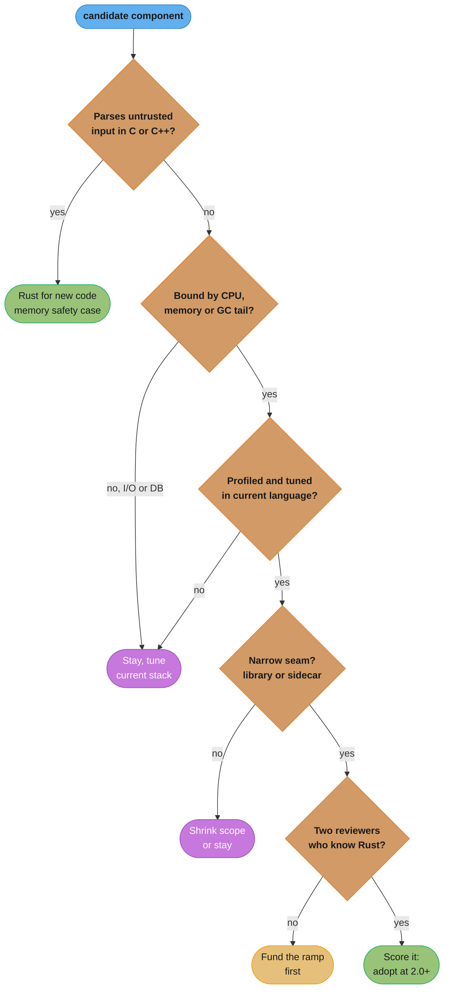
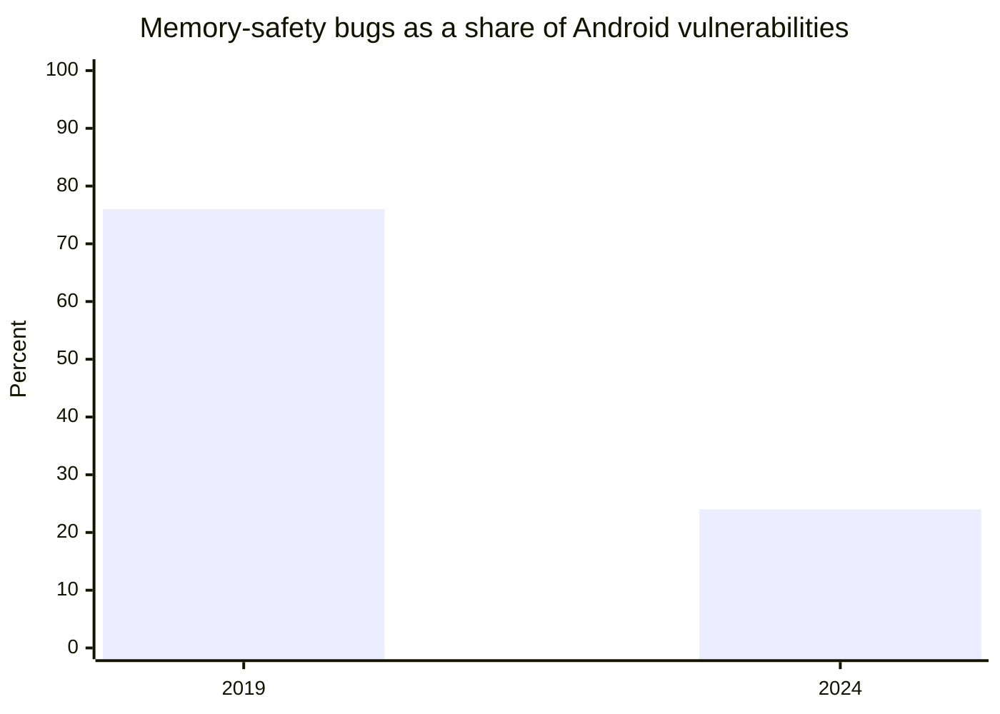

# Rust vs C++, Go, Java and Python

> **Version anchor (2026-11-06).** Rust 1.99.1 (2026-10-15), edition 2024. std threads default to a 2 MiB stack on tier 1 platforms. An uncaught panic that reaches an `extern "C"` function aborts the process since 1.81, and edition 2024 requires `#[unsafe(no_mangle)]` and `unsafe extern` blocks. The Linux kernel's Rust experiment is concluded (Miguel Ojeda's patch, 2025-12-13). The Rust Project adopted the FLS, announced 2025-03-26. Interop crates: cxx 1.0.205, pyo3 0.30.1, maturin 1.16.0, napi 3.16.1, jni 0.22.4, uniffi 0.32.2, bindgen 0.73.2, cbindgen 0.29.4. pingora 0.9.1.

## 1. Concept Overview

Every language in this comparison answers the same three questions differently: who frees
memory, who stops two threads from corrupting shared state, and what a blocked task costs.

| Language | Who frees memory | Who prevents data races | What a blocked task costs |
|---|---|---|---|
| C++ | The programmer, helped by RAII and smart pointers | The programmer | An OS thread, or a hand-written state machine |
| Rust | The compiler, through ownership and `Drop` at scope end | The compiler, through `Send` and `Sync` | An OS thread, or a future sized at compile time |
| Go | A tracing garbage collector | The race detector, at test time | A goroutine with a small growable stack |
| Java | A tracing garbage collector (G1, ZGC) | The programmer, with the Java memory model | A virtual thread |
| Python | Reference counting plus a cycle collector | The GIL, or the programmer on free-threaded builds | An OS thread, or an asyncio task |

Rust is the only row where both memory and data-race safety are checked before the program
runs, with no garbage collector. That combination is the case for Rust. The costs are compile
time, a steep first few months for engineers, async code that is harder to write than Go's,
and an ecosystem that is thin in some enterprise areas.

This module is the Rust axis of the comparison and holds the section's decision model for
**when to adopt Rust** and **where to cut the migration seam**. The three-way comparison of
Go, Java and Python is in
[Go vs Java and Python](../../go/go_vs_java_and_python/go_vs_java_and_python.md), and this
page does not repeat it. Discord's move of one service from Go to Rust because of GC latency
spikes is told in the
[Go runtime and garbage collector](../../go/the_runtime_and_garbage_collector/the_runtime_and_garbage_collector.md)
module.

---

## 2. Intuition

> **One-line analogy**: C++ hands you a chainsaw and a manual. Go and Java hire a cleaning
> crew that stops the room now and then. Python works through a careful assistant. Rust has a
> safety inspector who signs off on the plan before you cut, which is slow the first time and
> fast after.

**Mental model**: a language choice moves cost between three places.

1. **Write time**: how long it takes to get code accepted by the compiler and reviewers.
2. **Run time**: CPU, memory, tail latency.
3. **Incident time**: crashes, security bugs, races found in production.

C++ is cheap at write time and expensive at incident time. Go, Java and Python spend run time
on a runtime to cut write time and incident time. Rust moves cost to write time and cuts both
of the others.

**Why it matters**: the move is worth it only where run time or incident time is large. A
CRUD service that spends 95% of each request waiting on Postgres gains little from a faster
language. A parser for untrusted input in C++ gains a lot from memory safety.

**Key insight**: Google's Android data shows that vulnerabilities concentrate in new code and
decay as code ages. Writing new code in a memory-safe language cut Android's memory-safety
share of vulnerabilities from 76% in 2019 to 24% in 2024, without rewriting the old C++. The
highest-return use of Rust is often new components, not rewrites.

---

## 3. Core Principles

- **Compare on the workload, not the language.** CPU-bound, memory-bound and tail-latency
  workloads favor Rust. I/O-bound workloads gain little from any language change.
- **Memory safety has the strongest data behind it.** Chromium reports that around 70% of its
  high-severity security bugs are memory-safety bugs. Android measured a memory-safety
  vulnerability density for its Rust code about 1000 times lower than its historical C and
  C++ density.
- **Ownership replaces the GC, not memory management.** Rust frees memory at scope end, so
  there are no collection pauses. You still design for memory: fragmentation, `Arc` cycles
  and unbounded queues are your problem.
- **Safe Rust prevents data races, not deadlocks or logic races.** Two locks taken in opposite
  order still deadlock.
- **Async Rust is colored.** An `async fn` can only be awaited from async code, as in Python's
  asyncio. Go and Java virtual threads have no colors.
- **Cut the migration at a seam.** A library behind FFI, a sidecar, or a new service. Never a
  whole-application rewrite as the first step.
- **Price the ramp.** The first Rust code a team writes is slow to write and slow to review.
  Budget for it and for at least two reviewers who know the language.
- **Keep `unsafe` small and reviewed.** Android's post puts the main Rust security concern on
  the approximately 4% of code inside `unsafe` blocks.

---

## 4. Types / Architectures / Strategies

### Memory management models

| Model | Languages | Free time | Pause behavior | Typical failure |
|---|---|---|---|---|
| Manual plus RAII | C++ | Scope end or explicit `delete` | None | Use after free, double free, leaks |
| Ownership plus RAII, compiler-checked | Rust | Scope end | None | Leaks through `Arc` cycles or `mem::forget`, both safe |
| Tracing GC, non-moving | Go | Collector cycle | Short stop-the-world phases plus concurrent marking | Heap growth, GC CPU, tail spikes under pressure |
| Tracing GC, moving | Java (G1, ZGC) | Collector cycle | Pause or concurrent, by collector | Tuning, heap sizing, warmup |
| Refcount plus cycle GC | Python | Refcount zero, or cycle collection | Cycle collector pauses | Cycles, high per-object overhead |

Theory for all five is in
[memory management and virtual memory](../../cs_fundamentals/memory_management_and_virtual_memory/memory_management_and_virtual_memory.md).

### Concurrency models

| Model | Unit | Stack | Colored functions | Race safety |
|---|---|---|---|---|
| Rust std threads | OS thread | 2 MiB default on tier 1 platforms | No | Compile time (`Send`, `Sync`) |
| Rust async (tokio) | Future polled by an executor | None: a state machine sized at compile time | Yes | Compile time |
| Go goroutines | Runtime-scheduled goroutine | Small, growable | No | Race detector at test time |
| Java virtual threads | Virtual thread on carrier threads | Heap-allocated chunks | No | Java memory model, programmer |
| Python asyncio | Task on one event loop | Coroutine frame | Yes | GIL or programmer |

### Migration seams

| Seam | How | Overhead per call | Use when |
|---|---|---|---|
| In-process library | C ABI (`extern "C"`), cxx for C++, PyO3 for Python, jni for Java, napi for Node | Nanoseconds plus data marshalling | A hot function with a small, stable interface |
| Subprocess | Rust CLI called with arguments or pipes | Process spawn, about 2 ms measured for a hello world in a container | Batch jobs, tools |
| Sidecar or service | gRPC or HTTP between processes | A network round trip | A component with its own scaling or ownership |
| New components only | New services and libraries in Rust, old code stays | None | Large C or C++ code bases, the Android model |
| Full rewrite | Replace the system | n/a | Rarely. Only when the old system cannot be changed safely |

Details of each FFI path are in
[FFI and language interop](../ffi_and_language_interop/ffi_and_language_interop.md).

---

## 5. Architecture Diagrams

### Adoption decision



The safety branch comes first because it does not depend on performance. A C++ parser of
untrusted input is a Rust candidate even if it is fast enough. The scorecard in 6.6 settles
the cases that reach the last node.

### Android memory-safety share of vulnerabilities



Google reported 76% in 2019 and 24% in 2024 (2024-09-25 post), as Android shifted new
development to memory-safe languages. The 2025-11-13 post reports the share below 20% for
the first time. The old C++ was not rewritten.

### Vulnerability density, Android Rust vs historical C and C++

```
memory-safety vulnerabilities per million lines of code (MLOC)

C and C++ (historical)   ~1,000   ##################################################
Rust in Android            ~0.2   .  (one bar char = 20 per MLOC; Rust is 1/100 of a char)

ratio: about 1000x
basis: ~5 million lines of Rust in Android, one potential memory-safety bug found
       and fixed before release (CVE-2025-48530), per the 2025-11-13 Google post
```

The Rust bar cannot be drawn at this scale, which is the point. The estimate rests on one bug,
so treat it as an order of magnitude, not a precise ratio.

---

## 6. How It Works - Detailed Mechanics

### 6.1 What the compiler rejects that other languages accept

C++ accepts iterator invalidation. Java and Python raise a runtime exception for it, or not,
depending on the collection. Rust rejects it at compile time, because a `&mut` borrow cannot
coexist with a shared borrow. The safe version is a method that does the work in one pass:

```rust
fn main() {
    let mut scores = vec![10, 55, 70, 20, 90];
    // Remove failing scores while walking the list, in one borrow.
    scores.retain(|&s| s >= 50);
    assert_eq!(scores, vec![55, 70, 90]);
}
```

Shared mutable state across threads is the other big class. Go finds a race with `-race` at
test time, if a test hits it. Java finds it in production. Rust needs the sharing to be
explicit:

```rust
use std::collections::HashMap;
use std::sync::Mutex;
use std::thread;

fn main() {
    let counts = Mutex::new(HashMap::new());
    let words = ["a", "b", "a", "c", "a"];

    thread::scope(|s| {
        for chunk in words.chunks(2) {
            let counts = &counts;
            s.spawn(move || {
                for w in chunk {
                    let mut map = counts.lock().unwrap_or_else(|e| e.into_inner());
                    *map.entry(*w).or_insert(0) += 1;
                }
            });
        }
    });

    let map = counts.into_inner().unwrap_or_else(|e| e.into_inner());
    assert_eq!(map["a"], 3);
}
```

Remove the `Mutex` and the program does not compile. Thread mechanics are in
[threads, Send, Sync and locks](../threads_send_sync_and_locks/threads_send_sync_and_locks.md).

### 6.2 Deterministic destruction instead of a collector

```rust
struct Conn(&'static str);

impl Drop for Conn {
    fn drop(&mut self) {
        println!("close {}", self.0);
    }
}

fn main() {
    let _a = Conn("primary");
    {
        let _b = Conn("replica");
        println!("query");
    } // prints "close replica" here, not at some later collection
    println!("done");
} // prints "close primary" here
```

Every resource, not only memory, is released at a known point: sockets, file handles, locks,
pool slots. Java needs `try`-with-resources, Go needs `defer`, Python needs `with`, and each
is opt-in. In Rust it is the default. Ownership rules are in
[ownership, borrowing and RAII](../ownership_borrowing_and_raii/ownership_borrowing_and_raii.md).

### 6.3 Tasks: futures, goroutines and virtual threads

A Rust `async fn` compiles to a state machine. Its size is the largest set of values alive
across any `.await`, known at compile time. There is no stack to grow.

```rust
use std::mem::size_of_val;

async fn tick() {}

async fn small() -> u32 {
    tick().await;
    1
}

async fn big() -> usize {
    let buf = [0u8; 4096];
    tick().await;
    buf.len()
}

fn main() {
    let a = small();
    let b = big();
    assert!(size_of_val(&a) < 64);
    assert!(size_of_val(&b) >= 4096);
}
```

Measured with rustc 1.99.1 (`aarch64-unknown-linux-gnu`, `-O`, in the `rust:1.99.1-slim`
Docker image): `small()` is 2 bytes and
`big()` is 4,098 bytes. The exact numbers are implementation facts. The rule is that what you
hold across `.await` is what you pay for, per task.

The other models:

- **Go** gives each goroutine a small stack that grows by copying, and preempts goroutines.
  Blocking calls are cheap to write. See
  [goroutines and the scheduler](../../go/goroutines_and_the_scheduler/goroutines_and_the_scheduler.md).
- **Java** virtual threads mount on carrier threads and store their stacks in the heap. See
  [structured concurrency and Loom](../../java/structured_concurrency_and_loom/structured_concurrency_and_loom.md).
- **Python** asyncio runs coroutines on one event loop, colored like Rust. See
  [asyncio and the event loop](../../python/asyncio_and_event_loop/asyncio_and_event_loop.md).

The Rust tradeoff: the smallest per-task memory and no runtime preemption, so a task that
computes for 50 ms without an `.await` blocks its worker thread. Go hides that problem. Rust
makes you design for it. See
[async cancellation and pitfalls](../async_cancellation_and_pitfalls/async_cancellation_and_pitfalls.md).

### 6.4 Binary size and startup

Measured with rustc 1.99.1 in the `rust:1.99.1-slim` Docker image (Debian 13) on an Apple M5
host, target `aarch64-unknown-linux-gnu`, hello world:

| Build | Size |
|---|---|
| `--release` | 468,872 bytes |
| `strip = "symbols"` | 332,632 bytes |
| Size-tuned profile | 266,976 bytes |
| Static musl, stripped | 397,600 bytes |

200 runs of the stripped binary in a shell loop took about 2 ms each, the same as `/bin/true`
in that loop, so process spawn is the whole cost.
There is no JIT warmup and no runtime to start, so the first request runs the same optimized
machine code as later ones. Only cold caches slow it. That matters for CLIs, serverless functions and autoscaling. The packaging side is
in [Rust build, deployment and supply chain](../build_deployment_and_supply_chain/build_deployment_and_supply_chain.md).

### 6.5 Where Rust costs more

- **Compile time.** Monomorphization and LLVM optimization make clean builds slow. A large
  service takes minutes from clean, and CI needs caching. See
  [monomorphization, vtables and dispatch cost](../traits_generics_and_trait_objects/monomorphization_vtables_and_dispatch_cost.md).
- **Ramp.** The borrow checker rejects designs that are normal in GC languages: graphs with
  back pointers, shared mutable caches, callbacks that capture `self`. Engineers learn
  indices, arenas, `Arc<Mutex<_>>` and message passing instead.
- **Async complexity.** Pinning, `Send` bounds on futures, cancellation at every `.await`, and
  no `async fn` in `dyn Trait` on stable 1.99.1.
- **Ecosystem gaps.** Strong for networking, CLIs, parsing, cryptography and data tooling.
  Thinner for enterprise integrations, ORMs at Hibernate's depth, and GUI. GPU compute from
  Rust (wgpu) is out of scope here. See
  [GPU portability](../../cuda/gpu_portability_hip_sycl_and_beyond/gpu_portability_hip_sycl_and_beyond.md).

### 6.6 The adoption scorecard

Score each criterion from 0 to 3, multiply by its weight, and sum. The weights reflect the
argument of this module: safety and tail latency carry the case, and ramp is the largest cost.
Change the weights for your organization, but write them down before you score.

| Criterion | Weight | 0 | 3 |
|---|---|---|---|
| Safety requirement | 0.25 | Trusted input, managed language already | Untrusted input parsed in C or C++, or a security boundary |
| Tail-latency sensitivity | 0.20 | Batch, or p99 dominated by I/O | p99 or p999 is the SLO, and GC pauses show in it |
| Memory footprint | 0.15 | Memory is cheap at this scale | Memory per instance or per connection sets the fleet size |
| Ecosystem fit | 0.15 | Needs libraries Rust lacks | Mature crates exist for every dependency |
| Compile-time and CI cost | 0.10 | Tiny team, slow CI, frequent hotfixes | CI has caching and capacity |
| Team ramp and hiring | 0.15 | No one knows Rust, no budget to learn | Two or more reviewers, hiring pipeline open |

| Weighted score | Decision |
|---|---|
| 2.0 or more | Adopt behind a seam |
| 1.3 to 2.0 | Pilot one small component, measure, decide again |
| Under 1.3 | Stay, and tune the current stack |

Worked example for three candidates in one company:

| Candidate | Safety | Tail | Memory | Ecosystem | CI | Ramp | Score |
|---|---|---|---|---|---|---|---|
| Image-metadata parser in C++ for user uploads | 3 | 1 | 1 | 3 | 2 | 2 | 2.05 |
| WebSocket fan-out gateway in Java, p999 SLO missed during GC | 1 | 3 | 3 | 3 | 2 | 2 | 2.25 |
| Order-management CRUD service in Java | 0 | 0 | 1 | 1 | 2 | 1 | 0.65 |

The parser scores 3(0.25) + 1(0.20) + 1(0.15) + 3(0.15) + 2(0.10) + 2(0.15) = 2.05. The CRUD
service stays in Java: its latency is database time, and its ecosystem needs are Java's
strengths.

### 6.7 An FFI seam in practice

The smallest seam is one C-ABI function that another language calls:

```rust
/// Counts ASCII digits in a buffer owned by the caller.
///
/// # Safety
/// `ptr` must be valid for reads of `len` bytes for the duration of the call.
#[unsafe(no_mangle)]
pub unsafe extern "C" fn count_digits(ptr: *const u8, len: usize) -> usize {
    if ptr.is_null() {
        return 0;
    }
    // SAFETY: the caller promises ptr is valid for len bytes, and we checked for null.
    let bytes = unsafe { std::slice::from_raw_parts(ptr, len) };
    bytes.iter().filter(|b| b.is_ascii_digit()).count()
}
```

The seam is cheap per call, so put a whole unit of work behind it, not one element. A panic
that reaches this `extern "C"` boundary aborts the process since 1.81. For C++ use cxx, for
Python use PyO3 (the Python side is in
[C extensions and native interop](../../python/c_extensions_and_native_interop/c_extensions_and_native_interop.md)),
for Java use jni, for Node use napi. The Go side of the same seam is in
[cgo and FFI](../../go/cgo_and_ffi/cgo_and_ffi.md).

---

## 7. Real-World Examples

- **Android.** Google's 2024-09-25 post reports memory-safety bugs falling from 76% of
  Android vulnerabilities in 2019 to 24% in 2024, as new code moved to memory-safe languages.
  The 2025-11-13 post by Jeff Vander Stoep reports the share below 20%, a Rust
  memory-safety vulnerability density of about 0.2 per million lines against about 1,000 for
  historical C and C++, a rollback rate about 4 times lower than C++ for medium and large
  changes, about 25% less time in code review, and about 20% fewer revisions for Rust changes
  of a similar size.
- **Chromium.** The Chromium security team reports that around 70% of its high-severity
  security bugs are memory-safety problems, from an analysis of 912 high or critical bugs
  since 2015. The project uses Rust and other safer languages where it can.
- **Cloudflare Pingora.** Cloudflare's 2022-09-14 post says Pingora serves over 1 trillion
  requests a day and uses about 70% less CPU and 67% less memory than the NGINX-based service
  it replaced. Much of the gain came from the design, such as sharing connections across
  threads: connection reuse for one large customer rose from 87.1% to 99.92%, and Pingora
  opens a third as many new connections per second. Credit the architecture as much as the
  language.
- **Linux kernel.** The kernel's Rust experiment is concluded. Miguel Ojeda's patch of
  2025-12-13 states that, and also states that not every configuration, architecture and
  toolchain works, and that mixed GCC and LLVM builds stay experimental.
- **Safety-critical tooling.** The Rust Project adopted the FLS (formerly the Ferrocene
  Language Specification), announced 2025-03-26. Ferrocene is Ferrous Systems' qualified Rust
  toolchain.
- **Discord.** One service moved from Go to Rust because of GC latency spikes. The full story
  and its GC context are in the
  [real-time WebSocket fan-out case study](../../go/case_studies/design_a_realtime_websocket_fanout.md).
- **Rust inside other ecosystems.** uv and ruff in Python
  ([packaging and project tooling](../../python/packaging_and_project_tooling/packaging_and_project_tooling.md)),
  the Rust-built JS build tools
  ([modules, bundling and the build pipeline](../../frontend_platform/modules_bundling_and_the_build_pipeline/modules_bundling_and_the_build_pipeline.md)),
  Qdrant ([vector databases](../../database/vector_databases/vector_databases.md)),
  DataFusion in InfluxDB 3
  ([time-series databases](../../database/time_series_databases/time_series_databases.md)),
  and Hugging Face tokenizers
  ([tokenization and embeddings](../../llm/tokenization_and_embeddings/tokenization_and_embeddings.md)).
- **Service mesh data planes.** linkerd2-proxy and ztunnel are Rust. See
  [ambient mesh and workload identity](../../backend/service_mesh_and_service_discovery/ambient_mesh_and_workload_identity.md).

---

## 8. Tradeoffs

| Axis | Rust | C++ | Go | Java | Python |
|---|---|---|---|---|---|
| Memory safety | Checked at compile time, except in `unsafe` | Programmer | GC, bounds checks | GC, bounds checks | Runtime |
| Data-race safety | Compile time | Programmer | Race detector at test time | Programmer | GIL, or programmer on free-threaded builds |
| GC pauses | None | None | Short, frequent | Collector-dependent | Cycle collector |
| Peak CPU performance | Same class as C++ | Same class as Rust, most control | Good | Good after JIT warmup | Low without native extensions |
| Startup | Native, a hello world costs one process spawn | Native | Native | JVM startup and warmup unless AOT | Interpreter startup |
| Concurrency ergonomics | Hard (async colors, `Send` bounds) | Hard | Easy (goroutines) | Easy (virtual threads) | Medium (asyncio colors) |
| Compile time | Slow | Slow | Fast | Medium | None |
| Learning curve | Steep at first, then steady | Steep and long | Shallow | Medium | Shallow |
| Ecosystem depth for services | Good, thinner in enterprise integrations | Fragmented | Good, cloud-native | Deepest for enterprise | Deepest for data and ML |
| Interop with C | Direct, zero-cost ABI | Native | cgo, with a per-call cost | FFM API | C API, ctypes, PyO3 |

---

## 9. When to Use / When NOT to Use

**Rust is a strong choice when:**

- New code parses untrusted input or sits at a security boundary, and the alternative is C or
  C++.
- The p99 or p999 latency SLO is missed because of GC pauses, after tuning.
- Memory per instance or per connection decides fleet cost.
- The artifact must be a small native binary with fast startup: CLIs, serverless, sidecars,
  Python or Node extensions.
- The component is a library that several languages call through FFI.

**Rust is the wrong answer when:**

- The service is I/O-bound and its latency is database or network time. Tune queries and
  pools first.
- The team has no Rust reviewers and no budget to train them. The first code will be slow,
  and unreviewed `unsafe` erases the safety case.
- The work is exploratory: data science, ML research, prototypes that change shape weekly.
  Python iterates faster, and native extensions can come later.
- The ecosystem needs are a managed language's strength: deep enterprise integrations,
  mature ORMs, a big framework the team knows.
- A rewrite is proposed for its own sake. Rewrites carry the old bugs' fixes away with them.
- The target is GPU compute. That is out of scope for this section.

---

## 10. Common Pitfalls

### Porting a shared mutable cache from Java or Go

A Java team ported a worker that updated a shared `HashMap` from several threads. The direct
translation does not compile.

```rust
// BROKEN
use std::collections::HashMap;
use std::thread;

fn main() {
    let mut counts: HashMap<String, u32> = HashMap::new();
    thread::scope(|s| {
        for i in 0..4 {
            let key = format!("worker-{i}");
            // error[E0499]: cannot borrow `counts` as mutable more than once at a time
            s.spawn(|| {
                *counts.entry(key).or_insert(0) += 1;
            });
        }
    });
}
```

The compiler rejects the second mutable borrow of `counts` (E0499). Java would have compiled
this and corrupted the map under load.

```rust
// FIX
use std::collections::HashMap;
use std::sync::Mutex;
use std::thread;

fn main() {
    let counts: Mutex<HashMap<String, u32>> = Mutex::new(HashMap::new());
    thread::scope(|s| {
        for i in 0..4 {
            let counts = &counts;
            s.spawn(move || {
                let mut map = counts.lock().unwrap_or_else(|e| e.into_inner());
                *map.entry(format!("worker-{i}")).or_insert(0) += 1;
            });
        }
    });
    let map = counts.into_inner().unwrap_or_else(|e| e.into_inner());
    assert_eq!(map.len(), 4);
}
```

The better port often changes the design: each thread counts into its own map, and the maps
merge at the end. No lock, no contention.

### Treating assignment as aliasing

```rust
// BROKEN
fn main() {
    let names = vec![String::from("a"), String::from("b")];
    let backup = names;
    // error[E0382]: borrow of moved value: `names`
    println!("{}", names.len());
    println!("{}", backup.len());
}
```

In Java, Python and Go, `backup = names` makes two references to one list. In Rust it moves
ownership.

```rust
// FIX
fn main() {
    let names = vec![String::from("a"), String::from("b")];
    let backup = &names;
    println!("{}", names.len());
    println!("{}", backup.len());
}
```

Borrow when you want to look, clone when you want a copy, move when you hand it over.

### Other incidents

These are composite scenarios. Their numbers are illustrative.

- **A rewrite of an I/O-bound service.** A team rewrote a Java API that spent 90% of its
  request time in Postgres. p50 latency fell by 2 ms of a 40 ms request, and the rewrite took
  two quarters. The scorecard would have scored it under 1.0.
- **FFI per element.** A Python service called a Rust function once per row through PyO3. The
  call overhead and object conversion dominated, and the extension was slower than the NumPy
  code it replaced. Batch the whole array per call.
- **Blocking inside async.** A Go team's first Rust service ran a 200 ms CPU-bound parse inside
  an `async fn`. Other requests on that worker thread stalled. Go's scheduler would have
  preempted it. In Rust it belongs in `spawn_blocking` or a rayon pool.
- **`unsafe` without review.** A C++ team ported code with raw pointers wrapped in `unsafe`
  blocks to keep the old design. The result had C++'s bug classes and Rust's compile times.
  Require a `// SAFETY:` comment and a second reviewer for every `unsafe` block.
- **No reviewer capacity.** One engineer wrote all the Rust. When that engineer left, the
  service had no owner who could review changes, and the team rewrote it back in Go.

---

## 11. Technologies & Tools

| Tool | What it does | When you need it |
|---|---|---|
| cxx | Safe bindings between Rust and C++ with a shared bridge definition | A Rust seam inside a C++ code base |
| bindgen | Generates Rust declarations from C headers | Calling an existing C library |
| cbindgen | Generates C headers from Rust `extern "C"` items | Calling Rust from C or C++ |
| PyO3 | Rust bindings to the Python C API | Python extensions in Rust |
| maturin | Builds and publishes PyO3 wheels | Shipping a Python extension |
| napi-rs | Node-API bindings for Rust | Node extensions in Rust |
| jni | Rust bindings to the Java Native Interface | Calling Rust from Java or Android |
| UniFFI | Generates Kotlin, Swift and Python bindings from one Rust interface | Shared mobile and desktop libraries |
| Pingora | Cloudflare's Rust framework for proxies | An L7 proxy built on a production base |
| Criterion | Statistical micro-benchmarks | Proving the hot path is faster before and after |

---

## 12. Interview Questions with Answers

**Q: Does Rust's memory safety make a program free of security bugs?**
**Short:** No, it removes memory-safety bugs and data races from safe code, but logic bugs, injection, deadlocks and bugs inside unsafe blocks remain.

Safe Rust rules out use after free, double free, buffer overflows and data races. It does not
check authorization logic, SQL built from strings, deadlocks, integer overflow in release
builds (wrapping by default), or panics that take down a service. `unsafe` blocks can break
every one of those checks, which is why Android's post puts the main Rust security concern on the code
inside them. Treat Rust as the removal of one large bug class, and keep the rest of the
security program.

**Q: What does the Android data say about memory safety and Rust?**
**Short:** Memory-safety bugs fell from 76% of Android vulnerabilities in 2019 to 24% in 2024 as new code moved to memory-safe languages, without rewriting old C++.

Google's 2024 post explains the mechanism: vulnerabilities decay with code age, so most are
in new code. Shift new code to safe languages and the rate drops even while old C++ stays.
The 2025 post adds a Rust memory-safety vulnerability density near 0.2 per million lines
against about 1,000 for historical C and C++, based on about 5 million lines and one
potential bug. It also reports Rust changes with about a 4 times lower rollback rate and
about 25% less review time. Use it to argue for Rust in new components first.

**Q: Why might a team move a service from Go or Java to Rust?**
**Short:** To remove garbage-collection pauses from tail latency and cut memory per instance, when tuning the collector has already been tried and the SLO is still missed.

A tracing collector adds pauses or background CPU, and heaps sized for collection use more
memory than the live data. Rust frees memory at scope end, so p999 latency reflects the code,
not the collector. The case holds only for CPU, memory or tail-latency-bound services, and
only after profiling. Discord's move of one service from Go to Rust is the well-known example,
covered in the Go runtime module.

**Q: When is Rust the wrong choice?**
**Short:** When the work is I/O-bound, exploratory, or needs a managed ecosystem, or when the team has no Rust reviewers and no budget to train them.

A service that waits on a database gains little CPU speed. A research codebase changes shape
too often for the compiler's strictness to pay off. Deep enterprise integrations are a Java
strength. A team without reviewers ships slow, unreviewed code and often ends up with
`unsafe` that erases the safety case. Score the candidate before you decide, and state the
reason in writing when you say no.

**Q: How does Rust compare with C++ for a new systems component?**
**Short:** Similar performance and control, plus compile-time memory and data-race safety, at the cost of a stricter compiler and a smaller pool of experienced engineers.

Both compile to native code with no runtime and zero-cost abstractions. C++ allows any design
and leaves safety to the programmer. Rust rejects designs it cannot prove safe unless you use
`unsafe`. Android and Chromium both use Rust for new components of this kind, such as code that
handles untrusted input. For a change deep inside a large C++ code base, the seam
cost (cxx bindings, build integration) may be larger than the component.

**Q: How do Rust async tasks differ from goroutines?**
**Short:** A Rust future is a state machine sized at compile time and polled by an executor, while a goroutine has its own growable stack and is preempted by the Go runtime.

A Rust future stores only what it holds across `.await`. A measured future that holds 4,096
bytes across an await is 4,098 bytes, and one that holds nothing is 2 bytes. There is no
preemption, so a long CPU section blocks a worker thread. Async functions are colored and can
only be awaited from async code. Goroutines cost more memory per task and less engineer
attention. Choose Rust async when per-task memory and control matter, and remember to move
CPU work to `spawn_blocking`.

**Q: Is Rust async colored like Python's asyncio?**
**Short:** Yes, an async function returns a future that only async code can await, so sync and async code form two worlds, as in asyncio and unlike Go or Java virtual threads.

Calling an `async fn` from sync code needs an executor's `block_on`. Calling blocking code
from async code needs `spawn_blocking`. Libraries often ship both a sync and an async API.
Go and Java virtual threads avoid this because every function can block cheaply. The
benefit in Rust is that the await points are visible, which makes cancellation and borrow
checking across them explicit.

**Q: What does Rust's ownership model give you that a garbage collector does not?**
**Short:** Deterministic release of every resource at scope end, so files, sockets, locks and memory free at a known point without pauses or opt-in syntax.

A GC frees memory eventually and leaves other resources to `defer`, `with` or
`try`-with-resources. Rust's `Drop` runs when the owner goes out of scope, for every type.
Memory use tracks live data closely, with no heap headroom for a collector. The cost: shared
ownership needs `Rc` or `Arc`, and cycles leak unless broken with `Weak`. Design ownership
trees and use indices or arenas for graphs.

**Q: Why are the Pingora numbers not a pure language comparison?**
**Short:** Cloudflare changed the architecture as well as the language, and connection reuse across threads accounts for much of the CPU and memory saving.

Cloudflare reported about 70% less CPU and 67% less memory than the NGINX-based service.
NGINX's per-worker connection pools limited reuse. Pingora shares connections across threads,
raising reuse for one customer from 87.1% to 99.92% and cutting new connections per second
to a third. Rust made a shared, multi-threaded design safe to write. When you cite a rewrite's
numbers, separate the language effect from the design effect.

**Q: Where should the first Rust code go in an existing system?**
**Short:** Behind a narrow seam: a hot library called through FFI, a sidecar, or a new service, with a clear input, output and rollback path.

A seam limits the blast radius and the ramp. An FFI library replaces one function and keeps
the old code path for rollback. A sidecar has its own deploy. A new service starts in Rust
with no migration at all. Pick a component with a stable interface and a measurable target,
such as p99 latency or CPU per request, and measure before and after.

**Q: What is the cost of crossing an FFI seam, and how do you design around it?**
**Short:** Each call pays for argument conversion and the boundary, so put a batch of work behind each call instead of calling once per element.

A C-ABI call itself is cheap, but converting Python objects, Java objects or C++ strings is
not. A per-row PyO3 call can be slower than the NumPy code it replaced. Pass whole buffers,
slices or arrays, and return results in bulk. Also note that a panic reaching an `extern "C"`
function aborts the process since 1.81, so catch panics or use `extern "C-unwind"` where
unwinding must cross.

**Q: How do Rust's startup time and binary size compare with the JVM and Python?**
**Short:** Rust starts as a native binary with no runtime or warmup, so a hello world costs about one process spawn and the first request runs at full speed.

A stripped hello world is 332,632 bytes on aarch64 Linux with rustc 1.99.1, and a static musl
build is 397,600 bytes. The JVM must start and JIT-compile hot paths, and Python must start
its interpreter and import modules. For CLIs, serverless functions and fast autoscaling, that
difference is visible. For a long-running service it matters little after the first minute.

**Q: What makes Rust slow to adopt for a team?**
**Short:** The borrow checker rejects common GC-language designs, async adds pinning and Send bounds, and compile times are long, so the first months are slow to write and review.

Engineers must learn ownership, lifetimes, and new patterns: indices instead of back
pointers, message passing instead of shared mutable state. Review is slower at first because
reviewers are still learning. Android reports that Rust changes spend about 25% less time in
code review than C++ changes. Budget for the ramp, start with a small component, and
require two reviewers who know the language.

**Q: Does Rust prevent deadlocks?**
**Short:** No, safe Rust prevents data races but two threads can still take two locks in opposite order and wait for each other forever.

`Send` and `Sync` stop unsynchronized access to shared data. They say nothing about lock
order, channel cycles, or an async task that holds a lock across an `.await`. Use a fixed
lock order, keep critical sections short, and prefer message passing. Deadlock theory is in
the CS fundamentals module on deadlocks and synchronization.

**Q: How should you score a proposal to adopt Rust?**
**Short:** Weight safety needs, tail latency, memory, ecosystem fit, CI cost and team ramp, score each from 0 to 3, and adopt behind a seam only at a weighted 2.0 or more.

The scorecard turns a language debate into a decision about one component. Safety and tail
latency carry most weight because they are where Rust's advantage is measurable. Ramp has a
real weight because it is the largest cost. Below 1.3, stay and tune. Between 1.3 and 2.0,
pilot one small piece and decide again with data.

**Q: Why does writing only new code in Rust reduce vulnerabilities in an old C++ system?**
**Short:** Vulnerabilities concentrate in young code and decay as code ages, so moving new code to Rust removes most of the incoming risk.

Google's 2024 Android analysis models vulnerability lifetimes as exponential decay. Old code
has had its bugs found and fixed. New code carries most of the undiscovered ones. A team that
stops writing new C++ cuts the rate of new memory-safety bugs without paying for a rewrite.
That makes "new components in Rust" a better first policy than "rewrite the parser".

**Q: How does Rust's data-race protection compare with Go's race detector?**
**Short:** Rust rejects unsynchronized sharing at compile time, while Go's race detector finds races at runtime only on the code paths a test happens to run.

Go's `-race` flag instruments memory accesses and reports races it observes, with a slowdown,
usually in tests. A race on a rare path ships. Rust's `Send` and `Sync` traits make the
compiler refuse to share non-thread-safe data across threads at all. The cost is design
friction: you must choose a `Mutex`, an atomic, a channel or per-thread state up front.

**Q: Is Rust ready for the Linux kernel and safety-critical systems?**
**Short:** The kernel's Rust experiment is concluded, with stated limits on configurations and toolchains, and the Rust Project adopted the FLS specification used by Ferrocene.

Miguel Ojeda's 2025-12-13 patch ends the experimental label, and the same patch says not
every configuration, architecture and toolchain works, and mixed GCC and LLVM builds stay
experimental. For safety-critical work, Ferrous Systems ships Ferrocene as a qualified
toolchain, and the Rust Project adopted the FLS in 2025. Check the exact qualification scope
for your standard before committing.

**Q: Why is a whole-system rewrite in Rust usually a mistake?**
**Short:** It stops feature work, throws away years of bug fixes in the old code, and delivers no value until the end, while seams deliver value one component at a time.

The old system's edge cases live in code that nobody remembers writing. A rewrite must find
them again, often in production. The Android data shows the security win comes mostly from
new code. A seam-by-seam migration keeps a rollback path for each step and lets the team learn
Rust on small, measurable pieces.

**Q: What happens to memory leaks in Rust compared with GC languages?**
**Short:** Leaks are possible and safe in Rust, through Arc cycles, mem::forget or Box::leak, so ownership design still matters even without a collector.

A GC collects unreachable cycles. Rust's reference counting does not, so two `Arc`s that point
at each other never drop. `mem::forget` and `Box::leak` are safe functions. The common
production leak is an unbounded queue or cache, the same as in any language. Break cycles
with `Weak`, bound every queue, and watch RSS against live allocations.

**Q: How do Rust generics differ from Java and Go generics at runtime?**
**Short:** Rust compiles a specialized copy of generic code for each concrete type, Java erases type parameters, and Go shares code by GC shape, so Rust trades binary size for speed.

Monomorphization lets the optimizer inline and specialize each instantiation, so a generic
`Vec<u32>` loop is as fast as hand-written code. The cost is compile time and code size,
which grows with every type a generic is used with. Java erases generics to one copy that
works on references, which boxes primitives. Go stencils one copy per GC shape and passes a
dictionary, a middle point described in
[generics implementation and GC shape](../../go/generics_and_type_parameters/generics_implementation_and_gcshape.md).
When code size matters in Rust, use `dyn Trait` or forward to a non-generic inner function.

---

## 13. Best Practices

- Start from a measured problem: a CVE class, a missed p99, a memory bill. Not from the
  language.
- Score every candidate with the scorecard and keep the scores with the decision.
- Write new components in Rust before you rewrite old ones.
- Cut the migration at a seam with a rollback path, and measure before and after.
- Batch work across FFI calls. Never call across the seam once per element.
- Require `// SAFETY:` comments and a second reviewer for every `unsafe` block.
- Fund the ramp: training time, two reviewers, and a first project with a small scope.
- Keep CPU-bound work out of async tasks.
- Separate language effects from design effects when you report a rewrite's results.
- Say no in writing when the scorecard says no, so the question does not return every quarter.

---

## 14. Case Study

### Choosing where Rust goes in a media platform

**Context.** This is an illustrative scenario. A media platform with 60 engineers runs Java services, a Python data pipeline,
and a C++ image library that parses user uploads. Leadership asked whether to "move to Rust".
The platform team scored three candidates with the scorecard from 6.6.

| Candidate | Score | Decision |
|---|---|---|
| C++ image-metadata parser for user uploads | 2.05 | Adopt behind an FFI seam |
| Python log-enrichment step, 40% of pipeline CPU | 1.75 | Pilot as a PyO3 extension |
| Java order-management CRUD service | 0.65 | Stay in Java |

**The parser.** The C++ parser had 3 memory-safety CVEs in two years. The team wrote a Rust
parser behind a C ABI with cbindgen headers, kept the C++ parser behind a feature flag for
rollback, and fuzzed both against the same corpus for 4 weeks before the switch.

**The pilot.** The Python step deduplicated and filtered records in a loop. The first Rust
port mirrored the Python code and did not compile:

```rust
// BROKEN
fn drop_internal(records: &mut Vec<String>) {
    for (i, r) in records.iter().enumerate() {
        if r.starts_with("internal:") {
            // error[E0502]: cannot borrow `*records` as mutable because it is also borrowed as immutable
            records.remove(i);
        }
    }
}
```

In Python, removing items from a list while iterating skips elements silently. Rust rejects it.

```rust
// FIX
fn drop_internal(records: &mut Vec<String>) {
    records.retain(|r| !r.starts_with("internal:"));
}

fn main() {
    let mut records = vec![
        String::from("internal:a"),
        String::from("user:b"),
        String::from("internal:c"),
    ];
    drop_internal(&mut records);
    assert_eq!(records, vec![String::from("user:b")]);
}
```

The extension took one batch of 10,000 records per call instead of one record. The team also
found that the Python version had dropped every other internal record when two were adjacent,
the bug that the Rust compiler refused to reproduce.

**Outcome after two quarters.**

| Metric | Before | After |
|---|---|---|
| Memory-safety CVEs in the upload parser | 3 in two years | 0 in 6 months, with continuous fuzzing |
| Pipeline CPU for the enrichment step | 40% of the job | 9% of the job |
| Engineers able to review Rust | 1 | 5 |
| CRUD service | Java | Java, with the decision and scores recorded |

**Lessons.**

- "Move to Rust" became three separate decisions with different answers.
- The parser case was about safety, not speed. The pipeline case was about CPU. The CRUD case
  had neither.
- Batching across the FFI seam mattered as much as the language for the pipeline result.
- The compiler found a real bug in the Python code during the port, which made the
  reviewers' case for the next component.
