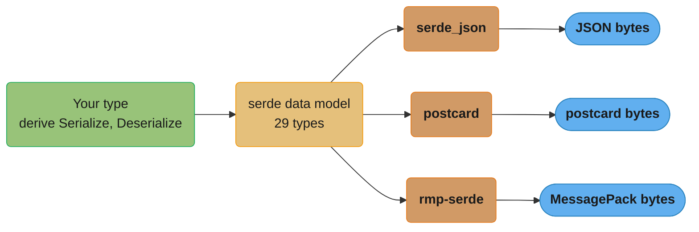
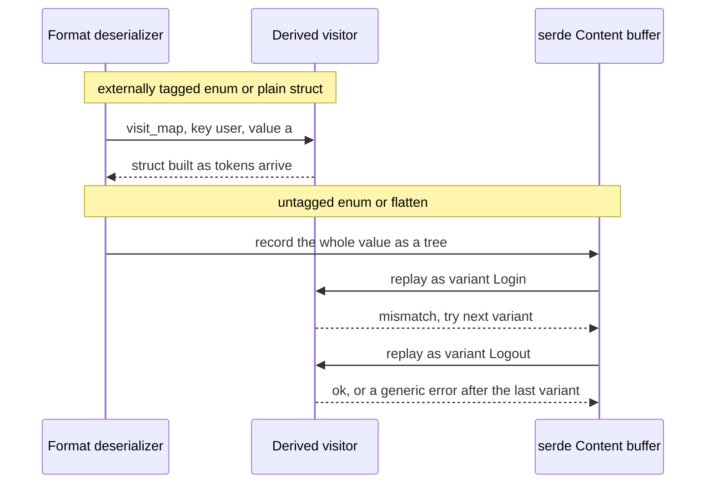

# serde and Serialization

> **Version anchor (2026-11-06).** Rust 1.99.1 (2026-10-15) on edition 2024. serde 1.0.229 (2026-07-18, MSRV 1.56), serde_json 1.0.154 (2026-10-11, MSRV 1.71), serde_with 3.24.0 (2026-09-26, MSRV 1.88), simd-json 0.19.0 (2026-10-27), sonic-rs 0.5.10 (2026-09-11), postcard 1.1.3 (2025-07-24), rmp-serde 1.3.1 (2025-12-23) and prost 0.14.4 (2026-06-07). bincode 3.0.0 (2025-12-16) is a tombstone release: the crate is unmaintained and holds only a README and a `compile_error!`.

---

## 1. Concept Overview

serde is a serialization framework, and JSON is only one of its formats. It defines a protocol
between two sides that depend only on serde. A **data
structure** implements `Serialize` and `Deserialize` and describes itself in terms of serde's
**data model**: 29 types such as `bool`, `i64`, `str`, `seq`, `map`, `struct` and four kinds of
enum variant. A **data format** (serde_json, postcard, rmp-serde, serde_yaml-style crates)
implements `Serializer` and `Deserializer` and maps those 29 types onto bytes. `#[derive]`
writes the first half for you, and the format crate ships the second half. Any derived type
works with any format, with no runtime reflection.

The derive generates plain Rust code that is monomorphized per format. There is no type
registry, no field lookup by string at runtime beyond a `match` on field names, and no
allocation the type itself does not ask for. A struct of borrowed `&'de str` fields can
deserialize straight out of the input buffer with zero copies. That is the speed story.

The production story is about the attributes. `flatten`, `untagged` and internally tagged
enums make serde buffer the input into an internal tree before it can decide what it is
reading, which costs allocations and turns precise errors into vague ones. A non-self-describing
format such as postcard cannot support those attributes at all. `deny_unknown_fields` does not
combine with `flatten`. serde_json stops at 128 levels of nesting by default, and that limit is
a security control. Schema evolution rules differ between JSON, where field
names travel with the data, and positional formats, where adding a field breaks every stored
record.

This page covers the serde model, the derive attributes that change cost or behavior,
zero-copy deserialization, the format choice, and evolution. The lifetime rules behind
`Deserialize<'de>` come from [Lifetimes and the Borrow Checker](../lifetimes_and_the_borrow_checker/lifetimes_and_the_borrow_checker.md).

---

## 2. Intuition

> **One-line analogy**: the data model is a shipping container standard. Your type packs its
> cargo into standard containers, and each format is a ship, train or truck that knows how to
> carry standard containers. Neither side needs to know the other exists.

**Mental model**: deserialization is a conversation. The format reads a token and calls a
method on a **visitor** that your derived code supplies: "here is a map", "here is a key
called `id`", "here is the integer 42". The visitor builds your struct as the tokens arrive.
Some attributes break that conversation. An untagged enum cannot know which variant it is
reading until it has seen the whole value, so serde records the entire value into a buffer
first and then replays it once per variant until one fits.

**Why it matters**: the default derive is fast and strict enough for almost everything. The
production incidents come from three places: attributes that silently buffer (latency and
memory), error messages that say "did not match any variant" with no field name (on-call
time), and formats or attributes that make old data unreadable after a deploy (data loss).

**Key insight**: choose the attribute by its cost, not only by the JSON shape it produces. An
externally or adjacently tagged enum streams. An internally tagged or untagged one buffers.
`flatten` buffers. Borrowed fields avoid copies but tie the result to the input's lifetime.

---

## 3. Core Principles

- **Two traits per side.** `Serialize`/`Serializer` and `Deserialize<'de>`/`Deserializer<'de>`.
  Types and formats depend only on serde, never on each other.
- **The `'de` lifetime is the input's lifetime.** `Deserialize<'de>` may borrow from input that
  lives for `'de`. `DeserializeOwned` means "works for any input lifetime", which is what a
  function that reads from a socket or file needs.
- **Self-describing vs not.** JSON, MessagePack and CBOR carry type tags in the bytes, so a
  deserializer can answer "what comes next?" (`deserialize_any`). postcard and bincode-style
  formats do not, so any attribute that needs `deserialize_any` fails on them.
- **Buffering attributes cost memory and error quality.** `flatten`, `untagged` and internally
  tagged enums record input into serde's internal `Content` tree.
- **Parse at the boundary into strong types.** `try_from`, newtypes and enums move validation
  into deserialization, so the rest of the code never sees invalid values.
- **Untrusted input needs limits.** Body size limits, the recursion limit and bounded
  collection sizes protect the process. serde itself enforces none of them except what the
  format chooses to.
- **Evolution is a format property.** Named-field formats tolerate added fields with
  `#[serde(default)]`. Positional formats need an explicit version tag.

---

## 4. Types / Architectures / Strategies

### 4.1 Format choice (decision model)

| Format | Crate | Self-describing | Schema | Speed and size | Use for |
|---|---|---|---|---|---|
| JSON | serde_json 1.0.154 | Yes | None, names in data | Baseline | Public APIs, config, logs, anything a human or browser reads |
| JSON, SIMD | simd-json 0.19.0, sonic-rs 0.5.10 | Yes | None | Faster parse on large documents; simd-json needs a mutable input buffer | Hot JSON ingest paths you have profiled |
| MessagePack | rmp-serde 1.3.1 | Yes | None | Smaller than JSON, binary | Cache values, internal queues where JSON shape is fine but bytes matter |
| postcard | postcard 1.1.3 | No | Implicit, positional | Small, varint integers, `no_std` | Embedded, IPC between binaries built from one source tree |
| Protocol Buffers | prost 0.14.4 | Partly (field tags) | `.proto` file | Small, fast, cross-language | Service contracts across languages; gRPC ([gRPC with tonic](../grpc_with_tonic/grpc_with_tonic.md)) |
| Zero-copy archive | rkyv (not serde) | No | Rust types | Access without a parse step | Memory-mapped read-mostly data |
| bincode | bincode 3.0.0 | No | Positional | n/a | Do not pick for new code: unmaintained, and the README names wincode, postcard and rkyv instead |

Rules of thumb. Cross-language or human-facing: JSON, or protobuf when you own both sides and
need a schema. Rust-to-Rust on one release train: postcard. Profiled JSON bottleneck: try
sonic-rs or simd-json, keeping serde_json as the reference. Need evolution across independent
deploys: protobuf or JSON, never a positional format without a version envelope.

### 4.2 Enum representations

| Attribute | JSON for `Event::Login { user }` | Streams or buffers | Works on postcard | Notes |
|---|---|---|---|---|
| (default, external) | `{"Login":{"user":"a"}}` | Streams | Yes | Clearest errors |
| `#[serde(tag = "type")]` (internal) | `{"type":"Login","user":"a"}` | Buffers until the tag is found | No | No tuple variants; common in public APIs |
| `#[serde(tag = "t", content = "c")]` (adjacent) | `{"t":"Login","c":{"user":"a"}}` | Streams if the tag comes first | No | Good for typed event envelopes |
| `#[serde(untagged)]` | `{"user":"a"}` | Buffers, then tries each variant in order | No | Error: "data did not match any variant of untagged enum"; first match wins |

### 4.3 Typed vs dynamic vs raw

| Target | Allocation | Validation | Use for |
|---|---|---|---|
| Typed struct | Only owned fields | Full, at parse time | Known shapes, which is most code |
| Borrowed struct (`&'de str`, `Cow<'de, str>`) | Little or none | Full | Hot paths over a buffer that outlives the value |
| `serde_json::Value` | One node per value, a `BTreeMap` per object (`IndexMap` with `preserve_order`) | None | Truly dynamic data, transforms, tests |
| `Box<RawValue>` / `&RawValue` (feature `raw_value`) | One copy, or none when borrowed | Syntax only | Passing a sub-document through unchanged, deferring its parse |

---

## 5. Architecture Diagrams

### 5.1 The two halves and the data model



Types and formats meet only at the data model. Adding a format to a codebase needs no change to
any derived type, and a new type works with every format already in use.

### 5.2 Streaming vs buffering deserialization



The buffered path allocates a node per value and loses the original error position. An
untagged enum with 5 variants can parse the same input 5 times before it reports one generic
error.

### 5.3 Where each format sits


The positions are qualitative. MessagePack moves between quadrants depending on whether structs
are written as maps with names (`rmp_serde::to_vec_named`) or as positional arrays
(`rmp_serde::to_vec`).

---

## 6. How It Works - Detailed Mechanics

### 6.1 The derive and its attributes

```rust
// fragment: serde 1 with derive, serde_json 1
use serde::{Deserialize, Serialize};

#[derive(Debug, Serialize, Deserialize)]
#[serde(rename_all = "camelCase")]
struct Order {
    order_id: u64,
    #[serde(default)]
    notes: Vec<String>,
    #[serde(skip_serializing_if = "Option::is_none")]
    coupon: Option<String>,
    #[serde(alias = "amount")]
    total_cents: i64,
    currency: Currency,
}

#[derive(Debug, Serialize, Deserialize, Clone, Copy)]
#[serde(try_from = "String", into = "String")]
enum Currency { Usd, Eur }

impl TryFrom<String> for Currency {
    type Error = String;
    fn try_from(s: String) -> Result<Self, Self::Error> {
        match s.as_str() {
            "USD" => Ok(Currency::Usd),
            "EUR" => Ok(Currency::Eur),
            other => Err(format!("unsupported currency {other}")),
        }
    }
}

impl From<Currency> for String {
    fn from(c: Currency) -> String {
        match c { Currency::Usd => "USD".into(), Currency::Eur => "EUR".into() }
    }
}
```

What each attribute does at runtime:

- `rename_all = "camelCase"` changes the strings in the generated `match`. No runtime cost.
- `default` fills a missing field from `Default`. This is the main tool for adding fields
  without breaking old producers.
- `skip_serializing_if` omits the key. Consumers in other languages must then treat "missing"
  and "null" the same.
- `alias` accepts an old name on input and writes only the new one. Use it for renames.
- `try_from = "String"` on `Currency` is a container attribute. It deserializes a `String`, then
  runs `TryFrom`, so a bad currency fails with the error text and position, and an invalid
  `Order` never exists in memory.

A derived struct rejects a duplicate key (`duplicate field`). A `HashMap` or `Value` keeps the
last value for a repeated key, which matters when a proxy and a backend disagree about which
copy of `"role"` counts.

### 6.2 `flatten` and `deny_unknown_fields`

```rust
// fragment: serde 1
use serde::Deserialize;
use std::collections::HashMap;

#[derive(Deserialize)]
struct Envelope {
    id: String,
    #[serde(flatten)]
    extra: HashMap<String, serde_json::Value>,
}
```

`flatten` forces the outer struct to deserialize as a map and to buffer every key it does not
know into a `Content` tree, so the flattened field can read them afterwards. Costs:

- One allocation per buffered value, even for keys nobody reads.
- The format must be self-describing. postcard fails at runtime.
- `deny_unknown_fields` is not supported with `flatten`, on the outer struct or on the
  flattened one. serde documents the combination as unsupported, so its behavior is not a
  contract you can rely on.

When you need strict input and shared fields, repeat the fields, or nest them under a key
instead of flattening.

### 6.3 Zero-copy deserialization

A borrowed field points into the input buffer. This std-only model has the same lifetime
shape as `Deserialize<'de>`: the output borrows from the input and cannot outlive it.

```rust
#[derive(Debug, PartialEq)]
struct Event<'a> {
    kind: &'a str,
    user: &'a str,
}

fn parse(line: &str) -> Option<Event<'_>> {
    let (kind, user) = line.split_once(' ')?;
    Some(Event { kind, user })
}

fn main() {
    let buf = String::from("login alice");
    let event = parse(&buf);
    assert_eq!(event, Some(Event { kind: "login", user: "alice" }));
    // `event` borrows `buf`, so `buf` must stay alive while `event` is used.
}
```

With serde the same idea is:

```rust
// fragment: serde 1 with derive
use std::borrow::Cow;
use serde::Deserialize;

#[derive(Deserialize)]
struct Hit<'a> {
    path: &'a str,                 // fails if the JSON string contains an escape
    #[serde(borrow)]
    query: Cow<'a, str>,           // borrows when it can, allocates when it must
    ua: String,                    // always owned
}
```

`&'de str` cannot represent a JSON string with an escape such as `\"` or `é`, because the
unescaped text does not exist in the input. A literal UTF-8 `é` has no escape and borrows fine. serde_json then fails with "expected a borrowed
string". `Cow<'de, str>` borrows only when it is marked `#[serde(borrow)]`; without the
attribute it always allocates. A function that reads from a socket and returns the value must
use owned types and the `DeserializeOwned` bound, because the buffer dies at the end of the
function.

### 6.4 serde_json mechanics worth knowing

| Behavior | Detail |
|---|---|
| Recursion limit | 128 nesting levels by default; `Deserializer::disable_recursion_limit` needs the `unbounded_depth` feature |
| Dropping a deep `Value` | `Drop` of a nested `Value` is recursive too, so a value built with the limit disabled can overflow the stack when dropped |
| Non-finite floats | `NaN` and infinities serialize as `null`, so a round trip turns them into a deserialize error for `f64` |
| Numbers in `Value` | Stored as `u64`, `i64` or `f64`; `arbitrary_precision` keeps the original digits |
| Object order in `Value` | Sorted (`BTreeMap`) unless `preserve_order` (IndexMap) is enabled |
| `from_reader` | Does not buffer the reader itself; the serde_json docs say reading into memory and calling `from_slice` is usually faster |
| Errors | Carry line and column, except errors from a buffered `untagged` or internally tagged enum, which report line 0, column 0; wrap the deserializer with `serde_path_to_error` to get the field path |

A std-only sketch of the depth rule, to show what the limit protects against:

```rust
const MAX_DEPTH: usize = 128;

fn check_depth(input: &str) -> Result<(), String> {
    let mut depth = 0usize;
    for (i, b) in input.bytes().enumerate() {
        match b {
            b'[' | b'{' => {
                depth += 1;
                if depth > MAX_DEPTH {
                    return Err(format!("nesting deeper than {MAX_DEPTH} at byte {i}"));
                }
            }
            b']' | b'}' => depth = depth.saturating_sub(1),
            _ => {}
        }
    }
    Ok(())
}

fn main() {
    let ok = "[".repeat(100) + &"]".repeat(100);
    let bad = "[".repeat(10_000);
    assert!(check_depth(&ok).is_ok());
    assert!(check_depth(&bad).is_err());
}
```

A recursive-descent parser uses at least one stack frame per level. Without a limit, a small
body of repeated `[` bytes can overflow the thread stack (2 MiB by default for a std thread). Keep the limit, and keep the
HTTP body limit in front of it.

### 6.5 serde_with

serde_with adds reusable conversions through `#[serde_as]`, which must come before `#[derive]`
so it can rewrite the field attributes first.

```rust
// fragment: serde_with 3
use serde::{Deserialize, Serialize};
use serde_with::{serde_as, DisplayFromStr, DurationSeconds};
use std::time::Duration;

#[serde_as]
#[derive(Serialize, Deserialize)]
struct Limits {
    #[serde_as(as = "DisplayFromStr")]
    max_bytes: u64,                       // "1048576" on the wire
    #[serde_as(as = "DurationSeconds<u64>")]
    timeout: Duration,                    // 30 on the wire
}
```

`DisplayFromStr` is the usual fix for 64-bit IDs sent to JavaScript, which loses precision
above 2^53 when it parses numbers.

### 6.6 Fast JSON and binary formats

- **simd-json** parses with SIMD and needs `&mut [u8]` because it unescapes strings in place.
  Copy the body into a `Vec<u8>` you own, then call `simd_json::from_slice(&mut buf)`.
- **sonic-rs** also uses SIMD and reads from an immutable slice. Treat both as profiled
  optimizations; keep serde_json as the reference in tests.
- **rmp-serde** writes structs as positional arrays with `to_vec` and as maps with field names
  with `to_vec_named`. Positional is smaller and breaks when a field is added in the middle.
- **postcard** encodes integers as varints and needs no allocator in `no_std`. It is not
  self-describing, so `untagged`, internal tags and `flatten` do not work.
- **prost** generates Rust structs from `.proto` files. It does not use serde for the wire
  format. Field numbers, not names, carry compatibility.

### 6.7 Schema evolution

| Change | JSON (named) | Positional (postcard, MessagePack arrays) | Protobuf |
|---|---|---|---|
| Add an optional field | Safe with `#[serde(default)]` on readers | Breaks old data unless appended and defaulted with a version tag | Safe with a new field number |
| Remove a field | Safe if readers ignore unknown keys | Breaks | Safe; reserve the number |
| Rename a field | Use `alias` on readers first, then switch writers | No names, so position must not move | Safe; names are not on the wire |
| Add an enum variant | Old readers fail unless a `#[serde(other)]` unit variant exists (tagged enums) | Breaks old readers | Old readers keep the unknown value |
| Change a type | Breaks | Breaks | Only within compatible scalar groups |

The safe order for any change is: deploy readers that accept old and new, then deploy writers
that produce new, then remove the old path. Store a version number in every persisted blob in a
positional format.

---

## 7. Real-World Examples

- **axum** uses serde for `Json`, `Query` and `Form`, and reports the failing field through
  `serde_path_to_error`; see [Web Services with axum, tower and hyper](../web_services_axum_tower_and_hyper/web_services_axum_tower_and_hyper.md).
- **sqlx** maps Postgres `jsonb` columns to `sqlx::types::Json<T>` through serde
  ([Databases with sqlx and diesel](../databases_sqlx_and_diesel/databases_sqlx_and_diesel.md)).
- **pydantic-core** is the Rust core of Pydantic v2. It validates against a schema built at
  runtime instead of code derived per type; see
  [Pydantic Core and Performance](../../fastapi/pydantic_v2_deep_dive/pydantic_core_and_performance.md).
- **Other languages.** Go's reflection-driven codec, its silent field drops and its `json/v2`
  are in [JSON and Serialization in Go](../../go/json_and_serialization/json_and_serialization.md).
  Jackson's annotation model and polymorphic-type risks are in
  [JSON Processing with Jackson](../../java/json_processing_jackson/json_processing_jackson.md).
  Python's `pickle` and `json` tradeoffs are in
  [File I/O and Serialization](../../python/file_io_and_serialization/file_io_and_serialization.md).
  serde differs from all three: the code is generated at compile time per type and per format.

---

## 8. Tradeoffs

| Choice | Gain | Cost |
|---|---|---|
| Typed struct over `Value` | Validation at the boundary, less memory | Every shape change needs a code change |
| Borrowed fields over owned | No copies on hot paths | Value cannot outlive the buffer; escapes force `Cow` |
| External tagging over internal | Streams, clear errors, works on every format | JSON shape less familiar to API consumers |
| `untagged` | Accepts several shapes with no tag | Buffers, tries every variant, poor errors, order-sensitive |
| `flatten` | Shared fields and catch-all maps | Buffers, no `deny_unknown_fields`, self-describing formats only |
| `deny_unknown_fields` | Typos in config fail loudly | Any new field from a producer breaks old readers |
| SIMD JSON over serde_json | Faster on large inputs | Extra dependency, mutable buffer (simd-json), CPU feature detection |
| postcard over JSON | Small, `no_std` | No evolution without a version tag, not debuggable by eye |
| Protobuf over JSON | Schema, compact, cross-language | Code generation step, `.proto` files to govern |

---

## 9. When to Use / When NOT to Use

**Use serde derive when:**

- A Rust type crosses a process, file or network boundary in a common format.
- You want validation at the boundary with `try_from`, enums and newtypes.
- You need the same types in several formats (JSON for the API, MessagePack for a cache).

**Use a different tool when:**

- Data is read far more often than written and is large: rkyv or a memory-mapped layout avoids
  the parse step entirely.
- The contract is shared with other languages and teams: start from a `.proto` or JSON Schema,
  and generate code, rather than treating a Rust struct as the source of truth.
- The input is a stream of millions of records where only two fields matter: a streaming
  `Deserializer` with `IgnoredAny`, or a lower-level tokenizer, beats building every value.
- You need `bincode`: it is unmaintained. Pick postcard, or one of the alternatives its README
  names.

---

## 10. Common Pitfalls

The incidents in this section are composite examples. Their numbers are illustrative and do not
come from one real system.

### 10.1 Returning a borrowed value from a function that owns the buffer

A config loader read a file into a `String`, deserialized a struct with `&str` fields from it,
and tried to return the struct. The compiler refuses, because the struct would point into a
`String` that is freed when the function returns.

```rust
// BROKEN
// error[E0515]: cannot return value referencing local variable `buf`
struct Event<'a> {
    kind: &'a str,
    user: &'a str,
}

fn parse(line: &str) -> Option<Event<'_>> {
    let (kind, user) = line.split_once(' ')?;
    Some(Event { kind, user })
}

fn read_event() -> Option<Event<'static>> {
    let buf = String::from("login alice"); // stands in for fs::read_to_string
    parse(&buf)
}

fn main() {
    if let Some(e) = read_event() {
        println!("{} {}", e.kind, e.user);
    }
}
```

```rust
// FIX: an owned type, the equivalent of a DeserializeOwned struct
struct Event {
    kind: String,
    user: String,
}

fn parse(line: &str) -> Option<Event> {
    let (kind, user) = line.split_once(' ')?;
    Some(Event { kind: kind.to_owned(), user: user.to_owned() })
}

fn read_event() -> Option<Event> {
    let buf = String::from("login alice");
    parse(&buf)
}

fn main() {
    if let Some(e) = read_event() {
        println!("{} {}", e.kind, e.user);
    }
}
```

With serde the error shows up as a lifetime error on `T: Deserialize<'de>`. The fix is the same:
owned fields and a `T: DeserializeOwned` bound on the loader.

### 10.2 `untagged` hides the real error

A webhook enum with 6 untagged variants rejected a valid-looking payload with "data did not
match any variant of untagged enum Event". The real cause was a timestamp in milliseconds that
overflowed the `u32` seconds field of the intended variant. Debugging took hours because serde
reports no field, no variant and no position. Switching to `#[serde(tag = "type")]` produced
"invalid value: integer `1730851200000`, expected u32", and the fix took minutes. The
internally tagged form still buffers, so that error also has no line and column, but it names
the value and the expected type.

### 10.3 `deny_unknown_fields` on a public API

An internal service added `deny_unknown_fields` to its request type for "strictness". The next
release of a client added an optional field, and every request from upgraded clients failed with
400 until the server shipped. Use `deny_unknown_fields` on config files you own, not on inputs
from independently deployed producers.

### 10.4 Positional format, added field

A team cached sessions with `rmp_serde::to_vec` (positional arrays) and inserted a field in the
middle of the struct. After the deploy every cached session failed to decode, and 2 million
users were logged out. Use `to_vec_named`, or prefix every blob with a version and read old
versions explicitly.

### 10.5 Recursion limit disabled for "large documents"

Someone enabled `unbounded_depth` and called `disable_recursion_limit` to fix an error on a
legitimately deep document. A fuzzer later sent `[` repeated 200,000 times and crashed the
worker with a stack overflow, which aborts the whole process, not one request. Depth 128 was
right; the deep document needed a different representation.

### 10.6 64-bit IDs in JavaScript

IDs above 2^53 came back off by a few units in the browser. serde_json wrote them as numbers,
which is correct JSON, and JavaScript rounded them. Serializing IDs as strings
(`DisplayFromStr`) fixed it for every client at once.

---

## 11. Technologies & Tools

| Tool | What it is for |
|---|---|
| serde | Data model, traits and derive macros |
| serde_json | JSON format, `Value`, `RawValue`, `json!` |
| serde_with | Reusable field conversions through `#[serde_as]` |
| serde_path_to_error | Wraps a deserializer to report the failing field path |
| simd-json | SIMD JSON parser with a serde interface, needs a mutable buffer |
| sonic-rs | SIMD JSON parser and serializer from the CloudWeGo project |
| rmp-serde | MessagePack format, positional or named structs |
| postcard | Compact varint format for `no_std` and IPC |
| prost | Protocol Buffers code generation and encoding |
| rkyv | Zero-copy archive format outside serde |
| cargo-fuzz | Fuzz deserializers with arbitrary bytes to find panics and stack overflows |

---

## 12. Interview Questions with Answers

**Q: Why can't you combine `#[serde(flatten)]` with `#[serde(deny_unknown_fields)]`?**
**Short:** `flatten` collects unknown keys into a buffer for the inner field to read, so the outer struct cannot know which keys are truly unknown, and serde does not support the combination.

With `flatten`, the outer struct deserializes as a map and stores every key it does not
recognize, because the flattened field may want it. Only after the inner field has taken its
keys could anything be called unknown, and the derive does not do that pass. serde's docs say
the combination is unsupported on either struct, so whatever it does in one release is not a
contract. For strict input, list the fields directly instead of flattening.

**Q: What does `#[serde(untagged)]` cost compared to a tagged enum?**
**Short:** An untagged enum buffers the whole value, then tries each variant in declaration order, so it allocates more, can parse the input many times, and reports one vague error.

serde cannot pick a variant from a tag, so it records the value into its internal `Content`
tree and replays it against each variant. The first variant that succeeds wins, which makes
variant order part of the contract. When none match, the error is "data did not match any
variant of untagged enum" with no field or position. Use an internal or adjacent tag when you
control the format, and keep `untagged` for accepting legacy shapes.

**Q: What is the difference between `Deserialize<'de>` and `DeserializeOwned`?**
**Short:** `Deserialize<'de>` lets a type borrow from input that lives for `'de`, while `DeserializeOwned` means the type works for any input lifetime and borrows nothing.

`DeserializeOwned` is `for<'de> Deserialize<'de>`. A struct with `&'de str` fields implements
`Deserialize<'de>` only for its own lifetime, so it is not `DeserializeOwned`. Use the owned
bound on any function that reads into a local buffer and returns the value, such as reading a
socket, a file or an HTTP body. Use borrowed types only when the caller keeps the buffer alive
longer than the value.

**Q: Why does deserializing into a `&str` field fail on some valid JSON strings?**
**Short:** A JSON string with an escape sequence has no unescaped copy in the input to borrow, so serde_json cannot produce a `&str` and fails with "expected a borrowed string".

`"a\"b"` decodes to `a"b`, which is not a substring of the input bytes. A borrowed field can
only point at bytes that already exist. Use `Cow<'de, str>` with `#[serde(borrow)]` so the
field borrows plain strings and allocates for escaped ones, or use `String` when the copy
does not matter.

**Q: What does serde_json's recursion limit protect, and what is the default?**
**Short:** It stops input nested deeper than 128 levels from overflowing the stack of the recursive parser, which would abort the whole process.

Each nesting level of arrays or objects is a stack frame in the deserializer. A small request
body of repeated `[` would otherwise exhaust the thread stack, and a stack overflow aborts the
process rather than failing one request. `disable_recursion_limit` exists behind the
`unbounded_depth` feature for trusted data, and even then you must drop deep `Value` trees
iteratively. Keep the default for anything from the network.

**Q: Which serde attributes do not work with postcard, and why?**
**Short:** `untagged`, internally tagged enums and `flatten` need `deserialize_any`, which a non-self-describing format like postcard cannot support.

postcard writes values with no type tags, so its deserializer cannot answer "what comes next?".
Buffering attributes rely on exactly that question to fill serde's `Content` tree. They compile
and then fail at runtime. Use externally tagged enums and plain structs with positional formats.

**Q: How do you add a field to a JSON-serialized struct without breaking old producers?**
**Short:** Mark the new field `#[serde(default)]` or make it an `Option`, deploy readers first, and only then deploy writers that send the field.

A missing field is an error unless the derive knows a default. With `default`, old payloads
still parse. Readers must ship before writers, because an old reader that uses
`deny_unknown_fields` rejects the new field. For renames, add `alias` for the old name on
readers before writers change.

**Q: Why is `deny_unknown_fields` a good default for config files and a bad one for API requests?**
**Short:** It turns a typo into a startup error in files you own, but it rejects every newer client that sends a field the server does not know yet.

A misspelled key in a config file otherwise falls back to a default silently, which is how
timeouts end up at zero. For API inputs, producers deploy independently, and tolerance of
unknown fields is what lets them evolve. Use it on config, not on wire contracts.

**Q: When should you use `serde_json::Value` instead of a typed struct?**
**Short:** Use `Value` only for truly dynamic data, because it allocates a node per value, sorts object keys, and validates nothing.

A typed struct checks shape and types once and stores only what you need. `Value` builds a
tree of enums, uses a `BTreeMap` per object unless `preserve_order` is on, and pushes every
type check into the code that reads it. Good uses: generic transforms, JSON patch, tests.
For a known sub-document that you only pass along, use `RawValue`.

**Q: What does `RawValue` give you?**
**Short:** `RawValue` keeps a sub-document as validated but unparsed JSON text, so you can pass it on or parse it later without building a tree.

Enable the `raw_value` feature and use `Box<RawValue>` (one copy) or `&'de RawValue` (no copy).
Common uses: an envelope where only the header fields matter to this service, or a payload
stored as `jsonb` and returned unchanged. You pay for a syntax scan, not for allocation of
every value.

**Q: Why do 64-bit integer IDs break in browsers, and how do you fix it with serde?**
**Short:** JavaScript parses JSON numbers as doubles, which are exact only up to 2^53, so serialize large IDs as strings with `DisplayFromStr` or a newtype.

serde_json writes `u64` as a JSON number, which is valid. The precision loss happens in the
client. Converting at the server boundary fixes all clients at once. serde_with's
`#[serde_as(as = "DisplayFromStr")]` does it per field, and a newtype with custom `Serialize`
does it for the type everywhere.

**Q: Which enum representation should a public JSON API use?**
**Short:** An internally tagged enum (`tag = "type"`) is the most familiar JSON shape, while adjacent tagging keeps streaming and works for tuple variants.

Internal tagging gives `{"type":"Login","user":"a"}`, the shape most API consumers expect.
It buffers until it finds the tag and does not allow tuple variants. Adjacent tagging gives
`{"t":"Login","c":{...}}` and streams when the tag comes first. External tagging is cheapest but
looks odd to non-Rust consumers. Add a `#[serde(other)]` unit variant so old readers survive
new variants.

**Q: What does `#[serde(try_from = "T")]` buy you over validating after deserialization?**
**Short:** It makes invalid values impossible to construct, because the conversion runs inside deserialization and its error becomes a deserialize error with position.

The type is first deserialized as `T`, then converted with `TryFrom<T>`. The rest of the program
receives only valid values, so no code path can forget to call `validate()`. Pair it with
`into = "T"` to serialize back to the same representation.

**Q: How does `#[serde(flatten)]` affect performance?**
**Short:** It buffers every unrecognized key into an internal tree before the flattened field reads it, which adds allocations on every message, including keys nobody uses.

The outer struct becomes a map visitor that cannot stream. For a small config struct that cost
is invisible. On a hot ingest path with large envelopes it shows up as allocator time in
profiles. Prefer nesting the shared part under a key, or repeating fields.

**Q: Why should you avoid bincode for new code?**
**Short:** bincode is unmaintained: release 3.0.0 holds only a README and a `compile_error!`, and the README points to wincode, postcard and rkyv instead.

The maintainers stated that no further releases will be published on crates.io. Existing
1.x and 2.x users keep working, but there will be no fixes. For new compact Rust-to-Rust
encoding pick postcard, and for zero-copy reads consider rkyv.

**Q: What is the difference between simd-json and serde_json in how they read input?**
**Short:** simd-json needs a mutable byte buffer because it unescapes strings in place with SIMD, while serde_json reads from an immutable slice or reader.

The in-place design avoids extra copies and lets SIMD scan many bytes per instruction. The
cost is an owned `Vec<u8>` you are allowed to modify, so you cannot parse a borrowed `&[u8]`
from a shared cache. Benchmark on your own payloads before switching; small documents often see
little gain.

**Q: Why is `serde_json::from_reader` slower than reading into a buffer first?**
**Short:** `from_reader` does not buffer its input and cannot borrow from it, so reading the whole input into a `Vec<u8>` and calling `from_slice` is usually faster.

Many small reads go through the reader's trait method, and an unbuffered `File` turns each one
into a system call. The parser also cannot borrow strings from a reader. The serde_json docs recommend reading into memory first when the data fits. For a body
already capped at a few megabytes, that is always the case.

**Q: What happens to `f64::NAN` when serialized with serde_json?**
**Short:** serde_json writes non-finite floats as `null`, so a round trip of NaN or infinity into an `f64` field fails to deserialize.

JSON has no NaN or infinity. Writing `null` keeps the output valid but loses the value, and the
reader then sees a `null` where a number was expected. Model the case explicitly with an
`Option<f64>` or a tagged enum, or reject non-finite values before you serialize.

**Q: How do positional binary formats break schema evolution?**
**Short:** Positional formats identify fields by order, not name, so inserting, removing or reordering a field makes every stored blob decode into the wrong fields or fail.

postcard and `rmp_serde::to_vec` write a struct as a sequence. Old data has no notion of the new
field. Prefix every persisted blob with a version, keep old structs to read old versions, or use
a named format (JSON, MessagePack maps, protobuf) for data that outlives one deploy.

**Q: Why might a derived `Deserialize` reject input that a `HashMap` accepts?**
**Short:** A derived struct errors on a duplicate key, while a map keeps the last value, so two parsers of the same JSON can disagree about which value counts.

serde derive reports "duplicate field" for a struct. `HashMap` and `serde_json::Value` overwrite.
If a proxy checks one copy of `"role"` and a backend reads the other, that disagreement is a
security bug. Parse into a derived struct at every trust boundary.

---

## 13. Best Practices

- Derive `Serialize` and `Deserialize` on types that exist for the wire, and convert to domain
  types with `try_from`, rather than putting serde attributes on core domain types.
- Prefer external or adjacent tagging. Use `untagged` only to accept legacy shapes.
- Avoid `flatten` on hot paths and anywhere the format is not self-describing.
- Use `deny_unknown_fields` on config, never on inputs from independently deployed producers.
- Keep serde_json's recursion limit, and put an HTTP body limit in front of every parser.
- Use owned types and `DeserializeOwned` for anything read from I/O; borrow only from buffers
  the caller keeps alive.
- Version every blob you store in a positional format.
- Serialize 64-bit IDs as strings for JavaScript consumers.
- Fuzz every deserializer that reads untrusted bytes ([Testing, Fuzzing and Miri](../testing_fuzzing_and_miri/testing_fuzzing_and_miri.md)).
- Map deserialize errors to 400 or 422 at the edge with the field path, and never echo the raw
  input back ([Error Design for Libraries and Applications](../error_handling_and_panics/error_design_for_libraries_and_applications.md)).

---

## 14. Case Study

### Clickstream ingest: from owned JSON to borrowed batches

This is an illustrative scenario. Its numbers are examples, not measurements from a real system.

**Context.** An ingest service receives clickstream events as newline-delimited JSON, about
120,000 events per second per pod, each event about 400 bytes. Each event is parsed, filtered
on two fields, and forwarded as MessagePack to a queue. Profiles showed 38 percent of CPU in
the allocator: every event built 9 `String` fields, and only `kind` and `user` were read.

**Step 1: borrow instead of own.** The team changed the event struct to `&'de str` fields with
`Cow<'de, str>` for the two fields that sometimes carry escapes. The first attempt collected the
borrowed events across lines of a reused line buffer, and it did not compile.

```rust
// BROKEN
// error[E0597]: `line` does not live long enough
struct Event<'a> {
    kind: &'a str,
}

fn parse(line: &str) -> Option<Event<'_>> {
    let (kind, _) = line.split_once(' ')?;
    Some(Event { kind })
}

fn main() {
    let mut events = Vec::new();
    for i in 0..3 {
        let line = format!("login user{i}"); // a buffer that dies each iteration
        if let Some(e) = parse(&line) {
            events.push(e);
        }
    }
    println!("{}", events.len());
}
```

```rust
// FIX: keep the whole batch buffer alive while the borrowed events are in use
struct Event<'a> {
    kind: &'a str,
}

fn parse(line: &str) -> Option<Event<'_>> {
    let (kind, _) = line.split_once(' ')?;
    Some(Event { kind })
}

fn main() {
    let batch = String::from("login user0\nclick user1\nlogin user2\n");
    let events: Vec<Event<'_>> = batch.lines().filter_map(parse).collect();
    let logins = events.iter().filter(|e| e.kind == "login").count();
    assert_eq!(logins, 2);
}
```

The production version reads one HTTP body (capped at 4 MB) into a `Vec<u8>`, parses every
line into borrowed events, filters, serializes the survivors, and only then drops the buffer.
The borrow checker enforces that order.

**Step 2: stop parsing what is not read.** Fields the service never inspects moved to
`IgnoredAny`, and the payload that is forwarded unchanged became `&RawValue`. Allocation per
event dropped from 9 strings to none for 94 percent of events (the ones without escapes in the
two `Cow` fields).

**Step 3: fix the downstream format.** The queue consumer had used `rmp_serde::to_vec`. The
team switched to `to_vec_named` after a field insert in staging made every in-flight message
unreadable, and added a one-byte version prefix to each message.

**Step 4: what they did not do.** simd-json was benchmarked and gave 11 percent more throughput
on this payload size. The team kept serde_json, because the borrowed path had already removed
the allocator from the profile, and simd-json would have needed a mutable copy of every body.

**Result.** CPU per pod fell from 3.1 to 1.4 cores at the same traffic, p99 latency for a batch
fell from 22 ms to 9 ms, and the version prefix let the consumer roll out a schema change a
month later with no lost messages. The rule they wrote down: borrow inside one request,
own anything that crosses a function or task boundary, and version anything that is stored.
