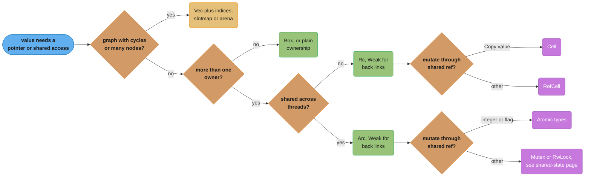
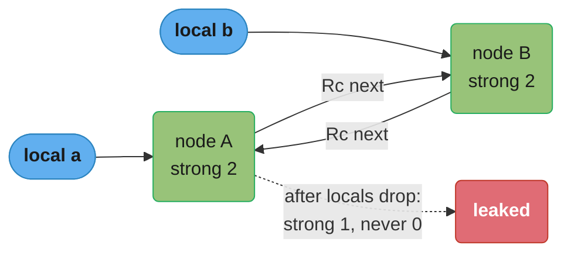

# Smart Pointers and Interior Mutability

> **Version anchor (2026-11-06):** Rust 1.99.1 (2026-10-15) on edition 2024. Gated items on this
> page: `LazyCell` and `LazyLock` `[1.80]`, `LazyLock::get` and `LazyLock::force_mut` `[1.94]`,
> and `Box`/`Rc`/`Arc::new_zeroed` `[1.92]`. Crates: slotmap 1.1.1, bumpalo 3.20.3, self_cell
> 1.3.0, arc-swap 1.9.3. Layout numbers are for 64-bit targets.

---

## 1. Concept Overview

A smart pointer is a type that owns or shares a value through a pointer and adds behavior: heap
allocation (`Box<T>`), shared ownership by reference counting (`Rc<T>`, `Arc<T>`), or a
non-owning handle (`Weak<T>`). All of them implement `Deref`, so `*p` and method calls reach
the inner value, and all of them release their resource in `Drop`.

Interior mutability is the second half of this page. The borrow rules say you may mutate only
through `&mut T`. Some designs need mutation through a shared reference: a cache inside an
immutable service object, a counter in a structure shared by `Rc`, a lazily initialized global.
The cell types (`Cell<T>`, `RefCell<T>`, `OnceCell<T>`, `LazyCell<T>`) allow it on one thread,
and `Mutex<T>`, `RwLock<T>`, the atomics, `OnceLock<T>` and `LazyLock<T>` allow it across
threads. Every one of them is built on `UnsafeCell<T>`, the only primitive the compiler
accepts as "this memory may change behind a `&`".

The cost of each choice is concrete: one heap allocation for `Box`, `Rc` and `Arc`, a 16-byte
count header for `Rc` and `Arc`, an atomic instruction per `Arc` clone and drop, and a
borrow-flag check (with a possible panic) per `RefCell` access. This page gives the decision
model for these types: `Box` or `Rc` or `Arc`, `RefCell` or `Mutex`, or no shared pointer at
all because indices into an arena fit the design better.

Moves and drop order are in
[Ownership, Borrowing and RAII](../ownership_borrowing_and_raii/ownership_borrowing_and_raii.md).
How to choose between `Mutex`, `RwLock`, channels, actors and atomics for state shared across
threads is in
[Channels, Atomics and Shared State](../channels_atomics_and_shared_state/channels_atomics_and_shared_state.md).

---

## 2. Intuition

> **One-line analogy:** `Box` is a storage unit with one key. `Rc` is a shared flat where the
> last tenant out turns off the lights. `RefCell` is a meeting room with a sign-up sheet
> checked at the door instead of at booking time.

**Mental model.** Ownership in plain Rust is a tree. Smart pointers let you bend it. `Box` keeps
it a tree but moves a node to the heap. `Rc` and `Arc` turn it into a directed acyclic graph,
where a node has several owners and dies when the last owner lets go. `Weak` adds edges that do
not count as ownership, which is how you point back up a tree without creating a cycle. Cells
move the shared-xor-mutable check from compile time to run time, or, for `Cell`, avoid the
check by never handing out a reference to the inside at all.

**Why it matters.** Engineers arriving from Java, Go, Python or C# reach for
`Rc<RefCell<T>>` to rebuild the object graph they are used to. It compiles, and then it fails
in three ways the compiler used to prevent: a `BorrowMutError` panic in production when two code
paths touch the same node, a memory leak from a reference cycle, and a type that cannot move to
another thread. Knowing the costs lets you pick the plain design first.

**Key insight.** The best smart pointer is often none. A `Vec<Node>` plus `usize` indices has
one allocation, no counts, no runtime borrow flags, is `Send` and `Sync` when the node type is,
and has no cycles to leak. Use `Rc`, `Arc` and cells when ownership really is shared, not to
avoid deciding who owns what.

---

## 3. Core Principles

1. **`Box<T>` is single ownership on the heap.** It costs one allocation and one pointer (8
   bytes). Use it for recursive types, trait objects, and large values you want to move cheaply.
2. **`Rc<T>` and `Arc<T>` share ownership by counting.** Each allocation holds a strong count,
   a weak count and the value. Clone increments the strong count. The value drops when it hits
   zero.
3. **`Rc` is single-thread, `Arc` is thread-safe.** `Rc` uses plain increments and is neither
   `Send` nor `Sync`. `Arc` uses atomic increments and is `Send + Sync` when `T: Send + Sync`.
4. **Shared ownership gives read-only access.** `Rc<T>` and `Arc<T>` hand out `&T`. To mutate,
   combine them with a cell or a lock, or use `make_mut` for copy-on-write.
5. **`Weak<T>` breaks cycles.** A weak handle does not keep the value alive. `upgrade()` returns
   `Some(Rc<T>)` only while a strong owner exists.
6. **Interior mutability is built on `UnsafeCell<T>`.** Writing through a `&T` without it is
   undefined behavior, and rustc denies the obvious cast with `invalid_reference_casting`.
7. **`RefCell` checks at run time and panics on conflict.** `borrow_mut` panics while another
   borrow is live. `try_borrow_mut` returns `Err(BorrowMutError)` instead.
8. **Single-thread cells are not `Sync`.** `Cell` and `RefCell` cannot sit in a `static` or be
   shared between threads. Use `Mutex`, `RwLock`, atomics, `OnceLock` or `LazyLock` there.
9. **Prefer ownership redesign over shared mutation.** Indices, arenas and message passing
   remove most `Rc<RefCell<T>>` before it is written.

---

## 4. Types / Architectures / Strategies

### 4.1 Owning and sharing pointers

| Type | Ownership | Thread-safe | Size of the handle | Extra cost | Typical use |
|---|---|---|---|---|---|
| `Box<T>` | Single | `Send`/`Sync` if `T` is | 8 bytes (16 for `Box<dyn Trait>` or `Box<[T]>`) | One allocation | Recursive types, trait objects, large values |
| `Rc<T>` | Shared | No | 8 bytes | One allocation with a 16-byte count header; plain increment per clone | Single-thread graphs, shared immutable config in one thread |
| `Arc<T>` | Shared | Yes, if `T: Send + Sync` | 8 bytes (16 for `Arc<str>`) | Same header; atomic increment per clone and drop | Shared state across threads and tasks |
| `Weak<T>` | None | Like its `Rc` or `Arc` | 8 bytes | Keeps the allocation (not the value) alive | Parent links, caches, observers |

### 4.2 Interior mutability

| Type | Threads | Check | Failure mode | Gives you |
|---|---|---|---|---|
| `Cell<T>` | One | None: values are copied or swapped in and out | None | `get` (for `T: Copy`), `set`, `replace`, `take` |
| `RefCell<T>` | One | Run-time borrow flag | Panic on conflict (`try_*` returns `Err`) | `Ref<T>` and `RefMut<T>` guards |
| `OnceCell<T>` | One | Set once | `set` returns `Err` if already set | `&T` after initialization |
| `LazyCell<T>` | One | Initialize on first access | Panic in the initializer poisons it | `&T` through `Deref` |
| `Mutex<T>` | Many | Lock | Blocking, deadlock, poisoning after a panic | `MutexGuard<T>` |
| `RwLock<T>` | Many | Read-write lock | Writer starvation depends on the OS | Read and write guards |
| `AtomicUsize` and friends | Many | Hardware atomic | None | Integer and pointer updates |
| `OnceLock<T>` | Many | Set once, synchronized | `set` returns `Err` if already set | `&T` after initialization |
| `LazyLock<T>` | Many | Initialize on first access, synchronized | Panic in the initializer poisons it | `&T` through `Deref`, works in a `static` |

### 4.3 Borrowed or owned: `Cow`

| Type | Holds | Allocates when |
|---|---|---|
| `Cow<'a, str>` | `Borrowed(&'a str)` or `Owned(String)` | Only when `to_mut()` or a constructor needs a change |
| `Cow<'a, [T]>` | `Borrowed(&'a [T])` or `Owned(Vec<T>)` | Same |

### 4.4 Alternatives to shared pointers

| Alternative | Shape | Gains | Loses |
|---|---|---|---|
| `Vec<T>` plus `usize` indices | One owner of all nodes | One allocation, no counts, `Send`, no leaks | Stale index after removal reads the wrong node |
| `slotmap` | Generational keys | Stale keys return `None` | A dependency and a slightly larger key |
| `bumpalo` arena | Bump allocation, free all at once | Very cheap allocation, references with one lifetime | No per-value free; `Drop` does not run for arena values |
| Message passing | One thread owns the state | No locks in user code | A channel hop per operation |

---

## 5. Architecture Diagrams

### 5.1 Decision model: which pointer or cell



Ask the graph question first. Most `Rc<RefCell<T>>` code is a graph that an arena models with
one owner and no runtime checks. The lock choice for the multi-thread branch is the decision
model in
[Channels, Atomics and Shared State](../channels_atomics_and_shared_state/channels_atomics_and_shared_state.md).

### 5.2 What an `Rc` allocation holds

```
  handle (stack, 8 bytes)          one heap allocation (RcBox)
  +-----------+                    +--------------------------+
  | a: ptr ---+------------------->| strong: usize = 2        |   16-byte header
  +-----------+         +--------->| weak:   usize = 1        |   (64-bit target)
  | b: ptr ---+---------+          | value:  T                |
  +-----------+                    +--------------------------+
  | w: Weak --+---------------------^   (Rc::weak_count reports 1)

  drop(a), drop(b)  ->  strong = 0: T's destructor runs, value memory is dead
  drop(w)           ->  weak = 0:   the whole allocation is freed
```

`Arc` has the same layout with atomic counters. When the strong count reaches zero the value
is dropped, but the allocation stays until the last `Weak` also goes. A long-lived `Weak` to a
large `T` keeps only the header and the dead `T`'s bytes, not anything `T` owned.

### 5.3 A cycle that never frees



When the two locals drop, each node still holds the other at a strong count of 1. Neither
destructor runs. Section 6.4 measures it, and the fix is to make one direction a `Weak`.

---

## 6. How It Works - Detailed Mechanics

### 6.1 `Box`: recursive types, trait objects and sizes

```rust
use std::mem::size_of;

// Without Box: error[E0072]: recursive type `Expr` has infinite size.
enum Expr {
    Num(i64),
    Add(Box<Expr>, Box<Expr>),
}

fn eval(e: &Expr) -> i64 {
    match e {
        Expr::Num(n) => *n,
        Expr::Add(a, b) => eval(a) + eval(b),
    }
}

#[cfg(target_pointer_width = "64")]
const _: () = {
    assert!(size_of::<Box<u64>>() == 8);
    assert!(size_of::<Box<[u8]>>() == 16); // pointer plus length
    assert!(size_of::<Box<dyn Fn()>>() == 16); // pointer plus vtable
    assert!(size_of::<Vec<u8>>() == 24); // pointer, capacity, length
};

fn main() {
    let e = Expr::Add(Box::new(Expr::Num(2)), Box::new(Expr::Num(40)));
    println!("{}", eval(&e));

    // A fixed-size buffer that never grows: Box<[u8]> drops the capacity word.
    let frame: Box<[u8]> = vec![0u8; 4096].into_boxed_slice();
    println!("{}", frame.len());
}
```

`Box::new(value)` builds `value` first and then moves it to the heap. For a large array, such as
`Box::new([0u8; 4 << 20])`, an unoptimized build can construct the 4 MiB array on the stack
first and overflow a spawned thread's 2 MiB default stack. Use `vec![0u8; n].into_boxed_slice()`,
which allocates on the heap directly. `Box::new_zeroed` `[1.92]` also allocates zeroed memory
directly, but returns `Box<MaybeUninit<T>>` and needs `unsafe` to finish.

### 6.2 `Rc`, `Arc` and the cost of a clone

```rust
use std::rc::Rc;
use std::sync::Arc;
use std::thread;

fn main() {
    let cfg = Rc::new(String::from("region=eu-west-1"));
    let a = Rc::clone(&cfg); // plain increment, no allocation
    println!("{a} strong={}", Rc::strong_count(&cfg));

    let shared: Arc<str> = Arc::from("read-only table");
    let handles: Vec<_> = (0..4)
        .map(|i| {
            let t = Arc::clone(&shared); // atomic increment
            thread::spawn(move || format!("{i}: {}", t.len()))
        })
        .collect();
    for h in handles {
        match h.join() {
            Ok(line) => println!("{line}"),
            Err(_) => eprintln!("worker panicked"),
        }
    }
}
```

Write `Rc::clone(&x)` instead of `x.clone()`. Both compile to the same increment, but the first
tells the reader that no deep copy happens. `Arc<str>` holds the bytes in the same allocation
as the counts, so it needs one allocation and one pointer hop. `Arc<String>` needs two of each.

An `Arc` clone is an atomic read-modify-write on the count's cache line. On one core that is
cheap. When many cores clone and drop the same `Arc` per request, they contend for that one
cache line, and the count becomes a hot spot. Pass `&Arc<T>` or `&T` into functions that only
read, and clone once per task, not once per call.

### 6.3 `Weak` for back links

```rust
use std::cell::RefCell;
use std::rc::{Rc, Weak};

struct Node {
    name: String,
    parent: RefCell<Weak<Node>>,
    children: RefCell<Vec<Rc<Node>>>,
}

fn node(name: &str) -> Rc<Node> {
    Rc::new(Node {
        name: name.to_string(),
        parent: RefCell::new(Weak::new()),
        children: RefCell::new(Vec::new()),
    })
}

fn main() {
    let root = node("root");
    let leaf = node("leaf");
    *leaf.parent.borrow_mut() = Rc::downgrade(&root);
    root.children.borrow_mut().push(Rc::clone(&leaf));

    let parent = leaf.parent.borrow().upgrade().map(|p| p.name.clone());
    println!("{parent:?} strong={} weak={}", Rc::strong_count(&root), Rc::weak_count(&root));
    // Prints: Some("root") strong=1 weak=1

    drop(root);
    println!("{}", leaf.parent.borrow().upgrade().is_none()); // true: the parent is gone
}
```

Children own downward with `Rc`, and parents are reached upward with `Weak`. Dropping `root`
frees it even though `leaf` still points at it. `upgrade()` then returns `None`, and the code
must handle that case.

### 6.4 A cycle, measured

```rust
use std::cell::RefCell;
use std::rc::Rc;

struct Session {
    peer: RefCell<Option<Rc<Session>>>,
}

impl Drop for Session {
    fn drop(&mut self) {
        println!("session dropped"); // never printed below
    }
}

fn main() {
    let a = Rc::new(Session { peer: RefCell::new(None) });
    let b = Rc::new(Session { peer: RefCell::new(Some(Rc::clone(&a))) });
    *a.peer.borrow_mut() = Some(Rc::clone(&b));
    println!("a={} b={}", Rc::strong_count(&a), Rc::strong_count(&b)); // a=2 b=2
} // both locals drop, both counts fall to 1, neither destructor runs
```

On rustc 1.99.1 this prints `a=2 b=2` and nothing else. No tool reports the leak at compile
time. Miri reports it as a memory leak when the program exits, and heap profilers show it as
growth.

### 6.5 `Cell` and `RefCell`

```rust
use std::cell::{Cell, RefCell};

struct Router {
    hits: Cell<u64>,             // Copy value: get and set, no borrow flag
    cache: RefCell<Vec<String>>, // non-Copy value: run-time checked borrows
}

impl Router {
    fn route(&self, path: &str) -> usize {
        self.hits.set(self.hits.get() + 1);
        let mut cache = self.cache.borrow_mut(); // RefMut guard
        cache.push(path.to_string());
        cache.len()
    } // guard dropped here: the borrow flag resets
}

fn main() {
    let r = Router { hits: Cell::new(0), cache: RefCell::new(Vec::new()) };
    r.route("/a");
    r.route("/b");

    let reader = r.cache.borrow();
    match r.cache.try_borrow_mut() {
        Ok(_) => println!("unexpected"),
        Err(e) => println!("conflict: {e:?}"), // conflict: BorrowMutError
    }
    drop(reader);
    println!("hits={}", r.hits.get());
}
```

In std's implementation, `RefCell<T>` stores a signed counter next to the value: positive for
the number of shared borrows, negative for one mutable borrow. `RefCell<u64>` is 16 bytes and `RefCell<String>` is
32 bytes on a 64-bit target. `borrow_mut()` panics with "RefCell already borrowed" on rustc
1.99.1 while any other borrow is live. Use `try_borrow_mut` where a conflict is a normal event.

`Cell<T>` never hands out a reference to its contents, so it needs no flag. `Cell<u64>` is the
same 8 bytes as a `u64`.

### 6.6 `UnsafeCell`: the only legal foundation

```rust
use std::cell::UnsafeCell;

// A minimal Cell. UnsafeCell makes this type !Sync automatically.
pub struct Counter {
    value: UnsafeCell<u64>,
}

impl Counter {
    pub fn new() -> Self {
        Counter { value: UnsafeCell::new(0) }
    }

    pub fn incr(&self) -> u64 {
        // SAFETY: Counter is !Sync, so only one thread can reach `self`. No method returns a
        // reference into `value`, so no other reference to the u64 exists during this write.
        unsafe {
            *self.value.get() += 1;
            *self.value.get()
        }
    }
}
```

The compiler assumes memory behind a `&T` does not change, except inside an `UnsafeCell`.
`Cell`, `RefCell`, `Mutex`, `RwLock`, the atomics and `OnceLock` all wrap one. Casting `&T` to
`*mut T` and writing through it is undefined behavior whatever the reasoning, and rustc 1.99.1
denies the direct form with "assigning to `&T` is undefined behavior, consider using an
`UnsafeCell`". See
[Unsafe Rust and Undefined Behavior](../unsafe_rust_and_undefined_behavior/unsafe_rust_and_undefined_behavior.md).

### 6.7 Lazy and once-initialized values

```rust
use std::collections::HashMap;
use std::sync::{LazyLock, OnceLock};

static STATUS_TEXT: LazyLock<HashMap<u16, &'static str>> = LazyLock::new(|| {
    HashMap::from([(200, "OK"), (404, "Not Found"), (503, "Service Unavailable")])
});

static REGION: OnceLock<String> = OnceLock::new();

fn region() -> &'static str {
    REGION.get_or_init(|| std::env::var("REGION").unwrap_or_else(|_| "eu-west-1".into()))
}

fn main() {
    println!("{:?} {}", STATUS_TEXT.get(&404), region());
    // A second set fails because the value was already initialized.
    println!("{:?}", REGION.set("us-east-1".into()).is_err());
}
```

| Type | Initializer given | Thread-safe | Use for |
|---|---|---|---|
| `OnceCell<T>` | At first `get_or_init` call | No | A lazily computed field in a single-thread struct |
| `LazyCell<T>` | At construction | No | A local lazy value with a fixed initializer |
| `OnceLock<T>` | At first `get_or_init` call | Yes | A global set from runtime input, such as parsed config |
| `LazyLock<T>` | At construction | Yes | A global table or regex with a fixed initializer |

`LazyLock` `[1.80]` replaces the `lazy_static` and `once_cell` crates for new code. `[1.94]`
added `LazyLock::get`, which returns `None` before initialization without running the
initializer.

### 6.8 `Cow` and `Arc::make_mut`: copy on write

```rust
use std::borrow::Cow;
use std::sync::Arc;

// Allocates only when the input contains a character to escape.
fn escape_label(s: &str) -> Cow<'_, str> {
    if s.contains('"') {
        Cow::Owned(s.replace('"', "\\\""))
    } else {
        Cow::Borrowed(s)
    }
}

fn main() {
    let a = escape_label("plain");
    let b = escape_label("say \"hi\"");
    println!("{} {}", matches!(a, Cow::Borrowed(_)), matches!(b, Cow::Owned(_)));

    let mut routes = Arc::new(vec!["/a", "/b"]);
    let snapshot = Arc::clone(&routes); // a reader still holds the old version
    Arc::make_mut(&mut routes).push("/c"); // shared, so make_mut clones first
    println!("{:?} {:?}", snapshot, routes); // ["/a", "/b"] ["/a", "/b", "/c"]
    Arc::make_mut(&mut routes).push("/d"); // unique now: mutates in place, no clone
}
```

`Cow` lets a function return borrowed data on the common path and owned data only when it must
change it. In a metrics pipeline where 99% of labels need no escaping, `Cow` removes 99% of the
allocations that a `-> String` signature forces. `Arc::make_mut` gives a `&mut T` when the `Arc`
is unique and clones the inner value first when it is shared, which is a copy-on-write snapshot
in one call. For a config that many threads read and one thread swaps, see arc-swap on the
shared-state page.

### 6.9 `Deref` coercion, and why not to fake inheritance with it

```rust
fn shout(s: &str) -> String {
    s.to_uppercase()
}

fn main() {
    let boxed: Box<String> = Box::new(String::from("hi"));
    // &Box<String> -> &String -> &str through two Deref steps, inserted by the compiler.
    println!("{}", shout(&boxed));
}
```

The compiler follows `Deref` as many times as needed to match a parameter type. That is right
for pointer types. It is wrong as an inheritance substitute: implementing `Deref<Target = Base>`
on a `Derived` struct makes every `Base` method callable on `Derived`, but trait impls do not
follow, generic code does not see it, and readers cannot tell where a method comes from. The
Rust API Guidelines limit `Deref` to smart pointers. Use composition with explicit delegation,
or a trait.

### 6.10 An index arena in place of `Rc<RefCell<T>>`

```rust
#[derive(Clone, Copy, PartialEq, Eq, Debug)]
struct NodeId(usize);

struct Node {
    name: String,
    parent: Option<NodeId>,
    children: Vec<NodeId>,
}

#[derive(Default)]
struct Tree {
    nodes: Vec<Node>,
}

impl Tree {
    fn add(&mut self, name: &str, parent: Option<NodeId>) -> NodeId {
        let id = NodeId(self.nodes.len());
        self.nodes.push(Node { name: name.to_string(), parent, children: Vec::new() });
        if let Some(p) = parent {
            self.nodes[p.0].children.push(id);
        }
        id
    }

    fn path(&self, mut id: NodeId) -> Vec<&str> {
        let mut out = vec![self.nodes[id.0].name.as_str()];
        while let Some(p) = self.nodes[id.0].parent {
            out.push(&self.nodes[p.0].name);
            id = p;
        }
        out.reverse();
        out
    }
}

fn main() {
    let mut t = Tree::default();
    let root = t.add("root", None);
    let api = t.add("api", Some(root));
    let v1 = t.add("v1", Some(api));
    println!("{:?} children={}", t.path(v1), t.nodes[root.0].children.len());
}
```

The tree has one owner (`Tree`), parent and child links in both directions, no counts, no
runtime borrow checks and no possible cycle leak, and it is `Send` and `Sync`. Mutating one node
while reading another is a matter of indices, which the borrow checker handles with
`get_disjoint_mut` `[1.86]` when two `&mut` are needed. Removing nodes makes plain indices
unsafe to reuse: a stale `NodeId` would read whatever node took the slot. `slotmap` solves that
with generational keys, where each key carries a version and a stale key returns `None`.

---

## 7. Real-World Examples

- **Tokio and axum shared state.** Handlers receive application state through `Arc`, and
  mutable parts sit behind a `Mutex`, an `RwLock` or an atomic. Each request clones the `Arc`
  once. See
  [Web Services with axum, tower and hyper](../web_services_axum_tower_and_hyper/web_services_axum_tower_and_hyper.md).
- **`bytes::Bytes`.** A reference-counted byte buffer whose `clone` and `slice` share one
  allocation, the standard zero-copy buffer type in hyper and tonic.
- **Compilers.** rustc allocates its internal data structures in arenas and interns types, so
  most of the compiler passes plain references and small IDs around instead of `Rc`. The fast
  developer tool case study uses arena ASTs for the same reason.
- **`std::sync::LazyLock` for globals.** Tables, compiled patterns and metrics registries that
  were once built with the `lazy_static!` macro are `static` items of type `LazyLock<T>`.
- **Python and Java contrast.** CPython counts references on every object and adds a cycle
  collector, see [CPython's memory model](../../python/cpython_memory_model/cpython_memory_model.md).
  Java offers weak and soft references to a tracing GC, see
  [Reference Types and Cleaners](../../java/reference_types_and_cleaners/reference_types_and_cleaners.md).
  Rust counts only where you ask, and has no cycle collector, so a cycle stays leaked.
- **Proxy pattern.** A Rust smart pointer is the proxy pattern with the language's help: a
  stand-in with the same interface (through `Deref`) that adds behavior on access and on drop.
  See [Proxy](../../lld/structural/proxy/proxy.md).

---

## 8. Tradeoffs

### 8.1 Pointer cost and capability

| Type | Allocations | Count update per clone | Mutation | Cycles possible | `Send` |
|---|---|---|---|---|---|
| `T` (owned) | 0 extra | none | Through `&mut T` | No | If `T` is |
| `Box<T>` | 1 | none (no clone of the pointer) | Through `&mut Box<T>` | No | If `T` is |
| `Rc<T>` | 1 | Plain increment | Needs a cell | Yes | No |
| `Arc<T>` | 1 | Atomic increment | Needs a lock or atomic | Yes | If `T: Send + Sync` |
| Arena plus indices | 1 for the whole arena | none | Through `&mut Arena` | No | If `T` is |

### 8.2 `RefCell` against `Mutex`

| Factor | `RefCell<T>` | `Mutex<T>` |
|---|---|---|
| Threads | One (`!Sync`) | Many |
| Conflict behavior | Panic, or `Err` from `try_borrow_mut` | Block until free; a second `lock` on the same thread never returns (deadlock or panic) |
| Cost per access | Counter update and a branch | An atomic operation uncontended, a syscall path contended |
| After a panic while held | Nothing special | Poisoned: `lock()` returns `Err` |
| Signals a design problem when | Borrows are taken across calls into unknown code | The lock is held across I/O or `.await` |

### 8.3 Shared pointer graph against arena

| Factor | `Rc<RefCell<Node>>` graph | `Vec<Node>` plus indices |
|---|---|---|
| Memory per node | One allocation plus 16-byte counts plus 8-byte flag | Element in one buffer |
| Removing a node | Natural: drop the last `Rc` | Needs a free list or generational keys |
| Bug class | Borrow panics, leaks from cycles | Stale index reads the wrong node |
| Threading | Single thread | `Send` and `Sync` if `Node` is |
| Fits | Small graphs with real shared ownership | Trees, ASTs, ECS, scene graphs, dependency graphs |

---

## 9. When to Use / When NOT to Use

**Use `Box` when:** the type is recursive, you need a trait object, a value is large and moves
often, or you want a fixed `Box<[T]>` without the capacity word.

**Use `Rc`/`Arc` when:** a value really has several owners whose lifetimes you cannot order,
such as shared configuration, an immutable lookup table, or a node held by two indexes.

**Use `Cell`/`RefCell` when:** a single-thread structure needs a small amount of internal
mutation behind `&self`, such as a counter or a memo cache, and borrows never escape a method.

**Use `OnceLock`/`LazyLock` when:** a global is computed once and then read.

**Do NOT:**
- Model an object graph with `Rc<RefCell<T>>` by default. Start with an arena and indices.
- Hold a `RefCell` borrow guard while calling a callback or another method on the same object.
- Use `Arc<Mutex<T>>` for a read-mostly config. Use `Arc` alone for immutable data, or an
  atomic pointer swap for rare updates.
- Implement `Deref` to inherit methods from a "base" type.
- Clone an `Arc` inside a tight loop when a `&T` would do.

---

## 10. Common Pitfalls

### 10.1 A `RefCell` borrow held across a callback

An event bus kept its subscriber list in `RefCell<Vec<Box<dyn Fn(&Bus, &str)>>>`. One handler
subscribed another handler while an event was being delivered. `emit` was still holding
`subscribers.borrow()`, so `subscribe` called `borrow_mut()` and the process panicked with
"RefCell already borrowed". It passed tests because no test subscribed from inside a handler.
The fix is to collect what you need, drop the guard, then call out:

```rust
use std::cell::RefCell;
use std::rc::Rc;

type Handler = Rc<dyn Fn(&Bus, &str)>;

#[derive(Default)]
struct Bus {
    subscribers: RefCell<Vec<Handler>>,
}

impl Bus {
    fn subscribe(&self, h: Handler) {
        self.subscribers.borrow_mut().push(h);
    }

    fn emit(&self, msg: &str) {
        // Clone the Rc handles, then release the borrow before running user code.
        let handlers: Vec<Handler> = self.subscribers.borrow().clone();
        for h in handlers {
            h(self, msg);
        }
    }
}

fn main() {
    let bus = Bus::default();
    bus.subscribe(Rc::new(|b: &Bus, m: &str| {
        if m == "init" {
            b.subscribe(Rc::new(|_: &Bus, m: &str| println!("late handler got {m}")));
        }
    }));
    bus.emit("init"); // with the guard held across the loop, this would panic
    bus.emit("tick");
}
```

### 10.2 `Rc` cannot cross a thread

```rust
// BROKEN
use std::cell::RefCell;
use std::rc::Rc;
use std::thread;

fn start_worker(queue: Rc<RefCell<Vec<u32>>>) {
    thread::spawn(move || {
        // error[E0277]: `Rc<RefCell<Vec<u32>>>` cannot be sent between threads safely
        queue.borrow_mut().push(1);
    });
}
```

```rust
// FIX
use std::sync::{Arc, Mutex};
use std::thread;

fn start_worker(queue: Arc<Mutex<Vec<u32>>>) -> thread::JoinHandle<()> {
    thread::spawn(move || {
        if let Ok(mut q) = queue.lock() {
            q.push(1);
        }
    })
}
```

The compiler error is the useful part: it points at the exact type that is not `Send`. Before
you swap `Rc<RefCell>` for `Arc<Mutex>`, ask whether the worker can own the queue outright and
receive items through a channel.

### 10.3 A `Cell` in a `static`

```rust
// BROKEN
use std::cell::Cell;

static REQUESTS: Cell<u64> = Cell::new(0); // error[E0277]: `Cell<u64>` cannot be shared between threads safely
```

```rust
// FIX
use std::sync::atomic::{AtomicU64, Ordering};

static REQUESTS: AtomicU64 = AtomicU64::new(0);

pub fn record() -> u64 {
    REQUESTS.fetch_add(1, Ordering::Relaxed) + 1
}
```

A `static` is reachable from every thread, so its type must be `Sync`. A counter needs an atomic.
A table needs `LazyLock`, and anything larger needs a lock inside the `LazyLock`.

### 10.4 Session cycles that leaked for weeks

An illustrative case: a chat service linked each session to its peer with `Rc<Session>` in both directions. Closing a
conversation dropped the session map's entries, but each pair still held each other at a strong
count of 1. Resident memory grew with every finished conversation, and the service was restarted
on a schedule until a heap profile showed millions of live sessions with no map entry. The fix
was one type change: the peer link became `Weak<Session>`, and code that followed it handled
`upgrade()` returning `None`.

### 10.5 Writing through a shared reference

```rust
// BROKEN
pub fn bump(counter: &u64) {
    let p = counter as *const u64 as *mut u64;
    // SAFETY: none. This is undefined behavior: the memory is not in an UnsafeCell.
    unsafe { *p += 1 } // error: assigning to `&T` is undefined behavior, consider using an `UnsafeCell`
}
```

```rust
// FIX
use std::cell::Cell;

pub fn bump(counter: &Cell<u64>) {
    counter.set(counter.get() + 1);
}
```

The deny-by-default `invalid_reference_casting` lint catches this direct form. Indirect forms,
such as a cast hidden behind a helper function, compile and are still undefined behavior.

---

## 11. Technologies & Tools

| Tool | What it does |
|---|---|
| slotmap | Generational-key storage (1.1.1): stale keys return `None` instead of another node |
| bumpalo | Bump-pointer arena allocator (3.20.3); frees everything at once and does not run `Drop` for its values |
| self_cell | An owner plus a borrowing dependent in one value (1.3.0), for parsers that keep source and AST together |
| arc-swap | Atomic swap of an `Arc` (1.9.3) for read-mostly configuration; covered on the shared-state page |
| Miri | Reports leaks at exit, use after free and writes through shared references in unsafe code |
| dhat | Heap profiler crate (0.3.3) that counts allocations per call site, useful to find `Rc` and `Box` churn |
| Clippy | `rc_buffer` flags `Rc<String>` and `Rc<Vec<T>>`; `redundant_allocation` flags `Box<Box<T>>` and `Rc<Box<T>>` |

---

## 12. Interview Questions with Answers

**Q: Why is `Rc<RefCell<T>>` often called a code smell in Rust?**
**Short:** It turns compile-time borrow checks into run-time panics, allows reference cycles that leak, and produces a type that cannot cross threads, often to rebuild an object graph an arena would model better.

It is the right tool for a small single-thread structure with real shared ownership and rare
mutation. As a default for every node in a graph it costs one allocation, a 16-byte count
header and a borrow flag per node, and it hides who owns what. A `Vec<Node>` with indices, or
`slotmap` when nodes are removed, keeps one owner and lets the compiler check borrows again.

**Q: What happens if you call `borrow_mut()` on a `RefCell` while a `borrow()` guard is still alive?**
**Short:** The call panics with a "RefCell already borrowed" message, while `try_borrow_mut()` returns `Err(BorrowMutError)` and lets the caller handle the conflict.

The `RefCell` keeps a counter of active borrows, and the guard types update it on creation and
drop. The panic usually comes from a guard held across a call into code that touches the same
cell, such as a callback. Release guards before calling out, and use the `try_*` methods where a
conflict can happen in normal operation.

**Q: How can safe Rust code leak memory with `Rc`, and how does `Weak` fix it?**
**Short:** Two `Rc` values that point at each other keep both strong counts above zero forever, and making one direction a `Weak` handle, which does not count, lets the cycle be freed.

Rust has no cycle collector, so a strong cycle is never reclaimed and no destructor in it runs.
Use `Rc` in the owning direction (parent to child) and `Weak` in the back direction (child to
parent, observer to subject). `Weak::upgrade` returns `None` once the owner is gone, which
forces the code to handle that case.

**Q: What is the cost difference between `Rc` and `Arc`, and why is `Rc` not `Send`?**
**Short:** `Rc` updates its counts with plain increments and `Arc` with atomic ones, and `Rc` is not `Send` because two threads updating a plain count at once would corrupt it.

Both store a strong and a weak count in a 16-byte header on 64-bit targets, next to the value
in one allocation. An atomic increment is slower than a plain one, and under contention from
many cores the count's cache line moves between cores on every clone and drop. Use `Rc` inside a
thread and `Arc` only where values cross threads.

**Q: Why can a `RefCell` or `Cell` not be placed in a `static`?**
**Short:** A `static` is reachable from every thread, so its type must be `Sync`, and the single-thread cells are not, so rustc rejects it with error E0277.

`Cell` and `RefCell` do their checks without synchronization, which is only correct on one
thread. For a global counter use an atomic such as `AtomicU64`. For a global value computed once
use `LazyLock` or `OnceLock`. For a global that changes, put a `Mutex` or `RwLock` inside a
`LazyLock`.

**Q: When do you choose `Cell` over `RefCell`?**
**Short:** Choose `Cell` when you can work with whole values by copy or swap, because it never hands out a reference to its contents and so needs no borrow flag and cannot panic.

`Cell<u64>` is the same 8 bytes as a `u64` and its `get` and `set` compile to plain loads and
stores. `RefCell` is needed when you must call methods on the inner value in place, such as
`push` on a `Vec`. For non-`Copy` values, `Cell::take` and `Cell::replace` still work without a
flag.

**Q: How do `RefCell` and `Mutex` differ when a conflict happens?**
**Short:** A `RefCell` conflict panics at once on its single thread, while a `Mutex` conflict makes the second caller wait, and a second lock on the same thread never returns.

`RefCell` exists to check borrows that the compiler cannot see on one thread. `Mutex` exists to
serialize access across threads. The std docs leave a second `lock()` on the thread that
holds the lock unspecified, except that it does not return: it may deadlock or panic. A
`Mutex` also becomes poisoned when a thread panics while holding it, and `lock()` then returns
`Err`. Neither type prevents deadlocks; the lock-ordering
rules are in
[Threads, Send, Sync and Locks](../threads_send_sync_and_locks/threads_send_sync_and_locks.md).

**Q: Why is `UnsafeCell` required for any mutation through a shared reference?**
**Short:** The compiler optimizes on the assumption that memory behind `&T` never changes, and `UnsafeCell` is the one type that removes that assumption for its contents.

Without `UnsafeCell`, casting `&T` to `*mut T` and writing is undefined behavior even on one
thread, because the optimizer may have kept the old value in a register. Every cell, lock and
atomic in std wraps an `UnsafeCell`. A custom cell type must do the same and must keep its own
invariants, such as never handing out a reference while a write can happen.

**Q: When do you need `Box<T>`?**
**Short:** For a recursive type whose size would otherwise be infinite, for a trait object of unknown size, and for a large value that should move as an 8-byte pointer.

`enum Expr { Add(Expr, Expr) }` fails with E0072 because its size would be infinite. Boxing the
recursive fields gives them a fixed 8-byte size. `Box<dyn Trait>` is a 16-byte fat pointer with a
vtable. A `Box` also gives a value a stable heap address that does not change when the box
moves, which some FFI and pinning code relies on.

**Q: What is the difference between `Box<[T]>` and `Vec<T>`?**
**Short:** `Box<[T]>` is a fixed-length heap slice of 16 bytes (pointer and length) with no capacity field, while `Vec<T>` is 24 bytes and can grow.

`into_boxed_slice()` shrinks the allocation to fit and drops the capacity word. It suits buffers
that are built once and then only read, such as a loaded table or a fixed frame. Millions of
small collections stored long term save 8 bytes each, plus any unused capacity.

**Q: What is `Deref` coercion, and why should you not use it to emulate inheritance?**
**Short:** The compiler automatically follows `Deref` to turn `&Box<String>` into `&str`, which is right for pointer types but makes a fake base class with confusing method lookup and no trait inheritance.

A `Deref<Target = Base>` on `Derived` lets callers call `Base` methods, but `Derived` does not
implement `Base`'s traits, generic code does not see the relationship, and method resolution
becomes hard to follow. The Rust API Guidelines reserve `Deref` for smart pointers. Use explicit
delegation methods or a trait with default methods.

**Q: What does `Cow` do, and where does it save allocations?**
**Short:** `Cow` holds either a borrowed or an owned value, so a function can return the input unchanged without copying and allocate only on the path that modifies it.

`fn escape(s: &str) -> Cow<'_, str>` returns `Cow::Borrowed(s)` when nothing needs escaping and
`Cow::Owned(String)` otherwise. When most inputs pass through unchanged, most calls allocate
nothing. `to_mut()` converts a borrowed value to owned on first write, and `into_owned()` gives
an owned value either way.

**Q: What does `Arc::make_mut` do?**
**Short:** It returns `&mut T` to the inner value, cloning it into a fresh allocation first if other `Arc` handles share it, which gives copy-on-write updates to shared data.

Readers holding the old `Arc` keep seeing the old version, and the writer continues with its
private copy. If the `Arc` is already unique, `make_mut` mutates in place with no clone. It needs
`T: Clone`. It suits snapshot-style data such as routing tables, where a writer rebuilds and
readers must never see a half-updated value.

**Q: How do you take the owned value back out of an `Arc` when the sharing is over?**
**Short:** Call `Arc::into_inner`, which returns `Some(T)` to exactly one caller when the last strong handle is consumed, or `Arc::try_unwrap`, which succeeds only if the handle is already unique.

`try_unwrap` returns `Err(arc)` while other handles exist, so two threads that each call it and
then drop on failure can both miss the value. `into_inner` consumes the handle either way and
hands the value to whichever caller drops the last one, which suits joining the results of
worker threads. `Rc` has the same pair. `Arc::unwrap_or_clone` returns the value without a copy
when unique and clones it otherwise.

**Q: How do `OnceLock`, `LazyLock`, `OnceCell` and `LazyCell` differ?**
**Short:** The `Lock` types are thread-safe and the `Cell` types are single-thread, and the `Lazy` types take their initializer at construction while the `Once` types take it at first access.

`static TABLE: LazyLock<HashMap<..>> = LazyLock::new(|| ..)` builds a global table on first use.
`OnceLock` suits a global that is set from runtime input, such as a parsed config, through `set`
or `get_or_init`. `LazyCell` and `LazyLock` are stable since 1.80 and replace the
`lazy_static` macro for new code.

**Q: When is the memory of an `Rc` allocation freed if `Weak` handles still exist?**
**Short:** The value is dropped when the strong count reaches zero, but the allocation itself is freed only when the weak count also reaches zero.

The header must outlive the value so that each `Weak` can still read the strong count and
report that the value is gone. Anything the value owned (heap buffers, file handles) is freed at
the strong-count drop. Only the allocation's own bytes wait for the last `Weak`.

**Q: How large is an `Rc<T>` handle and its allocation on a 64-bit target?**
**Short:** The handle is one 8-byte pointer, and the allocation holds a 16-byte header with the strong and weak counts followed by the value itself.

`Option<Rc<T>>` is also 8 bytes because the pointer cannot be null. An `Rc<str>` or `Arc<str>`
handle is 16 bytes, since it also carries the length. `Rc<String>` costs two allocations (the
`Rc` block and the string buffer), and Clippy's `rc_buffer` lint suggests `Rc<str>` instead.

**Q: How do generational indices fix the stale-index problem of a `Vec`-based arena?**
**Short:** Each slot stores a version number that increases when the slot is reused, and each key stores the version it was created with, so a key to a removed node no longer matches.

With plain `usize` indices, removing node 7 and inserting a new node into slot 7 makes every old
reference to 7 silently point at the new node. `slotmap` keys carry an index and a version, and
`get` returns `None` when the versions differ. It is the safe-Rust equivalent of an ABA check.

**Q: Why can `Box::new([0u8; 4 << 20])` crash a debug build?**
**Short:** The array is built as a temporary before it moves into the box, so without optimization it can sit on the stack and overflow a thread's 2 MiB default stack.

Release builds often remove the temporary, which makes the crash appear only in debug builds or
only on spawned threads. `vec![0u8; n].into_boxed_slice()` allocates the zeroed buffer on the
heap directly and is safe. `Box::new_zeroed` (1.92) also avoids the stack but returns a
`Box<MaybeUninit<T>>` that needs `unsafe` to finish.

**Q: Why prefer `Arc<str>` over `Arc<String>` for shared immutable text?**
**Short:** `Arc<str>` keeps the counts and bytes in one allocation behind a 16-byte handle, while `Arc<String>` needs two allocations and two pointer hops to reach the bytes.

An immutable shared string never uses `String`'s capacity, so storing it is waste. Build one
with `Arc::from(s)` or `s.into()`. The same reasoning gives `Arc<[T]>` over `Arc<Vec<T>>` for
shared read-only lists.

**Q: Is `Arc<Mutex<T>>` the default answer for state shared between threads?**
**Short:** No, it is one option among several, and immutable data needs only `Arc`, counters need atomics, and read-mostly config is better served by an atomic pointer swap or a channel to an owner.

`Arc<Mutex<T>>` serializes every access, including reads, and invites holding the lock across
I/O. Measure the read-to-write ratio and contention, then choose. The full decision table is in
[Channels, Atomics and Shared State](../channels_atomics_and_shared_state/channels_atomics_and_shared_state.md).

**Q: How expensive is a `RefCell` borrow check?**
**Short:** Each borrow is a counter update when the guard is created and another when it drops, plus a branch, so the cost is small and the real risk is the panic, not the cycles.

The compiler cannot remove the check because it depends on run-time state. In a tight loop the
counter updates can block some optimizations, so borrow once outside the loop and work through
the guard. A `RefCell` also adds an 8-byte flag to the value on 64-bit targets, padded to the
value's alignment.

---

## 13. Best Practices

1. Ask the graph question first. Reach for an arena with indices or `slotmap` before
   `Rc<RefCell<T>>`.
2. Make ownership point one way. Use `Rc`/`Arc` downward and `Weak` for back links.
3. Write `Rc::clone(&x)` and `Arc::clone(&x)` so cheap clones look cheap.
4. Pass `&T` to functions that only read. Clone an `Arc` once per task or thread.
5. Never hold a `RefCell` guard or a lock guard across a callback, an `.await` or I/O.
6. Use `try_borrow_mut` where a conflict is a normal event, not a bug.
7. Use `Arc<str>` and `Arc<[T]>` for shared immutable data.
8. Use `LazyLock` for globals with a fixed initializer and `OnceLock` for globals set at runtime.
9. Return `Cow` from functions that usually pass input through unchanged.
10. Keep `Deref` for pointer-like types. Delegate explicitly everywhere else.
11. Wrap every custom interior-mutability type around `UnsafeCell` and document its invariants in
    a `// SAFETY:` comment at each `unsafe` block.

---

## 14. Case Study

### A task-dependency graph for a build scheduler

**Context (illustrative numbers).** A build system schedules about 20,000 tasks per run. Each task has dependencies and
dependents, and the scheduler marks tasks ready as their dependencies finish. Version one ran on
one thread and modeled each task as `Rc<RefCell<Task>>` with `Rc` edges in both directions.

**What went wrong.** Three problems appeared over two releases:

1. A reviewer added parallel execution and the build broke with E0277.
2. A completion handler borrowed one task mutably while walking its dependents, and a task
   that depended on itself through a short cycle triggered "RefCell already borrowed" in
   production.
3. Every run leaked the whole graph, because `dependencies` and `dependents` formed strong cycles.
   The daemon mode grew by one graph per build.

The first problem is the one the compiler catches:

```rust
// BROKEN
use std::cell::RefCell;
use std::rc::Rc;
use std::thread;

struct Task {
    name: String,
    deps_left: usize,
    dependents: Vec<Rc<RefCell<Task>>>,
}

fn run_parallel(ready: Vec<Rc<RefCell<Task>>>) {
    for t in ready {
        thread::spawn(move || {
            // error[E0277]: `Rc<RefCell<Task>>` cannot be sent between threads safely
            println!("running {}", t.borrow().name);
        });
    }
}
```

**Options considered.**

| Option | Fixes threads | Fixes borrow panics | Fixes leaks | Cost |
|---|---|---|---|---|
| `Arc<Mutex<Task>>` with `Weak` back edges | Yes | Turns panics into deadlocks | Yes, if every back edge is `Weak` | A lock per task, lock-order rules |
| Arena: `Vec<Task>` plus `TaskId` indices, one owner | Yes: workers get IDs and names, the scheduler owns the graph | Yes: one `&mut Graph` | Yes: one owner, no counts | Index bookkeeping |

**Fix.** The team chose the arena. The scheduler thread owns the graph. Workers receive task IDs
and report completion over a channel, so only the scheduler mutates the graph:

```rust
// FIX
use std::sync::mpsc;
use std::thread;

#[derive(Clone, Copy, Debug, PartialEq, Eq)]
struct TaskId(usize);

struct Task {
    name: String,
    deps_left: usize,
    dependents: Vec<TaskId>,
}

#[derive(Default)]
struct Graph {
    tasks: Vec<Task>,
}

impl Graph {
    fn add(&mut self, name: &str, deps: &[TaskId]) -> TaskId {
        let id = TaskId(self.tasks.len());
        self.tasks.push(Task { name: name.to_string(), deps_left: deps.len(), dependents: Vec::new() });
        for d in deps {
            self.tasks[d.0].dependents.push(id);
        }
        id
    }

    // Marks `done` finished and returns the tasks that just became ready.
    fn complete(&mut self, done: TaskId) -> Vec<TaskId> {
        let dependents = std::mem::take(&mut self.tasks[done.0].dependents);
        let mut ready = Vec::new();
        for d in dependents {
            let t = &mut self.tasks[d.0];
            t.deps_left -= 1;
            if t.deps_left == 0 {
                ready.push(d);
            }
        }
        ready
    }
}

fn main() {
    let mut g = Graph::default();
    let fetch = g.add("fetch", &[]);
    let compile = g.add("compile", &[fetch]);
    let test = g.add("test", &[compile]);
    let lint = g.add("lint", &[fetch]);
    let _package = g.add("package", &[test, lint]);

    let (done_tx, done_rx) = mpsc::channel::<TaskId>();
    let mut ready: Vec<TaskId> = (0..g.tasks.len())
        .map(TaskId)
        .filter(|id| g.tasks[id.0].deps_left == 0)
        .collect();
    let mut running = 0;
    let mut finished = 0;

    while finished < g.tasks.len() {
        for id in ready.drain(..) {
            let name = g.tasks[id.0].name.clone();
            let tx = done_tx.clone();
            running += 1;
            thread::spawn(move || {
                println!("running {name}");
                let _ = tx.send(id); // the receiver outlives every worker
            });
        }
        let Ok(id) = done_rx.recv() else { break };
        running -= 1;
        finished += 1;
        ready.extend(g.complete(id));
    }
    println!("finished {finished}, still running {running}");
}
```

**Why this design holds.**

| Problem | Mechanism in the fix |
|---|---|
| Cannot cross threads | Workers get a `TaskId` (`Copy`, `Send`) and an owned `String`, never a pointer into the graph |
| Borrow panics | Only the scheduler mutates, through `&mut Graph`, so the compiler checks every borrow |
| Leaks | `Graph` owns every `Task` in one `Vec`; dropping the graph frees everything |
| Per-task overhead | No `Rc` header, no borrow flag, one allocation for the task array plus each `dependents` list |

**The `Weak` alternative, when shared ownership is real.** A different part of the system, a
cache of parsed build files shared across concurrent builds, kept `Arc<BuildFile>` because
several builds really did own the same parsed file. Its parent links to the including file
became `Weak<BuildFile>`, and lookups handle `upgrade()` returning `None` when the including file
was evicted. The rule the team wrote down: shared ownership gets `Arc` plus `Weak`, a graph with
one natural owner gets an arena.
