# Testing, Fuzzing and Miri

> **Version anchor (checked 2026-11-06):** Rust 1.99.1 (2026-10-15), edition 2024.
> Combined doctests [ed2024], `assert_matches!` and `debug_assert_matches!` [1.96].
> Crates and tools: cargo-nextest 0.9.151, proptest 1.12.0, insta 1.49.0, mockall 0.15.0,
> trybuild 1.0.122, cargo-fuzz 0.13.2, loom 0.7.2, turmoil 0.7.2, madsim 0.2.34,
> kani-verifier 0.68.0, cargo-llvm-cov 0.9.1, cargo-mutants 27.1.0, tokio 1.54.1.

## 1. Concept Overview

The Rust compiler removes whole classes of bugs before a test runs: use-after-free, data
races, null dereferences and unchecked error paths in safe code. That moves the job of
testing. Rust tests spend less effort on memory errors and more on four things the type
system cannot check:

- **logic**: wrong results, wrong edge cases, panics on input nobody expected.
- **unsafe code**: the `// SAFETY:` comment is a claim, and only a tool that runs the code
  under the language's rules can check it.
- **concurrency**: the compiler proves there is no data race, but not that the protocol
  between threads is correct, or that there is no deadlock.
- **distributed behavior**: timeouts, partitions and message reordering across processes.

Rust has a tool for each class. Unit tests, integration tests and doctests come with
Cargo. Property tests (proptest) and fuzzers (cargo-fuzz, afl.rs) search the input space.
Miri interprets the program and reports undefined behavior. loom runs every interleaving
of a small concurrent test. turmoil and madsim run a whole distributed system on one
thread with a seeded clock and network. Kani proves properties for all inputs up to a
bound. These tools form a ladder: each rung costs more and catches a class of bug the
rung below cannot.

This page owns the Rust tools and the ladder that picks between them. The theory of memory
models and the introduction to `loom` are in
[Memory Models and Concurrency Theory](../../cs_fundamentals/memory_models_and_concurrency_theory/memory_models_and_concurrency_theory.md).
Deterministic simulation as a method for distributed systems is in
[Consensus Algorithms](../../hld/consensus_algorithms/consensus_algorithms.md). Test-suite
shape for services (unit, contract, integration, end to end) is in
[Backend Testing Strategies](../../backend/backend_testing_strategies/backend_testing_strategies.md).
The policy for unsafe code review is in
[Unsafe Rust and Undefined Behavior](../unsafe_rust_and_undefined_behavior/unsafe_rust_and_undefined_behavior.md).

---

## 2. Intuition

> **One-line analogy:** the compiler is a building inspector who checks every beam before
> anyone moves in. Tests are the people who live there: they find the door that opens the
> wrong way, the stairs that are too steep and the room nobody can reach.

**Mental model:** sort bugs by what finds them. The type checker and borrow checker find
the bugs that are visible in types. A unit test finds a bug you thought of. A property test
finds a bug in a rule you can state ("decode of encode is the identity"). A fuzzer finds a
bug you did not think of, by mutating inputs for hours. Miri finds a bug that does not
crash today but is undefined behavior. loom finds a bug that needs one thread to stop at an
exact instruction. Simulation finds a bug that needs a partition at an exact moment.
Each step up the ladder covers a space the step below cannot reach.

**Why it matters:** teams new to Rust often stop at "it compiles, so it works". The
compiler's checks stop at the `unsafe` keyword and at logic. Soundness bugs in unsafe
code have shipped in widely used crates, and Miri found many of them. Concurrency bugs in
atomics code pass millions of normal test runs, then fail once a week in production.

**Key insight:** pick the rung by the bug class, not by habit. Pure logic needs unit and
property tests. A parser of untrusted bytes needs a fuzzer. Any `unsafe` block needs Miri
in CI. Lock-free code needs loom. A replicated state machine needs deterministic
simulation. Running every tool on every crate wastes CI time. Running none of them on the
crate that needs one ships the bug.

---

## 3. Core Principles

1. **Test behavior through the public API.** Integration tests in `tests/` are separate
   crates that see only `pub` items, so they test what users can call. Unit tests inside
   the module test private helpers that are hard to reach from outside.

2. **Prefer fakes to mocks.** A small struct that implements the trait with real logic
   (an in-memory store, a manual clock) tests behavior. A mock with expectations tests
   call sequences, which breaks on every refactor.

3. **State a property when you can.** A round trip, an invariant or an equivalence with a
   simple reference implementation checks thousands of inputs. A list of examples checks
   only the inputs you wrote.

4. **Fuzz every parser of untrusted input.** Bytes from the network, files and user
   uploads go through a fuzzer that runs in CI and keeps its corpus.

5. **Run Miri on every crate that contains `unsafe`.** Miri checks the claims in the
   `// SAFETY:` comments against the language's rules on the paths the tests run.

6. **Model-check concurrency primitives, simulate distributed protocols.** loom for code
   that uses atomics and locks directly. turmoil or madsim for services that talk over a
   network.

7. **Make time and randomness inputs.** Code that reads the clock or a random generator
   directly cannot be tested deterministically. Pass a clock and a seed.

8. **Measure what the tests miss.** Coverage shows lines no test runs. Mutation testing
   shows lines that run but whose behavior no test checks.

---

## 4. Types / Architectures / Strategies

### 4.1 Test targets in Cargo

| Kind | Location | Compiled as | Sees private items? | Runs with |
|---|---|---|---|---|
| Unit tests | `#[cfg(test)] mod tests` in the source file | Part of the library crate, with `--test` | Yes | `cargo test`, nextest |
| Integration tests | `tests/*.rs` | One separate crate per file | No, `pub` only | `cargo test`, nextest |
| Doctests | Code blocks in `///` comments | Combined into one binary per crate [ed2024], each test in its own process | No, `pub` only | `cargo test --doc` only |
| Examples | `examples/*.rs` | Separate binaries | No | Built by `cargo test`, run by hand |
| Compile-fail tests | `compile_fail` doctests, trybuild | Expected to fail to compile | No | `cargo test` |
| Benchmarks | `benches/*.rs` | Separate crates | No | `cargo bench` |

### 4.2 The verification ladder (decision model)

| Rung | Tool | Bug class it finds | Cost to adopt | CI cost | Use when |
|---|---|---|---|---|---|
| Unit and integration | `cargo test`, nextest | Wrong results on chosen cases | Low | Seconds | Always |
| Snapshot | insta | Unreviewed changes in large outputs | Low | Seconds | Error messages, generated code, serialized output |
| Property | proptest | Broken rules over many generated inputs | Low to medium | Seconds to minutes | Encoders, parsers, data structures, math |
| Fuzz | cargo-fuzz, afl.rs | Panics, hangs, OOM and UB on hostile input | Medium | Minutes per target, continuous runs | Any parser of untrusted bytes |
| Miri | `cargo miri test` | Undefined behavior in unsafe code | Low (nightly) | Much slower than native tests | Any crate with `unsafe` |
| Sanitizers | ASan, TSan, MSan (nightly) | Memory errors and races, including in C code | Medium | 2 to 15 times slower | FFI with C or C++ code |
| loom | `loom::model` | Wrong orderings and races between threads | Medium to high | Grows fast with threads and steps | Lock-free code, custom sync primitives |
| Simulation | turmoil, madsim | Partition, reorder, timeout and crash bugs across nodes | High: I/O and time behind interfaces | Minutes per seed sweep | Replicated state, consensus, retries |
| Model checking | Kani | Any input up to a bound violates an assertion | High | Minutes per proof | Small critical functions: parsers, arithmetic, unsafe helpers |

### 4.3 Test doubles

| Double | How in Rust | Strength | Weakness |
|---|---|---|---|
| Fake | A struct that implements the trait with simple real logic | Tests behavior. Survives refactors | You write and maintain it |
| Stub | A trait impl that returns fixed values | Simple | Hides interactions |
| Mock | `#[mockall::automock]` on the trait | Checks calls, counts and arguments | Ties tests to call order |
| Real thing in a container | testcontainers, a local Postgres | Highest fidelity | Slow, needs Docker |

---

## 5. Architecture Diagrams

### 5.1 Picking the rung

```mermaid
flowchart LR
    classDef io      fill:#61afef,stroke:#2e86c1,color:#1a1a1a,font-weight:bold
    classDef frozen  fill:#c678dd,stroke:#9b59b6,color:#fff
    classDef train   fill:#98c379,stroke:#27ae60,color:#1a1a1a
    classDef mathOp  fill:#d19a66,stroke:#e67e22,color:#1a1a1a,font-weight:bold
    classDef lossN   fill:#e06c75,stroke:#c0392b,color:#fff,font-weight:bold
    classDef req     fill:#56b6c2,stroke:#0097a7,color:#1a1a1a
    classDef base    fill:#e5c07b,stroke:#f39c12,color:#1a1a1a

    c([Crate or module]) --> u("Unit and<br/>integration tests")
    u --> q1{Rule you<br/>can state?}
    q1 -->|"yes"| p("proptest")
    q1 -->|"no"| q2
    p --> q2{Untrusted<br/>input?}
    q2 -->|"yes"| f("cargo-fuzz")
    q2 -->|"no"| q3
    f --> q3{Contains<br/>unsafe?}
    q3 -->|"yes"| m("Miri in CI")
    q3 -->|"no"| q4
    m --> q4{Atomics or<br/>custom locks?}
    q4 -->|"yes"| l("loom")
    q4 -->|"no"| q5
    l --> q5{Talks over<br/>a network?}
    q5 -->|"yes"| s("turmoil or<br/>madsim")
    q5 -->|"no"| done([Ship])
    s --> done

    class c,done io
    class u base
    class q1,q2,q3,q4,q5 mathOp
    class p,f train
    class m lossN
    class l,s req
```



Every crate gets the first rung. Each later rung is added only when the question before it
is "yes". A small JSON-handling crate with no `unsafe` stops after proptest and a fuzzer.
A lock-free queue reaches loom.

### 5.2 How Cargo builds the test targets

```
my_crate/
├─ src/lib.rs ──────────┐  #[cfg(test)] mod tests { ... }
│                       │      ↓ cargo test builds lib with --test
│                       └─> binary: unit tests (sees private items)
├─ tests/
│   ├─ api.rs ──────────> binary: integration test crate #1 (pub items only)
│   ├─ errors.rs ───────> binary: integration test crate #2 (links my_crate again)
│   └─ common/mod.rs ───> shared helpers, compiled into each crate that uses `mod common`
└─ /// ``` doc examples ─> one combined doctest binary [ed2024]
                           (compile_fail and standalone_crate blocks stay separate)

cargo nextest run  : runs the unit and integration binaries, one process per test
cargo test --doc   : runs the doctests (nextest does not run doctests)
```

Each file in `tests/` is its own crate and its own link step. Forty files mean forty link
steps. A single `tests/it/main.rs` that declares `mod api; mod errors;` builds one binary
and often cuts integration-test build time sharply on a large workspace.

### 5.3 What loom explores

```
Two threads, one AtomicUsize counter, each does load then store(+1)   (a broken increment)

         step 1        step 2        step 3        step 4     final   bug?
order A  T1 load 0     T1 store 1    T2 load 1     T2 store 2    2      no
order B  T1 load 0     T2 load 0     T1 store 1    T2 store 1    1      YES
order C  T1 load 0     T2 load 0     T2 store 1    T1 store 1    1      YES
order D  T2 load 0     T2 store 1    T1 load 1     T1 store 2    2      no
order E  T2 load 0     T1 load 0     T1 store 1    T2 store 1    1      YES
order F  T2 load 0     T1 load 0     T2 store 1    T1 store 1    1      YES

A normal test run almost always gets order A or D. loom runs all six and fails on B.
```

A normal `#[test]` sees one schedule, chosen by the OS, and passes almost every time. loom
replaces the threads and atomics with versions it controls and runs every distinct
schedule. The fix is `fetch_add`, which makes the load and store one atomic step.

---

## 6. How It Works - Detailed Mechanics

### 6.1 Unit tests

```rust
pub fn parse_kv(line: &str) -> Result<(&str, u32), String> {
    let (k, v) = line
        .split_once('=')
        .ok_or_else(|| format!("missing '=' in {line:?}"))?;
    let v = v.trim().parse::<u32>().map_err(|e| e.to_string())?;
    Ok((k.trim(), v))
}

fn normalize_key(k: &str) -> String {
    k.to_ascii_lowercase()
}

#[cfg(test)]
mod tests {
    use super::*;
    use std::assert_matches;

    #[test]
    fn parses_simple_pair() {
        assert_eq!(parse_kv("port = 8080"), Ok(("port", 8080)));
    }

    #[test]
    fn rejects_missing_equals() {
        assert_matches!(parse_kv("port"), Err(msg) if msg.contains("missing"));
    }

    #[test]
    fn private_helper_is_reachable() {
        assert_eq!(normalize_key("PORT"), "port");
    }

    #[test]
    fn returns_result() -> Result<(), String> {
        let (_, v) = parse_kv("n=3")?;
        assert_eq!(v, 3);
        Ok(())
    }

    #[test]
    #[should_panic(expected = "attempt to divide by zero")]
    fn panics_on_zero() {
        let d = std::hint::black_box(0u32);
        let _ = 10 / d;
    }
}
```

`#[cfg(test)]` compiles the module only for test builds, so test code and test-only
dependencies never reach the release binary. A test that returns `Result` fails on `Err`
and lets you use `?`. `#[should_panic(expected = "...")]` checks the panic message
contains the text, which is stricter than just checking that some panic happened.

`assert_matches!` [1.96] checks a value against a pattern with an optional guard and
prints the value on failure. Before it was stable, the common form was
`assert!(matches!(x, pat))`, which prints only "assertion failed". Import it with
`use std::assert_matches;` or call it as `std::assert_matches!`.

`cargo test` runs tests in threads inside one process per binary. Tests that change the
current directory, environment variables or other global state interfere with each other.
In edition 2024 `std::env::set_var` is `unsafe` for this reason. Use nextest, which runs
each test in its own process, or pass the value into the function instead.

### 6.2 Integration tests and doctests

An integration test is a separate crate that links your library like a user would. That
is its value, and also its cost: each file is a separate binary.

```rust
/// Splits a `key=value` line.
///
/// ```
/// let (k, v) = mycrate::parse_kv("port=8080").unwrap();
/// assert_eq!((k, v), ("port", 8080));
/// ```
///
/// A borrowed key cannot outlive the line it came from:
///
/// ```compile_fail
/// let key = {
///     let line = String::from("port=1");
///     mycrate::parse_kv(&line).unwrap().0
/// };
/// println!("{key}");
/// ```
pub fn parse_kv(line: &str) -> Result<(&str, u32), String> {
    let (k, v) = line.split_once('=').ok_or("missing '='")?;
    let v = v.trim().parse::<u32>().map_err(|e| e.to_string())?;
    Ok((k.trim(), v))
}
```

Doctests keep examples in the docs correct. In edition 2024 rustdoc combines doctests into
one binary per crate, which cuts compile time, while each test still runs in its own
process. A block marked `compile_fail` passes only if it does not compile. That is the
cheapest way to test that an API rejects misuse. Pin the error with
`compile_fail,E0597` (the error code for a borrowed value that does not live long enough)
so that a doctest that fails for another reason does not pass. For larger sets of
compile-fail cases, such as a proc macro's error messages, trybuild compares the compiler
output against saved `.stderr` files.

### 6.3 cargo-nextest

```bash
cargo nextest run                           # process per test, parallel
cargo nextest run --retries 2               # report flaky tests as flaky, not passed
cargo nextest run --partition count:1/4     # shard across 4 CI machines
cargo test --doc                            # doctests still need cargo test
```

nextest runs every test in its own process. A test that panics, aborts or leaks global
state cannot affect another test, and a slow test is reported with its time. Retries mark a
test that passed on a later try as flaky, so it shows in the report instead of hiding.
Configuration lives in `.config/nextest.toml`, with profiles for local and CI runs and JUnit
output for CI dashboards.

### 6.4 Fakes, mocks and snapshots

```rust
use std::collections::HashMap;
use std::sync::Mutex;

pub trait UserStore {
    fn get(&self, id: u64) -> Option<String>;
    fn put(&self, id: u64, name: String);
}

/// In-memory fake: real behavior, no network.
#[derive(Default)]
pub struct MemStore {
    users: Mutex<HashMap<u64, String>>,
}

impl UserStore for MemStore {
    fn get(&self, id: u64) -> Option<String> {
        self.users.lock().ok()?.get(&id).cloned()
    }

    fn put(&self, id: u64, name: String) {
        if let Ok(mut users) = self.users.lock() {
            users.insert(id, name);
        }
    }
}

pub fn rename(store: &dyn UserStore, id: u64, name: &str) -> Result<String, String> {
    let old = store.get(id).ok_or_else(|| format!("user {id} not found"))?;
    store.put(id, name.to_string());
    Ok(old)
}
```

A fake like `MemStore` checks the result of `rename` and the state after it. A mock
generated by `#[mockall::automock]` on `UserStore` checks that `get` was called once with
`id = 7`, then `put` once. Use the mock when the interaction is the contract (a payment
call that must happen exactly once). Use the fake everywhere else.

insta stores the output of `assert_snapshot!(value)` or `assert_debug_snapshot!(value)` in
a `.snap` file in a `snapshots/` directory next to the test file. A changed output fails the test and writes a `.snap.new`
file. `cargo insta review` shows the diff and accepts or rejects each change. Snapshots
fit large outputs that are tedious to write by hand: compiler diagnostics, generated SQL,
JSON responses.

### 6.5 Property testing with proptest

```rust
// fragment
use proptest::prelude::*;

fn encode(s: &str) -> String {
    s.replace('%', "%25").replace('=', "%3D")
}

fn decode(s: &str) -> String {
    s.replace("%3D", "=").replace("%25", "%")
}

proptest! {
    #[test]
    fn decode_inverts_encode(s in "\\PC*") {
        prop_assert_eq!(decode(&encode(&s)), s);
    }

    #[test]
    fn sorted_output_is_sorted(mut v in prop::collection::vec(any::<i32>(), 0..1000)) {
        v.sort_unstable();
        prop_assert!(v.windows(2).all(|w| w[0] <= w[1]));
    }
}
```

proptest generates inputs from strategies (`any::<T>()`, regexes such as `"\\PC*"` for any
printable string, collections, `prop_oneof!`). On a failure it shrinks the input: it
tries smaller strings, shorter vectors and smaller numbers until it finds a minimal case
that still fails. It saves the seed of each failure in `proptest-regressions/`, and later
runs replay those cases first. Commit that directory.

Good properties: round trips (decode of encode), invariants (a heap's top is its minimum),
equivalence with a slow reference (`my_sort(v) == { v.sort(); v }`) and idempotence
(`normalize(normalize(x)) == normalize(x)`). The default is 256 cases per property. Raise
it in a nightly CI job, not in every pull request.

### 6.6 Fuzzing

```rust
// fragment
// fuzz/fuzz_targets/parse_header.rs, created by `cargo fuzz add parse_header`
#![no_main]
use libfuzzer_sys::fuzz_target;

fuzz_target!(|data: &[u8]| {
    // Any panic, abort, timeout or sanitizer report is a finding.
    let _ = mylib::parse_header(data);
});
```

```bash
cargo +nightly fuzz run parse_header -- -max_total_time=300
cargo +nightly fuzz tmin parse_header fuzz/artifacts/parse_header/crash-<hash>
```

cargo-fuzz drives libFuzzer, which is coverage-guided: it instruments the code, keeps the
inputs that reach new branches in a corpus, and mutates them. It needs a nightly toolchain,
and by default it builds with AddressSanitizer. A crash leaves a reproducer file in
`fuzz/artifacts/`. `tmin` shrinks it. Add each reproducer as a normal unit test, so the
fix stays fixed without the fuzzer.

For structured input, derive `arbitrary::Arbitrary` on an input type and take that type in
the target instead of raw bytes. The fuzzer then explores valid shapes (a sequence of API
calls, a message struct) instead of mostly-invalid bytes. afl.rs runs the AFL++ fuzzer
over the same kind of target. OSS-Fuzz accepts Rust projects that use cargo-fuzz and runs
them continuously.

A fuzzer finds panics in safe code, which in a server are denial-of-service bugs: an
`unwrap` on a length field, an index from the input, an overflow in debug-assertion
builds, a `Vec::with_capacity` with a length the attacker controls.

### 6.7 Miri

Miri is an interpreter for Rust's mid-level IR. It runs the program step by step and
checks each operation against the rules of the language. It reports, per its README:

- Out-of-bounds accesses and use-after-free.
- Reads of uninitialized memory.
- Violated preconditions of intrinsics (`unreachable_unchecked` reached, overlapping
  `copy_nonoverlapping`).
- Misaligned accesses and references.
- Invalid values (a `bool` that is not 0 or 1, a bad enum discriminant).
- Data races, and some weak-memory effects of atomics.
- Aliasing violations under Stacked Borrows or, with `-Zmiri-tree-borrows`, Tree Borrows
  (both marked experimental).
- Memory leaks at the end of the run.

```rust
/// Returns the first and last byte without bounds checks.
pub fn ends(xs: &[u8]) -> (u8, u8) {
    assert!(!xs.is_empty());
    // SAFETY: the assert proves index 0 exists. The last index is len() - 1,
    // which is in bounds for a non-empty slice.
    unsafe { (*xs.get_unchecked(0), *xs.get_unchecked(xs.len() - 1)) }
}

/// A buggy version of the same function. It compiles, and a normal test passes
/// because the read lands on memory that happens to be mapped.
pub fn ends_buggy(xs: &[u8]) -> (u8, u8) {
    assert!(!xs.is_empty());
    // SAFETY: WRONG. Index len() is one past the end. Miri reports
    // "out-of-bounds pointer use" for this read.
    unsafe { (*xs.get_unchecked(0), *xs.get_unchecked(xs.len())) }
}
```

```bash
rustup +nightly component add miri
cargo +nightly miri test
MIRIFLAGS="-Zmiri-many-seeds" cargo +nightly miri test     # seeds 0..64 for scheduling
cargo +nightly miri test --target s390x-unknown-linux-gnu  # big-endian check
```

Know its limits before you rely on it:

- **Only executed paths.** Miri checks the code the tests run with the inputs they use.
  A clean Miri run shows no UB on those paths. It does not prove the code sound.
- **Slow.** Interpretation is much slower than native code. Shrink loops and inputs under
  `#[cfg(miri)]`, and mark tests that cannot run with `#[cfg_attr(miri, ignore)]`.
- **Isolated.** By default Miri replaces the clock, entropy and environment with
  deterministic fakes and has no networking. `-Zmiri-disable-isolation` gives access to
  real system APIs.
- **No general FFI.** Calls into C libraries do not run. The experimental
  `-Zmiri-native-lib` flag calls a shared library on Unix, but Miri cannot check what the
  native code does. Test the Rust side with the C calls behind a trait.
- **One schedule per seed.** Miri explores one interleaving per run. `-Zmiri-many-seeds`
  tries more, but for exhaustive interleavings use loom.

The sanitizers (`-Zsanitizer=address`, `thread`, `memory`) are the native-speed
complement. They also need nightly, they cover C and C++ code linked through FFI, and
they see only the behavior the compiled code shows, not every Rust-level rule Miri checks.

### 6.8 loom

```rust
// fragment
// Run with: RUSTFLAGS="--cfg loom" cargo test --release --test loom_counter
#[cfg(loom)]
use loom::sync::{Arc, atomic::{AtomicUsize, Ordering}};
#[cfg(loom)]
use loom::thread;

#[cfg(loom)]
#[test]
fn two_increments_are_not_lost() {
    loom::model(|| {
        let n = Arc::new(AtomicUsize::new(0));
        let handles: Vec<_> = (0..2)
            .map(|_| {
                let n = Arc::clone(&n);
                thread::spawn(move || {
                    // BUG on purpose: load then store is two steps. Use fetch_add.
                    let v = n.load(Ordering::Acquire);
                    n.store(v + 1, Ordering::Release);
                })
            })
            .collect();
        for h in handles {
            h.join().expect("thread panicked");
        }
        assert_eq!(n.load(Ordering::Acquire), 2);
    });
}
```

`loom::model` runs the closure many times. Each run takes a different path through the
points where threads can switch, which are the atomic operations, lock calls and spawns
that go through loom's types. It also models much of the C11 memory model, so a `Relaxed` load
that may see an old value does see it in some run. loom's docs list the behaviors it does
not model. The test above fails on the schedule in
section 5.3.

The code under test must use loom's types under `cfg(loom)`. The usual pattern is a small
`sync` module in the crate that re-exports `loom::sync` under `cfg(loom)` and `std::sync`
otherwise. The number of schedules grows very fast with threads and steps, so keep models
to 2 or 3 threads and a few operations. `LOOM_MAX_PREEMPTIONS=2` bounds the search, which
still finds most real bugs. Tokio tests its scheduler and sync primitives this way.

### 6.9 Deterministic simulation

turmoil (from the Tokio project) and madsim replace the network, the clock and task
scheduling with simulated versions driven by one seed. A test starts several hosts in one
process, injects partitions, delays and crashes, and checks invariants. A failing seed
replays the exact run. turmoil works with Tokio code through its own `turmoil::net` types.
madsim replaces the Tokio and other runtime APIs at build time behind `cfg(madsim)`. The
method and its tradeoffs against Jepsen are in
[Consensus Algorithms](../../hld/consensus_algorithms/consensus_algorithms.md).

```rust
// fragment
#[test]
fn client_survives_partition() -> turmoil::Result {
    let mut sim = turmoil::Builder::new().build();

    sim.host("server", || async {
        let listener = turmoil::net::TcpListener::bind("0.0.0.0:9000").await?;
        serve(listener).await
    });

    sim.client("client", async {
        turmoil::partition("client", "server");
        assert!(call_with_timeout("server:9000").await.is_err());
        turmoil::repair("client", "server");
        assert!(call_with_retry("server:9000").await.is_ok());
        Ok(())
    });

    sim.run()
}
```

### 6.10 Kani

Kani is a bounded model checker for Rust. A proof harness replaces concrete inputs with
`kani::any()`, which stands for every value of the type. Kani translates the code into a
logic formula and asks a solver whether any input reaches a failed assertion, a panic, an
overflow or an out-of-bounds access.

```rust
// fragment
pub fn mid(lo: u32, hi: u32) -> u32 {
    lo + (hi - lo) / 2
}

#[cfg(kani)]
#[kani::proof]
fn mid_is_between() {
    let lo: u32 = kani::any();
    let hi: u32 = kani::any();
    kani::assume(lo <= hi);
    let m = mid(lo, hi);
    assert!(lo <= m && m <= hi); // holds for every (lo, hi) pair with lo <= hi
}
```

`cargo kani` checks the harness. Loops need a bound (`#[kani::unwind(N)]`), and the cost
grows fast with loop bounds and data size. That limits Kani to small functions: index
arithmetic, bit manipulation, parsers of short headers and the helpers that unsafe code
relies on. For those, "for every input" is a stronger result than any number of tests.

### 6.11 Async tests with paused time

```rust
// fragment
// tokio = { version = "1.54", features = ["macros", "rt", "time", "test-util"] }
use std::time::Duration;

#[tokio::test(start_paused = true)]
async fn retry_waits_with_backoff() {
    let start = tokio::time::Instant::now();
    let result = retry_with_backoff(3, Duration::from_secs(1), || async {
        Err::<(), _>("unavailable")
    })
    .await;
    assert!(result.is_err());
    // 1 s + 2 s of backoff, and the test finishes in microseconds
    assert_eq!(start.elapsed(), Duration::from_secs(3));
}
```

`#[tokio::test]` builds a `current_thread` runtime per test. With `start_paused = true` (it
needs the `test-util` feature) the clock starts paused. When every task is waiting on a
timer, Tokio jumps the clock forward to the next timer. A test of a 30-second timeout runs
in microseconds and gives the same result every time. `tokio::time::advance` moves the
clock by hand for finer control.

### 6.12 Coverage and mutation testing

```bash
cargo llvm-cov nextest --html            # line and region coverage, HTML report
cargo llvm-cov --lcov --output-path lcov.info
cargo mutants --in-diff main.diff        # mutate only lines changed in this PR
```

cargo-llvm-cov uses rustc's `-C instrument-coverage` and LLVM's source-based coverage,
which reports regions inside a line (both arms of an `if` on one line). cargo-mutants
changes the code (replaces a function body with a default value, flips a comparison,
deletes a statement), runs the tests, and reports each mutant that no test caught. A
covered line whose mutant survives is a line that runs but whose result no test checks.

---

## 7. Real-World Examples

**The Rust standard library under Miri.** Parts of `core`, `alloc` and `std` run their
test suites under Miri in the Rust project's CI. The Miri README keeps a list of real bugs
it found in the standard library and in popular crates, many of them aliasing and
uninitialized-memory bugs that no normal test had shown.

**Tokio and loom.** loom was built by the Tokio team to test the scheduler, channels and
synchronization primitives. The memory-models page in `cs_fundamentals/` introduces it as
the standard tool for exhaustive interleaving tests in Rust.

**Simulation testing.** turmoil is maintained in the `tokio-rs` organization for testing
networked Tokio services. madsim takes the other route and swaps the runtime at build
time. Both apply the method that FoundationDB and TigerBeetle made known, described in
[Consensus Algorithms](../../hld/consensus_algorithms/consensus_algorithms.md).

**Kani.** Kani translates Rust into input for the CBMC bounded model checker. It fits
Rust code where an exhaustive check over a bounded input is worth the setup.

**Comparison with Go and Python.** Go ships fuzzing and benchmarks in `go test`
([Testing, Benchmarking and Fuzzing in Go](../../go/testing_benchmarking_and_fuzzing/testing_benchmarking_and_fuzzing.md)).
Python relies on pytest and Hypothesis, which inspired proptest's design
([Testing with pytest](../../python/testing_with_pytest/testing_with_pytest.md)). Rust's
extra rungs are Miri and loom, because Rust programs can contain `unsafe` and raw atomics
that neither of those languages exposes in the same way.

---

## 8. Tradeoffs

### 8.1 Input search

| Tool | Finds | Speed | Setup | Reproducible |
|---|---|---|---|---|
| Example tests | Bugs you thought of | Fast | None | Yes |
| proptest | Rule violations, shrunk to a minimal case | Fast, 256 cases by default | Strategies | Yes, with regression files |
| cargo-fuzz | Crashes and hangs on inputs you did not imagine | Hours to find deep bugs | Fuzz targets, nightly | Yes, with artifact files |
| Kani | Any violation up to a bound | Minutes per small proof | Harnesses, bounds | Yes |

### 8.2 Undefined-behavior detection

| Tool | Toolchain | Speed | Covers C code | Rust aliasing rules | Concurrency |
|---|---|---|---|---|---|
| Miri | Nightly | Much slower than native | No | Yes (experimental models) | One schedule per seed |
| ASan | Nightly | About 2 times slower | Yes | No | No |
| TSan | Nightly | 5 to 15 times slower | Yes | No | Races on the executed schedule |
| loom | Stable | Exponential in steps | No | No | All schedules within bounds |

### 8.3 Concurrency and distribution

| Tool | Scope | What it controls | Cost |
|---|---|---|---|
| loom | One primitive, 2 or 3 threads | Thread switches and atomic visibility | High per model, so models stay tiny |
| turmoil | Several hosts in one Tokio process | Network, time, partitions | Medium. Code must use its net types |
| madsim | Whole service, runtime swapped at build | Network, time, randomness, scheduling | High setup, then cheap seed sweeps |

---

## 9. When to Use / When NOT to Use

**Use** unit and integration tests always. Add proptest when a rule can be stated. Add a
fuzzer for every parser of bytes from outside the process. Add Miri to CI for every crate
with `unsafe`. Add loom when you write atomics or a custom lock. Add simulation when nodes
must agree. Add Kani for a small function where a bug is very costly.

**Do not** use mocks for value-returning dependencies a fake can stand in for. Do not
run loom on large code paths, because the search will not finish. Do not treat a clean
Miri run as a soundness proof. Do not gate every pull request on long fuzz runs: run a
short smoke run per pull request and the long campaign on a schedule. Do not chase 100
percent line coverage. Use mutation testing to find tests that run code without checking
it.

---

## 10. Common Pitfalls

The incidents below are composite examples. Their numbers are illustrative.

**The test that only passes alone.** A config module had two tests that each set
`APP_PORT` with `std::env::set_var` and read it back. `cargo test` ran them on two threads
in one process, and one failed about 1 run in 20. Edition 2024 marks `set_var` `unsafe`,
because changing the environment while another thread reads it is unsound on some
platforms. The fix was to pass the configuration source into the function and to use
nextest's process-per-test model for the remaining global-state tests.

**A clean Miri run with no unsafe paths tested.** A team added Miri to CI and saw green
for months. The only `unsafe` in the crate was in a SIMD fast path that ran only on inputs
longer than 64 bytes, and every test used shorter inputs. Miri checks only executed code.
They added tests at the boundary sizes and Miri reported an out-of-bounds read on the
first run.

**Mocks that froze the design.** A service had 400 tests built on `mockall` expectations
of exact call order against its storage trait. A refactor that batched two reads into one
broke 120 tests while the behavior stayed correct. The team replaced most of them with an
in-memory fake and kept mocks for the three calls whose count was a business rule.

**Fuzzer findings lost.** A fuzzer found a panic in a length check. The engineer fixed it
and deleted the artifact. Six months later a refactor brought the panic back. Turn every
fuzz artifact into a unit test in the same change as the fix.

**Integration tests that try to reach private code.** A team moved tests from a
`#[cfg(test)]` module into `tests/` to "keep source files clean". The build broke:

```rust
// BROKEN
mod parser {
    fn tokenize(s: &str) -> Vec<&str> {
        s.split_whitespace().collect()
    }

    pub fn count_tokens(s: &str) -> usize {
        tokenize(s).len()
    }
}

// Stands in for tests/parser.rs, which links the crate from outside.
mod integration_tests {
    use super::parser::tokenize; // error[E0603]: function `tokenize` is private

    pub fn splits_on_spaces() -> bool {
        tokenize("a  b") == ["a", "b"]
    }
}
```

A file in `tests/` is a separate crate, so only `pub` items are visible. Keep tests of
private helpers in the module, and test the public API from `tests/`:

```rust
// FIX
pub mod parser {
    fn tokenize(s: &str) -> Vec<&str> {
        s.split_whitespace().collect()
    }

    pub fn count_tokens(s: &str) -> usize {
        tokenize(s).len()
    }

    #[cfg(test)]
    mod tests {
        use super::*;

        #[test]
        fn splits_on_runs_of_spaces() {
            assert_eq!(tokenize("a  b"), ["a", "b"]);
        }
    }
}

// tests/parser.rs uses only the public API.
pub mod integration_tests {
    use super::parser::count_tokens;

    pub fn counts_tokens() -> bool {
        count_tokens("GET /index.html HTTP/1.1") == 3
    }
}
```

Do not widen a helper to `pub` just for a test. That adds it to the public API and to the
semver promise.

**`proptest-regressions/` in `.gitignore`.** A team ignored the directory as generated
output. Each CI run started from fresh random seeds, and a rare failure seen once on a
developer laptop never ran again in CI. Commit the regression files.

---

## 11. Technologies & Tools

| Tool | What it is for |
|---|---|
| cargo-nextest | Test runner with a process per test, retries, sharding and JUnit output |
| proptest | Property-based testing with strategies, shrinking and saved regressions |
| insta | Snapshot testing with an interactive review command |
| mockall | Generates mock implementations of traits |
| trybuild | Compile-fail and compile-pass tests with saved compiler output |
| cargo-fuzz | Runs libFuzzer coverage-guided fuzz targets |
| afl.rs | Runs AFL++ over Rust fuzz targets |
| arbitrary | Builds structured values from fuzzer bytes |
| OSS-Fuzz | Google's continuous fuzzing service, which accepts Rust projects |
| Miri | Interpreter that detects undefined behavior in Rust code |
| loom | Exhaustive interleaving tests for concurrent Rust code |
| turmoil | Deterministic simulation of networked Tokio services |
| madsim | Deterministic simulation that swaps the async runtime at build time |
| Kani | Bounded model checker that proves Rust properties for all inputs up to a bound |
| cargo-llvm-cov | Source-based code coverage through LLVM |
| cargo-mutants | Mutation testing that finds code no test checks |

---

## 12. Interview Questions with Answers

**Q: If Rust code compiles, why does it still need tests beyond the happy path?**
**Short:** The compiler proves memory and thread safety for safe code, not correct logic. It also trusts every `unsafe` block, and it cannot check protocols between threads or nodes.

Safe Rust rules out use-after-free, data races and null dereferences. It does not catch
an off-by-one, a wrong rounding mode, a panic on an unexpected input, or a deadlock.
Inside `unsafe`, the compiler accepts the programmer's claim, so a wrong `// SAFETY:`
comment compiles fine. Distributed behavior (timeouts, partitions, retries) is outside the
type system entirely. Tests, property tests and fuzzers cover logic. Miri covers unsafe
claims. loom and simulation cover concurrency and distribution.

**Q: What is the difference between a unit test and an integration test in Cargo?**
**Short:** A unit test lives in a `#[cfg(test)]` module inside the crate and can call private items. An integration test is a separate crate in `tests/` that sees only the public API.

Unit tests compile as part of the library with `--test`, so they test helpers that are
hard to reach from outside. Each file in `tests/` is its own crate that links the library
like a user would, so it catches mistakes in what is exported and how it composes. The
cost of integration tests is one binary and one link step per file. On a large crate,
gather them into `tests/it/main.rs` with submodules to build one binary. Keep tests of
private helpers in the module instead of making the helpers `pub`.

**Q: Why can tests that pass alone fail under `cargo test`?**
**Short:** `cargo test` runs the tests of one binary on several threads in one process, so tests that share global state such as environment variables, the working directory or a static interfere.

Two tests that both set an environment variable, change directory or write the same temp
file race with each other. In edition 2024 `std::env::set_var` and `remove_var` are
`unsafe`, because changing the environment while another thread reads it is unsound on
some platforms. Fix the design by passing configuration and paths into the code under
test. For tests that must touch process-wide state, run them with cargo-nextest, which
gives each test its own process.

**Q: Fake or mock: which should a Rust test use for a storage dependency?**
**Short:** Usually a fake: a small in-memory implementation of the trait that behaves like the real store. Use a mock only when the exact calls are the contract being tested.

A fake lets the test check results and state, so it keeps passing when the code changes
how it calls the store. A mockall mock checks that specific methods were called with
specific arguments a specific number of times, which ties the test to the current call
sequence. That is right for an interaction that is itself a requirement, such as "charge
the card exactly once". For reads and writes whose effect is visible in state, a fake
gives tests that survive refactors.

**Q: What does `assert_matches!` add over `assert!(matches!(...))`?**
**Short:** On failure it prints the actual value, so you see what came back instead of only "assertion failed". It was stabilized in 1.96 and takes a pattern with an optional guard.

`assert!(matches!(res, Err(e) if e.is_timeout()))` reports only that the expression was
false. `assert_matches!(res, Err(e) if e.is_timeout())` reports the debug form of `res`.
Import it with `use std::assert_matches;` or call `std::assert_matches!`.
`debug_assert_matches!` is the version that is compiled out in builds without debug
assertions. Use it for enum results and error variants where `assert_eq!` would need a
`PartialEq` on the error type.

**Q: How does proptest shrinking help, and what should you commit?**
**Short:** On a failure proptest searches for a smaller input that still fails, so the report shows a minimal case. Commit the `proptest-regressions/` files so the failing seed replays in CI.

A random failing input can be a 900-character string. Shrinking tries shorter strings,
simpler characters and smaller numbers, and reports the smallest one that still breaks
the property, often 1 or 2 characters. proptest writes the failing seed to
`proptest-regressions/<module>.txt` and replays those seeds first on later runs. If that
directory is ignored by Git, a failure seen once is lost. Treat it as test data.

**Q: What makes a good property for a property test?**
**Short:** A rule that must hold for every input: a round trip, an invariant, agreement with a simple reference implementation, or idempotence.

Round trips: `decode(encode(x)) == x` for codecs and serializers. Invariants: a sorted
output is ordered and has the same multiset of items. Reference agreement: a fast
implementation returns what a slow obvious one returns. Idempotence:
`normalize(normalize(x)) == normalize(x)`. Avoid properties that restate the
implementation, because they pass whenever the code does whatever it does. Pair each
property with a generator that produces the edge cases (empty, very long, Unicode,
boundary numbers).

**Q: What does fuzzing find in safe Rust, and why does it matter for a server?**
**Short:** Panics, hangs, huge allocations and overflow bugs on hostile input. In a server each one is a denial-of-service bug, even though safe Rust has no memory corruption.

An `unwrap` on a parsed field, slice indexing with a length from the input, a recursion
depth set by the input or `Vec::with_capacity(len_from_header)` all compile fine and fail
on crafted bytes. cargo-fuzz runs libFuzzer, which keeps inputs that reach new code paths
and mutates them, so it reaches deep parser states quickly. Each crash leaves a reproducer
file. Turn it into a unit test with the fix, and keep the corpus so later runs start from
the coverage already reached.

**Q: Why does cargo-fuzz need nightly, and what is `arbitrary` for?**
**Short:** It builds with unstable rustc flags for sanitizer and coverage instrumentation, which only nightly accepts. `arbitrary` turns raw fuzzer bytes into typed, structured inputs.

libFuzzer needs coverage instrumentation, and cargo-fuzz builds with AddressSanitizer by
default through `-Zsanitizer`, an unstable flag. The rest of the project can stay on
stable. With raw `&[u8]`, most inputs to a structured API are rejected early. Deriving
`Arbitrary` on an input enum (for example, a list of operations on a data structure) lets
the fuzzer explore valid sequences, which finds state bugs that byte fuzzing rarely
reaches.

**Q: What does Miri detect, and what can it not tell you?**
**Short:** It detects undefined behavior on the paths your tests run: out-of-bounds access, use-after-free, invalid values, uninitialized reads, aliasing violations, data races and leaks. It cannot prove code sound.

Miri interprets the program and checks each operation against Rust's rules. If it reports
UB, the code is unsound. If it reports nothing, that only covers the executed paths and
inputs, and one thread schedule per seed. It does not run most FFI calls or networking,
replaces the clock and randomness with fakes by default, and runs much slower than native
code. Add tests that drive every `unsafe` block, including boundary sizes, run them under
Miri in CI, and use loom or Kani where Miri's coverage is too narrow.

**Q: An `unsafe` function passes all tests in release mode. Why run it under Miri too?**
**Short:** Undefined behavior often does not crash. A read one byte past a slice usually hits mapped memory and returns a value, so normal tests pass while the program is unsound.

UB lets the compiler assume it never happens, so a later optimization or a different
target can turn a silent bug into a wrong result or a crash. Miri tracks the exact bounds,
initialization and borrow state of every allocation, so it reports the first invalid
operation with a stack trace. It also runs the code for other targets, such as a
big-endian one, which catches byte-order bugs in parsing code. The sanitizers run at
native speed and cover C code, but they do not check Rust's aliasing rules.

**Q: What does loom do that a normal concurrent test cannot?**
**Short:** It runs a small concurrent test under every distinct thread schedule and the atomic visibilities it models, so a race that needs one exact interleaving fails the test every time.

A normal test runs whatever schedule the OS picks, which is nearly always the same one.
loom replaces `std::thread`, `Arc`, atomics and locks with its own versions under
`cfg(loom)`, and `loom::model` re-runs the closure until it has explored the schedules.
It also models much of the C11 memory model, so a `Relaxed` load can return an old value
in some runs. The search grows very fast, so models use 2 or 3 threads and few operations, with
`LOOM_MAX_PREEMPTIONS` as a bound. Use it for lock-free structures and custom sync
primitives.

**Q: How do turmoil and madsim test a distributed Rust service?**
**Short:** They run several nodes in one process with a simulated network and clock driven by a seed, inject partitions and delays, and replay any failing seed exactly.

turmoil provides `turmoil::net` types for Tokio code, a `Builder` to add hosts and clients,
and calls such as `partition` and `repair`. madsim swaps the runtime APIs at build time
under `cfg(madsim)`, so more of the service runs unchanged. In both, time advances only in
the simulation, so a test of minutes of timeouts runs in seconds. The cost is design: all
I/O, time and randomness must go through interfaces the simulator controls.

**Q: What does Kani prove, and where is it practical?**
**Short:** For a harness with `kani::any()` inputs, Kani checks every possible value up to the loop bounds and reports any input that fails an assertion, panics, overflows or goes out of bounds.

Kani compiles the harness into a formula for a solver, so a clean result covers all inputs
in the bounded space, not a sample. That makes it strong for small, critical functions:
index arithmetic, bit tricks, length checks before `unsafe` code, short header parsers.
Cost grows fast with loop bounds and data size, so it does not scale to a whole service.
Use `kani::assume` to state preconditions and `#[kani::unwind(N)]` to bound loops.

**Q: How do you test a 30-second timeout in Tokio without waiting 30 seconds?**
**Short:** Use `#[tokio::test(start_paused = true)]` with the `test-util` feature. The clock starts paused and jumps to the next timer whenever all tasks are idle, so the test runs in microseconds.

With paused time, `tokio::time::sleep` and `timeout` use a virtual clock. When no task can
make progress except by waiting for a timer, the runtime advances the clock to that timer.
The result is deterministic: elapsed times are exact, so a test can assert that backoff
waited 1 s then 2 s. `tokio::time::advance` moves the clock by hand. Real I/O, such as a
socket to another process, still takes real time, so keep those tests separate.

**Q: Why use nextest in CI when `cargo test` already works?**
**Short:** nextest runs each test in its own process with clear timing, retries that mark flaky tests, and sharding across machines. It does not run doctests, so `cargo test --doc` stays a step.

A panic, abort or leaked global in one test cannot affect others under nextest. Retries
mark a test that passed on a later try as flaky in the report, instead of a silent pass.
`--partition count:K/N` splits the suite across N CI machines. Profiles in
`.config/nextest.toml` set timeouts and JUnit output. Doctests need rustdoc's harness,
which nextest does not support, so CI runs them with `cargo test --doc`.

**Q: How do you test that misuse of an API does not compile?**
**Short:** Write a `compile_fail` doctest, ideally pinned to an error code such as `compile_fail,E0597`, or use trybuild to compare compiler output against saved `.stderr` files.

A `compile_fail` doctest passes only if the block fails to compile. Without an error
code, it also passes when the example breaks for an unrelated reason, such as a typo, so
pin the code. trybuild builds each file in a `tests/ui/` directory and compares the
diagnostics with a saved file, which is how proc-macro crates test their error messages.
These tests protect type-level rules: a guard that must not be `Send`, a borrow that
must not outlive its source.

**Q: What does mutation testing show that coverage does not?**
**Short:** Coverage shows which lines ran. Mutation testing changes those lines and checks whether any test fails, which shows lines that run but whose results no test checks.

cargo-mutants replaces function bodies with default values, flips operators and deletes
statements, then runs the test suite once per mutant. A surviving mutant means a test
executes the code without asserting on its effect. A crate can have 95 percent line
coverage under cargo-llvm-cov and still have many survivors. Run mutants on the diff of
each pull request (`--in-diff`) to keep CI time bounded.

**Q: How do you make tests deterministic when code reads the clock or random numbers?**
**Short:** Make time and randomness inputs: pass a `Clock` trait object or a seeded generator into the code, and give tests a fake clock and a fixed seed.

Code that calls `SystemTime::now()` or a thread-local random generator inside its logic
gives a different result on every run, so a failure cannot be replayed. Put the clock
behind a small trait (`fn now_ms(&self) -> u64`) and the randomness behind a seed or a
generator parameter. Production passes the real clock and an OS-seeded generator. Tests
pass a fake clock they move by hand and a fixed seed. If the clock is shared across
threads, the trait or the trait object must be `Send + Sync`, and the fake should store
its time in an atomic. Tokio code can use paused time instead of a custom trait.

**Q: Why do edition 2024 doctests build faster?**
**Short:** rustdoc combines the doctests of a crate into one binary instead of one binary per example. Each test still runs in its own process, so global state stays separate.

Before edition 2024, each doctest compiled and linked as its own executable, which made a
crate with hundreds of examples slow to test. In edition 2024 rustdoc puts each example in
a function inside one binary when it can. Examples that cannot be merged stay separate:
`compile_fail` blocks, and blocks marked `standalone_crate` for code that needs its own
crate, such as one that defines a `#[global_allocator]`.

---

## 13. Best Practices

1. Keep unit tests in a `#[cfg(test)]` module next to the code. Keep integration tests in
   one `tests/it/` binary on large crates.
2. Pass clocks, randomness, configuration and I/O in through traits or parameters, so
   tests control them.
3. Use fakes by default, mocks only for interactions that are requirements.
4. Write a property for every codec, parser and data structure, and commit
   `proptest-regressions/`.
5. Fuzz every parser of external bytes. Run a short smoke fuzz per pull request and long
   campaigns on a schedule. Turn every crash into a unit test.
6. Run `cargo miri test` in CI for every crate with `unsafe`, with tests that reach every
   `unsafe` block at boundary sizes.
7. Model custom atomics code and locks with loom, with 2 or 3 threads.
8. Use turmoil or madsim for replicated or networked state, and save failing seeds as
   regression tests.
9. Use `start_paused = true` for async tests that involve timers.
10. Run nextest in CI and `cargo test --doc` as a separate step.
11. Track coverage with cargo-llvm-cov and run cargo-mutants on changed code.
12. Pin `compile_fail` doctests to an error code.

---

## 14. Case Study

**Scenario (illustrative).** A team builds a token-bucket rate limiter for an API gateway. It allows 1,000
requests per second per tenant with a burst of 200. A background thread refills the
buckets every 10 ms. Requests take tokens from many Tokio worker threads at once. The
bucket uses an `AtomicU64` for its token count. The team wants tests that run in
milliseconds and cover the refill race.

**First design.** For testability they put time behind a `Clock` trait and used a boxed
trait object, so tests could pass a fake. The refill thread would not compile:

```rust
// BROKEN
use std::thread;

pub trait Clock {
    fn now_ms(&self) -> u64;
}

pub struct Limiter {
    clock: Box<dyn Clock>,
}

pub fn start_refill(limiter: Limiter) {
    // error[E0277]: `dyn Clock` cannot be sent between threads safely
    thread::spawn(move || limiter.clock.now_ms());
}
```

`Box<dyn Clock>` erases the type, and with it the auto traits. The compiler cannot know
that every future `Clock` is `Send`, so it rejects the move into a thread. The trait object
must state the bounds the design needs.

**Fix.** The clock is shared between the refill thread and the request path, so `Clock`
takes `Send + Sync` as supertraits and the limiter holds an `Arc<dyn Clock>`. The fake clock uses an atomic so tests can move time from
any thread:

```rust
// FIX
use std::sync::Arc;
use std::sync::atomic::{AtomicU64, Ordering};

pub trait Clock: Send + Sync {
    fn now_ms(&self) -> u64;
}

pub struct FakeClock(AtomicU64);

impl FakeClock {
    pub fn new(start_ms: u64) -> Self {
        Self(AtomicU64::new(start_ms))
    }

    pub fn advance(&self, ms: u64) {
        self.0.fetch_add(ms, Ordering::SeqCst);
    }
}

impl Clock for FakeClock {
    fn now_ms(&self) -> u64 {
        self.0.load(Ordering::SeqCst)
    }
}

pub struct Bucket {
    tokens: AtomicU64,
    capacity: u64,
}

impl Bucket {
    pub fn new(capacity: u64) -> Self {
        Self {
            tokens: AtomicU64::new(capacity),
            capacity,
        }
    }

    pub fn try_take(&self) -> bool {
        self.tokens
            .fetch_update(Ordering::AcqRel, Ordering::Acquire, |t| t.checked_sub(1))
            .is_ok()
    }

    pub fn refill(&self, add: u64) {
        let cap = self.capacity;
        let _ = self
            .tokens
            .fetch_update(Ordering::AcqRel, Ordering::Acquire, |t| {
                Some(t.saturating_add(add).min(cap))
            });
    }
}

pub struct Limiter {
    pub clock: Arc<dyn Clock>,
    pub bucket: Bucket,
}

pub fn start_refill(limiter: Arc<Limiter>) -> std::thread::JoinHandle<u64> {
    std::thread::spawn(move || {
        limiter.bucket.refill(10);
        limiter.clock.now_ms()
    })
}

#[cfg(test)]
mod tests {
    use super::*;

    #[test]
    fn burst_then_empty() {
        let b = Bucket::new(200);
        assert_eq!((0..250).filter(|_| b.try_take()).count(), 200);
    }

    #[test]
    fn refill_never_exceeds_capacity() {
        let b = Bucket::new(200);
        b.refill(1_000);
        assert_eq!((0..1_000).filter(|_| b.try_take()).count(), 200);
    }
}
```

**The ladder applied.**

- **Unit tests** with `FakeClock` covered burst, empty and refill in under a millisecond.
- **proptest** generated random sequences of `take`, `refill` and `advance` operations and
  checked two invariants: tokens never exceed capacity, and the number of granted requests
  in any window never exceeds burst plus refill. It shrank one failure to a
  single `refill` on a full bucket. An early `refill` added tokens without the `min(cap)`
  clamp, so the count went over capacity.
- **loom** modeled one refill thread against two take threads on one bucket. With the old
  `load` then `store` refill, loom failed on the schedule where a take landed between the
  two steps, the same shape as section 5.3. With `fetch_update` all schedules passed.
- **Miri** was not needed, because the crate has no `unsafe`. The team noted that rule in
  the crate's CI config so adding `unsafe` later also adds the Miri job.

**Result.** The suite runs in 2 seconds on stable plus a loom job of about 40 seconds. proptest
caught the missing clamp. loom caught the lost-token race, which normal multi-threaded tests
had never shown. Both bugs were fixed before the limiter shipped.

**Lessons.**

- A trait object used across threads must say `Send + Sync` in its type or its trait.
- Put time behind a trait, and make the fake clock thread-safe.
- Use read-modify-write atomics (`fetch_add`, `fetch_update`) for shared counters, and
  prove it with loom.
- Each rung found something the one below could not.

Related: [Threads, Send, Sync and Locks](../threads_send_sync_and_locks/threads_send_sync_and_locks.md)
for the auto-trait rules behind the `E0277` error,
[Channels, Atomics and Shared State](../channels_atomics_and_shared_state/channels_atomics_and_shared_state.md)
for `fetch_update` and orderings, and
[Profiling and Benchmarking](../profiling_and_benchmarking/profiling_and_benchmarking.md)
for measuring the limiter's cost per request.
