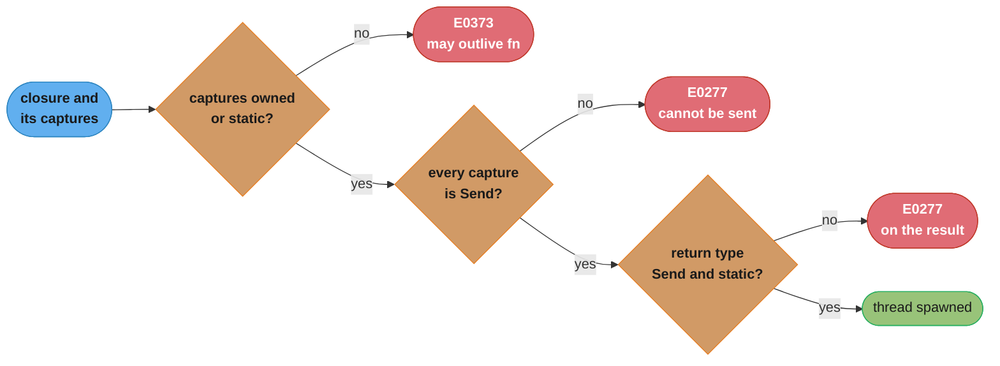
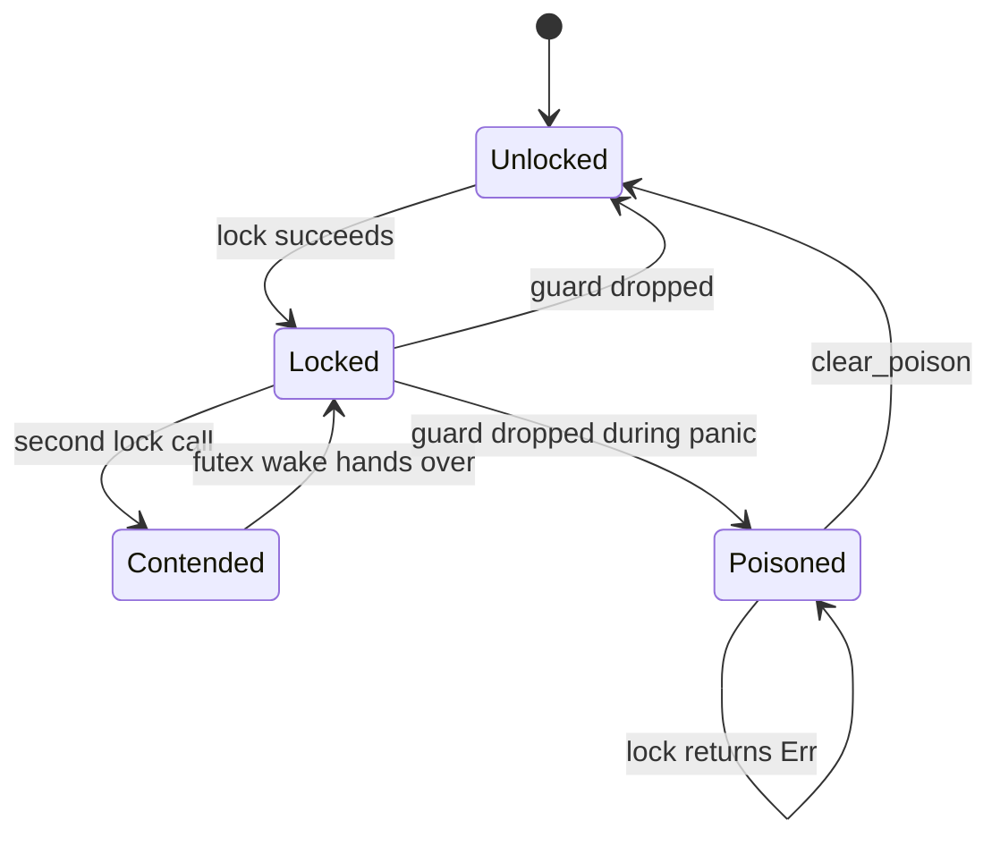
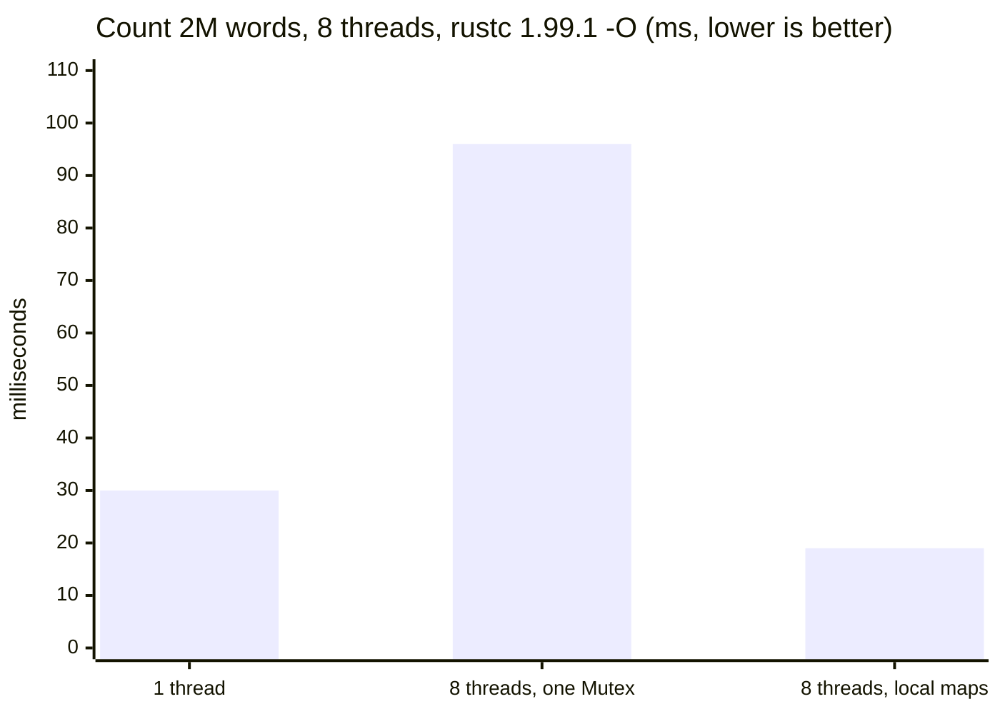

# Threads, Send/Sync and Locks

> **Version anchor (2026-11-06).** Rust 1.99.1 (2026-10-15) on edition 2024. Scoped threads are `[1.63]`, `LazyLock` is `[1.80]`, `RwLockWriteGuard::downgrade` is `[1.92]`, and the shorter `if let` temporary scope is `[ed2024]`. The std thread default stack is 2 MiB on all tier 1 platforms. Crates: parking_lot 0.13.0 (MSRV 1.95), rayon 1.12.0, crossbeam 0.8.5, loom 0.7.2.

---

## 1. Concept Overview

Rust gives you OS threads, the same 1:1 kernel threads that C, C++ and Java platform threads use. `std::thread::spawn` creates one, `JoinHandle::join` waits for it, and nothing in the standard library schedules user-space tasks on top of them. What Rust adds is a compile-time contract about which values may cross a thread boundary. Two marker traits carry that contract:

- `Send`: a value of this type can be moved to another thread.
- `Sync`: a shared reference `&T` can be used from several threads at once. Formally, `T: Sync` exactly when `&T: Send`.

The compiler implements both traits for you, field by field, and refuses to compile a program that moves a non-`Send` value into a thread or shares a non-`Sync` value between threads. The result is the property usually sold as "fearless concurrency": **safe Rust has no data races**. A data race is two unsynchronized accesses to one memory location, at least one of them a write. Rust promises nothing beyond that. Deadlocks, lost updates from a check-then-act sequence, starvation and priority inversion all compile without a warning.

The locks follow one design rule: **a lock owns the data it protects**. `Mutex<T>` holds the `T`. The only way to reach the `T` is through the `MutexGuard` that `lock()` returns, and dropping the guard unlocks. You cannot forget to lock, and you cannot keep a reference to the data after the unlock, because the borrow checker ties the reference to the guard's lifetime.

This module covers `spawn` and the `'static` bound, scoped threads, `Send` and `Sync`, `Mutex`, `RwLock`, `Condvar`, poisoning, `parking_lot`, thread-local storage, stack size, `available_parallelism` and rayon. Message passing, atomics and the shared-state decision model are in [Channels, Atomics and Shared State](../channels_atomics_and_shared_state/channels_atomics_and_shared_state.md). Scheduling, context switches and the kernel side of a thread are in [Processes, Threads and Context Switching](../../cs_fundamentals/processes_threads_and_context_switching/processes_threads_and_context_switching.md). Deadlock theory, the Coffman conditions and lock ordering are in [Deadlocks and Synchronization](../../cs_fundamentals/deadlocks_and_synchronization/deadlocks_and_synchronization.md). Safe Rust prevents data races, not deadlocks, so that page applies to Rust unchanged.

---

## 2. Intuition

> **One-line analogy**: `Send` is a shipping label that says "this box may travel". `Sync` is a sign on a museum exhibit that says "any number of visitors may look at once". The compiler is the customs officer who reads both before the box leaves the building.

**Mental model**: picture every value with two stamps on it, computed from its fields. A `Vec<u64>` gets both stamps. An `Rc<T>` gets neither, because its reference count is a plain integer and two threads that clone it at once can lose an increment. A `RefCell<T>` gets "may travel" but not "shared viewing", because its borrow flag is also a plain integer. `thread::spawn` checks the stamps of everything the closure captures. A `Mutex<T>` is a machine that turns "may travel" into "shared viewing": put a `Send` value in, and the mutex is `Sync`.

**Why it matters**: in C++ and Java, the first sign that a `HashMap` is shared without a lock is a corrupted map or a lost update in production, often weeks after the code shipped. In Rust the same mistake is error E0277 at compile time, with the field that is not `Send` named in the message. That moves a whole class of incidents to the compile step. It does not move all of them: two locks taken in opposite orders still deadlock, and the compiler is silent about it.

**Key insight**: **the compiler checks who can touch data, never when.** `Send` and `Sync` are about access rights, so they rule out data races completely. Ordering, waiting and progress are runtime behavior, so deadlocks, starvation and contention are still yours to design out. A Rust thread design is "the type system proves the sharing is sound, and you prove the locking is live".

---

## 3. Core Principles

1. **Ownership crosses the thread boundary, or a reference with a proven lifetime does.** `thread::spawn` takes `F: FnOnce() -> T + Send + 'static`, so the closure must own everything it captures. `thread::scope` `[1.63]` relaxes `'static` because it joins every thread before it returns, so borrows of the caller's locals are sound.
2. **`Send` and `Sync` are auto traits.** A struct is `Send` when all its fields are `Send`, and `Sync` when all its fields are `Sync`. You opt out with a field such as `PhantomData<*const ()>`, and you opt in with `unsafe impl`, which is a promise the compiler cannot check.
3. **`T: Sync` if and only if `&T: Send`.** Sharing is defined as sending a shared reference. From that one rule: `Arc<T>` needs `T: Send + Sync` to be `Send`, because each clone hands out `&T` on another thread and the last clone may drop the `T` there.
4. **A lock owns its data and a guard is the only key.** `Mutex<T>`, `RwLock<T>` and the `parking_lot` versions all return a guard. The guard derefs to `T` and unlocks on drop. Scope the guard tightly and the critical section is tight.
5. **A panic while a std lock is held poisons it.** Every later `lock()` returns `Err(PoisonError)`. Poisoning is a flag that says "an invariant may be half-updated". It is advisory: `PoisonError::into_inner` still hands you the guard.
6. **Safe Rust rules out data races, not race conditions.** A check-then-act on two separate lock acquisitions is a race condition and compiles. Hold one guard across the whole read-modify-write, or use an atomic read-modify-write.
7. **Threads cost real memory and real kernel work.** Each std thread reserves a 2 MiB stack by default on tier 1 platforms, and a spawn plus join cost about 80 to 130 microseconds in the measurements in §6. Thousands of mostly idle threads is the point where async or a bounded pool pays off.

---

## 4. Types / Architectures / Strategies

### 4.1 Ways to run code on another thread

| API | Lifetime of captures | Joined | Use it for |
|---|---|---|---|
| `std::thread::spawn` | `'static` (owned or `Arc`) | Explicitly, with `JoinHandle::join`; a dropped handle detaches the thread | Long-lived background workers, a thread per subsystem |
| `std::thread::scope` `[1.63]` | Any lifetime that outlives the scope | Automatically, before `scope` returns | Fork-join over borrowed data, such as chunks of a slice |
| `std::thread::Builder` | Same as `spawn` | Same as `spawn` | Named threads, a custom stack size, a spawn error you can handle |
| rayon (`par_iter`, `join`, `scope`) | Borrowed data is fine | Inside the call | Data-parallel CPU work on a work-stealing pool |
| `tokio::task::spawn_blocking` | `'static` | Through the returned `JoinHandle` | Blocking or CPU work called from async code; see [Async Runtimes and Executors](../async_runtimes_and_executors/async_runtimes_and_executors.md) |

### 4.2 `Send` and `Sync` for common types

| Type | `Send` | `Sync` | Reason |
|---|---|---|---|
| `i32`, `String`, `Vec<T>` (with `T: Send + Sync`) | yes | yes | Plain owned data |
| `Rc<T>` | no | no | Non-atomic reference count |
| `Arc<T>` | if `T: Send + Sync` | if `T: Send + Sync` | Atomic count, but every clone shares `&T` |
| `Cell<T>`, `RefCell<T>` | if `T: Send` | no | Unsynchronized interior mutability |
| `Mutex<T>` | if `T: Send` | if `T: Send` | The lock serializes all access to `T` |
| `RwLock<T>` | if `T: Send` | if `T: Send + Sync` | Several readers hold `&T` at the same time |
| `MutexGuard<'_, T>` | no | if `T: Sync` | Some platforms require the locking thread to unlock |
| `*const T`, `*mut T` | no | no | The compiler knows nothing about the pointee |
| `&T` | if `T: Sync` | if `T: Sync` | The definition of `Sync` |
| `&mut T` | if `T: Send` | if `T: Sync` | Exclusive access acts like ownership |

### 4.3 Lock and coordination primitives

| Primitive | Crate | What it gives you |
|---|---|---|
| `Mutex<T>` | std | Exclusive access, poisoning, `const fn new` |
| `RwLock<T>` | std | Many readers or one writer; `downgrade` `[1.92]`; priority policy not specified |
| `Condvar` | std | Wait for a predicate on mutex-protected state |
| `Barrier` | std | N threads wait until all N arrive |
| `OnceLock<T>`, `LazyLock<T>` `[1.80]` | std | One-time initialization, safe to race |
| `Mutex`, `RwLock`, `FairMutex`, `ReentrantMutex` | parking_lot 0.13.0 | No poisoning, 1-byte `Mutex` state, upgradable reads, timeouts, fair unlock |
| `ThreadPool`, `join`, `scope` | rayon 1.12.0 | Work-stealing pool, one per process by default |

---

## 5. Architecture Diagrams

### 5.1 What the compiler checks at `thread::spawn`



The three gates are the bounds on `spawn`: `'static`, `F: Send` and `T: Send + 'static`. `thread::scope` removes only the first gate. The `Send` checks stay.

### 5.2 The `Send`/`Sync` grid

```
                       Send   Sync   why
                       ----   ----   ----------------------------------------
  u64, String           ✓      ✓     plain owned data
  Rc<T>                 ✗      ✗     non-atomic refcount
  Arc<T>, T: Send+Sync  ✓      ✓     atomic refcount, T shared safely
  Arc<RefCell<T>>       ✗      ✗     RefCell is not Sync, so Arc is not Send
  RefCell<T>            ✓      ✗     borrow flag is a plain integer
  Mutex<T>, T: Send     ✓      ✓     the lock makes T shareable
  RwLock<T>, T: Send    ✓      ✗     readers share &T, so T must be Sync too
  MutexGuard<T>         ✗      ✓*    unlock must happen on the locking thread
  *mut T                ✗      ✗     unknown pointee, opt in with unsafe impl

  * Sync only when T: Sync
```

Read a row as "can a value of this type move to another thread" and "can `&value` be used from two threads at once". `Arc<RefCell<T>>` is the row that catches most people: `Arc` makes sharing cheap, but it does not make the contents shareable.

### 5.3 States of a std `Mutex`



On Linux, `Contended` means the waiting thread sleeps in the kernel on a futex word. An uncontended lock and unlock never enter the kernel. `Poisoned` is a flag beside the lock, not a lock state: the data is still reachable through `PoisonError::into_inner`.

### 5.4 Shared lock vs thread-local results (measured)



One run of the §14 benchmark. Eight threads that take one `Mutex` per word are about three times slower than one thread, because the threads spend their time handing the lock and its cache line to each other. Eight threads with private maps and one merge are faster than one thread. The full numbers are in §14.

---

## 6. How It Works - Detailed Mechanics

### 6.1 `spawn`, `join` and `'static`

```rust
use std::thread;

fn main() {
    let data = vec![1u64, 2, 3];
    let handle = thread::spawn(move || data.iter().sum::<u64>());
    match handle.join() {
        Ok(total) => println!("sum = {total}"),
        Err(_) => eprintln!("worker panicked"),
    }
}
```

`move` transfers ownership of `data` into the closure, so the closure is `'static`. `join` returns `Result<T, Box<dyn Any + Send + 'static>>`: `Err` carries the panic payload of a thread that panicked. Dropping a `JoinHandle` does not stop the thread. The thread is detached and keeps running until it returns or the process exits. When `main` returns, the process exits and detached threads stop without running their destructors.

### 6.2 Scoped threads `[1.63]`

```rust
use std::panic;
use std::thread;

pub fn parallel_sum(xs: &[u64], parts: usize) -> u64 {
    let chunk = xs.len().div_ceil(parts.max(1)).max(1);
    thread::scope(|s| {
        let handles: Vec<_> = xs
            .chunks(chunk)
            .map(|c| s.spawn(move || c.iter().sum::<u64>()))
            .collect();
        handles
            .into_iter()
            .map(|h| match h.join() {
                Ok(v) => v,
                Err(payload) => panic::resume_unwind(payload),
            })
            .sum()
    })
}
```

`scope` joins every thread that you did not join yourself before it returns, so each `c` borrow of `xs` is valid for the whole life of its thread. If an automatically joined thread panicked, `scope` panics too. Here the code joins by hand and re-raises the panic with `resume_unwind`, which keeps the original payload.

### 6.3 How `Send` and `Sync` are derived, and how to opt in

The compiler implements the auto traits structurally. A type that holds a raw pointer loses both, even when the design is sound:

```rust
use std::ptr::NonNull;

pub struct RawBuf {
    ptr: NonNull<u8>,
    len: usize,
}

// SAFETY: RawBuf owns its allocation exclusively. No other handle aliases
// `ptr`, so moving a RawBuf to another thread moves sole ownership with it.
unsafe impl Send for RawBuf {}
```

`unsafe impl Send` is a proof obligation. Write `Sync` only if `&RawBuf` methods are also safe to call concurrently, which a method that writes through `ptr` from `&self` breaks. The policy for reviewing these impls is in [Unsafe Rust and Undefined Behavior](../unsafe_rust_and_undefined_behavior/unsafe_rust_and_undefined_behavior.md).

To remove `Send` or `Sync` from a type with only safe fields, add a marker field:

```rust
use std::marker::PhantomData;

pub struct ThreadBound {
    id: u32,
    _not_send: PhantomData<*const ()>,
}
```

### 6.4 `Mutex<T>` internals

```rust
use std::collections::HashMap;
use std::sync::{Arc, Mutex, PoisonError};
use std::thread;

fn main() {
    let hits: Arc<Mutex<HashMap<String, u64>>> = Arc::default();
    let workers: Vec<_> = (0..4)
        .map(|id| {
            let hits = Arc::clone(&hits);
            thread::spawn(move || {
                let key = format!("worker-{}", id % 2);
                let mut map = hits.lock().unwrap_or_else(PoisonError::into_inner);
                *map.entry(key).or_insert(0) += 1;
            })
        })
        .collect();
    for w in workers {
        if w.join().is_err() {
            eprintln!("a worker panicked");
        }
    }
    let map = hits.lock().unwrap_or_else(PoisonError::into_inner);
    println!("{map:?}");
}
```

On Linux the standard library has used its own futex-based `Mutex`, `Condvar` and `RwLock` since Rust 1.62. The 1.62 release post gives the numbers: the pthread mutex it replaced was 40 bytes, could not move, and so needed a hidden `Box` per mutex. The futex version needs 5 bytes of state, with the note that this may change. Measured on aarch64 Linux with rustc 1.99.1, `size_of::<Mutex<()>>()` is 8, `Mutex<u64>` is 16, `RwLock<()>` is 12 and `Condvar` is 4. These are implementation facts that the docs do not promise.

The fast path is one compare-and-swap on the state word. A second locker spins briefly, then sleeps in `futex_wait`. The unlocker wakes one waiter with `futex_wake`. The std mutex is not fair: a thread that unlocks and immediately locks again often wins the lock back, which is good for throughput and bad for tail latency of the other waiters.

`Mutex::new` has been a `const fn` since 1.63, so a `static` mutex needs no lazy initialization:

```rust
use std::sync::{Mutex, PoisonError};

static REGISTRY: Mutex<Vec<&'static str>> = Mutex::new(Vec::new());

pub fn register(name: &'static str) {
    REGISTRY
        .lock()
        .unwrap_or_else(PoisonError::into_inner)
        .push(name);
}
```

Locking a mutex a second time from the thread that holds it is unspecified: the docs say the call will not return, and it may deadlock or panic. Rust's std mutex is not reentrant.

### 6.5 Poisoning

When a thread panics while it holds a `MutexGuard` or an `RwLock` write guard, the guard's drop marks the lock poisoned. From then on, `lock()` returns `Err(PoisonError<Guard>)`. The docs list cases where poisoning does not happen, such as a second panic during unwinding and foreign exceptions, and state that unsafe code cannot rely on poisoning for soundness.

| Strategy | Code | When |
|---|---|---|
| Propagate the panic | `.lock().expect("state lock poisoned")` | The data has an invariant that a half-finished update breaks, and a restart is the recovery |
| Ignore the flag | `.lock().unwrap_or_else(PoisonError::into_inner)` | Every update is a single assignment or insert, so no half-updated state can exist |
| Repair and continue | match the `Err`, fix the data, then `Mutex::clear_poison` (since 1.77) | You can rebuild the invariant from the data |

`parking_lot` has no poisoning. A panic releases its lock normally.

### 6.6 `RwLock` and `downgrade` `[1.92]`

```rust
use std::sync::{PoisonError, RwLock, RwLockWriteGuard};

pub fn append_and_read(cache: &RwLock<Vec<u32>>, v: u32) -> usize {
    let mut w = cache.write().unwrap_or_else(PoisonError::into_inner);
    w.push(v);
    let r = RwLockWriteGuard::downgrade(w);
    r.len()
}
```

`downgrade` changes the lock from exclusive to shared atomically, so no other writer can get in between the write and the read that follows it. The std docs do not promise a priority policy. A writer that waits may or may not block new readers, depending on the platform. One consequence the docs call out: a thread that holds a read guard and calls `read()` again can deadlock if a writer queued between the two calls. Never take a read lock twice on one thread.

`RwLock` is also not a free win for read-heavy data. Every `read()` writes the reader count, so all readers contend on one cache line. In the measurements below, eight threads reading one small value through `RwLock` were slower than the same eight threads through `Mutex`. `RwLock` pays off when the read critical section is long compared with the lock cost. For tiny reads of rarely changed data, see the snapshot patterns in [Channels, Atomics and Shared State](../channels_atomics_and_shared_state/channels_atomics_and_shared_state.md).

### 6.7 `Condvar`

```rust
use std::sync::{Condvar, Mutex, PoisonError};

pub struct Gate {
    open: Mutex<bool>,
    cv: Condvar,
}

impl Gate {
    pub const fn new() -> Self {
        Self {
            open: Mutex::new(false),
            cv: Condvar::new(),
        }
    }

    pub fn open(&self) {
        *self.open.lock().unwrap_or_else(PoisonError::into_inner) = true;
        self.cv.notify_all();
    }

    pub fn wait(&self) {
        let guard = self.open.lock().unwrap_or_else(PoisonError::into_inner);
        let _open = self
            .cv
            .wait_while(guard, |open| !*open)
            .unwrap_or_else(PoisonError::into_inner);
    }
}
```

`wait` releases the mutex and sleeps in one step, so a `notify` cannot slip in between. A thread can wake with no notify at all (a spurious wakeup), and another thread can change the state between the notify and the wake. `wait_while` loops on the predicate for you. Use it instead of a bare `wait`.

### 6.8 Thread-local storage, stack size and CPU count

```rust
use std::cell::RefCell;
use std::thread;

thread_local! {
    static SCRATCH: RefCell<Vec<u8>> = const { RefCell::new(Vec::new()) };
}

fn encode(input: &[u8]) -> usize {
    SCRATCH.with_borrow_mut(|buf| {
        buf.clear();
        buf.extend_from_slice(input);
        buf.len()
    })
}

fn main() -> std::io::Result<()> {
    let handle = thread::Builder::new()
        .name("encoder".into())
        .stack_size(8 * 1024 * 1024)
        .spawn(|| encode(b"payload"))?;
    let n = handle.join().unwrap_or(0);
    let cpus = thread::available_parallelism().map_or(1, |n| n.get());
    println!("{n} bytes on a host with {cpus} usable CPUs");
    Ok(())
}
```

- **`thread_local!`**: each thread gets its own `SCRATCH`, so a `RefCell` is fine inside it. The `const { ... }` initializer skips the lazy-init check on each access.
- **Stack size**: a std thread's stack is 2 MiB on all tier 1 platforms, and the docs say this is platform dependent and may change. `Builder::stack_size` sets it per thread. The `RUST_MIN_STACK` environment variable sets it for every thread the program spawns. The main thread's stack comes from the OS, not from these settings. The 2 MiB is reserved address space. Physical memory is committed as pages are touched.
- **`available_parallelism`** (since 1.59): returns the CPUs this process may use, not the CPUs in the machine. On Linux it reads the affinity mask and cgroup quotas. The docs say it can overcount when the cgroup filesystem cannot be read, for example under sandboxing, and undercount when the calling thread was pinned to fewer CPUs than the process cpuset.
- **`Builder::spawn`** returns `io::Result`, so a spawn that hits a thread limit is an error you can handle. `thread::spawn` panics instead.

### 6.9 rayon for data parallelism

```rust
// fragment
use rayon::prelude::*;

fn checksum(blocks: &[Vec<u8>]) -> u64 {
    blocks
        .par_iter()
        .map(|b| b.iter().map(|&x| u64::from(x)).sum::<u64>())
        .sum()
}
```

rayon 1.12.0 runs one global work-stealing pool per process. Its size comes from `RAYON_NUM_THREADS` if set, else the number of logical CPUs. The docs warn that this default may change and suggest passing `available_parallelism` to `ThreadPoolBuilder::num_threads` if you need a fixed rule. The global pool is built once and its configuration cannot change after that. `par_iter` borrows the slice, the same way scoped threads do. Never block on I/O or a lock inside rayon work: each blocked task holds one of a small number of pool threads.

### 6.10 Measured costs

Measured on a 10-core aarch64 Linux VM (Docker on Apple silicon), `rustc 1.99.1 -O`, three runs each. Treat these as ratios between rows, not as absolute numbers for your hardware.

| Operation | Result |
|---|---|
| Uncontended `Mutex` lock plus unlock | 3 to 7 ns |
| Uncontended `RwLock` read plus unlock | 3 to 4 ns |
| Uncontended `AtomicU64::fetch_add` (Relaxed) | about 2 ns |
| 8 threads, `Mutex` around a tiny read, wall time per op | 8 to 15 ns |
| 8 threads, `RwLock` read of the same value, wall time per op | 16 to 56 ns |
| `thread::spawn` plus `join` of an empty closure | 84 to 132 µs |
| 1,000 threads at the default stack size | about 2 GiB of reserved address space |

The `RwLock` row is the surprise. Readers do not block each other, but each one writes the shared reader count, and that cache-line traffic costs more than the serialization of a short `Mutex` critical section.

---

## 7. Real-World Examples

- **The standard library's own locks**: since Rust 1.62, `Mutex`, `Condvar` and `RwLock` on Linux are futex-based and need no heap allocation, and since 1.63 `Mutex::new` is `const`. A global lock is a plain `static` with no lazy-init wrapper (§6.4).
- **`std::sync::mpsc`**: since Rust 1.67 the std channel is a port of crossbeam-channel. The channel module covers it: [Channels, Atomics and Shared State](../channels_atomics_and_shared_state/channels_atomics_and_shared_state.md).
- **Tokio's blocking pool**: `spawn_blocking` runs closures on a pool of plain OS threads, up to 512 by default. Each of those threads is a `std::thread` with the same `Send + 'static` rules as this page. The pool is covered in [Tokio Deep Dive](../async_runtimes_and_executors/tokio_deep_dive.md).
- **Python free threading**: CPython's free-threaded build removes the GIL and leaves thread safety to runtime locks inside the interpreter. Rust code called from Python through PyO3 must still prove `Send` and `Sync` at compile time. The Python side is in [The GIL and Free Threading](../../python/the_gil_and_free_threading/the_gil_and_free_threading.md).
- **Java and Go contrast**: Java's [concurrency](../../java/concurrency/concurrency.md) model and Go's [sync primitives](../../go/sync_primitives_and_memory_model/sync_primitives_and_memory_model.md) both let any value cross a thread or goroutine boundary and find races at runtime (Java through code review and tools, Go through `go test -race`). Rust finds the same races at compile time and needs no race detector for safe code.

---

## 8. Tradeoffs

### 8.1 `thread::spawn` vs `thread::scope` vs rayon

| Concern | `spawn` | `scope` | rayon |
|---|---|---|---|
| Borrowed data | No, `'static` only | Yes | Yes |
| Thread lifetime | Until joined or process exit | Ends at scope exit | Pool lives for the process |
| Cost per unit of work | One OS thread spawn, about 100 µs in §6.10 | Same | A queue push, far below a spawn |
| Load balancing | Manual | Manual | Work stealing |
| Fits | Long-lived workers | One fork-join over a slice | Repeated data-parallel loops |

### 8.2 std locks vs parking_lot

| Concern | std `Mutex`/`RwLock` | parking_lot 0.13.0 |
|---|---|---|
| Poisoning | Yes, `lock()` returns `Result` | No, a panic releases the lock |
| `Mutex` state size | 5 bytes of state on Linux per the 1.62 post; 8 bytes total for `Mutex<()>` measured | 1 byte of lock state |
| Fair unlock | No | `MutexGuard::unlock_fair`, and `FairMutex` |
| Upgradable read | No | Yes, `upgradable_read` |
| Lock with timeout | No | Yes, `try_lock_for` |
| Deadlock detection | No | Experimental, `deadlock_detection` feature |
| Dependency and MSRV | None | One crate, MSRV 1.95 |

### 8.3 `Mutex` vs `RwLock`

| Workload | Pick | Why |
|---|---|---|
| Short critical sections, any read:write mix | `Mutex` | Lower cost per acquire, and §6.10 shows it beats `RwLock` for tiny reads |
| Long reads (iterate a large map), rare writes | `RwLock` | Readers run in parallel, and the reader-count traffic is small next to the read |
| Read-mostly config read on every request | Neither | Use an `Arc` snapshot; see the decision model in [Channels, Atomics and Shared State](../channels_atomics_and_shared_state/channels_atomics_and_shared_state.md) |
| Writer must never wait behind a stream of readers | parking_lot `RwLock` or a different design | std does not promise a writer policy |

---

## 9. When to Use / When NOT to Use

**Use OS threads and std locks when:**
- The work is CPU-bound, or the number of concurrent blocking operations is in the tens or low hundreds.
- You need a long-lived worker with its own state, such as a log flusher or a compaction thread.
- The code is a library that should not force an async runtime on its callers.

**Use scoped threads or rayon when:**
- The work is a fork-join over data you already hold. Scoped threads avoid `Arc` and cloning entirely.

**Do NOT use a thread per task when:**
- You expect thousands of concurrent connections that mostly wait on the network. Each thread reserves 2 MiB of stack by default, and 10,000 threads reserve about 20 GiB of address space. Use async; see [Async Runtimes and Executors](../async_runtimes_and_executors/async_runtimes_and_executors.md).

**Do NOT use a lock when:**
- The data has one owner that others only send requests to. Use a channel or an actor.
- The shared value is a single counter or flag. Use an atomic.
- Reads vastly outnumber writes and the read is on a hot path. Use an `Arc` snapshot.

---

## 10. Common Pitfalls

These incidents are illustrative. They show common failure patterns, not specific outages, and their numbers show scale only.

### 10.1 `Rc` in a spawned thread

A team ported a single-threaded parser cache to a worker pool by wrapping the work in `thread::spawn`. The cache was an `Rc<HashMap<..>>`.

```rust
// BROKEN
use std::rc::Rc;
use std::thread;

fn main() {
    let shared = Rc::new(vec![1, 2, 3]);
    let worker_copy = Rc::clone(&shared);
    // error[E0277]: `Rc<Vec<i32>>` cannot be sent between threads safely
    let h = thread::spawn(move || worker_copy.len());
    let _ = h.join();
}
```

```rust
// FIX: Arc has an atomic reference count, so it is Send when T is Send + Sync.
use std::sync::Arc;
use std::thread;

fn main() {
    let shared = Arc::new(vec![1, 2, 3]);
    let worker_copy = Arc::clone(&shared);
    let h = thread::spawn(move || worker_copy.len());
    match h.join() {
        Ok(n) => println!("{n} items"),
        Err(_) => eprintln!("worker panicked"),
    }
}
```

### 10.2 Borrowing a local in `thread::spawn`

```rust
// BROKEN
use std::thread;

fn main() {
    let v = vec![1, 2, 3];
    // error[E0373]: closure may outlive the current function, but it borrows `v`
    let h = thread::spawn(|| v.len());
    let _ = h.join();
}
```

The compiler's suggestion is `move`, which works when the thread may own `v`. When the caller still needs `v`, use a scope:

```rust
// FIX: scoped threads join before `scope` returns, so the borrow is sound.
use std::thread;

fn main() {
    let v = vec![1, 2, 3];
    let n = thread::scope(|s| s.spawn(|| v.len()).join().unwrap_or(0));
    println!("{n} items, and v is still usable: {v:?}");
}
```

### 10.3 The guard that lives too long in a `match`

A request handler drained a work queue like this and hung on the first non-empty queue. The temporary `MutexGuard` in a `match` scrutinee lives until the end of the whole `match`, so the arm's second `lock()` waits for a lock its own thread holds.

```rust
// BUG (runtime): deadlocks or panics on the second lock() in the arm.
use std::sync::Mutex;

pub fn drain_one(queue: &Mutex<Vec<u32>>, done: &Mutex<Vec<u32>>) {
    match queue.lock().expect("queue lock").pop() {
        Some(job) => {
            let left = queue.lock().expect("queue lock").len();
            done.lock().expect("done lock").push(job + left as u32);
        }
        None => {}
    }
}
```

```rust
// FIX: bind the result in a `let` statement. The guard drops at the semicolon.
use std::sync::Mutex;

pub fn drain_one(queue: &Mutex<Vec<u32>>, done: &Mutex<Vec<u32>>) {
    let next = queue.lock().expect("queue lock").pop();
    if let Some(job) = next {
        let left = queue.lock().expect("queue lock").len();
        done.lock().expect("done lock").push(job + left as u32);
    }
}
```

Edition 2024 fixes part of this: the temporaries of an `if let` scrutinee now drop before the `else` block `[ed2024]`. Checked with `try_lock` on rustc 1.99.1: in edition 2021 the lock was still held in `else`, and in edition 2024 it was free. The `then` block of an `if let` and every arm of a `match` still run with the guard held, in both editions. The `let` statement is the pattern that works everywhere.

### 10.4 `static mut` counters

Old code used `static mut` for a global counter. In edition 2024, taking a reference to a `static mut` is denied by default.

```rust
// BROKEN
static mut COUNTER: u64 = 0;

fn main() {
    // error: creating a mutable reference to mutable static (static_mut_refs, deny in edition 2024)
    // SAFETY: none possible; another thread may hold a reference at the same time.
    let r = unsafe { &mut COUNTER };
    *r += 1;
}
```

```rust
// FIX: an atomic needs no unsafe and has no data race.
use std::sync::atomic::{AtomicU64, Ordering};

static COUNTER: AtomicU64 = AtomicU64::new(0);

fn main() {
    COUNTER.fetch_add(1, Ordering::Relaxed);
    println!("{}", COUNTER.load(Ordering::Relaxed));
}
```

### 10.5 Lock held across blocking I/O

A metrics exporter held the registry `Mutex` while it wrote the snapshot to a socket. When the collector stalled, every thread that recorded a metric blocked behind the socket write. Copy what you need under the lock, drop the guard, then do the I/O. The same rule applies with more force in async code, where a std guard held across `.await` also makes the future `!Send`; see [Async Cancellation and Pitfalls](../async_cancellation_and_pitfalls/async_cancellation_and_pitfalls.md).

### 10.6 Two locks in opposite orders

Thread A locks `accounts` then `audit`. Thread B locks `audit` then `accounts`. It compiles, passes tests on a laptop, and deadlocks under load. Rust has no lock-order checker. Fix it with a single global order (for example, always lock in ascending account id), or by restructuring so no thread holds two locks at once. The theory is in [Deadlocks and Synchronization](../../cs_fundamentals/deadlocks_and_synchronization/deadlocks_and_synchronization.md). parking_lot's experimental `deadlock_detection` feature can find cycles in a test build.

### 10.7 Thread count from the host, not the container

A batch job sized its pool from `/proc/cpuinfo` and started 64 workers in a container limited to 4 CPUs. The kernel throttled the cgroup, and p99 latency of the job's health check went past its timeout. `available_parallelism` reads the cgroup quota on Linux, so it would have returned 4. It can still overcount when the cgroup filesystem is not readable, so allow an override through configuration.

### 10.8 Poison cascade

One handler panicked on a bad input while it held the session-map lock. Every other handler used `.lock().unwrap()`, so every one of them panicked on the poisoned lock, and the service went from one bad request to a full outage. Decide the poison policy per lock (§6.5). For a map where every update is a single insert, `unwrap_or_else(PoisonError::into_inner)` is correct. For data with a real multi-step invariant, a panic followed by a supervised restart is correct.

---

## 11. Technologies & Tools

| Tool | Version | Use it for |
|---|---|---|
| parking_lot | 0.13.0 | Smaller, non-poisoning `Mutex` and `RwLock`, fair unlock, upgradable reads, lock timeouts |
| rayon | 1.12.0 | Data-parallel iterators and fork-join on a work-stealing pool |
| crossbeam | 0.8.5 | Scoped threads before 1.63, channels, `CachePadded`, epoch-based reclamation |
| loom | 0.7.2 | Exhaustive interleaving tests for lock and atomic code; see [Testing, Fuzzing and Miri](../testing_fuzzing_and_miri/testing_fuzzing_and_miri.md) |
| ThreadSanitizer | rustc `-Zsanitizer=thread` (nightly) | Finds data races in `unsafe` code and FFI, which the type system cannot see |
| Miri | rustup component (nightly) | Detects data races and undefined behavior in `unsafe` code under an interpreter |
| tokio | 1.54.1 | `spawn_blocking` pool for blocking work from async code |
| clippy | rustup component | `await_holding_lock`, `mutex_atomic` and related concurrency lints |

---

## 12. Interview Questions with Answers

**Q: Why does an `Rc` fail to compile inside `thread::spawn`, and what is the fix?**
**Short:** Rc's reference count is a plain integer, so Rc is not Send and spawn rejects it with E0277; Arc uses an atomic count and is the fix.

`Rc` increments and decrements its count with ordinary loads and stores. Two threads that clone or drop the same `Rc` at once can lose an update and free the value while it is still in use. The compiler encodes this as `Rc<T>: !Send + !Sync`, and `thread::spawn` requires its closure to be `Send`, so the error names the `Rc` capture. `Arc` uses atomic operations for the count and is `Send` when `T: Send + Sync`. If you also need to mutate, the usual shape is `Arc<Mutex<T>>`. Do not switch to `Arc` everywhere by reflex: single-threaded code with `Rc` avoids the atomic cost on every clone.

**Q: Does "fearless concurrency" mean a Rust program cannot deadlock?**
**Short:** No. Safe Rust rules out data races only; deadlocks, livelocks, starvation and check-then-act race conditions all compile without a warning.

The type system proves who can access data, not when or in which order. Two threads that take two mutexes in opposite orders deadlock exactly as they would in C++. A thread that locks a std `Mutex` it already holds blocks forever or panics. A check-then-act sequence that reads under one lock acquisition and writes under another is a race condition, even with no data race. Use a single lock order, keep critical sections free of other locks, and test with loom or parking_lot's deadlock detection. The deadlock theory itself is language-neutral and lives in the cs_fundamentals deadlocks module.

**Q: Why does `thread::spawn` require `'static`, and how do scoped threads avoid it?**
**Short:** A spawned thread can outlive its caller, so captures must be owned; `thread::scope` joins every thread before returning, so borrows stay valid.

`spawn` returns immediately and nothing forces the caller to join. If the closure borrowed a stack local, the caller could return and free that stack while the thread still reads it. The `'static` bound rules that out. `thread::scope` `[1.63]` changes the contract: the scope function does not return until every thread spawned in it has finished, so the compiler can allow borrows that outlive the scope. Use `scope` for fork-join over a slice, and keep `spawn` with `move` and `Arc` for threads that must outlive the function.

**Q: What do `Send` and `Sync` mean precisely?**
**Short:** Send means a value may move to another thread; Sync means a shared reference may be used from several threads, defined as T: Sync exactly when &T: Send.

Both are auto traits: the compiler implements them for a struct when every field implements them. `Send` is about ownership transfer, so a type is `!Send` when moving it would break something, such as a non-atomic refcount shared with other handles. `Sync` is about simultaneous shared access, so a type is `!Sync` when `&self` methods mutate without synchronization, such as `Cell::set`. The `&T: Send` definition explains most derived rules, including why `RwLock<T>` needs `T: Sync` and `Mutex<T>` does not. Opting in with `unsafe impl` is a promise the compiler does not check.

**Q: Why is `RefCell<T>` `Send` but not `Sync`?**
**Short:** Moving a RefCell gives the new thread sole access, which is safe; sharing it lets two threads update its non-atomic borrow flag at once.

`RefCell` tracks borrows at runtime with a plain counter. When the whole `RefCell` moves to another thread, the old thread can no longer reach it, so only one thread ever touches the counter. That is why `RefCell<T>: Send` when `T: Send`. If two threads held `&RefCell<T>`, both could call `borrow_mut` and race on the counter, giving two `&mut T` at once. So it is `!Sync`. The thread-safe equivalent is `Mutex<T>` or `RwLock<T>`. `Arc<RefCell<T>>` is therefore neither `Send` nor `Sync`.

**Q: Why is `MutexGuard` not `Send`?**
**Short:** Some platforms, POSIX threads among them, require the thread that locked a mutex to unlock it, so the guard must drop on its own thread.

The std docs give the reason: pthread mutexes must be released by the thread that acquired them, and std's portable API keeps that rule on every platform. Moving the guard to another thread would move the unlock there. The guard is `Sync` when `T: Sync`, because a `&MutexGuard` only gives `&T`. In async code the same rule makes a future that holds a std guard across `.await` non-`Send`, which is why that pattern fails to compile with a multi-threaded runtime. parking_lot offers a `send_guard` feature for platforms where this restriction does not apply.

**Q: Why is `Mutex<T>` `Sync` when `T` is only `Send`, while `RwLock<T>` needs `T: Send + Sync`?**
**Short:** A Mutex lets one thread at a time reach T, which is a transfer; an RwLock lets several readers hold &T at once, which is sharing.

Through a `Mutex`, threads take turns. Each one gets `&mut T` alone, so the effect is the same as moving `T` between threads, and `Send` is enough. Through an `RwLock`, several readers hold `&T` simultaneously, so `T` must tolerate shared access from several threads, which is `Sync`. This is why `RwLock<RefCell<T>>` or `RwLock<Cell<u32>>` is not `Sync` while `Mutex<Cell<u32>>` is. The `Mutex` is the standard tool for making a `Send`-only type shareable.

**Q: What does lock poisoning protect against, and should you propagate it or ignore it?**
**Short:** Poisoning flags a lock whose holder panicked, since its data may be half-updated; propagate it for multi-step invariants and ignore it for single-step updates.

A panic between two related writes, such as a debit without its credit, leaves the data broken. Poisoning makes every later `lock()` return `Err` so the next thread notices. The flag is advisory: `PoisonError::into_inner` returns the guard, and `clear_poison` resets the flag. A blanket `.lock().unwrap()` turns one panic into a panic in every thread that uses the lock, which is the poison-cascade outage. Decide per lock: `expect` where the invariant matters and a restart is the recovery, `into_inner` where every update is atomic. parking_lot has no poisoning at all.

**Q: Why can `match m.lock().unwrap().pop()` deadlock, and what did edition 2024 change?**
**Short:** Temporaries in a match scrutinee live to the end of the match, so the guard is held in every arm; edition 2024 shortened this only for if-let else blocks.

The guard returned by `lock()` is a temporary in the scrutinee expression. Rust keeps scrutinee temporaries alive for the whole `match`, so an arm that calls `m.lock()` again waits on itself. Edition 2024 `[ed2024]` drops `if let` scrutinee temporaries before the `else` block, which removes the deadlock in the common "lock, check, else insert" shape. The `then` block and every `match` arm still hold the guard. The reliable fix is to finish with the guard in a `let` statement, whose temporaries drop at the semicolon, and branch on the result.

**Q: Why does `Arc<T>` need `T: Send + Sync` to be `Send`?**
**Short:** Every Arc clone gives its thread a shared &T, which needs Sync, and the last clone to drop runs T's destructor on its own thread, which needs Send.

An `Arc` sent to another thread is a shared reference to `T` that can be used there, so `T: Sync` is required by the definition of `Sync`. Whichever thread drops the last clone also drops the `T`, which moves ownership of `T` to an arbitrary thread, so `T: Send` is required too. This is why `Arc<Cell<u32>>` and `Arc<RefCell<T>>` cannot cross a thread boundary. The atomic refcount makes the `Arc` handle itself thread safe. It says nothing about the contents.

**Q: When is `RwLock` slower than `Mutex`, even for read-heavy data?**
**Short:** When read critical sections are short, every read() still writes the shared reader count, and that cache-line traffic costs more than a short Mutex section.

A read lock is not free: it increments and later decrements a reader count in the lock word. With eight threads reading one small value, measured on rustc 1.99.1 (§6.10), `RwLock` cost 16 to 56 ns per read in wall time against 8 to 15 ns for a `Mutex`. `RwLock` wins when the read itself is long, such as iterating a large map, so the reader-count cost is amortized. For a tiny read of a value that rarely changes, use an `Arc` snapshot that each thread reads without a shared write, or an atomic.

**Q: What writer policy does std's `RwLock` use?**
**Short:** None is promised; it depends on the platform, so a waiting writer may or may not block new readers, and a second read() on one thread can deadlock.

The std docs state the priority policy is dependent on the operating system, with no promise of a particular policy. On an implementation that blocks new readers while a writer waits, a thread that takes `read()` twice deadlocks if a writer arrives between the two calls. On one that lets readers through, a steady stream of readers can starve writers. Design so neither matters: never take a read lock recursively, and keep read sections short. If the policy matters, use parking_lot's `RwLock`, which documents a task-fair policy, or move to a snapshot design.

**Q: How does std's `Mutex` work on Linux?**
**Short:** It is a futex word plus a poison flag: an uncontended lock is one compare-and-swap in user space, and only contended waiters sleep in the kernel.

Since Rust 1.62, std uses its own futex-based locks on Linux instead of pthreads. The release post gives 5 bytes of state against 40 bytes for the pthread mutex, which also needed a `Box` because it could not move. A locker tries a compare-and-swap; on failure it spins briefly and then calls `futex_wait`. Unlock wakes one waiter. Measured on aarch64 Linux, `Mutex<()>` is 8 bytes, and an uncontended lock plus unlock costs a few nanoseconds. These sizes are implementation facts that can change between releases.

**Q: Why should `Condvar::wait` sit in a loop, and what does `wait_while` do?**
**Short:** A thread can wake with no notify or after another thread changed the state, so the predicate must be rechecked; wait_while runs that loop for you.

`Condvar::wait` atomically unlocks the mutex and sleeps, then relocks before returning. The docs allow spurious wakeups, and even a real `notify` does not prove the condition still holds when the thread reacquires the lock. A bare `if` before `wait` therefore acts on stale state. `wait_while(guard, |s| !ready(s))` loops until the predicate is false and returns the guard. `wait_timeout_while` adds a deadline. Always change the state under the same mutex before calling `notify_one` or `notify_all`.

**Q: When do you pick parking_lot over the std locks?**
**Short:** When you need fair unlock, upgradable reads, lock timeouts or a 1-byte mutex, or you want no poisoning; std is enough for most code.

parking_lot 0.13.0 documents five differences for its `Mutex`: no poisoning, 1 byte of lock state, locking with a timeout, raw lock and unlock without a guard, and explicit fair unlocking. Its `RwLock` adds upgradable reads, downgrade and a documented task-fair policy, and an experimental feature detects deadlocks. Since std moved to futexes, raw speed is no longer the main reason. Pick parking_lot for one of those features, or for a codebase where every lock would otherwise use `into_inner`. Its MSRV is 1.95, which matters for a library with an older MSRV policy.

**Q: How much memory does a std thread cost, and how do you change it?**
**Short:** Each std thread reserves 2 MiB of stack on tier 1 platforms by default; Builder::stack_size or RUST_MIN_STACK changes it, and pages commit only when touched.

The 2 MiB is reserved virtual address space, so a thread that uses 20 KiB of stack commits about 20 KiB of RAM. The reservation still matters at scale: 10,000 threads reserve about 20 GiB, which can hit a container's virtual-memory or thread limits. Deep recursion in a worker, such as a parser on nested input, can overflow 2 MiB, and the overflow aborts the process. Set the size per thread with `Builder::stack_size`, or for every spawned thread with `RUST_MIN_STACK`. The main thread's stack is set by the OS. The docs call the 2 MiB default platform dependent and subject to change.

**Q: What does `thread::available_parallelism` return inside a container?**
**Short:** On Linux it returns the CPUs this process may use after affinity masks and cgroup quotas, which is the right pool size, not the host's core count.

The function (since 1.59) reads the affinity mask and the cgroup CPU quota, so a container limited to 4 CPUs on a 64-core host gets 4. The docs list the edge cases: it can overcount when the cgroup filesystem cannot be read, for example in a sandbox, and in a VM with CPU limits; it can undercount when the calling thread was pinned to fewer CPUs than the process cpuset. It returns `io::Result`, so handle the error with a default of 1. Size thread pools from it and allow a configuration override.

**Q: When should you use rayon instead of spawning threads yourself?**
**Short:** Use rayon for repeated CPU-bound data parallelism over collections; it reuses a work-stealing pool and balances uneven chunks, which hand-spawned threads do not.

Each `thread::spawn` costs a kernel call and a stack, about 100 µs in the §6.10 measurement, so per-item threads waste most of the time on setup. rayon keeps one pool for the process, splits work recursively, and lets idle threads steal from busy ones, which matters when chunks take uneven time. Converting `iter()` to `par_iter()` borrows the data like a scoped thread. Do not use rayon for blocking I/O or work that waits on locks: a blocked task holds a pool thread, and the pool has only as many threads as CPUs.

**Q: How do you implement `Send` for a type that holds a raw pointer, and what must be true?**
**Short:** Write unsafe impl Send with a SAFETY comment, and only when no other handle can reach the pointee, so moving the value moves exclusive ownership.

Raw pointers are `!Send` and `!Sync`, so any struct holding one loses both traits. If the struct owns the allocation exclusively, like `Vec` does, moving it is sound and `unsafe impl Send` is justified. `Sync` needs more: every method reachable through `&self` must be safe to call from several threads at once, so a `&self` method that writes through the pointer rules it out. Write the argument in a `// SAFETY:` comment, test the type under Miri and loom, and wrap it so callers never see the pointer. A wrong impl is undefined behavior that no later safe code can repair.

**Q: What happens to a panic in a spawned thread?**
**Short:** The panic unwinds that thread only; join returns Err with the payload, and thread::scope re-panics if an automatically joined thread panicked.

A panic does not cross threads by itself. With `spawn`, the panic payload comes back as `Err(Box<dyn Any + Send>)` from `join`, and if nobody joins, it is lost after the default hook prints it. With `thread::scope`, the scope panics after joining when any thread it joined automatically had panicked. A std `Mutex`, or an `RwLock` held for writing, becomes poisoned if the panicking thread holds it. With `panic = "abort"` in the profile, the whole process aborts instead. Re-raise with `std::panic::resume_unwind(payload)` to keep the original message.

**Q: How does `thread_local!` behave on pooled threads?**
**Short:** A thread-local lives as long as its OS thread, so on a pool it carries state from one task to the next until the thread exits.

`thread_local!` values are created lazily on first access per thread and dropped when that thread exits. On a rayon or `spawn_blocking` pool, a thread runs many unrelated tasks, so a thread-local cache or scratch buffer is shared across them. That is useful for reusable buffers, and wrong for request-scoped data such as a user id. Clear per-task state at the start of each task. In async code a task can move between worker threads at every `.await`, so a thread-local is not task-local there; use `tokio::task_local!` instead.

**Q: How does Rust's thread-safety model compare with Java's and Go's?**
**Short:** Java and Go let any value cross threads and catch races with tools at runtime; Rust rejects unsynchronized sharing at compile time through Send and Sync.

In Java, any object reference can be read from any thread, and the Java memory model defines what a racy program may observe. In Go, any value can be captured by a goroutine, and `go test -race` finds races only on executed paths. Rust refuses to compile safe code with a data race, so a race detector is needed only for `unsafe` code and FFI. The cost is up-front work: you choose `Arc`, `Mutex` or a channel before the code compiles. None of the three languages prevents deadlocks. The Java and Go spellings are in their sections' concurrency modules.

---

## 13. Best Practices

- Prefer `thread::scope` over `spawn` plus `Arc` for fork-join over local data.
- Keep a guard's scope as small as the invariant allows. Bind the result of a locked operation with `let`, then drop the guard before the next branch.
- Never hold a lock across blocking I/O, a call into unknown code, or another lock you do not take in a fixed order.
- Choose a poison policy per lock and write it in the code: `expect` with a message, or `unwrap_or_else(PoisonError::into_inner)`.
- Use `wait_while` for every `Condvar` wait.
- Default to `Mutex`. Measure before you switch to `RwLock`, and consider a snapshot design for read-mostly data.
- Size pools from `available_parallelism` with a configuration override. Never read `/proc/cpuinfo`.
- Use `Builder` for long-lived threads: give each a name for debuggers and panic messages, and handle the spawn error.
- Every `unsafe impl Send` or `Sync` carries a `// SAFETY:` argument and a loom or Miri test.
- Turn on clippy's `await_holding_lock` in crates that mix threads and async.

---

## 14. Case Study

**Scenario (illustrative).** A log-analysis job counts token frequencies across 2 GB of logs every hour. It runs in a container limited to 8 CPUs. The first version was single-threaded and took too long, so a developer parallelized it in three steps. The benchmark below reproduces each step on 2 million words over a 5,000-word vocabulary, with 8 threads, `rustc 1.99.1 -O`, on the VM from §6.10.

**Step 1: share the existing map.** The single-threaded code kept its counts in an `Rc<RefCell<HashMap>>`. The first parallel version passed a reference to the `RefCell` into scoped threads.

```rust
// BROKEN
use std::cell::RefCell;
use std::collections::HashMap;
use std::thread;

pub fn count(words: &[&str], threads: usize) -> usize {
    let counts: RefCell<HashMap<String, u64>> = RefCell::new(HashMap::new());
    let chunk = words.len().div_ceil(threads.max(1)).max(1);
    thread::scope(|s| {
        for part in words.chunks(chunk) {
            let counts = &counts;
            // error[E0277]: `RefCell<HashMap<String, u64>>` cannot be shared between threads safely
            s.spawn(move || {
                for w in part {
                    *counts.borrow_mut().entry(w.to_string()).or_insert(0) += 1;
                }
            });
        }
    });
    counts.into_inner().len()
}
```

The compiler caught the data race before it ran. The quick fix was a `Mutex`, which compiles.

**Step 2: one `Mutex` for all threads.** This version is correct and is the slowest of the three. Each word takes the lock once, so eight threads spend their time passing the lock and its cache line between cores.

```rust
// FIX for the compile error, but slow: every word takes the shared lock.
use std::collections::HashMap;
use std::sync::{Mutex, PoisonError};
use std::thread;

pub fn count_shared<'a>(words: &[&'a str], threads: usize) -> HashMap<&'a str, u64> {
    let counts: Mutex<HashMap<&'a str, u64>> = Mutex::new(HashMap::new());
    let chunk = words.len().div_ceil(threads.max(1)).max(1);
    thread::scope(|s| {
        for part in words.chunks(chunk) {
            let counts = &counts;
            s.spawn(move || {
                for w in part {
                    let mut map = counts.lock().unwrap_or_else(PoisonError::into_inner);
                    *map.entry(*w).or_insert(0) += 1;
                }
            });
        }
    });
    counts.into_inner().unwrap_or_else(PoisonError::into_inner)
}
```

**Step 3: no shared state until the end.** Each thread counts into its own map, and the caller merges the maps once. There is no lock in the hot loop.

```rust
// FIX: private maps per thread, one merge at the end.
use std::collections::HashMap;
use std::panic;
use std::thread;

pub fn count_local<'a>(words: &[&'a str], threads: usize) -> HashMap<&'a str, u64> {
    let chunk = words.len().div_ceil(threads.max(1)).max(1);
    let parts: Vec<HashMap<&'a str, u64>> = thread::scope(|s| {
        let handles: Vec<_> = words
            .chunks(chunk)
            .map(|part| {
                s.spawn(move || {
                    let mut local = HashMap::new();
                    for w in part {
                        *local.entry(*w).or_insert(0) += 1;
                    }
                    local
                })
            })
            .collect();
        handles
            .into_iter()
            .map(|h| h.join().unwrap_or_else(|p| panic::resume_unwind(p)))
            .collect()
    });
    let mut total = HashMap::new();
    for part in parts {
        for (w, n) in part {
            *total.entry(w).or_insert(0) += n;
        }
    }
    total
}
```

**Results** (three runs each; the benchmark asserts that all versions give the same counts):

| Version | Wall time | Against one thread |
|---|---|---|
| 1 thread, one map | 29 to 31 ms | 1x |
| 8 threads, one shared `Mutex` | 80 to 100 ms | about 3x slower |
| 8 threads, private maps plus merge | 7 to 23 ms | 1.3x to 4x faster |

**Thread count.** The job reads `available_parallelism()` and gets 8 inside its cgroup, not the host's core count (§10.7). It also accepts an override from its configuration for sandboxes where the cgroup filesystem is not readable.

**What to take from it.**
- The type system turned the data race in step 1 into E0277. It did nothing about the contention in step 2, which compiled and was slower than no parallelism at all.
- The design that won shares nothing until the merge. Partition the data, give each thread its own state, and combine once. rayon's `fold` plus `reduce` is this same pattern with work stealing.
- When the shared state must stay shared, the next options are sharding the map, atomics, or an owner thread behind a channel. That decision model is in [Channels, Atomics and Shared State](../channels_atomics_and_shared_state/channels_atomics_and_shared_state.md).
