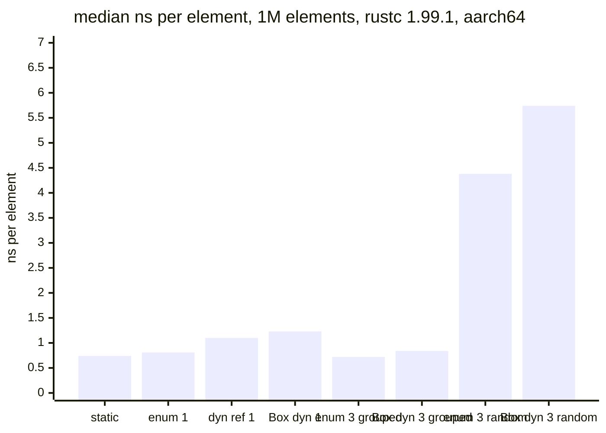
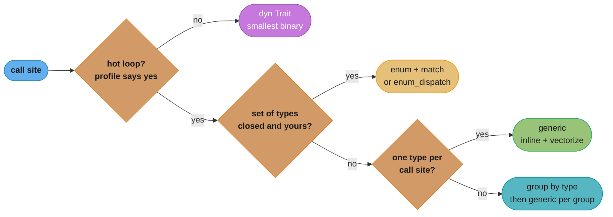

# Monomorphization, Vtables and Dispatch Cost

> **Version anchor (2026-11-06).** Rust 1.99.1 (2026-10-15), edition 2024. v0 symbol
> mangling is the default since `[1.97]`, so generic instantiations show their type arguments
> in symbol names. Trait upcasting `[1.86]`. `hint::black_box` `[1.66]`. Crates:
> cargo-llvm-lines 0.4.48, cargo-bloat 0.12.1, enum_dispatch 0.3.13, criterion 0.8.2,
> divan 0.1.21. Every number on this page marked "measured" was taken on 2026-11-06 with
> rustc 1.99.1 in the `rust:1.99.1-slim` container on aarch64 Linux, `-C opt-level=3`, on a
> shared laptop. Treat the spread between runs as noise.

---

## 1. Concept Overview

The parent page,
[Traits, Generics and Trait Objects](traits_generics_and_trait_objects.md), teaches how to
write generics, trait objects and enums. This page is about what each one costs: the
machine code rustc emits, the bytes it adds to the binary, the seconds it adds to the build,
and the nanoseconds it adds per call.

rustc implements generics by **monomorphization**. For every distinct set of type arguments
that reaches code generation, it emits a separate copy of the function, specialized and
optimized as if you had written it by hand for that type. `Vec<u32>::push` and
`Vec<String>::push` are two functions in the binary. A trait object takes the opposite path:
one copy of the code, and a **vtable** per concrete type that holds the drop function, the
size, the alignment and one function pointer per method.

The tradeoff is not "generics fast, `dyn` slow". The measured cost of a well-predicted
indirect call is about a nanosecond. The large costs are second-order. A generic call lets
LLVM inline and vectorize, and a `dyn` call stops both. A mixed collection of types makes
the branch predictor miss, and that miss costs the same for `dyn` and for an enum `match`.
Every generic instantiation adds code size and compile time, and those costs grow with the
number of types times the size of the generic body.

The general theory of monomorphization against type erasure lives in
[How Code Runs: Compilers and Interpreters](../../cs_fundamentals/how_code_runs_compilers_and_interpreters/how_code_runs_compilers_and_interpreters.md).
Go's middle path, GC-shape stenciling with dictionaries, is in
[Generics Implementation and GC Shape](../../go/generics_and_type_parameters/generics_implementation_and_gcshape.md).
This page covers code bloat and `dyn` cost in rustc only.

---

## 2. Intuition

**One-line analogy.** Monomorphization is printing a separate instruction manual for every
model of appliance. A vtable is one manual with a lookup table at the front: "for model X,
turn to page 12".

**Mental model.** Count three things for any dispatch choice: copies of code (binary size
and build time), indirections per call (one load and one indirect branch for `dyn`, zero for
a generic), and how predictable the target is (one type at a call site, or many in random
order).

**Why it matters.** A principal engineer gets asked two opposite questions about the same
codebase. "Why does this crate take four minutes to build and produce a 40 MB binary?" is a
monomorphization question. "Why is this inner loop three times slower than the C++ version?"
is often a `dyn` question. The answers point in opposite directions, so the decision is per
call site, not per codebase.

**Key insight.** Dispatch cost is mostly about what the optimizer can see. When LLVM can see
the concrete type, even a `&dyn Trait` call is devirtualized and inlined. When it cannot,
even an enum `match` costs a branch misprediction on unpredictable data.

---

## 3. Core Principles

1. **One copy per instantiation.** Each distinct set of generic arguments that reaches
   codegen produces its own function. The cost is roughly (number of types) times (size of
   the generic body).
2. **Instantiation happens where the types are known.** A generic function from a library is
   compiled in the crate that calls it with concrete types, so it can inline across crates
   without `#[inline]`.
3. **A `dyn` call is a load plus an indirect call.** The cost of that pair is small when the
   branch predictor is right. The real cost is the lost inlining.
4. **Predictability beats mechanism.** A random mix of types costs about the same through a
   vtable as through an enum `match` (measured below), because both pay for mispredicted
   branches.
5. **Vtable layout is not a stable ABI.** Drop, size, align and methods is what rustc emits.
   Nothing in the language promises it. Never read a vtable by hand.
6. **Devirtualization is an optimization, not a feature.** LLVM removes the indirect call
   when the vtable pointer is a known constant at the call site. It is not promised and it
   stops at function boundaries the optimizer cannot see through.
7. **Measure with `black_box`.** A benchmark that lets LLVM see the concrete type measures
   devirtualized code and proves nothing about production.

---

## 4. Types / Architectures / Strategies

| Strategy | What rustc emits | Size cost | Per-call cost |
|---|---|---|---|
| Generic `fn f<T: Trait>` | one copy per `T` | N copies of the body | direct call, usually inlined |
| `impl Trait` argument | same as a generic | same | same |
| `&dyn Trait` / `Box<dyn Trait>` | one copy, one vtable per concrete type | one body plus small vtables | load plus indirect call, no inlining |
| `enum` plus `match` | one copy, a `match` per call site | one body, all arms | tag load plus a branch or jump table, arms inlinable |
| `enum_dispatch` crate | an enum and a generated `match` impl | as for an enum | as for an enum |
| `fn` pointer | one copy per function | none | indirect call, no inlining |
| Generic shell plus non-generic inner `fn` | a tiny copy per `T`, one inner body | tiny per type | one direct call |
| Generic with `&dyn` inner | copy per `T` that builds a `&dyn` | tiny per type | indirect inside |

### Where the bloat comes from

| Source | Example | Fix |
|---|---|---|
| Large generic body, many types | `fn process<R: Read>(r: R)` with 300 lines, called for 6 reader types | move the body into `fn inner(r: &mut dyn Read)` |
| Generic over a closure | every `map(|x| ...)` closure is a distinct type | fine for small bodies; box the closure for big ones |
| Generic error conversion | `impl<E: Into<MyError>>` helpers per error type | convert at the edge with `map_err` |
| Deep generic types | a tower stack with ten layers | `BoxService` at the router boundary |
| `#[inline(always)]` on big generics | copied into every caller as well as every type | remove it; let LLVM decide |

---

## 5. Architecture Diagrams

### One generic source, N machine-code copies

```
 source                                   binary (v0 mangling, measured)

 fn report<T: Debug + Clone>(..)   --+--> report::<T0>   _RINv...6reportNtB2_2T0EB2_   149 IR lines
                                     +--> report::<T1>   _RINv...6reportNtB2_2T1EB2_   149 IR lines
                                     +--> ...
                                     +--> report::<T31>  _RINv...6reportNtB2_2T31EB2_  149 IR lines
                                                                                    = 4,768 lines

 fn report_dyn(items: &[&dyn Debug]) ---> report_dyn     one body                      148 IR lines
```

One generic function with 32 distinct type arguments produced 32 copies of about 149 LLVM
IR lines each. The `dyn` version produced one copy of 148 lines. This is the count that
`cargo llvm-lines` reports per function.

### Measured cost per element



Values are medians over the runs of the f64 shape benchmark in §6. With one type, or with
three types grouped by type, every strategy stays near 1 ns. With three types in random
order, enum and `dyn` both pay for branch mispredictions, and the gap between them is about
1 to 1.5 ns.

### Dispatch decision



Start from the profile, not from the syntax. Most call sites are not hot, and for those the
smaller binary and the shorter build matter more.

---

## 6. How It Works - Detailed Mechanics

### What rustc emits for a generic function

rustc type-checks a generic function once. It generates machine code only when a concrete
instantiation is needed, and it does so in the crate that names the concrete type. The
release profile defaults to 16 codegen units and the incremental dev profile to 256 (Cargo
profile docs). Each instantiation goes into a codegen unit, and LLVM optimizes each unit on
its own unless LTO is on. So the same instantiation can be compiled in several crates of one
build.

With v0 mangling `[1.97]`, the type arguments are part of the symbol:
`_RINvCs..._5bloat6reportNtB2_2T0EB2_` demangles to `bloat::report::<bloat::T0>`. Profilers
and `cargo bloat` print the demangled form, so a flame graph with 32 `report::<..>` frames
is a direct view of monomorphization.

### Measuring the bloat

```rust
use std::fmt::Debug;

#[inline(never)]
pub fn report<T: Debug + Clone>(items: &[T]) -> String {
    let mut out = String::new();
    for (i, it) in items.iter().enumerate() {
        let c = it.clone();
        out.push_str(&format!("{i}: {c:?}\n"));
    }
    out
}

#[inline(never)]
pub fn report_dyn(items: &[&dyn Debug]) -> String {
    let mut out = String::new();
    for (i, it) in items.iter().enumerate() {
        out.push_str(&format!("{i}: {it:?}\n"));
    }
    out
}
```

Instantiate `report` for 32 types and compile with `--emit=llvm-ir`: the IR has 32
`define` lines for `report`, each about 149 lines long (measured). In a Cargo project the
same view comes from:

```bash
cargo llvm-lines --release | head -20
cargo bloat --release --crates
cargo bloat --release -n 30
```

`cargo llvm-lines` lists total lines and the number of copies per generic function, sorted by
lines. LLVM IR lines track both binary size and LLVM time. `cargo bloat` reads the final
binary, after inlining and dead-code removal, so use both.

### The inner non-generic function

```rust
use std::fs;
use std::io;
use std::path::Path;

pub fn load<P: AsRef<Path>>(path: P) -> io::Result<Vec<u8>> {
    fn inner(path: &Path) -> io::Result<Vec<u8>> {
        let bytes = fs::read(path)?;
        if bytes.is_empty() {
            return Err(io::Error::new(io::ErrorKind::InvalidData, "empty file"));
        }
        Ok(bytes)
    }
    inner(path.as_ref())
}
```

The generic shell is one `as_ref` call per type. The real body is compiled once. The
standard library uses this shape: `std::fs::read` has an inner `fn inner(path: &Path)`, and
`Path::join` forwards to a private non-generic `_join`. Apply it when a generic function is
large and called with many types; skip it for small bodies, where inlining is the point.

### A trait object and its vtable

```rust
use std::fmt::Debug;
use std::mem::{align_of_val, size_of, size_of_val};

#[derive(Debug)]
pub struct Big {
    pub data: [u64; 4],
}

fn main() {
    let b = Big { data: [1, 2, 3, 4] };
    let d: &dyn Debug = &b;

    #[cfg(target_pointer_width = "64")]
    {
        assert_eq!(size_of::<&dyn Debug>(), 16);
        assert_eq!(size_of::<Box<dyn Debug>>(), 16);
        assert_eq!(size_of::<&Big>(), 8);
    }
    assert_eq!(size_of_val(d), 32);
    assert_eq!(align_of_val(d), 8);
    println!("{d:?}");
}
```

`size_of_val` and `align_of_val` on a `&dyn Debug` read the size and alignment from the
vtable, which is how `Box<dyn Trait>` knows how much to free. The vtable rustc emits holds
`drop_in_place`, size, alignment, then the trait's methods. A trait with supertraits also
carries what upcasting `[1.86]` needs to find the supertrait's vtable. All of this is an
implementation detail of rustc. Use `size_of_val`, never pointer arithmetic on the vtable.

### Devirtualization and its limits

```rust
pub trait Shape {
    fn area(&self) -> f64;
}

pub struct Circle {
    pub r: f64,
}

impl Shape for Circle {
    fn area(&self) -> f64 {
        3.0 * self.r * self.r
    }
}

pub fn visible(r: f64) -> f64 {
    let c = Circle { r };
    let s: &dyn Shape = &c;
    s.area()
}

pub fn opaque(s: &dyn Shape) -> f64 {
    s.area()
}
```

At `-C opt-level=3`, the IR for `visible` is two `fmul` instructions: LLVM saw the
constant vtable, turned the indirect call into a direct one, and inlined it (measured). The
IR for `opaque` is `tail call double %1(ptr %s.0)`, a call through a pointer loaded from the
vtable, because its callers are unknown. Devirtualization happens when the coercion to
`dyn` and the call meet in one function after inlining. It stops when the trait object comes
out of a `Vec`, a struct field or a public function argument. Stable rustc has no
whole-program devirtualization pass.

### The benchmark behind the numbers

```rust
use std::hint::black_box;
use std::time::Instant;

pub trait Shape {
    fn area(&self) -> f64;
}

#[derive(Clone, Copy)]
pub struct Circle {
    pub r: f64,
}

#[derive(Clone, Copy)]
pub struct Square {
    pub s: f64,
}

impl Shape for Circle {
    fn area(&self) -> f64 {
        3.14159 * self.r * self.r
    }
}

impl Shape for Square {
    fn area(&self) -> f64 {
        self.s * self.s
    }
}

#[derive(Clone, Copy)]
pub enum AnyShape {
    C(Circle),
    S(Square),
}

impl Shape for AnyShape {
    fn area(&self) -> f64 {
        match self {
            AnyShape::C(c) => c.area(),
            AnyShape::S(s) => s.area(),
        }
    }
}

#[inline(never)]
fn total_static<S: Shape>(v: &[S]) -> f64 {
    v.iter().map(|s| s.area()).sum()
}

#[inline(never)]
fn total_dyn(v: &[Box<dyn Shape>]) -> f64 {
    v.iter().map(|s| s.area()).sum()
}

fn time(name: &str, n: usize, mut f: impl FnMut() -> f64) {
    for _ in 0..3 {
        black_box(f());
    }
    let reps = 40;
    let t = Instant::now();
    for _ in 0..reps {
        black_box(f());
    }
    let ns = t.elapsed().as_nanos() as f64 / (reps * n) as f64;
    println!("{name:24} {ns:.2} ns/elem");
}

fn main() {
    let n = 1_000_000;
    let circles: Vec<Circle> = (0..n).map(|i| Circle { r: i as f64 }).collect();
    let mixed: Vec<AnyShape> = (0..n)
        .map(|i| {
            let x = i as f64;
            if (i * 7919) % 3 == 0 { AnyShape::S(Square { s: x }) } else { AnyShape::C(Circle { r: x }) }
        })
        .collect();
    let boxed: Vec<Box<dyn Shape>> = mixed
        .iter()
        .map(|e| match *e {
            AnyShape::C(c) => Box::new(c) as Box<dyn Shape>,
            AnyShape::S(s) => Box::new(s),
        })
        .collect();
    time("static Vec<Circle>", n, || total_static(black_box(&circles)));
    time("enum, mixed", n, || total_static(black_box(&mixed)));
    time("Box<dyn>, mixed", n, || total_dyn(black_box(&boxed)));
}
```

This is a trimmed version of the harness behind the chart in §5. The measured runs used three
shape types, once in xorshift-random order and once sorted by type, and also measured `&dyn`
without a box. The f64 sum is
sequential, because floating-point addition is not associative, so even the static loop is
not vectorized here. `black_box` stops LLVM from seeing the vector contents. For production
measurements use criterion or divan; the method and the noise floor are in
[Profiling and Benchmarking](../profiling_and_benchmarking/profiling_and_benchmarking.md).

### Measured results

f64 shapes, 1,000,000 elements, 40 repetitions per run, 3 to 5 runs:

| Strategy | Median ns/elem | Range ns/elem | Element size |
|---|---|---|---|
| static `Vec<Circle>` | 0.74 | 0.56 to 0.80 | 8 bytes |
| enum, one variant used | 0.81 | 0.69 to 1.00 | 24 bytes |
| `&dyn`, one type, no box | 1.10 | 0.73 to 1.24 | 16-byte pointer |
| `Box<dyn>`, one type | 1.23 | 0.70 to 1.73 | 16-byte pointer plus heap |
| enum, three variants grouped by type | 0.72 | 0.67 to 0.83 | 24 bytes |
| `Box<dyn>`, three types grouped by type | 0.84 | 0.73 to 0.97 | 16-byte pointer plus heap |
| enum, three variants random | 4.38 | 3.47 to 5.27 | 24 bytes |
| `Box<dyn>`, three types random | 5.74 | 4.40 to 6.06 | 16-byte pointer plus heap |

u64 costs with `wrapping_add`, which LLVM can vectorize, 4 runs:

| Strategy | Range ns/elem |
|---|---|
| static, vectorized | 0.19 to 0.41 |
| `&dyn`, one type | 0.81 to 1.51 |
| `&dyn`, two types grouped | 0.80 to 1.40 |
| `&dyn`, two types alternating | 0.82 to 1.69 |

Three readings. Inlining plus vectorization made the static u64 loop about 3 to 4 times
faster than `dyn` with one type. Random type order added 3.5 to 4.5 ns per element for both
enum and `dyn`, and sorting the same data by type removed nearly all of it. A strict A/B
alternation stayed cheap, because the predictor learns a short pattern.

### `enum_dispatch`

```rust
// Needs the enum_dispatch crate.
use enum_dispatch::enum_dispatch;

#[enum_dispatch]
pub trait Shape {
    fn area(&self) -> f64;
}

pub struct Circle {
    pub r: f64,
}

pub struct Square {
    pub s: f64,
}

impl Shape for Circle {
    fn area(&self) -> f64 {
        3.14159 * self.r * self.r
    }
}

impl Shape for Square {
    fn area(&self) -> f64 {
        self.s * self.s
    }
}

#[enum_dispatch(Shape)]
pub enum AnyShape {
    Circle,
    Square,
}
```

The macro generates `AnyShape::Circle(Circle)` variants, `From` impls, and an
`impl Shape for AnyShape` that `match`es and forwards. It is the hand-written enum from the
benchmark without the boilerplate. It needs the trait and the enum visible to the same macro
expansion, and the set of types is closed at compile time.

---

## 7. Real-World Examples

- **`std::fmt`.** `format_args!` passes each argument as a data pointer plus a formatting
  function pointer. That keeps every `println!` call site from monomorphizing a formatter per
  argument type, at the price of an indirect call per argument.
- **`std::fs::read` and `Path::join`.** Generic over `AsRef<Path>` at the surface, with a
  non-generic inner function holding the body.
- **axum routing.** Each handler is a distinct generic type, and the router stores routes as
  type-erased boxed services. Handler code is monomorphized; the route table is dynamic.
  See [Web Services with axum, tower and hyper](../web_services_axum_tower_and_hyper/web_services_axum_tower_and_hyper.md).
- **serde.** `Serialize` and `Deserialize` are generic over the format, so a crate with 200
  derived types and two formats carries up to 400 serializer bodies. This is a common source
  of large release binaries, and the reason `cargo llvm-lines` output in such crates is
  dominated by serde-generated functions. See
  [Serde and Serialization](../serde_and_serialization/serde_and_serialization.md).
- **Go and Java contrast.** Go groups type arguments by GC shape and passes a dictionary, so
  it bloats less and inlines less
  ([GC shape](../../go/generics_and_type_parameters/generics_implementation_and_gcshape.md)).
  Java erases generics to one body and relies on the JIT to devirtualize hot call sites at
  run time ([Java generics](../../java/generics_and_type_system/generics_and_type_system.md)).
  Rust has no JIT, so it cannot speculate on the types it observes at run time.

---

## 8. Tradeoffs

### Decision table: generics vs `dyn` vs enum

| | Generic | `dyn Trait` | Enum or `enum_dispatch` |
|---|---|---|---|
| Code size, measured | 32 types gave 32 copies, about 4,768 IR lines | 1 copy, 148 IR lines | 1 copy, all arms in it |
| ns per element, one type, f64 (median) | 0.74 | 1.10 (`&dyn`), 1.23 (`Box`) | 0.81 |
| ns per element, one type, u64 vectorizable | 0.19 to 0.41 | 0.81 to 1.51 | not measured |
| ns per element, 3 types grouped (median) | n/a (cannot mix) | 0.84 | 0.72 |
| ns per element, 3 types random (median) | n/a (cannot mix) | 5.74 | 4.38 |
| Element storage | `size_of::<T>()` inline | 16-byte pointer plus heap allocation | largest variant plus tag, inline |
| Compile time | grows with types times body size | flat | flat |
| Open to new types from other crates | yes | yes | no |
| Inlining and vectorization | yes | no, unless devirtualized | yes, inside each arm |

### `dyn` vs function pointer vs closure

| | `&dyn Fn(u64) -> u64` | `fn(u64) -> u64` | `impl Fn(u64) -> u64` |
|---|---|---|---|
| Captures state | yes | no | yes |
| Size | 16 bytes | 8 bytes | size of the captures |
| Call | indirect | indirect | direct, inlinable |
| Copies of caller | 1 | 1 | 1 per closure type |

---

## 9. When to Use / When NOT to Use

**Use generics when**
- the profile shows the call in a hot loop and the type is fixed per call site;
- the body is small, so inlining removes it anyway;
- you need vectorization across the loop body.

**Use `dyn` when**
- the code is not hot, which is most code;
- the build is slow or the binary is large and `cargo llvm-lines` names the generic;
- the type is chosen at run time, or plugins come from other crates.

**Use an enum when**
- the set is closed, you own it, and the call is hot;
- you want values stored inline in a `Vec` with no per-element allocation.

**Do not**
- convert a cold path from `dyn` to generics "for performance". You pay in build time for a
  nanosecond nobody measured;
- benchmark without `black_box`. LLVM devirtualizes the toy and the number is fiction;
- put `#[inline(always)]` on a large generic. It multiplies copies by call sites;
- assume an enum fixes a randomly mixed workload. Sorting or grouping by type helps both
  `dyn` and enums more than switching between them.

---

## 10. Common Pitfalls

### A heterogeneous `Vec<dyn Trait>`

```rust
// BROKEN
// error[E0277]: the size for values of type `(dyn Shape + 'static)` cannot be known at compilation time
pub trait Shape {
    fn area(&self) -> f64;
}

pub fn total(v: Vec<dyn Shape>) -> f64 {
    v.iter().map(|s| s.area()).sum()
}
```

```rust
// FIX: a Vec needs a sized element. Box each value, or store an enum inline.
pub trait Shape {
    fn area(&self) -> f64;
}

pub fn total(v: &[Box<dyn Shape>]) -> f64 {
    v.iter().map(|s| s.area()).sum()
}
```

### A `Self: Sized` method called through `dyn`

```rust
// BROKEN
// error: the `scaled` method cannot be invoked on a trait object
pub trait Shape {
    fn area(&self) -> f64;
    fn scaled(&self, k: f64) -> Self
    where
        Self: Sized;
}

pub fn double_area(s: &dyn Shape) -> f64 {
    s.scaled(2.0).area()
}
```

```rust
// FIX: give the dyn path its own dispatchable method that returns a box.
pub trait Shape {
    fn area(&self) -> f64;
    fn scaled_box(&self, k: f64) -> Box<dyn Shape>;
}

pub fn double_area(s: &dyn Shape) -> f64 {
    s.scaled_box(2.0).area()
}
```

### Release binary grew after a generic refactor

An illustrative case: a team made a 400-line request pipeline generic over six transport types so tests could
inject a fake. The release binary grew by several megabytes and the crate's build time went
up by about a minute in CI. `cargo llvm-lines` showed the pipeline six times at the top. The
fix was the inner-function shape: a generic constructor that boxes the transport once, and
a non-generic pipeline over `Box<dyn Transport>`. The added per-request cost was one indirect
call against a network round trip.

### A benchmark that measured devirtualized code

A microbenchmark built `let s: &dyn Shape = &Circle { .. }` and called `s.area()` in a loop.
It showed `dyn` and generics at the same speed, and the team shipped a `Vec<Box<dyn Shape>>`
into a hot path. The benchmark's vtable was a constant in one function, so LLVM had inlined
the call. Production paid the indirect call, the box pointer chase and mispredictions.
Wrap inputs in `black_box` and build them the way production does.

### A large enum variant inflating every element

An event enum had nine small variants and one with a 512-byte buffer. Every `Vec<Event>`
element was over 512 bytes, so the cache footprint of the "fast" enum was worse than a
`Vec<Box<dyn Event>>`. Clippy's `large_enum_variant` lint fires when the largest variant is
more than 200 bytes larger than the next one, its default `enum-variant-size-threshold`. Box
the large payload inside its variant.

---

## 11. Technologies & Tools

| Tool | What it measures |
|---|---|
| cargo-llvm-lines | 0.4.48: LLVM IR lines and copies per generic function, sorted by total lines |
| cargo-bloat | 0.12.1: size of each function and crate in the final binary |
| enum_dispatch | 0.3.13: generates enum-based dispatch from a trait and a list of types |
| criterion | 0.8.2: statistical microbenchmarks with warm-up and outlier analysis |
| divan | 0.1.21: lightweight benchmarks with per-type generic benches |
| samply | 0.13.1: sampling profiler; shows monomorphized symbols such as `report::<T0>` |
| Compiler Explorer | Shows rustc's assembly and LLVM IR for a snippet, to check inlining and devirtualization |
| Clippy | `large_enum_variant` flags an enum whose largest variant is over 200 bytes bigger than the next |

---

## 12. Interview Questions with Answers

**Q: Is a `dyn Trait` call slow because of the indirect jump?**
**Short:** Rarely; a predicted indirect call costs about a nanosecond, and the real cost is that the optimizer cannot inline or vectorize through it.

Measured on rustc 1.99.1, a u64 loop over `&dyn` with one concrete type cost 0.8 to 1.5 ns
per element, against 0.2 to 0.4 ns for the generic version that LLVM vectorized. The jump
itself is cheap when predicted. What the generic version gains is inlining, which then
enables vectorization, constant folding and hoisting. Look at whether the call site is hot
and whether its body is small enough to inline before blaming dispatch.

**Q: Does replacing `Box<dyn Trait>` with an enum always make a hot loop fast?**
**Short:** No; with types in random order both pay for branch mispredictions, and the measured gap was about 1.4 ns per element out of 4 to 6.

With three shape types in random order, the enum `match` measured a median of 4.4 ns per
element and `Box<dyn>` 5.7 ns. The enum saves the box pointer chase and allows inlining in each arm,
but the branch predictor misses on the tag just as it misses on the vtable pointer. Grouping
elements by type, or keeping one `Vec` per type, is the larger win. Enums also store every
element at the size of the largest variant.

**Q: Why can monomorphization make a release binary several megabytes larger?**
**Short:** Each distinct set of type arguments gets its own compiled copy of the generic function, so a large body used with many types is copied many times.

Measured: one 149-line generic function instantiated for 32 types became 32 copies, about
4,768 LLVM IR lines, while the `dyn` version was one copy of 148 lines. Real crates multiply
this through nested generics: serde derives, iterator chains and tower stacks. `cargo
llvm-lines` lists the worst offenders, and `cargo bloat` confirms what survived to the
binary. The fixes are an inner non-generic function or a `dyn` boundary.

**Q: What is the inner non-generic function trick?**
**Short:** Keep the generic function as a thin shell that converts its argument, then call one private non-generic function that holds the real body, so only the shell is copied per type.

`fn load<P: AsRef<Path>>(p: P)` calls `inner(p.as_ref())`, where `inner(path: &Path)` does
the work. Each new `P` adds one tiny shell, not the whole body. `std::fs::read` and
`Path::join` use this shape. Apply it to large generic functions with many instantiations.
For small bodies, leave the generic alone, since inlining is the benefit.

**Q: What does a Rust vtable contain?**
**Short:** rustc emits the drop function, the size and alignment, and one function pointer per dispatchable method; the layout is an implementation detail, not a stable ABI.

A `&dyn Trait` is a 16-byte pair on 64-bit targets: a data pointer and a pointer to a static
vtable shared by every object of that concrete type. The drop entry and the size and
alignment let `Box<dyn Trait>` drop and free a value whose type it does not know.
`size_of_val` and `align_of_val` read those entries. Supertrait vtables add what upcasting
needs. Never depend on the order; FFI code that needs a stable table should define a
`#[repr(C)]` struct of function pointers.

**Q: When does LLVM devirtualize a `dyn` call?**
**Short:** When the vtable pointer is a known constant at the call site after inlining, such as a value coerced to dyn and called in the same function; never through a Vec or an unknown caller.

In the measured example, `let s: &dyn Shape = &c; s.area()` compiled to two multiplies with
no call. A public `fn opaque(s: &dyn Shape)` compiled to an indirect call through a pointer
loaded from the vtable. Devirtualization is an LLVM optimization with no promise behind it,
and stable rustc has no whole-program devirtualization. Design hot paths as if it never
happens, and benchmark with `black_box` so a test does not get it by accident.

**Q: Where is a generic function from a library compiled?**
**Short:** In the downstream crate that uses it with concrete types, because only that crate knows the type arguments; this is why generics inline across crates without the inline attribute.

A library ships generic functions as metadata, not machine code. When your crate calls
`Vec::<Order>::push`, rustc generates that instantiation in your crate's codegen units. Two
crates in one build can each carry a copy of the same instantiation. LTO lets LLVM see across
crates and remove some of the duplicates. Non-generic library functions are compiled once
upstream and need `#[inline]` or LTO to inline downstream.

**Q: How do codegen units interact with monomorphization?**
**Short:** rustc splits each crate into codegen units that LLVM optimizes separately, 16 by default in release and 256 in incremental dev builds, so more units mean faster builds and fewer cross-unit inlines.

Each instantiation lands in one unit, and a call from another unit cannot inline it unless
the function is marked inlinable or LTO runs. `codegen-units = 1` plus `lto = "fat"` gives
LLVM the whole program and usually a smaller, faster binary, at the price of a slower
build. Monomorphization adds work to every unit that contains instantiations. Use these
settings in a release profile for the shipped binary, not for local iteration.

**Q: How do you find which generic functions cost the most build time and size?**
**Short:** Run cargo llvm-lines to rank generic functions by LLVM IR lines and copies, then cargo bloat to see what survives in the final binary.

`cargo llvm-lines --release` prints total lines, copies and the function name; a function
with 40 copies at the top is your target. `cargo bloat --release --crates` shows which
dependency dominates. `cargo build --timings` shows which crates take the longest. Fix the
top three entries and measure again; bloat is usually concentrated in a few functions.

**Q: Why is an enum often smaller and faster than `Vec<Box<dyn Trait>>` for a closed set?**
**Short:** Enum values sit inline in the Vec with no per-element heap allocation, and each match arm can inline, while boxed trait objects add an allocation and a pointer chase per element.

A `Vec<AnyShape>` is one contiguous allocation. A `Vec<Box<dyn Shape>>` is an array of fat
pointers to separate heap blocks, so iteration follows a pointer per element and may miss
the cache. Measured with one type, the enum had a median of 0.81 ns per element against
1.23 ns for `Box<dyn>`. The cost of the enum is that each element is as large as the biggest
variant, and adding a type means editing the enum.

**Q: What does `enum_dispatch` do, and when should you avoid it?**
**Short:** It generates an enum and a match-based trait impl from a trait and a list of types, giving enum performance with trait syntax; avoid it when types must come from other crates.

The macro writes the variants, `From` conversions and the forwarding `match` that you would
otherwise write by hand. The result costs what a hand-written enum costs. It needs the
trait and enum definitions visible to the macro, does not support every trait shape, and
fixes the set of types at compile time. For a plugin system with types from other crates,
`dyn` is the only option.

**Q: Why does a benchmark show `dyn` and generics at the same speed when production does not?**
**Short:** The benchmark let LLVM see the concrete type and devirtualize the call; production code receives trait objects from collections and function arguments the optimizer cannot see through.

Create inputs the way production does, pass them through `std::hint::black_box`, and keep
the measured function behind `#[inline(never)]` or a crate boundary. Mixed types in the
benchmark data should match the real distribution, since prediction dominates. Criterion and
divan add warm-up and statistics, but they cannot fix a benchmark that measures the wrong
code. The method is covered in
[Benchmarking Methodology](../../backend/benchmarking_methodology/benchmarking_methodology.md).

**Q: How does sorting or grouping elements by type change dispatch cost?**
**Short:** It makes the call target predictable, so the branch predictor stops missing; measured boxed dyn cost fell from a median of 5.7 ns per element in random order to 0.84 ns when grouped.

The indirect branch predictor learns a target that repeats. Grouped data, or a strict
two-type alternation, stays near the one-type cost. Random order defeats it. The strongest
form is one `Vec` per concrete type, processed with a generic function per `Vec`, which
gets inlining and vectorization too. This is the data-oriented design answer to "enum or
`dyn`?".

**Q: How does Rust's approach compare with Go's GC-shape stenciling and Java's erasure?**
**Short:** Rust copies per type for speed and pays in size and build time; Go shares bodies by memory shape with a dictionary; Java shares one erased body and relies on the JIT.

Rust has no runtime type information to speculate on, so it decides everything ahead of
time. Go's shape stenciling reduces copies but adds dictionary lookups that block inlining.
Java's erasure gives one body and boxes primitives, and its JIT can devirtualize hot call
sites from profiles, which an ahead-of-time Rust compiler cannot. `dyn Trait` is Rust's
opt-in erasure, with the choice made per call site by the programmer.

**Q: What does a function pointer cost compared with `dyn Fn` and a generic closure?**
**Short:** A plain fn pointer is 8 bytes and an indirect call with no captures; a dyn Fn reference is 16 bytes with captures; a generic closure is a direct, inlinable call copied per closure type.

`fn(u64) -> u64` suits callbacks with no state, such as a table of handlers. `&dyn Fn` adds
captured state through the data pointer. `impl Fn` or a generic `F: Fn` gives the optimizer
the closure body, which is why iterator adapters are fast and why each closure type
instantiates the adapter again. Choose by whether the call is hot and whether the set of
callers is large.

**Q: When would a principal engineer push a team from generics toward `dyn`?**
**Short:** When build time or binary size is the measured problem and the generic code is not on a hot path, which describes most service glue, configuration and plugin code.

Generic-heavy service code spreads type parameters through handlers, routers and app state,
and every type combination costs LLVM time. A `dyn` boundary at the composition root, such
as `Arc<dyn Repository>`, collapses those copies with an indirect call per request that is
noise next to I/O. Keep generics in the inner loops the profile names. Write the policy
down: generic in hot paths and small utilities, `dyn` at module and plugin boundaries.

---

## 13. Best Practices

- Profile before choosing a dispatch strategy. Most call sites are not hot.
- Run `cargo llvm-lines` when a crate's build time or binary size grows, and fix the top
  entries.
- Keep generic bodies small. Move large bodies into a non-generic inner function.
- Use `dyn` at composition boundaries: app state, plugins, configuration-selected backends.
- Use an enum or `enum_dispatch` for a closed, hot set of types, and box large variants.
- Group data by type before a hot loop over mixed types.
- Benchmark with `black_box`, with production-shaped data, under criterion or divan.
- Reserve `#[inline(always)]` for tiny functions that a profile proves are not inlined.
- In a release profile for shipped binaries, consider `codegen-units = 1` and LTO, and
  measure both build time and runtime.

---

## 14. Case Study

**Scenario (illustrative numbers).** A rules engine evaluates every incoming event against 40 rule types at about
2 million events per second per core. Version 1 stored rules as `Vec<Box<dyn Rule>>` and
evaluated every rule for every event. A profile showed 70% of CPU time in the evaluation
loop and the indirect call at the top of the annotated assembly.

**First attempt.** An engineer tried to make the vector generic so calls would be static:

```rust
// BROKEN
// error[E0562]: `impl Trait` is not allowed in the type of variable bindings
pub trait Rule {
    fn hit(&self, value: u64) -> bool;
}

pub struct Above(pub u64);

impl Rule for Above {
    fn hit(&self, value: u64) -> bool {
        value > self.0
    }
}

pub fn build() -> usize {
    let rules: Vec<impl Rule> = vec![Above(10)];
    rules.len()
}
```

A `Vec<impl Rule>` would still hold one concrete type, so it cannot store 40 kinds of rule.
Generics do not apply to a heterogeneous collection.

**Fix.** The rule set is closed and owned by the team, so it becomes an enum, and rules are
grouped by kind so each inner loop sees one variant.

```rust
// FIX: closed set as an enum, stored inline, evaluated grouped by kind.
#[derive(Clone, Copy)]
pub enum Rule {
    Above(u64),
    Below(u64),
    Between(u64, u64),
}

impl Rule {
    #[inline]
    pub fn hit(&self, v: u64) -> bool {
        match *self {
            Rule::Above(t) => v > t,
            Rule::Below(t) => v < t,
            Rule::Between(lo, hi) => v >= lo && v <= hi,
        }
    }

    fn kind(&self) -> u8 {
        match self {
            Rule::Above(_) => 0,
            Rule::Below(_) => 1,
            Rule::Between(..) => 2,
        }
    }
}

pub struct Engine {
    rules: Vec<Rule>,
}

impl Engine {
    pub fn new(mut rules: Vec<Rule>) -> Self {
        rules.sort_by_key(Rule::kind);
        Engine { rules }
    }

    pub fn matches(&self, v: u64) -> usize {
        self.rules.iter().filter(|r| r.hit(v)).count()
    }
}

fn main() {
    let e = Engine::new(vec![Rule::Between(5, 9), Rule::Above(3), Rule::Below(8)]);
    println!("{}", e.matches(7));
}
```

**Why it works.** Each `Rule` is 24 bytes on 64-bit targets, inline in one allocation, with no box per rule.
Sorting by kind turns the `match` on the tag into a predictable branch, which the
measurements in §6 show matters more than the dispatch mechanism. The arms are small and
inline into the filter loop.

**What stayed `dyn`.** Rule *sources* (a file loader, a database loader, a test fixture)
stayed `Box<dyn RuleSource>`, because they run once at startup and a generic there would
only add copies.

**How to present it.** Start with the profile, name the cost (lost inlining, unpredictable
targets, a pointer chase per rule), show why generics cannot hold a mixed set, and pick the
enum for the hot closed set and `dyn` for the cold open one. Quote the measured numbers
with their conditions: one machine, one compiler, 3 to 5 runs.
