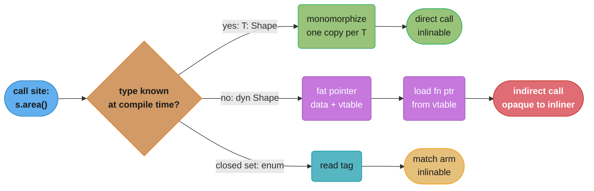
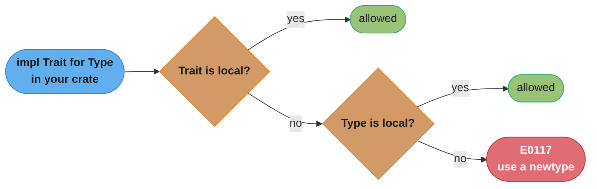

# Traits, Generics and Trait Objects

> **Version anchor (2026-11-06).** Rust 1.99.1 (2026-10-15), edition 2024. Release-gated
> features on this page: generic associated types `[1.65]`, `async fn` and return-position
> `impl Trait` in traits `[1.75]`, associated type bounds `[1.79]`, precise capturing
> `use<..>` `[1.82]` (and in trait definitions `[1.87]`), trait upcasting `[1.86]`, `_` as an
> inferred const generic argument `[1.89]`. Edition 2024 changes the default lifetime
> capture rules for return-position `impl Trait` `[ed2024]`. `async fn` in a `dyn Trait` is
> not dyn compatible on 1.99.1. Crates: trait-variant 0.1.3, enum_dispatch 0.3.13,
> cargo-llvm-lines 0.4.48.

---

## 1. Concept Overview

A trait is a named set of methods, associated types and associated constants that a type
promises to provide. Rust has no classes and no inheritance of implementation. Traits do
the work that interfaces, abstract base classes, type classes and operator overloading do
in other languages, and one mechanism covers all of them.

A trait gets used in two very different ways, and most design questions about traits come
down to which one you picked:

- **As a bound on a generic** (`fn draw<T: Shape>(s: &T)`). The compiler knows the concrete
  type at each call site and emits a separate copy of the function for it. This is
  *static dispatch*. Calls are direct and inlinable. The cost is binary size and compile
  time.
- **As a trait object** (`fn draw(s: &dyn Shape)`). The concrete type is erased. The value
  travels as a 16-byte fat pointer on 64-bit targets: a data pointer plus a pointer to a
  vtable of function pointers. This is *dynamic dispatch*. One copy of the code serves every
  type, and the call goes through a function pointer that the optimizer usually cannot see
  through.

Around those two uses sit the rules that make traits safe to compose across crates. The
**orphan rule** says who may write `impl Trait for Type`. **Coherence** says at most one impl
applies to any type. **Dyn compatibility** says which traits can become `dyn Trait`. **Auto
traits** (`Send`, `Sync`, `Unpin`) are implemented by the compiler from a type's fields.

This page teaches how to write traits and generics and how to choose between them at the
API level. What each choice costs in emitted code, vtable layout and nanoseconds per call
is in the sub-file
[Monomorphization, Vtables and Dispatch Cost](monomorphization_vtables_and_dispatch_cost.md).
The general compiler picture of monomorphization against erasure lives in
[How Code Runs: Compilers and Interpreters](../../cs_fundamentals/how_code_runs_compilers_and_interpreters/how_code_runs_compilers_and_interpreters.md);
this page covers only the Rust side.

---

## 2. Intuition

**One-line analogy.** A trait is a job description. A generic is a contract written for one
named hire at a time. A trait object is a badge that says "can do the job" and hides who is
wearing it.

**Mental model.** Every trait question has three parties: the crate that defines the trait,
the crate that defines the type, and the crate that writes the `impl`. The orphan rule
says the `impl` must live with one of the first two. Every dispatch question has two
moments: compile time, when the compiler may know the concrete type, and run time, when
only the vtable knows. Generics push the decision to compile time. `dyn` pushes it to run
time.

**Why it matters.** The choice leaks into your public API. A function that takes
`impl Read` cannot later switch to `&mut dyn Read` without a breaking change. A trait
that gains a generic method stops being usable as `dyn Trait`. An `async fn` in a public
trait gives callers no way to require a `Send` future. These are hard to undo after release.

**Key insight.** Traits in Rust are closer to Haskell type classes than to Java interfaces.
An impl is a separate item that can live outside the type's definition, a trait can be
implemented for types you did not write, and the compiler picks the impl by type, not by
an object's runtime class. Dynamic dispatch is opt-in, explicit in the type (`dyn`), and
rarer than in Java or Go.

---

## 3. Core Principles

1. **Static dispatch is the default.** A bare trait bound monomorphizes. You pay for
   dynamic dispatch only when you write `dyn`.
2. **One impl per (trait, type) pair.** Coherence forbids overlap (E0119). Stable Rust has
   no specialization; `#![feature(specialization)]` fails on the stable channel with E0554.
3. **The orphan rule protects downstream crates.** You may implement a trait for a type
   only if the trait or the type is local to your crate (E0117). The workaround is a newtype.
4. **Associated types express "one answer per implementor"; generic parameters express
   "many".** `Iterator::Item` is fixed by the iterator. `From<T>` can be implemented many
   times for one type.
5. **`dyn` needs dyn compatibility.** A dispatchable method has no type parameters, uses
   `Self` only in its receiver, and is not `async fn` and does not return `impl Trait`. A
   method that breaks these rules can opt out with `where Self: Sized`. The trait itself may
   have no associated constants and no generic associated types, and no bound opts those out.
6. **Auto traits are inferred, not declared.** A type is `Send` if all its fields are.
   `dyn Trait` does not carry `Send` unless you write `dyn Trait + Send`.
7. **Every generic parameter is implicitly `Sized`.** Write `?Sized` to accept `str`,
   `[T]` or `dyn Trait` behind a pointer.
8. **Implement the narrow trait, get the wide one free.** Implement `From` and receive
   `Into` through a blanket impl. Implement `Display` and receive `ToString`.

---

## 4. Types / Architectures / Strategies

### Trait shapes

| Shape | Example | Use it for |
|---|---|---|
| Plain trait with methods | `trait Shape { fn area(&self) -> f64; }` | Behavior many types share |
| Associated type | `trait Iterator { type Item; }` | An output type fixed by the implementor |
| Generic trait | `trait From<T>` | Many impls per type, chosen by the parameter |
| Associated constant | `trait Unit { const SYMBOL: &'static str; }` | Per-type constants (makes the trait not dyn compatible) |
| Generic associated type `[1.65]` | `type Item<'a> where Self: 'a;` | Lending iterators, borrowed views tied to `&self` |
| Supertrait | `trait Named: Shape` | "Implementors of `Named` must also implement `Shape`" |
| Marker trait | `Copy`, `Eq`, your own `trait Validated {}` | A promise with no methods |
| Auto trait | `Send`, `Sync`, `Unpin` | Compiler-derived properties of a type's fields |
| Extension trait | `trait StrExt { fn is_slug(&self) -> bool; } impl StrExt for str` | Adding methods to a foreign type |
| Sealed trait | `pub trait Backend: private::Sealed` | A public trait outside crates may use but not implement |

### Ways to accept "something that implements `Shape`"

| Syntax | Dispatch | Caller can name the type? | Heterogeneous collection? |
|---|---|---|---|
| `fn f<T: Shape>(s: &T)` | static | yes, `f::<Circle>` | no |
| `fn f(s: &impl Shape)` | static | no turbofish for the `impl` parameter | no |
| `fn f(s: &dyn Shape)` | dynamic | n/a | yes |
| `fn f(s: Box<dyn Shape>)` | dynamic, owned | n/a | yes |
| `fn f(s: ShapeEnum)` | `match` on a tag | n/a | yes, closed set |

### Ways to return "something that implements `Shape`"

| Syntax | Meaning | Limit |
|---|---|---|
| `-> impl Shape` | one hidden concrete type | every return path must produce the same type |
| `-> Box<dyn Shape>` | any type, heap allocated | one allocation, dynamic calls |
| `-> ShapeEnum` | one of a known set | the set is closed |

### Conversion traits

| Trait | Direction | Fails? | Typical use |
|---|---|---|---|
| `From<T>` / `Into<T>` | owned to owned | no | `String::from("x")`, error conversion in `?` |
| `TryFrom<T>` / `TryInto<T>` | owned to owned | yes, `Result` | narrowing integers, parsing into a validated newtype |
| `AsRef<T>` | cheap ref to ref | no | `fn open<P: AsRef<Path>>(p: P)` |
| `AsMut<T>` | cheap mut ref to mut ref | no | buffers |
| `Borrow<T>` | ref to ref, with equal `Eq`, `Ord` and `Hash` | no | `HashMap<String, V>::get(&str)` |
| `Deref<Target = T>` | smart pointer to pointee | no | `Box`, `Rc`, `String` to `str`; not for newtypes |
| `ToOwned` | borrowed to owned | no | `str` to `String`, used by `Cow` |

---

## 5. Architecture Diagrams

### Where the call target is decided



The same `s.area()` compiles to three different machine shapes. Only the `dyn` path hides
the callee from the optimizer, which is why its real cost is lost inlining rather than the
indirect jump itself.

### A trait object in memory (64-bit target)

```
  &dyn Shape  (16 bytes)                 vtable for <Circle as Shape>  (static, read-only)
 +----------------+----------------+    +-------------------------------+
 | data ptr (8)   | vtable ptr (8) |--->| drop_in_place::<Circle>       |
 +----------------+----------------+    | size  = 8                     |
         |                              | align = 8                     |
         v                              | <Circle as Shape>::area       |
 +----------------+                     | <Circle as Shape>::perimeter  |
 | Circle { r }   |                     +-------------------------------+
 +----------------+
```

The data pointer and the vtable pointer travel together. Every `&dyn Shape` that points at
a `Circle` shares one vtable. The order of entries is a rustc implementation detail, not a
documented layout, so never read a vtable by hand.

### Who may write the impl (orphan rule)



The full rule also lets a local type appear as a type parameter of a foreign trait
(`impl From<MyType> for Vec<u8>` is allowed), as long as it comes before any uncovered type
parameter. The two-question version above catches nearly every real case.

---

## 6. How It Works - Detailed Mechanics

### Bounds, `where` clauses and associated types

```rust
use std::collections::HashMap;
use std::fmt::Display;
use std::hash::Hash;

pub trait Repository {
    type Id: Copy + Eq + Hash + Display;
    type Item;

    fn get(&self, id: Self::Id) -> Option<&Self::Item>;
}

pub struct InMemory<T> {
    rows: HashMap<u64, T>,
}

impl<T> Repository for InMemory<T> {
    type Id = u64;
    type Item = T;

    fn get(&self, id: u64) -> Option<&T> {
        self.rows.get(&id)
    }
}

pub fn describe<R>(repo: &R, id: R::Id) -> String
where
    R: Repository,
    R::Item: Display,
{
    match repo.get(id) {
        Some(item) => format!("{id}: {item}"),
        None => format!("{id}: missing"),
    }
}
```

`Repository` has one `Id` per implementor, so `Id` is an associated type. If it were a
generic parameter (`Repository<Id>`), one type could implement `Repository<u64>` and
`Repository<Uuid>`, and every caller would have to say which. Associated type bounds `[1.79]`
let you write `R: Repository<Item: Display>` inline instead of the `where` line.

### Blanket impls and coherence

```rust
use std::fmt::Display;

pub trait Shout {
    fn shout(&self) -> String;
}

impl<T: Display + ?Sized> Shout for T {
    fn shout(&self) -> String {
        self.to_string().to_uppercase()
    }
}

fn main() {
    println!("{}", "ok".shout());
    println!("{}", 42.shout());
}
```

A blanket impl covers every type that meets the bound, including types written later in
other crates. The price: no other impl of `Shout` can overlap it. Adding a blanket impl to a
published trait is a breaking change, because a downstream crate may already have an impl
that now conflicts (E0119). The standard library uses this shape for
`impl<T: Display + ?Sized> ToString for T` and `impl<T, U: From<T>> Into<U> for T`.

### The orphan rule and the newtype

```rust
use std::fmt;

pub struct Hex(pub Vec<u8>);

impl fmt::Display for Hex {
    fn fmt(&self, f: &mut fmt::Formatter<'_>) -> fmt::Result {
        for b in &self.0 {
            write!(f, "{b:02x}")?;
        }
        Ok(())
    }
}

fn main() {
    println!("{}", Hex(vec![0xde, 0xad]));
}
```

`impl Display for Vec<u8>` is rejected with E0117 because both the trait and the type are
foreign. A one-field tuple struct is local, costs nothing at run time, and can carry
`#[repr(transparent)]` when its layout must match the inner type.

### Conversion traits

```rust
use std::collections::HashMap;
use std::path::Path;

pub struct Port(u16);

impl TryFrom<u32> for Port {
    type Error = String;

    fn try_from(v: u32) -> Result<Self, Self::Error> {
        u16::try_from(v)
            .ok()
            .filter(|p| *p != 0)
            .map(Port)
            .ok_or_else(|| format!("{v} is not a valid port"))
    }
}

pub fn exists<P: AsRef<Path>>(p: P) -> bool {
    p.as_ref().exists()
}

pub fn lookup(m: &HashMap<String, u32>) -> Option<u32> {
    // Borrow<str> for String lets a &str key query a String-keyed map.
    m.get("alice").copied()
}
```

`AsRef` is a cheap reference conversion with no contract on equality. `Borrow` carries a
contract: `x.borrow() == y.borrow()` must agree with `x == y`, and the same for `Hash` and
`Ord`. That is why `HashMap` uses `Borrow` for lookups. A `Borrow` impl that hashes
differently from the owned type returns wrong lookups without any panic.

### `impl Trait` in argument and return position

```rust
pub fn evens(limit: u32) -> impl Iterator<Item = u32> {
    (0..limit).filter(|n| n % 2 == 0)
}

pub fn total(xs: impl IntoIterator<Item = u32>) -> u32 {
    xs.into_iter().sum()
}

fn main() {
    println!("{}", total(evens(10)));
}
```

In argument position `impl Trait` is an anonymous generic parameter. In return position it
is one concrete type that the caller cannot name. The closure type inside `evens` has no
name, so return-position `impl Trait` is the only way to return it without a `Box`.

Edition 2024 changes which generic parameters a return-position `impl Trait` captures: it
captures all in-scope lifetimes by default `[ed2024]`. Use `use<..>` `[1.82]` to capture
fewer. [Lifetimes and the Borrow Checker](../lifetimes_and_the_borrow_checker/lifetimes_and_the_borrow_checker.md)
covers the capture rules in detail.

### Trait objects, dyn compatibility and the `Self: Sized` escape

```rust
pub trait Shape {
    fn area(&self) -> f64;

    fn scaled(&self, k: f64) -> Self
    where
        Self: Sized;

    fn name(&self) -> &'static str {
        "shape"
    }
}

pub struct Square(pub f64);

impl Shape for Square {
    fn area(&self) -> f64 {
        self.0 * self.0
    }

    fn scaled(&self, k: f64) -> Self {
        Square(self.0 * k)
    }
}

pub fn total(shapes: &[Box<dyn Shape>]) -> f64 {
    shapes.iter().map(|s| s.area()).sum()
}
```

`scaled` returns `Self`, which has no fixed size behind a `dyn`. The `where Self: Sized`
bound removes it from the vtable, so `Shape` stays dyn compatible. You can call `scaled` on
a `Square` but not on a `&dyn Shape`.

### Default object lifetime bounds

`Box<dyn Shape>` means `Box<dyn Shape + 'static>`. `&'a dyn Shape` means
`&'a (dyn Shape + 'a)`. So a `Box<dyn Shape>` cannot hold a type that borrows a local. Write
`Box<dyn Shape + 'a>` when it must.

### Auto traits, `Send` and `?Sized`

```rust
use std::fmt::Debug;
use std::marker::PhantomData;

pub type BoxError = Box<dyn std::error::Error + Send + Sync + 'static>;

pub struct NotSend {
    _marker: PhantomData<*const ()>,
}

pub fn show<T: Debug + ?Sized>(v: &T) -> String {
    format!("{v:?}")
}

fn main() {
    println!("{}", show("str is unsized"));
    println!("{}", show(&[1, 2, 3][..]));
}
```

`PhantomData<*const ()>` makes `NotSend` neither `Send` nor `Sync` without storing a raw
pointer. Negative impls (`impl !Send`) are not available on stable. The threading side of
`Send` and `Sync` is in
[Threads, Send, Sync and Locks](../threads_send_sync_and_locks/threads_send_sync_and_locks.md).

### Trait upcasting `[1.86]` and downcasting with `Any`

```rust
use std::any::Any;

pub trait Plugin: Any {
    fn name(&self) -> &str;
}

pub struct Metrics {
    pub count: u64,
}

impl Plugin for Metrics {
    fn name(&self) -> &str {
        "metrics"
    }
}

pub fn count_of(p: &dyn Plugin) -> Option<u64> {
    let any: &dyn Any = p;
    any.downcast_ref::<Metrics>().map(|m| m.count)
}

fn main() {
    let p: Box<dyn Plugin> = Box::new(Metrics { count: 7 });
    println!("{} {:?}", p.name(), count_of(p.as_ref()));
}
```

Since 1.86 a `&dyn Plugin` coerces to `&dyn Any` because `Any` is a supertrait. Before
that, every such trait needed a hand-written `fn as_any(&self) -> &dyn Any`. `Any` requires
`'static`, so a type that holds a borrow cannot be downcast.

### `async fn` in traits `[1.75]` and the `Send` bound

```rust
use std::future::Future;

pub trait Store {
    fn get(&self, key: u64) -> impl Future<Output = Option<String>> + Send;
}

pub struct Mem;

impl Store for Mem {
    async fn get(&self, key: u64) -> Option<String> {
        Some(format!("value-{key}"))
    }
}
```

`async fn get(&self, ...)` in a public trait triggers the `async_fn_in_trait` warning,
because callers cannot add `Send` to the hidden future. A multi-threaded runtime needs
`Send` to move the task between threads. Writing the desugared form with `+ Send` in the
trait fixes it, and implementors may still write `async fn`. The `trait-variant` crate
(0.1.3) generates both a local and a `Send` variant from one definition:

```rust
// Needs the trait-variant crate.
#[trait_variant::make(Store: Send)]
pub trait LocalStore {
    async fn get(&self, key: u64) -> Option<String>;
}
```

Neither form is dyn compatible. For `dyn Store`, return a boxed future. Section 14 shows that
pattern. Futures themselves are covered in
[Async, Futures and Pinning](../async_futures_and_pinning/async_futures_and_pinning.md).

### Const generics

```rust
pub struct Ring<T, const N: usize> {
    buf: [Option<T>; N],
    head: usize,
}

impl<T, const N: usize> Ring<T, N> {
    pub fn new() -> Self {
        Ring { buf: [const { None }; N], head: 0 }
    }

    pub fn push(&mut self, v: T) {
        self.buf[self.head % N] = Some(v);
        self.head += 1;
    }
}

fn main() {
    let mut r: Ring<u8, 4> = Ring::new();
    for i in 0..6 {
        r.push(i);
    }
    let arr: [u8; _] = [1, 2, 3];
    println!("{} {}", r.head, arr.len());
}
```

Stable const parameters accept integers, `bool` and `char`. Expressions over a parameter in
a type position (`[T; N + 1]`) are not stable. `_` as an inferred const argument is `[1.89]`.
Each distinct `N` is another monomorphized copy.

### Method resolution and fully qualified syntax

When a type has an inherent method and a trait method with the same name, the inherent one
wins. When two traits in scope both provide the method, the call is ambiguous (E0034). Use
`<Type as Trait>::method(&value)` to pick one. A trait method is callable only when the
trait is in scope, which is why `use std::io::Write;` is needed before `write_all` on a
`File` (E0599 without it).

---

## 7. Real-World Examples

- **`std::io::Read` and `Write`.** Dyn compatible on purpose. `Box<dyn Write>` lets a CLI
  choose stdout or a file at run time. Generic helpers such as `read_to_end` sit on the
  same trait.
- **`Iterator`.** Dozens of provided methods built on one required method, `next`. The
  adapters are generic and monomorphize, which is how `iter().map().filter().sum()`
  compiles to a tight loop. See [Closures and Iterators](../closures_and_iterators/closures_and_iterators.md).
- **`serde::Serialize` and `Deserialize`.** Generic over the format through the
  `Serializer` trait, so one derive serves JSON, MessagePack and postcard. They are not dyn
  compatible; the `erased-serde` crate exists to erase them. See
  [Serde and Serialization](../serde_and_serialization/serde_and_serialization.md).
- **tower `Service`.** One trait with an associated `Response`, `Error` and `Future`. Every
  middleware layer wraps a generic `S: Service`, so a stack of ten layers is one concrete
  nested type. `BoxService` erases it when a type name grows too long.
- **`std::error::Error`.** Used almost always as `Box<dyn Error + Send + Sync>`. Its
  `source()` chain is dynamic dispatch by design. See
  [Error Handling and Panics](../error_handling_and_panics/error_handling_and_panics.md).
- **Go and Java contrast.** Go interfaces are satisfied implicitly and dispatch through an
  itab ([Go interfaces](../../go/interfaces_methods_and_embedding/interfaces_methods_and_embedding.md)).
  Java generics erase to `Object` and every interface call is virtual until the JIT
  devirtualizes it ([Java generics](../../java/generics_and_type_system/generics_and_type_system.md)).
  TypeScript checks structure, not declared impls
  ([structural typing](../../typescript/structural_typing_and_assignability/structural_typing_and_assignability.md)).
  Rust needs an explicit `impl` and dispatches statically unless you ask otherwise.

---

## 8. Tradeoffs

### Generic vs `dyn` vs enum

| Concern | Generic `T: Trait` | `dyn Trait` | `enum` |
|---|---|---|---|
| Call | direct, inlinable | indirect via vtable | `match` on a tag, inlinable |
| Binary size | one copy per type | one copy | one copy |
| Compile time | grows with instantiations | flat | flat |
| Heterogeneous `Vec` | no | yes (`Vec<Box<dyn T>>`) | yes |
| New types added by users | yes | yes | no, closed set |
| New operations added | add a trait method | add a trait method | add a function with a `match` |
| Memory per element | `size_of::<T>()` | 16-byte pointer plus a heap box | size of the largest variant plus tag |
| Trait restrictions | none | dyn compatibility | none |

Numbers for each column, measured on rustc 1.99.1, are in
[Monomorphization, Vtables and Dispatch Cost](monomorphization_vtables_and_dispatch_cost.md).

### Associated type vs generic parameter

| | Associated type | Generic parameter |
|---|---|---|
| Impls per type | one | many |
| Caller must specify | no | yes, when ambiguous |
| Example | `Iterator::Item`, `Deref::Target` | `From<T>`, `Add<Rhs>` |
| Pick when | the implementor fixes the answer | the caller picks the answer |

### `impl Trait` vs named generic in argument position

| | `fn f(x: impl T)` | `fn f<X: T>(x: X)` |
|---|---|---|
| Caller can turbofish | no | yes |
| Two params must be the same type | cannot express | `fn f<X: T>(a: X, b: X)` |
| Reads cleanly | yes | slightly more noise |

---

## 9. When to Use / When NOT to Use

**Use generics when**
- the concrete type is known at the call site and the code is hot;
- you need zero-cost wrappers (iterator adapters, tower layers, newtypes);
- the trait is not dyn compatible and cannot be made so.

**Use `dyn Trait` when**
- the type is chosen at run time from config or user input;
- you need a heterogeneous collection of an open set of types;
- compile time or binary size matters more than a few nanoseconds per call;
- the generic version would spread a type parameter through dozens of structs.

**Use an enum when**
- the set of variants is closed and owned by you;
- you add operations more often than variants.

**Do not**
- add a trait with one implementor "for testability" when a concrete type would do. In
  Rust a test double can often be a different `cfg(test)` module or a closure;
- reach for `Deref` to make a newtype "inherit" methods. `Deref` is for smart pointers;
- implement `Into` directly. Implement `From`;
- write a blanket impl in a published trait unless you have decided it is part of the
  API forever.

Library-level rules for traits (sealed traits, adding methods without breaking users) are
in [Library API Design and Semver](../library_api_design_and_semver/library_api_design_and_semver.md).
The general design principles behind small interfaces are in
[LLD design principles](../../lld/design_principles/design_principles.md).

---

## 10. Common Pitfalls

### A generic method makes a trait unusable as `dyn`

A team added `fn visit<V: Visitor>(&self, v: &mut V)` to a `Node` trait. Every
`Box<dyn Node>` in the codebase stopped compiling.

```rust
// BROKEN
// error[E0038]: the trait `Node` is not dyn compatible
pub trait Visitor {
    fn leaf(&mut self, v: i64);
}

pub trait Node {
    fn eval(&self) -> i64;
    fn visit<V: Visitor>(&self, v: &mut V);
}

pub fn eval_all(nodes: &[Box<dyn Node>]) -> i64 {
    nodes.iter().map(|n| n.eval()).sum()
}
```

```rust
// FIX: take the visitor as a trait object, so the method has no type parameter.
pub trait Visitor {
    fn leaf(&mut self, v: i64);
}

pub trait Node {
    fn eval(&self) -> i64;
    fn visit(&self, v: &mut dyn Visitor);
}

pub fn eval_all(nodes: &[Box<dyn Node>]) -> i64 {
    nodes.iter().map(|n| n.eval()).sum()
}
```

The other fix is `where Self: Sized` on `visit`, which keeps the generic but makes it
uncallable on `dyn Node`.

### Two branches, two types, one `impl Trait`

```rust
// BROKEN
// error[E0308]: `if` and `else` have incompatible types
pub fn numbers(desc: bool) -> impl Iterator<Item = u32> {
    if desc { (0..10).rev() } else { 0..10 }
}
```

```rust
// FIX: one concrete type for both arms. Box<dyn Iterator> also works, with an allocation.
pub fn numbers(desc: bool) -> impl Iterator<Item = u32> {
    let v: Vec<u32> = if desc { (0..10).rev().collect() } else { (0..10).collect() };
    v.into_iter()
}
```

For large sequences, an enum with two variants that implements `Iterator` avoids the
`Vec` and the box.

### `Box<dyn Trait>` silently means `'static`

A parser stored `Box<dyn Fn(&str) -> bool>` filters. Someone tried to store a closure that
borrowed a local config and got "borrowed value does not live long enough" (E0597) far from
the field declaration. The fix is a lifetime on the object, `Box<dyn Fn(&str) -> bool + 'a>`,
or an owned capture with `move`.

### `dyn Error` without `Send + Sync`

`Box<dyn Error>` cannot cross `tokio::spawn`, because the future that holds it is not
`Send`. The error points at the spawn site, not at the type alias three modules away. Use
`Box<dyn Error + Send + Sync + 'static>` everywhere an error may cross a thread.

### `async fn` in a public trait

A library shipped `pub trait Fetch { async fn fetch(&self) -> Bytes; }`. Every user on a
multi-threaded runtime hit "future cannot be sent between threads safely" as soon as they
called it inside `tokio::spawn` with a generic `F: Fetch`. Changing the trait to return
`impl Future<Output = Bytes> + Send` was a breaking release. Decide the `Send` question
before 1.0.

### Blanket impl blocks a later impl

```rust
// BROKEN
// error[E0119]: conflicting implementations of trait `Describe` for type `Vec<u8>`
use std::fmt::Debug;

pub trait Describe {
    fn describe(&self) -> String;
}

impl<T: Debug> Describe for T {
    fn describe(&self) -> String {
        format!("{self:?}")
    }
}

impl Describe for Vec<u8> {
    fn describe(&self) -> String {
        format!("{} bytes", self.len())
    }
}
```

```rust
// FIX: no blanket impl. Implement per type, or wrap the special case in a newtype.
use std::fmt::Debug;

pub trait Describe {
    fn describe(&self) -> String;
}

pub struct Bytes(pub Vec<u8>);

impl Describe for Bytes {
    fn describe(&self) -> String {
        format!("{} bytes", self.0.len())
    }
}

pub struct Dbg<T>(pub T);

impl<T: Debug> Describe for Dbg<T> {
    fn describe(&self) -> String {
        format!("{:?}", self.0)
    }
}
```

### `Hash` that disagrees with `Eq`

A case-insensitive `Username` implemented `PartialEq` with `eq_ignore_ascii_case` but kept
`#[derive(Hash)]`. `HashSet` lookups for "Alice" missed "alice" whenever the two hashes fell in different
buckets, which was most of the time. Nothing panicked and no unsafe code ran; the set was just wrong.
Hash the lowercase form whenever `eq` compares it.

---

## 11. Technologies & Tools

| Tool | What it does for traits and generics |
|---|---|
| rustc | Reports E0038, E0117, E0119 and E0277 with the impl it tried; `--explain E0038` prints the rule |
| Clippy | Lints such as `should_implement_trait`, `from_over_into` and `derived_hash_with_manual_eq` |
| trait-variant | 0.1.3: generates a `Send` variant of a trait that uses `async fn` |
| enum_dispatch | 0.3.13: turns a trait plus an enum into match-based dispatch |
| cargo-llvm-lines | 0.4.48: counts LLVM IR lines per generic function to find monomorphization bloat |
| cargo-bloat | 0.12.1: lists the largest functions and crates in a built binary |
| cargo-expand | 1.0.127: shows code that derive and attribute macros generate, including trait impls |
| cargo-semver-checks | 0.51.0: flags trait changes that break downstream crates, such as a new required method |

---

## 12. Interview Questions with Answers

**Q: Why can you not write `impl Display for Vec<u8>` in your crate?**
**Short:** The orphan rule forbids it because both the trait and the type are foreign; wrap the vector in a local newtype and implement the trait on that.

The orphan rule requires that the trait or the type be local to the crate writing the impl,
and the compiler rejects this with E0117. The rule exists for coherence: if two crates could
both implement `Display` for `Vec<u8>`, a third crate that depends on both would have two
impls and no way to pick. The fix is a newtype, `struct Hex(Vec<u8>)`, which is local, costs
nothing at run time, and can be `#[repr(transparent)]`. In an interview, also mention that a
local type may appear as a parameter of a foreign trait, so `impl From<MyType> for Vec<u8>`
is legal.

**Q: When should a trait use an associated type instead of a generic parameter?**
**Short:** Use an associated type when each implementor has exactly one answer, and a generic parameter when one type may implement the trait many times.

`Iterator` has `type Item` because a given iterator yields one item type, so callers never
have to name it. `From<T>` is generic because `String` implements `From<&str>`,
`From<char>` and `From<Box<str>>`. A generic parameter where an associated type belongs
forces type annotations at every call site and allows impls that make no sense. The test:
can you imagine one type implementing the trait twice with different arguments? If not, use
an associated type.

**Q: Why does a function returning `impl Iterator` fail when the `if` and `else` branches build different iterators?**
**Short:** Return-position impl Trait stands for exactly one concrete type, so two branches with different types fail with E0308; use an enum, a Box of dyn, or one common type.

The caller sees an opaque type, but the compiler still needs one concrete type behind it,
and `Rev<Range<u32>>` is not `Range<u32>`. The error is E0308, "if and else have
incompatible types". Fixes, cheapest first: make both arms the same type, return a
two-variant enum that implements `Iterator`, or return `Box<dyn Iterator<Item = u32>>` and
pay one allocation and dynamic calls. `Either` from the `either` crate is the off-the-shelf
two-variant enum.

**Q: What makes a trait not dyn compatible, and how do you keep one method generic without losing `dyn`?**
**Short:** A generic method, Self by value, an associated const, a GAT, async fn or a returned impl Trait breaks dyn compatibility; put where Self: Sized on the offending method to remove it from the vtable.

The Reference lists the rules (the concept was formerly called object safety). A vtable
holds one function pointer per method, so a method with a type parameter would need
infinitely many entries, and a method that returns `Self` needs a size the vtable cannot
know. The compiler reports E0038. Adding `where Self: Sized` to one method makes it
explicitly non-dispatchable: concrete types can still call it, `dyn Trait` cannot, and the
trait stays usable as an object. `Clone` is the classic non-dyn-compatible trait, which is
why the `dyn-clone` crate exists.

**Q: Why does `rustc` warn about `async fn` in a public trait, and what do you write instead?**
**Short:** Callers cannot require the hidden future to be Send, so write the method as returning impl Future plus Send, or generate both variants with trait-variant.

The `async_fn_in_trait` lint fires because the trait author never said whether the future
is `Send`, and a downstream user on a work-stealing runtime has no syntax to demand it.
Writing `fn get(&self) -> impl Future<Output = T> + Send` in the trait fixes the contract,
and implementors may still write `async fn` in the impl. `trait-variant` 0.1.3 generates a
`Send` variant from a local trait. Make this decision before publishing, because changing it
later is a breaking release.

**Q: Can you call an `async fn` trait method through `Box<dyn Trait>` on Rust 1.99?**
**Short:** No; async fn and return-position impl Trait methods are not dyn compatible, so a dyn-usable trait must return a boxed, pinned future instead.

Each implementor's future is a different type with a different size, so it cannot fit in
one vtable slot. The dyn-usable shape is
`fn get(&self) -> Pin<Box<dyn Future<Output = T> + Send + '_>>`, which costs one heap
allocation per call. The `async-trait` macro writes exactly that for you. In practice that
allocation is small next to the I/O behind an async call, so boxing is fine at a service
boundary and wrong inside a tight loop.

**Q: Why implement `From` and never `Into`?**
**Short:** The standard library has a blanket impl that derives Into from every From, so implementing From gives you both directions for free and Clippy flags a direct Into impl.

`impl<T, U: From<T>> Into<U> for T` means one `From` impl gives callers `x.into()` too. The
reverse is not true: an `Into` impl does not give `From`, and the `?` operator converts
errors through `From`, so an `Into`-only impl breaks `?`. Clippy's `from_over_into` lint
catches it. Take `impl Into<String>` in arguments, but implement `From` on your types.

**Q: What is the difference between `AsRef` and `Borrow`?**
**Short:** Both are cheap reference conversions, but Borrow also promises that Eq, Ord and Hash agree between the owned and borrowed forms, which is what lets a String-keyed map accept a str key.

`HashMap<String, V>::get` takes `&Q where String: Borrow<Q>`, so `map.get("alice")` hashes
the `&str` and must land in the same bucket as the `String` would. `AsRef` has no such
contract, so `PathBuf: AsRef<OsStr>` is fine even though paths and OS strings compare
differently. Implement `Borrow` only when the borrowed form hashes and compares identically.
Use `AsRef` for "accept anything that can be viewed as a `Path`" arguments.

**Q: Why is implementing `Deref` on a newtype considered a smell?**
**Short:** Deref exists for smart pointers; on a newtype it leaks the inner type's whole API, hides which methods are yours, and still does not make trait bounds pass.

With `impl Deref for UserId { type Target = String; }`, `id.push_str("x")` silently mutates
through a `DerefMut`, or `id.len()` compiles and readers cannot tell where it came from.
Auto-deref applies to method calls, not to trait bounds, so `fn f<T: Display>(t: T)` still
rejects `UserId` unless it implements `Display` itself. The point of the newtype was to
narrow the API. Forward the few methods you need by hand or with a small macro.

**Q: What does `Box<dyn Trait>` mean for lifetimes when you write no lifetime?**
**Short:** It means Box of dyn Trait plus static, so the boxed value cannot borrow anything local; a reference to dyn Trait instead takes the reference's own lifetime.

The Reference's default object lifetime bound rules fill in `'static` for `Box<dyn Trait>`
and `'a` for `&'a dyn Trait`. The surprise shows up as E0597 when you try to box a closure
that borrows a local. Write `Box<dyn Trait + 'a>` and carry `'a` on the struct, or make the
closure own its captures with `move`. Libraries that store callbacks usually choose
`'static` on purpose, so the callback can outlive the call that registered it.

**Q: Why does `Box<dyn Error>` fail to cross `tokio::spawn`?**
**Short:** A trait object carries only the auto traits you name, so Box of dyn Error is not Send; write dyn Error plus Send plus Sync to move it between threads.

Auto traits such as `Send` are inferred for concrete types from their fields, but a
`dyn Trait` hides the fields, so the compiler assumes nothing. `tokio::spawn` needs a
`Send` future, and a future that holds a `Box<dyn Error>` across an `.await` is not. Define
one alias, `type BoxError = Box<dyn Error + Send + Sync + 'static>`, and use it everywhere.
`anyhow::Error` is already `Send + Sync`.

**Q: What is a blanket impl, and why is adding one to a published trait a breaking change?**
**Short:** A blanket impl implements a trait for every type meeting a bound; any downstream impl for a type that now also meets the bound becomes a conflict, error E0119.

`impl<T: Display> ToString for T` is the canonical example. Coherence allows at most one impl
per type, and stable Rust has no specialization to let a more specific impl win. So a
library that adds `impl<T: Debug> MyTrait for T` in a minor release breaks every user who
already implemented `MyTrait` for a type that is `Debug`. Ship blanket impls in 1.0 or
never, and check with `cargo-semver-checks` before a release.

**Q: How does trait upcasting work, and what did it change?**
**Short:** Since Rust 1.86 a dyn Sub reference or box coerces to dyn Super when Super is a supertrait, so hand-written as_super and as_any helper methods are no longer needed.

With `trait Named: Shape`, a `Box<dyn Named>` now coerces to `Box<dyn Shape>` and a
`&dyn Named` to `&dyn Shape`. The vtable for `Named` carries what the compiler needs to
produce the `Shape` vtable. The most common use is `trait Plugin: Any`, where `&dyn Plugin`
coerces to `&dyn Any` for `downcast_ref`. Code written for older compilers still has
`fn as_any(&self) -> &dyn Any` on every impl; it can be deleted once the crate's MSRV is 1.86.

**Q: How do you downcast a trait object to its concrete type?**
**Short:** Make Any a supertrait, upcast the trait object to dyn Any, and call downcast_ref; it works only for 'static types and returns None on a type mismatch.

`Any` compares `TypeId`s, and a `TypeId` exists only for `'static` types, so a struct that
holds `&'a str` cannot be downcast. `downcast_ref::<T>()` returns `Option<&T>`, and
`Box<dyn Any>::downcast::<T>()` returns `Result<Box<T>, Box<dyn Any>>`, giving the box back
on failure. Frequent downcasting is a design signal: an enum or a trait method usually
expresses the same intent without a runtime type check.

**Q: Where is `Sized` implicit, and what does `?Sized` change?**
**Short:** Every generic parameter is implicitly Sized; ?Sized relaxes that so the function also accepts str, slices and dyn Trait behind a reference.

`fn f<T>(x: &T)` cannot take `&str` because `T = str` is unsized. `fn f<T: ?Sized>(x: &T)`
can. Inside a trait, `Self` is `?Sized` by default, which is what lets `impl Trait for str`
and `dyn Trait` exist. A value of an unsized type cannot sit on the stack by value, so a
`?Sized` parameter must be used behind `&`, `Box`, `Rc` or `Arc`. Missing `?Sized` shows up
as E0277, "the size for values of type `str` cannot be known at compilation time".

**Q: What are auto traits and marker traits, and how do you opt a type out of `Send`?**
**Short:** Auto traits like Send, Sync and Unpin are implemented by the compiler from a type's fields; add a PhantomData of a raw pointer field to opt out on stable Rust.

A marker trait has no methods and states a property: `Copy`, `Eq`, `Sized`. An auto trait
is a marker that the compiler implements automatically when every field has it. Users cannot
declare new auto traits on stable, and negative impls are unstable, so the stable opt-out is
`PhantomData<*const ()>`, a zero-sized field that is neither `Send` nor `Sync`. Opting in
with `unsafe impl Send` is a soundness claim that the
[unsafe Rust module](../unsafe_rust_and_undefined_behavior/unsafe_rust_and_undefined_behavior.md)
covers.

**Q: What is the contract between `PartialEq`, `Eq` and `Hash`?**
**Short:** If two values compare equal they must hash equal; breaking that is not undefined behavior, but HashMap and HashSet then return wrong answers without any panic.

The `Hash` docs state the rule `k1 == k2` implies `hash(k1) == hash(k2)`. Deriving both
keeps it. Writing `PartialEq` by hand (case-insensitive, ignoring a field) and deriving
`Hash` breaks it, and Clippy's `derived_hash_with_manual_eq` lint catches that case. The
same applies to `Ord`: `cmp` must agree with `eq`. Treat a manual `PartialEq` as a signal to
write `Hash` by hand too.

**Q: Why is `f64` not `Ord`, and how do you sort a `Vec<f64>`?**
**Short:** NaN is not equal to itself, so floats are only PartialOrd; sort with total_cmp, which gives every float, NaN included, a fixed position.

`v.sort()` needs `Ord`, so it does not compile on floats. `v.sort_by(|a, b| a.total_cmp(b))`
uses the IEEE 754 total order, which places negative NaNs first and positive NaNs last.
`partial_cmp(...).unwrap()` panics on the first NaN. A comparator that is not a total order
can make the sort panic; the sort algorithms and that panic are covered in
[Sorting and Searching](../../cs_fundamentals/sorting_and_searching/sorting_and_searching.md).

**Q: What problem do generic associated types solve?**
**Short:** A GAT lets an associated type take a lifetime or type parameter, so a trait can return items that borrow from the implementor itself, such as a lending iterator.

`Iterator::next(&mut self) -> Option<Self::Item>` cannot return a reference into `self`,
because `Item` has no lifetime tied to that borrow. With a GAT, `type Item<'a> where Self: 'a;`
and `fn next(&mut self) -> Option<Self::Item<'_>>` express it. GATs are stable since 1.65.
A trait with a GAT is not dyn compatible, and the `where Self: 'a` bound is required, which
trips most people the first time.

**Q: How does Rust choose between an inherent method and a trait method with the same name?**
**Short:** Inherent methods win; two applicable trait methods are an ambiguity error E0034, solved with fully qualified syntax naming the trait.

Method lookup walks the receiver's autoref and deref steps, and at each step inherent
methods are checked before trait methods. If two traits in scope both apply, the compiler
stops with E0034 instead of guessing. Write `<Type as Trait>::method(&x)` or
`Trait::method(&x)`. A trait method is only visible when the trait is in scope, which is the
cause of E0599 "no method named `write_all`" until you add `use std::io::Write`.

**Q: What can a const generic parameter be on stable Rust?**
**Short:** An integer, bool or char value known at compile time, used in array lengths and type identity; arithmetic on the parameter in a type position is not stable.

`struct Ring<T, const N: usize>` gives a fixed-capacity buffer with no heap and no length
field. `[T; N]` and `Ring<u8, 4>` are distinct types from `Ring<u8, 8>`. `[T; N + 1]` in a
signature is rejected on stable. `_` as an inferred const argument, as in `[u8; _]`, is
`[1.89]`. Each distinct `N` is another monomorphized copy, so a const generic over many
values grows the binary like any other generic.

**Q: What does `trait Named: Shape` mean, and is it inheritance?**
**Short:** It means every implementor of Named must also implement Shape; it is a requirement, not inheritance, because no method bodies or fields pass from one trait to the other.

A supertrait bound lets code with `T: Named` call `Shape` methods, and lets `dyn Named`
upcast to `dyn Shape` since 1.86. The implementor still writes two separate impl blocks.
There is no `super` call and no override: a default method in `Named` cannot replace a
`Shape` method. If you want shared behavior, put a default method in one trait or write a
blanket impl.

---

## 13. Best Practices

- Start concrete. Introduce a trait when a second implementor exists or a test needs one.
- Prefer generics in libraries and hot paths, `dyn` at plugin and configuration boundaries.
- Decide dyn compatibility for every public trait before 1.0. Add `where Self: Sized` to
  helpers that would break it.
- In public traits that return futures, write `impl Future<Output = T> + Send` or use
  `trait-variant`.
- Use one alias, `Box<dyn Error + Send + Sync + 'static>`, for dynamic errors.
- Implement `From`, `TryFrom`, `Display` and `Default` where they apply; skip `Into` and
  `ToString`.
- Derive `PartialEq`, `Eq` and `Hash` together, or write all three by hand.
- Use a newtype for the orphan rule and for units (`Meters(f64)`), not `Deref`.
- Keep generic bodies small: move non-generic work into an inner function. The sub-file shows
  the measurement.
- Seal public traits that users should call but not implement.

---

## 14. Case Study

**Scenario (illustrative numbers).** A file-upload service must store blobs in S3, in a local directory for
development, or in memory for tests, chosen by a config value at startup. Handlers are
async on a multi-threaded runtime. The first design was a generic `App<S: BlobStore>`; it
spread the `S` parameter through 40 handler and router types and doubled the compile time of
the crate, because every handler was compiled once per backend. The team moved to one
`Arc<dyn BlobStore>`.

**Constraint.** `BlobStore` needs async methods. `async fn` in a trait is not dyn
compatible on Rust 1.99.1.

```rust
// BROKEN
// error[E0038]: the trait `BlobStore` is not dyn compatible
use std::sync::Arc;

pub trait BlobStore {
    async fn put(&self, key: &str, data: Vec<u8>) -> Result<(), String>;
    async fn get(&self, key: &str) -> Result<Option<Vec<u8>>, String>;
}

pub struct App {
    pub store: Arc<dyn BlobStore>,
}
```

```rust
// FIX: return boxed futures, which are one concrete type and fit in a vtable slot.
use std::collections::HashMap;
use std::future::Future;
use std::pin::Pin;
use std::sync::{Arc, Mutex};

pub type BoxFuture<'a, T> = Pin<Box<dyn Future<Output = T> + Send + 'a>>;

pub trait BlobStore: Send + Sync {
    fn put<'a>(&'a self, key: &'a str, data: Vec<u8>) -> BoxFuture<'a, Result<(), String>>;
    fn get<'a>(&'a self, key: &'a str) -> BoxFuture<'a, Result<Option<Vec<u8>>, String>>;
}

#[derive(Default)]
pub struct MemStore {
    blobs: Mutex<HashMap<String, Vec<u8>>>,
}

impl BlobStore for MemStore {
    fn put<'a>(&'a self, key: &'a str, data: Vec<u8>) -> BoxFuture<'a, Result<(), String>> {
        Box::pin(async move {
            let mut map = self.blobs.lock().map_err(|e| e.to_string())?;
            map.insert(key.to_owned(), data);
            Ok(())
        })
    }

    fn get<'a>(&'a self, key: &'a str) -> BoxFuture<'a, Result<Option<Vec<u8>>, String>> {
        Box::pin(async move {
            let map = self.blobs.lock().map_err(|e| e.to_string())?;
            Ok(map.get(key).cloned())
        })
    }
}

pub struct App {
    pub store: Arc<dyn BlobStore>,
}

pub fn build(kind: &str) -> Result<App, String> {
    let store: Arc<dyn BlobStore> = match kind {
        "memory" => Arc::new(MemStore::default()),
        other => return Err(format!("unknown store {other}")),
    };
    Ok(App { store })
}
```

**Why it works.** `BoxFuture<'a, T>` is one concrete type for every implementor, so each
method has one vtable entry. `+ Send` on the boxed future lets handlers run on a
work-stealing runtime. `BlobStore: Send + Sync` makes `Arc<dyn BlobStore>` shareable across
threads. The `std::sync::Mutex` guard is never held across an `.await`, because both async
blocks finish their work before they complete.

**Cost.** One heap allocation per `put` and `get`. Against an S3 round trip of
milliseconds, a single small allocation is noise. The compile time went back to one copy of
every handler.

**What to say in the interview.** Generic at the core, `dyn` at the configuration edge. If
the backend set were closed and hot, an enum `Store { S3(..), Local(..), Mem(..) }` would
avoid both the box and the vtable; the sub-file
[Monomorphization, Vtables and Dispatch Cost](monomorphization_vtables_and_dispatch_cost.md)
gives the numbers for that choice. The `async-trait` crate generates the same boxed shape
from `async fn` syntax.
