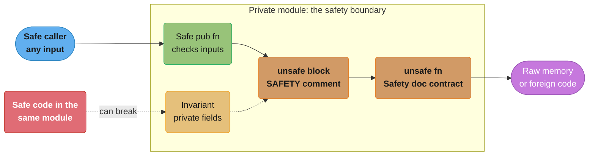
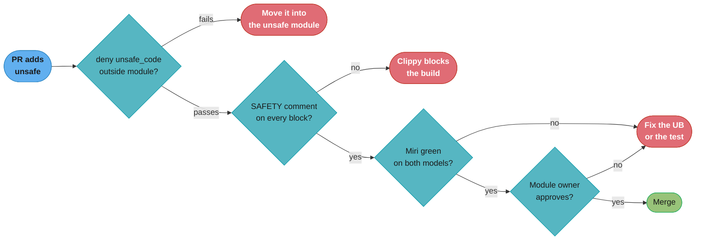

# Unsafe Rust and Undefined Behavior

> **Version anchor (2026-11-06).** Rust 1.99.1 (2026-10-15) on edition 2024. `&raw const`/`&raw mut`, `unsafe extern` blocks and unsafe attributes such as `#[unsafe(no_mangle)]` are `[1.82]`. Edition 2024 makes `unsafe extern` and unsafe attributes required, denies references to `static mut`, and makes `unsafe_op_in_unsafe_fn` warn `[ed2024]`. Strict provenance APIs are `[1.84]`. 1.91 adds a lint against dangling raw pointers from locals. 1.99 stabilizes `Layout::for_value_raw`, `mem::size_of_val_raw` and `mem::align_of_val_raw`, and the `Box::leak` docs recommend `Box::into_raw` or `Box::into_non_null` for memory that is freed later. Miri's default aliasing model is Stacked Borrows. Tree Borrows is opt-in with `-Zmiri-tree-borrows`. Tools: cargo-geiger 0.14.0, kani-verifier 0.68.0, loom 0.7.2, cargo-fuzz 0.13.2.

---

## 1. Concept Overview

Safe Rust makes one promise: no input that safe code can construct causes undefined
behavior (UB). The compiler keeps that promise with the borrow checker, the type system and
bounds checks. Some correct programs need operations that the compiler cannot check. A
`Vec` must write into memory it has allocated but not yet initialized. A lock-free queue
must share a pointer between threads. A C library hands back a raw pointer. The `unsafe`
keyword marks the places where the programmer, not the compiler, carries the proof.

`unsafe` does not switch the checks off. Inside an `unsafe` block the borrow checker, type
checker and lifetime rules still run. The keyword unlocks five extra operations, the list the
Rust Book gives: dereference a raw pointer, call an `unsafe` function, read or write a
`static mut`, implement an `unsafe` trait (with `unsafe impl`, not inside a block), and read a
`union` field. Edition 2024 adds two more places
where the keyword appears, `unsafe extern` blocks and unsafe attributes, and both mark a
promise about linking, not an extra operation.

The unit of correctness is the **safe API**, not the `unsafe` block. A function is *sound*
when no caller that uses only safe code can cause UB through it. `Vec::push` contains
unsafe code and is sound. A three-line public function that calls `get_unchecked` on a
caller-supplied index is unsound, even if every caller in your repository passes a valid
index. The question a reviewer asks is never "is this block correct for the inputs we
have?" It is "can any safe input reach UB through this API?"

This module covers the unsafe superpowers, the UB catalogue, the `// SAFETY:` discipline,
the edition 2024 changes, raw pointers and `MaybeUninit`, provenance, the aliasing models
that Miri implements, and an unsafe-code policy for a team. Memory-model theory
(happens-before, acquire and release) lives in
[Memory Models and Concurrency Theory](../../cs_fundamentals/memory_models_and_concurrency_theory/memory_models_and_concurrency_theory.md).
The FFI surface lives in [FFI and Language Interop](../ffi_and_language_interop/ffi_and_language_interop.md),
and the review checklist lives in
[the unsafe review and soundness checklist](../case_studies/cross_cutting/unsafe_review_and_soundness_checklist.md).

---

## 2. Intuition

> **One-line analogy**: an `unsafe` block is a signed statement. The compiler stops
> checking one claim and trusts your signature. If the claim is false, the whole program
> is void, not only the line you signed.

**Mental model**: picture safe Rust as a building with fire doors. Every door checks a
badge. `unsafe` is a key that opens five specific doors without a badge check. The key
does not disable the other doors. The danger is that a door you open can let someone
reach a room that the rest of the building assumed was locked. The fix is to put each
unsafe door inside a small locked office (a private module) and to let callers in only
through a reception desk (a safe API) that does the badge check itself.

**Why it matters**: UB is not "the program crashes". The optimizer assumes UB never
happens and transforms the program on that assumption. A null check after a dereference
can be deleted because the dereference "proved" the pointer non-null. A loop over an
uninitialized `bool` can take both branches. The symptom appears far from the cause, often
only in release builds, only on one CPU, or only after a compiler upgrade.

**Key insight**: the module, not the block, is the safety boundary. Safe code in the same
module as an unsafe block can break the invariant that block relies on. If `Vec` kept
`len` as a public field, any caller could set `len = 1_000_000` with no `unsafe` at all,
and the next `push` would write out of bounds. Privacy is what makes unsafe code
auditable.

---

## 3. Core Principles

1. **Soundness is a property of the public API.** A sound crate cannot be driven into UB
   by any sequence of safe calls, including calls you consider silly: zero-length input,
   `usize::MAX`, a panicking closure, a `Drop` that never runs.
2. **UB is a whole-program property.** One UB anywhere makes the behavior of the whole
   execution undefined. "It is only a small race" or "it is only one uninitialized byte"
   are not states the compiler models.
3. **Write the proof next to the code.** Every `unsafe` block carries a `// SAFETY:`
   comment that names each precondition and says why it holds. Every `unsafe fn` carries a
   `# Safety` doc section that states the caller's contract. Clippy's
   `undocumented_unsafe_blocks` lint enforces the first.
4. **Shrink the surface.** Keep unsafe code in one private module per invariant, expose a
   safe API, and make the rest of the crate `#![deny(unsafe_code)]`.
5. **Validity before safety.** A *validity invariant* must hold at every moment a value
   exists (a `bool` is 0 or 1, a reference is non-null and aligned). A *safety invariant*
   must hold whenever safe code can observe the value (a `str` is UTF-8, a `Vec` has
   `len <= capacity`). Breaking validity is immediate UB. Breaking safety is UB as soon as
   safe code acts on it.
6. **Leaking is safe.** `mem::forget`, `Box::leak` and an `Rc` cycle are all safe code.
   Unsafe code must stay sound even when a destructor never runs.
7. **Tools find UB, they do not prove its absence.** Miri, sanitizers and fuzzers check the
   executions you give them. Soundness needs an argument, and the argument lives in the
   `SAFETY` comments.

---

## 4. Types / Architectures / Strategies

### 4.1 The five unsafe operations

| Operation | Example | What the compiler stops checking |
|---|---|---|
| Dereference a raw pointer | `*p`, `&mut *p` | Non-null, aligned, points to a live and initialized value, aliasing rules |
| Call an `unsafe fn` | `v.get_unchecked(i)`, `Box::from_raw(p)` | The function's documented `# Safety` contract |
| Access a `static mut` | `COUNTER += 1` | Data races between threads |
| Implement an `unsafe trait` | `unsafe impl Send for T {}` | The trait's promise (for `Send`: moving `T` to another thread is safe) |
| Read a `union` field | `u.as_int` | That the bytes are a valid value of the field's type |

### 4.2 The UB catalogue

| Category | Typical cause | Caught by |
|---|---|---|
| Out-of-bounds or use-after-free access | `get_unchecked` past the end, a pointer kept after `drop` | Miri, AddressSanitizer, fuzzing |
| Dangling reference | Returning `&*p` where `p` points into a freed `Box` | Miri, AddressSanitizer |
| Unaligned reference | `&packed.field` (a compile error, E0793), `&*(ptr as *const u32)` on a byte offset | Compiler (packed), Miri |
| Uninitialized read | `Vec::set_len` before writing, `assume_init` before the write, reading padding | Miri, MemorySanitizer |
| Invalid value | `bool` from byte 2, enum with an unknown discriminant, null `&T`, a `char` above `0x10FFFF` | Miri |
| Aliasing violation | Two live `&mut` to one place, writing through a pointer derived from `&T` | Miri (Stacked or Tree Borrows) |
| Data race | Unsynchronized writes through `static mut` or a bad `unsafe impl Sync` | Miri, ThreadSanitizer, loom |
| Unwinding across a non-unwind ABI | A C++ exception unwinding into Rust through `extern "C"` | Nothing at run time. Use `extern "C-unwind"` |
| Breaking a library safety invariant | `str::from_utf8_unchecked` on non-UTF-8 bytes | Miri only when the bad value is later used invalidly |

A Rust panic that reaches an `extern "C"` function aborts the process since 1.81. That is
defined behavior. A foreign exception that unwinds into Rust through `extern "C"` is UB.

### 4.3 Where the keyword appears

| Form | Meaning | Who carries the proof |
|---|---|---|
| `unsafe { ... }` | "I discharge the preconditions of what is inside" | The author of the block |
| `unsafe fn f()` | "Callers must meet a contract the compiler cannot check" | Every caller |
| `unsafe trait T` / `unsafe impl T for X` | "Implementors promise a property other unsafe code relies on" | The implementor |
| `unsafe extern "C" { ... }` `[ed2024]` | "These signatures match the real foreign symbols" | The author of the block. Items inside can be marked `safe fn` |
| `#[unsafe(no_mangle)]`, `#[unsafe(export_name = "..")]`, `#[unsafe(link_section = "..")]` `[ed2024]` | "This symbol does not collide with another" | The author of the attribute |

Edition 2024 also makes `unsafe_op_in_unsafe_fn` warn: the body of an `unsafe fn` is no
longer an implicit `unsafe` block. Each operation needs its own block and its own
`SAFETY` comment.

### 4.4 Decision model: an unsafe-code policy and its review gates

Pick one tier per crate. Write the tier into the crate root, not into a wiki page.

| Tier | Crate root | Who may add unsafe | Required gates |
|---|---|---|---|
| A. Application, service, CLI | `#![forbid(unsafe_code)]` | Nobody. Unsafe lives in vetted dependencies | cargo-geiger report in CI, dependency admission policy |
| B. Library with one unsafe core | `#![deny(unsafe_code)]` plus `#[allow(unsafe_code)]` on one private module | Owners of that module | `SAFETY` comments (Clippy lint), Miri on the module's tests, two reviewers, one of them a module owner |
| C. Low-level crate (allocator, lock-free structure, FFI wrapper) | `#![deny(unsafe_op_in_unsafe_fn)]`, `#![deny(clippy::undocumented_unsafe_blocks)]` | Named maintainers | Tier B gates plus loom for concurrency, fuzzing, sanitizers in nightly CI, Kani for small invariants |

The checklist that every pull request touching unsafe code passes:

1. Every `unsafe` block has a `// SAFETY:` comment that names each precondition.
2. Every `unsafe fn` and `unsafe trait` has a `# Safety` doc section.
3. The invariant lives behind module privacy. No public field can break it.
4. The code stays sound if a user closure panics and if a destructor never runs.
5. Miri passes on the tests that reach the new code, with and without `-Zmiri-tree-borrows`.
6. A safe alternative was measured, and the numbers are in the pull request.
7. A second reviewer who owns the module approves.

---

## 5. Architecture Diagrams

### Where each proof obligation lives



The safe function checks its inputs, the `SAFETY` comment discharges the `unsafe fn`
contract, and module privacy protects the invariant. The red node is the reason the
boundary is the module: safe code next to the block can still break the invariant.

### Stacked Borrows: one place, one stack of permissions

Miri tracks a stack of permissions for every memory location. A reborrow pushes onto the
stack. Using a pointer pops everything above its own entry. Using a pointer whose entry is
gone is UB.

```
let mut x = 0u32;            stack for x: [ Unique(x) ]
let p = &raw mut x;          stack for x: [ Unique(x), SharedRW(p) ]
let a = unsafe { &mut *p };  stack for x: [ Unique(x), SharedRW(p), Unique(a) ]
let b = unsafe { &mut *p };  use of p pops a:
                             stack for x: [ Unique(x), SharedRW(p), Unique(b) ]
*a += 1;                     a is not on the stack  ->  UB reported here
```

Tree Borrows tracks the same program as a tree where `a` and `b` are siblings under `p`.
It reports the error one line later, at the write through `b`, because the write through
`a` disabled `b`. Both models reject the program. Tree Borrows accepts more code than
Stacked Borrows, so a test can fail under one and pass under the other.

### From pull request to merge under a tier B policy



Every gate except the last one is mechanical. The human review is the gate that checks the
argument, and it is cheap only because the gates before it already failed the easy cases.

---

## 6. How It Works - Detailed Mechanics

### 6.1 A sound abstraction over raw pointers

`split_at_mut` is the textbook case. The borrow checker cannot see that two halves of one
slice do not overlap, so the safe version does not compile. The unsafe version checks the
one fact the proof needs and then builds the two slices from a raw pointer.

```rust
/// Splits a slice into two mutable halves at `mid`.
pub fn split_at_mut(s: &mut [u32], mid: usize) -> (&mut [u32], &mut [u32]) {
    let len = s.len();
    assert!(mid <= len, "mid {mid} out of bounds for len {len}");
    let p = s.as_mut_ptr();
    // SAFETY: `mid <= len` is checked above, so both ranges lie inside the
    // allocation that `s` borrows, and `[0, mid)` and `[mid, len)` do not overlap.
    unsafe {
        (
            std::slice::from_raw_parts_mut(p, mid),
            std::slice::from_raw_parts_mut(p.add(mid), len - mid),
        )
    }
}

fn main() {
    let mut v = [1, 2, 3, 4, 5];
    let (a, b) = split_at_mut(&mut v, 2);
    a[0] = 10;
    b[0] = 30;
    assert_eq!(v, [10, 2, 30, 4, 5]);
}
```

Delete the `assert!` and the function is unsound: `split_at_mut(&mut v, 9)` is safe code
that produces a slice past the end. The `assert!` costs one compare and one branch that the
predictor gets right every time.

### 6.2 `unsafe fn` contracts and the edition 2024 body rule

An `unsafe fn` moves the proof to the caller. Its `# Safety` section is the contract. Since
edition 2024 the body is not an implicit `unsafe` block, so each operation inside needs its
own block and its own comment.

```rust
/// Returns the element at `i` without a bounds check.
///
/// # Safety
///
/// `i` must be less than `v.len()`.
pub unsafe fn get_fast(v: &[u64], i: usize) -> u64 {
    // SAFETY: the caller promises `i < v.len()` (see `# Safety`).
    unsafe { *v.get_unchecked(i) }
}

pub fn sum_even_indices(v: &[u64]) -> u64 {
    let mut total = 0;
    let mut i = 0;
    while i < v.len() {
        // SAFETY: the loop condition gives `i < v.len()`.
        total += unsafe { get_fast(v, i) };
        i += 2;
    }
    total
}
```

In practice `v.iter().step_by(2).sum()` compiles to the same loop with no bounds checks and
no `unsafe`. Reach for `get_unchecked` only when a profile shows a bounds check that the
optimizer could not remove.

### 6.3 `&raw const` and `&raw mut` `[1.82]`

Creating a reference asserts that the target is aligned, initialized and not aliased in a
conflicting way. That assertion is UB to break even if the reference is converted to a raw
pointer on the next line. `&raw const place` and `&raw mut place` create the raw pointer
directly, with no intermediate reference. They replace the `addr_of!` and `addr_of_mut!`
macros.

```rust
#[repr(C, packed)]
pub struct Header {
    pub tag: u8,
    pub len: u32,
}

pub fn read_len(h: &Header) -> u32 {
    let p = &raw const h.len;
    // SAFETY: `p` points into `*h`, which is live and initialized.
    // `read_unaligned` has no alignment requirement.
    unsafe { p.read_unaligned() }
}

pub fn len_by_copy(h: &Header) -> u32 {
    // A by-value copy of a packed field is safe. Only a reference is the problem.
    h.len
}
```

The same tool initializes a struct field by field through `MaybeUninit<Struct>`:
`(&raw mut (*p).field).write(value)` never creates a `&mut` to the uninitialized struct.

### 6.4 `MaybeUninit`: memory that is not yet a value

`MaybeUninit<T>` has the size and alignment of `T` and no validity requirement. It is how
you allocate first and initialize second.

```rust
use std::mem::MaybeUninit;

pub fn squares() -> [u64; 8] {
    let mut buf = [const { MaybeUninit::<u64>::uninit() }; 8];
    for (i, slot) in buf.iter_mut().enumerate() {
        slot.write((i as u64) * (i as u64));
    }
    // SAFETY: the loop above wrote every one of the 8 slots.
    buf.map(|s| unsafe { s.assume_init() })
}

fn main() {
    assert_eq!(squares()[7], 49);
}
```

For this case `std::array::from_fn(|i| (i * i) as u64)` is safe and equal in speed. Use
`MaybeUninit` for buffers handed to a reader, for arena slots, and for FFI out-parameters.
`mem::zeroed()` is not a general substitute: an all-zero `&T`, `NonNull<T>`, `Box<T>` or
fieldless enum with no zero discriminant is an invalid value.

### 6.5 Provenance and the strict provenance APIs `[1.84]`

A pointer is an address plus *provenance*: the permission to access a specific allocation.
Two pointers with the same address can have different provenance, and the compiler uses
that fact for alias analysis. `ptr as usize as *mut T` loses provenance. The strict
provenance APIs keep it: `addr()` reads the address, `with_addr` and `map_addr` change the
address and keep the permission, and `without_provenance` makes a pointer that must never
be dereferenced. Pointer tagging is the common use.

```rust
pub fn tag(p: *mut u64, bits: usize) -> *mut u64 {
    debug_assert!(bits < 8 && p.addr() % 8 == 0);
    p.map_addr(|a| a | bits)
}

pub fn untag(p: *mut u64) -> (*mut u64, usize) {
    (p.map_addr(|a| a & !7), p.addr() & 7)
}

fn main() {
    let mut x = 5u64;
    let tagged = tag(&raw mut x, 3);
    let (clean, bits) = untag(tagged);
    assert_eq!(bits, 3);
    // SAFETY: `clean` has the address and provenance of `x`, which is live.
    assert_eq!(unsafe { *clean }, 5);
}
```

Code that must turn an integer from outside the program into a pointer (a memory-mapped
register, an address from a C API) uses `with_exposed_provenance`, which pairs with
`expose_provenance()` on the pointer that produced the integer.

### 6.6 Aliasing: what `&mut` really promises

A `&mut T` promises that no other pointer accesses the place while the reference is live.
A `&T` promises that nobody writes the place (unless it is inside an `UnsafeCell`). LLVM
receives these promises as `noalias` attributes. The program below compiles and is UB.

```rust
fn main() {
    let mut x = 0u32;
    let p = &raw mut x;
    // SAFETY: none. This is a counterexample that Miri rejects under both
    // Stacked Borrows and Tree Borrows.
    let a = unsafe { &mut *p };
    // SAFETY: none. Creating `b` from `p` invalidates `a`.
    let b = unsafe { &mut *p };
    *a += 1;
    *b += 1;
    println!("{x}");
}
```

The Rust Reference does not define the aliasing model. Stacked Borrows and Tree Borrows
are Miri's executable proposals, not the language rules. Code that passes both is the safe
target. Code that relies on Tree Borrows being more permissive is a bet on the outcome of
an open design question.

### 6.7 `Box::into_raw`, `Box::leak` and the 1.99 guidance

`Box::leak` returns a `&'static mut T` and gives up ownership forever. Since 1.99 the docs
recommend against leaking a box and later rebuilding it with `Box::from_raw` to free it,
and recommend `Box::into_raw` or `Box::into_non_null` instead. The reason is aliasing: a
`&'static mut` is a promise that nothing else ever touches the memory, and freeing it
breaks that promise. The guidance applies to the other `leak` functions in std too.

```rust
pub struct Config {
    pub name: String,
}

pub fn install() -> *mut Config {
    Box::into_raw(Box::new(Config { name: "prod".to_string() }))
}

/// # Safety
///
/// `p` came from `install` and is not used after this call.
pub unsafe fn uninstall(p: *mut Config) {
    // SAFETY: the caller promises `p` came from `Box::into_raw` and is not reused.
    drop(unsafe { Box::from_raw(p) });
}
```

### 6.8 `ManuallyDrop`, `transmute` and `repr`

`ManuallyDrop<T>` stops the compiler from calling `T`'s destructor. It is how a container
moves values out of a buffer without a double drop. `transmute::<A, B>` reinterprets bits
and checks only that the sizes match. It does not check validity, alignment of the
pointee, or lifetimes. Prefer the narrow tool: `u32::from_ne_bytes`, `f32::to_bits`,
`ptr.cast::<T>()`, `as` for numeric casts, or a derive from the `zerocopy` or `bytemuck`
crates that proves the layout at compile time.

Layout matters for every reinterpretation. The default `repr(Rust)` lets the compiler reorder
fields. `#[repr(C)]` gives C's order and padding. `#[repr(transparent)]` specifies that
a single-field newtype has the same layout and ABI as its field, which is what makes
casting `&[Meters]` to `&[f64]` sound.

---

## 7. Real-World Examples

- **The standard library.** `Vec`, `String`, `HashMap` (a port of hashbrown), `Arc` and
  the sort implementations are safe APIs over unsafe cores. Their source is the reference
  for `SAFETY` comment style. See
  [Smart Pointers and Interior Mutability](../smart_pointers_and_interior_mutability/smart_pointers_and_interior_mutability.md)
  for `UnsafeCell`, the one type that permits mutation through `&T`.
- **Rust for Linux.** The kernel's Rust experiment concluded: Miguel Ojeda posted "rust:
  conclude the Rust experiment" on 2025-12-13 after the 2025 Maintainers Summit. Kernel
  Rust is a set of safe abstractions over C kernel APIs, which is this module's pattern at
  the scale of an operating system. The same patch says that not every configuration,
  architecture and toolchain works. See
  [Embedded Rust and Bare Metal](../embedded_rust_and_bare_metal/embedded_rust_and_bare_metal.md).
- **The FLS.** The Rust Project adopted the FLS (formerly the Ferrocene Language
  Specification), announced 2025-03-26. Safety-critical users need a written
  specification to argue about unsafe code against.
- **RustSec advisories.** The RustSec database classifies advisories by category, and
  `memory-corruption` and `thread-safety` advisories against crates usually describe an
  unsound safe API: a missing bounds check, a wrong `unsafe impl Send`, or a panic that
  left a buffer half-initialized. See
  [Rust Build, Deployment and Supply Chain](../build_deployment_and_supply_chain/build_deployment_and_supply_chain.md)
  for cargo-audit.
- **Go and Java.** Go's `unsafe.Pointer` rules and Java's FFM API solve the same problem
  with different tools. See [Go reflection and unsafe](../../go/reflection_and_unsafe/reflection_and_unsafe.md)
  and [Java FFM API](../../java/foreign_function_and_memory_api/foreign_function_and_memory_api.md).

---

## 8. Tradeoffs

### 8.1 Safe form versus unsafe form

| Task | Safe form | Unsafe form | Typical result |
|---|---|---|---|
| Index in a hot loop | iterator or `assert!(i < len)` before the loop | `get_unchecked` | The safe form usually has no bounds check after optimization |
| Bytes to `&str` | `str::from_utf8` (SIMD validated) | `from_utf8_unchecked` | Validation is cheap. Keep it unless a profile says otherwise |
| Two `&mut` into one slice | `split_at_mut`, `get_disjoint_mut` `[1.86]` | raw pointer arithmetic | The std function is already the unsafe core |
| Reinterpret bytes as a struct | `zerocopy`/`bytemuck` derive, `from_ne_bytes` | `transmute`, pointer cast | The derive checks layout at compile time |
| Self-referential struct | indices, `self_cell`, `ouroboros` | raw pointer into self | See [Lifetimes and the Borrow Checker](../lifetimes_and_the_borrow_checker/lifetimes_and_the_borrow_checker.md) |
| Global counter | `AtomicU64`, `LazyLock`, `OnceLock` | `static mut` | Edition 2024 denies references to `static mut` |
| Shared state across threads | `Arc<Mutex<T>>`, atomics | `unsafe impl Sync` | See [Channels, Atomics and Shared State](../channels_atomics_and_shared_state/channels_atomics_and_shared_state.md) |

### 8.2 Verification tools against UB classes

| Tool | Finds | Misses | Cost |
|---|---|---|---|
| Miri | Aliasing, uninit reads, invalid values, out-of-bounds, leaks, data races in the executed interleaving | FFI calls, unexecuted paths, other interleavings | Slow interpreter, nightly toolchain |
| AddressSanitizer (`-Zsanitizer=address`) | Out-of-bounds, use-after-free in native code, including C | Aliasing, invalid values | Nightly, typically 2x slower (Clang's AddressSanitizer docs) |
| ThreadSanitizer | Data races in native code | Races in code paths not run | Nightly, rebuild std |
| loom | Ordering bugs across all interleavings of a small test | Large tests (state explosion) | Test written against loom's types |
| cargo-fuzz | Inputs that reach a crash or a sanitizer report | Logic that needs structured input you did not model | CPU hours |
| Kani | Proves a property for all inputs up to a bound | Unbounded loops, large state | Model-checking time per harness |

See [Testing, Fuzzing and Miri](../testing_fuzzing_and_miri/testing_fuzzing_and_miri.md) for
how these fit into a test ladder.

---

## 9. When to Use / When NOT to Use

### Use unsafe when

- You implement a data structure whose invariant the borrow checker cannot express: an
  intrusive list, an arena, a lock-free queue, a custom allocator.
- You call foreign code. Every FFI call is unsafe because the compiler cannot check the
  other side.
- A profile shows a check the optimizer cannot remove, the safe rewrites did not remove it,
  and the gain is large enough to pay for the review and the Miri job.
- You access hardware: memory-mapped registers, inline assembly, a `#[target_feature]`
  intrinsic on a CPU you detected at run time.

### Do NOT use unsafe when

- An std or well-reviewed crate API already does it: `split_at_mut`, `get_disjoint_mut`,
  `Cell`, `OnceLock`, `bytemuck`.
- The goal is to silence the borrow checker. A borrow error usually points at a real
  aliasing bug or at a design that wants indices instead of references.
- You have not measured. Bounds checks cost far less than most people expect, because the
  branch is always predicted and the optimizer removes most of them.
- The code lives in an application crate. Put the unsafe code in a small library crate
  with its own tests and owners, and keep the application `#![forbid(unsafe_code)]`.

---

## 10. Common Pitfalls

### 10.1 A `static mut` counter

A metrics module kept request counts in a `static mut`. It worked under one thread. Under
the multi-threaded runtime two workers incremented it at the same time, which is a data
race and therefore UB. In edition 2024 the deny-by-default `static_mut_refs` lint rejects the
reference that the code takes.

```rust
// BROKEN
static mut REQUESTS: u64 = 0;

pub fn record() -> u64 {
    // error: creating a mutable reference to mutable static (lint static_mut_refs)
    let r = unsafe { &mut REQUESTS };
    *r += 1;
    *r
}
```

```rust
// FIX: an atomic needs no `unsafe` and has no data race.
use std::sync::atomic::{AtomicU64, Ordering};

static REQUESTS: AtomicU64 = AtomicU64::new(0);

pub fn record() -> u64 {
    REQUESTS.fetch_add(1, Ordering::Relaxed) + 1
}
```

`Relaxed` is enough for a counter that nothing else synchronizes on. A global that holds a
complex value uses `LazyLock<Mutex<T>>`.

### 10.2 A reference to a packed field

An illustrative case: a network-header parser used `#[repr(C, packed)]` to match the wire
format and then passed `&hdr.len` to a helper. On x86-64 an unaligned load works, so the bug
hid until the service ran on an ARM target where the compiler emitted an aligned load. The
compiler rejects such a reference outright (E0793).

```rust
// BROKEN
#[repr(C, packed)]
pub struct Header {
    pub tag: u8,
    pub len: u32,
}

pub fn len_ref(h: &Header) -> u32 {
    let r = &h.len; // error[E0793]: reference to field of packed struct is unaligned
    *r
}
```

```rust
// FIX: copy the field, or read it through a raw pointer with no alignment requirement.
#[repr(C, packed)]
pub struct Header {
    pub tag: u8,
    pub len: u32,
}

pub fn len_copy(h: &Header) -> u32 {
    h.len
}

pub fn len_raw(h: &Header) -> u32 {
    // SAFETY: the pointer is derived from a live `&Header`. `read_unaligned`
    // does not need alignment.
    unsafe { (&raw const h.len).read_unaligned() }
}
```

### 10.3 Dereferencing a raw pointer outside `unsafe`

The error is easy to fix and easy to fix wrongly. Wrapping the whole function body in one
`unsafe` block hides which line needs the proof.

```rust
// BROKEN
pub fn first(p: *const u8) -> u8 {
    *p // error[E0133]: dereference of raw pointer is unsafe and requires unsafe block
}
```

```rust
// FIX: make the contract explicit and keep the unsafe block to one operation.
/// # Safety
///
/// `p` is non-null, aligned, and points to an initialized `u8`.
pub unsafe fn first(p: *const u8) -> u8 {
    // SAFETY: the caller upholds the `# Safety` contract.
    unsafe { *p }
}

pub fn first_of(s: &[u8]) -> Option<u8> {
    s.first().copied()
}
```

The second function is the real fix in most code: take a slice, not a raw pointer.

### 10.4 An unsound safe API that every test passed

An illustrative case: a ring buffer exposed `pub fn get(&self, i: usize) -> &T` and called `get_unchecked`
internally, because "callers always pass `i < len`". All tests passed. A fuzz target
written six months later found `get(len)` in 40 seconds and produced an out-of-bounds read.
The function was unsound from the start. The tests checked the callers, and soundness is a
property of the function.

```rust
pub struct Ring {
    buf: Vec<u64>,
    head: usize,
}

impl Ring {
    // Unsound: a safe signature over an unchecked index. `get_unsound(len)` reads
    // past the end, and no `unsafe` keyword appears at the call site.
    pub fn get_unsound(&self, i: usize) -> u64 {
        // SAFETY: wrong. It assumes `i < buf.len()`, which a safe signature
        // cannot demand from its callers.
        unsafe { *self.buf.get_unchecked(i) }
    }

    // The fixed version checks the caller's index, which is what the contract needs.
    pub fn get(&self, i: usize) -> Option<u64> {
        if i >= self.buf.len() {
            return None;
        }
        Some(self.buf[(self.head + i) % self.buf.len()])
    }
}
```

The fix replaced the unchecked call with a check. The benchmark moved by less than the
run-to-run noise.

### 10.5 `set_len` before the writes, and a panic in between

A deserializer called `v.set_len(n)` and then filled the buffer from a user closure. When
the closure panicked on bad input, unwinding dropped the `Vec`, which ran destructors on
`n` uninitialized elements. The crash was a double free in a release build, eight frames
away from the cause. Two fixes work: write first and call `set_len` after, or keep a guard
whose `Drop` sets `len` to the number of elements written so far. `Vec::extend` and
`Vec::spare_capacity_mut` give you the first one for free.

### 10.6 Extending a lifetime with `transmute`

A cache returned `&'static str` from a `String` it owned by calling
`transmute::<&str, &'static str>`. Eviction freed the `String` while a request handler
still held the reference. The fix was to store `Arc<str>` and hand out clones. Any
`transmute` whose source and target differ only in a lifetime is a use-after-free waiting
for the owner to drop.

### 10.7 `unsafe impl Send` for a wrapper that holds an `Rc`

A team wrapped a raw pointer in a struct, wrote `unsafe impl Send for Handle {}` to move it
into a worker thread, and later added an `Rc<Config>` field to the same struct. The
`unsafe impl` covered the new field too, so the compiler no longer checked it, and two
threads changed the `Rc` count without synchronization. Put the `unsafe impl` on the
smallest possible type (a wrapper around only the raw pointer), so a new field keeps the
compiler's automatic `Send` check.

---

## 11. Technologies & Tools

| Tool | Purpose |
|---|---|
| Miri | Interpreter that detects UB in tests: aliasing (Stacked Borrows by default, Tree Borrows opt-in), uninit reads, invalid values, out-of-bounds, data races, leaks. `cargo miri test` |
| Clippy | `undocumented_unsafe_blocks`, `multiple_unsafe_ops_per_block`, `missing_safety_doc` lints for the review policy |
| cargo-geiger | Counts `unsafe` usage in a crate and each dependency, for the dependency review |
| Kani | Model checker that proves properties of small unsafe functions for all inputs up to a bound (crate `kani-verifier`) |
| loom | Runs a concurrency test under every permitted interleaving and memory ordering |
| cargo-fuzz | libFuzzer integration for finding inputs that reach UB or a panic |
| AddressSanitizer | `-Zsanitizer=address` on nightly, for out-of-bounds and use-after-free across Rust and C |
| ThreadSanitizer | `-Zsanitizer=thread` on nightly, for data races in native code |
| zerocopy | Derives that prove a type can be safely reinterpreted from bytes |
| bytemuck | `Pod` and `Zeroable` traits for safe casts between plain-data types |
| self_cell | Safe self-referential structs without hand-written unsafe |

---

## 12. Interview Questions with Answers

**Q: Does an `unsafe` block turn off the borrow checker?**
**Short:** No. Borrow checking, type checking and lifetimes still run inside it. The block only permits five extra operations, such as dereferencing a raw pointer.

The five operations are: dereference a raw pointer, call an `unsafe fn`, access a
`static mut`, implement an `unsafe trait`, and read a `union` field. Two `&mut` to the same
variable are still a compile error inside `unsafe`. That is why code that wants two mutable
paths to one place goes through a raw pointer, and why the aliasing rules then become the
programmer's job. If a borrow error is the reason you are adding `unsafe`, the design is
usually wrong.

**Q: What does it mean for an API that contains unsafe code to be sound?**
**Short:** No sequence of calls written in safe code can cause undefined behavior through it, whatever arguments the caller passes.

Soundness is a property of the public signature, not of the call sites you have today.
`Vec::push` is sound because nothing a safe caller passes can make it write out of bounds.
A public `fn get(&self, i: usize) -> &T` that calls `get_unchecked(i)` is unsound even if
every current caller passes a valid index, because a future caller in safe code can pass a
bad one. To fix it, check the input, or mark the function `unsafe` and document the
contract in a `# Safety` section.

**Q: Why is the module, and not the `unsafe` block, the real safety boundary?**
**Short:** Safe code in the same module can change private fields that the unsafe block depends on, so the whole module must be audited.

`Vec`'s unsafe code relies on `len <= capacity` and on the first `len` slots being
initialized. Any safe function inside `Vec`'s module can assign `self.len = 99` without
the `unsafe` keyword. That is why std keeps `len` private and why audits read the whole
module. The practical rule: put each invariant in its own small private module, expose
only safe functions, and make the rest of the crate `#![deny(unsafe_code)]`.

**Q: What does the compiler do with undefined behavior, and why can't you predict the result?**
**Short:** The optimizer assumes UB never happens and transforms code on that assumption, so effects can appear anywhere, even before the faulty line.

UB is not "the program crashes" or "you get a garbage value". After `*p` the compiler may
delete a later `if p.is_null()` check, because a dereference of null would be UB. A loop
that reads an uninitialized `bool` can run both branches. Results change with the
optimization level, the target and the compiler version. Treat any UB as a bug of the
highest priority even if the tests pass today.

**Q: Can a program written only in safe Rust have undefined behavior?**
**Short:** Only if some unsafe code it calls, in std or a dependency, is unsound, or through a compiler bug. Safe code alone cannot cause UB.

That is the language's core promise. Safe Rust can still leak memory, deadlock, overflow
an integer (a panic in debug builds, wrapping in release builds by default), panic, and
have logic bugs. None of those is UB. When safe code hits UB, the bug report goes to the
crate that owns the unsound `unsafe` block, and RustSec issues an advisory for it.

**Q: Why is leaking memory considered safe in Rust?**
**Short:** Reference cycles in `Rc` already make leaks possible in safe code, so `mem::forget` is safe and unsafe code cannot assume destructors run.

The decision dates from before 1.0: once `Rc` cycles existed, a safe `forget` added no new
risk. The consequence for authors of unsafe code is large. An API that relies on a guard's
`Drop` to restore an invariant is unsound if the user can `mem::forget` the guard. That is
why `thread::scope` takes a closure and joins the threads itself instead of returning a
guard. Design so that a forgotten guard leaks or blocks, never corrupts.

**Q: Why is reading an uninitialized `u32` undefined behavior when every bit pattern is a valid `u32`?**
**Short:** Uninitialized memory is not "some bits". The abstract machine treats it as a distinct state, and the compiler may assume the read never happens.

LLVM can give each read of an uninitialized value a different result, or remove code that
depends on it. So `let x: u32 = unsafe { MaybeUninit::uninit().assume_init() };` is UB
even though no bit pattern is invalid for `u32`. Padding bytes are uninitialized too, which
is why copying a struct's bytes into a network buffer through a raw cast can be UB. Use
`MaybeUninit<T>` until every byte is written, then call `assume_init`.

**Q: What changed about the body of an `unsafe fn` in edition 2024?**
**Short:** The body is no longer an implicit unsafe block. `unsafe_op_in_unsafe_fn` warns, so every unsafe operation inside needs its own block and SAFETY comment.

Before, `unsafe fn` meant two things at once: "callers have a contract" and "the body may
do anything". Edition 2024 separates them. The signature still states the caller's
contract. Inside, each `unsafe { ... }` block names the precondition it discharges. A crate
policy usually raises the lint to `deny` so the change is a build failure and not a
warning that scrolls past.

**Q: What are `unsafe extern` blocks and `safe fn` items, and why did edition 2024 require them?**
**Short:** Declaring a foreign function is itself a promise that the signature matches the symbol, so the block is `unsafe extern` and can mark known-safe items `safe fn`.

A wrong `extern` declaration (a wrong argument type, a missing argument) is UB at every call
site, and the old syntax hid that promise. Since `[1.82]`, `unsafe extern "C" { ... }` puts
the promise where it is made. An item marked `safe fn` inside it, such as `abs`, can be
called without an `unsafe` block, because its signature has no preconditions beyond the
declaration. Edition 2024 rejects a plain `extern "C" { }` block with "extern blocks must
be unsafe".

**Q: Why are `#[no_mangle]` and `#[export_name]` unsafe attributes?**
**Short:** An unmangled symbol can collide with another symbol of the same name, such as `malloc`, and the linker can then route calls to the wrong function.

A `#[no_mangle] fn malloc` in your crate can replace the C allocator for the whole process.
Two crates that export the same unmangled name produce a link error at best and a silent
override at worst. Since `[1.82]` the form is `#[unsafe(no_mangle)]`, and edition 2024
rejects the bare attribute with "unsafe attribute used without unsafe". Treat every
exported symbol name as a global namespace claim and prefix it with the crate name.

**Q: Why does edition 2024 deny references to `static mut`, and what replaces it?**
**Short:** A `&mut` to a `static mut` is almost never unique, so it breaks aliasing rules. Use atomics, `Mutex`, `OnceLock` or `LazyLock` instead.

Any code in the program can reach the same `static mut`, including another thread, so a
`&mut STATIC` that lives across a function call is very hard to prove unique. The
`static_mut_refs` lint is deny-by-default in edition 2024, and the error reads "creating a
mutable reference to mutable static". The replacements carry their own synchronization:
`AtomicU64` for counters, `OnceLock` for set-once values, `LazyLock<Mutex<T>>` for a
mutable global. Where a raw pointer is truly needed, `&raw mut STATIC` creates it without
an intermediate reference.

**Q: Why use `&raw const x` instead of `&x as *const T`?**
**Short:** `&x` creates a reference first, and a reference must be aligned and point to valid data. `&raw const` makes the pointer with no such assertion.

For a field of a `#[repr(packed)]` struct, `&x.field` is a compile error (E0793) because
the reference would be unaligned. For a field of a partly initialized struct, a reference
to uninitialized memory is UB even if it is cast away at once. `&raw const` and
`&raw mut` `[1.82]` create the raw pointer directly and replace the `addr_of!` macros.
Then use `read_unaligned` or `write` on the pointer.

**Q: What is `MaybeUninit<T>` for, and why is `mem::zeroed()` not a safe default?**
**Short:** `MaybeUninit<T>` holds memory that is not yet a valid `T`. All-zero bytes are invalid for references, `NonNull`, `Box` and many enums.

`MaybeUninit<T>` has `T`'s size and alignment and no validity requirement, so you can
allocate a buffer, fill it, and call `assume_init` once every byte is written. `zeroed()`
is fine for plain integers and `#[repr(C)]` structs of integers, but `zeroed::<&T>()` is
an immediate invalid value. For simple arrays, `std::array::from_fn` is safe and as fast,
so reserve `MaybeUninit` for I/O buffers, arenas and FFI out-parameters.

**Q: What is pointer provenance, and why can't you round-trip a pointer through `usize` freely?**
**Short:** A pointer carries permission to access one allocation, and an integer does not. Casting to `usize` and back can lose that permission.

Two pointers with the same address can have different provenance, and the optimizer uses
that for alias analysis. The strict provenance APIs `[1.84]` keep provenance while you
change the address: `addr`, `with_addr`, `map_addr`. Pointer tagging written with
`map_addr` is correct under Miri. For integers that really come from outside (MMIO, a C
API), `expose_provenance` and `with_exposed_provenance` mark the round trip explicitly.

**Q: Are Stacked Borrows and Tree Borrows the official Rust aliasing rules?**
**Short:** No. They are executable models that Miri implements. Stacked Borrows is Miri's default, Tree Borrows is opt-in and accepts more programs.

The Rust Reference does not define the aliasing model. Stacked Borrows tracks a stack
of permissions per location and pops entries on use. Tree Borrows tracks a tree of
reborrows and is more permissive, for example with two-phase borrows and with raw pointers
derived from `&mut`. Run Miri with and without `-Zmiri-tree-borrows`. Code that passes both
is on solid ground. Code that passes only Tree Borrows depends on how the open question is
settled.

**Q: What kinds of undefined behavior can Miri not find?**
**Short:** It checks only the paths and thread interleavings that your tests execute, it cannot run most FFI calls, and its aliasing rules are approximations.

Miri is an interpreter for Rust's intermediate representation. It has no access to most
platform APIs or to FFI (there is an experimental `-Zmiri-native-lib` flag). It runs one
interleaving per run, so a race may need other seeds or loom. A green Miri run shows that
those executions had no detected UB. It does not prove the API sound. Pair it with fuzzing
for inputs and loom for orderings.

**Q: What are you promising when you write `unsafe impl Send for T`?**
**Short:** That moving a `T` to another thread and using or dropping it there cannot cause a data race or any other UB, whatever its fields are.

The compiler implements `Send` and `Sync` automatically from the fields. A raw pointer
field turns that off, and the `unsafe impl` turns it back on for the whole type. The trap:
a field added later (an `Rc`, a `Cell`) is covered by the old `unsafe impl` with no
compiler check. Put the `unsafe impl` on a tiny wrapper around the raw pointer only, so
the outer struct keeps its automatic check. See
[Threads, Send, Sync and Locks](../threads_send_sync_and_locks/threads_send_sync_and_locks.md).

**Q: What is panic safety in unsafe code?**
**Short:** Unsafe code must leave its data structure valid at every point where a user callback or allocation can panic, because unwinding still runs destructors.

A classic bug: call `set_len(n)`, then fill elements from a user closure. If the closure
panics on element 3, the `Vec` drop runs destructors on `n` elements, most of them
uninitialized. Fixes: update the length after each write, or hold a guard whose `Drop`
sets the length to the count written so far. The goal is weaker than full exception
safety: after a panic the structure may lose data, but it must not be in a state that
causes UB.

**Q: When does `transmute` cause trouble, and what should you use instead?**
**Short:** It reinterprets bits and checks only that sizes match. Use `from_ne_bytes`, `to_bits`, `cast`, or a zerocopy or bytemuck derive instead.

`transmute` does not check validity (a `u8` of 2 is not a `bool`), does not check the
alignment of pointees, and changes lifetimes without complaint, which makes a use-after-free
one line long. Layout also matters: the compiler may reorder the fields of a default
`repr(Rust)` struct, so transmuting it to bytes or to another struct is not portable.
`#[repr(transparent)]` is what makes a newtype cast sound.

**Q: Why do the `Box::leak` docs in 1.99 recommend against leaking and later freeing?**
**Short:** A leaked `&'static mut` promises nobody else touches the memory forever. Rebuilding a `Box` to free it breaks that promise. Use `Box::into_raw` instead.

The language rules did not change in 1.99. The docs changed so that code which wants to
hand ownership to C or to a global and take it back later uses `Box::into_raw` or
`Box::into_non_null`, which return a raw pointer with no aliasing promise. `Box::leak`
stays correct for values that really live until the process exits, such as a config
loaded once at startup.

**Q: When is `get_unchecked` worth it in a hot loop?**
**Short:** Rarely. Iterators and one assertion before the loop usually remove the bounds checks. Use it only when a profile and the assembly show a check the optimizer kept.

A bounds check is a compare and a branch that is always predicted, so its cost is mostly
lost vectorization when it blocks a SIMD loop. `for x in &v`, `zip`, `chunks_exact`, and
`assert!(i + 3 < v.len())` hoisted out of the loop all let LLVM drop the checks. If a check
survives, measure the unchecked version with criterion. Keep it only if the gain beats the
noise floor and you are willing to add the Miri job and the second reviewer it costs. See
[Performance and Zero-Cost Abstractions](../performance_and_zero_cost_abstractions/performance_and_zero_cost_abstractions.md).

**Q: How would you set an unsafe-code policy for a 40-engineer organization?**
**Short:** Forbid unsafe in application crates, confine it to small owned library modules, and gate each change on SAFETY comments, Miri in CI and an owner's review.

Concretely: application and service crates use `#![forbid(unsafe_code)]`. Libraries that
need unsafe use `#![deny(unsafe_code)]` at the root and allow it in one private module per
invariant. Clippy's `undocumented_unsafe_blocks` and rustc's `unsafe_op_in_unsafe_fn` are
`deny`. Miri runs on the tests that reach unsafe code, on both aliasing models. cargo-geiger
reports the unsafe count in every dependency, and dependency admission treats a rise as a
review trigger. Each unsafe change needs two approvals, one from a named owner.

---

## 13. Best Practices

- Start every crate with `#![forbid(unsafe_code)]` or `#![deny(unsafe_code)]` and relax it
  only for one named module.
- Write `// SAFETY:` on every `unsafe` block and `# Safety` on every `unsafe fn` and
  `unsafe trait`. Deny `clippy::undocumented_unsafe_blocks` and `missing_safety_doc`.
- Keep one unsafe operation per block where you can, so each comment proves one thing.
- Check inputs in the safe wrapper with `assert!`. An `assert!` is cheap, and a missing
  check is unsoundness.
- Use `&raw const`/`&raw mut` instead of a reference you then cast, and `MaybeUninit`
  instead of `mem::zeroed` or uninitialized `Vec` slots.
- Use the strict provenance APIs (`addr`, `map_addr`, `with_addr`) for pointer tricks.
- Prefer `zerocopy` or `bytemuck` to `transmute`, and `#[repr(transparent)]` for newtypes
  you cast.
- Put `unsafe impl Send`/`Sync` on the smallest wrapper type that needs it.
- Test unsafe modules under Miri with both aliasing models, fuzz their parsers, and use
  loom for their atomics.
- Write the safe version first, benchmark it, and keep the unsafe version only with numbers
  in the pull request.

---

## 14. Case Study

### Putting a parsing library under an unsafe-code policy

**Context (illustrative numbers).** A log-ingest team owns `fastlog`, a 30,000-line parsing crate used by six
services. A cargo-geiger report showed 212 `unsafe` expressions spread over 31 files.
Nobody could say which invariants they relied on. A fuzzing pilot found two out-of-bounds
reads in the first afternoon, both in public functions with safe signatures.

**Step one: find the real unsafe core.** The team grouped the 212 expressions by purpose.
Most were `from_utf8_unchecked` on bytes that were never validated, and `get_unchecked`
in loops that iterators would have handled. Only two places had a real need: a
SIMD-accelerated delimiter scan that used `std::arch` intrinsics, and an arena that handed
out `&str` slices tied to one buffer.

**Step two: confine it.** The first attempt forbade unsafe code at the root and tried to
allow it in the one module.

```rust
// BROKEN
#![forbid(unsafe_code)]

#[allow(unsafe_code)] // error[E0453]: allow(unsafe_code) incompatible with previous forbid
mod scan {
    pub fn first_byte(p: *const u8) -> u8 {
        // SAFETY: placeholder body for the example.
        unsafe { *p }
    }
}
```

`forbid` cannot be relaxed further down, which is its purpose. The fix is `deny` at the
root and `allow` on exactly one private module, so a second module that adds `unsafe`
fails the build.

```rust
// FIX
#![deny(unsafe_code)]
#![deny(unsafe_op_in_unsafe_fn)]
#![deny(clippy::undocumented_unsafe_blocks)]

#[allow(unsafe_code)]
mod scan {
    /// Index of the first `b'\n'`, or `None`.
    pub fn find_newline(buf: &[u8]) -> Option<usize> {
        let p = buf.as_ptr();
        for i in 0..buf.len() {
            // SAFETY: `i < buf.len()`, so `p.add(i)` is in bounds of `buf`.
            if unsafe { *p.add(i) } == b'\n' {
                return Some(i);
            }
        }
        None
    }
}

pub fn line_len(buf: &[u8]) -> usize {
    scan::find_newline(buf).unwrap_or(buf.len())
}
```

The real `scan` module held the SIMD path behind an `is_x86_feature_detected!` check and
the same scalar fallback. The other 29 files lost every `unsafe` expression.

**Step three: measure the safe rewrites.** `from_utf8_unchecked` became `str::from_utf8`
once per record, not per field. Throughput on the 2 GB benchmark corpus went from
1.84 GB/s to 1.79 GB/s, a 2.7% drop, inside what the services had budgeted. The
`get_unchecked` loops became iterators with no measurable change. The SIMD scan stayed
unsafe because the scalar version was 3.1 times slower on long lines.

**Step four: gates.** CI gained a Miri job over the `scan` and `arena` test suites
(11 minutes on nightly, run on every pull request that touches those directories), a
nightly fuzz run of 30 minutes per target, and a cargo-geiger check that fails if the
unsafe count outside `scan` and `arena` is above zero. Both modules got two named owners.

**Results after two quarters.** `unsafe` expressions fell from 212 to 19, all in two
modules with `SAFETY` comments. The fuzzers found one more bug, in the arena's
growth path, before any user did. Miri under Tree Borrows passed, and Miri under Stacked
Borrows flagged one reborrow pattern in the arena, which the team rewrote so both models
pass. No RustSec advisory has been filed against the crate.

**What they would tell another team.** Most unsafe code in an application-adjacent crate
is not needed. Group it by purpose before you review it line by line, and you will
delete most of it. Write the policy into the crate root as lints, because a policy that
lives only in a document does not fail a build. See
[Testing, Fuzzing and Miri](../testing_fuzzing_and_miri/testing_fuzzing_and_miri.md) for the
CI layout and
[the unsafe review and soundness checklist](../case_studies/cross_cutting/unsafe_review_and_soundness_checklist.md)
for the review form.
