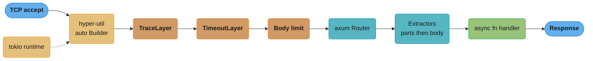
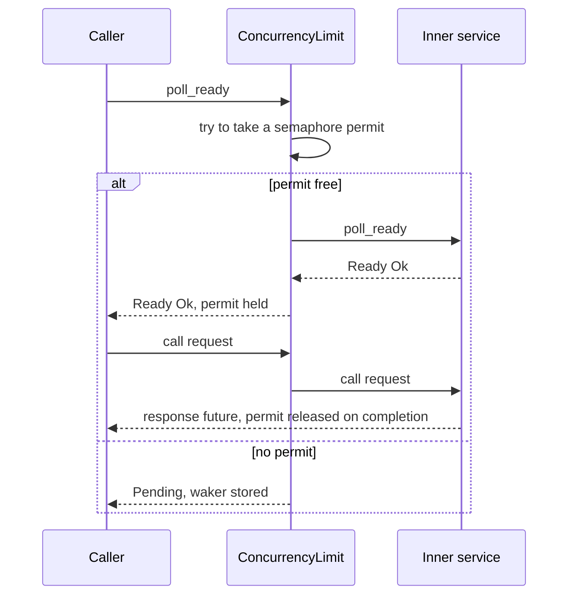
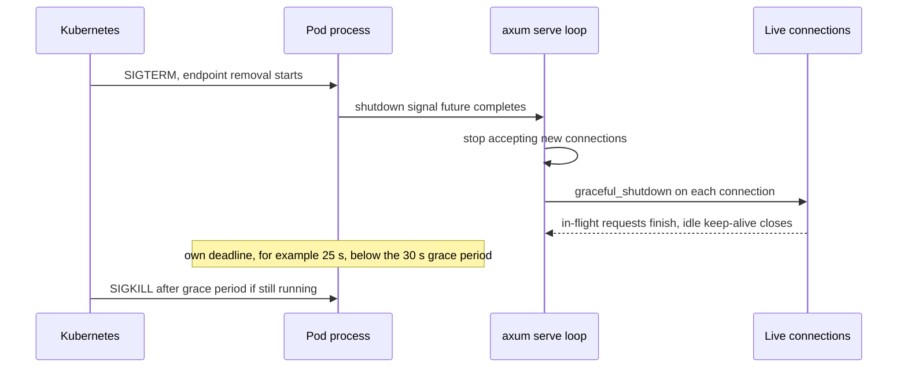

# Web Services with axum, tower and hyper

> **Version anchor (2026-11-06).** Rust 1.99.1 (2026-10-15) on edition 2024. axum 0.8.9 (2026-04-14, MSRV 1.80), tower 0.5.3 (2026-01-12), tower-http 0.7.1 (2026-08-31), hyper 1.12.0 (2026-10-06), hyper-util 0.1.21 (2026-09-24), tokio 1.54.1 (2026-10-21), reqwest 0.13.5 (2026-09-08), rustls 0.23.46 (2026-10-14, aws-lc-rs is the default provider) and actix-web 4.18.2 (2026-11-06, MSRV 1.89). The axum default body limit is 2 MB.

---

## 1. Concept Overview

A Rust HTTP service is three crates stacked on a runtime. **hyper** speaks HTTP/1 and HTTP/2
on a byte stream. **tower** defines one trait, `Service`, that every piece of the stack
implements: a function from a request to a future of a response, plus a `poll_ready` method
that says whether the service has capacity. **axum** is a router and a set of extractors that
turn an `async fn` into a tower `Service`. tokio runs all of it.

That split is the main thing to learn. axum adds little logic of its own. Timeouts,
compression, CORS, tracing, body limits and concurrency limits are tower layers, most of them
from **tower-http**, and the same layers wrap a tonic gRPC server or a reqwest-style client.
Once you can read a `Service` signature, you can read the whole stack, and you can tell which
layer owns a given behavior when it breaks.

hyper 1.x is deliberately small. It has no server loop, no connection pool and no TCP
listener. Those live in **hyper-util** (`server::conn::auto::Builder`, the legacy pooled
client, `TokioExecutor`, `TokioTimer`). `axum::serve` is a thin accept loop over hyper-util.
That is why a default axum server has no header-read timeout: hyper's 30 s default needs a
timer, and `axum::serve` does not give it one (§10).

The production questions for this module are the ones that silently cap or break a service:
which layer applies a limit, why a handler does not compile, why a deploy drops requests, why
a client opens thousands of sockets, and which framework to pick in the first place.

HTTP semantics, HTTP/2 and HTTP/3 framing, REST design and retry or breaker theory are owned
by [HTTP Protocols](../../backend/http_protocols/http_protocols.md),
[REST API Design](../../backend/rest_api_design/rest_api_design.md) and
[Fault Tolerance Patterns](../../backend/fault_tolerance_patterns/fault_tolerance_patterns.md);
this page owns the tower layers that implement them.

---

## 2. Intuition

> **One-line analogy**: hyper is the loading dock, tower is the conveyor belt with stations
> bolted along it, and axum is the sorting desk at the end that reads each parcel's label and
> hands it to the right clerk.

**Mental model**: picture each request as a parcel on a belt. Every station (a layer) can
stamp it, weigh it, reject it, or hold it until there is room further down. The `poll_ready`
call is the station asking "is there room after me?" before it lets the next parcel through.
If a station says yes without checking, parcels pile up in memory instead of waiting at the
dock, and the service dies of out-of-memory rather than slowing down.

**Why it matters**: the bugs in Rust web services are rarely in handler logic. They are a
missing timeout at one of three layers, a layer in the wrong order, a `MutexGuard` held across
an `.await` that makes a handler not `Send`, or a shutdown that cuts live requests. Each one is
a property of the stack, so you only see it when you know the stack.

**Key insight**: in axum, the type checker does a large part of the code review. A handler is
valid only if every argument is an extractor, the body extractor is last, the future is
`Send`, and the state type matches the router. Most "axum does not compile" problems are one
of those four rules, and `#[debug_handler]` names which one.

---

## 3. Core Principles

- **Everything is a `Service`.** A handler, a router, a middleware stack and a client are all
  `Service<Request>` values. Composition is wrapping one service in another.
- **`poll_ready` is a capacity contract.** A caller must get `Poll::Ready(Ok(()))` from
  `poll_ready` before it calls `call`. A service that reserves a permit in `poll_ready` may
  panic or misbehave if you skip it.
- **Layers wrap from the outside in.** In a `ServiceBuilder`, the first `.layer()` is the
  outermost. Each `Router::layer` call wraps everything added before it, so the last call is
  the outermost.
- **Extractors run in argument order.** Parts extractors (`FromRequestParts`) read headers,
  path and state and can run in any order. Exactly one body extractor (`FromRequest`) may
  appear, and it must be last, because it consumes the body.
- **State is typed, extensions are not.** `State<T>` is checked at compile time against
  `Router<T>`. `Extension<T>` is a type map lookup that fails at runtime with a 500.
- **Errors become responses.** axum requires the final service error type to be
  `Infallible`. A fallible tower layer (timeout, load shed) needs `HandleErrorLayer` or a
  tower-http equivalent that returns a response instead of an error.
- **Timeouts live at three layers.** Connection (header read, keep-alive), request (handler
  deadline, body deadline) and outbound (client total timeout, pool acquire timeout). One
  missing layer is enough for a slow peer to hold resources forever.
- **Shutdown has a deadline.** Graceful shutdown stops the accept loop and drains live
  connections, but it waits with no upper bound unless you add one.

---

## 4. Types / Architectures / Strategies

### 4.1 Framework choice (decision model)

| Option | Model | Handler future must be `Send` | Middleware | Pick it when |
|---|---|---|---|---|
| axum 0.8.9 | Router plus extractors on tower and hyper | Yes (multi-thread runtime) | Any tower layer, tower-http | Default for new tokio services. Shares layers with tonic and reqwest |
| actix-web 4.18.2 | Own runtime: one single-thread tokio runtime per worker thread | No | actix `Transform` middleware, not tower | Existing actix codebase, or handlers that hold `!Send` state per worker |
| hyper 1.12.0 plus hyper-util directly | Raw `service_fn` per connection | Depends on the executor | Hand-written tower | Proxies and gateways that need full control of connection handling |
| Pingora 0.9.1 | Proxy framework with its own HTTP stack | n/a | Phase callbacks | An L7 proxy or load balancer, not an application API |
| tonic 0.14.9 | gRPC on hyper and tower | Yes | Same tower layers | gRPC services; see [gRPC with tonic](../grpc_with_tonic/grpc_with_tonic.md) |

The honest default is axum. actix-web is mature and fast, and its per-worker design means a
handler can hold an `Rc`, but its middleware does not compose with tower, so you write retry,
timeout and tracing glue twice if you also run tonic or reqwest. Raw hyper is for code whose
main job is the connection itself.

### 4.2 Where a concern belongs (decision model)

| Concern | tower layer | Handler code | Why |
|---|---|---|---|
| Timeout, concurrency limit, load shed | Yes | No | Must apply before any handler work and to every route |
| Request id, tracing span, metrics | Yes | No | Needs the whole request lifetime, including rejections |
| Compression, CORS, CSRF | Yes (tower-http) | No | Protocol mechanics, identical on every route |
| Authentication | `route_layer` or an extractor | No | An extractor makes "this route needs a user" a type, not a convention |
| Authorization on a resource | No | Yes | Needs the loaded resource and business rules |
| Input validation | Extractor rejection | Yes for cross-field rules | Shape errors map to 400/422 before the handler runs |
| Retries | Client side only (tower `retry` on reqwest or tonic) | No | Retrying inside a server handler multiplies load on the dependency |

### 4.3 State strategies

| Pattern | Checked at | Cost per request | Use for |
|---|---|---|---|
| `State<AppState>` with `Router::with_state` | Compile time | One `Clone` of `AppState` (keep it cheap: `Arc` fields) | Pools, clients, config |
| `FromRef` substates | Compile time | One `Clone` of the substate | Handlers that need one field, not the whole state |
| `Extension<T>` | Runtime (500 if missing) | Type-map lookup plus `Clone` | Values set per request by a layer (authenticated user) |
| Global `static` / `LazyLock` | n/a | None | Truly process-wide constants only; hurts tests |

---

## 5. Architecture Diagrams

### 5.1 One request through the stack



The first `ServiceBuilder` layer is the outermost, so `TraceLayer` sees requests that the
timeout or the 2 MB body limit later rejects. Put tracing outside and limits inside, or the
rejections never reach your logs.

### 5.2 The `poll_ready` handshake



`call` without a successful `poll_ready` is a contract violation. The permit is taken in
`poll_ready`, so a caller that skips it either panics or bypasses the limit.

### 5.3 Graceful shutdown timeline



`with_graceful_shutdown` drains with no deadline of its own. Your process must enforce one
shorter than the orchestrator's grace period, or SIGKILL decides which requests die.

---

## 6. How It Works - Detailed Mechanics

### 6.1 The `Service` trait, built from std

tower's trait is small enough to rebuild with std only. This sketch has the same shape as
`tower::Service` and a concurrency-limit middleware that refuses readiness when full.

```rust
use std::future::{self, Future, Ready};
use std::pin::pin;
use std::task::{Context, Poll, Waker};

trait Service<Req> {
    type Response;
    type Error;
    type Future: Future<Output = Result<Self::Response, Self::Error>>;

    fn poll_ready(&mut self, cx: &mut Context<'_>) -> Poll<Result<(), Self::Error>>;
    fn call(&mut self, req: Req) -> Self::Future;
}

struct Upper;

impl Service<String> for Upper {
    type Response = String;
    type Error = &'static str;
    type Future = Ready<Result<String, &'static str>>;

    fn poll_ready(&mut self, _cx: &mut Context<'_>) -> Poll<Result<(), Self::Error>> {
        Poll::Ready(Ok(()))
    }

    fn call(&mut self, req: String) -> Self::Future {
        future::ready(Ok(req.to_uppercase()))
    }
}

struct Limit<S> {
    inner: S,
    in_flight: usize,
    max: usize,
}

impl<S: Service<String>> Service<String> for Limit<S> {
    type Response = S::Response;
    type Error = S::Error;
    type Future = S::Future;

    fn poll_ready(&mut self, cx: &mut Context<'_>) -> Poll<Result<(), Self::Error>> {
        if self.in_flight >= self.max {
            // tower's ConcurrencyLimit stores cx.waker() and wakes it when a permit frees.
            return Poll::Pending;
        }
        self.inner.poll_ready(cx)
    }

    fn call(&mut self, req: String) -> Self::Future {
        self.in_flight += 1;
        self.inner.call(req)
    }
}

fn main() {
    let mut cx = Context::from_waker(Waker::noop());
    let mut svc = Limit { inner: Upper, in_flight: 0, max: 2 };

    for name in ["a", "b", "c"] {
        match svc.poll_ready(&mut cx) {
            Poll::Ready(Ok(())) => {
                let fut = pin!(svc.call(name.to_string()));
                if let Poll::Ready(Ok(out)) = fut.poll(&mut cx) {
                    println!("{name} -> {out}");
                }
            }
            Poll::Ready(Err(e)) => println!("{name} failed: {e}"),
            Poll::Pending => println!("{name} waits: limit of {} reached", svc.max),
        }
    }
}
```

The real `ConcurrencyLimit` uses a tokio semaphore, keeps the permit inside the response
future and releases it when that future completes. `LoadShed` wraps a service and turns
`Pending` from `poll_ready` into an immediate `Overloaded` error, which is how you reject
instead of queue. `Buffer` puts an mpsc channel in front of a service so that many cloned
handles share one inner service; its channel size is the queue bound.

### 6.2 A production router

```rust
// fragment: Cargo deps axum 0.8, tokio 1 (full), tower 0.5, tower-http 0.7 (trace, timeout, limit, compression-gzip)
use std::{sync::Arc, time::Duration};

use axum::{
    Json, Router,
    extract::{DefaultBodyLimit, Path, State},
    http::StatusCode,
    routing::{get, post},
};
use tower::ServiceBuilder;
use tower_http::{
    compression::CompressionLayer, timeout::TimeoutLayer, trace::TraceLayer,
};

#[derive(Clone)]
struct AppState {
    db: sqlx::PgPool,          // already an Arc inside
    http: reqwest::Client,     // already an Arc inside
    cfg: Arc<Config>,
}

fn app(state: AppState) -> Router {
    Router::new()
        .route("/orders/{id}", get(get_order))
        .route("/orders", post(create_order))
        .layer(DefaultBodyLimit::max(256 * 1024))
        .layer(
            ServiceBuilder::new()
                .layer(TraceLayer::new_for_http())
                .layer(TimeoutLayer::with_status_code(
                    StatusCode::SERVICE_UNAVAILABLE,
                    Duration::from_secs(10),
                ))
                .layer(CompressionLayer::new()),
        )
        .with_state(state)
}

async fn get_order(
    State(st): State<AppState>,
    Path(id): Path<i64>,
) -> Result<Json<Order>, AppError> {
    let order = load_order(&st.db, id).await?;
    Ok(Json(order))
}

async fn create_order(
    State(st): State<AppState>,
    Json(input): Json<NewOrder>, // body extractor: last argument
) -> Result<(StatusCode, Json<Order>), AppError> {
    let order = insert_order(&st.db, input).await?;
    Ok((StatusCode::CREATED, Json(order)))
}
```

Four details carry most of the weight:

- `/orders/{id}` is the axum 0.8 path syntax. The 0.7 form `/:id` panics at router build
  time in 0.8, so an upgrade fails at startup, not silently.
- `DefaultBodyLimit::max(256 * 1024)` replaces the 2 MB default for `Bytes`, `String`, `Json`
  and `Form`. It does not apply to a body you stream yourself with `Body::poll_frame`; use
  tower-http `RequestBodyLimitLayer` when you stream.
- `TimeoutLayer::with_status_code` is the current constructor. A handler that runs past
  10 s is dropped at the `.await` where it is suspended, and the client gets 503. Dropping is cancellation, so
  the handler must be cancel-safe (see [Async Cancellation and Pitfalls](../async_cancellation_and_pitfalls/async_cancellation_and_pitfalls.md)).
- Every field of `AppState` is cheap to clone. axum clones the state for each request that
  extracts it.

### 6.3 Errors as responses

```rust
// fragment: uses axum 0.8 and thiserror 2
use axum::{http::StatusCode, response::{IntoResponse, Response}, Json};
use serde_json::json;

#[derive(Debug, thiserror::Error)]
enum AppError {
    #[error("order {0} not found")]
    NotFound(i64),
    #[error(transparent)]
    Db(#[from] sqlx::Error),
}

impl IntoResponse for AppError {
    fn into_response(self) -> Response {
        let (status, msg) = match &self {
            AppError::NotFound(_) => (StatusCode::NOT_FOUND, self.to_string()),
            AppError::Db(e) => {
                tracing::error!(error = %e, "database error");
                (StatusCode::INTERNAL_SERVER_ERROR, "internal error".to_owned())
            }
        };
        (status, Json(json!({ "error": msg }))).into_response()
    }
}
```

The `Db` arm logs the full error and returns a generic message. Returning `e.to_string()`
leaks SQL text, table names and sometimes values to the client. The error-shape decision
(enum vs opaque, where the HTTP mapping lives) belongs to
[Error Design for Libraries and Applications](../error_handling_and_panics/error_design_for_libraries_and_applications.md).

### 6.4 Custom extractors

In axum 0.8 a custom extractor is a plain `async fn` in the impl, because axum-core uses
`async fn` in traits (stable since Rust 1.75) instead of `#[async_trait]`.

```rust
// fragment: axum 0.8 custom extractor
use axum::{extract::FromRequestParts, http::{request::Parts, StatusCode}};

struct CurrentUser { id: i64 }

impl<S: Send + Sync> FromRequestParts<S> for CurrentUser {
    type Rejection = StatusCode;

    async fn from_request_parts(parts: &mut Parts, _state: &S) -> Result<Self, Self::Rejection> {
        let token = parts
            .headers
            .get("authorization")
            .and_then(|v| v.to_str().ok())
            .ok_or(StatusCode::UNAUTHORIZED)?;
        verify(token).map(|id| CurrentUser { id }).ok_or(StatusCode::UNAUTHORIZED)
    }
}
```

A handler that takes `CurrentUser` cannot run for an anonymous request. That is stronger than
an auth middleware plus a convention, because forgetting the argument is visible in review
and adding it is the only way to read the user id.

### 6.5 Timeouts at three layers

| Layer | Knob | Default | Without it |
|---|---|---|---|
| Connection | hyper `http1::Builder::header_read_timeout` | 30 s, applied only if a timer is set | A client that sends headers one byte at a time holds a connection and a task forever |
| Connection | HTTP/2 `keep_alive_interval` / `keep_alive_timeout` | Off | Dead peers keep streams open until TCP notices |
| Request | tower-http `TimeoutLayer` | None | A stuck dependency holds the handler forever |
| Request body | tower-http `RequestBodyTimeoutLayer` (resets per frame), `RequestBodyDeadlineLayer` (total, added in 0.7.0) | None | A slow upload trickles under the per-frame timeout for minutes |
| Outbound | reqwest `ClientBuilder::timeout`, `connect_timeout` | None for both in 0.13.5 | One hung upstream call pins the handler that the request timeout then cancels |
| Outbound | sqlx `PoolOptions::acquire_timeout` | 30 s in 0.9.0 | Requests queue for a connection longer than the client waits |

The hyper default is the trap. `axum::serve` in 0.8.9 builds `hyper_util::server::conn::auto::Builder::new(TokioExecutor::new())`
and never calls `.timer(...)`. hyper's rule is that a default timeout with no timer is
skipped, and a timeout you set explicitly with no timer panics. So a plain `axum::serve`
service has no header-read timeout at all. If you need one, run the hyper-util builder
yourself with `TokioTimer`, or put a proxy that has one in front.

### 6.6 Graceful shutdown with a deadline

```rust
// fragment: axum 0.8, tokio 1, tokio-util 0.7
use std::time::Duration;
use tokio_util::sync::CancellationToken;

async fn run(app: axum::Router) -> std::io::Result<()> {
    let listener = tokio::net::TcpListener::bind("0.0.0.0:8080").await?;
    let token = CancellationToken::new();

    let server = axum::serve(listener, app)
        .with_graceful_shutdown(token.clone().cancelled_owned());
    let mut handle = tokio::spawn(async move { server.await });

    tokio::select! {
        res = &mut handle => return res.map_err(std::io::Error::other)?,
        _ = tokio::signal::ctrl_c() => {}
    }
    token.cancel(); // stop accepting, start draining

    match tokio::time::timeout(Duration::from_secs(25), &mut handle).await {
        Ok(joined) => joined.map_err(std::io::Error::other)?,
        Err(_) => {
            tracing::warn!("drain deadline hit, aborting live connections");
            handle.abort();
            Ok(())
        }
    }
}
```

On Kubernetes, the pod also keeps receiving traffic for a short time after SIGTERM while
endpoints update. A readiness probe that fails first, or a `preStop` sleep of a few seconds,
covers that window. The 25 s deadline stays under the default 30 s
`terminationGracePeriodSeconds`.

### 6.7 Outbound HTTP with reqwest

reqwest 0.13 is built on hyper-util's pooled client. Defaults in 0.13.5: idle pooled
connections close after 90 s (`pool_idle_timeout`), there is no cap on idle connections per
host (`pool_max_idle_per_host` is `usize::MAX`), and there is no total or connect timeout.
TLS is rustls by default with the aws-lc-rs provider (0.13.0 moved the default from
native-tls), and the `query` and `form` request-builder methods are behind crate features.

```rust
// fragment: reqwest 0.13
use std::time::Duration;

fn build_client() -> reqwest::Result<reqwest::Client> {
    reqwest::Client::builder()
        .connect_timeout(Duration::from_secs(2))
        .timeout(Duration::from_secs(5))
        .pool_max_idle_per_host(32)
        .pool_idle_timeout(Duration::from_secs(60))
        .build()
}
```

Build the client once and clone it. A `reqwest::Client` is an `Arc` around the pool. Calling
`reqwest::Client::new()` per request discards the pool, pays a TCP and TLS handshake every
time, and leaves sockets in `TIME_WAIT` until the host runs out of ephemeral ports.

### 6.8 rustls and the crypto provider

rustls 0.23.46 uses aws-lc-rs by default and `ring` through the `ring` feature. When the
dependency graph turns on both providers and nobody installs one, rustls cannot pick, and
`ClientConfig::builder()` panics at startup asking for a process-level `CryptoProvider`. The
fix is one line early in `main`:

```rust
// fragment: rustls 0.23
fn install_tls_provider() {
    // Ignore the error: it only means another crate installed a provider first.
    let _ = rustls::crypto::aws_lc_rs::default_provider().install_default();
}
```

aws-lc-rs needs a C toolchain and CMake on some targets. Teams that cross-compile to musl
often pick `ring` for that reason, and that choice belongs in
[Build, Deployment and Supply Chain](../build_deployment_and_supply_chain/build_deployment_and_supply_chain.md).

### 6.9 WebSockets and SSE

axum's `WebSocketUpgrade` extractor (feature `ws`) completes the upgrade and hands you a
`WebSocket` in `on_upgrade`. In 0.8 `Message::Text` carries `Utf8Bytes` and `Message::Binary`
carries `Bytes`, so fan-out can share one buffer across many sockets without copying, and
WebSockets also work over HTTP/2.

The production rule for both WebSockets and server-sent events (`axum::response::sse::Sse`)
is per-connection backpressure. Give each connection a bounded `mpsc` channel. When a slow
client fills it, drop that client instead of buffering. An unbounded channel per socket turns
one stalled mobile client into gigabytes of queued messages. For SSE, enable `KeepAlive` so
that idle proxies do not cut the stream.

---

## 7. Real-World Examples

- **linkerd2-proxy** is built on hyper and tower; its retry, balancing and timeout logic is
  tower middleware. See [Ambient Mesh and Workload Identity](../../backend/service_mesh_and_service_discovery/ambient_mesh_and_workload_identity.md)
  for where it and ztunnel sit in a mesh.
- **tonic** is a gRPC server and client on the same hyper and tower stack, so a tower-http
  `TraceLayer` or a tower `ConcurrencyLimitLayer` works on both an axum and a tonic service.
- **reqwest** is a hyper-util pooled client with tower-http decompression layers inside it.
- **Pingora** (0.9.1) is a proxy framework with its own HTTP implementation. It is the
  reference point when the job is forwarding traffic, not running handlers.
- **Go and Python equivalents.** Go's `net/http` server and its timeout fields are covered in
  [Go net/http Server](../../go/net_http_server/net_http_server.md) and client pooling in
  [HTTP Clients and Resilience](../../go/http_clients_and_resilience/http_clients_and_resilience.md).
  The ASGI model is in [FastAPI Fundamentals and ASGI](../../fastapi/fastapi_fundamentals_asgi/fastapi_fundamentals_asgi.md).
  The contrast: Go sets no server timeouts by default either, and Python frameworks run one
  event loop per process where axum runs a work-stealing pool.

---

## 8. Tradeoffs

| Choice | Gain | Cost |
|---|---|---|
| axum over actix-web | tower ecosystem shared with tonic and reqwest, one runtime model | Handlers must be `Send`; some compile errors are long trait-bound messages |
| actix-web over axum | `!Send` handler state per worker, mature built-ins | Own middleware model, separate from tower |
| Raw hyper over axum | Full control of connection setup, timers, protocol options | You write routing, extraction and error mapping |
| `State` over `Extension` | Compile-time check, no runtime 500 | Generic `Router<S>` types to thread through helpers |
| `ConcurrencyLimit` alone | Smooths bursts | Excess requests wait in memory with no bound on wait time |
| `ConcurrencyLimit` plus `LoadShed` | Fast 503 under overload, bounded memory | Clients see errors and must retry with backoff |
| `TimeoutLayer` per router | One deadline for every route | Long routes (exports, uploads) need their own sub-router |
| aws-lc-rs over ring | rustls default, FIPS build option | C build dependency, harder cross-compile |
| One shared `reqwest::Client` | Pool reuse, fewer handshakes | Pool limits and timeouts are global unless you build per-upstream clients |

---

## 9. When to Use / When NOT to Use

**Use axum, tower and hyper when:**

- You build a JSON or HTML service on tokio and want middleware shared with gRPC and clients.
- You need predictable p99 latency without GC pauses and memory per connection in the
  tens of kilobytes rather than a 2 MiB thread stack each.
- You need the types to enforce handler contracts: auth extractors, typed state, typed errors.

**Do not use them when:**

- The job is a reverse proxy at the edge. Envoy, or Pingora if it must be Rust, does
  connection pooling, retries and observability already.
- The team has no Rust experience and the service is CRUD over one database. Go or FastAPI
  ship it sooner; see [Rust vs C++, Go, Java and Python](../rust_vs_cpp_go_java_and_python/rust_vs_cpp_go_java_and_python.md).
- Every handler is CPU-bound (image transforms, compression of large blobs). An async server
  is fine as the front, but the work belongs on `spawn_blocking` or rayon, not on the
  runtime workers ([Async Runtimes and Executors](../async_runtimes_and_executors/async_runtimes_and_executors.md)).

---

## 10. Common Pitfalls

The incidents in this section are composite examples. Their numbers are illustrative and do not
come from one real system.

### 10.1 A `std::sync::MutexGuard` held across `.await`

A handler increments a counter under a `std::sync::Mutex`, then calls an async audit function
while the guard is still alive. The handler stops compiling as soon as it is used in a
router, with a long trait-bound error about `Handler` not being implemented.

```rust
// BROKEN
// error: future cannot be sent between threads safely (rustc gives this one no error code)
use std::sync::Mutex;

static HITS: Mutex<u64> = Mutex::new(0);

async fn audit() {}

async fn handler() -> u64 {
    let mut hits = HITS.lock().unwrap_or_else(|p| p.into_inner());
    *hits += 1;
    audit().await; // the guard is alive across this await, so the future is !Send
    *hits
}

fn spawn_like<F: Future + Send + 'static>(_f: F) {}

fn main() {
    spawn_like(handler());
}
```

```rust
// FIX: finish with the guard before the await
use std::sync::Mutex;

static HITS: Mutex<u64> = Mutex::new(0);

async fn audit() {}

async fn handler() -> u64 {
    let count = {
        let mut hits = HITS.lock().unwrap_or_else(|p| p.into_inner());
        *hits += 1;
        *hits
    };
    audit().await;
    count
}

fn spawn_like<F: Future + Send + 'static>(_f: F) {}

fn main() {
    spawn_like(handler());
}
```

`#[debug_handler]` (axum `macros` feature) turns the `Handler` error into "future cannot be
sent between threads safely" with the line of the guard. If the lock must span an await, use
`tokio::sync::Mutex`, and expect it to be slower. Shared-state choices are in
[Channels, Atomics and Shared State](../channels_atomics_and_shared_state/channels_atomics_and_shared_state.md).

### 10.2 Slowloris against a default `axum::serve`

A service passed load tests and then held 40,000 open connections during a scan. Each scanner
connection sent a partial header line every few seconds. hyper's 30 s header-read timeout
never ran because `axum::serve` sets no timer. The fix was the hyper-util builder with
`TokioTimer` and an explicit `header_read_timeout`, plus the same timeout on the load
balancer in front.

### 10.3 Body extractor not last

`async fn h(Json(b): Json<In>, State(s): State<App>)` does not compile. The error says the
function does not implement `Handler`. `Json` consumes the body, so it must be the last
argument. Move it last. Two body extractors (`Json` and `String`) in one handler can never
compile.

### 10.4 Auth on `layer` instead of `route_layer`

An auth middleware added with `Router::layer` also runs on the fallback, so an unknown path
returns 401 instead of 404. Scanners learn which paths exist. `route_layer` applies only to
matched routes.

### 10.5 Layer order inverted

A team put `TimeoutLayer` outside `TraceLayer`. Timed-out requests produced no span and no
latency metric, and the dashboard showed a healthy p99 during an outage. The outermost layer
should be tracing, then timeout, then limits.

### 10.6 New client per request

A webhook fan-out built `reqwest::Client::new()` inside the handler. At 2,000 calls per second
it exhausted ephemeral ports in minutes, and TLS handshakes doubled CPU. One client in state
fixed both.

### 10.7 Shutdown without a deadline

`with_graceful_shutdown` waited on one long-poll connection that never finished. The pod hit
SIGKILL at 30 s every deploy, and every other in-flight request on that pod died with it. An
explicit 25 s drain deadline turned that into a clean abort of one connection.

### 10.8 `Extension` missing at runtime

A refactor removed `.layer(Extension(pool))` and kept the handler's `Extension<PgPool>`. It
compiled, and every request on that route returned 500 "Missing request extension". `State`
would have failed the build.

---

## 11. Technologies & Tools

| Tool | What it is for |
|---|---|
| axum | Router and extractors over tower and hyper; `axum::serve` accept loop |
| axum-extra | Extra extractors (`TypedHeader`, `Host`, cookies) moved out of axum core |
| tower | `Service` and `Layer` traits; `ServiceBuilder`; timeout, limit, load shed, buffer, retry middleware |
| tower-http | HTTP layers: trace, timeout, body limit, compression, CORS, CSRF, request id, static files |
| hyper | HTTP/1 and HTTP/2 protocol implementation, no server loop |
| hyper-util | Server connection builder, legacy pooled client, tokio executor and timer adapters |
| actix-web | Framework with per-worker single-thread runtimes and its own middleware |
| reqwest | High-level HTTP client on hyper-util with pooling and rustls by default |
| rustls | TLS 1.2 and 1.3 in Rust; aws-lc-rs or ring as the crypto provider |
| Pingora | Proxy framework for L7 load balancers and gateways |
| tokio-console | Live view of task states to find stuck handlers |
| oha | HTTP load generator written in Rust for local latency tests |

---

## 12. Interview Questions with Answers

**Q: Why does an axum handler that compiles as a plain async function fail to compile once you pass it to `route`?**
**Short:** The router needs the handler future to be `Send`, so a `!Send` value held across an `.await` (a std `MutexGuard`, an `Rc`) breaks the `Handler` impl.

axum implements `Handler` only for functions whose future is `Send + 'static`, because the
multi-thread runtime may resume the future on another worker. A `std::sync::MutexGuard` or an
`Rc` alive across an `.await` makes the generated state machine `!Send`. The error points at
the `route` call and says the trait `Handler` is not implemented, which hides the cause. Add
`#[debug_handler]` to get the real message, then end the guard's scope before the `.await` or
switch to an owned or `Send` type.

**Q: Why must the body extractor be the last handler argument in axum?**
**Short:** Body extractors implement `FromRequest` and consume the request body, so only one can run and axum requires it to be the final argument.

Extractors run in argument order. Parts extractors (`Path`, `Query`, `State`, headers)
implement `FromRequestParts` and borrow the request head, so many can run. A body extractor
(`Json`, `String`, `Bytes`, `Form`) takes ownership of the body stream. axum's `Handler` impls
are written so only the last type parameter may be `FromRequest`. Putting `Json` first is a
compile error, not a runtime one, and two body extractors can never compile.

**Q: What is the axum default request body limit, and where does it not apply?**
**Short:** axum caps `Bytes` and the extractors built on it (`String`, `Json`, `Form`) at 2 MB, but not a body you read directly with `Body::poll_frame`.

`DefaultBodyLimit` sets 2 MB for every extractor that buffers through `Bytes`. A large upload
fails with 413 unless you raise it with `DefaultBodyLimit::max(n)` or remove it with
`DefaultBodyLimit::disable()`. Streaming the body yourself bypasses it, so a streaming route
needs tower-http `RequestBodyLimitLayer` instead. Set the smallest limit each route needs:
256 KB for a JSON API is common, and only upload routes get more.

**Q: Why does a default `axum::serve` server have no header-read timeout even though hyper documents a 30-second default?**
**Short:** hyper applies its 30 s header-read default only when a timer is configured, and `axum::serve` builds the hyper-util connection builder without one.

In hyper 1.12 a default timeout with no timer is skipped, and an explicit timeout with no
timer panics. `axum::serve` in 0.8.9 calls `Builder::new(TokioExecutor::new())` and never sets
`.timer(TokioTimer::new())`. A client can therefore trickle headers forever and hold a
connection and a task. Run the hyper-util builder yourself with a timer, or terminate behind a
proxy or load balancer that enforces header timeouts.

**Q: What does `poll_ready` promise, and what goes wrong if a caller skips it?**
**Short:** `poll_ready` returning `Ready(Ok)` reserves capacity for exactly one `call`, and calling without it may panic or bypass limits like `ConcurrencyLimit`.

tower's contract is: poll until ready, then call once. Middleware such as `ConcurrencyLimit`
takes its semaphore permit in `poll_ready` and moves it into the response future in `call`.
A caller that skips `poll_ready` either panics (`ConcurrencyLimit::call` expects the permit
that `poll_ready` stored) or runs without a permit. Cloning a service after `poll_ready` and calling the clone has the same bug,
because the reservation belongs to the original. Use `ServiceExt::ready().await` or
`oneshot` when you call a tower service by hand.

**Q: In what order do layers in a `ServiceBuilder` wrap the service?**
**Short:** The first `.layer()` in a `ServiceBuilder` is the outermost wrapper, so requests pass top to bottom and responses bottom to top.

`ServiceBuilder::new().layer(A).layer(B).service(s)` produces `A(B(s))`. Separate
`Router::layer` calls work the other way round: each call wraps everything before it, so the
last call is outermost. Put tracing outermost so it records rejections, then timeout, then
concurrency limits and body limits closest to the handler.

**Q: When do you use `State` and when `Extension` in axum?**
**Short:** Use `State` for application-wide dependencies checked at compile time, and `Extension` for per-request values that a middleware inserts.

`State<T>` must match the router's state type, so a missing `with_state` fails the build.
`Extension<T>` is a lookup in the request's type map, and a missing value returns 500 at
runtime. Pools, clients and config go in `State`. An authenticated user that an auth layer
attaches to the request goes in an extension, or better, in a custom extractor that does the
auth itself.

**Q: How do you make a fallible tower layer such as `Timeout` work in an axum router?**
**Short:** axum requires the service error type to be `Infallible`, so wrap fallible layers with `HandleErrorLayer` or use the tower-http version that returns a response.

tower's `Timeout` returns `Err(Elapsed)`. axum cannot send an error, only a response, so
`Router::layer` rejects a stack whose error is not `Infallible`. Put `HandleErrorLayer` above
the fallible layers and map each error type to a status code. For timeouts, tower-http
`TimeoutLayer::with_status_code` already returns a response, so it needs no error handler.

**Q: How do you implement graceful shutdown in axum, and what does it not do for you?**
**Short:** `with_graceful_shutdown` stops accepting and drains live connections, but it waits with no deadline, so you must add your own timeout below the orchestrator's grace period.

When the shutdown future completes, the accept loop exits and each connection gets hyper's
`graceful_shutdown`, which finishes in-flight requests and closes idle keep-alive. The serve
future resolves only after every connection task ends. A long-poll, SSE or WebSocket
connection can keep it open forever. Spawn the server, cancel it on SIGTERM, and wrap the
join in `tokio::time::timeout` set a few seconds under Kubernetes' 30 s default.

**Q: Why is creating a `reqwest::Client` per request a production bug?**
**Short:** Each new client has an empty connection pool, so every request pays TCP and TLS setup and leaves a socket in TIME_WAIT, which exhausts ephemeral ports.

`reqwest::Client` wraps an `Arc` to a hyper-util pool. Reuse is the whole point: an idle
pooled connection skips the handshake. A per-request client multiplies CPU spent on TLS and
leaves thousands of closed sockets in `TIME_WAIT`. Build one client at startup, store it in
state, and clone it into tasks.

**Q: What timeouts does reqwest 0.13 apply by default?**
**Short:** None for the whole request or the connect phase, so an upstream that never answers holds the caller until something else cancels it.

reqwest 0.13.5 defaults `timeout` and `connect_timeout` to `None`. It closes idle pooled
connections after 90 s and caps idle connections per host at `usize::MAX`. Set
`connect_timeout` (a few seconds) and `timeout` (shorter than your own request deadline) on
the builder, and per request with `RequestBuilder::timeout` for slow endpoints.

**Q: Why might a Rust service using rustls panic at startup about a missing crypto provider?**
**Short:** When both aws-lc-rs and ring are enabled in the build, rustls 0.23 cannot choose a default provider and panics unless one is installed explicitly.

rustls 0.23 picks its default provider from crate features. With only aws-lc-rs (the default)
or only `ring` enabled, it picks that one. Feature unification can turn on both, through two
dependencies that each ask for a different one, and then `ClientConfig::builder()` panics.
Call `default_provider().install_default()` for the provider you want at the top of `main`,
before any TLS client or server is built.

**Q: How does axum 0.8 differ from 0.7 in route syntax and extractors?**
**Short:** Path parameters moved from `/:id` to `/{id}` (the old form panics), custom extractors use native async fn, and `Option<T>` no longer hides every rejection.

matchit 0.8 changed the syntax to `/{single}` and `/{*rest}`, and the old syntax panics when
the router is built so the change cannot pass silently. axum-core dropped `#[async_trait]`, so
`FromRequestParts` and `FromRequest` impls use `async fn`. `Option<Path<T>>` now rejects
malformed input instead of returning `None`. The `Host` extractor moved to `axum-extra`, and
handlers must be `Sync`.

**Q: What does `Router::route_layer` do that `Router::layer` does not?**
**Short:** `route_layer` wraps only matched routes, so middleware like auth does not run on the fallback and unknown paths still return 404.

`layer` wraps the whole router including the fallback. An auth layer there returns 401 for
`/does-not-exist`, which tells a scanner nothing exists without a token and masks routing
bugs. `route_layer` runs only after a route matched. Use it for auth and per-route limits,
and `layer` for tracing, timeouts and compression that should see every request.

**Q: How do `ConcurrencyLimit` and `LoadShed` differ under overload?**
**Short:** `ConcurrencyLimit` makes excess requests wait for a permit, while `LoadShed` in front of it rejects them at once with an overloaded error.

With only a concurrency limit, a burst becomes a queue of pending futures, each holding its
request in memory with no bound on wait time. Putting `LoadShed` outside turns "not ready" into
an immediate error, which `HandleErrorLayer` maps to 503. Clients then back off. Use the pair
when latency matters more than completing every request.

**Q: How does actix-web's runtime model differ from axum's?**
**Short:** actix-web runs one single-threaded tokio runtime per worker thread, so handler futures need not be `Send`, while axum runs on tokio's work-stealing pool.

Each actix worker owns its connections and never moves a task to another thread. That allows
`Rc` and `RefCell` in handler state and avoids cross-thread synchronization. The cost is no
work stealing: one hot connection can overload its worker while others idle. axum's
work-stealing pool balances tasks but requires `Send` futures. The middleware models differ
too: actix uses its own `Transform` trait, not tower.

**Q: Why put `TraceLayer` outside `TimeoutLayer` and the body limit?**
**Short:** The outer layer sees every outcome of the inner ones, so tracing outermost records timeouts and 413s as spans with latency.

A layer only observes what passes through it. With tracing inside the timeout, a timed-out
request is dropped before the trace layer emits its response event, and the latency
histogram loses exactly the slow requests. Trace first, then timeout, then limits. See
[Observability with tracing and OpenTelemetry](../observability_tracing_and_opentelemetry/observability_tracing_and_opentelemetry.md)
for span fields.

**Q: What makes `TimeoutLayer` dangerous for handlers that write to a database?**
**Short:** A timeout cancels the handler by dropping its future wherever it is suspended, so a half-finished sequence of writes stops partway unless it is atomic.

Dropping a future runs no more code in it. If the handler did two separate writes, the first
may commit and the second never runs. Wrap related writes in one transaction, which rolls back
on drop, or move the work to a spawned task that the timeout does not own. The general rules
are in [Async Cancellation and Pitfalls](../async_cancellation_and_pitfalls/async_cancellation_and_pitfalls.md).

**Q: How do you apply backpressure to WebSocket or SSE clients in axum?**
**Short:** Give each connection a bounded channel and drop the client when it is full, so one slow reader cannot grow server memory without limit.

The broadcaster sends into a bounded `mpsc` per connection with `try_send`. A full channel
means the client is not reading. Close it and let it reconnect. axum 0.8 messages use `Bytes`,
so one payload can go to many sockets without a copy. Add SSE keep-alive so idle proxies keep
the stream open.

**Q: Why does tower-http 0.7 add a body deadline next to the body timeout?**
**Short:** The body timeout resets on every frame, so a client sending one byte at a time never trips it, while the deadline caps the total transfer time.

`RequestBodyTimeoutLayer` measures idle time between frames. A slow sender stays just under it
and holds a connection for minutes. `RequestBodyDeadlineLayer`, added in 0.7.0, bounds the
whole body. Use the deadline on upload routes and size it from the largest allowed body and
the slowest client bandwidth you accept.

---

## 13. Best Practices

- Keep `AppState` cheap to clone: wrap config in `Arc`, rely on pools and clients being `Arc`
  internally.
- Order layers: trace, request id, timeout, load shed, concurrency limit, body limit, then the
  router.
- Set all three timeout layers. Connection timeouts need a hyper timer, which `axum::serve`
  does not set.
- Use `route_layer` for auth. Prefer an auth extractor so the type system shows which routes
  are protected.
- Add `#[debug_handler]` while you develop a handler, and remove nothing else to "make it
  compile".
- Return typed errors that implement `IntoResponse`. Log the internal error, send a generic
  message.
- Build one `reqwest::Client` per upstream class, with `connect_timeout` and `timeout` set.
- Give graceful shutdown a deadline below the orchestrator's grace period, and fail the
  readiness probe before you stop accepting.
- Test the router as a tower service with `ServiceExt::oneshot`, no socket needed
  ([Testing, Fuzzing and Miri](../testing_fuzzing_and_miri/testing_fuzzing_and_miri.md)).

---

## 14. Case Study

### Payments webhook receiver on axum

This is an illustrative scenario. Its numbers are examples, not measurements from a real system.

**Context.** A payments team receives provider webhooks at a peak of 3,000 requests per
second across 6 pods, each pod a 4-vCPU container. Every webhook is a JSON body under 64 KB.
The handler verifies an HMAC signature, writes the event to Postgres, and returns 200 within
the provider's 10 s deadline, or the provider retries.

**First version.** The handler kept a dedupe cache in `Rc<RefCell<HashSet<String>>>`, copied
from a single-threaded prototype. It did not compile once it went into the router.

```rust
// BROKEN
// error[E0277]: `Rc<RefCell<HashSet<String>>>` cannot be sent between threads safely
// error[E0277]: `Rc<RefCell<HashSet<String>>>` cannot be shared between threads safely
use std::cell::RefCell;
use std::collections::HashSet;
use std::rc::Rc;

// Stands in for Router::with_state, which needs Clone + Send + Sync + 'static.
fn with_state<S: Clone + Send + Sync + 'static>(_state: S) {}

fn main() {
    let seen: Rc<RefCell<HashSet<String>>> = Rc::new(RefCell::new(HashSet::new()));
    with_state(seen);
}
```

```rust
// FIX: shared state that is Send + Sync, with short critical sections
use std::collections::HashSet;
use std::sync::{Arc, Mutex};

fn with_state<S: Clone + Send + Sync + 'static>(_state: S) {}

#[derive(Clone, Default)]
struct Dedupe {
    seen: Arc<Mutex<HashSet<String>>>,
}

impl Dedupe {
    fn first_time(&self, event_id: &str) -> bool {
        let mut seen = self.seen.lock().unwrap_or_else(|p| p.into_inner());
        seen.insert(event_id.to_owned())
    }
}

fn main() {
    let state = Dedupe::default();
    assert!(state.first_time("evt_1"));
    assert!(!state.first_time("evt_1"));
    with_state(state);
}
```

The in-memory set was later dropped in favor of a unique index on `event_id` in Postgres,
because 6 pods do not share memory and a restart forgets everything.

**Second problem: duplicate processing on deploys.** Each rollout dropped about 40 in-flight
webhooks. The provider retried them, and because the original writes had partly committed, a
few events were applied twice. Two changes fixed it:

1. The signature check, the dedupe insert and the ledger write moved into one transaction, so
   a cancelled handler rolls back fully.
2. Shutdown got a 25 s drain deadline, the readiness probe failed 5 s before the accept loop
   stopped, and `terminationGracePeriodSeconds` stayed at 30.

**Third problem: memory spikes.** A misconfigured provider sandbox posted 20 MB bodies. Under
the 2 MB default the requests failed with 413, which was correct, but the team had raised the
limit to 32 MB "to be safe". They set `DefaultBodyLimit::max(64 * 1024)` on the webhook
route, added `RequestBodyDeadlineLayer` at 5 s, and put `LoadShed` plus
`ConcurrencyLimitLayer::new(512)` per pod in front of the router.

**Result.** The stack, outermost first: trace, request id, 8 s `TimeoutLayer` returning 503,
load shed, concurrency limit 512, 64 KB body limit, router. p99 stayed under 40 ms at peak,
deploys stopped producing duplicates, and a 10x replay storm from the provider produced fast
503s that the provider retried with backoff instead of out-of-memory kills. The decision
record named the three timeout layers and the drain deadline as required settings for every
new service in the org.
