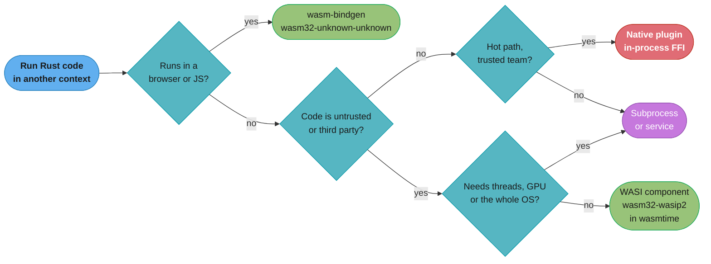
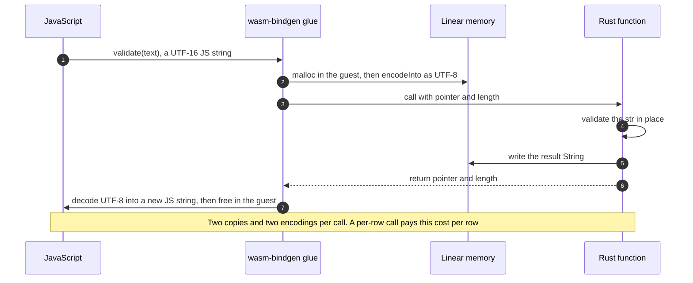
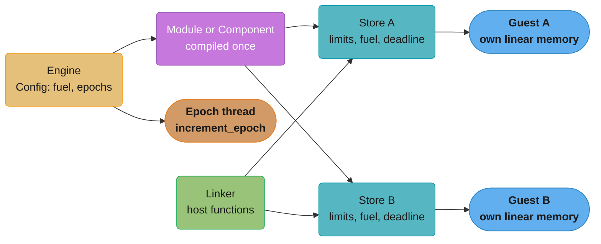
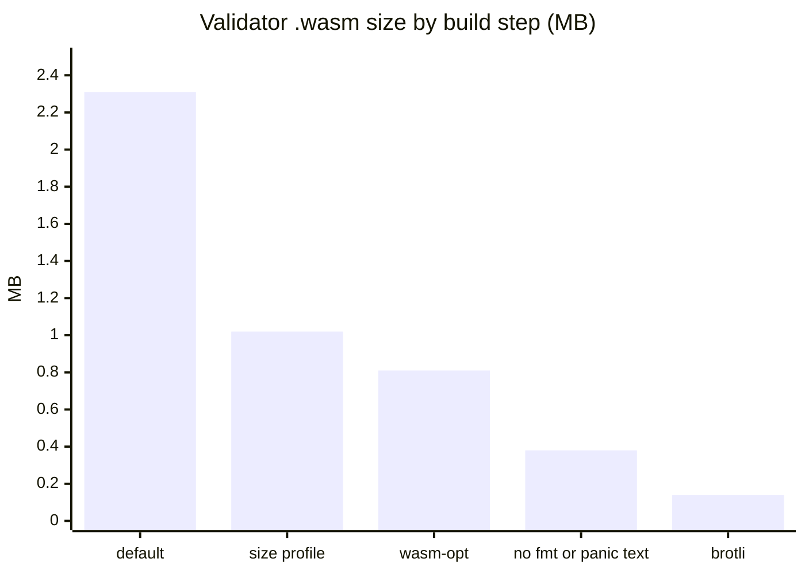

# WebAssembly and WASI from Rust

> **Version anchor (2026-11-06).** Rust 1.99.1 (2026-10-15) on edition 2024. Target tiers from the rustc platform support page on 2026-11-06: `wasm32-unknown-unknown`, `wasm32-wasip1`, `wasm32-wasip1-threads`, `wasm32-wasip2` and `wasm32v1-none` are tier 2 without host tools, and `wasm32-wasip3` is tier 3. Since 1.96, Wasm targets no longer pass `--allow-undefined` to the linker, so an undefined symbol is a link error. `cfg_select!` is `[1.95]`. Crates: wasm-bindgen 0.2.130, wasm-pack 0.15.1 (maintained in the `wasm-bindgen` GitHub org), wit-bindgen 0.63.0, cargo-component 0.21.1 (its README calls it experimental), wasmtime 50.0.1 (MSRV 1.97), leptos 0.8.23, dioxus 0.7.10. wasmtime 50 defaults: `max_wasm_stack` 512 KiB, `async_stack_size` 2 MiB, `StoreLimits` allows 10,000 instances, tables and memories per store and does not limit memory size.

---

## 1. Concept Overview

Rust is a common source language for WebAssembly, for three reasons. It
has no garbage collector to ship inside the module, its standard library splits cleanly
into `core`, `alloc` and `std`, and LLVM has a mature Wasm back end. A Rust crate can
become a module that a browser loads, a WASI program that `wasmtime run` executes, a
component that another language links against through WIT, or a plugin that a Rust host
runs in a sandbox. The same source can target all four.

From the Rust side the work splits into two roles. **As a guest**, you pick a target, keep
the code portable with `cfg`, generate bindings (wasm-bindgen for JavaScript, wit-bindgen
for components), and fight binary size and boundary-crossing cost. **As a host**, you embed
wasmtime, give each guest a `Store` with limits, stop runaway guests with fuel or epochs,
and decide which capabilities to link in.

The important limit: the Wasm sandbox protects the host from the guest. It does not protect
the guest from itself. A Rust guest with UB in an `unsafe` block can still corrupt its own
linear memory and return wrong answers. It simply cannot reach the host's memory.

This module covers the Rust toolchain side: targets, what `std` does on each one,
wasm-bindgen and wasm-pack, size tuning, the 1.96 linker change, components with
wit-bindgen, embedding wasmtime, and a decision model for the deployment shape. The Wasm
format, validation as the sandbox, WASI versions, the Component Model, runtimes and the
`wasm32-wasi` rename live in
[WebAssembly and Portable Bytecode](../../cs_fundamentals/how_code_runs_compilers_and_interpreters/wasm_and_portable_bytecode.md),
and the Wasm ABI and `wasm-ld` live in
[ABIs, Linking and Wasm](../../cs_fundamentals/how_code_runs_compilers_and_interpreters/abis_linking_and_wasm.md).

---

## 2. Intuition

> **One-line analogy**: a Wasm module is a sealed workshop with one mail slot. Anything the
> worker inside needs (files, the clock, the DOM) must be passed through the slot, and
> everything passed through the slot is copied.

**Mental model**: the guest owns one flat byte array, its linear memory. The host can read
and write that array, but the guest cannot see anything outside it. Every call across the
boundary passes only numbers. A string, a struct or a list is written into linear memory,
and its offset and length cross as two integers. wasm-bindgen and the Component Model's
canonical ABI are code generators that write and read those bytes for you.

**Why it matters**: the two costs that surprise teams are both on that mail slot. A
function called once per table row from JavaScript spends more time copying and converting
strings than running Rust. And a `.wasm` file that pulls in `format!`, panic messages and a
debug allocator can be 10 times larger than the logic it carries, which matters when every
page load downloads it.

**Key insight**: design the boundary first. Pass whole buffers, not elements. Keep a pure
Rust core with no Wasm types in it, and put bindings in a thin outer crate. The core then
compiles and tests natively at full speed, and each Wasm flavor is a small adapter.

---

## 3. Core Principles

1. **The target decides the system interface.** `wasm32-unknown-unknown` has none, so `std`
   I/O fails at run time. `wasm32-wasip1` uses WASI preview 1. `wasm32-wasip2` produces a
   component that uses WASI 0.2.
2. **Crossings copy.** Numbers cross for free. Everything else is written into or read out
   of linear memory. Batch the data, and keep long-lived state on one side.
3. **Size is a feature.** For browser delivery, bytes are download and compile time.
   Measure with twiggy, set the release profile for size, and run wasm-opt.
4. **The host sets every limit.** A guest gets no CPU, memory or capability budget unless
   the host configures one: fuel or epochs for time, a `ResourceLimiter` for memory and
   instances, and an explicit `Linker` for imports.
5. **Declare imports explicitly.** Since 1.96 an undefined symbol is a link error. Put
   `#[link(wasm_import_module = "...")]` on every hand-written import block.
6. **Portable core, thin adapters.** Gate Wasm-only code with `cfg` and give every gated
   item a native arm, so `cargo test` on the host still builds.
7. **The sandbox is not a soundness proof.** Unsafe code inside the guest still needs the
   same review as native unsafe code. See
   [Unsafe Rust and Undefined Behavior](../unsafe_rust_and_undefined_behavior/unsafe_rust_and_undefined_behavior.md).

---

## 4. Types / Architectures / Strategies

### 4.1 Targets

| Target | Tier on 2026-11-06 | System interface | `std` support | Typical host |
|---|---|---|---|---|
| `wasm32-unknown-unknown` | 2 | None | Full `std` API, but files, threads and the clock fail or panic at run time | Browser through wasm-bindgen, Proxy-Wasm hosts |
| `wasm32v1-none` | 2 | None | `no_std` only. Restricted to Wasm 1.0 features | Hosts that accept only Wasm 1.0 modules |
| `wasm32-wasip1` | 2 | WASI preview 1 (`wasi_snapshot_preview1`) | `std` with files, clock, env, stdio | `wasmtime run`, edge platforms, most WASI tooling |
| `wasm32-wasip1-threads` | 2 | WASI preview 1 plus threads | `std` with `std::thread` | Hosts that implement wasi-threads |
| `wasm32-wasip2` | 2 | WASI 0.2 | `std`, output is a component | Component hosts: wasmtime, jco |
| `wasm32-wasip3` | 3 | WASI 0.3 | No official artifacts | Experiments only |
| `wasm32-unknown-emscripten` | 2 | Emscripten's POSIX emulation | `std` | Mixing with C or C++ built by Emscripten |

### 4.2 Guest toolchain pieces

| Tool | Role |
|---|---|
| wasm-bindgen | `#[wasm_bindgen]` attribute plus a CLI that writes the JavaScript glue and TypeScript types |
| js-sys, web-sys | Generated bindings to JavaScript built-ins and Web APIs |
| wasm-pack | Runs cargo, wasm-bindgen and wasm-opt and writes an npm package |
| trunk | Builds and serves a Rust web app (HTML, CSS, the `.wasm` and its glue) |
| wit-bindgen | Generates guest bindings from a WIT world for a component |
| cargo-component | Cargo subcommand for components. Its README calls it experimental and says the `wasm32-wasip2` target is enough when only WASI interfaces are used |
| wasm-opt (binaryen) | Optimizes and shrinks a `.wasm` after LLVM |
| twiggy | Shows which functions and data take space in a `.wasm` |

### 4.3 Decision model: deployment shape

| Shape | Isolation | Crossing cost | Languages on the other side | Choose when |
|---|---|---|---|---|
| wasm-bindgen module in the browser or a JS runtime | Browser sandbox | JS to Wasm call plus string and array copies | JavaScript, TypeScript | You need Rust logic next to a web UI: parsing, codecs, validation, geometry |
| WASI component in a host | Full memory isolation, explicit capabilities | Canonical ABI copy per call | Any language with a WIT toolchain | Untrusted plugins, multi-language composition, edge functions |
| Native plugin (dynamic library, in-process FFI) | None | A function call | Rust or C ABI | Trusted code on the hot path, where nanoseconds matter. See [FFI and Language Interop](../ffi_and_language_interop/ffi_and_language_interop.md) |
| Subprocess or service | Full, by the OS | Process start, then IPC per message | Any | Untrusted code with a low call rate, or code that needs real threads, GPUs or the whole OS |

---

## 5. Architecture Diagrams

### Picking the deployment shape



Trust decides between a sandbox and a native plugin. The browser decides the target on its
own, because it accepts nothing else.

### One string crossing from JavaScript into Rust and back



The Rust function itself is often the cheapest step. The encoding, the guest allocation and
the decoding scale with the data size and run on every call.

### The host side: one `Store` per guest



The `Engine` and the compiled module are shared and cheap to reuse. Each guest gets its own
`Store`, which holds its memory, its fuel, its epoch deadline and its limiter.

---

## 6. How It Works - Detailed Mechanics

### 6.1 What `std` does on each target

On `wasm32-unknown-unknown` the whole `std` API compiles, but the platform layer has
nothing behind it. `std::fs::File::open` returns an "unsupported" error,
and `std::thread::spawn` and `std::time::Instant::now()` panic. Code that reaches
those calls compiles and then fails in the browser. On `wasm32-wasip1` and
`wasm32-wasip2` the same calls work, limited by the capabilities the host grants:
`wasmtime run --dir ./data::/data app.wasm` opens exactly one directory.

The portable pattern is a core crate that takes its inputs as arguments (bytes, a clock
value, a random seed) and an outer crate per target that supplies them.

### 6.2 The raw ABI under the bindings

A Wasm export can take and return only numbers. This is what wasm-bindgen generates for a
function that takes bytes, written by hand so the mechanism is visible. The host calls
`buf_alloc`, writes the bytes into linear memory at the returned offset, calls `checksum`,
and then calls `buf_free`.

```rust
#[unsafe(no_mangle)]
pub extern "C" fn buf_alloc(len: usize) -> *mut u8 {
    let buf = vec![0u8; len].into_boxed_slice();
    Box::into_raw(buf).cast::<u8>()
}

/// # Safety
///
/// `ptr` and `len` come from one `buf_alloc` call, and the buffer is freed once.
#[unsafe(no_mangle)]
pub unsafe extern "C" fn buf_free(ptr: *mut u8, len: usize) {
    let slice = std::ptr::slice_from_raw_parts_mut(ptr, len);
    // SAFETY: per the contract, `slice` is the `Box<[u8]>` that `buf_alloc` leaked.
    drop(unsafe { Box::from_raw(slice) });
}

/// # Safety
///
/// `ptr` points to `len` initialized bytes inside linear memory.
#[unsafe(no_mangle)]
pub unsafe extern "C" fn checksum(ptr: *const u8, len: usize) -> u32 {
    // SAFETY: per the contract, the range is readable and initialized.
    let data = unsafe { std::slice::from_raw_parts(ptr, len) };
    data.iter().fold(0u32, |acc, &b| acc.rotate_left(5) ^ u32::from(b))
}
```

`usize` is 32 bits on `wasm32`, so every pointer and length is an `i32` on the wire.

### 6.3 wasm-bindgen and wasm-pack

`#[wasm_bindgen]` writes the glue in 6.2 for you and adds conversions for `&str`, `String`,
slices, `Vec`, closures, `Result` and JavaScript classes.

```rust
// fragment: wasm-bindgen 0.2
use wasm_bindgen::prelude::*;

#[wasm_bindgen]
pub fn count_invalid_rows(csv: &str) -> Result<u32, JsError> {
    let mut bad = 0;
    for line in csv.lines().skip(1) {
        if line.split(',').count() != 5 {
            bad += 1;
        }
    }
    if bad > 10_000 {
        return Err(JsError::new("too many invalid rows"));
    }
    Ok(bad)
}

#[wasm_bindgen]
pub struct Validator {
    columns: usize,
}

#[wasm_bindgen]
impl Validator {
    #[wasm_bindgen(constructor)]
    pub fn new(columns: usize) -> Validator {
        Validator { columns }
    }

    pub fn check(&self, row: &str) -> bool {
        row.split(',').count() == self.columns
    }
}
```

A `&str` argument is encoded from UTF-16 to UTF-8 into guest memory. A returned `String` is
decoded back into a JavaScript string. A `#[wasm_bindgen]` struct lives in linear memory and
JavaScript holds a handle, so the JavaScript side must call `free()` on it or rely on a
`FinalizationRegistry`. js-sys covers JavaScript built-ins and web-sys covers Web APIs, with
each API behind a cargo feature so unused bindings cost nothing.

`wasm-pack build --target web` runs `cargo build --target wasm32-unknown-unknown --release`,
runs the wasm-bindgen CLI, runs wasm-opt, and writes a package directory with the `.wasm`,
the JavaScript glue, `.d.ts` types and a `package.json`. wasm-pack is maintained in the
`wasm-bindgen` GitHub org and released 0.15.1 on 2026-10-30. trunk does the same job for a
whole web application and serves it during development.

### 6.4 Size tuning

A release profile for size:

```toml
[profile.release]
opt-level = "z"     # or "s", measure both
lto = true
codegen-units = 1
panic = "abort"
strip = true
```

Then:

1. Run `wasm-opt -Oz`. wasm-pack runs wasm-opt on release builds with `-O` by default. Set
   `wasm-opt = ["-Oz"]` under `[package.metadata.wasm-pack.profile.release]` to optimize for
   size, or `false` to skip it.
2. Run `twiggy top -n 20 pkg/app_bg.wasm` and `twiggy dominators` to find what pulls in
   code.
3. Remove the usual suspects: `{:?}` formatting of large types, `format!` in error paths,
   `unwrap` and `expect` messages (each one keeps a string and the panic formatting
   machinery), and generic functions instantiated for many types.
4. Compress for delivery. Brotli on a `.wasm` usually cuts it by more than half, and the
   browser compiles the module while it streams with `WebAssembly.instantiateStreaming`.

`opt-level = "z"` can be slower than `"s"` or `3` at run time. For a compute kernel,
measure both size and speed before you choose.

### 6.5 Imports and the 1.96 linker change

Before 1.96, a Wasm build passed `--allow-undefined` to the linker, so any undeclared
symbol silently became an import from the module `"env"`. A typo in a function name, or a
missing C object file, produced a module that failed only when the host tried to
instantiate it. Since 1.96 an undefined symbol is a link error. Name the import module
explicitly:

```rust
#[link(wasm_import_module = "host")]
unsafe extern "C" {
    safe fn host_log(level: i32, code: i32);
    fn host_read(dst: *mut u8, cap: usize) -> isize;
}

pub fn warn(code: i32) {
    host_log(2, code);
}
```

A build that really wants the old behavior can pass
`RUSTFLAGS=-Clink-arg=--allow-undefined`, or put `#[link(wasm_import_module = "env")]` on
the block. wasm-bindgen and wit-bindgen already name their import modules, so crates that
use only them are not affected.

### 6.6 A component with wit-bindgen

A component describes its interface in WIT. The guest implements the exports of a world:

```wit
package acme:filters@1.0.0;

world row-filter {
    import log: func(msg: string);
    export apply: func(row: list<u8>) -> result<list<u8>, string>;
}
```

```rust
// fragment: wit-bindgen guest for wasm32-wasip2
wit_bindgen::generate!({
    world: "row-filter",
    path: "wit",
});

struct Filter;

impl Guest for Filter {
    fn apply(row: Vec<u8>) -> Result<Vec<u8>, String> {
        if row.len() > 64 * 1024 {
            log("row too large");
            return Err(format!("row of {} bytes is over the 64 KiB limit", row.len()));
        }
        Ok(row.into_iter().map(|b| b.to_ascii_uppercase()).collect())
    }
}

export!(Filter);
```

Build with `cargo build --target wasm32-wasip2 --release` and the output is a component.
cargo-component also builds components and handles WIT dependencies, but its README calls it
experimental and says that for WASI-only interfaces the `wasm32-wasip2` target is enough.

### 6.7 Embedding wasmtime: limits, fuel and epochs

```rust
// fragment: wasmtime 50 host
use std::time::Duration;
use wasmtime::{Caller, Config, Engine, Linker, Module, Result, Store, StoreLimits, StoreLimitsBuilder};

struct HostState {
    limits: StoreLimits,
    log_calls: u64,
}

fn score(engine: &Engine, module: &Module, a: i32, b: i32) -> Result<i32> {
    let mut linker = Linker::new(engine);
    linker.func_wrap("host", "host_log", |mut caller: Caller<'_, HostState>, _lvl: i32, _code: i32| {
        caller.data_mut().log_calls += 1;
    })?;

    let limits = StoreLimitsBuilder::new()
        .memory_size(64 * 1024 * 1024)
        .instances(1)
        .trap_on_grow_failure(true)
        .build();
    let mut store = Store::new(engine, HostState { limits, log_calls: 0 });
    store.limiter(|s| &mut s.limits);
    store.set_fuel(50_000_000)?;
    store.set_epoch_deadline(5);

    let instance = linker.instantiate(&mut store, module)?;
    let f = instance.get_typed_func::<(i32, i32), i32>(&mut store, "score")?;
    f.call(&mut store, (a, b))
}

fn main() -> Result<()> {
    let mut config = Config::new();
    config.consume_fuel(true);
    config.epoch_interruption(true);
    let engine = Engine::new(&config)?;

    let ticker = engine.clone();
    std::thread::spawn(move || loop {
        std::thread::sleep(Duration::from_millis(10));
        ticker.increment_epoch();
    });

    let module = Module::from_file(&engine, "plugin.wasm")?;
    println!("{}", score(&engine, &module, 3, 4)?);
    Ok(())
}
```

**Fuel** counts executed Wasm operations. It is deterministic: the same input stops at the
same instruction on every machine, which suits billing and reproducible limits. It costs a
counter update in compiled code. A new `Store` starts with zero fuel, so `set_fuel` must run
before the first call.

**Epochs** compare a shared counter at function entries and loop back edges. One thread
calls `Engine::increment_epoch` on a timer, and each store traps when it is `n` ticks past
its deadline. With a 10 ms tick and a deadline of 5, a guest stops 40 to 50 ms after the
call starts. Epochs are cheaper than fuel and measure wall-clock time, but they are not
deterministic. Epoch interruption is not compatible with the Winch compiler.

**Memory** is bounded by the `ResourceLimiter`. `StoreLimits` does not limit memory size
unless you set `memory_size`, and it allows 10,000 instances, tables and memories per store
by default. With `trap_on_grow_failure(true)` a `memory.grow` over the limit traps instead
of returning -1 to the guest. Stack depth is bounded by `Config::max_wasm_stack`, 512 KiB by
default.

**Capabilities** are whatever the `Linker` provides. A component host adds WASI through the
`wasmtime-wasi` crate and grants directories, environment variables and sockets one by one.

### 6.8 Async hosts

With wasmtime's `async` cargo feature, host functions can be `async` and guests can be
called from a Tokio task. `Linker::func_wrap_async` registers a host function whose closure
returns a boxed future, `Linker::instantiate_async` and `TypedFunc::call_async` replace the
blocking calls, and the guest runs on a separate stack (`async_stack_size`, 2 MiB by
default). Two settings stop a guest from holding a runtime worker thread:
`Store::fuel_async_yield_interval` yields to the executor every `n` units of fuel, and
`Store::epoch_deadline_async_yield_and_update` yields at each epoch deadline and sets the
next one. The async APIs require `T: Send` for the store's host data, so host state must not
hold an `Rc` or a `RefCell` (see §10.1).

### 6.9 Plugins in proxies, and Rust UI frameworks

Envoy runs Proxy-Wasm filters in a Wasm VM per worker thread, and Envoy dynamic modules
load a native shared object built with an official Rust SDK. The first is the sandboxed
plugin shape and the second is the native plugin shape from §4.3. The tradeoffs are in
[Envoy Proxy](../../technologies/envoy_proxy/envoy_proxy.md).

Leptos 0.8.23 and Dioxus 0.7.10 are Rust UI frameworks that compile the client to
`wasm32-unknown-unknown` through wasm-bindgen. Leptos uses fine-grained reactive signals
and server-side rendering with hydration. Dioxus uses a virtual DOM and also targets
desktop and mobile. Both add the size and string-crossing costs of this module to every
page, so they suit applications where the team wants Rust on both sides more than a
smaller bundle. JavaScript runtimes and edge platforms that run Wasm are covered in
[The Node and Edge Runtimes](../../frontend_platform/the_node_and_edge_runtimes/the_node_and_edge_runtimes.md).

---

## 7. Real-World Examples

- **Edge functions.** Fastly Compute runs Rust compiled to Wasm, and Cloudflare Workers run
  Rust through the `workers-rs` crate, which is built on wasm-bindgen.
- **Commerce extensions.** Shopify Functions run merchant logic as Wasm modules, and Rust is
  one of the languages Shopify supports for them.
- **Proxy filters.** Proxy-Wasm filters written in Rust run in Envoy. See
  [Envoy Proxy](../../technologies/envoy_proxy/envoy_proxy.md).
- **Terminal plugins.** Zellij, a terminal multiplexer written in Rust, loads its plugins
  as Wasm modules.
- **Native plugin replaced by Wasm.** The cost and the payoff of moving a plugin ABI to Wasm
  are worked through in the case study of
  [WebAssembly and Portable Bytecode](../../cs_fundamentals/how_code_runs_compilers_and_interpreters/wasm_and_portable_bytecode.md).
- **Go's view of the same choice.** Go services embed Wasm through wazero to avoid cgo. See
  [cgo and FFI](../../go/cgo_and_ffi/cgo_and_ffi.md).

---

## 8. Tradeoffs

### 8.1 Limiting guest time

| Mechanism | Measures | Deterministic | Overhead | Use when |
|---|---|---|---|---|
| Fuel | Wasm operations executed | Yes | A counter update in generated code | Billing, reproducible limits, tests |
| Epochs | Wall-clock ticks from a host thread | No | A load and compare at function entry and loop edges | Production timeouts at low cost |
| OS thread timeout and kill | Wall-clock | No | A process per guest | Guests that run as a subprocess |
| None | Nothing | n/a | None | Only for fully trusted modules |

### 8.2 Browser logic in Rust and Wasm or in JavaScript

| Factor | Rust and Wasm | JavaScript |
|---|---|---|
| CPU-heavy pure logic (parsing, codecs, geometry) | Usually faster and more predictable | JIT-dependent |
| DOM-heavy UI work | Every DOM call crosses the boundary | Direct |
| Download size | Hundreds of KB once tuned | Often smaller for small features |
| Code shared with a native Rust backend | One crate on both sides | A rewrite |
| Debugging | Source maps and DWARF support vary by browser | Mature |

### 8.3 Sizes for one validation crate (illustrative, from the §14 case study)

| Build | Size of the `.wasm` |
|---|---|
| Default release build | 2.31 MB |
| `opt-level = "z"`, LTO, one codegen unit, `panic = "abort"` | 1.02 MB |
| After wasm-opt `-Oz` | 0.81 MB |
| After removing `{:?}` and panic messages in error paths | 0.38 MB |
| Brotli-compressed for delivery | 0.14 MB |

---

## 9. When to Use / When NOT to Use

### Use Rust to Wasm when

- A CPU-bound component must run in the browser or at the edge and already exists in Rust,
  or would be faster and safer there than in JavaScript.
- You need to run third-party or customer code inside your process with memory isolation
  and explicit capabilities: plugins, user-defined functions, filters.
- One Rust core must serve a browser client, a native backend and a CLI.

### Do NOT use it when

- The work is mostly DOM manipulation or calls into JavaScript APIs. The boundary cost will
  dominate.
- The code needs threads, a GPU, raw sockets or shared memory with the host, and the target
  host does not provide them.
- A trusted native plugin is acceptable and the call rate is very high. A function call
  through FFI is cheaper than any Wasm crossing.
- Bundle size is the main constraint and the Rust feature is small. A few kilobytes of
  JavaScript beat a few hundred kilobytes of Wasm.

---

## 10. Common Pitfalls

The incidents below are composites. Their numbers are illustrative, not measurements from a
named product.

### 10.1 Host state that is not `Send`

A plugin host kept a per-guest cache in `Rc<RefCell<..>>` inside the store's host data.
It worked with the blocking API. When the team moved to the async API to run guests on
Tokio tasks, every call site failed to compile, because the async APIs require the host
data to be `Send`. The same error appears for any host state moved to a worker thread:

```rust
// BROKEN
use std::cell::RefCell;
use std::rc::Rc;

pub struct HostState {
    pub cache: Rc<RefCell<Vec<u8>>>,
}

pub fn run_on_worker<T: Send + 'static>(state: T) -> std::thread::JoinHandle<()> {
    std::thread::spawn(move || drop(state))
}

pub fn start() {
    let state = HostState { cache: Rc::new(RefCell::new(Vec::new())) };
    // error[E0277]: `Rc<RefCell<Vec<u8>>>` cannot be sent between threads safely
    run_on_worker(state);
}
```

```rust
// FIX: shared host state uses Arc and Mutex, or each store owns its data outright.
use std::sync::{Arc, Mutex};

pub struct HostState {
    pub cache: Arc<Mutex<Vec<u8>>>,
}

pub fn run_on_worker<T: Send + 'static>(state: T) -> std::thread::JoinHandle<()> {
    std::thread::spawn(move || drop(state))
}

pub fn start() -> std::thread::JoinHandle<()> {
    let state = HostState { cache: Arc::new(Mutex::new(Vec::new())) };
    run_on_worker(state)
}
```

Most per-guest state does not need sharing at all. A plain `Vec<u8>` owned by the store is
`Send` and has no lock.

### 10.2 A link error after upgrading to 1.96

A guest declared `extern "C" { fn host_log(code: i32); }` with no import module. Before
1.96 it linked, and the import was named `env.host_log`. After the upgrade the build failed
with an undefined symbol. The fix is the explicit `#[link(wasm_import_module = "host")]`
from §6.5, which also made the host's linker definition match a real module name. The same
change caught a second import whose name had a typo, which had been failing at
instantiation in staging for weeks.

### 10.3 `Instant::now()` in shared code

A rate limiter in a shared crate called `std::time::Instant::now()`. Native tests passed.
In the browser build the first call panicked, because `wasm32-unknown-unknown` has no
clock behind `std`. Pass time in as an argument from the adapter crate, which reads
`performance.now()` through web-sys in the browser and `Instant` natively.

### 10.4 One crossing per row

A spreadsheet front end called a Rust `validate_cell(&str)` once per cell, 200,000 times
per sheet. Each call encoded a JavaScript string to UTF-8 in guest memory and decoded the
result. The validation logic took 3% of the time. Passing the whole sheet as one buffer and
returning a compact list of failing cell indexes cut the total from 1.9 s to 140 ms.

### 10.5 A guest with no time limit

A plugin host ran customer filters without fuel or epochs. One customer deployed a filter
with an infinite loop on a rare input, and it held a host worker thread at 100% CPU until
the pod was killed. Every untrusted guest needs an epoch deadline at least, and an async
host needs a yield setting so one guest cannot starve the executor.

### 10.6 A build script still pinned to `wasm32-wasi`

CI broke on a toolchain upgrade because a script still used the target name `wasm32-wasi`,
which was removed in Rust 1.84. The replacement is `wasm32-wasip1`. The rename history is in
[WebAssembly and Portable Bytecode](../../cs_fundamentals/how_code_runs_compilers_and_interpreters/wasm_and_portable_bytecode.md).

---

## 11. Technologies & Tools

| Tool | Purpose |
|---|---|
| wasm-bindgen | Rust and JavaScript bindings for `wasm32-unknown-unknown`, with a CLI that writes the glue |
| js-sys | Bindings to JavaScript built-in objects |
| web-sys | Bindings to Web APIs, one cargo feature per API |
| wasm-pack | Builds a Rust crate into an npm package |
| trunk | Builds and serves Rust web applications |
| wit-bindgen | Guest bindings generated from WIT worlds |
| cargo-component | Experimental cargo subcommand for building components |
| Wasmtime | Bytecode Alliance runtime that Rust hosts embed (crate `wasmtime`) |
| wasm-opt | Binaryen's optimizer and shrinker for `.wasm` files |
| twiggy | Code size profiler for `.wasm` files |
| wasm-tools | Inspects, validates and composes modules and components |
| Leptos | Rust web framework with fine-grained reactivity and SSR |
| Dioxus | Rust UI framework for web, desktop and mobile |

---

## 12. Interview Questions with Answers

**Q: Which Rust target do you use for a browser, a WASI program and a component?**
**Short:** `wasm32-unknown-unknown` with wasm-bindgen for the browser, `wasm32-wasip1` for a classic WASI program, and `wasm32-wasip2` for a WASI 0.2 component.

All three are tier 2 without host tools. `wasm32-unknown-unknown` has no system interface
at all. `wasm32-wasip1` targets `wasi_snapshot_preview1`, which most runtimes and edge
platforms accept. `wasm32-wasip2` emits a component that imports WASI 0.2 interfaces.
`wasm32-wasip3` exists at tier 3 for experiments. A build script that still names
`wasm32-wasi` fails, because that name was removed in 1.84.

**Q: What happens when code compiled for `wasm32-unknown-unknown` opens a file or reads the clock?**
**Short:** It compiles, then fails at run time. File operations return an unsupported error, while `thread::spawn` and `Instant::now()` panic.

The target provides the whole `std` API with no platform behind it, so the type checker
cannot warn you. Keep I/O and time out of the shared core: take bytes, timestamps and seeds
as arguments, and let a browser adapter crate read them through web-sys and js-sys. For
programs that really need files and a clock, use a WASI target and grant the capabilities
from the host.

**Q: Why does passing a string between JavaScript and Rust cost more than passing a number?**
**Short:** Numbers cross as Wasm values. A string must be encoded from UTF-16 to UTF-8 and copied into linear memory, and the result is copied back and decoded.

The wasm-bindgen glue allocates in the guest, encodes with `TextEncoder`, passes a pointer
and a length, and on return decodes with `TextDecoder` and frees the guest buffer. That is
two copies, two encodings and two allocations per call, all proportional to the data size.
The fix is to cross less often: send whole documents or typed arrays, keep long-lived data
in a `#[wasm_bindgen]` struct on the Rust side, and return compact results such as indexes.

**Q: How do you make a Rust `.wasm` file small?**
**Short:** Build with `opt-level = "z"` or `"s"`, LTO, one codegen unit and `panic = "abort"`, run wasm-opt, then use twiggy to find and remove what pulls in code.

The large wins usually come after the profile settings: `{:?}` formatting, `format!` in
error paths and panic messages keep the formatting machinery and many strings alive, and
generics instantiated for many types multiply code. twiggy's `top` and `dominators`
reports show the culprits. Measure run-time speed too, because `"z"` can be slower than
`"s"`, and serve the file Brotli-compressed with streaming compilation.

**Q: What changed for Wasm targets in Rust 1.96, and how do you fix the resulting link errors?**
**Short:** The linker no longer gets `--allow-undefined`, so an undefined symbol is an error instead of a silent `env` import. Declare imports with `#[link(wasm_import_module)]`.

Before 1.96, a typo in a foreign function name produced a module with an import nobody
provided, and the failure appeared only at instantiation. Now it is a build failure. Put
`#[link(wasm_import_module = "host")]` on each hand-written import block. If a build truly
depends on the old behavior, `RUSTFLAGS=-Clink-arg=--allow-undefined` restores it, but the
explicit attribute is the better fix.

**Q: What are wasm-bindgen, wasm-pack and trunk each responsible for?**
**Short:** wasm-bindgen generates the JS glue and types, wasm-pack packages a crate as an npm library, and trunk builds and serves a whole Rust web application.

wasm-bindgen is both the `#[wasm_bindgen]` attribute and a CLI that post-processes the
`.wasm`. wasm-pack runs cargo, the wasm-bindgen CLI and wasm-opt, and writes `package.json`
and `.d.ts` files. It is maintained in the `wasm-bindgen` GitHub org, with 0.15.1 released
2026-10-30. trunk targets applications: it builds the HTML, assets and the Wasm bundle and
runs a development server. Leptos and Dioxus apps often use trunk or their own CLIs.

**Q: How do you build a WASI 0.2 component from Rust?**
**Short:** Write a WIT world, generate guest bindings with `wit_bindgen::generate!`, implement the `Guest` trait, call `export!`, and build for `wasm32-wasip2`.

The `wasm32-wasip2` target emits a component directly, with its WASI imports. A world with
custom interfaces needs the WIT files in the crate and `wit-bindgen` in the dependencies.
cargo-component adds WIT dependency management, but its README calls it experimental and
says the target alone is enough for WASI-only interfaces. The host side uses
`wasmtime::component::bindgen!` on the same WIT, so both sides check the interface at build
time.

**Q: What is the difference between fuel and epoch interruption in wasmtime?**
**Short:** Fuel counts executed operations and is deterministic. Epochs check a counter that a host thread advances on a timer, which is cheaper but not deterministic.

Fuel suits billing and tests: the same input stops at the same place everywhere. It costs a
counter update in generated code, and a new `Store` starts with zero fuel. Epochs suit
production timeouts: one thread calls `Engine::increment_epoch` every few milliseconds, and
each store traps once its deadline passes. A deadline of `n` ticks gives a timeout between
`n - 1` and `n` tick lengths. Epochs do not work with the Winch compiler.

**Q: How do you cap a guest's memory in wasmtime?**
**Short:** Put a `ResourceLimiter`, usually a `StoreLimits` built with `StoreLimitsBuilder::memory_size`, in the host data and register it with `Store::limiter`.

`StoreLimits` does not limit linear memory unless you set `memory_size`, and it allows
10,000 instances, tables and memories per store by default, so set the counts you expect.
`trap_on_grow_failure(true)` makes an over-limit `memory.grow` trap, which is clearer than
the default -1 that a guest allocator may handle badly. Linear memory never shrinks, so a
long-lived instance keeps its peak size. Recreate stores per request or per batch when peak
size matters.

**Q: What changes when a wasmtime host calls guests from async Rust?**
**Short:** Enable the `async` feature, use `func_wrap_async`, `instantiate_async` and `call_async`, keep host data `Send`, and make guests yield through fuel or epochs.

The guest runs on its own stack, 2 MiB by default (`async_stack_size`), which must be at
least `max_wasm_stack`. Without a yield setting, a guest in a long loop holds a Tokio
worker thread and starves other tasks. `fuel_async_yield_interval` and
`epoch_deadline_async_yield_and_update` turn the limits into cooperative yields. A
`ResourceLimiterAsync` set with `limiter_async` can await before allowing memory growth.

**Q: Can a Rust program running as Wasm still have undefined behavior?**
**Short:** Yes. The sandbox stops the guest from touching host memory, but unsafe code inside the guest can still corrupt the guest's own linear memory.

Wasm linear memory has no guard pages between objects, and a module typically has no
protection at address 0 either, so some bugs that crash natively continue silently in Wasm
with corrupted data. The host is safe, and the guest's results are not. Run the guest's
unsafe code through the same Miri, fuzzing and review process as native code, natively
first where possible.

**Q: When is a Wasm component a better plugin format than a native dynamic library?**
**Short:** When the plugin is untrusted or written by another team or customer, because Wasm gives memory isolation, explicit capabilities and recoverable traps.

A native plugin runs in the host's address space: a bug corrupts host memory and a crash
takes down the host. A component call costs a canonical ABI copy, so it loses on very hot,
fine-grained calls. Envoy shows both shapes: Proxy-Wasm filters run sandboxed per worker,
and dynamic modules run native code with an official Rust SDK, where a bug crashes the
proxy. Choose on trust first and call rate second.

**Q: How do you run threads in Rust code compiled to Wasm?**
**Short:** On WASI, use the `wasm32-wasip1-threads` target and a host that implements wasi-threads. In the browser, threads need shared memory and cross-origin isolation.

`wasm32-wasip1-threads` gives `std::thread` on hosts that support it. In the browser, a
threaded module needs the `atomics` and `bulk-memory` target features, a std built with
them, a `SharedArrayBuffer`, and pages served with cross-origin isolation headers. Many
teams avoid all of that and run several single-threaded instances in Web Workers, passing
messages between them.

**Q: How do you keep one Rust crate building for Wasm and native without breaking `cargo test`?**
**Short:** Keep a pure core crate with no Wasm types, and give every `cfg(target_family = "wasm")` item a native arm, for example with `cfg_select!`.

A function defined only under the Wasm `cfg` makes the native build fail with E0425 when
other code calls it. `cfg_select!` `[1.95]` writes the branches as one block with a `_`
fallback arm, so a missing arm is visible in review. Test the core natively at full speed,
and run a small set of Wasm tests with `wasm-bindgen-test` or with wasmtime set as the cargo
runner for `wasm32-wasip1`.

**Q: When is Rust compiled to Wasm the wrong choice for a browser feature?**
**Short:** When the feature is mostly DOM updates or calls to JS APIs, when it is small enough that the Wasm download dominates, or when it needs threads or the GPU directly.

Every DOM call from Rust goes through the JS boundary, so a UI-heavy feature pays crossing
costs without using Rust's speed. A tuned module is still hundreds of kilobytes, which is
large next to a small JavaScript feature. Rust and Wasm win for CPU-bound pure logic such as
parsing, compression, image processing and validation, and for code that must match a Rust
backend exactly.

**Q: What do Leptos and Dioxus trade off against a JavaScript framework?**
**Short:** They let a team write the whole UI in Rust and share types with the backend, at the cost of Wasm bundle size and a boundary crossing for each DOM update.

Leptos 0.8.23 uses fine-grained reactive signals and server-side rendering with hydration.
Dioxus 0.7.10 uses a virtual DOM and also targets desktop and mobile from one codebase.
Both compile the client with wasm-bindgen. They suit internal tools and teams that are
already Rust-heavy. For a public site where first load time drives revenue, measure the
bundle against a JavaScript framework before you commit.

**Q: How should you design the interface between a Rust guest and its host?**
**Short:** Make calls coarse: pass whole requests or buffers, return compact results, keep state on one side, and version the WIT package.

Each crossing copies data through the canonical ABI or the wasm-bindgen glue, so a chatty
interface spends its time on copies. A `process(batch) -> results` export beats
`process(item)` called in a loop. Version the WIT package (`acme:filters@1.0.0`) and treat
it as a public API, since host and guest are often built and deployed by different teams.

**Q: Why should an untrusted guest get its own `Store`, and what does that cost?**
**Short:** A `Store` holds a guest's memory, fuel, deadline and limits, so one store per guest isolates them. Creating a store is cheap, and compiling the module is the expensive part.

Compile the `Module` or `Component` once with a shared `Engine` and reuse it. Instantiate
into a fresh `Store` per tenant, request or batch. Sharing one store between tenants lets
one tenant read the other's linear memory and exhaust the shared fuel. For high request
rates, wasmtime's pooling allocator pre-reserves instance slots so instantiation stays fast.

---

## 13. Best Practices

- Keep a pure Rust core crate with no Wasm dependencies, and put wasm-bindgen or wit-bindgen
  code in thin adapter crates.
- Give every Wasm-only `cfg` item a native arm, with `cfg_select!` where there are several
  branches.
- Design coarse interfaces: whole buffers in, compact results out.
- Set a size budget for browser modules in CI, and fail the build when the Brotli size
  grows past it.
- Use the size profile, wasm-opt and twiggy, and remove formatting and panic strings from
  hot error paths.
- Name the import module on every hand-written import block.
- In a host, give every untrusted guest its own `Store` with a `ResourceLimiter`, an epoch
  deadline and only the capabilities it needs.
- In an async host, set a fuel or epoch yield so one guest cannot hold a runtime worker.
- Version WIT packages and treat them as public APIs.
- Review unsafe code in a guest as strictly as native unsafe code.

---

## 14. Case Study

### Moving a CSV validator from the server to the browser

The product, the team and the numbers in this case are illustrative.

**Context.** A data-import product validated uploaded CSV files on the server. Customers
uploaded files of 5 to 50 MB, waited for the upload, and then waited again for the error
report. The validator was a 9,000-line Rust crate. The team decided to run the same crate
in the browser so users saw errors before uploading. Targets: under 1 s to validate a 10 MB
file on a mid-range laptop, and under 200 KB of compressed Wasm on the critical path.

**Step one: the host build broke.** The crate read the clock to report validation time. The
first port added a Wasm version of the clock function and nothing else.

```rust
// BROKEN
#[cfg(target_family = "wasm")]
fn now_ms() -> f64 {
    0.0 // replaced by a performance.now() call in the real adapter
}

pub fn elapsed_ms(start: f64) -> f64 {
    now_ms() - start // error[E0425]: cannot find function `now_ms` in this scope
}
```

The browser build compiled. `cargo test` on the developers' machines and in CI failed,
because the native build had no `now_ms`. The fix gives both arms in one block:

```rust
// FIX
cfg_select! {
    target_family = "wasm" => {
        fn now_ms() -> f64 {
            0.0 // replaced by a performance.now() call in the real adapter
        }
    }
    _ => {
        fn now_ms() -> f64 {
            use std::time::{SystemTime, UNIX_EPOCH};
            SystemTime::now()
                .duration_since(UNIX_EPOCH)
                .map(|d| d.as_secs_f64() * 1000.0)
                .unwrap_or(0.0)
        }
    }
}

pub fn elapsed_ms(start: f64) -> f64 {
    now_ms() - start
}
```

Later the team moved time out of the core entirely: the core takes a timestamp argument,
and the adapter supplies it.

**Step two: the boundary.** The first version called `validate_row(&str)` from JavaScript
once per row. A 10 MB file with 120,000 rows took 2.6 s, and a profile showed 81% of that
time in the string encoding and decoding glue. The second version passed the file as one
`Uint8Array`, validated it as bytes in Rust, and returned a `Uint32Array` of failing row
numbers plus one JSON string of messages for only those rows. Time fell to 310 ms.

**Step three: size.** The table in §8.3 is this crate. The default release build was
2.31 MB. The size profile brought it to 1.02 MB and wasm-opt to 0.81 MB. twiggy showed that
`{:?}` on the error enum and the `expect` messages pulled in about 400 KB of formatting
code and strings. Replacing them with error codes and a small message table gave 0.38 MB,
and 0.14 MB with Brotli.



The largest single step after the profile was removing formatting, not any compiler flag.

**Step four: threads.** The team tried a threaded build for large files. It needed
cross-origin isolation headers on the whole app, which broke two third-party embeds. They
shipped two single-threaded instances in Web Workers instead, each validating half of the
file, which brought a 50 MB file from 1.5 s to 0.8 s.

**Results.** Validation of a 10 MB file took 310 ms in the browser, against an upload plus
server round trip of 9 to 25 s before. Server CPU for validation fell by 70%, because most
files with errors were fixed before upload. The server still revalidates every file with
the same crate built natively, because a browser result is untrusted input.

**What they would tell another team.** Design the boundary before you tune the code: one
call with a whole buffer replaced 120,000 calls and gave the largest win. Make size a CI
budget from the first build, because formatting code arrives one `{:?}` at a time. And keep
the core free of Wasm types, so the server build, the browser build and the tests all use
the same code. See
[Performance and Zero-Cost Abstractions](../performance_and_zero_cost_abstractions/performance_and_zero_cost_abstractions.md)
for profile settings and
[Build, Deployment and Supply Chain](../build_deployment_and_supply_chain/build_deployment_and_supply_chain.md)
for CI budgets.
