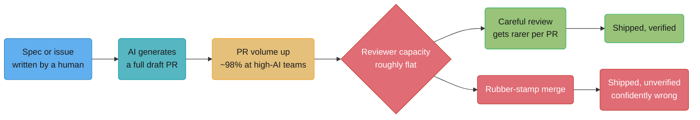
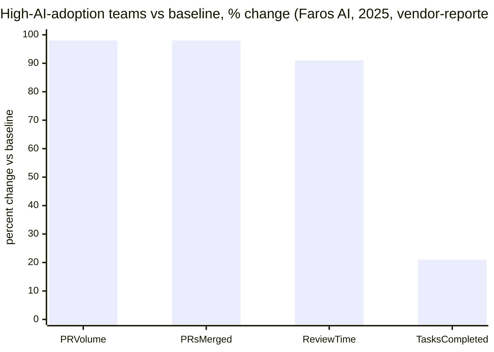
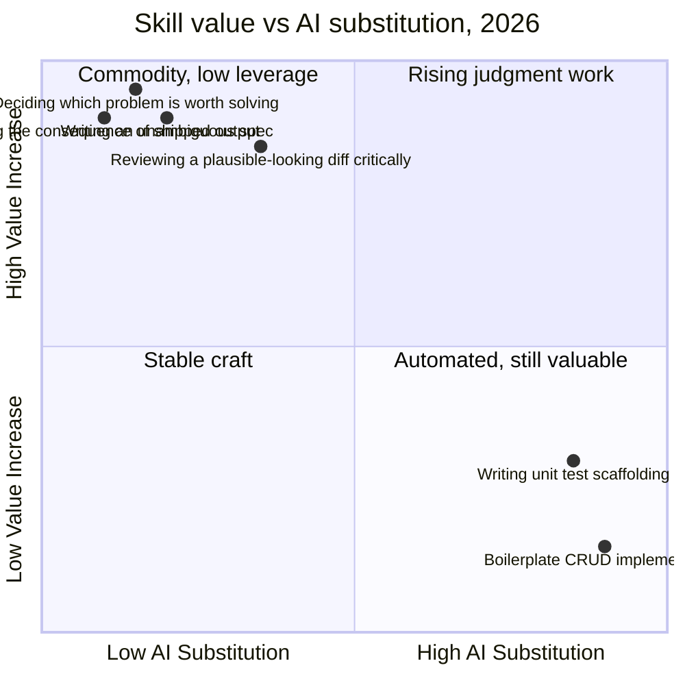

# Engineering Leadership in the AI Era

## 1. Concept Overview

By August 2026, AI-assisted coding is no longer a pilot program at most engineering
organizations — DORA's own 2025 survey puts adoption at 90% of surveyed developers using AI
in their daily work, up from roughly 76% the year before. What is far less settled is what
that adoption actually *did* to delivery performance, code quality, review load, junior
hiring, and interviewing — and this module's job is to report that honestly rather than
narrate it confidently. Some of what follows is measured in a controlled study. Some of it
is self-reported in a large voluntary survey. Some of it is a vendor's own product telemetry,
published by a company with a commercial interest in the story it tells. Each claim below is
labeled as one of those three, because conflating them is the single easiest way to turn
real evidence into a false narrative.

This module deliberately does not try to sound authoritative about a question that is still
being answered in real time. Where a company publicly changed a level definition or a
promotion bar for the AI era, it is named. Where the search for that turned up nothing, that
absence is reported as a finding, not silently dropped.

---

## 2. Intuition

> **One-line analogy**: By 2026, generating a plausible implementation is like having an
> infinitely fast intern who never sleeps, never gets embarrassed, and is occasionally,
> confidently, catastrophically wrong — the job did not stop being engineering, it moved
> from typing to supervising.

**Mental model.** Before this era, the bottleneck in most engineering orgs was writing code:
someone had to type the implementation, and everything downstream — review, test, ship —
waited on that. The bottleneck has measurably moved. GitHub's own 2025 platform data shows
commit volume up over 25% year over year while comments on those commits fell 27% — more
gets written, proportionally less of it gets looked at closely. The scarce resource in 2026
is not code generation; it is verified judgment about whether the generated code is actually
correct, and someone willing to be accountable for it.

**Why it matters.** A staff engineer's job in this environment is increasingly to be the
verification layer a team cannot otherwise afford — the person who reads a plausible diff
and can tell, from real experience with the system, whether "plausible" and "correct" have
actually converged this time. That is a different skill from writing the diff yourself, and
most engineers were never explicitly trained in it, because for most of their careers the
volume of code needing that kind of scrutiny was small enough that careful reading and
careful writing were close to the same activity.

**Key insight.** The evidence in this module points at an uncomfortable, well-corroborated
finding: AI tooling reliably makes people *feel* faster more consistently than it makes them
*measurably* faster, and the gap between those two things is exactly where a team's real
risk accumulates. Section 6.3 covers a randomized controlled trial where this gap was
directly measured, not inferred.

---

## 3. Core Principles

- **Classify every claim before you act on it: measured, reported, or contested.**
  Measured means a controlled study or platform-level telemetry with a defined methodology.
  Reported means a survey or a vendor's own analytics, self-interested or self-selected but
  still real data. Contested means a claim repeated widely with no clear underlying source,
  or a marketing claim dressed as a finding.
- **Generation got cheap; judgment did not.** The cost of producing a plausible
  implementation has fallen close to zero; the cost of knowing whether it is the *right*
  implementation has not moved, and in several measured ways has gone up.
- **Correlation in a large survey is not causation**, and the most-cited 2024 finding in
  this space (§6.2) is exactly this kind of result — real, worth taking seriously, and not
  proof that AI itself broke anything.
- **A confidently wrong answer is a worse failure mode than an obviously broken one.** Code
  that doesn't compile fails loudly and immediately; code that compiles, passes a casual
  read, and is subtly wrong fails quietly, later, and on someone else's shift.
- **Name the date on every number.** This domain moves fast enough that a 2024 finding and
  a 2025 finding on the same question can legitimately disagree, and treating either as
  permanent is a mistake this module tries hard not to make.

---

## 4. Types / Levels / Modes

Not every use of AI in a development workflow carries the same risk profile, and GitHub's
own 2025 Octoverse report frames the shift explicitly as AI moving from assistant to
contributor. Three modes, in increasing order of how much unsupervised work the tool is
doing:

| Mode | What it looks like | Review implication |
|---|---|---|
| **Assistive** | Autocomplete, inline suggestions, chat-based Q&A the engineer reads and decides whether to use | The engineer is still the author; review load is roughly unchanged from the pre-AI baseline |
| **Delegated** | An agent is given a task or issue, writes code across multiple files, and opens a complete pull request for a human to review | The human's role shifts entirely to verification of something they did not write line by line — this is where §6.6-6.7's reviewer-bottleneck evidence concentrates |
| **Autonomous** | An agent completes work with minimal or no human review before it ships | Reported as emerging and rare in mainstream engineering orgs as of 2026; treated here as a frontier case, not a norm |

GitHub reports that its own Copilot coding agent — squarely in the **delegated** mode —
authored more than one million pull requests between May and September 2025, a concrete,
platform-measured example of delegated-mode work at real scale (§7). The DORA adoption
numbers in §6.2-6.3 mostly describe assistive-mode usage; the reviewer-bottleneck data in
§6.6 is the leading edge of what happens as delegated mode becomes more common.

---

## 5. Models & Frameworks Diagrammed

The bottleneck did not disappear when generation got cheap — it relocated. §6.6 gives the
vendor-reported numbers behind the volume and review-time figures in this diagram, flagged
for what they are: real, but published by companies selling tools into this exact problem.

Every bar in this chart moved in the direction more-is-more — more PRs opened, more merged,
more tasks completed — except that review time grew nearly as fast as volume, meaning the
proportional depth of any single review did not obviously improve, and by GitHub's
independently measured comment-count data (§6.5) it went the other way.

The pattern this quadrant chart is arguing for a specific position: the skills clustering in
the upper-left — precise specification, judgment about what's worth building, critical
review, accountability — are exactly the skills this module's §6 evidence says are becoming
scarcer relative to demand, not the boilerplate work in the lower-right that AI substitutes
for cleanly.

---

## 6. How It Works — Detailed Mechanics

### 6.1 The evidence taxonomy, applied

Every source cited in this module is classified here once, so the rest of the module can
cite it by name without re-litigating its reliability each time.

| Source | Classification | Why |
|---|---|---|
| METR, "Measuring the Impact of Early-2025 AI on Experienced Open-Source Developer Productivity" (2025) | **Measured** | Randomized controlled trial — tasks randomly assigned to allow or disallow AI, the same design used in clinical trials |
| Brynjolfsson, Chandar & Chen, "Canaries in the Coal Mine?" (Stanford Digital Economy Lab, 2025, updated 2026) | **Measured** | Individual-level ADP payroll administrative data, quasi-experimental design comparing AI-exposed vs non-exposed occupations |
| GitHub Octoverse 2025 | **Measured, vendor-published** | Platform-level telemetry (actual commit, PR, comment counts), not self-report — but published by the company selling the Copilot product driving the trend |
| DORA State of DevOps / AI-assisted Software Development reports (2024, 2025) | **Reported** | Large self-reported survey (~3,000 respondents in 2024, ~5,000 in 2025), correlational by design |
| Stack Overflow Developer Survey 2025 | **Reported** | Large but self-selected voluntary online survey |
| Faros AI, CodeRabbit, CircleCI vendor analytics (2025-2026) | **Reported, vendor-interested** | Real customer telemetry, published by companies that sell tools addressing the exact problem the data describes |
| AI interview-cheating flag-rate statistics (2026) | **Reported, vendor-interested** | Interview-proctoring vendor data; the vendor has a commercial incentive to report high fraud rates |
| Shopify's April 2025 internal memo | **A verified event, not a study** | A real, publicly posted policy statement — reported here as a fact about what one company did, not as evidence about the industry |

### 6.2 DORA 2024 — the stability finding, precisely

The widely discussed headline from the 2024 DORA report (dora.dev, ~3,000 respondents) is
genuinely counterintuitive and worth stating exactly rather than in its flattened headline
form. The report's own framing, quantified against a 25-percentage-point increase in AI
adoption: an estimated **1.5% decrease in delivery throughput**, an estimated **7.2%
decrease in delivery stability**, and an estimated **2.6% decrease in time spent on valuable
work**. At the same time, over 75% of the same respondents reported individual productivity
gains from using AI, and 75.9% said they rely on AI for at least part of their daily work.

**The caveat that matters.** This is a self-reported, cross-sectional survey; the report
itself does not establish that AI adoption *causes* the stability decline, only that the two
are correlated in the data. DORA's own explanation, and the more useful lesson than the raw
number, is that AI tends to increase batch size — it makes writing more code in a single
change easier, and DORA's research has separately, repeatedly shown that larger changesets
carry more risk regardless of who or what wrote them. The mechanism proposed is not "AI
writes buggy code," it's "AI makes it easier to skip the discipline of small, reviewable
changes," which is a controllable organizational choice, not an inherent property of the
tooling.

### 6.3 DORA 2025 — the amplifier finding and the new capabilities model

The 2025 report (dora.dev, ~5,000 respondents) shifts framing substantially. Adoption is now
reported at 90%, a 14-percentage-point rise from the prior year. The report's central claim
is that **AI is an amplifier of whatever organizational strengths and weaknesses already
exist**, not a fix on its own — strong teams get measurably stronger with AI, and teams with
unclear priorities, weak testing discipline, or legacy architecture ship low-quality work
*faster*, which is a worse outcome than shipping it slowly.

The report introduces the **DORA AI Capabilities Model**, seven organizational practices it
found predictive of turning AI adoption into real gains rather than amplified dysfunction:
a clear and communicated AI stance, healthy data ecosystems, AI-accessible internal data,
strong version control practices, working in small batches, a user-centric focus, and
quality internal platforms. The 2025 program also retired its long-standing four-tier
performance model (Elite/High/Medium/Low) in favor of seven team archetypes spanning
throughput, stability, product performance, and burnout — and added a fifth core metric,
**rework rate**, alongside the four familiar ones (deployment frequency, lead time for
changes, change failure rate, and failed-deployment recovery time), specifically to capture
the kind of quality erosion that a pure speed metric would miss in an AI-accelerated
pipeline.

**Read together, 2024 and 2025 are not contradictory** — they are the same underlying
mechanism observed a year apart at different adoption levels: AI does not change whether
small-batch discipline and clear priorities matter, it changes how quickly the absence of
those things becomes visible.

### 6.4 The METR result — a rare controlled measurement, and it's counterintuitive

Most of what's known about AI's productivity effect is self-reported. METR's July 2025 study
("Measuring the Impact of Early-2025 AI on Experienced Open-Source Developer Productivity,"
arXiv:2507.09089) is a genuine exception: a randomized controlled trial, the same
methodology used in clinical drug trials, run on 16 experienced open-source developers
completing 246 real tasks in mature repositories they averaged roughly five years of prior
experience with. Each task was randomly assigned to allow or disallow the era's AI tools
(developers primarily used Cursor Pro alongside Claude 3.5 and 3.7 Sonnet).

**The finding: developers took 19% longer to complete tasks when allowed to use AI.**

**The more striking finding is the perception gap.** Before starting, developers forecast
that AI would cut their completion time by 24%. After finishing, having just lived through
tasks that were actually slower, they still estimated AI had made them about 20% faster.
The measured reality and the felt experience pointed in opposite directions, and the felt
experience did not correct itself even with the actual timing data sitting right there in
their own recent memory.

**What the study does and does not tell you.** It is one of the strongest pieces of causal
evidence in this whole module precisely because it's randomized rather than
survey-correlational — but its scope is narrow. Sixteen developers, one class of task (bug
fixes and small features in large, mature, high-familiarity codebases these specific
engineers already knew deeply), and early-2025 tooling. It says something real and important
about that specific, common scenario — an experienced engineer working in code they already
know well, where the overhead of specifying the task to an agent and then verifying its
output can exceed the overhead of just writing the fix themselves. It does not directly
establish what happens for a less-familiar codebase, a junior engineer, or a purely
greenfield task, and this module does not claim it does.

### 6.5 Stack Overflow 2025 — adoption up, trust down, both real

Stack Overflow's 2025 Developer Survey reports **84% of developers use or plan to use AI
tools**, up from 76% in 2024. In the same survey, **46% say they don't trust the accuracy of
AI tool output**, up sharply from 31% the year before; only 29% report trusting it at all
(down 11 percentage points from 2024), and just 3% report "highly" trusting it. Forty-five
percent say debugging AI-generated code takes longer than writing it themselves would have,
and 66% say AI solutions are frequently "close, but ultimately miss the mark." When asked
why they'd still turn to a human over AI for a coding question, 75.3% cited not trusting
AI's answers, 61.7% cited ethical or security concerns about the code, and 61.3% said they
wanted to fully understand the code themselves.

**Read against §6.4**, this is not a contradiction — it's the same phenomenon from a
different angle. Developers are adopting the tools at a high and rising rate while, in
growing numbers, not believing the output is reliable — which is a rational response to
"close, but ultimately miss the mark" being a common experience, not a sign that the survey
respondents are confused about their own workflow.

### 6.6 GitHub Octoverse 2025 — measured platform data on volume and review

GitHub's own 2025 Octoverse report is the closest thing in this module to a hard,
platform-measured (not self-reported) data point, published by the company most directly
positioned to benefit from a rosy AI-adoption narrative — read the numbers on their own
terms rather than the framing GitHub puts around them. Developers pushed **nearly 1 billion
commits in 2025, up 25.1% year over year**, with a single-month record of roughly 100
million commits in August. Pull request merges averaged **43.2 million a month, up 23% year
over year**. In the same period, **comments on commits fell 27% year over year** — more
code changed hands, and proportionally less of it drew a written response from another
human. GitHub's own Copilot coding agent authored **over one million pull requests between
May and September 2025** — real, platform-counted evidence of delegated-mode adoption at
scale (§4).

The report separately flags a security signal worth naming precisely: **Broken Access
Control overtook Injection as the most common vulnerability class flagged on GitHub, found
in over 151,000 repositories, a 172% year-over-year increase** — GitHub's own explanation is
that AI-generated code scaffolds frequently produce endpoints that look structurally correct
while omitting the authentication check that would have caught the class of bug, which is a
direct, concrete instance of the "confidently wrong rather than obviously broken" failure
mode this module keeps returning to.

### 6.7 The reviewer bottleneck — vendor-reported magnitude, independently corroborated direction

Faros AI, an engineering-analytics vendor, reports from telemetry across more than 10,000
developers that teams with high AI adoption completed 21% more tasks and merged 98% more
pull requests than baseline teams — but PR review time rose 91% over the same period, and
PRs grew larger. CodeRabbit, an AI code-review vendor, reports that AI-written code surfaces
roughly 1.7 times more flagged issues per review than human-written code in its own
telemetry. CircleCI's 2026 data shows feature-branch throughput up 59% year over year while
main-branch throughput for the median team was flat or falling — work is being produced
faster than it is being safely integrated.

**Treat the exact magnitudes with real caution — these are all vendors whose products are
sold as the fix for exactly the problem their own data describes.** What is not merely a
vendor claim is the *direction*: it agrees with GitHub's own independently measured -27%
comment-count figure in §6.6 and with the DORA 2024/2025 findings in §6.2-6.3. Three
differently-motivated, differently-methodologied sources converging on "review did not scale
with generation" is a stronger basis for believing the direction of the effect than any one
of them alone, even while none of the specific percentages should be treated as precise.

### 6.8 The verification burden — why "looks right" is worse than "doesn't compile"

Code that fails to compile fails immediately, loudly, and cheaply — the person who wrote it
finds out in seconds, before it goes anywhere near another human's time. Code that compiles,
passes a casual skim, and is subtly wrong fails later, more expensively, and often on
someone else's shift — this is the mechanism behind §6.6's Broken Access Control statistic
and behind Stack Overflow's 45%-say-debugging-takes-longer finding. Reviewing AI-generated
output at volume means reviewing a stream of artifacts that are, by construction, optimized
to *look* plausible — a large language model is trained to produce output a human finds
convincing, which is a different objective from producing output that is actually correct,
and the gap between those two things is exactly where CodeRabbit's 1.7x issue-rate finding
and Stack Overflow's "close, but ultimately miss the mark" finding both live.

**Weak version — a review comment on AI-generated code**

> LGTM, looks reasonable.

**Strong version — the same PR, actually verified**

> This handles the happy path correctly, but the retry logic in `processPayment` retries on
> every exception type including `ValidationError`, which means a permanently invalid
> request gets retried 3 times before failing — that's 3x the load on the payment gateway
> for something that will never succeed. Also: I don't see a test for the retry-exhaustion
> path. Can you narrow the catch to the specific transient-failure types and add that test
> before I approve?

**What changed:** "LGTM" is exactly the rubber-stamp failure mode §6.6's data is describing
at scale — it costs the reviewer nothing to write and provides no actual verification. The
strong version required the reviewer to trace a specific execution path, reason about a
concrete consequence (3x gateway load), and check for a specific missing test — the kind of
work that does not get cheaper just because the code under review was generated quickly.

### 6.9 What it changed about the junior pipeline — honestly, both sides

This is genuinely contested territory, and the strongest evidence available points at a real
and troubling effect while several plausible counter-mechanisms remain largely unmeasured.

**The measured, quasi-causal evidence.** Erik Brynjolfsson, Bharat Chandar, and Ruyu Chen
(Stanford Digital Economy Lab), in "Canaries in the Coal Mine? Six Facts about the Recent
Employment Effects of Artificial Intelligence" (first released August 2025, updated August
2026), analyzed individual-level ADP payroll administrative data — not a survey — and found
employment for workers aged 22-25 in the *most AI-exposed* occupations fell to a level 19%
below where it would have been had it tracked their less-exposed peers, as of the August
2026 update (the original August 2025 release had reported 13%; the gap widened over the
following year). Experienced workers in the same occupations show no comparable gap. The
effect is concentrated specifically in occupations where AI usage *substitutes* for tasks
rather than complements them, and operates mainly through reduced hiring of young workers
rather than through increased layoffs of existing ones — this design, comparing exposed to
non-exposed occupations over the same time period, is the closest thing in the labor-market
literature to a controlled comparison, which is why it carries more weight here than a
simple before/after job-posting count.

**The reported, less rigorous evidence, all pointing the same direction.** SignalFire's
State of Talent Report 2026 states entry-level hiring at a named set of major technology
employers (Alphabet, Meta, Apple, Amazon, Microsoft, Netflix, Nvidia, Tesla, Uber, Airbnb,
Block, and Stripe) is down 65% since 2019, and that new-role starts for candidates with
under one year of post-graduate experience fell 50% between 2019 and 2024. It is widely
reported, without a single precisely pinned source this module could independently verify to
its own confidence bar, that entry-level software postings fell roughly 60-67% between 2023
and 2024, and that Google and Meta are each hiring roughly half as many new graduates as in
2021; Salesforce is widely reported to have paused junior hiring for 2025. Treat the exact
percentages in this paragraph as directionally consistent with the Brynjolfsson et al.
finding but individually less rigorously sourced.

**The honest counter-signal.** Some reporting from early 2026 describes several large
enterprise technology employers increasing junior hiring again, and the plausible
counter-argument — that juniors today simply start further up the skill ladder, doing work
that used to be reserved for a year-two engineer, because the truly rote onboarding tasks
are now automated — is a real hypothesis worth taking seriously. **What this module can
honestly say is that this counter-argument is plausible and not, as of today, backed by
comparable measured evidence.** The Brynjolfsson et al. data measures a hiring effect, not a
skill-trajectory effect; nobody has yet published a comparably rigorous study of what
today's hired juniors are actually doing differently, or how fast they're actually
progressing, relative to a pre-AI cohort. Report the hiring numbers as real; treat the
"they start higher" story as an open, unmeasured question, not a settled counterpoint.

### 6.10 Behavioural interviews in 2026 — briefly, cross-referenced

The companion module, [Behavioural Interview Systems §6.9](../behavioral_interview_systems/behavioral_interview_systems.md),
covers this in depth; the summary relevant here: one widely cited 2026 industry analysis
(covering roughly 19,000+ monitored interviews between July 2025 and January 2026) reported
an overall AI-cheating flag rate around 38.5%, reaching roughly 48% in technical roles, with
the flag rate roughly tripling over the second half of 2025 — reported, vendor-sourced data
from an interview-integrity company with a direct commercial interest in a high number, and
treated here as directionally credible but not precisely reliable. The reported employer
response includes Google, McKinsey, Deloitte, and Cisco each reinstating some form of
mandatory in-person interviewing specifically to counter this, alongside a broader reported
trend of in-person interview requests rising from roughly 5% of roles in 2024 to roughly 30%
in 2025. The mechanism connects directly to this module's core finding: as AI makes a
fluent, structurally polished, *plausible-sounding* answer nearly free to produce — in an
interview exactly as in a pull request — the premium shifts toward whatever cannot be
cheaply generated: live, specific, unrehearsable detail recalled under real-time follow-up.

### 6.11 Ladders rewritten — what was found, and the honest gap

**A direct search for a company that publicly rewrote its formal engineering ladder — new
scope, ambiguity, or autonomy definitions specifically for the AI era — did not turn up a
verifiable example.** That absence is reported here as a finding rather than silently
dropped: as of this module's writing, no major technology employer appears to have published
a revised, named-level ladder document explicitly reworking what "senior" or "staff" scope
means in response to AI. Several third-party blogs and career-coaching sites describe
informal "AI engineer" ladders (junior/mid/senior/staff/principal, mapped to LLM-specific
skills), but none of these are a company revising its *own* general engineering ladder — they
are new, parallel job-family frameworks for a specialized AI-engineering role, a different
thing.

**The closest verified, real example is not a ladder rewrite, and should not be reported as
one.** In April 2025, Shopify CEO Tobi Lütke posted an internal company memo publicly on X,
titled to the effect of "reflexive AI usage is now a baseline expectation" at Shopify. The
memo states, in Lütke's own words, that using AI reflexively — the way one reaches for a
search engine, as a first move rather than a deliberated choice — is now a baseline
expectation; that AI usage would be incorporated into performance and peer reviews; and that
before requesting additional headcount, a team must demonstrate why the work cannot be done
with AI instead. This is real, public, and dated — but it is a **performance-expectation and
resourcing-policy change**, not a rewritten ladder with new scope, ambiguity, or autonomy
definitions at each level. Reporting it as "Shopify rewrote its ladder for the AI era" would
overstate what actually happened; reporting it as "one major company tied AI usage
explicitly to performance evaluation and headcount decisions in 2025" is what the evidence
actually supports.

### 6.12 The spec as the differentiating artifact

If §6.8's verification burden is the cost side of this module's argument, the spec is the
other half: a delegated-mode agent (§4) only produces work worth reviewing if the task it
was given was precise enough to execute against in the first place. An ambiguous spec fed to
a fast, literal executor does not produce a slower, more thoughtful clarifying question the
way a confused junior engineer might — it produces a fast, confident, wrong answer to the
wrong question, which is then the artifact a human has to catch in review. Writing a spec
precisely enough that either a machine or a person could execute it without guessing is not
a new skill this era invented, but it is a skill whose cost of *not* having it went up
sharply, because the downstream executor no longer pauses to ask.

**Weak version — a spec written for execution**

> We should improve the checkout flow's error handling, it's been a bit flaky and customers
> have complained. Take a pass at making it more robust.

**Strong version — the same request, written to be executed**

> When the payment gateway times out (>3s, currently ~2% of checkout attempts per last
> month's logs), the checkout flow should retry once with the idempotency key already
> generated for the request, then surface a specific "payment provider is slow, your card
> has not been charged" message rather than a generic error — verified against gateway
> response codes 504 and 599 specifically, not a blanket catch-all. Do not retry on a 402 or
> 403; those are correctly-rejected charges and a retry would double-charge. Add a test for
> each of the three response codes.

**What changed:** the weak version hands a plausible-sounding executor — human or AI — an
open license to interpret "more robust" however it likes, and any resulting implementation
will look reasonable without anyone being able to check it against the actual intent. The
strong version names the specific trigger condition with a real number, the specific
mechanism, the specific message, the specific codes that must NOT be retried (the
double-charge risk named explicitly), and the specific tests that would prove it — leaving
no ambiguity for either kind of executor to confidently fill in the wrong way.

---

## 7. Real-World Examples

- **Shopify's April 2025 memo** (§6.11) is the clearest example in this module of a company
  making its AI expectations explicit, dated, and public, rather than leaving them as an
  unstated cultural drift — whatever one thinks of the policy, the explicitness itself is
  worth naming as a real organizational choice other companies mostly have not made public.
- **GitHub's Copilot coding agent**, having authored over one million pull requests between
  May and September 2025, is a concrete, platform-counted instance of delegated-mode AI
  adoption operating at real scale rather than as a pilot — the reviewer-bottleneck data in
  §6.6-6.7 describes exactly the downstream consequence of work at this volume.
- **Google and McKinsey reinstating mandatory in-person interview rounds** (§6.10) in 2025-
  2026, per reporting including *The Wall Street Journal*, is a named, dated, verifiable
  organizational response to AI's effect on the *candidate* side of the hiring loop — the
  mirror image of this module's employer-side findings about code review.
- **Salesforce's own engineering blog** ("Scaling Code Reviews: Adapting to a Surge in
  AI-Generated Code," engineering.salesforce.com) is a primary-source account, from the
  company itself rather than a third-party vendor, of one real organization explicitly
  restructuring its review process in response to the same volume-vs-capacity mismatch
  described in §6.6 — a useful example specifically because it is the company describing
  its own practice rather than a vendor selling a fix.

---

## 8. Tradeoffs

| Adoption mode | Individual productivity (reported) | Delivery stability (reported, DORA) | Review load (measured + vendor-reported) |
|---|---|---|---|
| **Assistive** (autocomplete, chat) | High reported gains (DORA 2024/2025, Stack Overflow) | Least implicated in the 2024 stability finding — batch size changes less | Closest to pre-AI baseline |
| **Delegated** (agent authors full PRs) | Highest reported task-completion gains (Faros AI: +21% tasks) | Most exposed to the 2024/2025 batch-size and amplifier findings | Sharpest measured increase — Faros AI +91% review time, GitHub -27% comment depth |
| **Autonomous** (minimal human review) | Reported as fastest, least verified | Untested at scale in the sources this module could verify | Effectively externalizes verification onto whoever discovers the failure downstream |

**The honest tension.** Every mode that increases reported individual speed also increases
measured or vendor-reported downstream review burden and, per DORA, correlational
instability — and the 2025 DORA finding that AI is an *amplifier* means the tradeoff is not
fixed: an organization with the seven named capabilities already in place absorbs delegated
mode far better than one without them, which is why §9 frames the decision around
organizational readiness rather than the tool itself.

---

## 9. When to Use / When NOT to Use

**Lean into delegated-mode AI coding when:** the change is in a well-tested, low-blast-radius
area of the codebase, the team already has DORA's small-batch discipline and strong
version-control practices in place (§6.3's capabilities model), and there is real reviewer
capacity budgeted for the resulting PR volume rather than assumed to appear for free.

**Be far more cautious, or stay assistive-only, when:** the code path touches
authentication, payments, or another high-blast-radius surface — §6.6's Broken Access
Control finding is precisely the failure mode this caution exists to prevent — or when the
team's review discipline and test coverage were already weak before AI arrived, because
DORA's amplifier finding says that weakness gets worse under AI, not better.

**Do not adopt a delegated-mode tool as a substitute for the underlying organizational
work.** The single clearest lesson across every measured and reported source in this module
is that AI adoption on its own does not fix a team's process; it reveals and accelerates
whatever was already there, for better and for worse.

---

## 10. Common Pitfalls

**Measuring engineers on lines of code or PR count in 2026.** Both are now trivially
inflated by a tool that can generate a large, structurally plausible diff on request — a
metric that was already a weak proxy for engineering value a decade ago is a materially
worse one now that generation cost has collapsed. GitHub's own -27%-comments-per-commit
figure (§6.6) is the visible symptom of exactly this: volume metrics kept climbing while the
signal a human actually reviewed anything carefully fell.

**Mandating an AI tool and calling it a strategy.** DORA's 2025 finding that AI is an
*amplifier*, not a fix, directly contradicts the common leadership move of rolling out a
coding assistant company-wide and treating adoption itself as the win. A team with unclear
priorities or thin test coverage that adopts a coding agent does not become a team with
clear priorities and thick test coverage — per DORA, it ships its existing weaknesses
faster, which is measurably worse than shipping them slowly.

**The reviewer who rubber-stamps.** The weak review comment in §6.8 ("LGTM, looks
reasonable") costs the reviewer nothing to produce and, at the volumes described in §6.6-6.7,
becomes structurally likely once PR volume outpaces reviewer capacity — not because any
individual reviewer became lazy, but because the math of "91% more review time needed,
reviewer headcount unchanged" resolves itself somewhere, and a shallower review per PR is
the path of least resistance. The org-level fix is not moral exhortation to reviewers; it is
the same DORA capabilities (small batches, clear ownership) that make review tractable at
any volume.

**Assuming a fluent answer is a considered one.** The same property that makes AI-generated
code look plausible before it's verified (§6.8) makes an AI-assisted interview answer sound
polished before it's probed (§6.10) — both are instances of the same underlying failure
mode, optimizing for "convincing" rather than "correct," and both require the same fix:
deliberate, deeper follow-up rather than accepting fluency as a proxy for substance.

**Treating the junior-pipeline data as settled in either direction.** Citing the
Brynjolfsson et al. finding (§6.9) as proof AI is "ending junior engineering" overstates a
real but occupation-specific, hiring-side effect into a universal claim the data does not
support; dismissing it with "juniors just start higher now" is an equally unsupported claim
in the other direction, since no comparable measured evidence for that counter-story yet
exists. The honest position, and the harder one to hold in a room full of people who want a
confident answer, is that the hiring effect is real and measured, and the trajectory
counter-effect is plausible and unmeasured.

**Weak version — a claim about AI productivity**

> AI has basically made us 10x faster, everyone should be using it for everything now.

**Strong version — the same claim, properly calibrated**

> Stack Overflow's 2025 survey found 84% of developers use AI tools and productivity is
> broadly self-reported as improved, but METR's 2025 randomized trial found experienced
> developers were actually 19% slower on real tasks in codebases they knew well, and DORA's
> 2024 data found AI adoption correlated with reduced delivery stability. I'd guess we're
> seeing real gains on unfamiliar or boilerplate-heavy work and a real verification tax on
> familiar, high-stakes work — I want us to measure our own review time and defect rate
> before and after, not assume the survey numbers apply to our specific codebase.

**What changed:** the weak version treats a self-reported survey figure as a universal,
proven multiplier and offers no mechanism for being wrong. The strong version names which
specific studies say what, holds the contradictory controlled result alongside the survey
data instead of ignoring it, and proposes a way to find out what's actually true for this
specific team rather than importing someone else's number.

---

## 11. Frameworks, Books & Further Reading

| Source | What it gives you |
|---|---|
| DORA, "Accelerate State of DevOps Report" (2024) (dora.dev) | The 1.5% throughput / 7.2% stability correlational finding, in the report's own words |
| DORA, "State of AI-assisted Software Development" (2025) (dora.dev) | The amplifier framing, the 7-capability AI Capabilities Model, the retired 4-tier system, and the new 5th (rework rate) metric |
| METR, "Measuring the Impact of Early-2025 AI on Experienced Open-Source Developer Productivity" (arXiv:2507.09089, 2025) | The randomized controlled trial behind the 19%-slower / 20%-perceived-faster finding |
| Stack Overflow, "2025 Developer Survey" (survey.stackoverflow.co/2025/ai) | The adoption-up, trust-down figures in the company's own words |
| GitHub, "Octoverse 2025" (github.blog/news-insights/octoverse) | Platform-measured commit, PR, and comment-volume data; the Broken Access Control security finding |
| Erik Brynjolfsson, Bharat Chandar, Ruyu Chen, "Canaries in the Coal Mine? Six Facts about the Recent Employment Effects of Artificial Intelligence" (Stanford Digital Economy Lab, 2025, updated 2026) | The quasi-causal evidence on young-worker employment in AI-exposed occupations |
| SignalFire, "State of Talent Report" (2026) | Named-company entry-level hiring figures (venture-firm-published, reported not measured) |
| Salesforce Engineering, "Scaling Code Reviews: Adapting to a Surge in AI-Generated Code" (engineering.salesforce.com) | A real company's own account of restructuring review process for AI-generated volume |

Related modules in this section:
[Behavioural Interview Systems](../behavioral_interview_systems/behavioral_interview_systems.md),
[Interviewing as the Interviewer](../interviewing_as_the_interviewer/interviewing_as_the_interviewer.md),
[Design Docs, RFCs & ADRs](../design_docs_rfcs_and_adrs/design_docs_rfcs_and_adrs.md).

---

## 12. Interview Questions with Answers

**Q: What did the 2024 DORA report actually find about AI adoption and delivery stability — in exact numbers, not the headline version?**
**Short:** A 25pp adoption rise correlated with a 7.2% estimated drop in delivery stability.
DORA's own framing: a 25-percentage-point increase in AI adoption is associated with an
estimated 1.5% decrease in delivery throughput, a 7.2% decrease in delivery stability, and a
2.6% decrease in time spent on valuable work — while over 75% of the same self-reported
respondents said AI improved their individual productivity. It's a correlational finding
from a roughly 3,000-person survey, not a controlled experiment, and DORA's own proposed
mechanism is that AI increases batch size, and larger batches have always carried more risk
in DORA's data — the tooling isn't inherently the problem, skipping small-batch discipline
is.

**Q: How does the 2025 DORA report's framing differ from 2024's, and what is the "AI Capabilities Model"?**
**Short:** AI is framed as an amplifier; 7 named practices predict whether it helps or hurts.
The 2025 report (~5,000 respondents, 90% adoption, up 14pp) argues AI amplifies whatever
organizational strengths and weaknesses already exist rather than fixing anything on its
own — strong teams get stronger, weak teams ship low-quality work faster. It names seven
predictive capabilities: a clear AI stance, healthy data ecosystems, AI-accessible internal
data, strong version control, small batches, a user-centric focus, and quality internal
platforms, and it retired the old four-tier (Elite/High/Medium/Low) model for seven team
archetypes plus a new fifth core metric, rework rate.

**Q: What did METR's 2025 randomized controlled trial find, and why does the methodology matter here?**
**Short:** Experienced devs were 19% slower with AI tools, despite believing they were faster.
Sixteen experienced open-source developers completed 246 real tasks in codebases they
averaged five years of experience with, each task randomly assigned to allow or disallow
early-2025 AI tools (mainly Cursor Pro with Claude 3.5/3.7 Sonnet). Measured completion time
was 19% *slower* with AI allowed — yet developers had forecast a 24% speedup beforehand and,
after finishing, still estimated a 20% speedup had actually occurred. It matters because
this is a randomized trial, not a survey, making it one of the few genuinely causal data
points in a field otherwise dominated by self-report.

**Q: Why is the METR finding not a blanket claim that "AI slows everyone down"?**
**Short:** It measured one narrow, common case: experienced devs, familiar mature codebases.
The study's scope was specific — 16 experienced developers, tasks in large mature
repositories they already knew deeply, early-2025 tooling. It says something real about that
exact scenario, where the overhead of specifying a task to an agent and verifying its output
can exceed just writing the fix yourself. It does not directly measure unfamiliar
codebases, junior engineers, or greenfield work, and treating it as a universal verdict on
AI coding tools overstates what a 16-person, single-vintage study can establish.

**Q: What does the Stack Overflow 2025 survey say about the relationship between AI adoption and trust?**
**Short:** Adoption hit 84% while distrust of AI accuracy rose to 46%, both up sharply.
84% of developers report using or planning to use AI tools, up from 76% in 2024, while 46%
say they don't trust the accuracy of AI output, up from 31% — only 29% report trusting it at
all, down 11 points, and just 3% "highly" trust it. Sixty-six percent say AI solutions are
often "close, but ultimately miss the mark," and 45% say debugging AI-generated code takes
longer than writing it themselves would have — adoption and skepticism are rising together,
not trading off against each other.

**Q: What did GitHub's Octoverse 2025 report measure about code review specifically, and why is this data different in kind from the DORA and Stack Overflow figures?**
**Short:** Commits rose 25% while comments on them fell 27% — platform-measured, not self-reported.
Unlike DORA and Stack Overflow, which are surveys, Octoverse reports GitHub's own platform
telemetry: nearly 1 billion commits pushed in 2025 (+25.1% YoY) against a 27% year-over-year
drop in comments on those commits, and 43.2 million average monthly PR merges (+23% YoY).
It's measured rather than self-reported, though it's worth noting GitHub also sells the
Copilot product driving much of this trend, so the framing GitHub puts around the numbers
deserves the same scrutiny even though the raw counts are real.

**Q: What is Broken Access Control's rise in GitHub's 2025 security data, and why is it a good example of the "confidently wrong" failure mode?**
**Short:** It overtook Injection as GitHub's top flagged vulnerability, up 172% YoY.
GitHub's 2025 report found Broken Access Control flagged in over 151,000 repositories, a
172% year-over-year increase, overtaking Injection as the most common vulnerability class —
GitHub's own explanation is that AI-generated code scaffolds frequently produce endpoints
that look structurally correct while quietly omitting the authentication check, which is the
precise shape of a confidently-wrong failure: it passes a casual read and fails only once
something exploits the missing check.

**Q: How reliable are the vendor-reported "reviewer bottleneck" numbers (Faros AI, CodeRabbit, CircleCI), and how should they be used?**
**Short:** Treat exact numbers with caution — all three vendors sell fixes for what they report.
Faros AI reports 91% higher review time and 98% more merged PRs on high-AI-adoption teams;
CodeRabbit reports AI-written code surfaces 1.7x more flagged issues; CircleCI reports
feature-branch throughput up 59% YoY against flat main-branch throughput. All three are
vendors selling tools that address exactly the problem their own telemetry describes, so the
specific magnitudes deserve real skepticism — but the *direction* is independently
corroborated by GitHub's own -27% comment-count figure and by DORA's correlational findings,
which is a stronger basis for believing the trend than any single vendor's number alone.

**Q: What is "the verification burden," and why is it a different problem than the review load engineers had before AI?**
**Short:** Reviewing output optimized to look plausible, not necessarily to be correct.
An AI system is trained to produce output a human finds convincing, which is a different
objective from producing output that is actually correct — reviewing at volume means reading
a stream of artifacts specifically likely to pass a casual skim whether or not they're right.
Code that doesn't compile fails immediately and cheaply; code that compiles, looks
reasonable, and is subtly wrong (like the Broken Access Control pattern above) fails later,
more expensively, and often on someone else's shift — which is why "looks right" is a worse
failure mode than "doesn't compile," not a better one.

**Q: What does the Brynjolfsson, Chandar & Chen "Canaries in the Coal Mine" research find about junior employment, and why does its methodology carry more weight than the other junior-pipeline figures cited in this module?**
**Short:** 22-25-year-olds in AI-exposed jobs are 19% below their hiring counterfactual, per payroll data.
Using individual-level ADP payroll administrative data rather than a survey, comparing
AI-exposed to non-exposed occupations over the same period, the study found employment for
22-25-year-olds in the most AI-exposed occupations 19% below where it would be had it
tracked their less-exposed peers (August 2026 update; the original 2025 release had reported
13%), concentrated in occupations where AI substitutes for tasks rather than complements
them, operating mainly through reduced hiring rather than increased layoffs. Its
exposed-vs-non-exposed comparison design is closer to a controlled comparison than a simple
before/after count, which is why it's treated here as the strongest evidence in an otherwise
noisier body of junior-pipeline reporting.

**Q: What is the honest, unresolved counter-argument to "AI is destroying the junior pipeline," and what's actually known about it?**
**Short:** That juniors now start further up the ladder — plausible, but not yet measured.
The counter-argument is that the truly rote onboarding tasks juniors used to learn on are
now automated, so today's juniors simply start doing more advanced work sooner. It's a
real, plausible hypothesis, but as of this module's research, no comparably rigorous study
has measured what today's hired juniors actually do differently or how their skill
trajectory compares to a pre-AI cohort — the hiring-reduction effect is measured; the
"they start higher" story is unmeasured, and treating it as an equally solid counterpoint
overstates the current evidence.

**Q: Did any major company publicly rewrite its engineering ladder for the AI era, and what should you conclude if the answer is no?**
**Short:** No verified example was found — that absence is itself a real, reportable finding.
A direct search for a company publishing a revised leveling document with new scope,
ambiguity, or autonomy definitions specifically for the AI era did not turn up a verifiable
example as of this module's research — several sites describe informal parallel "AI
engineer" job-family ladders, which is a different thing from a company revising its general
engineering ladder. The honest conclusion is not that no such change exists anywhere, but
that it has not become a publicly documented, verifiable industry pattern yet, which is
worth knowing on its own.

**Q: What did Shopify's April 2025 memo actually change, and why is it inaccurate to describe it as "rewriting the ladder"?**
**Short:** It tied AI usage to performance reviews and headcount requests — not level definitions.
CEO Tobi Lütke's publicly posted internal memo declared reflexive AI usage a baseline
expectation, stated AI usage would factor into performance and peer reviews, and required
teams to justify why work couldn't be done with AI before requesting more headcount. That's
a real, dated, verifiable performance-expectation and resourcing-policy change — but it does
not touch what "senior" or "staff" scope means at any level, so describing it as a rewritten
ladder overstates the actual change; describing it as tying AI usage to performance
evaluation and headcount decisions is what actually happened.

**Q: What specifically changed about behavioural interviewing in 2026, and what's the underlying mechanism connecting it to this module's other findings?**
**Short:** AI-cheating detection rose sharply; the fix mirrors the code-review verification problem.
Reported 2026 data (vendor-sourced, treat magnitudes cautiously) put AI-cheating flag rates
around 38.5% of monitored interviews, prompting employers including Google, McKinsey,
Deloitte, and Cisco to reinstate mandatory in-person rounds. The underlying mechanism is
identical to the code-review problem in §6.8: AI makes a fluent, plausible-sounding answer
nearly free to produce, so the premium shifts to whatever can't be cheaply generated — live,
specific, unrehearsable detail recoverable only under real follow-up, whether that follow-up
is a code reviewer's question or an interviewer's probe.

**Q: What is the module's central argument for why judgment became the scarce input rather than code generation?**
**Short:** Producing a plausible implementation got cheap; knowing if it's right did not.
Every measured and reported data source in this module points the same direction: DORA's
batch-size mechanism, METR's verification-overhead result, GitHub's comment-count collapse,
and the vendor reviewer-bottleneck telemetry all describe the same underlying shift — the
cost of writing a plausible-looking diff has collapsed toward zero, while the cost of
knowing whether that diff is actually correct has not moved, and in several measured ways
has gone up. The scarce, differentiating skill in 2026 is not typing code, it's deciding
which problem is worth solving, recognizing when a plausible answer is wrong, and being
willing to own the consequence if it wasn't caught in time.

**Q: What stayed the same about engineering leadership, despite everything in this module?**
**Short:** Scope, ambiguity and autonomy still define the ladder; the postmortem is still blameless.
No evidence gathered for this module suggests the fundamental measures of seniority
changed — a promotion still turns on demonstrated scope, ambiguity, and autonomy, not on
which AI tool someone used to get there; a behavioural loop still tests whether a candidate
has actually operated at the level they claim; a postmortem is still blameless because
blame still doesn't fix systems; and a design doc is still how a nontrivial decision travels
through an organization and survives contact with people who weren't in the room when it was
made. What changed is the volume and plausibility of the raw material feeding into all of
those processes, not the processes' underlying purpose.

---

## 13. Best Practices

- Classify every AI-related claim you're about to act on as measured, reported, or
  contested before repeating it in a decision-making room — and say which one it is out
  loud.
- Track your own team's review time and defect rate before and after any AI-tooling change,
  rather than importing someone else's survey number as if it applies to your codebase.
- Treat AI adoption as an amplifier, per DORA's 2025 finding — fix unclear priorities and
  weak test coverage before rolling out delegated-mode tooling broadly, not after.
- Budget real reviewer capacity for the PR volume increase before enabling agent-authored
  pull requests at scale — the volume increase in §6.6-6.7 is not optional overhead, it is
  the direct, predictable consequence of the mode you're choosing.
- Never accept "LGTM" as a review on AI-generated code touching authentication, payments, or
  any high-blast-radius surface — trace a specific execution path and name a specific
  consequence, the way §6.8's strong-version comment does.
- Hold both the junior-pipeline hiring data and its unmeasured counter-argument in mind at
  once — neither "AI ended the junior pipeline" nor "juniors just start higher now" is fully
  supported by current evidence.
- When someone in a review or an interview produces an unusually fluent, structurally
  perfect answer, probe it the same way you would any other claim that sounds too smooth —
  fluency stopped being a reliable proxy for correctness or for lived experience the moment
  it became cheap to generate.
- Write specs precisely enough that either a machine or a person could execute them without
  asking you a clarifying question — see §10's weak/strong claim pair for what a
  properly-calibrated version of an AI claim looks like, and hold specs to the same bar.

---

## 14. Case Study

**Scenario — illustrative, not a specific reported incident.** A 40-engineer platform team
at a mid-size fintech company adopts a delegated-mode coding agent in early 2026, rolled out
company-wide with the stated goal of "doubling velocity," following the pattern of public
memos like Shopify's (§6.11) without the specific accompanying process changes.

**What happened in the first six weeks.** PR volume roughly doubled, consistent with the
range Faros AI's vendor telemetry reports for high-AI-adoption teams (§6.7). Reviewer
headcount did not change. Within a month, the team's own internal metrics — tracked
independently of any vendor dashboard — showed median time-to-first-review climbing from
roughly four hours to over a day, and a growing fraction of reviews consisted of a single
"LGTM" comment with no inline discussion, mirroring the exact pattern described in §6.6's
GitHub comment-count data.

**The incident that forced a change.** A delegated-mode PR added a new internal reporting
endpoint. It compiled cleanly, passed the existing test suite (which had no test for the new
endpoint's authorization path, because none had been written), and was approved with a
single "LGTM" after roughly ninety seconds on the reviewer's clock — timestamped in the PR
history. Two weeks later, the endpoint was found, during a routine access audit rather than
an incident, to be missing the authorization check that every comparable endpoint in the
service had. No confirmed exploitation occurred, and the team explicitly flagged this as
lucky rather than as evidence the process had been fine — precisely the same failure
pattern GitHub's own Broken Access Control finding (§6.6) describes as a systemic AI-era
trend, not a one-off mistake by one careless reviewer.

**What the team changed.** Following the postmortem — run blamelessly, per this section's
own conventions — the team did not walk back AI adoption; they applied the DORA 2025
capabilities model directly (§6.3). They capped PR size for anything touching
authentication or payment paths, regardless of whether a human or an agent authored it. They
required a named human reviewer to explicitly answer, in writing, "what execution path did
you trace and what would break it," for any PR over a defined size touching a high-
blast-radius surface — operationalizing the §6.8 weak-vs-strong review-comment distinction
as an actual PR-template checkbox rather than a norm people were expected to internalize on
their own. And they added authorization-path test coverage as a required CI gate for any
new endpoint, closing the specific gap the incident had exposed.

**The outcome, three months later.** PR volume stayed elevated relative to the pre-adoption
baseline, but median time-to-first-review on the flagged high-risk category returned close
to its original range, while the team's overall throughput on lower-risk changes remained
fast — a direct, deliberate application of DORA's small-batch and clear-ownership
capabilities rather than a rollback of the tooling itself.

**The one-line lesson.** Nothing about this scenario required rejecting AI-assisted coding;
it required treating the reviewer-capacity math in §6.6-6.7 as a real, foreseeable
constraint rather than an assumption that review would simply absorb whatever volume
generation produced — which is precisely DORA's amplifier finding, made concrete at the
scale of one team's actual incident.
