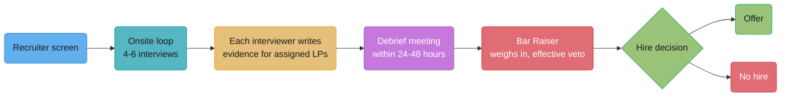
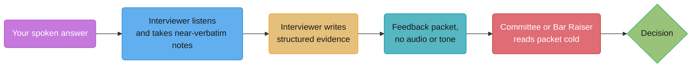
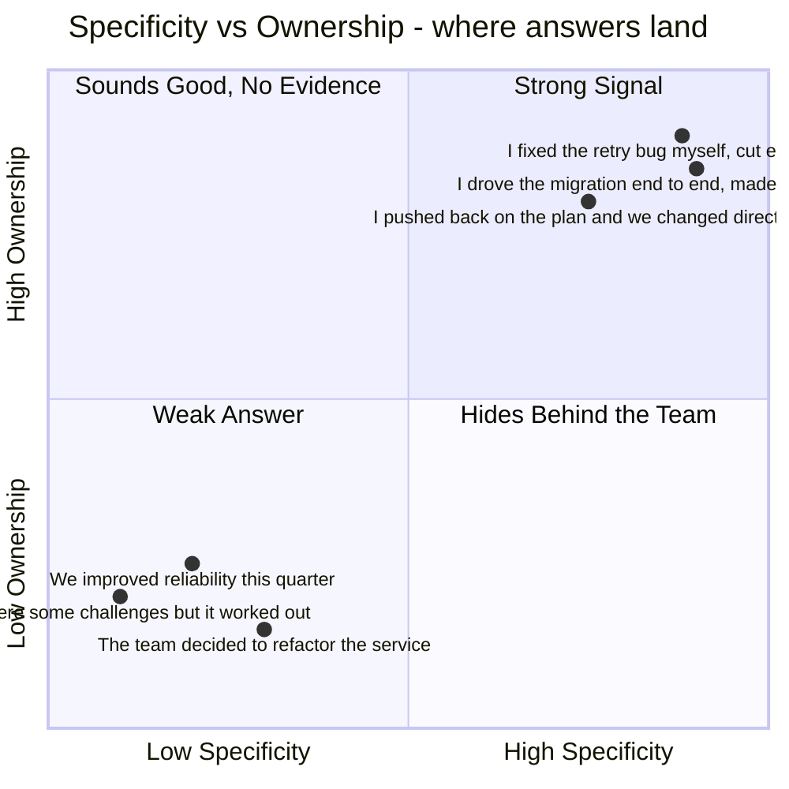

# Behavioural Interview Systems

## 1. Concept Overview

A behavioural interview loop is not a conversation, it is a scoring system with an input
(your answer), a rubric (a named framework — Leadership Principles, hiring attributes,
core values), a decision function (a debrief, a committee, a Bar Raiser), and a failure
mode (vague answers scoring badly no matter how confident they sounded). Treat each
company's loop the way you would treat an unfamiliar production system before you operate
it: read the rubric first, understand who reads your output and in what form, and only
then decide what to say.

This module goes company by company — Amazon, Google, Meta, Netflix, Stripe, Airbnb,
Microsoft, Apple — because the generic advice ("be specific," "use STAR") is true and
useless without knowing which specific rubric is scoring you in which specific room. The
companion module, [Story Portfolio & Answer Frameworks](../story_portfolio_and_star_frameworks/story_portfolio_and_star_frameworks.md),
covers how to build and deliver the answer itself; this one covers what happens to that
answer after it leaves your mouth.

---

## 2. Intuition

> **One-line analogy**: A behavioural interview is not a conversation you have with a
> person — it is a document that person writes about you, and you only get to see the
> outline once, live, from the wrong side.

**Mental model.** Every interviewer in a structured loop is holding a rubric they did not
write and cannot deviate from very far. Their job is not to decide whether they like you;
it is to collect enough specific evidence, against specific named criteria, to write a
defensible document that other people who never met you will read and act on. An answer
that would charm a friend at a bar and an answer that survives being copied verbatim into
a hiring packet are different answers, and the second one is the only one that counts.

**Why it matters.** The single biggest miscalibration candidates walk in with is treating
the interviewer as the audience. The interviewer is a court reporter. The actual audience
is a Bar Raiser reading a written LP writeup two days later, or a hiring committee reading
a packet with your name attached to four other people's notes, none of whom were in the
room. If your answer only makes sense with your tone of voice and your face doing half the
work, it dies the moment it becomes twelve lines of someone else's typed notes.

**Key insight.** The follow-up probe — "what was your specific contribution," "what would
you do differently," "what data did you have" — is not politeness or curiosity. It is the
actual test. A rehearsed answer survives the first thirty seconds; it does not survive
three layers of "and then what did you specifically do." Interviewers who are good at
this job ask the surface-level question, listen to the surface-level answer, and then
spend the rest of the time trying to find the floor underneath it.

---

## 3. Core Principles

- **You are not being remembered, you are being transcribed.** Assume every sentence you
  say might be typed, in something close to your own words, into a document someone else
  will read cold.
- **The rubric came first, your story came second.** The interviewer is not discovering
  whether you're a good engineer; they are checking boxes against criteria fixed months
  before you walked in. Speak to the box, not around it.
- **"We" is not evidence of anything.** A rubric scores individual behaviour. Every
  sentence that hides your specific action behind a team pronoun is a sentence the
  interviewer cannot use as evidence for or against you, and an interviewer who cannot
  use a sentence writes it down as a gap, not a neutral.
- **The probe is not adversarial, it is structural.** Interviewers are trained to keep
  pulling until they hit either real detail or the bottom of the story. Treat every
  follow-up as an invitation to give the detail you should have led with.
- **A polished answer and a scored answer are different targets.** Polish reads well out
  loud. Score comes from specificity, first-person ownership, a number, a real conflict,
  and a real "what I'd do differently" — four things that have nothing to do with how
  smoothly the sentences flow.

---

## 4. Types / Levels / Modes

Not every behavioural round is testing the same thing, even when the questions sound
identical across companies.

| Mode | What is actually being scored | Companies that run it this way |
|------|-------------------------------|-------------------------------|
| **Principle-mapped** | Each interviewer is assigned specific named principles and collects evidence only against those | Amazon (Leadership Principles) |
| **Attribute-mapped** | Each interviewer owns one or two of a small fixed set of hiring attributes | Google (role-related knowledge, problem solving / cognitive ability, leadership, and a fourth cultural-fit attribute — see §6.2) |
| **Values-mapped, single dedicated round** | One round, evaluated against a short list of company values, weighted equally with technical rounds | Meta (the values-mapped round candidates informally call the "Jedi" round — see §6.3) |
| **Culture-memo mapped** | Scored less by rubric line-item and more by whether you'd pass a "would I fight to keep them" test | Netflix |
| **Operating-principle mapped** | Interviewers probe for evidence against a short published list of operating principles, usually inside a working-session or pairing round rather than a pure Q&A round | Stripe |
| **Values-as-filter, less formalised loop** | Values are real and named but the loop is less rigidly rubric-driven than Amazon's or Google's, reported as closer to a fit conversation | Airbnb |

The distinction matters because "which framework" changes what a strong answer looks
like. An answer that is airtight evidence for Amazon's "Ownership" can simultaneously be
weak evidence for Google's "Leadership" attribute, because the two rubrics are not asking
the same question even when the English words overlap.

---

## 5. Models & Frameworks Diagrammed

The Bar Raiser sits at the end of the pipeline but is trained to have formed an opinion
throughout — the box's position is chronological, not a statement that they only speak
once. See §6.1 for what an "effective veto" means in practice and what is officially
confirmed versus widely reported.

This is the mental model most candidates never form. The decision-maker in most large
loops was never in the room with you. They read a document written by someone who was.
Every ambiguity you leave in your spoken answer becomes the interviewer's problem to
resolve on paper, and they resolve it by writing down the weakest defensible reading, not
the most charitable one.

The quadrant a candidate lands in is decided almost entirely by pronoun and precision, not
by how impressive the underlying project actually was. A modest project told with "I" and
a number outscores an impressive project told with "we" and a vibe.

---

## 6. How It Works — Detailed Mechanics

### 6.1 Amazon — Leadership Principles and the Bar Raiser

Amazon publishes 16 Leadership Principles at aboutamazon.com. The current list, with each
principle's official opening framing:

| # | Principle | Official one-line framing |
|---|-----------|---------------------------|
| 1 | Customer Obsession | Leaders start with the customer and work backwards; they obsess over customers, not competitors |
| 2 | Ownership | Leaders think long term, act on behalf of the whole company, and never say "that's not my job" |
| 3 | Invent and Simplify | Leaders require innovation from their teams and always find ways to simplify |
| 4 | Are Right, A Lot | Leaders have strong judgment and good instincts; they seek diverse perspectives and work to disconfirm their own beliefs |
| 5 | Learn and Be Curious | Leaders are never done learning and act to explore new possibilities |
| 6 | Hire and Develop the Best | Leaders raise the performance bar with every hire and promotion, and take coaching seriously |
| 7 | Insist on the Highest Standards | Leaders have relentlessly high standards and ensure defects don't get sent down the line |
| 8 | Think Big | Leaders create and communicate a bold direction that inspires results |
| 9 | Bias for Action | Speed matters; most decisions are reversible and don't need extensive study |
| 10 | Frugality | Accomplish more with less; constraints breed resourcefulness |
| 11 | Earn Trust | Leaders listen attentively, speak candidly, and are vocally self-critical |
| 12 | Dive Deep | Leaders stay connected to the details, audit frequently, and are skeptical when metrics and anecdote disagree |
| 13 | Have Backbone; Disagree and Commit | Leaders respectfully challenge decisions they disagree with, then commit wholly once decided |
| 14 | Deliver Results | Leaders focus on key inputs and deliver them with the right quality, on time, despite setbacks |
| 15 | Strive to be Earth's Best Employer | Leaders create a safer, more diverse, more just work environment and lead with empathy |
| 16 | Success and Scale Bring Broad Responsibility | Leaders are humble about the secondary effects of Amazon's size and create more than they consume |

Principles 15 and 16 were added in 2021; as of this writing (2026) the list is still 16
and unchanged since. Every Amazon interviewer on a loop is assigned two to three specific
principles to probe — not the whole list — and writes evidence only against those. This
is why the same story told to two different Amazon interviewers can produce two
completely different writeups: one interviewer is listening for "Ownership," the other
for "Dive Deep," and the same eight minutes of talking gets filtered through two different
rubrics simultaneously.

**The Bar Raiser.** Amazon's own public description (aboutamazon.com) frames the Bar
Raiser as an objective third-party adviser, deliberately from outside the hiring team, who
is a trained steward of the 16 principles and who leads the post-loop debrief. The
official standard, in Amazon's own words: every person hired should be better than 50
percent of those currently in similar roles — the program exists to keep raising that bar
with every hire rather than merely maintaining it, which is also why the earlier internal
name ("Bar Keeper," from Amazon's original 1999 rollout) was changed to "Bar Raiser."
There are reportedly several thousand trained Bar Raisers company-wide.

**What is honestly unconfirmed:** Amazon's own public pages describe the Bar Raiser as
having outsized influence in the debrief and driving the room toward consensus, but do
not, in the sources checked for this module, state in so many words that the Bar Raiser
holds a formal, unilateral veto over the hiring manager. That specific claim — "the Bar
Raiser can block a hire regardless of every other interviewer's vote" — is extremely
widely and consistently reported across interview-prep sites and by former Amazon
recruiters, to the point that it should be treated as operationally true. Flagged here
because the contract this module is written under says: state what you verified at the
confidence you have it, and this is strong secondary consensus rather than a quoted
company statement.

**Written evidence, not impression.** Interviewers take near-verbatim notes during your
answer and submit written evidence tied to their assigned principles before the debrief
conversation happens — this is directly confirmed on Amazon's own site. That single fact
is why vague answers score badly regardless of delivery: there is no "he seemed sharp"
column on the form. If the interviewer cannot write a sentence with a specific action and
a specific outcome in it, the form has a gap, and gaps read as weak signal, not neutral
signal.

### 6.2 Google — hiring attributes, the committee, and structured interviewing

Google's own re:Work guide to structured interviewing (rework.withgoogle.com) frames
candidate evaluation around defined attributes measured consistently across interviewers,
and names role-related knowledge, problem-solving ability, and leadership explicitly. A
fourth attribute, historically called "Googleyness" and covering things like intellectual
humility, comfort with ambiguity, and bias to action, has been widely reported — including
by Google's former SVP of People Operations Laszlo Bock in his 2015 book *Work Rules!* —
as part of the same four-attribute framework (General Cognitive Ability, Role-Related
Knowledge, Leadership, Googleyness). At the time this module was written, current
interview-prep sources describe the behavioural portion of the loop as a "Googleyness and
Leadership" (G&L) round, but this module could not verify a current, official Google page
that uses the word "Googleyness" or confirms a formal renaming — treat the G&L label as
commonly reported terminology, not a quoted company statement, and treat the underlying
four-way split of what gets evaluated as reliable.

**The hiring committee.** Your interviewers do not decide whether you're hired. Each
writes a structured evaluation; a hiring committee that was not in any of your interviews
reads the packet and makes the call. The practical consequence is identical to Amazon's:
you are optimizing a document, not a rapport. A candidate who is warm and likeable in the
room but whose interviewer struggles to write concrete evidence produces a thin packet,
and thin packets do not clear committee.

**The evidence for structured interviewing itself.** Google's re:Work materials argue
structured interviews — same questions, same rubric, scored independently — outperform
free-form conversation, and this is backed by decades of published I/O psychology outside
Google as well: the most widely cited meta-analysis (Schmidt & Hunter, 1998, aggregating
85 years of personnel-selection research) found structured interviews at roughly .51
predictive validity against unstructured interviews at roughly .38; a more recent 2023
update (Sackett et al.) puts structured interview validity around .42, still near the top
of the list of studied predictors. The claim being tested in a behavioural round is
therefore not "is this a pleasant person," it's "is there specific evidence this person
has already produced the outcome we need at this level" — the entire loop exists because
that question, asked in a structured way, correlates with future performance far better
than a friendly chat does.

### 6.3 Meta — the values-mapped round and levelling

Meta's careers site (metacareers.com) publishes six current company values: Move Fast,
Build Awesome Things, Be Direct and Respect Your Colleagues, Focus on Long-Term Impact,
Live in the Future, and Meta, Metamates, Me. This supersedes the older, now-retired public
mantra "Move Fast and Break Things" — "Move Fast" survives as a value, but the "break
things" half does not appear in the current published list.

Meta runs one dedicated behavioural round, widely and informally referred to by
candidates and interview-prep sources as the "Jedi" round — a nickname, not an official
Meta term, that traces to interview-prep naming conventions (coding = "Ninja," design =
"Pirate," behavioural = "Jedi") popularised well outside Meta itself. What is reliably
reported: the round is scored on par with the coding rounds, not as a soft tiebreaker, and
it evaluates the candidate against the six values above through story-based questions,
commonly probing conflict handling, growth from failure, self-awareness, and the ability
to drive results without direct authority.

**E5 vs E6 expectations.** The same behavioural round asks similar questions at both
levels, but the bar for what counts as sufficient evidence moves. E5 (senior) evidence
typically centers on cultural fit and demonstrated leadership potential inside a single
team or a well-scoped cross-team effort. E6 (staff) evidence is expected to show
cross-functional leadership under real disagreement — driving alignment across teams with
different incentives, not just executing well inside one team's boundaries. See §6.8
below for a single story told at both levels to make this concrete.

### 6.4 Netflix, Stripe, Airbnb, Microsoft, Apple

**Netflix.** The current Netflix Culture Memo (jobs.netflix.com/culture, most recently
revised in 2024 and still the live version as of 2026) names four principles — The Dream
Team, People Over Process, Uncomfortably Exciting, and Great and Always Better — and eight
named "Dream Team" values: selflessness, judgment, candor, creativity, courage, inclusion,
curiosity, and resilience. The memo explicitly frames Netflix as a "sports team," not a
family — performance-driven, not tenure-driven. The **keeper test** — "if this person
wanted to leave for a similar role elsewhere, would I fight to keep them?" — is the
mechanism managers are told to apply continuously, and Netflix's own materials state the
belief that it is fairer to both sides to part ways quickly when the answer is no. In an
interview, this shapes what gets probed: less "tell me about a process you followed," more
"tell me about a call you made that most people wouldn't have made, and why it was
right" — evidence of judgment and candor specifically, because those are two of the eight
named values and the loop is built to test for them individually.

**Stripe.** Stripe's own careers/culture page (stripe.com/jobs/culture) publishes six
operating principles: Users First, Create with Craft and Beauty, Move with Urgency and
Focus, Collaborate Egolessly, Stay Curious, and Obsess Over Talent. Stripe's process is
widely reported to lean more heavily on a working session or pairing round than a pure
Q&A behavioural round, but the same six principles are what a behavioural answer gets
measured against when one is asked — "collaborate egolessly" in particular gets probed
directly with conflict and cross-team questions.

**Airbnb.** Airbnb is widely and consistently reported (though this module could not
independently confirm against a live official Airbnb page at time of writing) to organize
around four core values: Champion the Mission, Be a Host, Embrace the Adventure, and Be a
Cereal Entrepreneur — the last one a reference to the company's origin story of selling
election-themed cereal boxes to fund the founders' first product. Reported secondary
sources describe Airbnb's interview loop as values-real but less rigidly rubric-scored
than Amazon's or Google's, closer to an explicit "would this person thrive inside this
specific culture" conversation.

**Microsoft.** Microsoft's cultural framing under CEO Satya Nadella is built around
"growth mindset," borrowed explicitly from Carol Dweck's research and popularised inside
the company as "learn-it-all beats know-it-all" — Nadella's own, frequently repeated
phrasing since roughly 2014-2015. This is not a numbered leadership-principle list the way
Amazon's is; it is a single cultural lens applied across the loop. In practice, behavioural
questions probe for evidence of learning from a specific failure or a specific instance of
updating a strongly held technical opinion in response to new information — "know-it-all"
answers (certainty, no update, no acknowledged gap) tend to score worse than "learn-it-all"
answers even when the underlying technical judgment was correct.

**Apple.** Apple does not publish a numbered, named values list the way Amazon or Netflix
do. What is reliably known: Apple's hiring emphasizes product craft, taste, and a strong
bias toward extreme confidentiality and small, trusted teams; secondary interview-prep
sources describe a competency-based approach loosely informed by the Lominger competency
library and a public emphasis, from Tim Cook's own remarks, on collaboration, creativity,
curiosity, and expertise — but this module could not verify an official, discrete,
Amazon-LP-style rubric, and none is invented here. Treat Apple's evaluation as real but
less formally codified in public than the other companies in this list; candidates should
expect deep, specific probing on product judgment and taste rather than a named-principle
checklist.

### 6.5 What differentiates a strong loop from a weak one — the interviewer's side

Interviewers who run a lot of loops converge on the same handful of differentiators,
independent of which company's rubric they're using:

- **Specificity.** A named system, a named number, a named date beats "a project" every
  time — specificity is what turns a claim into evidence.
- **First-person ownership.** "I" describing a decision, not "we" describing an outcome.
- **Real numbers.** Before/after, scale, time, cost — anything that lets the interviewer
  write a sentence with a figure in it instead of an adjective.
- **A real conflict in a conflict question.** Not a disagreement that resolved itself in
  five minutes with no hard feelings — an actual moment where two reasonable people wanted
  different things and someone had to move.
- **A genuine "what I'd do differently."** Not false modesty bolted onto a story that was
  actually a triumph — an answer that shows the candidate has actually metabolized the
  lesson, which is different from performing humility.

### 6.6 The written debrief — what your answer becomes

This is the highest-value content in this module: a candidate's actual spoken answer,
weak and then strong, and — because the real point of this module is that your answer
stops being yours the moment you finish saying it — what each one becomes once an
interviewer has typed it into a debrief document.

**Weak version** (spoken answer to "tell me about a time you took ownership of something
outside your job description")

> We had some reliability issues on the team last year, and I think everyone kind of
> pitched in to help stabilize things. It was a tough few months but we got through it and
> things are a lot more stable now. I think it showed we're a team that takes ownership
> when things get hard.

**Strong version** (same underlying situation, spoken as a real answer)

> Our on-call load tripled in Q1 2025 because of a flaky dependency another team owned
> that nobody was actively fixing. I wrote a two-page proposal to take ownership of its
> retry logic, got sign-off from that team's lead, and rewrote the retry path myself over
> three weeks. Pages dropped from about 40 a week to about 6. The thing I'd do differently:
> I should have looped in their on-call rotation before I shipped — my change briefly broke
> their alerting, and I caught and fixed that within a day, but I should have caught it
> before it shipped, not after.

**What changed:** a number before, a number after, an unprompted individual decision, and
a real, specific mistake acknowledged and fixed — versus a sentence that could describe
almost any six-month period at almost any company.

Here is what each one becomes once it is someone else's typed notes, which is the entire
point of preferring the second version:

> **Debrief note on the weak version (Amazon, "Ownership" principle):** Candidate
> discussed a project involving service reliability improvements. Mentioned the team
> worked hard and things got better over a few months. Some ownership language used
> ("we took ownership") but no specific individual action or decision was described when
> asked to elaborate. Unable to confirm candidate's specific contribution vs. team's.
> LEANING NO HIRE on this principle — insufficient evidence.

> **Debrief note on the strong version (same principle):** Candidate identified a specific
> on-call load spike (tripled, Q1 2025) caused by another team's dependency, took
> unprompted ownership of a fix outside their own scope, got cross-team sign-off, and
> personally rewrote the retry path. Quantified outcome (~40/week to ~6/week pages),
> consistent under follow-up. Credible, specific "what I'd do differently" (should have
> looped in the other team's on-call before shipping). STRONG HIRE signal on this
> principle — clear unprompted ownership, quantified outcome, real self-correction.

Nothing the candidate said in the weak version was false. It simply gave the interviewer
nothing concrete enough to write down, and a gap on the form reads as a weak signal
whether or not the underlying work was actually good.

Two more whole-answer pairs, for the two question types §10 identifies as most commonly
sanitized into uselessness — a conflict question and a "what would you do differently"
follow-up:

**Weak version** (spoken answer to "tell me about a disagreement with your manager")

> My manager and I disagreed on a technical approach once, but we talked it through and
> found a middle ground pretty quickly. It wasn't a big deal, we work really well together.

**Strong version** (a real conflict, named)

> My manager wanted to ship a new pricing feature without a feature flag to hit a board
> deadline. I disagreed — we'd had two rollback incidents that quarter from unflagged
> changes — and told her directly that I thought the risk to revenue-critical code was
> higher than the cost of a two-day delay to add the flag. She pushed back, said the board
> deadline was firm. I asked for 24 hours to build the flag in parallel rather than instead
> of the deadline, showed her a working version the next day, and she agreed to ship with
> it. We hit the deadline with the flag in place, and when a real bug surfaced two weeks
> later, we killed it in under a minute instead of doing an emergency rollback.

**What changed:** the weak version resolves before any real stakes appear, which gives the
interviewer nothing to evaluate about how the candidate handles actual disagreement. The
strong version names a real position, a real pushback, a concrete alternative offered
instead of just an objection, and a result that shows the disagreement mattered.

**Weak version** (spoken answer to "what would you do differently?")

> Honestly, I think I handled it pretty well overall — maybe I could have communicated a
> little more, but I don't think there's much I'd really change.

**Strong version** (a real, specific lesson)

> I'd have looped in the other team's on-call rotation before shipping, not after. My
> change briefly broke their alerting the same night I deployed it, and even though I
> caught and fixed it within a day, that's a day someone on their team spent confused about
> a page they didn't expect. It was a fixable process gap, not a technical one, and it's the
> first thing I check now before any cross-team change.

**What changed:** the weak version is false modesty bolted onto a story the candidate is
still framing as a win, which reads as evasive rather than reflective. The strong version
names something the candidate actually got wrong, states its real (if small) cost to
someone else, and shows a specific, permanent change to how they now operate — which is
also, not incidentally, far harder to fabricate convincingly under a live follow-up.

### 6.7 Failure modes graders actually write down

Interviewers who write a lot of these notes develop a short mental list of red flags they
watch for, almost independent of which company's rubric they're filling in:

- **No "I," only "we."** Every sentence hides the individual's specific action.
- **No numbers anywhere.** No scale before, no scale after, no time, no cost, no count.
- **No actual conflict in a conflict question.** A story where nobody disagreed with
  anybody is not evidence of conflict-handling; it's evidence the candidate didn't
  understand the question or is avoiding the real story.
- **A three-minute Situation section.** By the time the candidate reaches an actual
  action, half the allotted time is gone and the interviewer has almost nothing to write
  under the section that actually carries the evidence.
- **A result that isn't a result.** "And then it worked out well" is not an outcome; an
  outcome has a number, a person's changed behaviour, or a decision that got made.
- **The same story reused across four different questions,** thinly reskinned. Trained
  interviewers on a panel compare notes; a candidate whose "conflict" story and "failure"
  story and "influence" story are visibly the same incident reads as having a shallow
  portfolio, which is a real, coachable problem — see the companion module's twelve-story
  portfolio for the fix.
- **Visible rehearsed cadence.** Not polish itself — polish is fine and often good — but a
  cadence so uniform across every answer that it stops sounding like recall and starts
  sounding like recitation, which triggers deeper, more skeptical follow-up rather than
  less.

### 6.8 Levelling: the same story, told twice

**Told as senior.** *"Our payments retry logic was causing duplicate charges under
partial network failures. I found the race condition — two retries could both succeed
server-side before either client saw a response — and fixed it by adding an idempotency
key generated client-side. Duplicate-charge tickets went from about 12 a week to zero over
the following month. I also added a regression test so it couldn't silently come back."*

**Told as staff.** *"Our payments retry logic was causing duplicate charges under partial
network failures — I found the specific race condition. But the harder problem was that
three other teams had each built their own retry logic with the same bug, because there
was no shared pattern. I fixed our instance, then wrote a design doc proposing a shared
idempotency-key library, pre-wired the two teams most likely to push back on adopting yet
another shared dependency, and got all four teams migrated over the following quarter.
Duplicate-charge tickets across the company, not just our team, went from roughly 50 a
week to under 5. The part I'd do differently: I should have looped in the payments
platform team before I built the library, not after — they ended up owning it, and I
redid two weeks of API design once they had opinions I could have gotten up front."*

**What changed between the two:** identical root-cause technical work in both versions.
The senior telling stops at "I fixed my team's instance." The staff telling shows the same
person noticing the problem was systemic, choosing to fix the pattern rather than the
instance, and doing the cross-team influence work described in
[Influence Without Authority](../influence_without_authority/influence_without_authority.md)
to make the fix stick company-wide. An interviewer scoring for "Think Big" or a
Staff-level "Leadership" attribute is listening specifically for the second half; a
candidate who only tells the first half at a staff-level loop reads as senior regardless
of what their resume says.

### 6.9 2026: how these loops changed in response to AI

Multiple 2026 industry analyses report a sharp rise in AI-assisted interview cheating: one
widely cited analysis of interview-integrity data (Fabric, covering roughly 19,000+
AI-monitored interviews between July 2025 and January 2026) reported an overall
AI-cheating flag rate around 38.5%, reaching roughly 48% in technical roles, with the flag
rate roughly tripling over the second half of 2025. Reported mechanisms include real-time
answer generation via screen overlays, pre-interview "fluency coaching" using LLMs, and,
per multiple 2026 reports, covert audio feeds through earpieces or paired devices. These
figures come from industry vendor analyses and journalism, not peer-reviewed academic
research — treat the specific percentages as reported-but-not-independently-verified, and
the underlying trend (a real, material rise) as well corroborated across multiple
independent sources.

The reported response from employers, per 2026 reporting: a documented shift back toward
mandatory in-person or onsite rounds at major employers (Google and McKinsey were both
named in Wall Street Journal coverage cited in this research as reinstating in-person
requirements specifically to counter AI-assisted remote cheating), and — more relevant to
this module — a shift in *how* interviewers run the same behavioural rounds: more layered,
live follow-up probing rather than accepting a fluent first answer, and more weight on the
kind of unrehearsable specificity this module has been describing throughout (an exact
number recalled under pressure, a genuine "what I'd do differently" that isn't a stock
phrase, consistency of small details across three separate follow-ups). The practical
takeaway for a candidate preparing honestly is unaffected by any of this — the same
specificity and ownership that beats a weak human-written answer is also, as a side
effect, the thing that is hardest to fake — but the *margin for a vague answer* has
shrunk, because interviewers are now actively trained to probe past exactly the kind of
fluent-but-empty answer an LLM produces by default.

---

## 7. Real-World Examples

- **Amazon's Bar Raiser program** started in 1999 as the "Bar Keeper" program and was
  renamed within the company specifically because "keeper" implied maintaining a
  standard, not raising one — the name change is itself a piece of evidence for how
  seriously the company treats the underlying incentive design.
- **Google's re:Work initiative** publishes its structured-interviewing guidance publicly,
  a deliberate choice to open-source internal hiring research rather than keep it as
  competitive advantage — the guide is used directly by other companies building their own
  loops, which is part of why "Amazon-style" and "Google-style" rubrics now look similar
  in structure even though the specific criteria differ.
- **Netflix's 2024 Culture Memo rewrite** was produced after collecting more than 1,500
  points of employee feedback over roughly a year and cut the document down to
  approximately 2,264 words — a deliberate, documented editorial choice to make the memo
  short enough that a manager could actually apply it in the room, not just cite it.
- **Meta's internal "Jedi/Ninja/Pirate" naming convention** for interview rounds is not an
  official company taxonomy — it is candidate- and prep-industry slang that predates and
  outlives any one company's actual round names, which is itself a useful lesson: the
  informal name candidates use for a round is not always the framework actually scoring
  it, and conflating the two is a common preparation mistake.

---

## 8. Tradeoffs

| Approach to loop design | Consistency across interviewers | Candidate cognitive load | False-negative risk (good candidate scored badly) |
|---|---|---|---|
| Principle/attribute-mapped, one interviewer per principle (Amazon, Google) | High — each rubric line gets dedicated, trained attention | High — candidate must hit many distinct criteria across many rounds | Lower for candidates who prepare against the specific rubric; higher for candidates who don't know it exists |
| Single dedicated values round, equal weight to technical (Meta) | Medium — one interviewer, one rubric, less cross-checking | Medium — one round to get right, but it counts as much as a coding round | Higher — one bad interviewer-candidate pairing has outsized effect since there's no second data point |
| Culture-memo/keeper-test framing (Netflix) | Lower formal consistency, higher manager judgment | Lower — fewer named criteria to prepare against explicitly | Higher variance by manager, since the test is closer to "would I fight to keep this person" than a scored rubric |
| Less formally rubric-driven, values-as-filter (reported pattern at Airbnb) | Lowest of this set | Lowest — feels more like a real conversation | Hardest to calibrate across interviewers, but arguably lower false-negative risk for candidates who interview well conversationally |

The honest tradeoff is between predictive validity and candidate experience. The
research cited in §6.2 is unambiguous that more structure produces better hiring
outcomes on average — but it also produces a harder, more legible-if-you-know-the-rubric,
worse-if-you-don't game, which is exactly why this module exists.

---

## 9. When to Use / When NOT to Use

**Prepare against the specific company's named rubric when:** you have an onsite loop at
Amazon, Google, Meta, Netflix, or Stripe — all five publish or reliably leak enough of
their actual rubric that generic "STAR prep" without company-specific mapping leaves real
points on the table.

**Prepare more generally, around specificity and ownership rather than a named list,
when:** the company has no publicly documented framework (most startups, and, per this
module's honest assessment, Apple) — in that case, over-fitting to a framework you
invented for a company that doesn't use one wastes prep time that would be better spent on
the twelve-story portfolio in the companion module.

**Do not treat rubric-matching as a substitute for having real stories.** A candidate who
has memorized which words map to which Amazon Leadership Principle but has no specific,
first-person, numbered story to tell will produce exactly the weak debrief note in §6.6 —
knowing the rubric only helps once you have evidence to put against it.

---

## 10. Common Pitfalls

**Answering the interviewer instead of the transcript.** A candidate at a large cloud
provider gave charismatic, warm, well-received answers in the room — the interviewer
visibly enjoyed the conversation. The written evaluation, produced an hour later from
memory, contained almost no specific detail, because the candidate's stories relied
heavily on tone and shared laughter that does not survive being typed. Feedback came back
"LEANING NO HIRE — pleasant conversation, insufficient specific evidence." The candidate
was rejected and, per a later debrief with a friend on the panel, never understood why,
because the room had genuinely gone well.

**Treating the Bar Raiser as just another interviewer.** A candidate at Amazon gave their
strongest, most detailed answers to the technical interviewers and visibly relaxed effort
for what they assumed was a "culture fit chat" with the Bar Raiser late in the day. The Bar
Raiser's writeup — carrying outsized weight in the debrief per §6.1 — was the thinnest in
the packet. The candidate did not get an offer despite four strong technical writeups,
because the Bar Raiser's role in the room is not lower-stakes than a technical round, it
is differently-stakes.

**Reusing one story across the whole loop with light reskinning.** A candidate told
functionally the same "I fixed a production incident" story for "tell me about a
conflict," "tell me about a failure," and "tell me about a time you influenced without
authority," changing only which sentence got emphasized. Two interviewers on the panel
compared notes at debrief and independently flagged that the stories sounded like the same
incident — which they were — and the packet read as "one good story, unclear if this
candidate has more than one," a specific and damaging note that a genuinely deeper
portfolio would have avoided entirely.

**Sanitizing the conflict out of a conflict question.** Asked to describe a disagreement
with a manager, a candidate described a scenario that resolved itself amicably within
minutes with no real friction — technically responsive to the question, but useless as
evidence, because nothing about it demonstrated how the candidate handles actual
disagreement under actual stakes. The interviewer's note: "candidate avoided describing
real conflict — reask or discount this answer." A second, harder follow-up in the same
interview produced a much more useful (and much less comfortable to tell) real story,
which scored well — the lesson landing on the candidate afterward was that avoiding
discomfort in the answer costs more than the discomfort of telling the real story would
have.

**Over-trusting AI-polished prep in 2026.** A candidate who had heavily rehearsed
LLM-generated, fluent answers gave a confident opening thirty seconds on each question and
then visibly struggled the moment the interviewer asked a specific follow-up the
rehearsed answer hadn't anticipated — a symptom the 2026 wave of deeper live probing
(§6.9) is specifically designed to surface. The fix is not avoiding preparation tools; it
is preparing the underlying facts and decisions (per the companion module's §6) rather
than a fixed script, so that a follow-up produces more true detail instead of visible
recalculation.

---

## 11. Frameworks, Books & Further Reading

| Source | What it gives you |
|--------|--------------------|
| aboutamazon.com, "Amazon's Leadership Principles" | The current, official 16-principle list and wording |
| aboutamazon.com / aboutamazon.eu, "What is an Amazon bar raiser?" | Official framing of the Bar Raiser role, the "better than 50%" standard, the debrief process |
| Google re:Work, "A guide to structured interviewing for better hiring practices" | Google's own published rationale for structured over unstructured interviewing |
| Laszlo Bock, *Work Rules!: Insights from Inside Google That Will Transform How You Live and Lead* (2015) | The original public source describing Google's four-attribute hiring framework, including "Googleyness" |
| Frank Schmidt & John Hunter, "The Validity and Utility of Selection Methods in Personnel Psychology," *Psychological Bulletin* (1998) | The landmark 85-year meta-analysis behind the .51 vs .38 structured-vs-unstructured validity figures |
| Paul Sackett et al., meta-analytic update on selection-method validity (2023) | A more recent estimate (~.42) for structured interview validity |
| metacareers.com, "Our Culture" | Meta's current six official company values |
| jobs.netflix.com/culture, "Netflix Culture Memo" (2024 revision) | Netflix's four principles, eight Dream Team values, and the keeper test in the company's own words |
| stripe.com/jobs/culture, "How we operate" | Stripe's six official operating principles |

Related modules in this section:
[Story Portfolio & Answer Frameworks](../story_portfolio_and_star_frameworks/story_portfolio_and_star_frameworks.md),
[Engineering Career Ladders](../engineering_career_ladders/engineering_career_ladders.md).

---

## 12. Interview Questions with Answers

**Q: Why do interviewers keep asking "what was YOUR specific contribution" after you already answered the question?**
**Short:** Because "we" answers give no individual evidence, and the rubric scores individuals.
The follow-up is not skepticism about whether you're lying, it's the interviewer doing
their actual job — a rubric like an Amazon Leadership Principle or a Google hiring
attribute is scored against an individual's demonstrated behaviour, and a "we" answer
gives them nothing to write down under your name specifically. Every time this question
lands, answer it with a concrete individual action, not a restatement of the team
outcome — the interviewer is handing you a second chance to produce the evidence the
first answer was missing.

**Q: What does it mean that a hiring committee, not your interviewers, decides at Google?**
**Short:** Your interviewers write evidence; people who never met you read it and decide.
Each interviewer submits a structured written evaluation against the attributes they were
assigned; a separate committee that was in none of your interviews reads the packet of
evaluations and makes the hiring call. The practical consequence is that a warm, likeable
interview that produces a thin written evaluation is a worse outcome than a slightly
awkward interview that produces a specific, evidence-dense one — you are optimizing a
document a stranger reads cold, not the mood of the room you were actually in.

**Q: What is an Amazon Bar Raiser, and what makes their evaluation different from the other interviewers on the loop?**
**Short:** A trained outside interviewer whose evaluation carries outsized, near-veto weight.
A Bar Raiser is deliberately drawn from outside the hiring team, trained as a steward of
the 16 Leadership Principles, and leads the post-loop debrief. Widely and consistently
reported practice — though not spelled out in exactly these terms on Amazon's own public
pages — is that the Bar Raiser holds an effective veto: if they say no, the hire generally
does not happen regardless of how the other interviewers scored. The mistake candidates
make is treating the Bar Raiser slot as a lower-stakes "culture fit chat" late in a long
day, when in the reported process it is closer to the opposite.

**Q: Give the real reason companies moved to structured behavioural interviews instead of free-form conversation.**
**Short:** Structured interviews predict job performance meaningfully better; the research is decades old.
The most widely cited evidence is Schmidt and Hunter's 1998 meta-analysis of 85 years of
personnel-selection research, which found structured interviews at roughly .51 predictive
validity against roughly .38 for unstructured interviews — a large, reliable gap, later
essentially reconfirmed by newer work (Sackett et al., 2023, around .42). Google's own
re:Work guidance argues the same thing from its internal hiring data. The claim being
tested is never "is this person likeable," it's "is there evidence this specific person
has already produced this kind of outcome" — and that question, asked the same way of
every candidate and scored against a fixed rubric, turns out to correlate with future
performance far better than an unstructured chat does.

**Q: List Amazon's 16 Leadership Principles from memory — or at minimum, explain why you can't just memorize a subset.**
**Short:** All 16 matter because you don't know which two or three your interviewer owns.
Amazon assigns each loop interviewer two or three specific principles to probe, not the
full list, and you are not told which ones in advance. A candidate who prepared strong
stories against six popular principles (Ownership, Bias for Action, Customer Obsession)
and ignored the rest can walk into an interviewer assigned "Frugality" and "Dive Deep" with
nothing to say. The practical fix isn't memorizing all 16 verbatim, it's building a
portfolio of stories (see the companion module) that each map cleanly to two or three
principles, spread across enough different stories that most of the 16 are covered by
something in your portfolio.

**Q: What actually differentiates a strong behavioural answer from a weak one, from the interviewer's side of the table?**
**Short:** Specificity, first-person ownership, real numbers, a real conflict, a real lesson.
Interviewers who run a lot of loops converge on the same five things: a named specific
detail rather than a generic description, "I" describing a decision rather than "we"
describing an outcome, an actual number (before/after, scale, time, cost), a real conflict
in a conflict question rather than a sanitized non-disagreement, and a genuine "what I'd
do differently" that shows the lesson actually landed rather than performed humility
bolted onto a story that was really a triumph.

**Q: What is Meta's behavioural round commonly called by candidates, and is that Meta's official name for it?**
**Short:** Informally the "Jedi" round; not an official Meta term, but real in weight.
Candidates and interview-prep sources widely call it the "Jedi" round, following a
prep-industry naming convention (Ninja = coding, Pirate = design, Jedi = behavioural) that
predates and is broader than Meta specifically — it is not a term Meta itself publishes.
What is reliably reported and matters more than the nickname: the round is scored on par
with the coding rounds, evaluated against Meta's six current published values (Move Fast,
Build Awesome Things, Be Direct and Respect Your Colleagues, Focus on Long-Term Impact,
Live in the Future, and Meta, Metamates, Me), and treating it as a lower-stakes
tiebreaker is a real, common candidate mistake.

**Q: What is the "keeper test" and how does it change what a Netflix interviewer probes for?**
**Short:** "Would I fight to keep this person?" — it pushes probes toward judgment and candor.
Netflix's own culture memo frames the keeper test as the question a manager should ask
continuously: if this person wanted to leave for a similar role elsewhere, would I fight
to keep them? Because Netflix names judgment and candor among its eight explicit "Dream
Team" values, interviewers tend to probe for evidence of a call the candidate made that
most people wouldn't have made and were right about, or a moment of direct, possibly
uncomfortable honesty, rather than for process-compliance stories.

**Q: How did Meta's six current company values change from the old "Move Fast and Break Things"?**
**Short:** "Move Fast" survived; "and Break Things" did not make the current published list.
Meta's current careers page lists six values — Move Fast, Build Awesome Things, Be Direct
and Respect Your Colleagues, Focus on Long-Term Impact, Live in the Future, and Meta,
Metamates, Me — none of which is the older public mantra "Move Fast and Break Things."
"Move Fast" persists as an explicit value; the "break things" half does not appear in the
current list, and candidates who cite the old mantra as if it were still current are
citing a company Meta no longer publicly is.

**Q: Explain the mechanical difference between how your answer reaches an Amazon decision-maker versus a Netflix decision-maker.**
**Short:** Amazon: written evidence against assigned LPs feeds a debrief; Netflix: manager judgment against the keeper test.
At Amazon, each interviewer produces near-verbatim written evidence tied to specific
assigned Leadership Principles, which feeds a structured debrief with an outsized Bar
Raiser voice. At Netflix, the process is reported to lean more on manager judgment applied
against the culture memo's principles and the keeper-test framing than on a
line-item rubric filled out by multiple independent interviewers — meaning the same
answer can be scored more consistently at Amazon (more structure, more raters) but with
more room for a single manager's read to dominate at Netflix.

**Q: A candidate tells you their behavioural interview "went really well" because the interviewer laughed and the conversation flowed. Why might that be a bad sign?**
**Short:** A good room does not guarantee a good written evaluation of specific evidence.
The written evaluation the interviewer produces afterward is what actually gets used, and
it is built from concrete, quotable detail, not from the warmth of the exchange. A
candidate whose stories relied on tone, shared laughter, or things that only make sense
"if you were there" can leave a genuinely enjoyable interview and still produce a thin,
low-evidence writeup — the mismatch between how the room felt and what got written down
is one of the most common and least understood failure modes in this whole system.

**Q: What is Stripe's operating-principle framework, and how does it differ structurally from Amazon's Leadership Principles?**
**Short:** Six operating principles (Users First, Craft, Urgency, Egoless Collaboration, Curiosity, Talent).
Stripe publishes six operating principles on its own careers page: Users First, Create
with Craft and Beauty, Move with Urgency and Focus, Collaborate Egolessly, Stay Curious,
and Obsess Over Talent. Structurally it's a shorter, less individually-assigned-per-
interviewer list than Amazon's 16, and Stripe's process is reported to weight a working
session or pairing round more heavily than a pure Q&A round — meaning demonstrated
behaviour during collaborative work can carry as much evidentiary weight as a spoken
story.

**Q: What is honestly NOT confirmed about Apple's interview rubric, and what should a candidate do about that?**
**Short:** No official numbered values list exists publicly; prepare on specificity, not a rubric.
Unlike Amazon, Google, Meta, Netflix, or Stripe, Apple does not publish a discrete,
numbered set of values or hiring attributes the way those companies do — public reporting
describes an emphasis on product craft, taste, and confidentiality plus loosely-sourced
claims about a Lominger-competency-based approach, none of which rises to a verified
official rubric. The correct preparation response is not to invent a rubric that doesn't
exist, but to fall back on the universal differentiators from §6.5 — specificity,
ownership, real numbers, real conflict, real lessons — which score well regardless of
which named framework (or lack of one) is behind the interviewer's notes.

**Q: What is Microsoft's "learn-it-all vs. know-it-all" framing, and what does it change about how you should answer a failure question there?**
**Short:** Growth-mindset framing rewards visible learning from failure over defending being right.
Satya Nadella popularized "the learn-it-all does better than the know-it-all" as
Microsoft's cultural lens, drawing explicitly on Carol Dweck's growth-mindset research.
Practically, this means a failure or feedback question at Microsoft is listening less for
"I was ultimately right" and more for genuine evidence of updating a strongly-held
position based on new information — an answer that spends its energy defending the
original call, even when the call turns out to have been correct, reads as "know-it-all"
and scores worse than an answer that shows real updating, even on a smaller issue.

**Q: Why does a rehearsed, LLM-polished answer tend to fail under 2026-era interviewing specifically?**
**Short:** Deeper live follow-up probing is a direct 2026 response to fluent, generic AI answers.
Multiple 2026 industry reports describe a sharp rise in AI-assisted interview cheating
(one widely cited analysis reported roughly 38.5% of monitored interviews flagged,
reaching about 48% in technical roles) and a documented employer response: more layered,
live follow-up probing designed specifically to surface the gap between a fluent
first answer and the underlying real detail. A rehearsed script tends to survive the
first thirty seconds and then visibly struggle at the second or third specific
follow-up, which is precisely the failure mode interviewers are now trained to look for.

**Q: What changed at some major employers in 2026 as a direct, reported response to AI interview cheating?**
**Short:** A documented shift back toward mandatory in-person or onsite interview rounds.
Per 2026 reporting (including Wall Street Journal coverage cited in industry analyses),
companies including Google and McKinsey reinstated mandatory in-person interview
requirements specifically to counter remote AI-assisted cheating via screen overlays and
similar tools. This is a reported industry trend, not a universal policy — but it signals
that the value of demonstrating genuine, unaided, specific recall under live, in-person
follow-up has gone up, not down, as AI-assisted prep has become more common.

**Q: How would the same story about fixing a production bug read differently to a senior-level versus a staff-level interviewer?**
**Short:** Senior: fixed the instance. Staff: fixed the pattern and drove cross-team adoption.
A senior-level telling stops at finding the root cause and fixing it within the
candidate's own team, with a clear before/after number. A staff-level telling of the exact
same underlying technical fact additionally shows the candidate recognizing the problem
was systemic across multiple teams, choosing to build and drive adoption of a shared fix
rather than just patching their own instance, and doing real cross-team influence work to
make it stick — an interviewer scoring for a staff-level "Think Big" or "Leadership"
attribute is specifically listening for that second half, and a candidate who only
delivers the first half at a staff loop will be read as senior regardless of title.

**Q: What is the single biggest mistake candidates make with the follow-up probe "what would you do differently"?**
**Short:** Performing false modesty instead of naming a real, credible lesson.
The common mistake is bolting a token piece of humility onto a story that was actually a
clean triumph ("I guess I could have communicated a little more," said with no real
conviction), which reads to a trained interviewer as evasive rather than reflective. A
strong answer names something the candidate actually got wrong or would genuinely handle
differently, with enough specificity that the interviewer can tell it's a real memory and
not a rehearsed hedge — which is also, not coincidentally, one of the details hardest to
fake convincingly under live follow-up.

**Q: Why is reusing the same underlying story across multiple different behavioural questions a real problem, not just a minor tell?**
**Short:** Interviewers compare notes at debrief, and a thin portfolio reads as a specific gap.
Panels compare written evaluations at debrief, and a candidate whose "conflict," "failure,"
and "influence" stories are all visibly the same lightly-reskinned incident produces a
specific, damaging note: unclear whether this candidate has more than one real story to
draw on. It is a different and worse failure mode than simply telling a weak individual
story, because it suggests either a shallow track record or an unwillingness to show
range — both of which read as risk at a level where the job increasingly is operating
across many different kinds of situations.

**Q: What is the practical difference between preparing "answers" and preparing "evidence" for a behavioural loop?**
**Short:** Evidence is facts and decisions that survive probing; answers are scripts that don't.
Preparing answers means rehearsing a fixed sequence of sentences designed to sound good
delivered once. Preparing evidence means knowing the actual facts — the specific numbers,
the specific decision points, the specific names and dates — deeply enough that any
follow-up question, asked from any angle, produces more true detail rather than visible
hesitation or repetition of the same phrase. The distinction matters more now than it did
five years ago specifically because live follow-up probing has gotten more aggressive as a
direct response to AI-polished, script-shaped answers — see §6.9.

---

## 13. Best Practices

- Learn the specific company's rubric before the loop — Amazon's 16 principles, Google's
  attributes, Meta's six values, Netflix's four principles and eight Dream Team values,
  Stripe's six operating principles — and map your stories to it in advance, not live.
- Write every story down with a number in it before the interview, not during — a number
  recalled under live follow-up is far more credible than one invented in the room.
- Assume everything you say might be typed into a document a stranger reads cold; if a
  sentence only works with your tone of voice, rewrite it so it works on paper too.
- Never let a "we" sentence stand as your answer to "what did you do" — always follow it
  with the specific individual action underneath it, before the interviewer has to ask.
- Treat every interviewer on the loop as equally consequential, including the one that
  feels like a "culture chat" — that is frequently the highest-leverage slot in the day.
- Bring a real conflict to a conflict question and a real lesson to a "what would you do
  differently" follow-up — sanitized, risk-free versions of both read as evasive to a
  trained interviewer, not as safe.
- Build a portfolio deep enough that no two stories in your loop are the same incident
  reskinned — see the companion module for the twelve-story competency grid.
- Practice the underlying facts and decisions, not a fixed script — a script survives the
  first question and collapses under the second follow-up; facts survive both.

---

## 14. Case Study

**Scenario.** A senior backend engineer, six years of experience, is interviewing for a
Staff role at a large e-commerce company running an Amazon-style Leadership-Principle
loop: five interviews, each assigned two or three specific principles, followed by a Bar
Raiser-led debrief.

**What went wrong in round 1 (Ownership + Bias for Action).** The candidate answered
well conversationally — described leading a service migration, used phrases like "we took
ownership of the timeline" and "our team moved fast." The interviewer's written note
afterward: *"Candidate discussed a migration project. Language suggests awareness of
Ownership and Bias for Action principles but no specific individual decision or action
was isolated when probed. Cannot confirm candidate's role vs. team's. WEAK SIGNAL."* The
candidate left the room feeling the interview had gone well; the written record told a
different story.

**What changed by round 3 (Dive Deep + Have Backbone).** By the third interview the
candidate had noticed the pattern — the interviewer kept asking "what did YOU specifically
do" and the candidate's answers kept defaulting back to team language. For this round, the
candidate deliberately restructured: named the specific metric they personally dug into
(P99 latency on one endpoint, from 340ms to 90ms), named the specific moment they
disagreed with their own tech lead about the migration's rollback plan and pushed back with
data, and named what they'd do differently (loop in the on-call rotation earlier). The
written note from this round: *"Candidate identified a specific latency regression
personally, dug into root cause via a Dive Deep example with concrete before/after
numbers. Candidate also described disagreeing with their tech lead's rollback plan,
brought data, tech lead changed the plan — clear Have Backbone; Disagree and Commit
signal. STRONG SIGNAL."*

**What the Bar Raiser's debrief note said.** The Bar Raiser, reading all five written
evaluations cold, flagged the gap explicitly in the debrief: *"Rounds 1 and 2 read thin —
candidate's language stayed at team level. Rounds 3 through 5 are much stronger, same
underlying seniority, clearly the same person just calibrating to the format partway
through. Recommend hire, but flag to candidate in a debrief call that earlier rounds should
have looked like the later ones — this appears to be a coaching gap, not a signal gap."*

**The outcome.** The candidate received an offer — the strong rounds carried enough weight,
and the Bar Raiser's own framing credited the pattern rather than penalizing it outright.
But the candidate reported afterward, in a post-offer debrief with their own mentor, that
the first two rounds had genuinely been close calls, and that they had gotten lucky the
loop had five rounds rather than three.

**The one-line lesson.** The gap between round 1 and round 3 was not new stories or new
achievements — it was the same underlying career, told with "I" instead of "we," with a
number instead of an adjective, and with a real disagreement instead of a smoothed-over
one. That gap is entirely closeable in preparation, and it is exactly what this module and
its companion are for.
