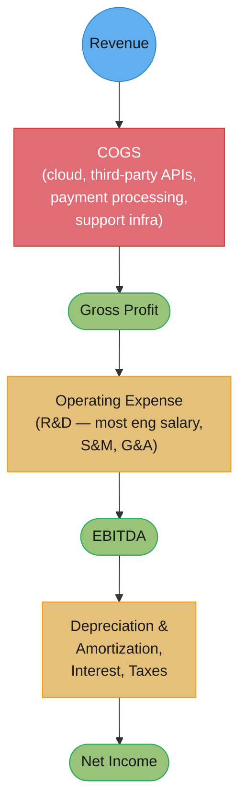
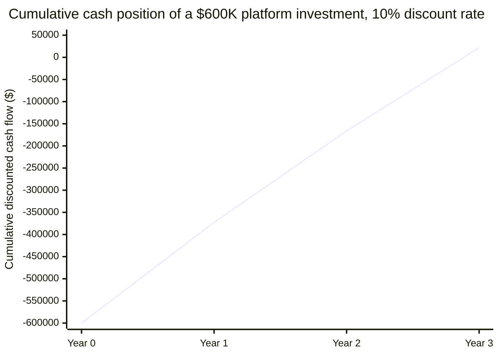
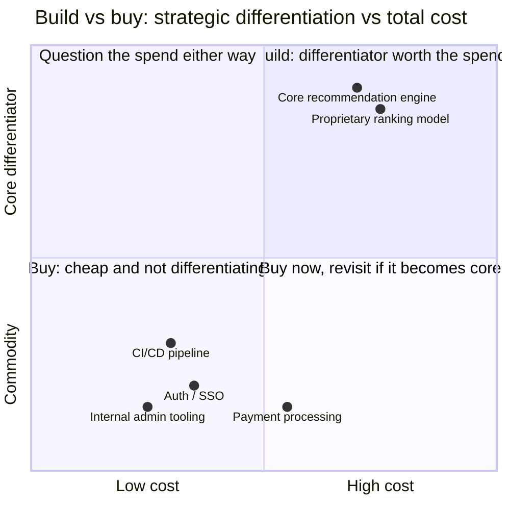

# Business & Finance Vocabulary for Engineers

## 1. Concept Overview

Every engineering decision above a certain size gets re-litigated in a second language:
the one the CFO, the VP of Finance, and the board use to decide what gets funded. An
engineer who cannot speak it is not wrong technically — they are simply invisible in the
room where the budget gets set, permanently dependent on a PM or a manager to translate
"this refactor removes a class of production incidents" into "this reduces COGS by 40
basis points and pays back in five months." This module is that translation layer, built
as a working lexicon rather than a glossary to skim: every term below carries its
authority (an accounting standard, a named practitioner, a specific formula), a real
misuse an engineer actually makes, and a sentence that uses the term correctly in a
sentence that could survive being said out loud to a CFO.

The register is not decorative. A dollar of production cloud spend and a dollar of
engineering salary sit on different lines of the income statement and move different
metrics — the difference determines whether "let's just add two engineers instead of
buying the vendor" is a good argument or a category error. Knowing that difference, and a
handful of others like it, is what separates an engineer who gets a budget approved from
one who gets told "we'll revisit next quarter."

---

## 2. Intuition

> **One-line analogy**: the income statement is a pipe with valves — revenue enters at
> the top, COGS and opex are valves that bleed it off before it reaches the bottom, and
> your code and your headcount decisions are valves you personally control.

**Mental model**: Every technical choice an engineer makes is also a financial choice
wearing a disguise. Choosing a bigger instance class is a COGS decision. Choosing to build
instead of buy is an NPV decision with a hidden discount rate. Choosing to let a junior
engineer own a project instead of hiring a contractor is an opportunity-cost decision. The
finance vocabulary does not add new decisions to your job — it names the decisions you are
already making, so you can make them on purpose and defend them in the room where they get
approved or killed.

**Why it matters**: Executives do not evaluate engineering work in units of elegance, test
coverage, or lines deleted. They evaluate it in units of margin, runway, and return on
capital, because those are the units their own boss evaluates them in. A staff engineer
who says "this is cleaner" loses to a staff engineer who says "this takes 90 basis points
off COGS at current volume" — not because the second engineer is more persuasive, but
because the second sentence is actually answerable to the thing the executive is graded
on.

**Key insight**: Almost every finance term an engineer needs has a companion misuse that
is common enough to have a name — capex mistaken for a virtue, TCO mistaken for a complete
argument, "our AWS bill is opex" stated with total confidence and total wrongness. Learning
the term without learning its standard misuse is learning half the vocabulary; the other
half is knowing which wrong sentence you are about to not say.

---

## 3. Core Principles

1. **Every number on the income statement has an owner, and cloud infrastructure and
   engineering headcount usually have different owners.** Production cloud spend is COGS;
   most engineering salary is opex (R&D). Confusing the two produces wrong build-vs-buy
   math and a CFO who stops trusting your numbers.
2. **A metric is a lens, not a verdict.** TCO without benefits, payback without a discount
   rate, and ROI without a time horizon are each half an argument. Pick the metric that
   matches the decision's real shape — reversible vs irreversible, near-term vs multi-year
   — rather than the one that is easiest to compute.
3. **Cash and profit are different facts that can point in opposite directions.** A
   profitable company can run out of cash; a cash-rich company can be unprofitable for
   years by design (most SaaS companies below a certain scale are exactly this). Runway is
   a cash question, not a P&L question.
4. **The real cost of a project is the next-best project it displaced**, not the number on
   its own invoice. This is opportunity cost, and it is the single most common argument
   engineers fail to make, because "what would we have done instead" requires naming a
   real alternative, not a hypothetical one.
5. **Classification changes outcomes, not reality.** Whether a dollar is capex or opex,
   capitalized or expensed, showback or chargeback does not change what was spent — it
   changes who is measured on it, what tax treatment applies, and which quarter absorbs
   the hit. Engineers who understand this stop being surprised when the "same" project
   gets accounted for differently by different finance teams.
6. **Every vocabulary term below exists because engineers get it wrong in a specific,
   repeatable way.** The misuse is not filler; it is usually the more instructive half of
   the entry.

---

## 4. Types / Levels / Modes

The finance vocabulary an engineer needs breaks into seven registers, ordered roughly by
how often you will reach for them: the income statement itself, cash, investment
decisions, capex vs opex, capitalizing software development, growth and unit economics,
and engineering cost management. Each register below is a set of four-part records —
term, definition with its authority, a real misuse, and a correct-use sentence.

### 4.1 The income statement, top to bottom

#### `Revenue vs Bookings vs Billings vs Recognized Revenue`

**Definition.** These are four different numbers that engineers routinely treat as one.
*Bookings* is the total contract value a customer signed up for, recognized the moment
the deal closes, regardless of when the money arrives or the service is delivered.
*Billings* is what was actually invoiced in a period. *Revenue* under GAAP/IFRS accrual
accounting (ASC 606 / IFRS 15) is recognized as the service is delivered, not when it is
paid for or signed — a $1.2M annual contract signed in January is $100K of *recognized
revenue* per month, not $1.2M of revenue in January. "ARR" (module §4.6) is a normalized
run-rate view of recurring revenue, distinct from all three.
**Misuse.** "We just closed a $2M deal, revenue is up $2M this quarter." It is bookings,
not revenue — the $2M shows up on the income statement over the life of the contract, and
conflating the two is how an engineer misreads whether the business is actually growing
as fast as a press release implies.
**Correct use.** "Bookings were strong this quarter, but recognized revenue lags by a
quarter or two on annual contracts, so don't expect this quarter's income statement to
show the full jump yet."

#### `COGS`

**Definition.** Cost of Goods Sold: the direct costs of delivering the product to a
customer. For a SaaS business that is production cloud hosting, third-party API spend,
payment processing fees, and the customer-support and infrastructure headcount directly
attributable to running the service — R&D headcount building new features is generally
opex, not COGS (see §4.1 Operating Expense below). It sits directly above gross profit on
the income statement, so a dollar of COGS reduces gross margin one-for-one, and it is
increasingly the site of a live fight: several vertical SaaS vendors have publicly
disclosed multiple points of year-over-year gross-margin compression attributed
specifically to AI inference and GPU costs, because that spend is COGS the moment it
serves production traffic.
**Misuse.** "Our AWS bill is an operating expense, so it doesn't affect margin." Production
cloud spend is COGS for almost every SaaS company. It is the single largest lever an
engineer has on gross margin, which is exactly why the CFO cares what you deploy — and
misclassifying even a modest share of production compute as opex can make a reported
gross margin look 200-300 basis points better than it actually is.
**Correct use.** "Moving the inference tier to the smaller instance class takes 90 basis
points off COGS at current volume, which shows up in gross margin next quarter."

#### `Gross Margin`

**Definition.** (Revenue − COGS) / Revenue, expressed as a percentage — the profit left
after the direct cost of delivering the product, before anything else is paid for. Public
SaaS companies commonly run 70-80% gross margin, with best-in-class software-only
businesses at 80%+ and usage-heavy or services-heavy models running lower (commonly cited
in the low-to-mid 60s); a figure below roughly 70% is a common red flag for a pure-software
investor, though the healthy range genuinely varies by pricing model and company stage.
**Misuse.** "We're profitable, so gross margin doesn't matter." A company can be net-income
negative for years by design (heavy S&M investment) while still needing a strong gross
margin, because gross margin is the ceiling every dollar of opex investment has to fit
under — a weak gross margin caps how profitable the business can ever become regardless of
scale.
**Correct use.** "This architecture change moves us from 68% to 74% gross margin at
current volume — that's the difference between 'red flag' and 'investable' for a
Series-B SaaS company."

#### `Contribution Margin`

**Definition.** (Revenue − variable costs) / Revenue — narrower than gross margin because
it excludes only the costs that scale directly with volume and leaves out fixed
production costs that gross margin still includes (a fixed hosting reservation cost, for
instance). Because it strips out more, contribution margin is typically a *higher*
percentage than gross margin for the same company — a SaaS business commonly running
around 80% contribution margin against roughly 70% gross margin is a normal, not
suspicious, gap.
**Misuse.** Quoting contribution margin in a board deck as if it were gross margin. The
two numbers answer different questions — contribution margin answers "does one more unit
of sales make money," gross margin answers "is the overall delivery cost structure
healthy" — and reporting the higher, narrower number as if it were the wider one
materially overstates how healthy the business looks.
**Correct use.** "Contribution margin on the new tier is 82%, but don't confuse that with
our blended gross margin of 71% — the gap is the fixed infrastructure cost contribution
margin doesn't count."

#### `Operating Expense (R&D, S&M, G&A)`

**Definition.** Costs below the gross-profit line, grouped into three standard buckets:
R&D (Research & Development — most engineering salary lives here), S&M (Sales &
Marketing), and G&A (General & Administrative — finance, legal, HR, executives). This is
the specific fact that trips up most engineers arguing for headcount: **engineering
salary is usually opex (R&D), while production cloud spend is usually COGS.** They are not
interchangeable in a build-vs-buy argument, because adding two engineers moves R&D opex
and buying a vendor moves either COGS (if the vendor's fee scales with usage) or opex
(if it's a flat subscription) — the comparison only works if you put both options in the
same bucket before comparing them.
**Misuse.** "We should just build it in-house instead of paying the vendor — it's about
the same cost." Comparing a vendor's COGS-line fee to two engineers' fully-loaded R&D-opex
cost without noting they hit different lines, are measured by different people, and — if
the vendor bill is usage-based — behave completely differently as the company scales, is
the single most common build-vs-buy error engineers make.
**Correct use.** "Buying the vendor adds $180K/year to COGS and moves inversely with our
gross margin as we scale; building it adds two R&D headcount at $360K/year loaded cost
but is roughly flat regardless of volume — at our growth rate, buy wins for the next 18
months and build wins after that."

#### `EBITDA`

**Definition.** Earnings Before Interest, Taxes, Depreciation, and Amortization — a proxy
for how much cash-generating ability the core business has, stripped of financing
decisions (interest), tax jurisdiction (taxes), and non-cash accounting choices
(depreciation, amortization). It is the profit half of the Rule of 40 (§4.6) in most
formulations and a common input to company valuation multiples.
**Misuse.** "EBITDA is basically cash flow." It excludes changes in working capital and
all capital expenditure, so a company can show healthy EBITDA while burning cash buying
equipment or extending customer payment terms — EBITDA is not a substitute for a cash-flow
statement.
**Correct use.** "We're EBITDA-positive but still cash-flow negative this quarter because
of the upfront hardware purchase for the new region — that's a capex timing effect, not a
profitability problem."

**Net Income, briefly.** The literal bottom line — revenue minus every cost, including
COGS, opex, interest, taxes, depreciation and amortization — almost always smaller than
EBITDA because it's the only standard income-statement number with nothing left out.
**Misuse:** treating "net income negative" as "in trouble." Most VC-backed SaaS companies
run net-income negative for years by design, trading net income for growth — a rational
strategy exactly as long as gross margin and the Rule of 40 (§4.6) stay healthy.
**Correct use:** "we're net-income negative this year investing 40% of revenue in S&M —
fine as long as gross margin holds above 70%."

### 4.2 Cash

#### `Runway`

**Definition.** Cash on hand divided by net burn (below), expressed in months — the time
until the company runs out of money at the current spend rate if nothing changes. It is a
cash-statement fact, not a P&L fact: a company can be improving its profit margin every
quarter and still have shrinking runway if net burn in absolute dollars is still growing
faster than revenue.
**Misuse.** "We're profitable this quarter, so runway isn't a concern." Runway is about
cash, not profit — a quarter's positive net income does not by itself tell you the cash
balance, because of timing effects like unpaid invoices, upfront capex, or deferred
revenue that was collected (and spent) in a prior period.
**Correct use.** "At $800K/month gross burn against $650K/month recognized revenue, net
burn is $150K/month — with $6M in the bank that's 40 months of runway, not the 7.5 months
you'd get from dividing cash by gross burn."

#### `Gross Burn vs Net Burn`

**Definition.** Gross burn is total monthly cash outflow — everything the company spends,
full stop. Net burn is gross burn minus revenue collected in the same period — the actual
rate the bank balance is draining. Y Combinator's own guidance (Tim Brady) puts it plainly:
"burn rate is a measurement of cash flow, not profit and loss," and the standard YC
guidance is to start cutting spend below six months of net-burn runway and treat below
three months as an emergency.
**Misuse.** Answering "can we afford this?" using gross burn. A team that spends $800K a
month but collects $650K a month is burning $150K net, not $800K — using the gross figure
overstates the urgency of cuts by more than 5x in this example and can drive a
panic-driven layoff that a look at net burn would have shown was unnecessary.
**Correct use.** "Gross burn went up $50K/month from the new hires, but net burn is flat
because revenue grew by the same amount — runway didn't actually change."

**Cash Flow vs Profit, briefly.** Profit is accrual-based — recognized when earned, not
when cash moves; cash flow is the literal movement of money in and out of the bank. They
diverge constantly: an annual contract paid upfront creates cash ahead of the matching
recognized revenue, while a capitalized project (§4.5) shows as cash out immediately but
expenses slowly over years. **Misuse:** "we booked the revenue, so the cash must be in
the bank" — an unpaid invoice is recognized revenue with zero cash behind it; a customer
on 90-day terms means the cash lags the recognized revenue by a full quarter. **Correct
use:** "recognized this quarter for accounting, but don't expect the cash until Q2 —
that's a receivables timing gap, not a problem with the deal."

### 4.3 Investment decisions

#### `TCO`

**Definition.** Total Cost of Ownership: every cost a decision incurs over its useful
life, not just the sticker price. For a build-vs-buy decision the costs engineers
systematically omit are migration cost, training cost, the on-call burden of the thing
you built, and the cost of the thing you cannot easily buy your way out of later once
you're dependent on it. TCO is a useful budgeting input but a weak standalone decision
metric on its own, because it totals costs while saying nothing about the benefits or the
time value of money — for that you need NPV (below).
**Misuse.** "The vendor costs $200K/year and building it ourselves is free since we
already have the engineers." "Free" ignores the opportunity cost of those engineers'
time (§4.3 below), the on-call load the in-house system creates, the migration cost if it
ever needs replacing, and the training cost for every engineer who joins the team later —
a real TCO comparison routinely finds the "free" option is the more expensive one once all
four are priced in.
**Correct use.** "TCO on the in-house option is $340K/year once we price in on-call,
migration risk, and the two-week onboarding tax on every new hire — that's higher than the
vendor's $200K, not lower."

**ROI, briefly.** Return on Investment: (gain − cost) / cost. Simple and universal, and its
weakness is exactly its simplicity — plain ROI ignores *when* the return arrives, so a
project returning 50% over one year and one returning 50% over five years report
identically. **Misuse:** "Project A has 40% ROI, B has 35%, so A wins" — incomplete if A
takes four years to deliver that return and B takes eighteen months; once time is priced
in via NPV, B is very likely the better investment. **Correct use:** "both show similar
ROI, but B pays back in 18 months against A's 4 years — once discounted, B wins."

#### `NPV and the Discount Rate`

**Definition.** Net Present Value: the sum of a project's future cash flows, each
discounted back to today's dollars by a discount rate that represents the return the
company could get elsewhere with that capital (its cost of capital, or a hurdle rate set
by finance — commonly 8-15% for an established company's internal projects, higher for
riskier bets). A positive NPV means the project creates value versus the next-best use of
the money; a negative NPV means it destroys value even if it "pays for itself" eventually,
because money today is worth more than the same money later.

**A worked calculation an engineer can actually do.** A platform investment costs $600K
upfront and is projected to save $250K/year in reduced infrastructure and incident cost
for three years, then $100K/year of ongoing savings after that as the platform matures.
Using a 10% discount rate:

```text
Year 0: -$600,000                              (upfront cost)
Year 1: +$250,000 / 1.10^1 = +$227,273
Year 2: +$250,000 / 1.10^2 = +$206,612
Year 3: +$250,000 / 1.10^3 = +$187,829
NPV (3-year horizon) = -600,000 + 227,273 + 206,612 + 187,829 = +$21,714
```

At a 10% discount rate over three years, this platform bet is barely NPV-positive — a
real answer, and a much more honest one than "it saves $750K over three years against a
$600K cost, obviously worth it," which ignores that the $750K arrives later and is worth
less than $750K today. Raise the discount rate to 15% (a riskier-bet hurdle) and this
specific three-year case turns NPV-negative, which is the whole reason the discount rate
you use is itself a decision worth stating out loud in the proposal.
**Misuse.** Summing future savings without discounting them, then presenting the raw total
as if it were comparable to today's cost. "It saves $750K against a $600K spend, so it's
worth $150K to us" silently uses a 0% discount rate, which overstates the value of every
multi-year project and is the single most common finance error engineers make when
pitching a platform investment.
**Correct use.** "At our standard 10% hurdle rate, this is NPV-positive by about $22K over
three years — thin, but real. If finance uses a 15% hurdle for infra bets, it likely
doesn't clear; ask before we commit resourcing."

#### `Payback Period`

**Definition.** The time until cumulative returns equal the initial investment — the
simplest of the four investment metrics and the one most likely to mislead by itself,
because it ignores every cash flow after the breakeven point and ignores the time value of
money entirely.
**Misuse.** "Payback is 8 months, so it's clearly the better option." Payback period alone
cannot distinguish between two projects with identical payback if one keeps paying off for
five more years and the other stops the month after breakeven — that distinction only
shows up in NPV.
**Correct use.** "Payback is 8 months either way, but option B has roughly 3x the NPV over
five years once discounted — payback tells you they're similarly safe bets short-term,
NPV tells you which one is actually the better investment."

**IRR, briefly.** Internal Rate of Return is the discount rate at which a project's NPV
hits exactly zero — the rate of return the project itself generates, useful for ranking
projects of different sizes but unreliable when cash flows change sign more than once, so
treat it as a supporting metric to NPV, not a replacement. **Misuse:** treating a 40% IRR
on a $10K project as better than a 15% IRR on a $2M project — IRR tells you the rate, not
the size, of the win, and a small project clearing the rate bar isn't automatically worth
prioritizing over a bigger one that also clears it. **Correct use:** "IRR clears our 12%
hurdle, but check the NPV too before sizing the resourcing."

#### `Opportunity Cost`

**Definition.** The value of the next-best alternative you gave up by choosing what you
chose. It is not "what did this cost" — it is "what did we not get to do because we did
this instead," and it is the argument engineers most often fail to make, because it
requires naming a real, specific alternative rather than treating the decision as
cost-versus-nothing.
**Misuse.** "This project only costs two engineers for a quarter, that's cheap." "Cheap"
compared to what? If those two engineers were otherwise going to ship the feature that
closes the company's biggest sales blocker, the opportunity cost of the "cheap" project is
that blocker staying unresolved for a quarter — the sticker cost was never the real cost.
**Correct use.** "This refactor takes two engineers off the checkout redesign for six
weeks — the real cost isn't the six weeks, it's that the redesign now ships after the
Q4 sales push instead of before it, which is the number that should decide this, not the
headcount."

### 4.4 Capex vs opex

#### `Capex vs Opex`

**Definition.** Capital expenditure (capex) buys an asset with value extending beyond the
current period — hardware, a data center, a long-term license — and is depreciated over
its useful life rather than expensed immediately; operating expenditure (opex) is
consumed in the period it's spent, like a cloud bill. The cloud shift moved most
infrastructure spend from capex to opex, usually framed as a pure win — smaller upfront
commitment, easy to scale down. The FinOps counter-argument: reserved instances and
savings plans "behave like fixed investments but fluctuate like variable costs" —
committed-use discounts reintroduce a capex-like multi-year commitment inside what still
looks like an opex line. Mature FinOps treats the capex/opex label as secondary to the
real question, unit economics and eliminated waste (an industry-wide estimate put roughly
a third of 2023 cloud spend as wasted) — a wasted opex dollar and a wasted capex dollar
are equally wasted.
**Misuse.** "The cloud is opex, so it's automatically cheaper and better than capex." Some
finance and tax positions genuinely prefer capex: capitalized assets can be depreciated in
ways that shift tax timing favorably, capex doesn't hit the current quarter's opex budget
the way a cloud bill does, and a company already committed to a large capex-heavy
data-center footprint may see a cloud migration as adding cost, not removing it. "The
cloud is cheaper" does not automatically land as an argument with a CFO who is optimizing
for a different variable than sticker price.
**Correct use.** "Moving to reserved capacity gets us the unit discount, but be honest that
it's a 12-month commitment behaving like capex — model it as a commitment, not as free
opex savings."

### 4.5 Capitalizing software development cost

#### `Capitalizing Software Development Costs (ASC 350-40 / IAS 38)`

**Definition.** Some software development effort can be capitalized — booked as an asset
and amortized over its useful life — rather than expensed immediately in full. Under US
GAAP's ASC 350-40, internal-use software development is traditionally divided into three
stages: preliminary project (exploring feasibility, expensed), application development
(the actual build — coding, testing, installing to hardware, the capitalizable stage), and
post-implementation/operation (maintenance, expensed again); training and data-conversion
costs are expensed throughout, even during the capitalizable stage. This stage-based model
is currently being replaced — FASB issued ASU 2025-06 to remove the three-stage framework
in favor of a simpler, principles-based recognition threshold, explicitly because the old
staging maps poorly onto agile, iterative development where there's no clean line between
"still exploring" and "now building." Under IFRS's IAS 38, development costs are
capitalized only when all six of a named set of criteria hold simultaneously — technical
feasibility, intent to complete, ability to use or sell it, probable future economic
benefit, adequate resources to finish, and reliable measurability — while research costs
are always expensed; IAS 38 gives no specific guidance for purely internal-use software.

**Why it matters to an engineer.** Capitalizing doesn't change the cash spent — it changes
which quarter's profit absorbs the hit, spreading it as amortization over years instead of
expensing it all now, which is exactly why some organizations ask engineers to classify
their own time as capitalizable versus not: the classification can be the difference
between a project clearing an internal approval bar or not. **Get the principle right and
stop there** — the exact stage boundaries and how a given company's auditors interpret
either standard are jurisdiction- and auditor-specific, and none of this is accounting
advice.
**Misuse.** "We're depreciating the software we built in-house." Depreciation is for
tangible assets (servers, buildings); internally developed, capitalized software is
*amortized*, not depreciated — using the wrong word in a finance conversation is a small
tell that reads as a bigger gap in understanding than it is.
**Correct use.** "If finance wants this project's engineering time booked as capitalizable,
that changes how it shows up on the income statement — ask whether that changes the
approval bar, because a capitalized cost is friendlier to this quarter's reported margin
than an expensed one."

### 4.6 Growth and unit economics

#### `ARR, MRR, ACV`

**Definition.** ARR (Annual Recurring Revenue) and MRR (Monthly Recurring Revenue) are
normalized run-rate views of subscription revenue — "if nothing changes, this is the
annualized/monthly pace we're on" — distinct from GAAP recognized revenue (§4.1), which
recognizes revenue as delivered rather than as a forward-looking run rate. ACV (Annual
Contract Value) is a per-contract number — what one customer's deal is worth annualized —
while ARR is the aggregate across all customers; a company can grow ARR by adding
customers, growing existing ACVs, or both, and the mix matters for how sustainable the
growth is.
**Misuse.** "ARR is up 20%, so revenue is up 20%." ARR is a run-rate metric, not the
recognized revenue on the income statement for the period — a burst of new contracts
signed late in the quarter inflates ARR immediately but barely moves recognized revenue
until the next quarter or two.
**Correct use.** "ARR grew 20%, driven mostly by expansion in existing accounts rather
than new logos — a healthier mix than the same 20% coming entirely from new-customer ACV."

#### `CAC, LTV, and the LTV:CAC Ratio`

**Definition.** CAC (Customer Acquisition Cost) is the fully-loaded sales and marketing
spend to acquire one customer — S&M spend in a period divided by new customers added.
LTV (Lifetime Value) = (average revenue per account × gross margin %) / monthly churn
rate — LTV embeds gross margin directly, one of the concrete channels through which an
engineer's infrastructure decisions reach a finance metric far from the codebase. The
LTV:CAC ratio compares the two; a commonly-cited healthy benchmark is 3:1 or higher, with
a median around 3.2:1 across a large sample of B2B SaaS companies, and below 1:1 means the
company loses money on every customer it signs.
**Misuse.** Computing CAC from ad spend alone, ignoring sales salaries and commissions —
this understates CAC and makes LTV:CAC look healthier than it is. Separately, "our
LTV:CAC is 8:1, we're crushing it" misreads the number: a ratio well above roughly 5:1 is
commonly read not as excellence but as *underinvestment in growth*.
**Correct use.** "Fully-loaded CAC is $8,400, not the $3,100 you get counting ad spend
alone — and at that CAC, our LTV:CAC of 7.5:1 says we could spend more on S&M and still
grow profitably."

#### `Churn — Logo, Revenue, and Net Revenue Retention`

**Definition.** Three distinct numbers get called "churn." *Logo churn* is the percentage
of customers lost, regardless of size. *Gross revenue churn* is recurring revenue lost to
cancellations and downgrades only. *Net revenue retention* (NRR) nets that against
expansion revenue (upsells, seat growth) in the accounts that stayed, and can exceed
100% — the single figure investors watch most closely, since it says the product gets
more valuable to the customers who stay, independent of new-sales performance;
best-in-class SaaS commonly targets gross retention above roughly 95% and NRR in the
120-140% range, though the "best-in-class" band varies by source.
**Misuse.** "Churn is only 6%, we're fine." A company can have 6% logo churn — losing 6%
of its customers — while running net revenue churn of *negative* 4%, meaning overall
recurring revenue from the retained base actually grew, because expansion in the accounts
that stayed outran the revenue lost from the small accounts that left. Quoting logo churn
alone hides whether the business is actually healthy.
**Correct use.** "Logo churn is 6%, but net revenue retention is 104% — we're losing small
accounts and more than making it up in expansion from the accounts that stay, which is a
fine trade if the departing accounts were never the profitable ones."

#### `The Rule of 40`

**Definition.** A SaaS company's growth rate percentage plus its profit margin percentage
(commonly EBITDA margin) should sum to at least 40 — popularized by Brad Feld and
Bessemer Venture Partners as a directional efficiency and health signal, not a strict
pass/fail gate and not a requirement that growth and margin be balanced 20/20: a company
growing 60% at −5% margin scores 55 and is considered healthy, exactly as a company
growing 15% at 25% margin scoring 40 is. Bessemer has proposed a growth-weighted successor
metric, the "Rule of X," on the argument that growth should count for more than an equal
point of margin at earlier stages — worth knowing the Rule of 40 is not universally
treated as final even inside the firm that popularized it.
**Misuse.** "We're at 25% growth and 10% margin, that's only 35, we're failing." The Rule
of 40 is a lens for spotting companies burning cash without a growth payoff to justify it,
not a hard cutoff — a company just under 40 with a clear, funded path to either higher
growth or higher margin next year is not in the same category as a company stuck at 35 for
three years running with no plan to move either number.
**Correct use.** "We're at a Rule of 40 score of 38 this year, mostly margin-driven — the
board's more interested in whether that's trending up or just holding steady."

**Magic Number, briefly.** A SaaS sales-efficiency metric: ((current quarter ARR − prior
quarter ARR) × 4) / prior-quarter S&M spend. Above roughly 0.75 reads as efficient
go-to-market spend; below roughly 0.5 signals an inefficient S&M engine. **Misuse:**
reading a low score as "the sales team is bad" — it can equally mean the product isn't
converting sales investment into revenue, which is a prompt to investigate the whole
go-to-market motion, not a scorecard for one function. **Correct use:** "magic number
dropped from 0.9 to 0.6 — before cutting S&M, check if it's sales or product."

### 4.7 Engineering cost management

#### `FinOps`

**Definition.** The practice (formalized by the FinOps Foundation) of running cloud
spend through a continuous, cross-functional cycle: **Inform** (visibility — tagging,
allocation, forecasting), **Optimize** (rightsizing, eliminating idle resources,
committed-use discounts), and **Operate** (continuously tracking spend against business
goals and sharing results). The phases are explicitly cyclical, not a one-time project —
"Crawl, Walk, Run" is the Foundation's own maturity framing.
**Misuse.** Treating FinOps as a one-time cost-cutting exercise finance runs on
engineering's infrastructure. Mature FinOps practice makes engineers the primary actors,
because they are the only people who can actually rightsize a workload or fix a wasteful
query pattern — finance can report the number, but only engineering can move it.
**Correct use.** "Let's put this service's cost-per-request on the team's own dashboard,
not just finance's — Optimize only works if the people who can change the code see the
number regularly."

#### `Showback vs Chargeback`

**Definition.** Showback reports a team's cloud cost for visibility, without actually
billing it to their budget — it moves information. Chargeback formally bills the cost to
the consuming team's P&L or budget — it moves money, with real budget consequences. A
dashboard a team can merely look at is showback; a line item that reduces their actual
budget is chargeback, and the two produce very different behavior change.
**Misuse.** Calling a shared cost dashboard "chargeback" when no team's budget is actually
debited. If nothing changes on anyone's P&L, it's showback — useful for awareness, but it
does not carry the same incentive weight as a real chargeback, and treating the two as
interchangeable overstates how much the dashboard alone will change behavior.
**Correct use.** "We've had showback dashboards for a year with no real cost reduction —
time to propose actual chargeback so teams feel it in their own budget, not just see it."

**Unit Cost Metrics, briefly.** Cost normalized to a business-meaningful denominator —
per request, per tenant, per inference, per active user — rather than a raw total. Total
spend going up isn't itself informative; total spend going up *faster than the business
metric it should track* is, and picking the right denominator is the whole game.
**Misuse:** reporting "cloud spend is up 30%" as automatically bad news — if revenue or
usage grew 40% in the same period, cost per unit actually improved, and without the
denominator the raw total is unreadable. **Correct use:** "spend is up 30%, but cost per
active tenant is down 8% — we're scaling more efficiently, not less."

#### `Amortization vs Depreciation`

**Definition.** Depreciation spreads the cost of a *tangible* asset (servers, buildings,
hardware) over its useful life, often on an accelerated schedule, down to a salvage value.
Amortization spreads the cost of an *intangible* asset (patents, capitalized software,
loan issuance costs) over its useful life, typically on a straight-line basis, usually to
zero.
**Misuse.** "We're depreciating the software license." A purchased or internally
capitalized software asset is amortized, not depreciated — the terms are not
interchangeable even though both describe "spreading a cost over time," and using the
wrong one in a finance conversation signals a shakier grasp of the underlying accounting
than the mistake itself warrants.
**Correct use.** "The new servers are depreciated over five years; the platform we
capitalized last quarter is amortized over three — different schedules, different assets,
don't merge them in the model."

---

## 5. Models & Frameworks Diagrammed



Production cloud spend is the first valve revenue passes through, and it is the one
engineers directly control — it lands in COGS, not opex, which is why an instance-class
change reaches gross margin and a headcount change reaches operating margin instead.
Engineering salary for new feature work lives in the second valve (opex, specifically
R&D), several steps further from gross margin than most engineers assume.



The project is underwater until partway through year three, when discounted cumulative
cash flow finally crosses zero — the NPV worked calculation in §4.3 in cumulative form.
Payback period alone would only tell you it crosses zero somewhere in year three; NPV
tells you the final answer is barely positive, which is the more useful fact for deciding
whether to fund it.



Most build-vs-buy fights are actually fights about which quadrant something belongs in,
not about the numbers — auth and CI/CD sit low on differentiation almost everywhere, which
is why "just buy it" is right far more often than engineering intuition suggests, while a
genuinely core, differentiating system belongs in the top-right even at real cost.

---

## 6. How It Works — Detailed Mechanics

### 6.1 Three complete briefs — the arguments this module unlocks

**Brief 1 — the build-vs-buy case with a real NPV.**

```text
DECISION: Build an in-house feature-flagging system, or buy a LaunchDarkly-equivalent
at $54K/year.
BUY: $54K/year opex, flat regardless of team growth, live in two weeks.
BUILD: one engineer for one quarter (~$60K loaded) plus ~0.1 FTE/year maintenance
(~$24K/year loaded), plus opportunity cost — that engineer is off mobile-offline for
the quarter, delaying it one release cycle.
NPV over 3 years at 10%: BUY -$134,200; BUILD -$119,600. Build is ~$14,600 cheaper in
pure NPV terms — but that ignores the delay's opportunity cost, which sales estimates
at $80K in at-risk renewal ARR this year.
RECOMMENDATION: Buy. The NPV gap is smaller than the opportunity cost of the delay, and
feature-flagging is a commodity capability (bottom-left of the §5 quadrant), not a
differentiator worth it.
```

**Brief 2 — the "this refactor pays for itself in COGS" case.**

```text
DECISION: Approve two engineers, three weeks, to move the recommendation service off the
oversized instance class kept "just in case" since a memory leak was fixed 8 months ago.
CURRENT COST: $38,000/month, 70% attributable to the oversized instance.
PROJECTED: $19,500/month after rightsizing — an $18,500/month, $222,000/year reduction.
COST OF THE FIX: 2 engineers x 3 weeks loaded = ~$17,300. Payback: under one month.
RECOMMENDATION: Approve immediately — the rare case where payback alone is sufficient
because the return so overwhelms the discount effect that a fuller NPV wouldn't change
the decision.
```

**Brief 3 — the "this feature has negative unit economics at scale" case.**

```text
DECISION: Ship the free-tier AI-powered search feature as scoped, or gate it to paid
tiers?
UNIT ECONOMICS: $0.014/query inference COGS; median free user runs 40 queries/month =
$0.56/month in COGS per free user against $0 revenue.
AT CURRENT SCALE (140,000 free users): $940,800/year in COGS with zero offsetting
revenue — a pure gross-margin drag, since free-to-paid conversion is a measured 2.1%,
meaning 97.9% of this spend serves users who will likely never pay.
RECOMMENDATION: Gate to 5 queries/month with upgrade prompts past the limit. Modeled
impact: ~85% COGS reduction (~$800K/year saved) with small conversion impact, since
heavy users — who convert disproportionately — hit the limit anyway.
```

### 6.2 Weak version -> Strong version pairs

**A budget request**

**Weak version**

> We could really use a bigger observability budget, our current tooling is pretty
> limited and it's been slowing us down.

**Strong version**

> Our current observability spend is $4,200/month and covers 60% of production services.
> The uncovered 40% caused two Sev-1 incidents this quarter with a combined 90 minutes of
> extra MTTR because we lacked traces — conservatively $40K in SLA credits and engineering
> time. Full coverage costs an incremental $2,800/month ($33,600/year). I need approval by
> the next budget cycle to include it in Q4 planning.

**What changed:** a vague feeling became a coverage percentage, a cost, a quantified
consequence of not having it, and a specific number with a deadline. The weak version can
be nodded at and deferred indefinitely; the strong one has to be either approved or
explicitly declined with a reason.

**A build-vs-buy recommendation**

**Weak version**

> I think we should just build our own version of this instead of paying for the vendor,
> it doesn't seem that complicated and we'd have more control.

**Strong version**

> Vendor costs $54K/year flat. Building costs roughly $84K in year one (engineering time)
> and $24K/year after that in maintenance, plus it takes one engineer off the
> mobile-offline project for a quarter — sales estimates that delay puts $80K of at-risk
> renewal ARR in play. NPV favors build by about $14.6K over three years, but the
> opportunity cost of the delay is six times that. I recommend buy.

**What changed:** "doesn't seem that complicated" became two priced options with a real
NPV calculation and an opportunity cost that changes the recommendation. The weak version
is an opinion; the strong version is a decision someone else can check the arithmetic on
and disagree with specifically, not vaguely.

**A cost-reduction claim**

**Weak version**

> We cleaned up some unused resources and cut our cloud bill significantly this month.

**Strong version**

> We identified 340 idle resources (unattached volumes, unused load balancers, oversized
> dev-environment instances) and removed them, cutting monthly spend from $61,200 to
> $47,900 — a 22% reduction, $159,600/year run-rate. Cost per active tenant dropped from
> $8.70 to $6.79 in the same period, so this wasn't just a one-time cleanup riding on flat
> usage — it's a durable unit-cost improvement.

**What changed:** "significantly" became a before/after dollar figure, an annualized
run-rate, and a unit-cost metric proving the saving is structural rather than a temporary
blip. The weak version invites a follow-up question; the strong version answers it before
it's asked.

**A headcount ask**

**Weak version**

> Our team is pretty stretched and I think we need at least one more engineer to keep up
> with the roadmap.

**Strong version**

> The team shipped 3 of 5 committed Q3 items; the two slipped items were both blocked on
> the same specialization (mobile) that only one engineer on the team has, creating a
> single point of failure that already caused a two-week slip once this year. One
> additional mobile-capable engineer, fully loaded at ~$210K/year, removes that
> bottleneck; the alternative is continuing to slip 1-2 committed items per quarter, which
> at our current deal size risks an estimated $150K/quarter in delayed expansion revenue
> tied to the mobile roadmap specifically.

**What changed:** "pretty stretched" became a named bottleneck with a track record, a
priced headcount ask, and a quantified cost of not filling it. The weak version reads as
a complaint; the strong version reads as a resourcing decision with a number on both
sides of the ledger.

---

## 7. Real-World Examples

- **SaaS Capital's 2025 gross-margin analysis** found that misclassifying even a modest
  share of production compute as opex instead of COGS can make reported gross margin look
  200-300 basis points better than it is; separately, **multiple vertical SaaS providers**
  have disclosed year-over-year gross-margin compression of several points explicitly
  attributed to AI inference and GPU costs — the current live battleground for what counts
  as COGS, since model-serving cost scales directly and visibly with usage.
- **Y Combinator's standard startup guidance** (Tim Brady) treats net burn, not gross
  burn, as the operative runway metric, with concrete thresholds: cut below six months of
  net-burn runway, treat below three months as an emergency — a real policy a huge
  fraction of venture-backed engineering orgs operate under.
- **FASB's ASU 2025-06** replaced ASC 350-40's three-stage capitalization framework with
  a simpler, principles-based standard specifically because the old model didn't map onto
  agile development — a concrete, current instance of an accounting standard changing to
  catch up with how software is actually built.

---

## 8. Tradeoffs

| Choice | Pro | Con |
|---|---|---|
| Buy (vendor, usage-priced) | Fast, no build risk, scales with the vendor's engineering | Recurring COGS that grows with usage; less control over the roadmap |
| Build in-house | Full control, potentially lower long-run cost for a differentiating capability | Opportunity cost of the engineers building it; ongoing on-call and maintenance burden |
| Capex-heavy infrastructure (owned hardware) | Predictable long-run unit cost at very high, stable scale; some tax positions prefer it | Large upfront commitment, poor fit for variable or uncertain demand |
| Opex-heavy infrastructure (cloud, pay-as-you-go) | Elastic, low upfront commitment, easy to scale down | Committed-use discounts reintroduce capex-like lock-in; can be more expensive at very high stable scale |
| Reporting NPV over payback | Accounts for time value of money and full project life | Requires agreeing on a discount rate, which is itself a judgment call |
| Showback only | Low friction, no budget disruption | Weak incentive to actually change behavior |
| Chargeback | Real incentive — hits the team's own budget | Higher friction to set up; can create adversarial finance-vs-engineering dynamics if introduced badly |

---

## 9. When to Use / When NOT to Use

**Use NPV** when a decision spans more than about a year and the cash flows are
reasonably estimable — the right default for platform investments and any non-trivial
build-vs-buy call. **Don't bother with NPV** for a decision whose payback is inside a
month or two and whose benefit clearly dwarfs the cost (Brief 2 in §6.1) — the extra
rigor buys you nothing the payback period didn't already tell you.

**Use TCO** as an input to a bigger decision, never as the whole argument — pair it with
NPV or ROI rather than presenting TCO alone as a recommendation. **Use showback** first,
on a team that has never seen its own cloud bill; **move to chargeback** once showback
alone has stopped moving behavior, usually visible as flat or growing per-unit cost
despite the dashboard being in front of the team for a quarter or more.

**Do not** default every infrastructure decision to "opex is better because it's more
flexible" — check whether committed-use discounts are already turning your opex bill into
a capex-shaped commitment, and check whether your company's specific tax and accounting
position actually favors capex before assuming the cloud-native answer is automatically
the financially better one.

---

## 10. Common Pitfalls

**Presenting a build-vs-buy case with the two options on different accounting lines and
not saying so.** An engineer compares a vendor's flat annual fee against "two engineers
for a quarter" without noting the vendor fee is COGS (moves with gross margin) and the
engineers are opex (moves with operating margin, and stays roughly fixed regardless of
usage) — the CFO reading the proposal sees two numbers that aren't actually comparable and
loses confidence in the whole analysis, sometimes permanently for that engineer's future
proposals.

**Quoting ROI or payback with no discount rate and calling it rigorous.** A proposal that
sums three years of savings against one year of cost, with no discounting, systematically
overstates the value of every multi-year project — and once one overstated proposal gets
caught by finance, every subsequent proposal from that team gets scrutinized harder,
which is a slower and more expensive tax than just discounting correctly the first time.

**Treating "our AWS bill is opex" as settled fact, and reporting raw spend with no
denominator.** Production cloud spend is COGS for almost every SaaS company, and an
engineer who argues a build-vs-buy decision on the belief that infrastructure is opex is
reasoning from a wrong premise a five-minute finance conversation would have corrected —
visibly wrong about this specific fact in front of a CFO costs more credibility than the
correction is worth. Compounding it: "spend is up 30%" sounds bad in isolation and can be
genuinely good news once normalized to cost-per-tenant — a team that only ever reports the
raw total trains its leadership to react to noise instead of the number that matters.

---

## 11. Frameworks, Books & Further Reading

- Y Combinator — Tim Brady's public guidance on burn rate and runway (ycombinator.com),
  source of the widely-cited six-month and three-month runway thresholds.
- Brad Feld and Bessemer Venture Partners — the Rule of 40's popularizers; Bessemer's 2024
  "Rule of X" proposal is a named revision worth reading alongside the original.
- David Skok (Matrix Partners), forEntrepreneurs blog — original popularizer of the 3:1
  LTV:CAC benchmark, drawn from the SaaS companies he invested in.
- FASB ASC 350-40 and ASU 2025-06; IFRS IAS 38 — the two standards governing software
  capitalization. Consult an accountant for application to a specific company; this
  module states the principle, not tax or accounting advice.
- FinOps Foundation (finops.org) — the Inform/Optimize/Operate framework, and the source
  of the widely-cited estimate that roughly a third of 2023 cloud spend was wasted.
- [Executive Communication](../executive_communication/executive_communication.md) — how
  to lead with the numbers this module defines when the audience is a CFO or a VP with
  five minutes.

---

## 12. Interview Questions with Answers

**Q: Why does moving a service to a bigger instance class hit gross margin, while hiring
another engineer hits operating margin instead?**
**Short:** Production cloud spend is COGS, above the gross-margin line; most engineering salary is R&D opex, below it.
Cloud infrastructure serving production traffic is Cost of Goods Sold, so a change in
instance class moves gross margin one-for-one; engineering salary for feature work is
almost always R&D operating expense, which sits below gross profit and moves operating
margin instead. This is the single most common line-item confusion in a build-vs-buy
argument — comparing a vendor's COGS-line fee to an engineer's opex-line salary without
noting the difference produces numbers that look comparable but aren't, since a
usage-priced vendor bill scales with the business the way COGS does while headcount stays
roughly fixed.

**Q: What is the difference between gross margin and contribution margin, and which one
is usually higher?**
**Short:** Contribution margin excludes fixed costs gross margin still includes, so it's typically the higher percentage.
Gross margin is (revenue − COGS) / revenue, including both variable and fixed production
costs; contribution margin is (revenue − variable costs only) / revenue, so it strips out
more and is typically a higher percentage for the same company — an 80% contribution
margin against a 70% gross margin is a normal gap, not a red flag. The gotcha is
presenting contribution margin in a context that expects gross margin, which materially
overstates how healthy the business looks to anyone who doesn't catch the substitution.
Ask which one a chart or a claim is actually using before reacting to it.

**Q: Your company signed a $1.2M annual contract in January. Is that $1.2M of revenue
this quarter?**
**Short:** No — bookings recognize the full deal value immediately, but recognized revenue accrues over the contract's life.
Bookings is the total contract value, recognized the moment the deal closes; recognized
revenue under accrual accounting is delivered — and therefore recognized — over the life
of the contract, so a $1.2M annual deal shows up as roughly $100K of revenue per month,
not $1.2M in January. Billings (what's actually invoiced) is a third, separate number.
Conflating bookings with revenue is a common way to misread how fast a business is
actually growing from the outside.

**Q: Why is net burn the number that determines runway, not gross burn?**
**Short:** Gross burn is total spend; net burn subtracts revenue collected, and that's what actually drains the bank.
Gross burn is every dollar the company spends in a month; net burn subtracts the revenue
collected in the same period, and it's net burn, divided into cash on hand, that gives the
real runway figure. A company spending $800K/month while collecting $650K/month is
burning $150K net, not $800K gross — using the gross number overstates urgency by more
than 5x in that example and can drive an unnecessary panic response. Y Combinator's own
guidance is explicit that burn rate is a cash-flow measurement, not a profit-and-loss one.

**Q: Under what circumstances might a CFO actually prefer capex over the "cheaper" cloud
opex model?**
**Short:** Some tax and accounting positions favor capex's depreciation treatment, and cloud opex isn't automatically the financially better choice.
Capitalized assets can be depreciated in ways that shift tax timing favorably, capex
doesn't hit the current quarter's opex budget the way a recurring cloud bill does, and a
company with an already-large capex-heavy data-center footprint may see cloud migration
as adding cost rather than removing it. "The cloud is cheaper" is a claim about sticker
price, not about the variable a given CFO is actually optimizing — assuming it lands as an
automatic argument is a common and avoidable engineer mistake.

**Q: What is NPV, and why is it generally a better decision tool than a raw payback
period?**
**Short:** NPV discounts future cash flows to today's value; payback ignores everything after breakeven and ignores time value entirely.
Net Present Value sums a project's future cash flows discounted back to today's dollars
at a rate representing what the capital could earn elsewhere, so it accounts for both when
returns arrive and how much they're worth once discounted; payback period only tells you
when cumulative returns cross the initial cost, ignoring everything after that point and
ignoring discounting altogether. Two projects with identical payback periods can have very
different NPVs if one keeps generating returns for years past breakeven and the other
stops right after — that distinction is invisible to payback period alone but decisive
for NPV.

**Q: What is opportunity cost, and why do engineers most often fail to make this
argument?**
**Short:** It's the value of the next-best alternative given up, and it requires naming a real alternative, not treating the cost as versus nothing.
Opportunity cost is what you gave up by choosing what you chose, not the sticker price of
what you chose — "this only costs two engineers for a quarter" is meaningless without
naming what those two engineers would otherwise have shipped. Engineers fail to make this
argument because it requires identifying a specific, real alternative use of the same
resource, which takes more work than just stating the direct cost of the option in front
of you. The strongest version of a project pitch names the alternative explicitly: "the
real cost of this project isn't the six weeks, it's that the checkout redesign now ships
after the Q4 push instead of before it."

**Q: What costs does TCO capture that a vendor-vs-build sticker-price comparison usually
misses?**
**Short:** Migration cost, training cost, ongoing on-call burden, and the lock-in cost of what you can't easily undo later.
Total Cost of Ownership is meant to include every cost over a decision's useful life, and
engineers systematically omit migration cost, training cost for every future team member,
the on-call load of anything built in-house, and the cost of being locked into a choice
that's hard to reverse later. "Building it ourselves is free since we already have the
engineers" is the classic omission — it ignores the opportunity cost of that engineering
time and every ongoing cost the "free" option actually carries. A real TCO comparison
often finds the "free" in-house option is more expensive once all of these are priced in.

**Q: A team reports LTV:CAC of 7.5:1 and is proud of it. What's the more sophisticated
read?**
**Short:** A ratio well above roughly 5:1 usually signals underinvestment in growth, not just efficiency.
A commonly-cited healthy LTV:CAC range is 3:1 to 5:1; a ratio well above that, like 7.5:1,
is more often read as the company leaving efficient, profitable growth on the table by not
spending more on customer acquisition while unit economics are this favorable, rather than
as an unqualified win. The correct response to a very high ratio is usually "we should be
spending more on S&M," not a celebration — competitors with more aggressive acquisition
spend will grow faster on the same underlying unit economics.

**Q: What's the difference between logo churn, revenue churn, and net revenue retention,
and how can a company lose customers while its revenue from retained accounts grows?**
**Short:** NRR nets expansion revenue in retained accounts against revenue lost, and expansion can outpace losses entirely.
Logo churn counts customers lost regardless of size; gross revenue churn counts recurring
revenue lost to cancellations and downgrades; net revenue retention nets that loss against
expansion revenue (upsells, seat growth) from the accounts that stayed, and NRR can exceed
100%. A company can report 6% logo churn while net revenue churn is actually negative 4%,
meaning the accounts it kept grew enough in dollar terms to more than offset the revenue
lost from the accounts that left — quoting logo churn alone would make a genuinely healthy
business look worse than it is.

**Q: What does the Rule of 40 actually measure, and why doesn't a company scoring 35 fail
automatically?**
**Short:** Growth rate plus profit margin should sum to roughly 40+; it's a directional efficiency signal, not a hard gate.
The Rule of 40 sums a company's growth rate percentage and its profit margin percentage
(usually EBITDA margin) and treats 40 or above as generally healthy, without requiring the
two halves to be balanced — 60% growth at −5% margin scores 55 and is fine exactly as 15%
growth at 25% margin scoring 40 is. A company at 35, trending upward with a credible plan
to close the gap, is in a very different situation than one stuck at 35 for years with no
plan — the score is a lens for spotting cash-burning growth with no payoff, not a
pass/fail threshold on its own.

**Q: Why does capitalizing engineering time change how a project gets approved, even
though the cash spent is identical either way?**
**Short:** Capitalizing spreads the cost as amortization over years instead of expensing it all in the current quarter's earnings.
Capitalizing a development cost under ASC 350-40 or IAS 38 doesn't change how much cash
was spent — it changes which quarter's reported profit absorbs the hit, spreading it via
amortization over the asset's useful life instead of expensing it immediately in full.
That changes the current quarter's reported earnings without touching the cash balance,
which is exactly why some organizations ask engineers to classify their time as
capitalizable versus non-capitalizable — the classification alone can be the difference
between a project clearing an internal approval bar this quarter or not.

**Q: What's the practical difference between showback and chargeback, and when do you
move from one to the other?**
**Short:** Showback moves information without billing anyone; chargeback actually debits a team's budget.
Showback reports a team's cloud cost for visibility with no budget consequence — it moves
information, not money; chargeback formally bills the cost to the consuming team's own
budget, which carries real incentive weight. Move from showback to chargeback once
showback alone has stopped changing behavior, typically visible as flat or worsening
unit-cost metrics despite the dashboard being in front of the team for a quarter or more —
showback that isn't moving the number is a signal, not a failure to wait out longer.

**Q: Why is "cloud spend is up 30%" not, by itself, useful information?**
**Short:** Without a business-metric denominator, you can't tell if the business is scaling efficiently or wastefully.
A raw total-spend figure says nothing about whether cost is growing faster or slower than
the business activity it should track — spend up 30% while revenue or active usage grew
40% in the same period is actually an efficiency *improvement* in cost-per-unit terms, the
opposite of what the headline number implies on its own. Picking the right denominator —
cost per request, per tenant, per active user, per inference — and reporting the unit
metric alongside the total is what turns the number into something a decision can be made
from.

**Q: What's the practical difference between amortization and depreciation, and why does
mixing them up matter?**
**Short:** Depreciation is for tangible assets; amortization is for intangible ones like capitalized software.
Depreciation spreads a tangible asset's cost (servers, hardware, buildings) over its
useful life, often on an accelerated schedule; amortization spreads an intangible asset's
cost (patents, capitalized software) over its useful life, typically straight-line.
Internally developed, capitalized software is amortized, never depreciated, and using the
wrong term in a finance conversation — however small the mistake feels — signals a shakier
grasp of the underlying accounting than the error itself would suggest, which costs more
credibility than the correction would.

---

## 13. Best Practices

- Before comparing two spending options, check which income-statement line each one hits
  (COGS vs opex) — a comparison across mismatched lines is not actually a comparison.
- Never present a multi-year cost or savings claim without stating the discount rate you
  used, even informally — "at a 10% hurdle rate" prevents the most common finance
  credibility error engineers make.
- Pair every raw cost or spend number with a business-relevant denominator (per tenant,
  per request, per active user) before presenting it as good or bad news, and name the
  specific alternative a resource would otherwise have gone to whenever arguing a cost is
  "worth it" — a cost without a named opportunity cost is an unfinished argument.
- Ask what discount or hurdle rate finance actually uses internally before building your
  own NPV case, and treat committed-use cloud discounts as real multi-year commitments,
  not free savings, when modeling their impact.
- Confirm whether a cost-visibility initiative is showback or chargeback before promising
  it will change behavior — only chargeback reliably does.

---

## 14. Case Study

**Scenario.** A 22-person platform team's annual cloud bill has grown from $1.4M to
$2.6M over 18 months while the customer base grew 1.6x — a growth rate the CFO flags in
a quarterly review as "cloud costs growing faster than the business." The engineering
lead, Marcus, is asked to explain it in the next board prep cycle, three weeks out.

**What Marcus does first.** He pulls total spend by service and finds the obvious
top-line culprits: the recommendation service (up 3.1x) and a newly launched AI-search
feature (from $0 to $340K/year in nine months). His first draft slide says "cloud costs
grew due to new AI features and recommendation service scaling" — true, but not yet an
answer to the CFO's actual question, which is whether the growth is healthy or wasteful.

**What changes the analysis.** A finance partner asks Marcus for cost *per customer*, not
just total cost. Recomputing: cost per customer was $187/year 18 months ago and is $203/
year now — a 9% increase against 1.6x revenue growth per customer over the same window,
meaning the business got meaningfully *more* efficient on a unit basis even while the
total bill grew. The AI-search feature is the exception: its free-tier usage (Brief 3 in
§6.1) is running at negative unit economics with a 2.1% conversion rate, costing roughly
$940K/year against essentially no offsetting revenue from the 97.9% who never convert.

**The brief Marcus takes to the board:**

```text
TOTAL CLOUD SPEND: $2.6M, up from $1.4M (86% growth) against 1.6x customer growth (60%).
UNIT ECONOMICS: cost per customer is up only 9% in the same window ($187 -> $203/year) —
the core business is getting more cost-efficient, not less, despite the alarming total.
THE EXCEPTION: AI-search free-tier usage — $940K/year in inference COGS against a 2.1%
free-to-paid conversion rate, with 97.9% of that spend serving users unlikely to ever pay.
RECOMMENDATION: gate free-tier AI search to a rate-limited allotment. Modeled impact:
~85% COGS reduction (~$800K/year) with small conversion impact, since heavy users convert
disproportionately anyway — this one change brings cloud growth back in line with
customer growth.
ASK: approval to ship the gate next sprint, and a standing cost-per-customer metric on the
board dashboard, so "total spend is up" stops being reported without its denominator.
```

**Outcome.** The board approves the gate and the standing metric. The reframe from "total
spend up 86%" to "cost per customer up 9%, with one specific $940K negative-unit-economics
feature" changes the conversation from a general cost-cutting mandate across the whole
platform team — which would have meant cutting things that were working fine — to a single,
targeted fix. The lesson Marcus's team takes from it, stated in the postmortem of the
board prep itself: never bring a raw total-spend number to a finance conversation again
without the per-unit number sitting next to it.
