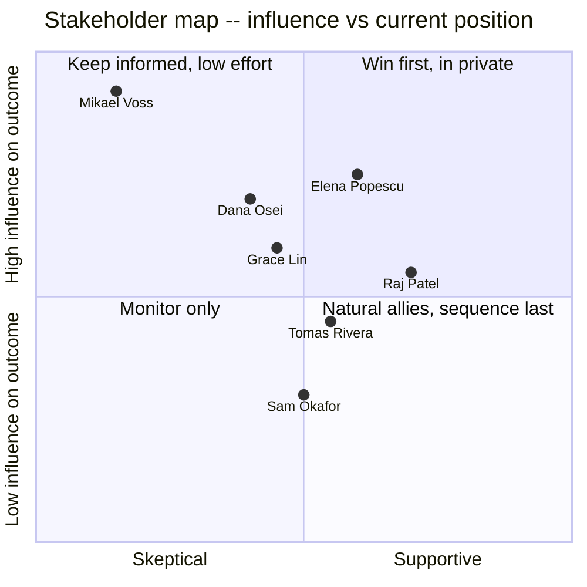
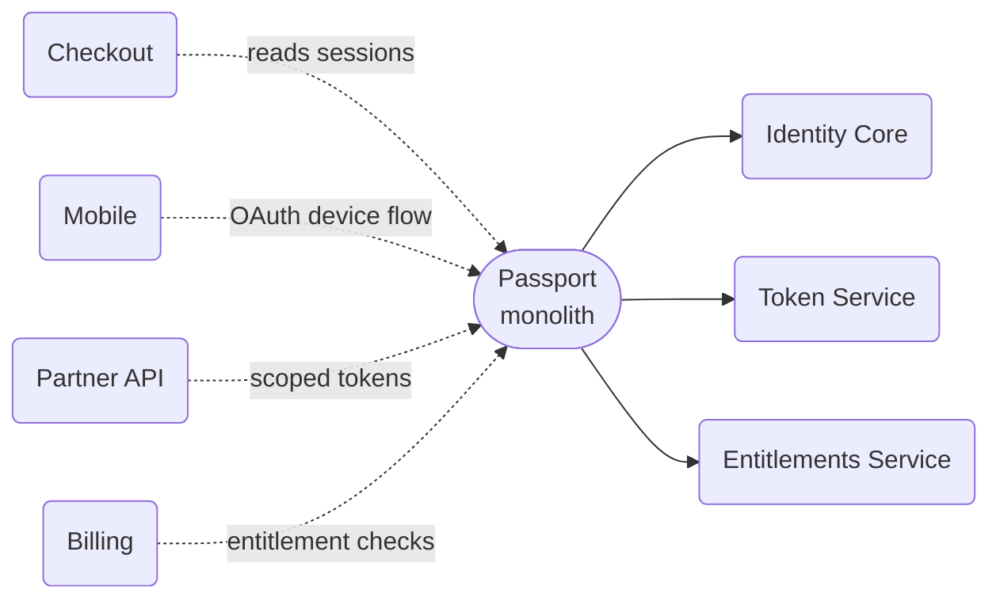

# Getting a Migration Approved

## Intuition

> **One-line analogy**: A design doc is not a proposal until the people who can say no
> have already told you what would make them say yes.

**Mental model.** The canonical staff-engineer problem is not technical. The plan is
usually obvious to anyone who reads it carefully — split the monolith, add the queue,
retire the legacy path. What is not obvious is how to get four teams who do not report to
you, one of whom actively distrusts the idea, to move in the same direction on the same
quarter. The RFC document is not the persuasion mechanism. The conversations that happen
before anyone reads the RFC are the persuasion mechanism; the document just records what
those conversations already settled.

**Why it matters.** Most technically-sound migrations that stall do not stall because the
architecture is wrong. They stall because the author treated "write the RFC, post it, ask
for feedback" as the whole job, skipped the step where they find out who can block the
plan and what they actually need, and then mistook silence for agreement. Silence is not
agreement. Silence is what happens right before someone with more organizational standing
than you says no in a room you were not in.

**Key insight.** The single highest-leverage question in this entire case study is seven
words: *"What would make you say no to this?"* Asked privately, before the second draft
existed, to the one person most likely to sink it. It is not a trick question and it is
not adversarial — it is the fastest way to convert a vague objection into a concrete
design requirement you can actually satisfy.

---

## 1. Situation & Stakes

Solstice Systems is an online platform for live-event ticketing — concerts, sports,
theater — serving roughly 40 million monthly active users across web and a native mobile
app. Since 2019, a single service called **Passport** has owned everything related to
identity: the user record store, session-token issuance and validation, and per-account
entitlement flags (subscription tier, partner scopes, fraud holds). Passport was built by
**Mikael Voss**, now a Senior Staff Engineer on the Checkout team, back when Solstice had
40 engineers and one identity service made sense.

By early 2026, Passport is called by four teams at very different rates: **Checkout**
(session validation on the payment path, roughly 55% of Passport's query volume),
**Mobile** (OAuth device-code flow for the native app, roughly 20%), **Partner API**
(scoped API tokens for ticket-resale and box-office partners under contractual SLAs,
roughly 15%), and **Billing** (subscription-tier entitlement checks, roughly 10%). All
four read and write to the same Postgres cluster through the same service, which means a
schema change for any one team's use case is a deploy risk for all four.

That risk stopped being theoretical on **January 14, 2026**. A Passport deploy added a
`NOT NULL` column to the `sessions` table without a default value. On Postgres, that
migration takes an `ACCESS EXCLUSIVE` lock for the duration of the table rewrite. On a
table with 40 million rows, that was 90 seconds. For those 90 seconds, every session
validation call across all four teams returned a 502. Checkout's payment flow was mid-lock
for the worst of it: **14,000 failed checkout attempts**, of which most retried
successfully within the hour but roughly **$60,000 in ticket sales did not come back**
(Solstice's post-incident finance estimate, against a gross at-risk figure of $380,000 had
none of it recovered). The postmortem's top action item was "Passport's blast radius is
four teams' worth of unrelated traffic sharing one migration risk," which is the sentence
that gave **Priya Raghavan**, Staff Engineer in the Core Infra / Platform org, the mandate
to propose splitting it.

See [Design Docs, RFCs & ADRs](../design_docs_rfcs_and_adrs/design_docs_rfcs_and_adrs.md)
for the document mechanics this case study assumes, and
[Influence Without Authority](../influence_without_authority/influence_without_authority.md)
for the underlying model of why the pre-wire conversation in §4.3 works. Priya is not on
any of the four consumer teams. She reports to **Raj Patel**, Director of
Platform Engineering. She has no authority to tell Checkout, Mobile, Partner API, or
Billing to change how they call Passport — every one of those changes has to be a decision
those teams' engineering managers make, and the person whose technical judgment carries
the most weight among them, Mikael Voss, is on record as skeptical of exactly this kind of
split. This case study is about how that mandate turned into an approved, scheduled,
four-team migration plan — and how it did not, the first time.

---

## 2. The People and What Each One Wants

| Person | Role | Stake | What they actually want |
|---|---|---|---|
| Priya Raghavan | Staff Eng, Core Infra / Platform | Owns the proposal | A migration that ships without becoming her full-time job for a year |
| Raj Patel | Director, Platform Engineering | Priya's manager | Confidence this won't blow up in a way that lands on him |
| Mikael Voss | Senior Staff Eng, Checkout | Built the original Passport; most technically credible skeptic | Not to be the guinea pig again, and proof the failure modes he remembers are actually handled |
| Dana Osei | EM, Checkout | Owns Mikael's team's roadmap | Not to be told about a decision that affects her team's Q3 by someone who skipped her |
| Tomás Rivera | EM, Mobile | Smallest ask, least political weight | A clear, bounded scope of work with a date, nothing more |
| Grace Lin | EM, Partner API | Contractual SLAs with external partners | Zero-notice-window changes to token issuance; anything else needs lead time |
| Sam Okafor | EM, Billing | Lowest Passport usage, lowest urgency | This to not become his team's problem before his own OKRs are done |
| Elena Popescu | VP Engineering | Cross-team tie-breaker if it comes to that | Not to be the tie-breaker; wants this resolved at the EM layer |

Mikael is the pivotal node not because he has formal authority over the other three
teams — he does not — but because Dana defers to his technical judgment, and the other
three EMs will quietly wait to see what Checkout does before committing their own teams.
Convincing Mikael is most of convincing everyone.



*Mikael sits alone in the top-left: high influence over the outcome, and, as of the first
RFC, actively unconvinced. Everyone else's position moves in relation to his — which is
exactly why the pre-wire conversation targets him specifically, not the group.*

---

## 3. The Approach

The plan itself was not the hard part. Passport splits cleanly along its three concerns:
a record store for identity, a service for issuing and validating short-lived tokens, and
a service for entitlement lookups. The hard part was sequencing the conversations so that
by the time anyone read a document, the outcome was no longer in doubt.



*Before: four teams share one deploy risk. After: each team's traffic hits the service
that owns its concern, and a schema change to entitlements can no longer lock the table
Checkout reads on the payment path.*

Priya's approach, in order, once she reset after the first draft died:

1. Write nothing publishable yet. Talk to Raj first — not for permission, for airtime and
   a read on how much political capital this was worth spending.
2. Find the one conversation that would make or break everything else: Mikael.
3. Ask him what would make him say no, not what he thinks of the idea in the abstract.
4. Change the design where his objections were real engineering risk, not preference.
5. Only then write the second RFC — with his preferred alternative addressed by name, a
   migration plan with a rollback per team, and an explicit decision date.
6. Talk to the remaining three EMs in the order their risk profile demanded, each
   already knowing Mikael was coming around.
7. Bring Elena in last, as a sponsor for the decision meeting, not as a judge of the
   design.

---

## 4. The Artifacts and Conversations

### 4.1 The first RFC — posted February 2, 2026, and why it died

Priya wrote this alone over a weekend and posted it to `#eng-rfcs` on a Monday morning
with no prior conversations. It is reproduced here in full because the shape of its
failure is the lesson, not just its outcome.

```text
RFC: Decompose Passport into Identity Core, Token Service, and
     Entitlements Service
Author: Priya Raghavan
Status: Draft
Posted: 2026-02-02

## Background

Passport currently serves three logically distinct concerns from one
Postgres cluster and one deployable service: user identity records,
session token issuance/validation, and per-account entitlements. The
proposed architecture separates these into three services:

- Identity Core: owns the `users` table and credential storage. Exposes
  a gRPC API for lookups and mutations. Backed by its own Postgres
  instance, replicated from the current Passport primary during
  migration.
- Token Service: owns session and OAuth token issuance/validation.
  Stateless where possible; token state cached in Redis with a Postgres
  fallback for revocation lists.
- Entitlements Service: owns subscription tier and partner scope flags.
  Reads from Identity Core via event stream (Debezium CDC off the
  `users` table) to stay in sync without a synchronous dependency.

Each service gets its own deploy pipeline, its own on-call rotation
within Platform, and its own schema migration process, decoupled from
the other two.

## Proposed Architecture

[diagram: three boxes, arrows to four consumer teams]

The Token Service is the most latency-sensitive of the three, since
Checkout calls it synchronously on the payment path. We will run it
behind the same load balancer tier Passport currently uses, with a
regional read replica in each of our three deploy regions to keep p99
latency comparable to today.

Identity Core becomes the source of truth for the `users` table and the
only service permitted to run DDL against it going forward. This should
substantially reduce the deploy-risk blast radius that caused the
January 14th incident, since a migration to, say, the entitlements
schema would no longer share a lock domain with session validation.

Entitlements moves to an eventually-consistent model fed by CDC, which
does introduce a small propagation delay (typically under 2 seconds)
between an entitlement change and it being visible to Billing's checks.
We believe this is acceptable given Billing's current polling interval
is already 60 seconds.

## Why

This addresses the blast-radius problem from the January incident and
sets us up to scale each concern independently as we grow.

## Feedback

Let me know if you have any feedback! Happy to set up time to discuss
if useful.
```

**Why this failed**, precisely: it opens with the design before establishing the stakes
or the ask, so a reader has to get through two full sections before learning why any of
this matters to them. It has no **Non-Goals** section, so nobody reading it knows what is
explicitly out of scope — Mikael's first assumption, reasonably, was that this also meant
rewriting Checkout's session-validation client, which was never the plan. It never states
a decision date or names who the decision-makers are. And it closes with "any feedback,"
which is an invitation to comment, not a request for a decision — nobody feels compelled
to respond by a deadline to an open-ended question.

Three comments came in over the following ten days. Two were minor questions about the
CDC lag figure. The third was Mikael's:

```text
Mikael Voss  Feb 4, 10:41 AM
We tried something close to this in 2021, before Passport was one
service -- splitting session storage out from the user table caused
more incidents that quarter than it fixed, mostly cache-invalidation
races between the two stores. I'd want to understand what's different
this time before I could get behind it. Also not clear from this doc
what happens to Checkout's client code, or on what timeline -- "each
service gets its own deploy pipeline" is doing a lot of work in one
sentence.
```

Nobody replied to Mikael's comment for six days, and when Priya did reply it was a
one-line acknowledgment ("good point, let me think about the cache invalidation piece")
that did not resolve anything. No decision was requested, no date existed to force one,
and the thread went quiet. **The RFC sat untouched from February 16 to April 20 — eleven
weeks — with zero forward motion.**

### 4.2 The reset and the stakeholder order

On April 20, Priya and Raj agreed the first attempt was dead and needed a different
approach, not a third comment reply. The order they picked, and why:

1. **Raj Patel** (Apr 21) — realign on priority and get explicit air cover to spend the
   next two weeks on conversations instead of code.
2. **Mikael Voss** (Apr 22, morning) — the pre-wire. Everything downstream depends on
   this one going well.
3. **Dana Osei** (Apr 22, afternoon) — brief her before Mikael mentions it to her
   first, and confirm Checkout's roadmap has room in Q3.
4. **Grace Lin** (Apr 23) — Partner API has contractual notice-window obligations;
   she needs the longest lead time of the remaining three.
5. **Tomás Rivera** (Apr 23) — smallest, most bounded ask; a fifteen-minute sync.
6. **Sam Okafor** (Apr 24) — lowest usage, lowest urgency, talked to last.
7. **Elena Popescu** (Apr 24, end of day) — brought in last, as a sponsor to put the
   decision meeting on the calendar, not to adjudicate a design that was already settled.

### 4.3 The pre-wire conversation with Mikael — transcribed in full

Fifteen-minute 1:1, booked by Priya as "Passport split — want your read before I write
anything else," on Mikael's calendar, not a group meeting.

```text
Priya: Thanks for making time. I want to be upfront about why I'm here --
       the RFC I posted in February didn't move, and I think that's on
       me, not on the idea being wrong. Before I write another draft I
       want to understand what would actually make you say no to this,
       so I'm not guessing.

Mikael: Fair. Two things, and they're not the same weight. The smaller
        one: in 2021 we split session storage out of the user table and
        it caused a string of cache-invalidation races -- a session
        would get revoked, the cache wouldn't know for up to 40 seconds,
        and a logged-out user could still complete a purchase. We rolled
        it back after three weeks. If this is the same shape of split, I
        want to know specifically what's different.

Priya: It's not identical -- the 2021 split kept both stores under the
       same service, which is what let the races happen; nobody owned
       the invalidation contract end to end. This time Token Service
       owns revocation as a synchronous write path, no cache-then-DB
       gap on revoke specifically. But I take the point that "we
       thought about it more" isn't a proof. What would convince you --
       a design walkthrough of the revocation path specifically, or
       something else?

Mikael: A walkthrough would help, and I'd want to see it hold up against
        the actual 2021 postmortem, not just against my memory of it.
        Second thing, and this one's bigger: whatever the design is, I
        do not want Checkout to be first. We were the team that ate the
        January incident. If there's a migration bug, I want it to
        surface on Partner API's traffic before it surfaces on a payment
        path with real money moving through it.

Priya: That's reasonable and honestly I hadn't sequenced it explicitly
       at all in the first draft -- that's a real gap. If I commit to
       Checkout being last, with everyone else's cutover clean first,
       does that resolve it?

Mikael: Mostly. I'd also want an explicit rollback per team, not one
        rollback plan for the whole migration -- if Partner API's
        cutover goes wrong I don't want that blocking or getting
        conflated with whether Checkout's cutover is safe.

Priya: Per-team rollback, Checkout sequenced last, and I'll pull the
       2021 postmortem and walk the revocation path against it
       specifically in the next draft. Anything else that would be a
       hard no for you, or is that the list?

Mikael: That's the list. If those three things are actually in the
        doc -- not just said in this conversation -- I'll say so on
        the thread, and that'll carry weight with Dana.

Priya: That's exactly what I was hoping to hear. I'll send you the
       draft before I post it widely, not after.
```

Two genuine objections came out of this, and both changed the design, not just the
messaging: **(1)** the revocation path needed an explicit synchronous-write contract
between Token Service and its cache, walked through against the specific 2021 failure
mode, not asserted away; **(2)** the migration needed to be sequenced with Checkout
strictly last and a rollback plan scoped per team rather than one plan for the whole
program. Neither was in the first draft. Both are in the second.

### 4.4 The second RFC — posted April 27, 2026, in full

```text
RFC: Decompose Passport into Identity Core, Token Service, and
     Entitlements Service (v2)
Author: Priya Raghavan
Status: Requesting decision
Posted: 2026-04-27
Decision requested by: 2026-05-06, decision meeting on calendar

## Ask

I am requesting approval to split Passport into three services --
Identity Core, Token Service, Entitlements Service -- migrated one
consumer team at a time over Q3, in the order Partner API, Billing,
Mobile, Checkout. Decision needed by May 6 to hold the Q3 planning
slot in all four teams' roadmaps.

## Why now

The January 14th incident locked the `sessions` table for 90 seconds
during a routine schema change, causing 14,000 failed checkout
attempts and an estimated $60K in unrecovered revenue. All four
consumer teams currently share this single point of migration risk.
This RFC is Platform's response to that postmortem's top action item.

## Non-Goals

- This does NOT require any consumer team to change its client-facing
  API contract. Checkout, Mobile, Partner API, and Billing continue
  calling the same method signatures they call today; only the service
  behind those calls changes.
- This does NOT touch fraud-hold logic, which stays in Entitlements
  unchanged from its current Passport implementation.
- This is NOT a rewrite of authentication itself -- password hashing,
  MFA, and OAuth scopes are unchanged.

## Alternatives considered

**1. Harden Passport in place** (Mikael's preferred starting position).
Add staged/online schema migration tooling (e.g., `pg_repack`-style
rebuilds, or Postgres native online DDL where the column allows a
default) so future migrations don't take an ACCESS EXCLUSIVE lock on
the whole table. This is real and worth doing regardless of the split
-- we are doing it as a stopgap in May, independent of this RFC's
timeline -- but it does not address that four unrelated teams' traffic
still shares one deploy pipeline and one on-call rotation. A bad
Entitlements deploy can still take down Checkout's session validation
even with perfect migration tooling. We're recommending both: harden
now, split over Q3.

**2. Split into two services instead of three** (Identity+Entitlements
combined, Token separate). Considered and rejected -- Entitlements'
read pattern (CDC-fed, eventually consistent, high read volume from
Billing) is different enough from Identity Core's (strongly consistent,
low volume, security-sensitive writes) that combining them reintroduces
a version of the same coupling problem one layer down.

## Revocation path, walked against the 2021 postmortem

The 2021 split kept session cache and session store under one service
with no single owner of the invalidation contract; a revoke could
land in the DB before the cache entry expired, and a stale cache read
during that window let a revoked session complete a purchase. In this
design, Token Service is the sole owner of both the cache and the
store, and revoke is a synchronous dual-write: the cache entry is
invalidated in the same request that writes the revoke to Postgres,
before the response returns. A cache read that races the write can
only see "not present" (safe, forces a store lookup) never "present
but stale." We will load-test this specifically against the 2021
failure's traffic pattern before Checkout's cutover.

## Migration plan

Order: Partner API -> Billing -> Mobile -> Checkout, one team at a
time, each with a two-week dual-write shadow period before cutover.

For each team:
1. Team's calls dual-write to old Passport and new service; reads
   still come from Passport.
2. After 3 days of dual-write with zero discrepancy alerts, reads
   switch to the new service; writes continue dual-writing to old
   Passport for a further 7 days as a rollback safety net.
3. After 7 clean days, old-Passport writes for that team's traffic
   stop. That team's migration is complete.

## Rollback (per team, not per program)

Any team can roll back to step 1 or 2 independently at any point in
its own migration without affecting another team's progress or
requiring the whole program to pause. Rollback trigger: any
discrepancy alert between old and new stores, or p99 latency
regression of more than 15% sustained for 10 minutes.

## Decision requested

Approve this plan and this sequencing by May 6, or tell us what
would change your answer. Decision owners: Dana Osei, Tomas Rivera,
Grace Lin, Sam Okafor, Mikael Voss (technical sign-off), Raj Patel
(sponsor).
```

### 4.5 Review comments and how each was triaged

| From | Comment | Triage |
|---|---|---|
| Mikael Voss | "Revocation section holds up against what I remember of 2021. Want to see the load test results before Checkout's cutover specifically, not before the RFC is approved." | Accepted as a gate on step 4 of Checkout's migration, not on the RFC itself — noted in the doc as a named checkpoint. |
| Grace Lin | "Partner contracts require 30 days' notice for anything touching token issuance. Two-week dual-write shadow isn't the same as notice — can we start Partner API's shadow period 30 days after their EM sign-off, not 30 days after this RFC?" | Accepted; migration plan amended to start Partner API's clock from Grace's sign-off date, not the RFC's approval date. |
| Tomás Rivera | "Device-flow tokens have a 90-day TTL, way longer than session tokens. Does the dual-write window need to be longer for us to catch a discrepancy that only shows up near expiry?" | Accepted; Mobile's dual-write window extended to 21 days with an explicit near-expiry test case added. |
| Sam Okafor | "Can Entitlements expose a batch lookup? We currently do 40 sequential single-record calls per billing run and that's already slow against Passport." | Out of scope for this RFC, logged as a fast-follow ticket Entitlements picks up in the sprint after Billing's cutover. |
| Dana Osei | "No objection to the design. Confirming Checkout has capacity in Q3 for our slice, contingent on being last per what Mikael already told me." | Not a design change — confirms sequencing already agreed in 4.3. |

Every comment got a stated resolution in the thread within two business days. None sat
unanswered the way Mikael's February comment had.

### 4.6 The decision meeting — May 6, 2026, twenty minutes

```text
Raj:    Everyone's had the doc since the 27th and the comment thread's
        resolved. Mikael, your sign-off is the one this hinges on --
        where are you?

Mikael: I'm good. Sequencing's right, revocation design holds up, and
        I've got the load test as a named gate before our cutover,
        which is what I asked for. Approve.

Dana:   Checkout's in for Q3, last in the order, no objection.

Grace:  Approved contingent on the 30-day notice clock starting from my
        sign-off, which is already in the doc. We're good.

Tomas:  Approved.

Sam:    Approved. Batch lookup ticket is filed separately, not blocking.

Elena:  Then this is decided. Priya, Raj -- send the confirmed dates to
        all four EMs today so it's on the record, and flag me directly
        if sequencing slips.
```

There was nothing left to decide by the time this meeting happened. Every substantive
disagreement had already been resolved in a 1:1 or in a threaded comment with a stated
triage. The meeting's only job was to make the decision official and put dates on a
shared calendar.

### 4.7 The team that agreed and then did not do the work

Sam Okafor's team signed off on May 6 and committed to starting Billing's dual-write phase
by June 1, second in the sequence after Partner API. By **July 15** — six weeks past that
commitment — Billing had not opened a single pull request against the dual-write
integration. Partner API had completed its cutover cleanly on June 20 and Mobile was
queued to start, but the program's public sequencing (Partner API, Billing, Mobile,
Checkout) meant Mobile's team was waiting on a green light that implicitly depended on
Billing not being mid-migration when Mobile started, to keep the shadow-alerting signal
clean per team.

```text
Priya (Slack, Jul 15): Sam -- checking in on Billing's dual-write PR,
                        I don't see anything opened yet against the plan
                        from May. Is something blocking that I should
                        know about?

Sam (Jul 15): Yeah, sorry -- this fell behind our Q3 entitlement-tier
              redesign, which landed on my team the same week as the
              RFC approval and I didn't flag the conflict when I said
              yes in the meeting. I don't have headcount to do both
              this quarter.

Priya (Jul 15): Understood, and I'd rather know now than in September.
                Can I bring this to Raj and Elena as a resourcing
                question rather than a commitment question? This isn't
                you not delivering, it's two real priorities landing on
                one team.

Sam (Jul 15): Yes, please. I'd rather it go that route than have me
              keep saying "next sprint" for another month.
```

Priya and Raj raised it as a three-week resourcing gap, not a broken promise, in the next
leadership sync. Elena approved lending one engineer from Partner API's now-freed capacity
to Billing for three weeks. Billing's dual-write phase started July 22 and completed
August 22 — three weeks later than the original plan, fully absorbed without slipping
Mobile's or Checkout's dates, because the slack had been reserved rather than assumed.

---

## 5. Decisions & Tradeoffs

| Decision | Alternative rejected | Why |
|---|---|---|
| Split into three services (Identity, Token, Entitlements) | Two services, Identity+Entitlements combined | Entitlements' eventually-consistent CDC read pattern doesn't belong on the same consistency model as Identity's security-sensitive writes |
| Checkout migrates last | Migrate Checkout first, since it's the largest and most urgent | Mikael's core objection; a migration bug should surface on lower-stakes traffic first |
| Per-team rollback, not one program-wide rollback | Single rollback plan for the whole migration | A bad cutover on one team shouldn't block or cast doubt on another team's already-clean migration |
| Harden Passport in place AND split it | Split only, treat hardening as redundant | The stopgap protects the teams still on old Passport during the months before their cutover |
| Dual-write shadow period scaled per team's token TTL | One fixed shadow-period length for all four teams | Mobile's 90-day device tokens need longer to surface near-expiry discrepancies than Checkout's short-lived sessions |
| Billing's slip handled as a resourcing conversation | Escalate as a missed commitment | The actual cause was a resourcing conflict Sam should have flagged at sign-off, not an engineering failure — naming it correctly kept the fix (borrow an engineer) matched to the actual problem |

---

## 6. Real-World Parallels

Stripe's public engineering writing on its API-versioning and internal-service evolution
work describes a comparable discipline: never break the caller's contract, absorb the
migration cost inside the platform team instead of pushing it onto every consumer. That
maps directly onto this RFC's Non-Goals section — "no consumer team changes its
client-facing API contract" was a deliberate design constraint, not an afterthought, for
exactly the reason Stripe gives: it removes the "what does this cost my team" question
from every downstream EM's calculus before they even read the migration plan.

Google's internal large-scale-change (LSC) tooling, described in Winters, Manshreck, and
Wright's *Software Engineering at Google* (O'Reilly, 2020), formalizes per-callsite,
independently-revertible migrations at a scale where "roll back the whole migration" is
never an option — thousands of call sites cannot fail atomically. The per-team rollback
plan in this RFC is a small-scale version of that same principle: isolate blast radius per
migrating unit so one failure doesn't force a decision about everyone else's progress.

Will Larson's *Staff Engineer: Leadership Beyond the Management Track* (2021) names the
pre-wire explicitly as a staff-engineer technique — circulate the idea privately with the
people most likely to have objections before the document exists in a form anyone else
can react to, specifically so objections become design inputs instead of public
relitigating. Mikael's two objections becoming migration-plan requirements, rather than
comment-thread arguments, is that technique executed.

---

## 7. Frameworks Applied

**Disagree and commit** (a term popularized by Andy Grove and used extensively at Amazon,
described in Amazon's published leadership principles) governed the decision meeting
itself: nobody in that twenty-minute meeting was being asked to newly agree with the
design — they had each already worked through their specific objection in a 1:1 or a
threaded comment. The meeting's function was to make a private set of individual
agreements into one public, dated commitment.

**The pre-wire** is not a named academic framework so much as a documented staff-engineer
practice (see Larson above); its mechanism here is straightforward — surface the highest-
influence skeptic's real objections in a setting with no audience, so they can be
precise about what would change their mind without also managing how it looks to defend a
position in front of peers.

**Stakeholder mapping by influence and position**, shown in §2's quadrant chart, is the
standard project-management technique of separating "how much does this person's opinion
move the outcome" from "what is their opinion today" — the combination is what tells you
whom to talk to first, not just whom to talk to.

---

## 8. Playbook

1. Before writing anything, identify the one or two people whose objection alone could
   sink the plan, independent of formal authority. Mikael had none over the other three
   teams and was still the pivotal conversation.
2. Talk to that person privately, first, and ask the direct question: what would make you
   say no? Do not ask "what do you think" — that invites a broad reaction instead of a
   specific, addressable requirement.
3. Change the design where the objection is real engineering risk. Do not just reword the
   document to sound more persuasive around an unaddressed risk.
4. Write the second draft with an explicit ask, a decision date, a Non-Goals section, and
   named decision-owners. If nobody is named as needing to decide, nobody will.
5. Sequence the remaining conversations by how much each person's buy-in depends on the
   pivotal person's — talk to the ones who will defer to the skeptic after the skeptic,
   not before.
6. Bring in an executive sponsor last, to put a decision meeting on the calendar, not to
   settle a design disagreement that should already be settled.
7. Expect at least one team to agree in the room and then not deliver. Diagnose why before
   escalating — a resourcing conflict and a broken commitment need different responses.

---

## 9. What Went Wrong & What It Cost

**The first draft cost eleven weeks of pure calendar time with zero forward motion** —
posted February 2, effectively dead after the last un-actioned comment on February 16,
and not revisited until April 20. Nothing about the underlying technical plan changed in
that window; the only difference between a dead RFC and an approved one was whether the
pivotal skeptic's objections had been converted into design requirements before anyone
else was asked to react to the document.

**The second attempt took fourteen calendar days from the pre-wire conversation to an
approved decision** — Mikael's 1:1 on April 22, the second draft posted April 27, review
comments resolved by May 4, decision meeting May 6. The decision meeting itself lasted
twenty minutes and settled nothing that was not already settled; every substantive
disagreement had been resolved in a 1:1 or a threaded comment with a stated triage before
anyone sat down in that room.

**Billing's slip cost three additional weeks** inside the post-approval migration
timeline (June 1 committed start, July 22 actual start, August 22 completion versus a
would-have-been August 1), fully absorbed by borrowing one engineer for three weeks rather
than by re-litigating the sequencing decision — because the underlying cause, a
resourcing conflict Sam had not flagged at the decision meeting, was diagnosed correctly
instead of treated as a broken promise.

**The full post-approval migration ran roughly four and a half months** — Partner API
complete June 20, Billing complete August 22 (three weeks late), Mobile complete August
29, Checkout complete September 19 — against zero customer-visible incidents during any
of the four cutovers, which is the actual measure of whether the per-team rollback design
worked, not just whether the RFC got approved.

---

## 10. Variations

**If Mikael had said no even after the pre-wire.** The plan would not have gone to a
second RFC in that form. Priya's fallback, discussed with Raj beforehand, was to propose
a smaller first slice — migrate only Partner API and Billing, the two lowest-risk
consumers, as a bounded pilot with its own decision gate before committing Mobile or
Checkout to anything. A skeptic who cannot be moved on the whole plan can sometimes still
agree to a pilot that gives him evidence instead of assurances.

**If there had been no January incident.** The RFC would have needed a different Non-
Goals-adjacent section entirely: a cost-of-inaction argument built from something other
than a single dated event, most likely the deploy-frequency and on-call-load data across
the four teams sharing Passport's rotation, since "this could happen" persuades far less
than "this happened, here is what it cost."

**If Elena had been brought in first instead of last.** This is the most common way this
kind of migration actually fails in practice: an executive sponsor announces support for
a plan before the technical skeptics have been won over, which reads to Mikael and Dana as
the decision being made over their heads regardless of the actual merits — and converts a
technical disagreement into a status fight about whether their judgment was consulted at
all.

---

## 11. Interview Discussion Points

**Q: Tell me about a time you got a technical decision approved across multiple teams that didn't report to you.**
**Short:** Won over the most influential skeptic in a private 1:1 before writing the version everyone else would read.
The strongest version of this answer names the specific objection you didn't have an
answer for going in, and what changed in the design because of it — not just that you
"communicated well" or "built alignment." Interviewers are listening for whether the plan
actually changed, or whether you just got better at describing the same plan. Use a
concrete example like a pre-wire conversation that surfaced a real engineering
requirement, not a vague claim about socializing an idea.

**Q: What do you do when a design doc you posted gets no engagement?**
**Short:** Treat silence as unresolved risk, not agreement, and go find out privately why nobody engaged.
Silence after a design doc almost never means people read it and agreed — it usually means
either nobody with a real stake has read it carefully, or someone has an objection they
have not bothered writing down because there is no forcing function to make them. The fix
is not to wait longer or post a reminder; it is to go find the person most likely to have
an unstated objection and ask them directly what would change their answer.

**Q: How do you handle a stakeholder who is skeptical of your plan for good technical reasons?**
**Short:** Ask what would make them say no, then change the parts of the design their answer exposes as real risk.
Treat their skepticism as free risk analysis rather than an obstacle to route around.
Mikael's 2021 cache-invalidation history was a real prior failure, not an excuse, and the
design that resulted — synchronous dual-write on revoke — was better than what would have
shipped without his objection. The mistake to avoid is addressing the tone of the
objection instead of its content.

**Q: How did you decide the order to talk to people in?**
**Short:** Talked to the person whose objection would sink everything first, then to whoever defers to that person.
Map influence over the outcome separately from current position — someone with low
influence and high enthusiasm doesn't need convincing, and someone with high influence and
quiet skepticism needs to go first regardless of formal seniority. Dana deferred to
Mikael's technical judgment even though she outranked him organizationally, so talking to
her before him would have wasted the conversation.

**Q: What's the difference between the two RFC drafts that actually mattered?**
**Short:** The second named a decision date and decision-owners; the first only asked for open-ended feedback.
The technical content changed too — the revocation design and the migration sequencing —
but the structural difference that made the document actionable at all was that it stated
who needed to decide and by when. "Any feedback welcome" produces comments; "decision
requested by May 6, decision owners named" produces a decision.

**Q: How do you write a Non-Goals section, and why does it matter?**
**Short:** State explicitly what the proposal will not change, because unstated scope gets assumed as worst-case.
Readers who are not deeply familiar with your plan will assume the broadest possible
interpretation of what it touches unless you rule it out explicitly. Mikael's first
assumption from the vague first draft was that client code would need to change; the
second draft's Non-Goals section removed that assumption in one line instead of leaving
it to be discovered — or feared — later.

**Q: A team agreed to a migration plan and then didn't deliver their part. What do you do?**
**Short:** Diagnose whether it's a resourcing conflict or a broken commitment before deciding how to escalate.
Ask directly and early rather than letting the slip compound silently for months. Sam's
team had a genuine competing priority he hadn't flagged at sign-off, which is a
resourcing question for leadership to solve with capacity, not a performance conversation
— escalating it as the wrong kind of problem would have damaged the relationship for no
benefit.

**Q: Why sequence the riskiest team last instead of first?**
**Short:** Let a migration bug surface on lower-stakes traffic before it ever touches the highest-stakes path.
Checkout carried real payment traffic and had already absorbed one incident from
Passport's shared blast radius; putting it last meant three other teams' clean cutovers
were proof the design worked before Checkout's team had to trust it with money moving
through it. This is also usually the concession that costs the least to grant and buys the
most trust.

**Q: How do you keep a multi-team migration from becoming an open-ended program with no end date?**
**Short:** Give every team an explicit rollback trigger and a dated cutover sequence instead of an open migration window.
An open-ended "migrate when ready" plan lets the lowest-priority team's timeline become
the whole program's timeline, exactly as it briefly did with Billing. Naming the trigger
conditions and a specific order up front means a slip on one team is visible and
addressable immediately instead of discovered in a retrospective.

**Q: What would you have done differently if the executive sponsor had come in first?**
**Short:** Would have lost the technical skeptics' trust, since it reads as the decision being made over their heads.
Bringing in top-down authority before the technical stakeholders have engaged converts a
design disagreement into a status fight — the skeptic stops evaluating the plan and starts
evaluating whether their judgment was bypassed, which is a much harder thing to repair
than a technical objection.

**Q: How do you decide what to compromise on versus what to hold firm on when a stakeholder pushes back?**
**Short:** Concede on sequencing and process readily; hold firm only on things that would reintroduce the original risk.
Priya conceded immediately on Checkout-last and per-team rollback, both process
decisions with no downside to the platform team, but did not concede on doing the split at
all, which was the thing the RFC actually existed to accomplish. Cheap concessions build
trust for the conversations where you cannot concede.

**Q: What's a concrete signal that a design review meeting is unnecessary as a decision-making forum?**
**Short:** Every attendee already knows their answer and it's a formality that only records the decision.
If a decision meeting is where disagreements first surface, the pre-work was skipped. The
May 6 meeting here took twenty minutes and produced no new information — every
participant had already resolved their objection in a smaller setting, and the meeting's
only function was making the outcome official and calendared.

---
